# 乘法拆小以后，为什么反而少算了一次？
## 从四块积，到 Karatsuba 的三条递归支路

算1234×5678时，最直接的办法是把每一位拿去乘另一边的每一位，再按位相加。位数各翻一倍，格子数就变成原来的四倍。这个规律很熟悉，也很容易让人误以为：要得到全部信息，四块都得分别算。

这篇文章想试一次不同的分工：不要求每块都单独拿到，只要求最终答案需要的组合拿到。乘法没被近似，某个中间结果也没被猜出来；我们只是允许加法和减法帮乘法传递信息。

先约定“长”指二进制位数或固定进制数字个数，不是整数本身的数值。一个数有n位，可能大到接近2^n；说算法花O(n²)，并不是说花O(整数值²)。下文先用十进制块手算，代码再换成二进制移位。所有实验都是本文自写程序实际产生的整数结果，不是计时跑分。

Karatsuba和Ofman的论文有1962年的出版记录。这里不讲未经核实的课堂传奇，也不把本稿说成原论文翻译。我们从自己的数例推导，并在文末交代实际读到的一手材料范围。


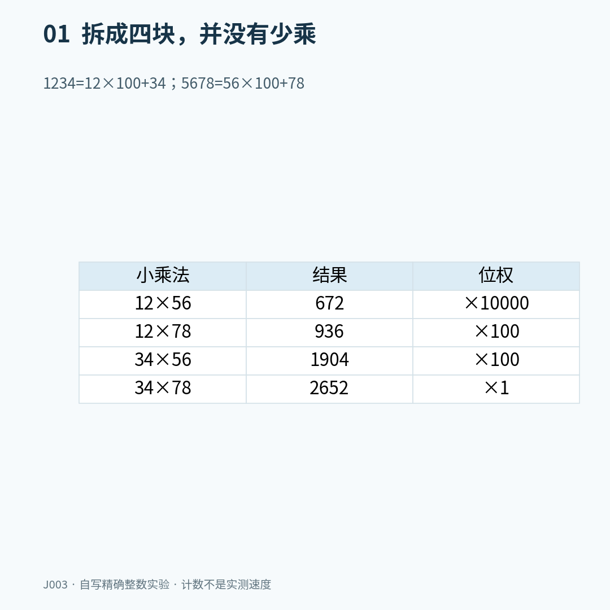
图1｜四块都乘仍需四次小乘法，两个中间块共享同一个位权100。


## 1. 拆成四块，为什么还没有省事？
把1234写成12×100+34，把5678写成56×100+78。用字母记就是：

x=aB+b，y=cB+d。

B是共同的位权；这次B=100。a、c是高块，b、d是低块。展开：

xy=acB²+(ad+bc)B+bd。

四次小乘法分别得到672、936、1904、2652。合起来是6720000+284000+2652=7006652。

注意中间括号。最终答案不需要区分936来自哪块、1904来自哪块，只需要知道它们的和2840。也就是说，我们一直在求比最终用途更多的中间信息。四块格子图让这个机会变得明显，但图的格面积不代表数值大小。


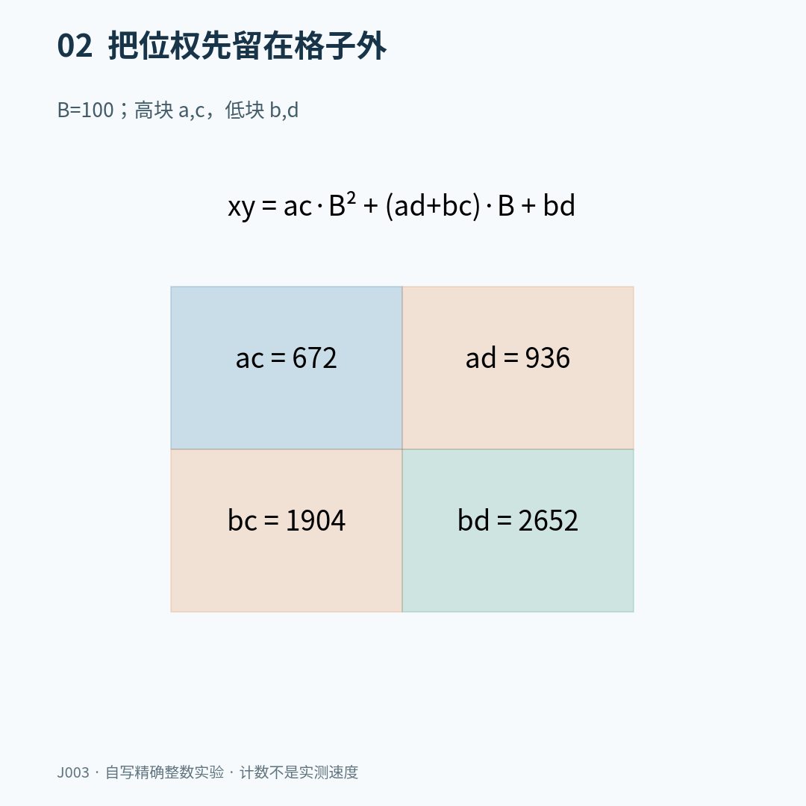
图2｜图中的格面积只是四项排布，不按数值大小；我们真正需要的是ad+bc的合计。


## 2. 多算两次加法，换掉一次乘法
先算p=(a+b)(c+d)。把它展开，会得到ac、ad、bc、bd四项。既然ac和bd已经分别算过，那么：

ad+bc=p−ac−bd。

我们的数例中，a+b=46，c+d=134，p=6164。减去672和2652，就得到2840。现在需要的乘法只有ac、bd、p三个，代价是多做几次加减。

这不是“加减不花钱”。关键在于：对长整数，加减可以逐位走一遍；长乘法通常需要更多工作。如果每一层都能把四次大任务换成三次半大任务，新增的一遍加减可能很划算。

但这里有个容易忽略的小尾巴：两个两位块相加，可能得到三位数。134就是例子。如果要严格控制递归子问题的长度，不能简单说三个子问题永远恰好一半。和形式仍然可以正确实现；下面改用差形式，是为了让位宽论证更直观，不是说和形式错误。


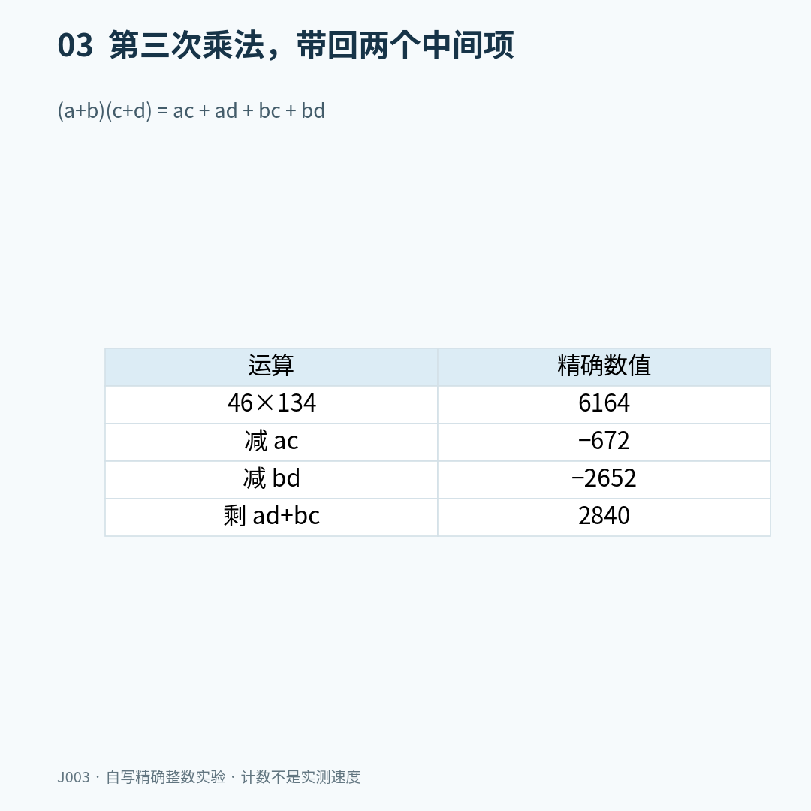
图3｜和形式用三次乘法得到中间项；46与134已不都保持原两位块的宽度。


## 3. 差形式：第三次乘法可以更“瘦”
展开另一个组合：

q=(a−b)(c−d)=ac−ad−bc+bd。

移项便得到：

ad+bc=ac+bd−q。

仍然是三个乘法：ac、bd、差与差的积。两个非负块之差的绝对值，不会超过较大的那一块；它不像两块的和那样可能额外长出一位。

在1234×5678中，两个差都是−22，q=484。因此cross=672+2652−484=2840。名字cross只是“两个交叉项的合计”，并不是新的数学对象。

递归程序只让非负数进入内部函数，所以第三个任务算的是|a−b|×|c−d|。返回后再根据两个差是否异号恢复q的正负。不要为了判符号先计算(a−b)×(c−d)：那相当于偷偷把我们刚想节省的大乘法又做了一次。附录只比较两个差与零的关系。


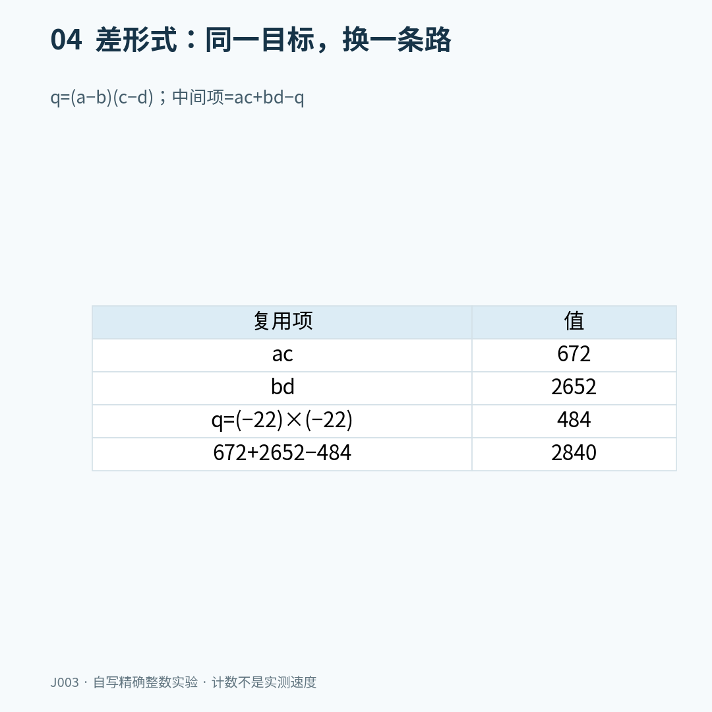
图4｜差形式复用ac与bd，第三次乘绝对差，再恢复q的符号。


## 4. 负号弄丢，算法会把正确答案拉到另一边
用一个更小的例子：3×12，取B=4。

3=0×4+3，12=3×4+0，因此ac=0，bd=0。两个差是−3和3，q应当是−9。cross=0+0−(−9)=9，最后9×4=36。

如果只记第三次乘法的绝对值9，不记符号，就会得到cross=−9和错误答案−36。这个例子也说明高块为零并不违法，输入长度不相等无需先制造一个特殊公式。

外部输入本身是负数时，我们把整个x和y先取绝对值，算完后只根据原输入符号恢复最终正负。中间差的符号与最终乘积的符号是两件事，不能合成一个“反正最后加负号”的处理。


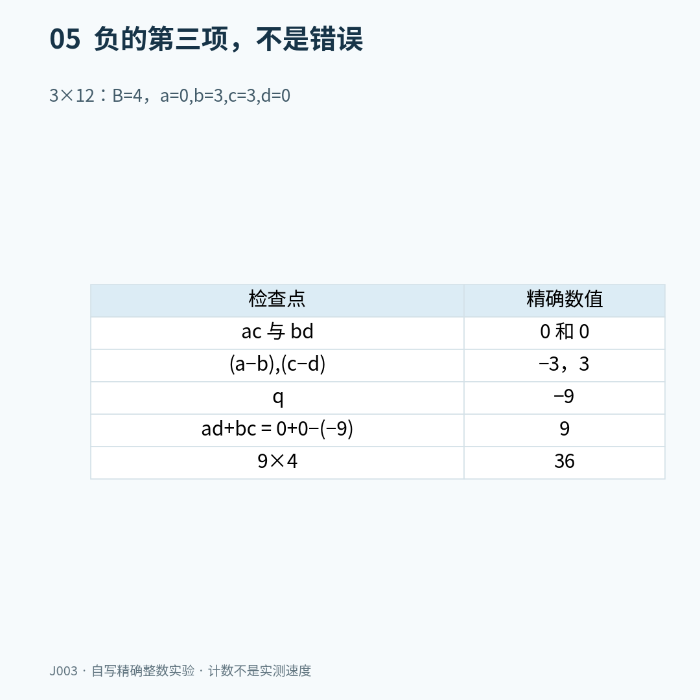
图5｜差值异号使q为负，减负数应变为加；只取绝对值会算错。


## 5. 把十进制方格换成二进制代码
代码令n=max(u.bit_length(),v.bit_length())，m=n//2，B=2^m。高块用右移m位，低块用掩码(1<<m)−1取出：

a=u>>m，b=u & (B−1)。

c、d对v采用同一m。不能让两个操作数各自用不同的B，然后仍套同一个合并式。

27和22的最大位长是5，所以m=2、B=4。它们分别拆成(6,3)与(5,2)。三个结果是30、6、9，cross=27。合并30×16+27×4+6=594。

这里高块最多3位，低块最多2位，不是硬说奇数5可以平均分成两个整数位长。Python的整数移位与加法负责位权重叠；图里显示十进制数字只是方便阅读。


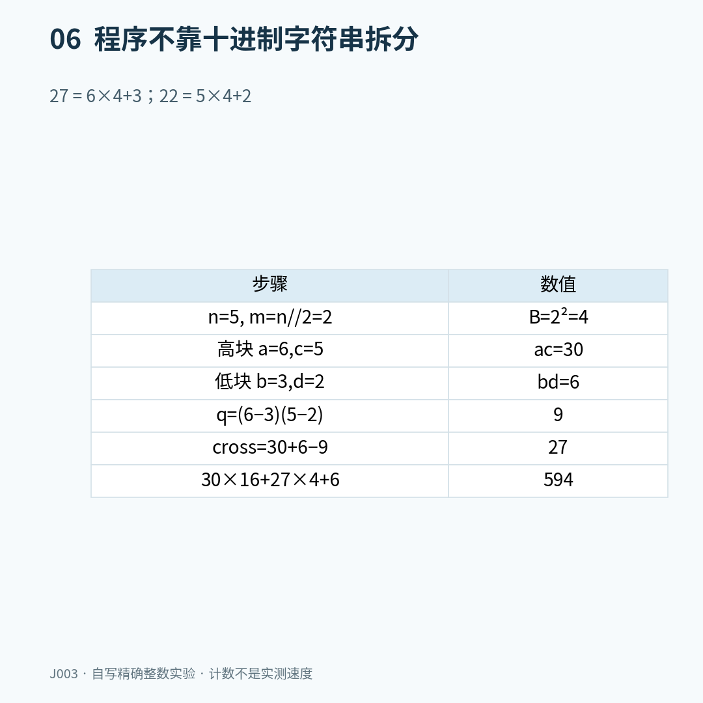
图6｜奇数位长5拆成最多3位高块、2位低块；两个操作数使用同一个B。


## 6. 一次省一点，为什么值得递归？
现在把ac、bd和绝对差的乘法也交给同一个函数。不再对每个小乘法立刻用竖式，直到它小到某个阈值。

27×22在第一层派出6×5、3×2、3×3三个子任务。子任务不是同时运行；本程序按顺序完成第一个、保存结果，再做后两个。所谓“三条支路”是依赖结构，不是并行计算承诺。

每个任务返回以后，父节点恢复q符号、得到cross、按位权合并。图7只画第一层；要知道整个执行的大小，得看真实计数，而不是把第一层的三个框读成“总共只做三次乘法”。


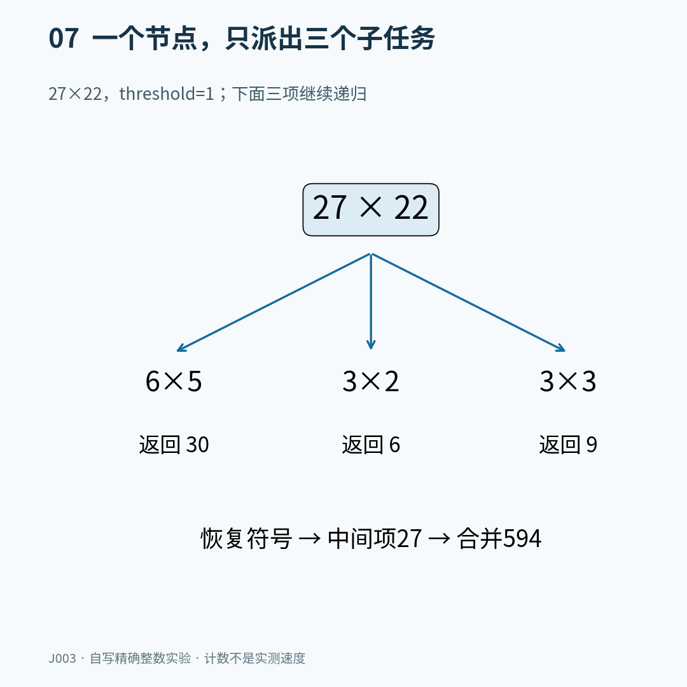
图7｜这里只画实际递归树的第一层，不把整个树伪装成三次机器指令。


## 7. 零分支，是真实树与理想树的区别
threshold=1时，只要不是零，就拆到最多一位。27×22的真实执行共有19次函数调用，其中5个非零基例用Python的乘法，8个零叶直接返回0，剩下6个节点继续拆分。三类相加正好19。

为什么不是一棵整齐的满三叉树？因为块可能是零，两个块可能相等，从而差为零；一些子问题的实际位长也比上界短。一个零叶不再派出子任务。

stats中的base_products指代码执行非零基例乘法的次数，不是CPU乘法指令次数。threshold=8的一个基例最多乘两个8位数，threshold=128的一个基例则可能乘两个128位数；把这两种“一次”直接相减来算加速比没有意义。


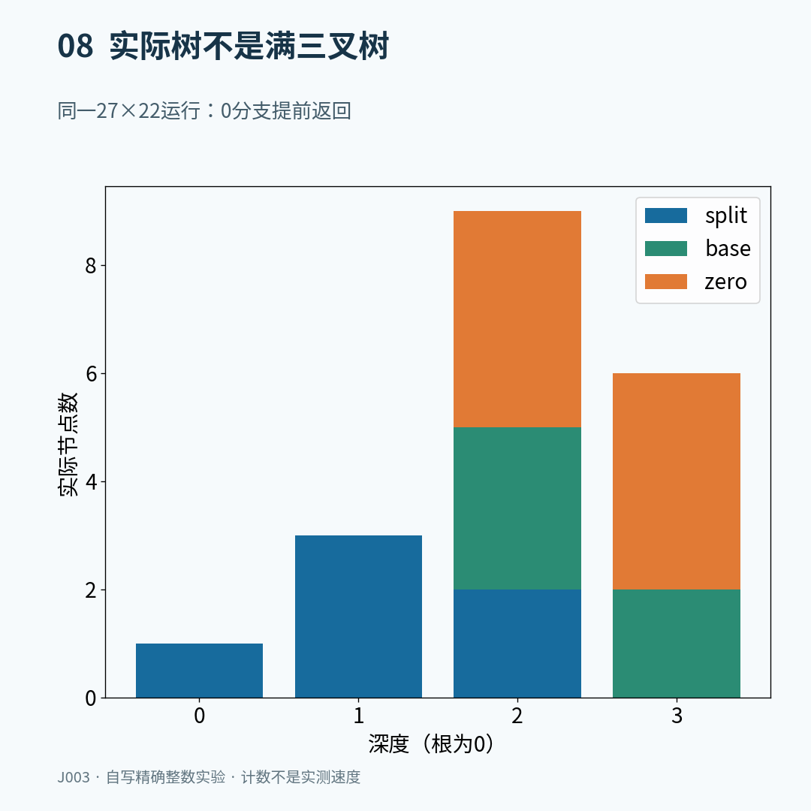
图8｜实际19次调用、5个非零基例乘法、8个零叶；层计数来自完整trace。


## 8. “块”不等于“最后一位”，进位不能靠拼接
算99×99并取B=10，ac=81，bd=81，q=0，所以cross=162。162大于B，但完全没有问题：它本来就是两个交叉项的和，不是必须落在0到9之间的单个数字。

81×100+162×10+81=9801。三个项有重叠位，普通整数加法自然完成进位。如果错误地把81、162、81当字符串直接拼在一起，得到的不是同一道运算。

这份实现依赖Python任意精度整数，不手写机器字数组的进位循环。因此它适合看清递归与代数，不等于一个完整的底层大整数库。固定宽度语言还必须处理临时加法、减法、移位的范围；不能把这份Python代码机械翻译成窄整型后声称仍然精确。


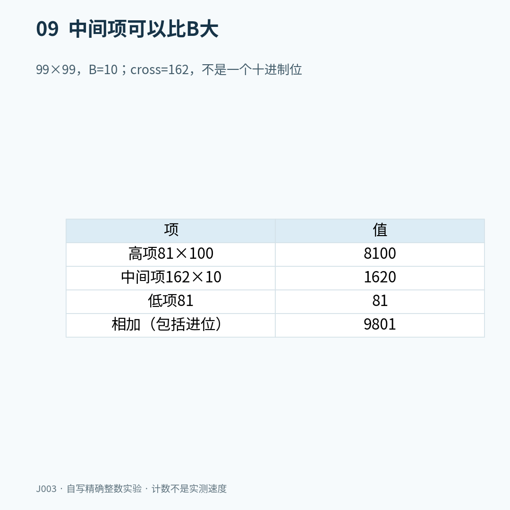
图9｜中间项不是合法单个“数字”；用整型加法完成重叠和进位，不能直接拼接字符串。


## 9. 递归为什么一定走得完？
对于n>1，m=floor(n/2)。低块小于2^m，高块小于2^(n−m)。所以四块的位长都不超过ceil(n/2)。两个非负块都小于这个共同上界，它们的绝对差也小于这个上界。

三个子任务的最大位长于是都≤ceil(n/2)<n。每次继续递归，规模严格下降；最后到零或阈值以内。

这也给正确性证明搭好台阶：基例直接正确；假定三个更小任务都正确，代数恒等式就保证cross正确，位权展开又保证父任务正确。逐层向上，就得到整次乘法正确。测试负责找实现偏差，归纳负责解释为什么这个结构应该成立，两者不要互相冒充。

阈值必须至少1。代码拒绝0、布尔值和非整数阈值，不让“一个看起来像数字的输入”悄悄改变终止规则。


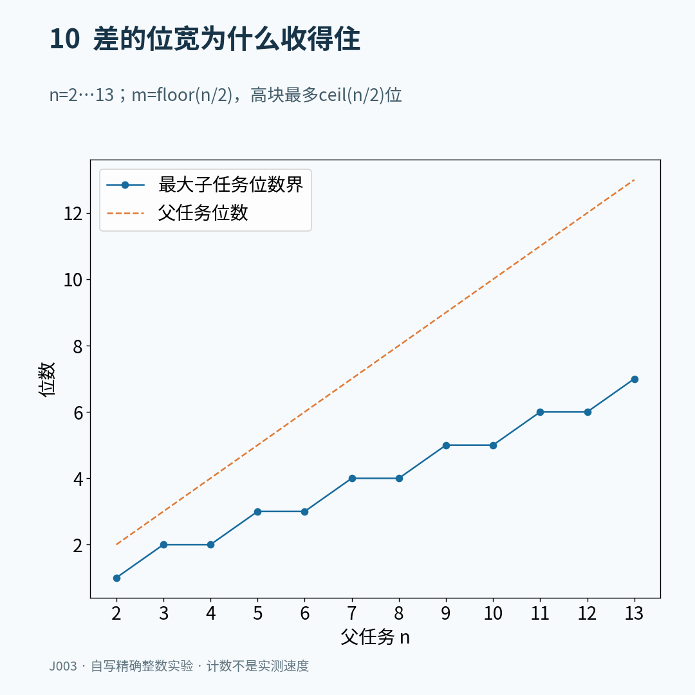
图10｜非负a,b都小于2^ceil(n/2)，所以|a−b|也小于此界；n>1时严格缩小。


## 10. 指数从2变成约1.585，来自哪里？
先暂时看理想模型：n是2的幂，三个子问题都按n/2计。每层拆分、加减、恢复位权的位工作量是O(n)，于是：

T(n)≤3T(n/2)+cn。

拆到1位时，深度为log₂n，叶子上界是3^(log₂n)=n^(log₂3)。log₂3约1.585，低于竖式乘法的2。第j层非递归工作约为cn(3/2)^j；这是增长的等比数列，直到末层相加仍为O(n^log₂3)。这一步不能只数叶子而把所有层的加减删掉。

奇数位长可用ceil(n/2)写递推，或在分析中补到下一个2的幂（小于原长的两倍），不会改变这个渐近指数。附录没有真的补零数组，它按实际bit_length拆分。

这是固定阈值、按位成本模型下的上界。有限4096位教学上限只是接口保护；讨论渐近式是在把这个上限概念上放宽时分析算法族，不是对有限集合谈无限增长。Python分配器、解释器和内建基例乘法都不是图11里的单位时间方格。这个经典界针对乘法核心；附录还维护stats计数和节点元数据，若把这些辅助整数的位成本一并保守计入，可取O(n^log₂3·log n)时间上界，不宣称带仪表的Python逐条操作已经取得同样紧的核心界。


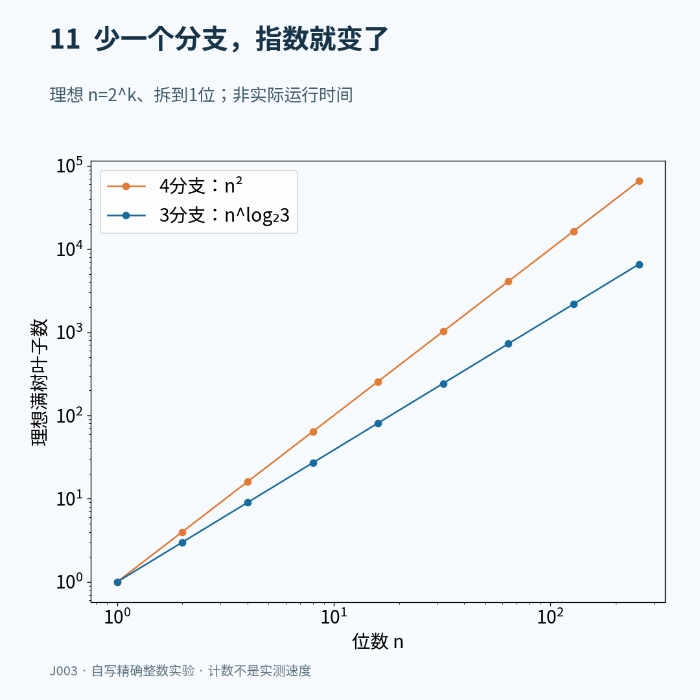
图11｜理想叶子数对比；真实零分支可更早停止，实际加减与调度成本另计。


## 11. 为什么还留一个阈值，不一路拆到1位？
递归调用、创建对象、拆分和合并都有固定开销。数很小时，省掉一次乘法可能不够偿还这些开销，所以实现通常保留基例。本程序的默认阈值8只是便于观察的教学选择，不是调优结论。

固定两组128位模式，在threshold=1时有430次调用；阈值8时有46次；阈值128时只剩一次内建乘法。最后一个“一次”把整个任务交给Python整数实现，并不意味着成本从430神奇降为一个位操作。

这里故意不画毫秒曲线。要认真选阈值，需要规定机器、运行时版本、输入分布、计时方法与基例实现，再重复测量。换一个大整数库或输入形状，交叉点都可能改变。我们只验证结构计数和结果，不宣布自己的Python递归比内建乘法快。


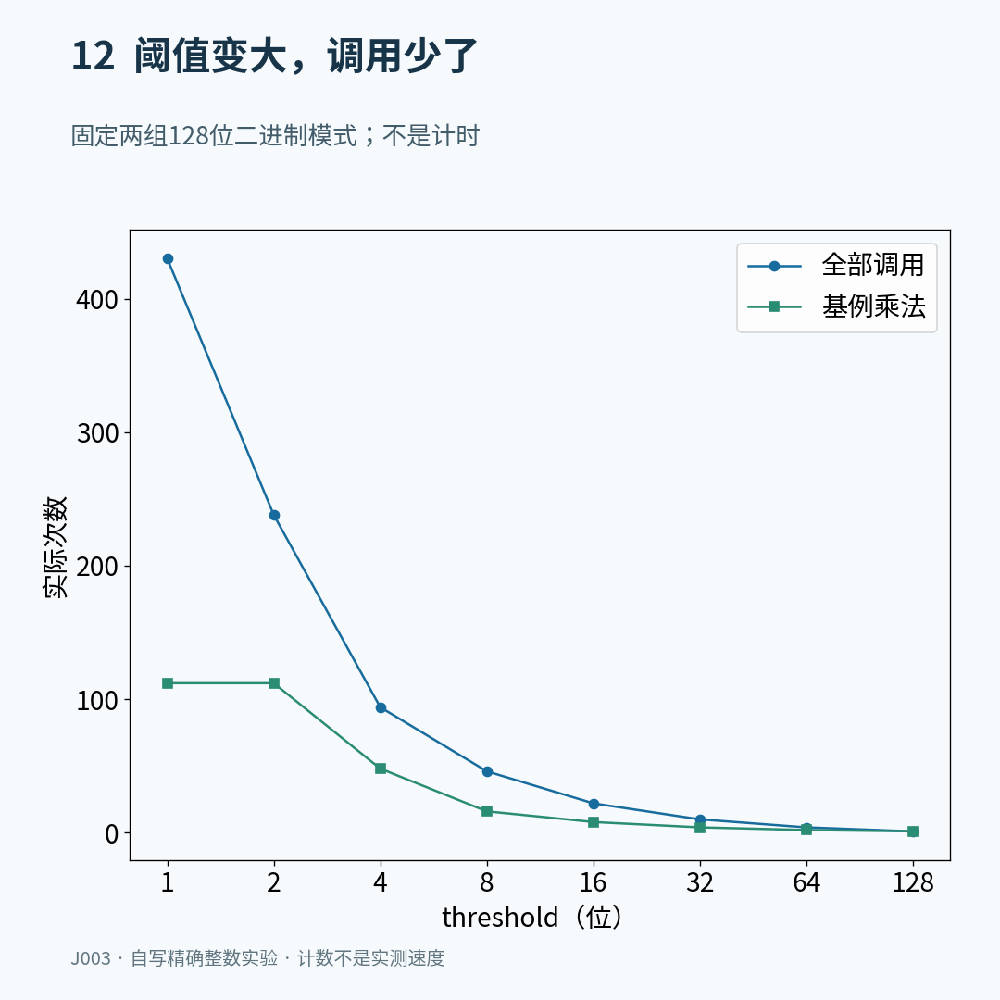
图12｜基例越大越接近直接用Python乘法；一次大基例不等于一次便宜的位运算。


## 12. 不平衡输入，也会改变树的形状
同样最大位长128、threshold=1，两组指定模式得到430次调用；两个全1整数相乘得到382次；全1的128位数乘3只需22次。

这不是乘3的一般最优性证明。长数的高块乘零、相同块的差为零，让很多支路马上结束；但程序仍按最大位长拆分，没有实现专门针对极度不平衡输入的最优策略。用max位长给出的O(n^log₂3)是保守上界，不是说每个输入都必须花同样工作。

也别用这一现象处理秘密数据：分支、零检测、位长和树形都随输入变化，本实现不是常数时间密码学代码。正确结果与抵抗侧信道是完全不同的要求。


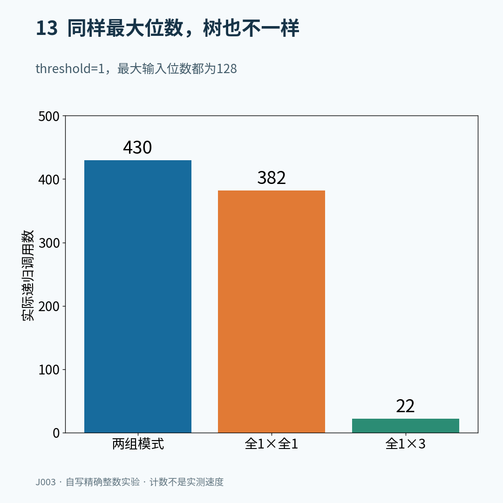
图13｜430、382、22来自实际输入；不平衡和重复块影响零分支，复杂度是上界不是固定工作表。


## 13. 存下整棵树，会花掉另一笔内存
默认trace=False，只返回最终整数与少量计数。深度优先执行时，一个父节点保存常数个O(n)位临时数，下一个活动层约n/2位，再下一层约n/4位。有效位总量是几何级数，因此在固定阈值、忽略对象头常数的模型中是O(n)；栈帧数O(log n)。这不是在本机测得的Python堆字节数，也不表示原地乘法。

trace=True会把每个访问节点的输入、拆分、子积和结果都留下。最坏记录数O(n^log₂3)，不再只有一条活动路径。若连深度、索引大小与所有整数元数据的位成本也统一保守计入，可用O(n^log₂3·log n)位作宽松上界，不能沿用无trace的O(n)说法。生成解释图只对很小的27×22开完整trace；大例只存统计。

接口每个输入限4096位，但这不是运行时或内存预算保证。把阈值设到1仍可能产生很多节点。真实服务还要另设请求预算和资源治理。


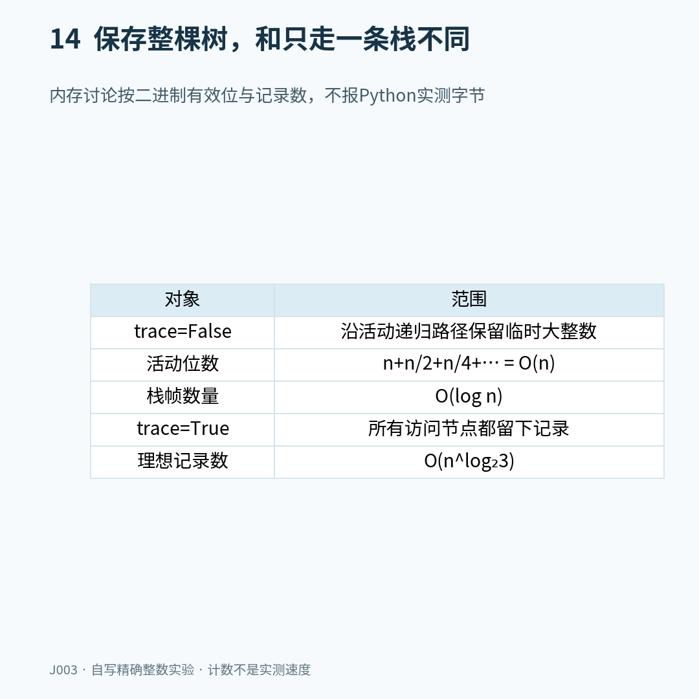
图14｜无trace的O(n)是固定阈值下大整数临时有效位模型；完整trace会保留整棵已访问树。


## 14. 该相信哪一层证据？
局部恒等式可以手算；规模下降可以证明；整个递归正确性可以归纳。另有正式验证项目对它自己的表示与程序建立了证明。但“有人形式化验证过Karatsuba”不等于“这份Python已经被形式化验证”。

我们实际读到Schulz与Karayel的AFP材料摘要和第11—12节：它使用低位优先布尔列表，采用绝对差与符号恢复，包含正确性与位成本界的形式化结果。它的固定阈值和填充表示，与本文自写的实际位长整数实现不同。本文没有运行Isabelle、没有复制它的源代码，也不转授那份证明给本程序。

图15把本程序最需要审查的环节列出来。若三次递归都正确但合并移错了一位，最终仍然错；若代数没问题但符号恢复写错，3×12这样的微型案例就足以揭穿。


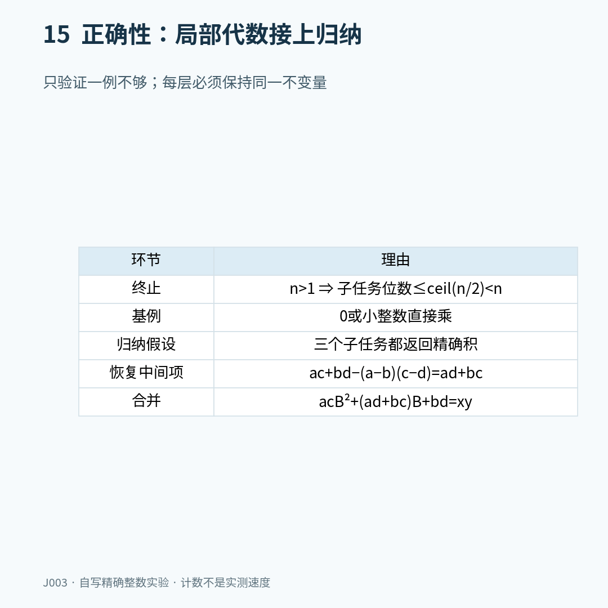
图15｜这是自写算法的代数证明路线；另一个项目的形式化证明不会自动验证本Python程序。


## 15. 给这个程序安排几种会出错的题
自查逐个枚举−80到80的两整数组合，分别用阈值1、3、8，对照Python整数乘法，共77763个结果；另有700组固定种子随机例，覆盖正负、不等长、奇偶位长和多个阈值，总计78463次精确结果对照。

还实际拒绝了7种非法输入，包括bool、浮点操作数、零/过大的阈值、非bool的trace以及超过4096位的输入。27×22完整trace中的每个节点也逐个核对积与交叉项。

这些检查没有覆盖所有4096位输入，不是运行时间证明，也不是生产库认证。最有价值的扩展练习，是先给程序注入一个小错误：把signed_q总设为正，或把合并中的2*m改成m，看看哪个最小输入能揭穿它。只在副本里改实验，别修改下面已经对应所有图表的版本。

还有一个值得思考的问题：如果两个差都为零，为什么第三条支路可以立即返回？回答它时，你会重新走过“先确定最终真正需要什么信息”这条主线。Karatsuba的巧处，不是把乘法藏起来，而是用更便宜的组合避免重复求取中间信息。


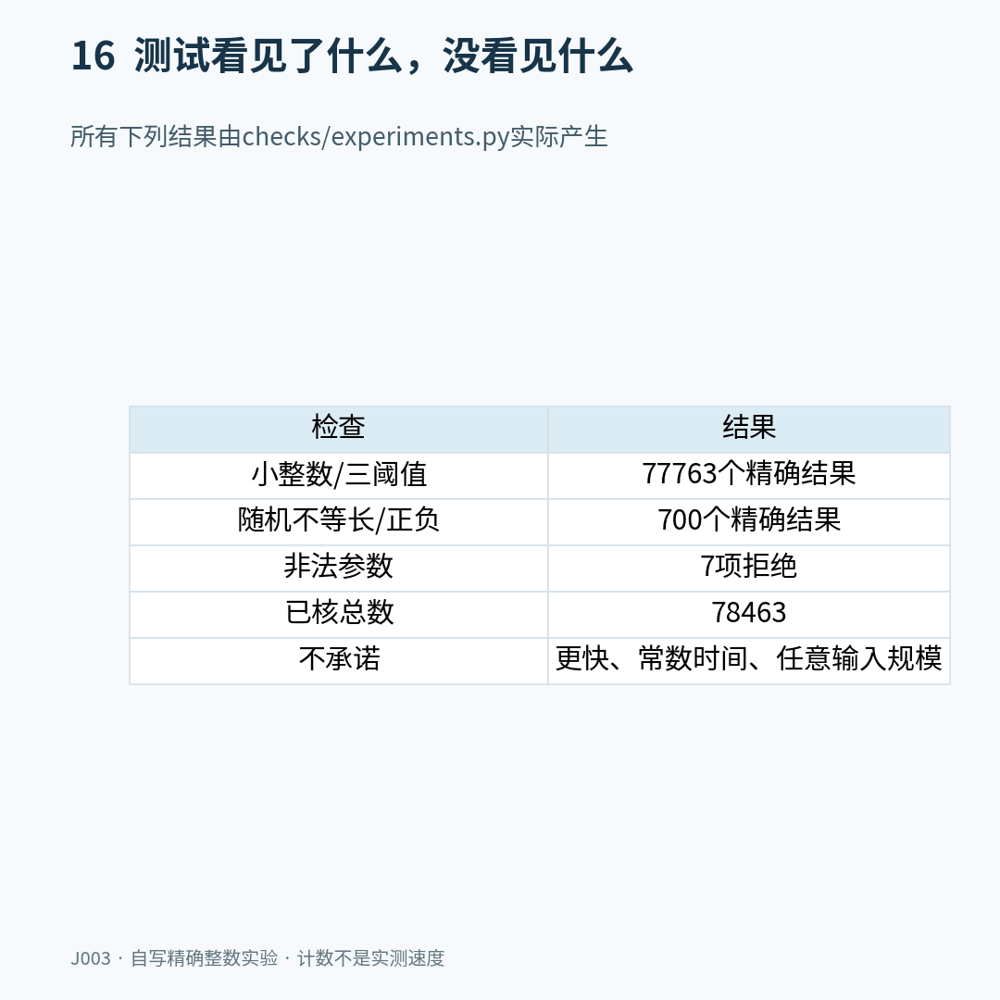
图16｜78463个结果与Python整数乘法一致；有限测试不是形式证明或密码学侧信道保证。


## 短读版｜少做一次大乘法，不是少算一个答案
把x=aB+b、y=cB+d展开，会得到ac、ad、bc、bd四个积。最终却只需要ac、bd和中间项ad+bc。

令q=(a−b)(c−d)，那么ad+bc=ac+bd−q。三次半大乘法，加上几次加减，就能精确恢复完整答案；对子任务继续这样拆，固定阈值下得到O(n^log₂3)的位成本上界，而不是竖式的O(n²)。

真正容易错的是边界：差可能是负数；奇数位长不能假装平均；两个操作数要共享同一位权；中间项可能超过B，必须加法进位而非拼字符串；保存完整递归树的空间也不同于只走一条栈。

本文16图都是自写代数与实际整数实验。27×22拆到1位实际19次调用，不是理想满树；78463个有限对照都精确一致，不代表代码已形式验证，更不代表比Python内建乘法快。完整代码支持正负普通整数，拒绝bool与浮点，每输入限4096位。旧候选来源停点保持，本文是同名额内全新乘法核心。

## 来源、权利与复现实验范围
1. [Karatsuba、Ofman的1962出版元信息](https://www.mathnet.ru/php/archive.phtml?jrnid=dan&option_lang=eng&paperid=26729&wshow=paper)：搜索结果显示卷145(2)、293–294页。未读到该原论文全文。此处只确认有限出版信息，不讲未核实的历史细节。
2. [Schulz与Karayel，Karatsuba Multiplication for Integers](https://www.isa-afp.org/browser_info/current/AFP/Karatsuba/outline.pdf)：实际读摘要、第11—12节与参考项，现有PDF首页日期2026-02-06。本文只用其机制与形式化工作定位，自己的公式数例逐步独立推导。实际查看物理第61页，它是证明/代码排版，没有为本文新增独有实验结果，因此只留核证，不复制页面/代码或描摹排版。未确认该页面图片再版许可，也不声称开放图像授权。
3. GNU GMP手册页 https://gmplib.org/manual/Karatsuba-Multiplication.html 未读到正文，不依据它作现行实现断言。

所有16张交付图均为本文原创数学布局或自写程序实际数据；没有历史照片、原论文截图或AI伪造证据。

复现：Python标准库可运行karatsuba_lab.py；checks/experiments.py输出固定实验JSON；绘图脚本另需Matplotlib和Pillow以及Noto CJK字体。附录给出完整核心求解器与完整实验脚本，图表构建源码随本地稿包保留；无第三方程序下载或执行。代码和实验用于解释整数算法，不承诺性能、侧信道安全或资源预算。


## 完整核心代码｜karatsuba_lab.py
```python
"""Exact signed integers, difference-form Karatsuba; instructional counts only."""
def multiply(x, y, threshold=8, trace=False):
    if type(x) is not int or type(y) is not int:
        raise ValueError('x and y must be ordinary Python integers')
    if type(threshold) is not int or not 1 <= threshold <= 4096:
        raise ValueError('threshold must be an integer in 1..4096')
    if type(trace) is not bool:
        raise ValueError('trace must be bool')
    if max(abs(x).bit_length(), abs(y).bit_length()) > 4096:
        raise ValueError('teaching limit: at most 4096 bits per input')
    stats = dict(calls=0, base_products=0, zero_leaves=0, max_depth=0)
    nodes = []
    def rec(u, v, depth):
        stats['calls'] += 1
        stats['max_depth'] = max(stats['max_depth'], depth)
        n = max(u.bit_length(), v.bit_length())
        row = dict(u=u, v=v, depth=depth, n=n)
        if trace:
            nodes.append(row)
        if u == 0 or v == 0:
            stats['zero_leaves'] += 1
            row.update(kind='zero', value=0)
            return 0
        if n <= threshold:
            stats['base_products'] += 1
            value = u*v
            row.update(kind='base', value=value)
            return value
        m = n//2
        a, b = u >> m, u & ((1 << m)-1)
        c, d = v >> m, v & ((1 << m)-1)
        z2 = rec(a, c, depth+1)
        z0 = rec(b, d, depth+1)
        q = rec(abs(a-b), abs(c-d), depth+1)
        signed_q = -q if ((a-b) < 0) != ((c-d) < 0) else q
        cross = z2 + z0 - signed_q
        value = (z2 << (2*m)) + (cross << m) + z0
        row.update(kind='split', m=m, a=a, b=b, c=c, d=d,
                   z2=z2, z0=z0, q=signed_q, cross=cross, value=value)
        return value
    value = rec(abs(x), abs(y), 0)
    if (x < 0) != (y < 0):
        value = -value
    return dict(value=value, stats=stats, nodes=nodes)

if __name__ == '__main__':
    assert multiply(27, 22, 1)['value'] == 594
    assert multiply(-1234, 5678)['value'] == -7006652
    assert multiply(0, 19)['value'] == 0
    print(multiply(27, 22, 1, True))
```

## 完整实验代码｜checks/experiments.py
```python
from pathlib import Path
import sys,json,random,collections
P=Path(__file__).resolve().parents[1];sys.path.insert(0,str(P))
from karatsuba_lab import multiply
rng=random.Random(3003);checks=0
for x in range(-80,81):
 for y in range(-80,81):
  for t in [1,3,8]:
   assert multiply(x,y,t)['value']==x*y;checks+=1
for k in range(700):
 n=rng.choice([1,2,3,7,15,31,63,127,255,511,1023]);m=rng.randrange(1,n+1)
 x=rng.getrandbits(n)*rng.choice([-1,1]);y=rng.getrandbits(m)*rng.choice([-1,1]);t=rng.choice([1,4,8,16,32])
 assert multiply(x,y,t)['value']==x*y;checks+=1
invalid=[(True,1,8,False),(1,1.5,8,False),(1,2,0,False),(1,2,True,False),(1,2,4097,False),(1,2,8,1),(1<<4096,1,8,False)]
for a in invalid:
 try:multiply(*a)
 except ValueError:pass
 else:raise AssertionError(a)
samples={}
for label,x,y in [('dense',int('10110110'*16,2),int('11001011'*16,2)),('ones',(1<<128)-1,(1<<128)-1),('unbalanced',(1<<128)-1,3)]:
 samples[label]=[dict(threshold=t,**multiply(x,y,t)['stats']) for t in [1,2,4,8,16,32,64,128]]
example=multiply(27,22,1,True)
for r in example['nodes']:
 assert r['value']==r['u']*r['v']
 if r['kind']=='split':assert r['cross']==r['a']*r['d']+r['b']*r['c']
bound=[]
for n in [2,4,8,16,32,64,128,256]:
 x=int(('10110110'*40)[:n],2);y=int(('11001011'*40)[:n],2)
 r=multiply(x,y,1);bound.append(dict(bits=n,calls=r['stats']['calls'],base=r['stats']['base_products'],zero=r['stats']['zero_leaves'],depth=r['stats']['max_depth'],ideal_leaves=3**(n.bit_length()-1),school_pairs=n*n))
D=dict(checks=checks,invalid=len(invalid),example=example,samples=samples,bound=bound,sign_example=multiply(3,12,1,True),zero=multiply(0,19,1,True),carry=dict(a=9,b=9,c=9,d=9,B=10,z2=81,z0=81,q=0,cross=162,value=9801))
(P/'checks/experiments.json').write_text(json.dumps(D,indent=2));print({'checks':checks,'invalid':len(invalid),'example':example['stats'],'samples':samples})
```

---

[来源、AI 辅助与许可范围](sources.md)
