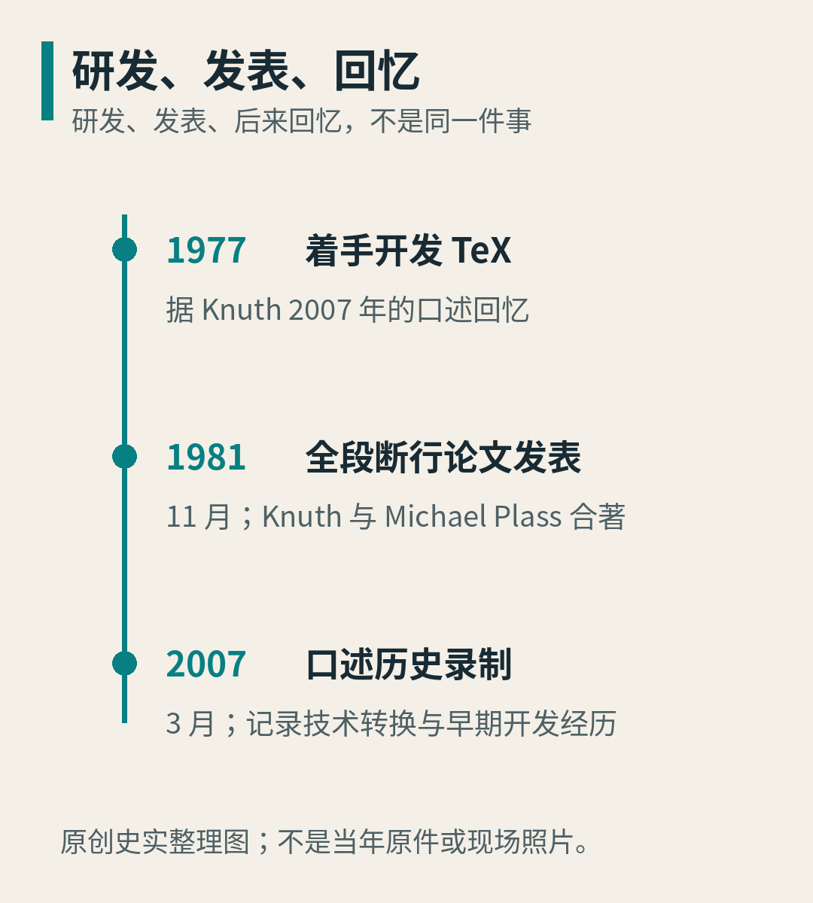
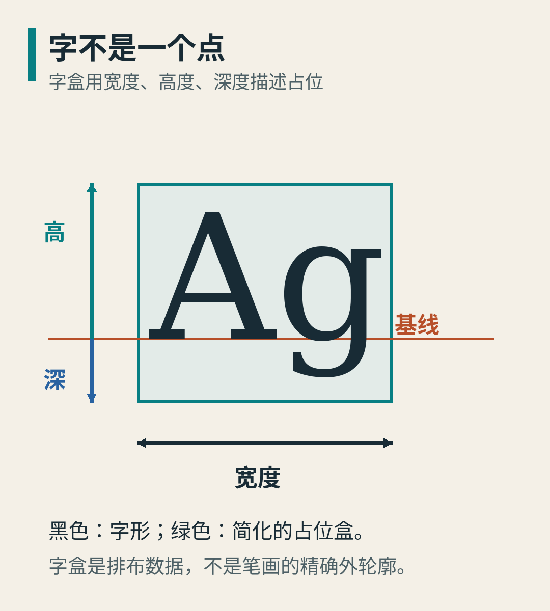
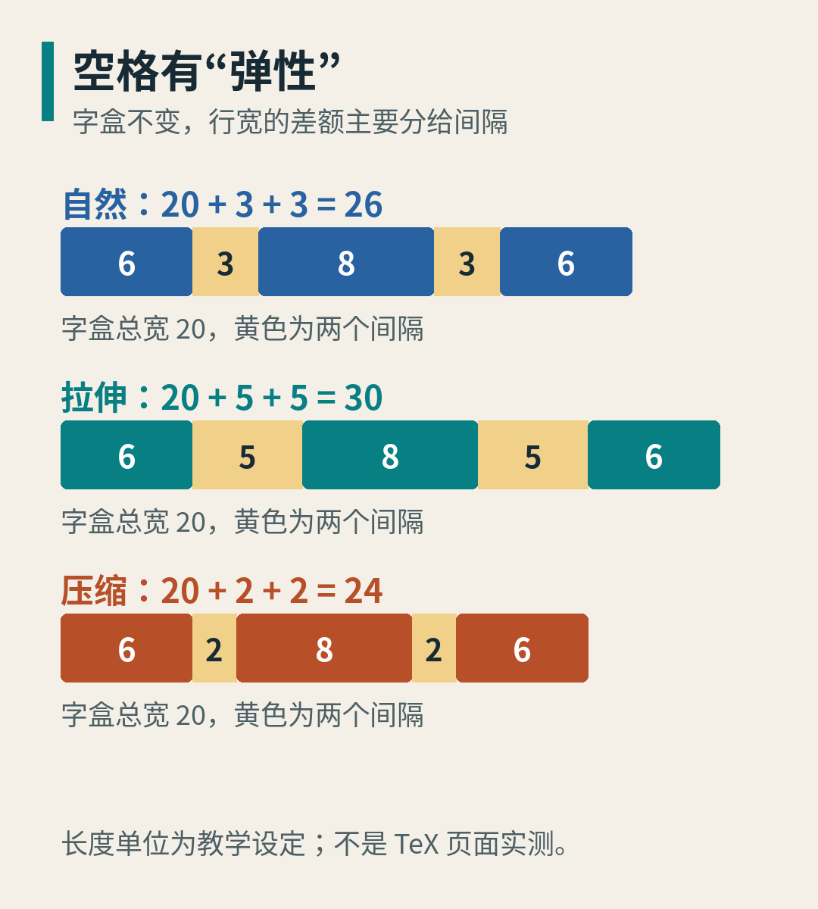
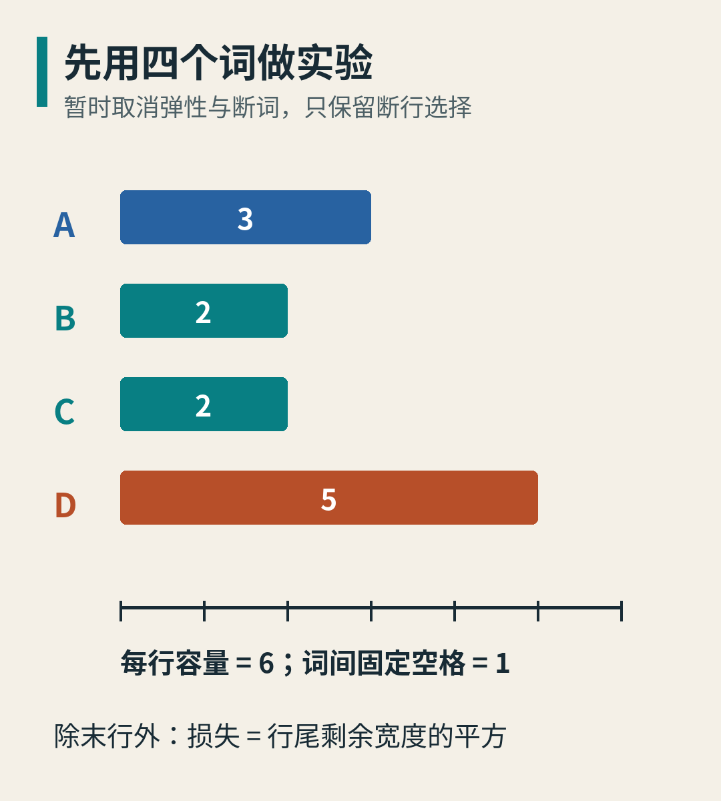
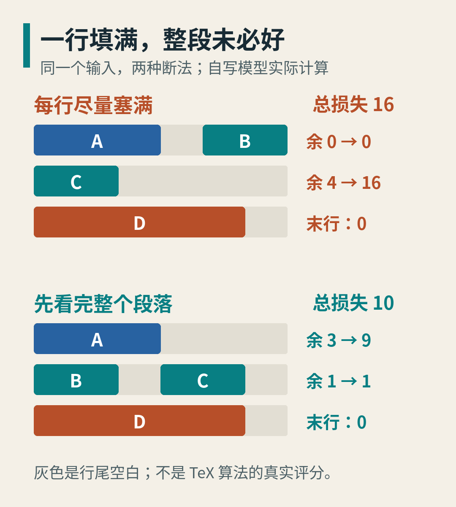
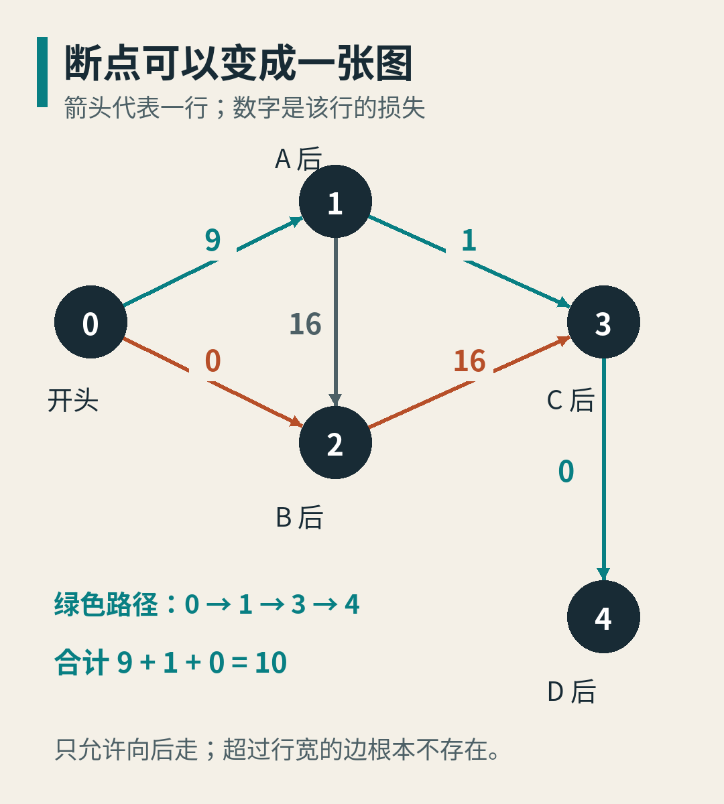
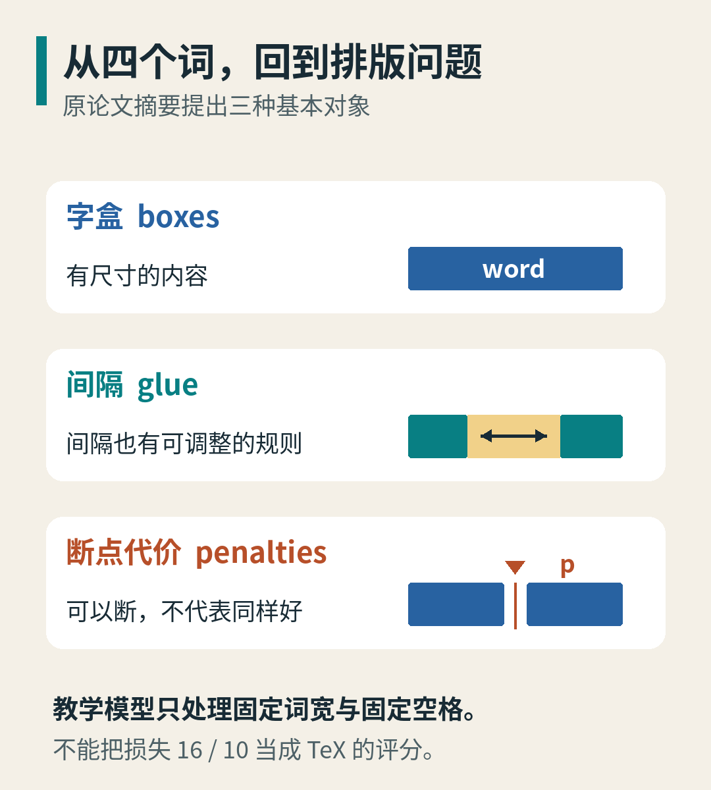

# Knuth 为什么停下写书，去研究一行字在哪里结束？

Donald E. Knuth 是计算机科学家，也是《计算机程序设计艺术》的作者。本文讨论他开发的 TeX 排版系统：它不只提供字形，还要把内容组织成行与页面。[1][2]

图1｜Donald Knuth 于 2011 年 1 月 11 日参加计算机历史博物馆 Revolution 展览开幕活动。先认识本文的主人公：这不是 1977 年开发 TeX 时的现场，也不用于证明当年的排印效果。摄影：Alex Handy，原图未改动，依 CC BY-SA 2.0 使用。[3] 作品页：https://commons.wikimedia.org/wiki/File:Donald_Ervin_Knuth.jpg 许可：https://creativecommons.org/licenses/by-sa/2.0/

一部书的字没有错，排出来却可能很难读。小字与大字不协调，单词之间忽远忽近，公式里的层次挤在一起。问题不在于读者能不能认出每个符号，而在于这些符号放到一起后，能不能让人顺畅地读下去。

TeX 的故事就从这种具体的不满意出发。但它不是“程序员嫌字体难看，于是换了一套字体”的故事。

这里至少有三件不同的事：设计字长什么样，决定一行怎样排，决定一页怎样组织。前一件做得好，并不会自动替后两件作决定。把一个漂亮的字重复一千次，也不会自动得到一页漂亮的书。

我们沿着其中一条线往下走：先看排印技术转换带来的困境，再把字与空格拆成可以操作的对象，最后用四个假想词算一遍，看看为什么“这一行已经排得很好”还不够。

图2｜三个层次分别回答字形、断行和页面组织的问题。看中间一层：即使字形已给定，行末位置仍然需要决定。原创概念图，不是 TeX 输出或历史原件。

## 1. 新机器到了，旧手艺并不会自动跟过来

Knuth 在 2007 年的计算机历史博物馆口述中回忆：修订《计算机程序设计艺术》第二卷时，出版流程已从铅字转向照相排印。他不满意新校样中字形搭配与间距；1977 年看到 Information International, Inc. 的数字排印样张后，他意识到数字输出也能有很好的质量，于是转向开发排版工具。这是当事人多年后的回忆，不是当年现场记录。[1]

这个转折值得慢一点看。问题不是“旧技术一定好、新技术一定差”，也不是“只要换一台分辨率更高的机器就行”。输出设备决定最终能画出多细的东西；排版规则决定那些东西应该画在哪里。分辨率足够，说明好结果有可能；它不替软件决定行距、字距与断点。

可以把它想成一种交接问题：以前由设备、工序和熟练排字者共同完成的判断，换了一条生产路线后，哪些已经保留下来，哪些还没有被明确表达？这段分析并不是要把当年的整个出版业概括成一个原因，而是帮助我们理解 TeX 所面对的设计问题。

如果计算机只得到一串字符，它知道接下来是 A、B、C，却还不知道怎样让它们组成可读的行。人眼可能一句“这里有点松”就能指出问题，程序却必须追问：松多少？怎样衡量？允许挪动什么？为了修好这一行，能不能让上一行多留一点空白？

TeX 的有趣之处，正在于它没有把排版只当作“把字符印出来”。它把一些过去依赖判断的取舍，变成了可以描述、比较与重复执行的规则。

图3｜1977 是开发经历所在的年份，1981 年 11 月是 Knuth 与 Michael Plass 的论文发表时间，2007 年 3 月是这里采用的口述史录制时间。三个日期分别对应事件、发表和回忆，不能互相替代。[1][2] 原创史实整理图，不是历史照片。

## 2. 连“把设计交给程序员”也没那么简单

同一份口述还记下了另一道坎：1977 年，Michael Plass 和 Frank Liang 根据早期设计制作原型。Knuth 后来认为，困难并非学生能力不足，而是看似完整的规格仍有许多未说清的地方。[1]

这件事与排版问题本身很相似。

对人说“让这一行的空格均匀一点”，听起来已经能理解。可一旦要写程序，就必须确定：是让每个空格最终一样宽，还是让各自增加相同的比例？如果一个公式不能拆开，这一行还放得下吗？换一个断点后，下一行会怎样？

这些是本文为说明规格问题提出的例子，不是当年会议上的对话。它们让我们看见一个设计上的转折：从“描述想要的效果”，走到“明确允许的对象、操作与评价规则”。

也因此，不宜把这段历史讲成一个人突然想通全部细节。1981 年《Breaking paragraphs into lines》的作者是 Donald E. Knuth 和 Michael F. Plass。论文摘要明确把整段断行、三种基本对象和动态规划连在一起。[2]

下面不复刻整套 TeX，也不假定你读过它的手册。我们只把这条思路拆开：先有空间中的对象，再有选择，最后才有算法。

## 3. 第一步：把字当成有尺寸的对象

写在纸上的字有轮廓，排版程序还需要它的占位信息。

最容易理解的是宽度：它占用多少横向空间。高度与深度则可以以基线为参照，分别描述上方、下方的占位。基线不是字的底边。比如图4里的 g 有向下伸出的部分；如果只按最高与最低的黑色像素把字符逐个贴齐，字就容易上下跳。

字盒是对占位的描述，不是说每一个盒边都要紧贴笔画。一个有空白边缘的字形，仍然可能需要这些空白来和邻字保持合适距离。数学表达式也可以先作为一块内容参与排布，再处理它内部的细节。

图4｜橙线是基线，箭头区分宽度、高度与深度。黑色字形与绿色占位盒不是同一个东西；示意盒并非该字体的真实度量数据。原创字盒机制图，字形由本地字体绘制。

这里先做一个有用的简化：假定要排的词已经有了确定宽度，不讨论字体如何塑造曲线、字偶间距或复杂文字的字形组合。我们不是宣称这些问题不重要，而是暂时把它们交给前一道工序，专心研究下一步。

下一步就是：这些有宽度的块，要怎样变成行？

## 4. 空格不是只能取一个数

假设三个字盒总宽是 20，盒与盒之间有两个间隔，各自的自然宽度都是 3。整行自然宽度就是：

20 + 3 + 3 = 26。

如果目标宽度是 30，不能直接把最后一个字盒推到最右边，再留下一个特别大的洞。更合理的一种分配是，让两个间隔各增加 2，成为：

20 + 5 + 5 = 30。

反过来，如果目标宽度是 24，可以让两个间隔各减少 1：

20 + 2 + 2 = 24。

图5｜三排的字盒总宽都保持 20，改变的只是黄色间隔。图中数值为自定长度单位，用来解释自然宽度与调整量，不是对 TeX 某页输出的测量。

这就是“弹性间隔”有用的地方：不仅记录平常多宽，还表达它能怎样调整。论文采用 glue 这个名称。[2] 它并不是物理弹簧；这里也没有力、质量或振动。类比只到“可以在一定规则下调整长度”为止。

但有弹性，不等于问题已经解决。如果一行放得太少，就需要把间隔拉得很大；放得太多，间隔又可能挤得难以阅读。你还必须决定在哪里结束这一行。

而一个断点不仅影响当前行，也决定下一行从哪个词开始。行与行从这里连在了一起。

## 5. 先别研究整套 TeX：四个词就能暴露问题

下面是本文自写的教学模型。它不是 TeX 的真实实现，评分也不是 TeX 的评分。我们故意先去掉弹性和断词，只留下最关键的选择：在哪里换行。

有四个词 A、B、C、D，宽度分别是 3、2、2、5。词之间的空格固定宽 1，每行最多容纳 6。词不能拆开，词序不能改变。行尾没有额外空格。

这不是说字母 A 的真实字宽是 3；A、B、C、D 只是四块内容的名字。全部长度都是同一种假想单位。

图6｜蓝绿橙色块分别对应 A、B、C、D。下面的刻度给出每行容量 6。图中的宽度比例与计算使用同一组数据。

还需要定一条好坏标准。这里选择：除最后一行外，每一行的损失等于“行尾剩余宽度的平方”。整段损失是各行损失相加。最后一行允许短一些，损失记为 0。

为什么平方？这只是模型设计的一种选择：剩余 4 的代价是 16，比两个分别剩余 2 的行合计 8 更大，因此它更不喜欢把大空白集中在某一行。它不是关于“人类审美”的定理。

现在用一个很自然的办法：这一行还能塞下下一个词，就继续塞。

第一行放 A 和 B：3 + 1 + 2 = 6，正好填满，损失为 0。

第二行轮到 C。如果再放 D，需要 2 + 1 + 5 = 8，超过容量。因此第二行只能放 C，宽度 2，剩下 4，损失是 4 × 4 = 16。

第三行放 D。它是末行，损失记 0。

整段合计：0 + 16 + 0 = 16。

第一行看起来很漂亮，可它把 C 留在了一个尴尬的位置。

## 6. 少放一个词，为什么总结果反而更好？

试着让第一行只放 A。

这行宽 3，剩 3，损失是 9。看起来比刚才糟了，但先别急着下结论。

第二行可以放 B 和 C：2 + 1 + 2 = 5，剩 1，损失是 1。

第三行仍放 D，末行损失是 0。

整段合计：9 + 1 + 0 = 10。

它愿意让第一行承担一点损失，避免第二行出现更大的损失。付出 9，换掉原先的 16，同时又付出 1，总账反而少了 6。

图7｜上半部分是“每行尽量塞满”，下半部分是全段比较后的最优结果。灰色为行尾空白，右侧逐行列出损失。图由本文小模型的实际计算结果绘制，不是 TeX 排版效果或其真实评分。

这就是整段视角带来的变化：不是下一行来补救上一行已经做完的决定，而是上一行的决定本身就允许受后面的内容影响。

Knuth 与 Plass 的论文摘要，正是用“考虑整个段落”来区别于逐行决定的方法。[2] 我们的小例子只演示这个差别，不能据此推断现实中的每一段文字都会改用不同断法，也不能说任何一种整段优化都一定更符合你的审美。

规则与输入不同，结果就可能不同。不过，只要目标明确，程序至少能够把不同方案放在同一把尺上比较。

## 7. 真要把所有断法一一试完吗？

四个词之间只有三个位置，每个位置都可以想成“断”或“不断”。不管容量是否允许，原始组合总共有 2 × 2 × 2 = 8 种。

如果有 n 个词，词间位置有 n − 1 个，组合数就是 2 的 n − 1 次方。大多数方案可能很差甚至不可行，但若先把它们全部列出来，长度增加一点，工作量就会增加很多。

我们换一种看法：不先列整段排法，而是列断点。

把开头记为 0；A 后、B 后、C 后、D 后分别记为 1、2、3、4。若从一个断点到另一个断点之间的内容能放进一行，就画一条向前的箭头。箭头上的数字，是这一行的损失。

例如：

- 0 → 2 代表第一行放 A B，损失 0。
- 0 → 1 代表第一行只放 A，损失 9。
- 1 → 3 代表一行放 B C，损失 1。
- 2 → 4 需要放 C D，宽度 8，所以没有这条边。

图8｜圆点是候选断点，箭头是一条可行的行，数字为这行在教学模型中的损失。绿色路径 0 → 1 → 3 → 4 合计 10。灰色边 1 → 2 也是真实候选，不因它最终未被选中就省略。

一条从 0 走到 4 的路径，恰好对应一种完整排法。于是，“寻找总损失最小的排法”，变成了“寻找从开头到结尾的最低成本路径”。

这张图只向前走，不会绕回来。因此我们可以按断点顺序计算，不用反复尝试已经解决过的整段前缀。

## 8. 动态规划到底记住了什么？

先记住一件事：到达某个断点，已经花掉的最少损失是多少。

以 C 后为例，最后一行可能从 A 后开始，也可能从 B 后开始。

从 A 后来：到 A 后已付 9，再排 B C 付 1，合计 10。

从 B 后来：到 B 后最少已付 0，再排 C 付 16，合计 16。

两条历史都来到 C 后。接下来剩下的内容完全一样，都是 D；在我们设定的模型里，未来的评分也不关心更早怎样排过。因此可以保留累计 10 的那条历史，舍弃累计 16 的那条。

图9｜不是挑“当前这一行损失最小”，而是比较“到上一个断点的累计损失＋新一行损失”。只有未来所需的信息相同，较贵的历史才可以被安全舍弃。

若把到断点 j 的最小累计损失写成 D(j)，规则就是：

D(j) = 所有可行前驱 i 中，D(i) + 从 i 到 j 的一行损失的最小值。

这里 i、j 是位置，不是字宽；D 是累计损失，不是某一行的长度。起点 D(0) = 0。

沿着图8计算，会得到：D(1) = 9，D(2) = 0，D(3) = 10，D(4) = 10。每次除了保存最小值，再保存它来自哪个前驱。最后从 4 向前追溯，就得到 4、3、1、0，反过来便是选中的断点顺序。

这个方法叫动态规划。它节省的不是“算术加法特别快”，而是避免把同一个前缀的最好结果，在大量完整方案里重新算一遍。

不过，刚才的舍弃有一个重要前提：未来只需要知道当前位置。如果另一个排版规则规定“上一行特别松，这一行就不应特别紧”，那么两条来到同一位置的历史，可能不再等价。此时只记录位置就不够，还得把影响未来的上一行信息纳入状态。这是一般性的建模提醒，不是本文对 TeX 内部状态结构的完整说明。

## 9. 从小模型返回 TeX，需要补回什么？

1981 年论文摘要给出的三个基本概念是 boxes、glue、penalties：字盒、间隔，以及断点的取舍代价。[2]

我们已经用图4和图5建立了前两个概念的直觉。第三个也不难理解：一个位置“可以断开”，不代表在这里断与在那里断同样合适。规则可以对不希望出现的断法增加代价，让算法在整体比较时把这种偏好算进去。

图10｜三种对象帮助把排版问题组织成可计算的选择；p 表示示意的断点代价。本文的固定空格模型只使用了很小一部分结构；损失 16 与 10 不能拿来当成 TeX 的评分。原论文机制范围依据摘要，图中中文为解释性概括。

我们的模型刻意没有处理：词内断开、可伸缩间隔、不同候选断点的附加代价、变化的行宽、公式内部布局，以及其他真实文本条件。把这些都加回来，评分和状态也会随之复杂起来。

因此，本文没有提供“几十行代码重写 TeX”的捷径。它提供的是一个能算到底的小窗口：为什么整段比较有价值，以及动态规划怎样保留必要的历史。

### 这个小算法的成本到哪里为止？

有 n 个词时，候选断点数是 n + 1。朴素实现为每个终点 j 检查所有更早的 i，检查次数不超过 n(n + 1) / 2，因此是 O(n²) 级别。

这里还有一个容易漏掉的条件：检查一条边的宽度，必须能在常数次操作内得到。做法是事先保存词宽的前缀和。词宽之和用两个前缀相减，间隔数再乘固定宽度 1，就得到该行宽度。

如果每次检查都从头把这一段的词宽逐个相加，就多了一层重复工作，不能继续不加条件地称它为 O(n²)。

只存前缀和、各断点的最小值与前驱，不必把整个图放进内存，所需额外空间是 O(n)。为了讲解，本文测试脚本另外保留了候选检查记录；这份记录可能占 O(n²)，不属于上述最小存储方案。

这些复杂度只针对本文固定行宽、固定空格、不拆词的小模型。它们不是对 TeX 完整实现、各种扩展或整本文档处理耗时的保证。

## 10. “整段最优”仍然不是“全书最优”

段落并不是一部书的全部。

某段多出一行，就可能改变这一页剩下的空间；一张图是否能留在当前位置，又可能影响后面的页面。脚注、标题与分页还有各自的约束。哪怕段落内部已经选出某个评分规则下的最好断法，也不能直接宣称整本书已经得到联合最优布局。

图11｜从换行到段高，再到分页，约束会跨越层次。右侧橙线示意段落多了一行，后续对象随之下移。两张纸是关系示意，不是实际排版对比，也不表示 TeX 对整本书执行了联合最优化。

这里的“最优”始终要带着三个条件来读：对什么对象优化，允许哪些选择，用什么指标比较。

如果你不喜欢一个优化结果，原因可能是算法没有找到规则下的最好答案，也可能是规则本身不符合你的需求。这两类问题不能混为一谈。前一类要改算法，后一类先要改模型。

这也让 TeX 的历史有了比“某人写出聪明算法”更具体的意味：数字机器能够输出漂亮的字，还需要把字体、空间、断点和偏好组织成一个可以工作的系统。抽象不是离开纸面，而是让纸面上的问题有了可以逐项讨论的名字。

## 留一个可以亲手改的条件

把例子的行宽从 6 改成 7，其他规则全部不变。先别运行程序，试着预测：“每行尽量塞满”还会输吗？

第一行仍能放 A B，宽 6，剩 1；第二行只能放 C，剩 5；第三行是 D。损失变成 1 + 25 + 0 = 26。

第一行只放 A、第二行放 B C、第三行放 D，则损失是 16 + 4 + 0 = 20。它依然更好，不过差距的来源已经变了。

你还可以改“末行不罚”这条规则，再把所有方案逐一算一遍。注意，不是只给之前的两种方案换一个总数就够了：规则改变后，原来没赢的方案也可能成为新候选。

下一次看到文档里忽然出现一条很松的行，可以先分清两件事：软件是否只能局部决策，还是它正在遵守某些你没有注意到的全局约束？这比单纯说“这行不好看”更接近一个能被解决的问题。

## 来源与阅读范围

[1] Computer History Museum，Oral History of Donald Knuth，Edward Feigenbaum 访谈，录制于 2007 年 3 月 14 日及 21 日。本文使用其中关于 1970 年代排印转换、1977 年开发及早期学生原型的口述段落，不把回忆当作当年原始日志。
https://archive.computerhistory.org/resources/access/text/2013/05/102658053-05-01-acc.pdf

[2] Donald E. Knuth、Michael F. Plass，Breaking paragraphs into lines，Software: Practice and Experience，11(11)，1119–1184，1981 年 11 月。本文核对的是出版社公开摘要与书目信息；没有声称阅读全文或复现完整算法。
https://onlinelibrary.wiley.com/doi/10.1002/spe.4380111102

[3] 人物照片：Alex Handy，Donald Ervin Knuth，2011 年 1 月 11 日。文件页记录摄影者、拍摄活动与 CC BY-SA 2.0 许可；本文保留原图，没有裁切或修改。
https://commons.wikimedia.org/wiki/File:Donald_Ervin_Knuth.jpg
许可：https://creativecommons.org/licenses/by-sa/2.0/

图像与模型说明：除已署名的真实人物照片外，其余十张图为原创程序绘制的教学示意，没有原书页面或历史排印效果的复刻。照片依所列许可使用，原创示意图不自动沿用该许可。四词模型由本文代码计算，并与小输入的穷举结果核对；不属于 TeX 运行结果。AI 协助了资料整理、写作与程序绘图。示意图只承担图注所述的解释作用，不替代真实史料。

——短版——

## 为什么排好这一行，还不够？

Donald E. Knuth 是计算机科学家、《计算机程序设计艺术》的作者。他开发的 TeX 是排版系统，不只是一套字体。按他在 2007 年的口述回忆，1970 年代排印方式转换后，新校样的字形搭配和间距让他不满意；数字排印样张又让他看到，好结果可以由程序实现。

排版必须把“看着顺眼”拆成能操作的对象和规则。1981 年，Knuth 与 Michael Plass 合著的断行论文，把整段比较、字盒、间隔与断点代价放进同一个框架。

用四个假想词就能看出为什么要看整段：词宽为 3、2、2、5，空格宽 1，行宽 6。若每行尽量塞满，会排成 A B／C／D，第二行只剩一个孤零零的 C。

换成 A／B C／D，第一行虽然更短，第二行却好得多。按本文自定的“行尾空白平方、末行不罚”规则，总损失从 16 降到 10。

这不是 TeX 的真实评分，而是一个能手算的小模型。它说明：当前行最好的决定，可能把麻烦留给下一行。动态规划则比较“此前最少已付多少＋新一行要付多少”，不用把所有完整排法反复算一遍。

完整文章从真实的排印困境讲起，配一张已署名的真实人物照片，并用十张原创图走过字盒、弹性间隔、四词反例、断点图与状态选择，并说明“整段最优”为什么不等于“全书最优”。

史料：CHM 的 Knuth 口述史；Knuth 与 Plass 1981 年论文的出版社公开摘要。照片为 Alex Handy 2011 年作品，依 CC BY-SA 2.0 使用；其余十图与数值模型为原创，非 TeX 运行输出。AI 协助资料整理、写作与绘图。

照片作品页：https://commons.wikimedia.org/wiki/File:Donald_Ervin_Knuth.jpg
照片许可：https://creativecommons.org/licenses/by-sa/2.0/

---

[来源、AI 辅助与许可范围](sources.md)
