# Liskov与CLU：换掉数据结构，为什么调用者可以一行不改？

## 1｜程序变大后，最贵的可能不是重写，而是牵连

你给社团写了一段撤销功能。最初把记录存在列表里，最后一项就是最近一次操作。后来记录变多，你想换成另一种结构。结果搜索整个项目，发现十几个地方都在读“列表最后一格”，还有人直接清空列表。

你原以为只是换一个容器，实际却要替所有人改用法。真正昂贵的不是新结构本身，而是散落在外面的依赖。

一个小小的 `pop()` 接口，能把这些依赖收回来吗？可以帮忙，但只改方法名不够。必须说清楚：调用者有权期待什么，哪些细节不属于承诺。

本文先用两种整数栈把问题做实，再回到Liskov与CLU。例子、图解和Python程序是本文的教学构造，不是历史CLU编译器或运行时的复原。

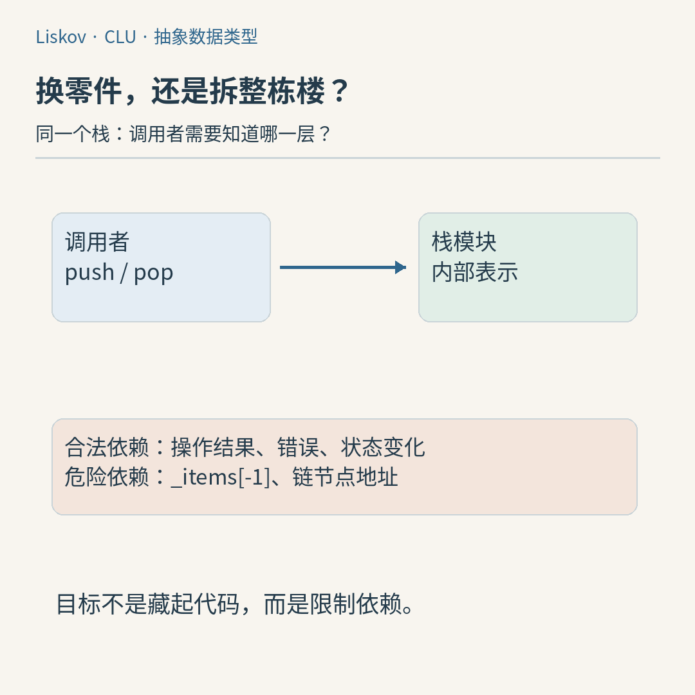

图1：接口外的调用者只依赖公开契约；箭头表示调用关系，不是内存指针。

## 2｜先写规则，不急着挑数据结构

想象一叠盘子：最后放上去的，先拿走。用一个从底到顶的有限整数序列 `q` 表示栈的意思。例如 `(3,7,9)` 的栈顶是9。

我们自己制定一份小契约：创建得到空序列；`push(x)`把整数x放到末端，返回None；非空时`pop()`移走并返回末端元素，`peek()`只看不移走；`size()`返回元素个数；额外提供`snapshot()`，返回底到顶的不可变整数元组。

空栈上的pop和peek抛出同一种`EmptyStack`，并且不改状态。元素只接受Python的exact int，特意拒绝bool、float、字符串和容器；拒绝发生在修改前。这样我们不用把可变元素的深浅复制问题偷偷藏在例子里。

这份契约没有说“第几个内存地址”“用list还是链表”。它说的是行为。即使实现还没写，调用者已经可以据此编程。

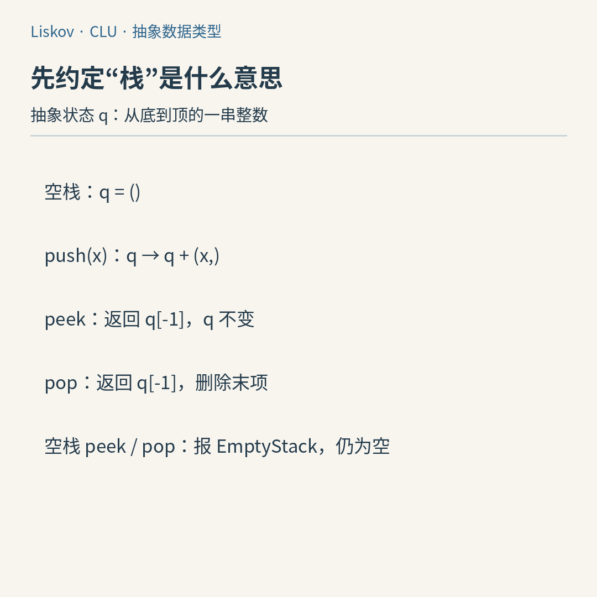

图2：本文自定顺序整数栈契约；只接受exact int，不含布尔值，空栈错误不改变状态。

## 3｜第一种表示：数组式，末尾就是栈顶

最直接的做法是保留一个Python list。内部 `[3,7,9]` 对应抽象序列 `(3,7,9)`。压栈就在末尾append，弹栈就从末尾pop。

这里有两个不同层次：list是具体表示，序列q是对外意义。把具体表示翻译成对外意义的规则，叫抽象函数，记作AF。此处 `AF_A(a)=tuple(a)`。

为什么要给这么简单的一步起名字？因为换成另一种表示时，顺序不一定这么直观。AF让我们讨论“两个东西是不是同一个栈”时，不必要求它们长得一样。

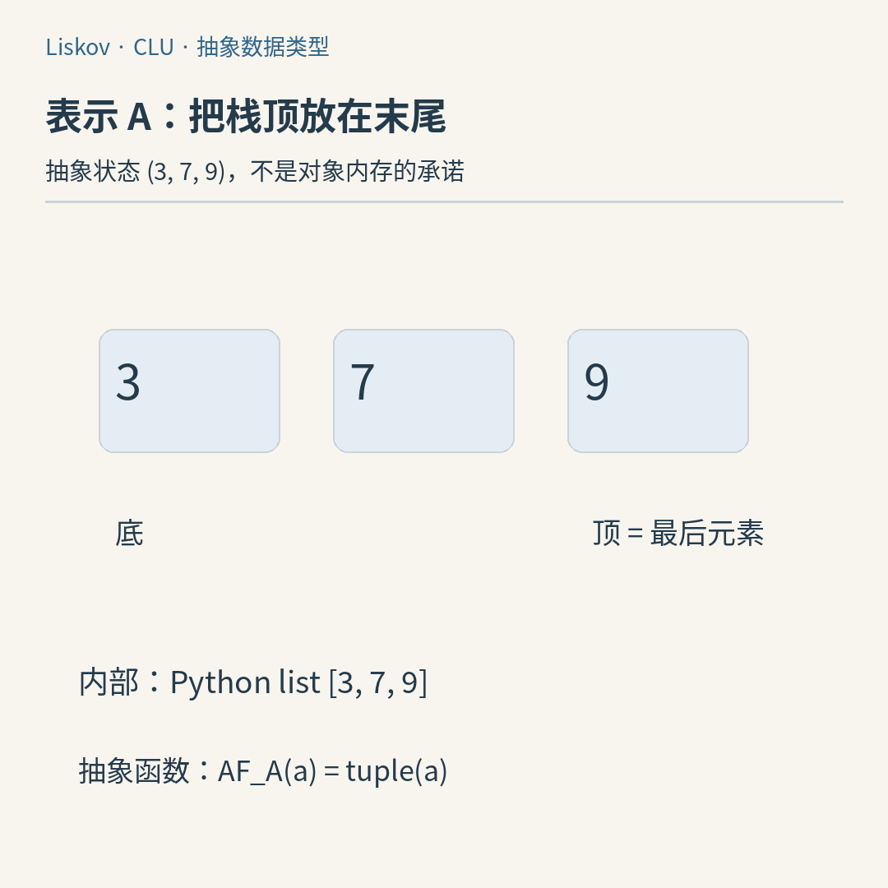

图3：数组式表示的逻辑顺序是底到顶；示意不显示容量、地址或Python实际内存布局。

## 4｜第二种表示：链头是顶，方向倒过来

另一种实现只记住链头。每个节点装一个值和指向后续节点的tail。压入9时，让新节点9指向旧链头7；弹出时，把head移到tail。

内部沿链看到的是 `9→7→3→None`，但它代表的抽象序列仍然是底到顶的 `(3,7,9)`。所以 `AF_B` 要把沿链读到的值反转。额外缓存长度n，避免每次问size都数整条链。

这两种实现的字段、方向和更新方式都不相同。它们是否可替换，不能靠“方法名字都一样”判断，得看操作是否保持同一个意思。

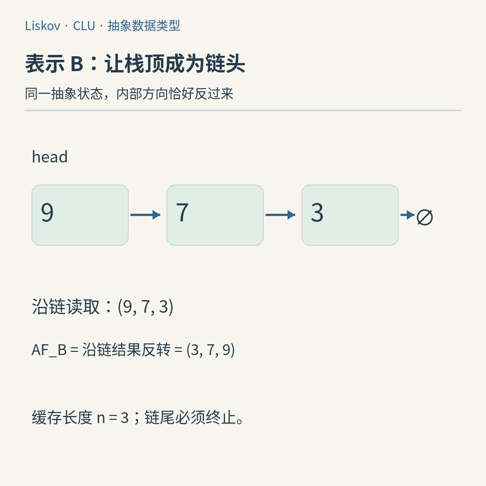

图4：链头为栈顶，箭头为tail引用；抽象函数反转沿链值序列，与数组表示得到同一状态。

## 5｜一个可逐步检查的证明思路

先只看单个栈、顺序执行、遵守接口的调用者。设具体状态r满足该实现的不变量，且 `AF(r)=q`。

对每个公开操作，检查四件事：输入条件相同；返回值或约定错误相同；新状态r′仍满足不变量；`AF(r′)`等于契约要求的新抽象状态q′。图里两条路线必须会合，而不只是最后一个数看起来接近。

例如链式push(x)：新链头是x，旧链沿tail保留。反转新链得到原q末尾再加x，与契约一致。链式pop在非空时返回头值，剩余链反转得到删去末项的q；空栈则按契约报错，状态不动。

创建操作给出相同空状态，是归纳起点；每个操作保持上述关系，是归纳步骤。于是，对任意有限、合约内的调用序列，可以一步步推出相同观测。若调用者根据先前返回值选择下一步，因为先前观测一致，它也会作出相同选择。这里不包含运行时间、对象地址、反射、并发调度、资源耗尽与恶意改字段。

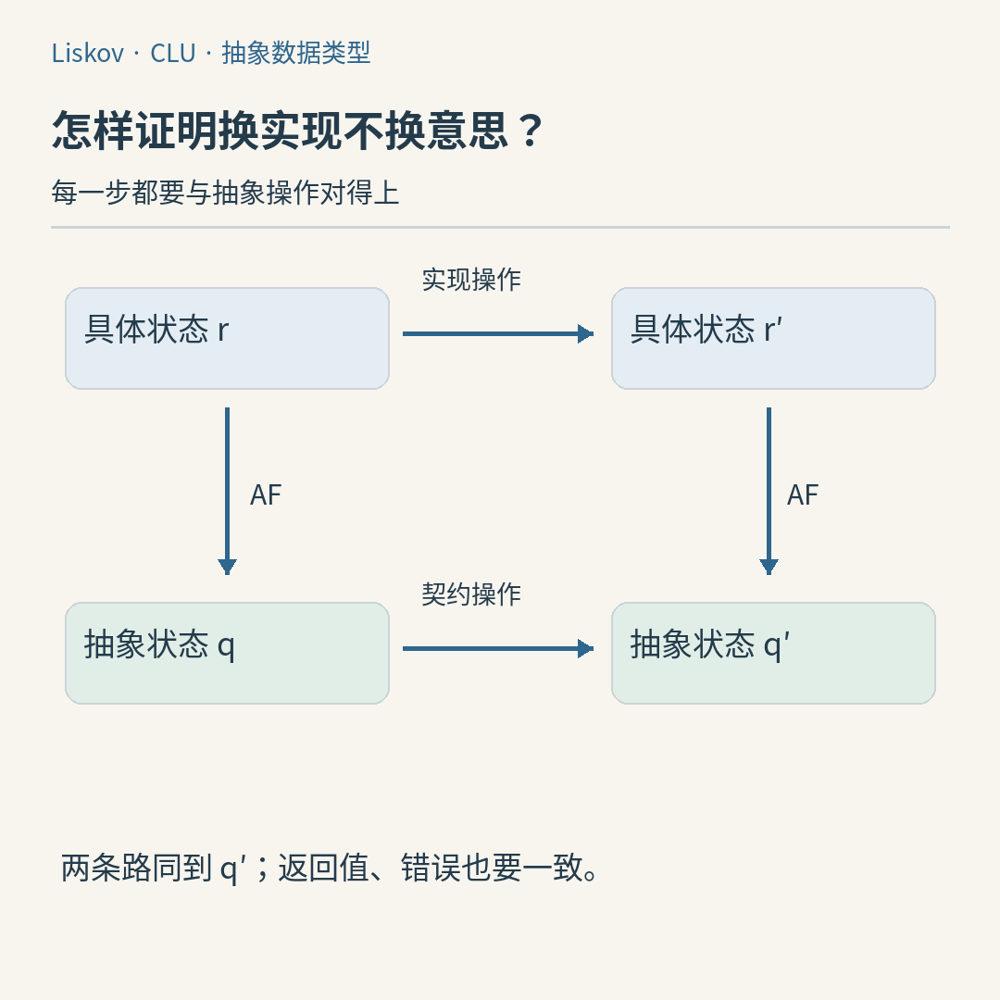

图5：表示独立的教学交换图：在不变量成立时，具体操作映射到契约操作；状态相同还不够，观测也须匹配。

## 6｜先拿五步操作，实际对一遍

从空栈开始，依次push(3)、push(7)、peek、pop、size。两种实现都先返回两次None，再返回7、7、1，最后都代表 `(3,)`。

这一行行对账比“跑完以后都是空栈”更有信息：一个错误实现可能把peek也做成删除，后来又通过某次push碰巧补回来。只看终点就会漏掉中途的错误。

后面的测试程序保存每步的结果标签，并比较最终快照。更长的轨迹可以自动枚举；但自动比较两份代码还有一个陷阱——它们可能犯同一个错。因此，契约推理和独立参照仍然重要。

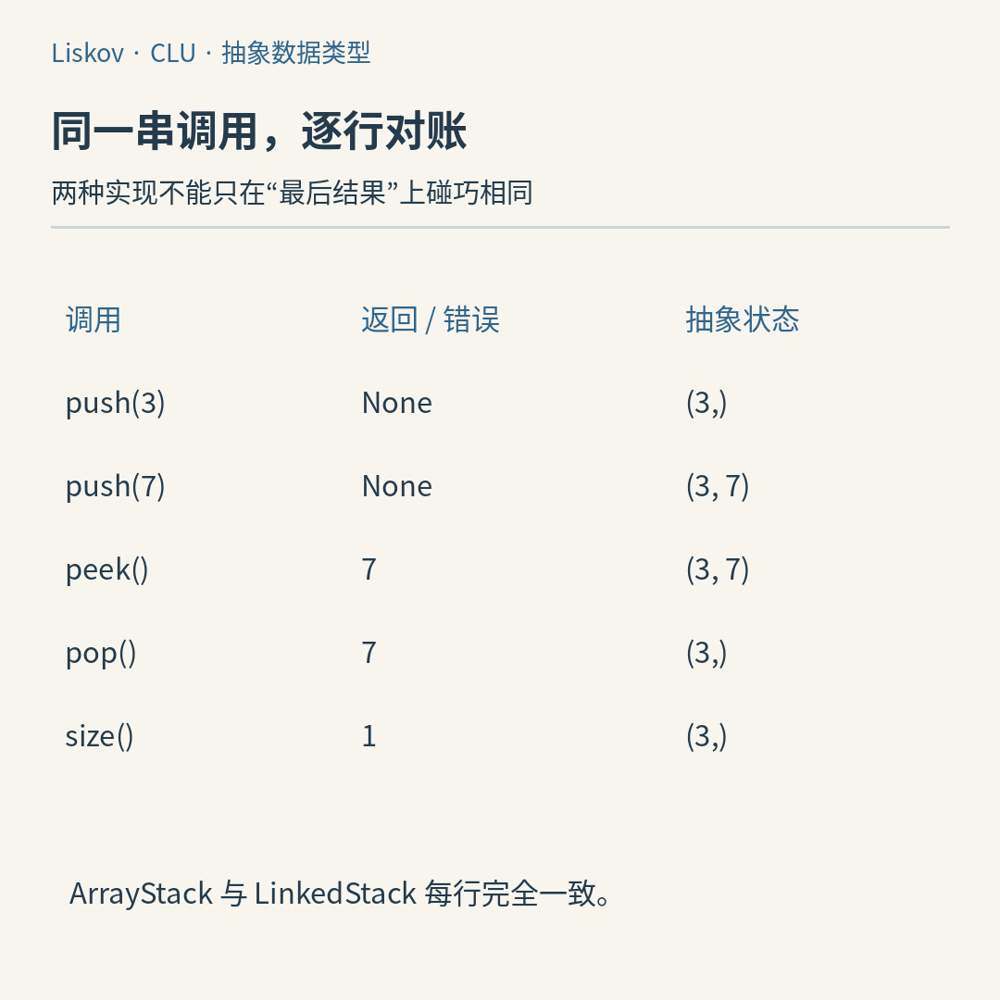

图6：真实模型示例的五步观测；peek不删除元素，pop之后size为1。

## 7｜失败方式不统一，替换也会破坏程序

假设数组版本在空栈时抛`EmptyStack`，链式版本却返回0。调用者可能已经用try/except写好了“没有撤销记录”的分支，替换后这个分支就不执行了。

0并不是一个安全的万能错误标记，因为0本来就是合法元素。返回值的类型一样，语义仍然可能完全不同。

本文只比较约定的异常类别和是否修改状态，不保证Python异常的traceback、源码行号和诊断字符串相同。真实接口若承诺了特定错误消息，那也要纳入检查。承诺越多，可替换的自由就越小。

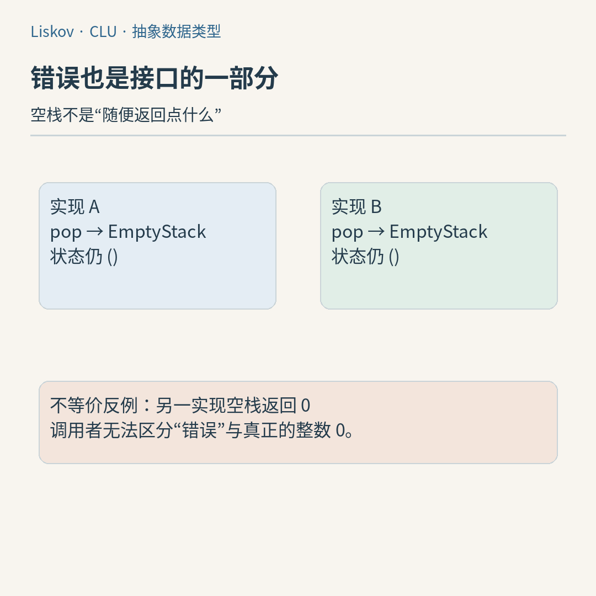

图7：空栈错误的种类与不改状态的行为都受契约约束；本模型不承诺异常堆栈文本相同。

## 8｜不变量：每个操作都要守住的内部事实

链式栈维护三条事实：head到tail的链有限且无环，节点元素都是exact int，n恰好等于节点数。空栈时head为None且n为0。

push新建节点接到旧链前，增加一个节点并把n加1；pop移开头节点并把n减1；peek、size和snapshot不修改状态。只要没有外部越界写入，这些局部检查就可以反复使用。

试着删掉pop里的`self._n -= 1`：第一次弹出的元素可能仍然正确，下一次size就说谎了。“封装好了”不能自动排除逻辑bug。它的价值是让你能把不变量的维护责任定位到实现内部，而不是怀疑项目里每一处代码都可能改坏它。

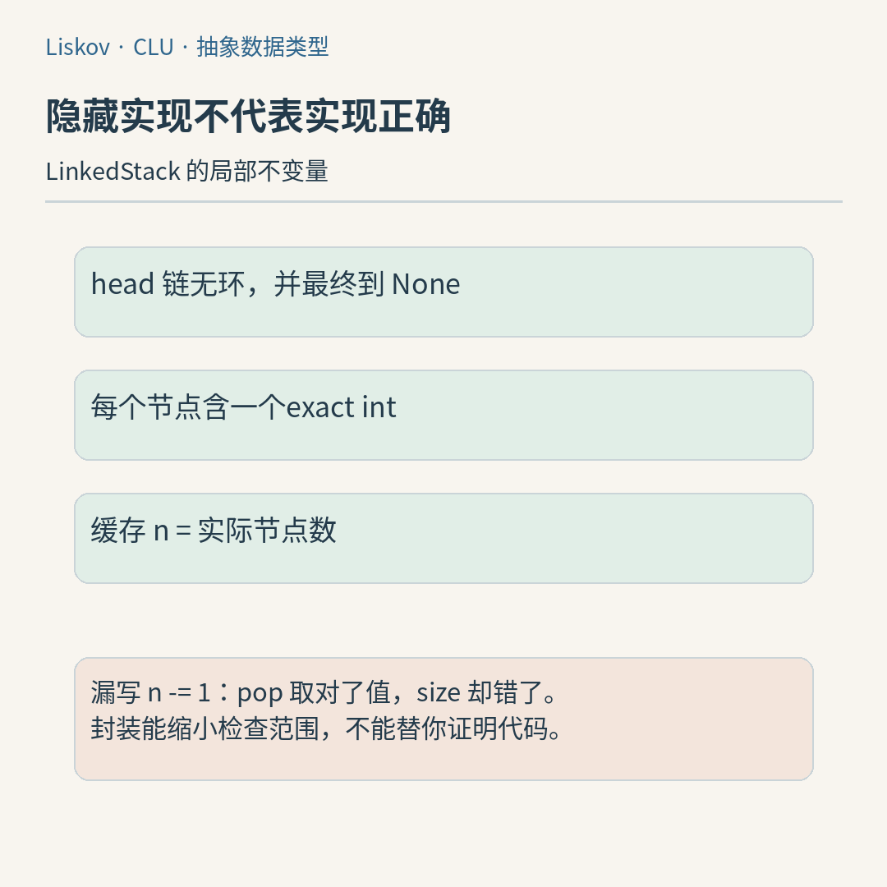

图8：链式表示的三个教学不变量；漏减计数会造成操作间不一致，类型边界本身无法排除这种逻辑错误。

## 9｜最容易漏掉的洞：好心提供内部容器

如果提供一个“方便调试”的接口，直接返回内部list，外部就能拿到它并clear。栈在没有调用pop的情况下被清空；如果调用者还依赖这个list的末尾布局，换成链表也会立刻失效。

不修改内部对象也可能造成依赖。只读 `_items[-1]` 的调用者，照样要求实现必须有_items、必须能索引、必须把顶放在末端。

本文代码的下划线只是Python命名约定。你确实可以执行 `s._items.clear()`，也可以修改 `_head` 或 `_n`。所以它是展示“守约时如何替换”的可运行模型，不是能够强制隔离恶意调用者的安全机制，更不是CLU静态类型边界的实现。

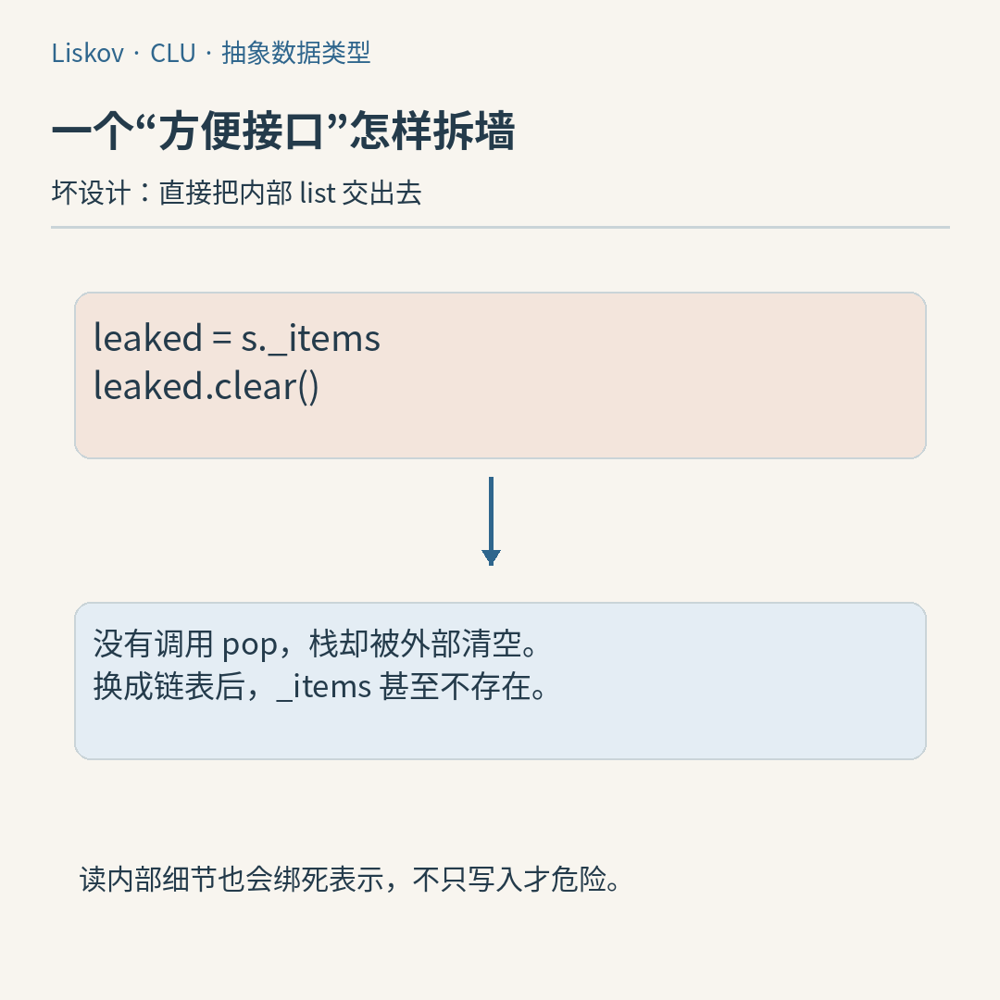

图9：故意越界的Python反例；本文_前缀只是约定，不是CLU静态封装机制或安全沙箱。

## 10｜别名不一定是敌人

`alias = s`并没有创建第二个栈，只是给同一个栈多取了一个名字。先s.push(4)，再alias.pop()，最后s.size()为0，这是合理的共享语义。

重要的不是“有没有两个引用”，而是它们经什么通道改变对象。通过已约定的push/pop修改，调用者可以预期变化；直接拿到内部list或节点并任意动手，就越过了表示边界。

若要把前面的证明扩展到多个栈和别名，需要让两种运行状态中的对象身份对应，并保持同样的别名关系，不能只给每个变量分别贴一个序列。本文穷举主要覆盖单栈轨迹，另有共享引用实例，不冒充完成了任意对象图的形式验证。

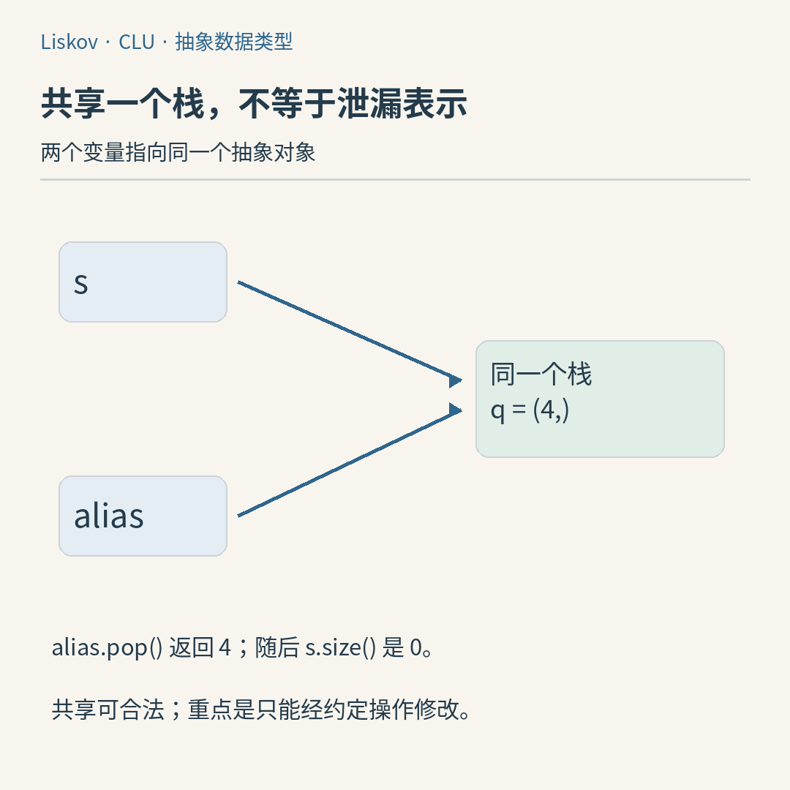

图10：本模型允许栈对象别名；公开操作造成共享状态变化不等于向外暴露list或链节点。

## 11｜给观察窗口，而不是把后门钥匙交出去

snapshot返回底到顶的tuple。它公开了抽象序列，不公开list布局、节点或n的存储位置；两种实现都能提供这项操作。

先取得 `(3,)`，再push(7)，旧快照仍是 `(3,)`，新快照是 `(3,7)`。因为本模型只存不可变整数，外部也不能通过快照改动内部元素。

如果把元素放宽为可变list，tuple里面仍可能装着原list的引用。外层不可变，并不意味着里层对象也不可变。那时必须重新决定契约：允许共享元素、复制元素，还是禁止修改？不能把当前整数例子的结论直接搬过去。

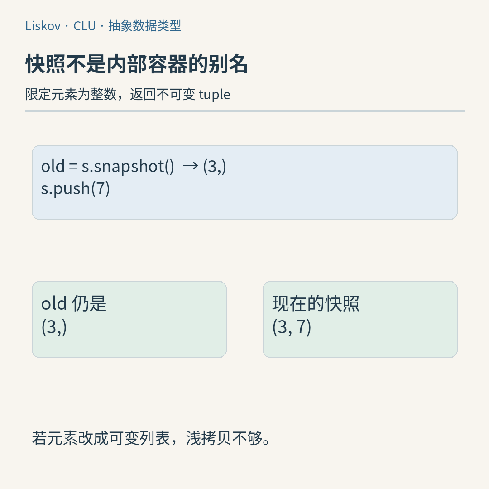

图11：snapshot是额外公开的抽象观测，返回底到顶序列；整数不可变，旧快照不随后续push变化。

## 12｜“一行不改”不代表性能也一模一样

在常见单位成本模型里，链式版本的push/pop/peek/size只改动或读取常数个字段；snapshot必须走过n个节点。动态数组式版本的末端push通常摊还O(1)，pop若触发收缩也应区分单次与摊还成本，peek和size为O(1)，复制快照为O(n)。

这是数据结构层面的成本分析，不是对所有Python实现、整数长度、内存分配和垃圾回收过程的实时保证。本文不拿一台机器上的微秒数来证明另一个实现永远更快。

如果业务契约要求“每次操作必须在某个硬时限内完成”，性能就是契约的一部分，不能说返回值相同就算替换成功。同样，外部若依赖序列化格式、持久化布局或线程安全，这些也需要单独写进承诺。

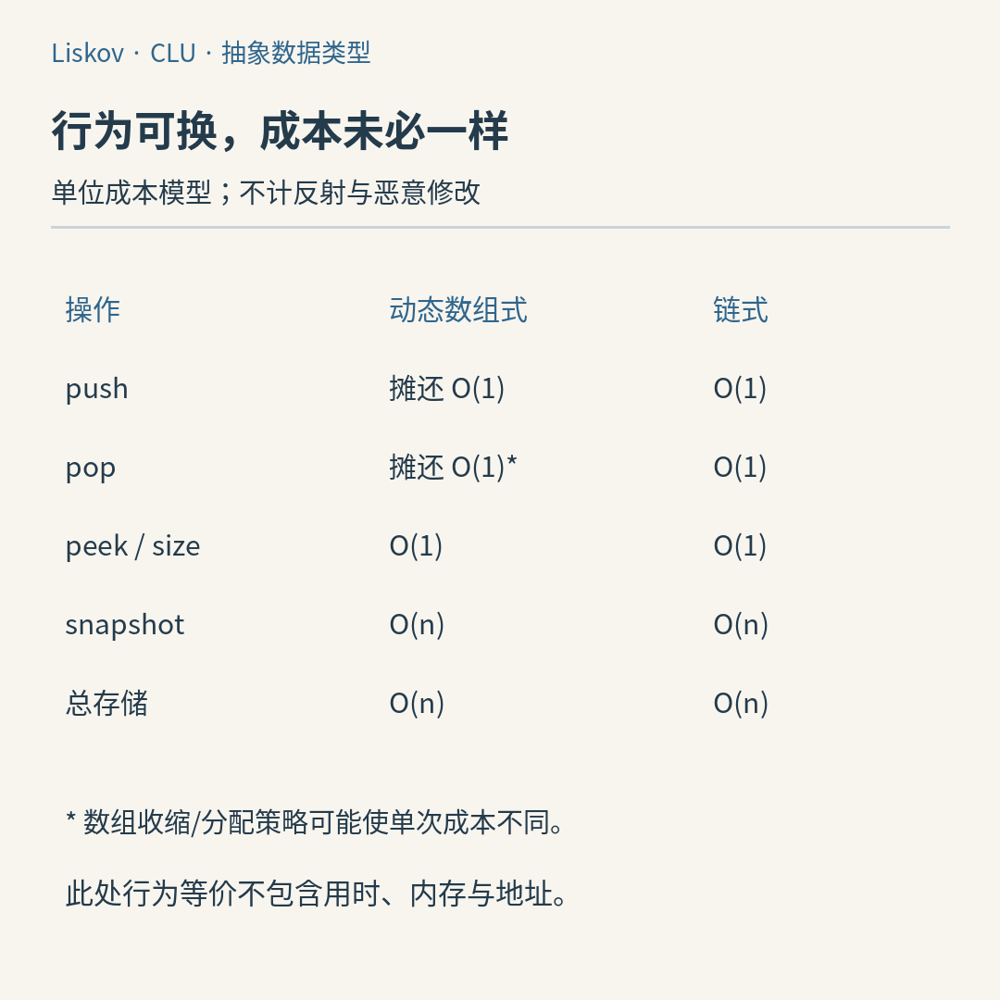

图12：抽象动态数组与链式结构的常见成本模型；Python运行时分配、回收和整数大小不视为严格常数时间保证。

## 13｜回到CLU：不是给Python类换个历史名字

Liskov在1992年的回顾中，把早期工作放在1972—1973年，并明确记述Zilles及其他同事的贡献；CLU这个名字取自cluster。这里讨论的是一支研究团队对程序组织方式的探索，不是“某个人独自发明了全部抽象”。[1]

图13保留她文中图3-1的代码骨架。它不是栈，而是整数集合：头部列出对外操作，rep选择内部数组表示，内部过程实现这些操作。骨架刻意略去实现细节，恰好能看见“外部能做什么”和“内部怎么存”被分开放置。[1]

1976年的《An Introduction to CLU》进一步解释：cluster外把对象当作抽象类型；内部操作通过cvt标记在参数或结果边界以rep类型处理它，类型检查限制外部绕过操作访问表示。这个语言规则与“大家自觉别碰Python下划线字段”不是同一强度的约束。[2]

还要分清两个层次：我们把两个Python类放在同一脚本里，是方便对照实验；历史CLU在一个程序里，同一类型只采用一种实现。本文不声称CLU允许两个不同表示在同一类型的运行中任意混用。[1]

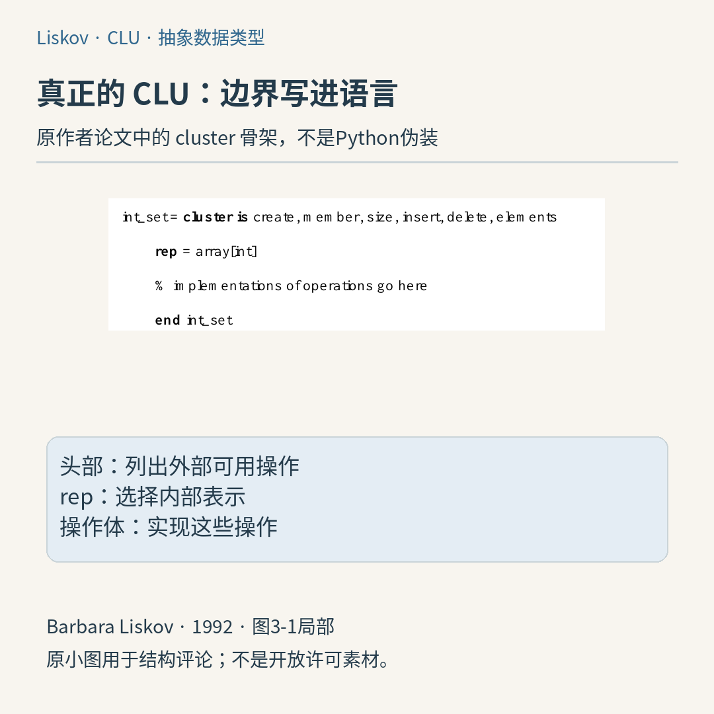

图13：Barbara Liskov《A History of CLU》(MIT/LCS/TR-561, 1992)印刷页9图3-1代码区局部；只摘必要结构，原版权保留，非通用开放或商业授权。

## 14｜表示独立，不是继承的同义词

CLU没有继承机制，这是作者回顾明确指出的设计边界。[1] 但“没有继承”不妨碍它围绕数据抽象组织程序。

本例问的是：同一套整数栈规则，可不可以用不同内部结构实现？它不要求ArrayStack继承LinkedStack，也没有需要重写的父类方法。

现代程序里的继承还可能用于派生类型、代码复用等目的；这些问题与封装有联系，却不能用一个短栈示例就全部证明。本篇不把它改写成Liskov替换原则的传记，也不把“能换表示”当成任意子类都满足行为契约。

更实用的区分是：封装管访问边界，表示替换管既定观测，继承管派生关系或实现复用。先说你正在解决哪一个问题，再挑语言机制。

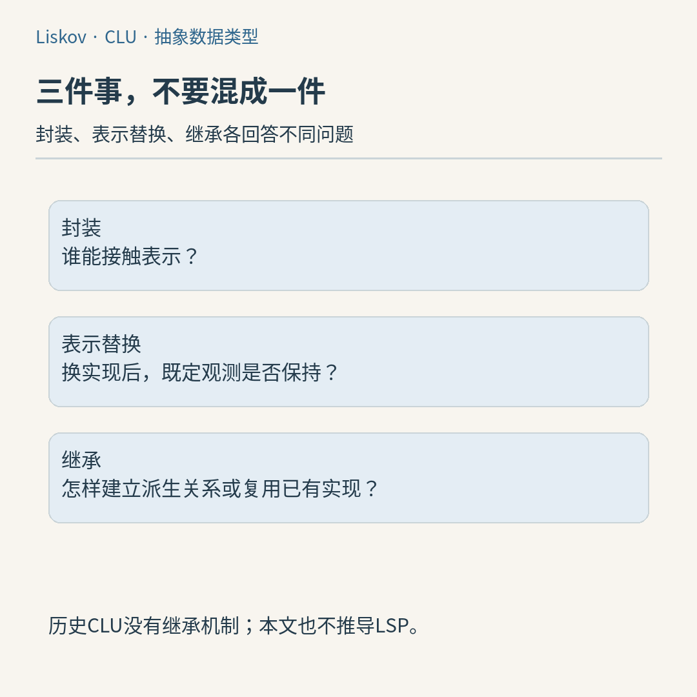

图14：以问题划分概念，不把本篇表示独立的例子偷换成现代类继承或完整行为子类型理论。

## 15｜把论证落到可以复现的实验上

代码枚举长度0到6的调用序列，每一步有五种选择：push(0)、push(1)、pop、peek、size。总数是 `1+5+…+5^6=19531`。每条序列从新空栈开始，逐步比较两个实现的返回或空栈错误，并比较最终快照。

另测非法元素拒绝后状态不变、别名共享、旧快照不变、空栈peek/pop，以及把 `[3,7,9]` 逆序取出得到 `[9,7,3]` 的同一客户端。作者本地实际运行通过；这是有限测试，不是任意长序列的穷尽，也不是CLU编译器测试。

你可以做两个小实验：把链式pop的n减1删掉，看哪条最短轨迹暴露问题；或者把空栈错误改成返回0，看调用者的错误分支怎样被破坏。下面是完整可运行程序，仅需Python标准库，保存为stack_lab.py后执行。

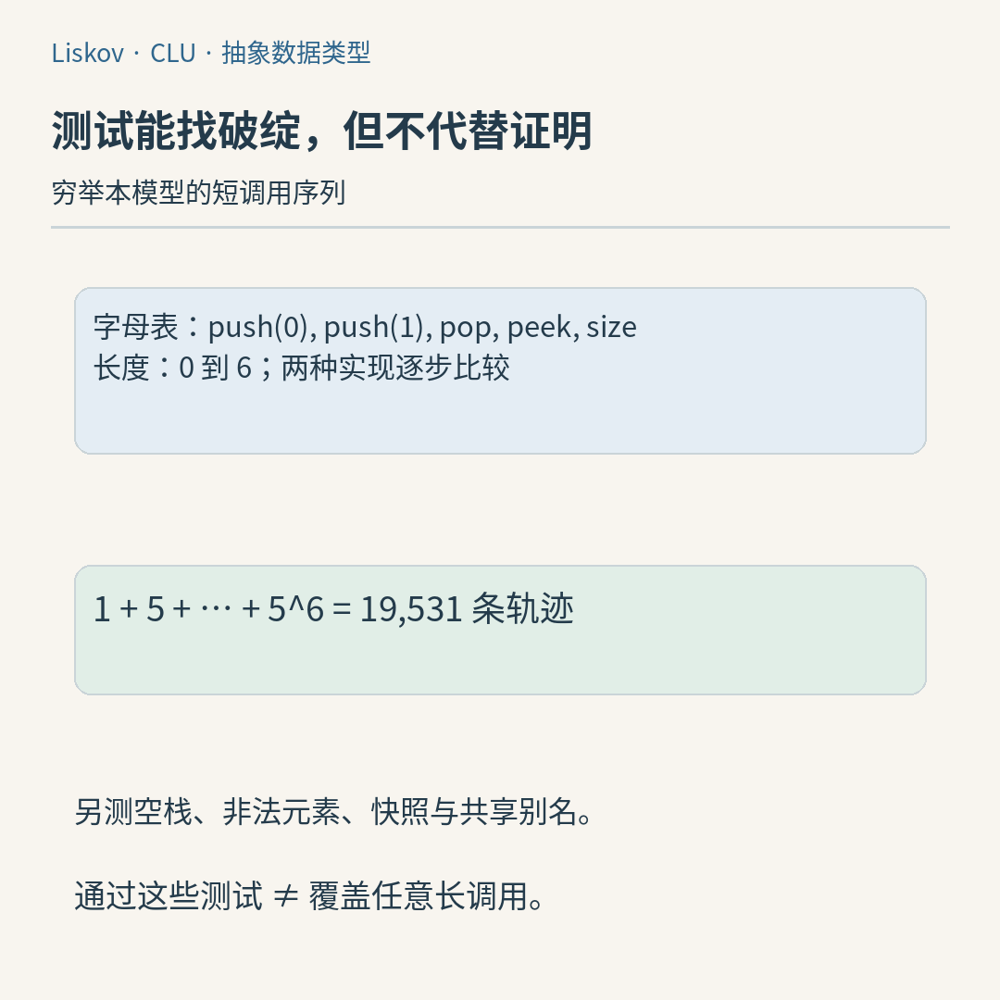

图15：作者可复现实验的穷举范围是19531条有限轨迹，此外有两组实现边界测试；不是全输入证明。

```python
"""Original sequential integer-stack model, not a CLU implementation.
Private attributes are a Python convention, not an access-control boundary.
"""
from dataclasses import dataclass
from itertools import product

class EmptyStack(Exception):
    pass

def integer(x):
    if type(x) is not int:
        raise TypeError('exact int required')

class ArrayStack:
    def __init__(self):
        self._items = []
    def push(self, x):
        integer(x)
        self._items.append(x)
    def pop(self):
        if not self._items:
            raise EmptyStack('empty')
        return self._items.pop()
    def peek(self):
        if not self._items:
            raise EmptyStack('empty')
        return self._items[-1]
    def size(self):
        return len(self._items)
    def snapshot(self):
        return tuple(self._items)

@dataclass(frozen=True)
class _Node:
    value: int
    tail: object

class LinkedStack:
    def __init__(self):
        self._head = None
        self._n = 0
    def push(self, x):
        integer(x)
        self._head = _Node(x, self._head)
        self._n += 1
    def pop(self):
        if self._head is None:
            raise EmptyStack('empty')
        x = self._head.value
        self._head = self._head.tail
        self._n -= 1
        return x
    def peek(self):
        if self._head is None:
            raise EmptyStack('empty')
        return self._head.value
    def size(self):
        return self._n
    def snapshot(self):
        out, node = [], self._head
        while node is not None:
            out.append(node.value)
            node = node.tail
        return tuple(reversed(out))

def apply(stack, op):
    name, arg = op
    try:
        if name == 'push':
            stack.push(arg)
            return ('ok', None)
        if name == 'pop':
            return ('ok', stack.pop())
        if name == 'peek':
            return ('ok', stack.peek())
        if name == 'size':
            return ('ok', stack.size())
        if name == 'snapshot':
            return ('ok', stack.snapshot())
        raise ValueError('unknown operation')
    except EmptyStack:
        return ('empty', None)

def run(factory, ops):
    s = factory()
    return [apply(s, op) for op in ops], s.snapshot()

def client(factory, values):
    s = factory()
    for x in values:
        s.push(x)
    out = []
    while s.size():
        out.append(s.pop())
    return out

def self_test():
    alphabet = [('push',0),('push',1),('pop',None),('peek',None),('size',None)]
    traces = 0
    for length in range(7):
        for ops in product(alphabet, repeat=length):
            assert run(ArrayStack, ops) == run(LinkedStack, ops)
            traces += 1
    for factory in [ArrayStack, LinkedStack]:
        s = factory(); alias = s
        s.push(4); assert alias.pop() == 4 and s.size() == 0
        for value in [True, 1.5, '2', None, []]:
            before = s.snapshot()
            try: s.push(value)
            except TypeError: pass
            else: raise AssertionError('accepted invalid element')
            assert s.snapshot() == before
        s.push(3); old = s.snapshot(); s.push(7)
        assert old == (3,) and s.snapshot() == (3,7)
        assert client(factory, [3,7,9]) == [9,7,3]
        for op in [('pop',None),('peek',None)]:
            empty = factory(); assert apply(empty,op) == ('empty',None)
            assert empty.snapshot() == ()
    return {'trace_pairs':traces, 'boundary_groups':2, 'status':'PASS'}

if __name__ == '__main__':
    print(self_test())
    print(run(ArrayStack,[('push',3),('push',7),('peek',None),('pop',None),('size',None)]))
```

## 16｜真正值得带走的，不是“再包一层”

回头看最初的撤销功能，目标不是把每一行代码都装进类里，而是让改变可以被限制在有边界的位置。

如果调用者只知道操作名字，却不知道错误和别名规则，边界仍然含糊。如果对外返回内部容器，边界又被挖了洞。如果没有抽象函数和不变量，开发者就很难解释“新实现为什么仍然是同一个东西”。

下次你想把数组换成链表、把本地实现换成远程服务，先问图里的四个问题。远程服务还会带来超时、重试和并发等新观测，不能仅靠本篇单线程栈模型盖章。

能清楚回答“哪些变化不应被调用者察觉”，常常比先选一个漂亮的数据结构更重要。

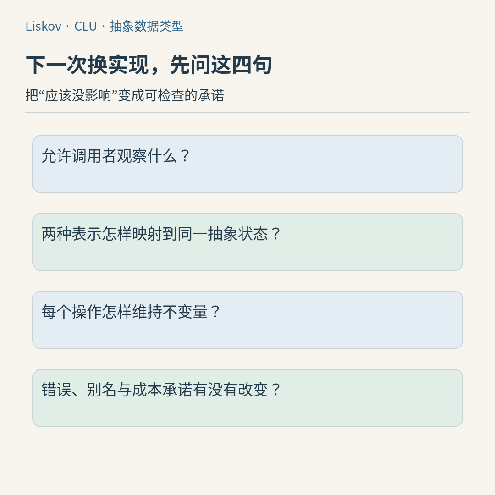

图16：四个可迁移到真实模块设计的问题；若外部依赖未列明，不能只凭同名方法声称安全替换。

## 来源、图像用途与范围

[1] Barbara Liskov, *A History of CLU*, MIT/LCS/TR-561, April 1992：[MIT原PDF](https://publications.csail.mit.edu/lcs/pubs/pdf/MIT-LCS-TR-561.pdf)。本文核读早期历史、模块独立、cluster结构及继承界限相关段落，实际查看印刷页9图3-1；没有声称逐页精读全部31页。图13仅引用该图代码区的小幅局部，用于逐项评论cluster结构，保留作者、题名、年份、页码、图号与链接，不复制整页/整篇。原版权归相应权利人；这是本篇必要的有限教学评论引用，不是开放许可、官方授权或商业素材许可。单独再利用原图仍需评估相应用途与权利。

[2] Barbara H. Liskov, *An Introduction to CLU*, CSG Memo 136, February 1976：[MIT原PDF](https://csg.csail.mit.edu/pubs/memos/Memo-136/Memo-136.pdf)。核读扫描页1—9相关段落，并对照原页确认cvt/类型边界；不把OCR当无误源码，不复制其完整程序，也不声称运行历史CLU。

[3] Liskov、Snyder、Atkinson、Schaffert，*Abstraction Mechanisms in CLU*：[MIT所存一页摘要](https://csg.csail.mit.edu/pubs/memos/Memo-144/Memo-144.pdf)。仅用于确认四作者署名与摘要范围；该文件不是全文，未据它声称读过完整论文。

除图13原小图外，15张图、整数栈模型、数值轨迹与解释为原创教学制作。使用AI辅助撰文和程序绘图。本文没有复刻人物肖像，也没有把官方图用作生成参考。

---

## 短篇导读｜换实现之前，先决定别人能看见什么

把一个栈从数组换成链表，调用者真的可以一行不改吗？答案不是“两个类方法同名就行”。

本文用同一整数栈契约，让数组末尾和链表头分别充当栈顶，再逐步核对push、pop、peek、size以及空栈错误。抽象函数把不同内部形状翻译成同一个底到顶序列；不变量保证每次操作之后仍然能正确翻译。

最容易毁掉这种可替换性的，是悄悄交出内部list，或让调用者依赖节点布局。相反，多个变量共享同一个栈未必有问题，只要共享和修改方式已写进契约。

历史CLU把访问表示的边界落实为语言机制；本文Python代码只靠约定，不是假装强制封装的CLU。原作者论文的一小段cluster结构图帮助辨清两者，其余15图是原创演示。

可运行模型枚举19531条短调用序列，并保留空栈、非法元素与快照边界。有限测试不能代替一般证明，性能、并发与资源失败也不在本例行为等价的承诺里。

不必先背“抽象数据类型”的定义。先问一句：我换掉这个模块时，外面哪些东西本来就不该依赖它的内部细节？

来源、原图版权及AI辅助说明见长文末尾；短篇不提供额外授权。

---

[来源、AI 辅助与许可范围](sources.md)
