# 切线明明指向答案，牛顿法为什么还会绕圈？

给你一个数，问它平方后是不是2。你试1，得到1，偏小；试1.5，得到2.25，偏大。接着试哪个数？

二分法会说：既然答案在两者之间，就把区间砍半。牛顿法多问一句：当前位置的曲线，有多陡？它想借这条斜率信息，一步走得更聪明。

聪明不等于稳妥。这篇文章会亲手算出一个两点循环、一次从0.1飞到33.4的跳跃，还会看到“残差一直变小”为什么仍可能找不到根。最后给切线配两种不同的安全措施：先试后收的阻尼，以及始终保留异号区间的保护策略。

所有曲线、轨迹、表格来自文末自写程序或文中可核算的公式，不是某个科学计算库的性能测试，也不是历史软件运行截图。

## 1｜我们找的是横轴交点

把问题写成 f(x)=x²−2，目标是 f(x)=0。这里的“根”是横轴交点，不是函数最低点。比如 x²−2 在0处最低，根却在±√2。

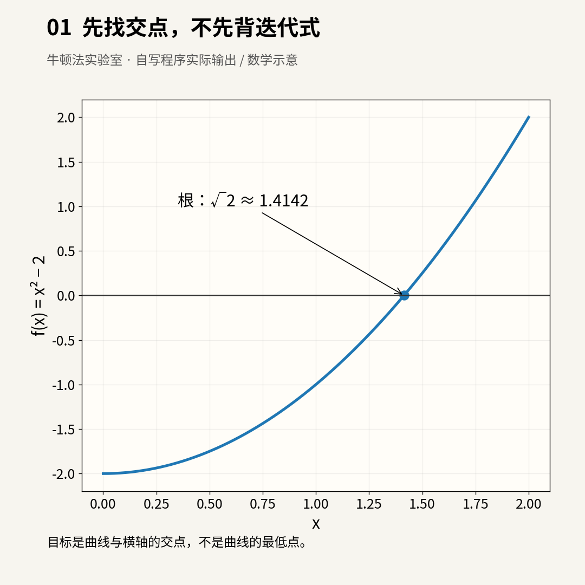
图1｜正半轴上，曲线 x²−2 与横轴交于 √2；这与找曲线的最低点不同。

从 x₀=1 开始，函数值是−1。导数 f′(x)=2x，于是这一点的斜率是2。你可以把导数暂时理解为：在足够小的一段距离里，x每增加一点，f大约以多快的速度变化。

在这个局部，曲线可以用直线替代：

ℓ(x)=f(x₀)+f′(x₀)(x−x₀)=−1+2(x−1)。

让这条直线等于0，得到 x₁=1.5。注意，1.5只是切线的零点，不是真曲线的零点。把它代回去，f(1.5)=0.25，我们还得继续。

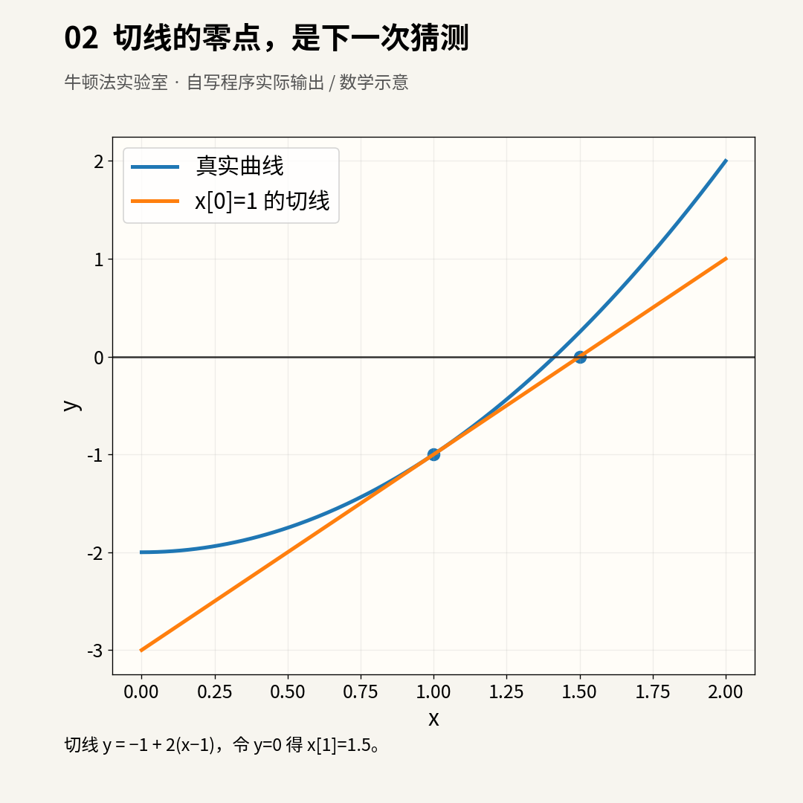
图2｜蓝线是真曲线，另一条线是 x₀=1 处的切线；切线给出下一次猜测1.5。

把刚才的代数换成任意一步，便得到：

xₖ₊₁ = xₖ − f(xₖ)/f′(xₖ)。

这就是本文使用的牛顿迭代。它需要当前位置能够计算函数和导数，而且分母不能是0。公式背后不是“把答案算出来了”，而是“相信当前直线模型能给出一个更好的下一站”。

## 2｜一次成功，究竟快在哪里？

对 x²−2，这个式子也可写成 (x+2/x)/2。文末程序从1开始，实际得到：

1 → 1.5 → 1.4166666667 → 1.4142156863 → 1.4142135624。

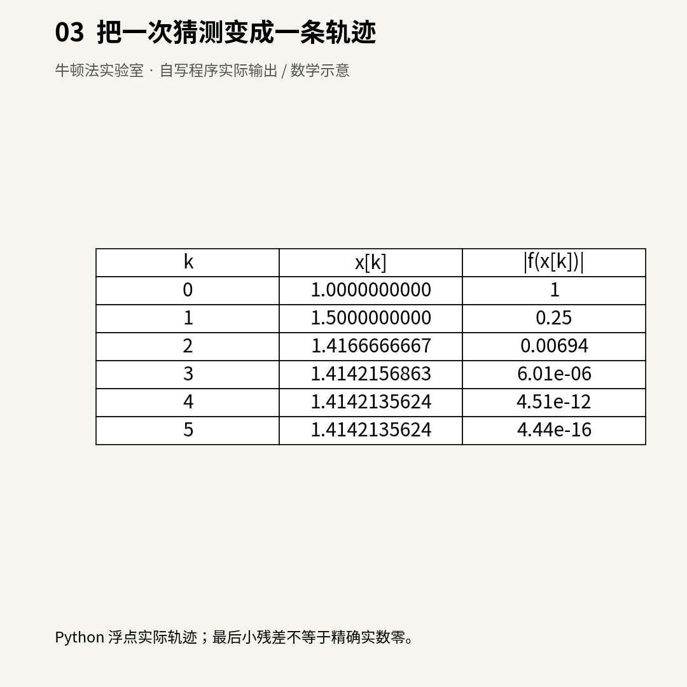
图3｜完整浮点轨迹同时列出 x 和残差 |f(x)|，不是只看屏幕上相邻两次数字像不像。

为什么越到后面越快？设真根 r=√2，误差 e=x−r。直接整理，不必先背定理：

新误差 = (x+2/x)/2 − r = (x−r)²/(2x)=e²/(2x)。

当x已经接近r，分母大致固定，下一次误差相当于把当前误差平方再乘一个常数量级。如果误差已经很小，平方后会更小。这叫局部二次收敛。

“局部”很重要。通常使用的充分条件是：根附近函数二次连续可微，根是简单根，也就是 f(r)=0、f′(r)≠0，并且初值足够接近。不能删掉条件，再宣称任何初值都会快速收敛。NIST DLMF §3.8(ii)给出这一定位；本例的误差公式则由上面直接推导。

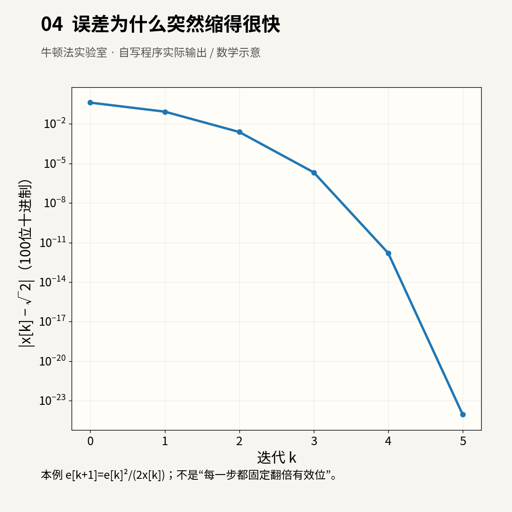
图4｜以100位十进制计算 √2 误差，纵轴采用对数尺度；它展示进入局部区域后的快速缩小。

一般函数也有相似解释。对根r附近的x，泰勒展开可写为：0=f(x)+f′(x)(r−x)+½f″(ξ)(r−x)²。整理得新误差是 f″(ξ)e²/[2f′(x)]。若二阶导数有界、分母离0有余量，就得到一个常数乘 e² 的上界。这是局部论证，不是允许跨越任意远距离的通行证。

实际浮点数只有有限精度。误差小到一定程度后，舍入开始主导，不能指望精度无限翻倍。图4因此另用100位十进制记录前几轮；代码中的一般求解器仍是普通Python浮点。

## 3｜重根：连“平方加速”也有条件

换成 f(x)=(x−1)²，根仍很简单地位于1，但它不是“简单根”：在根处，导数也为0。

只要x还没到1，牛顿更新就是 x新=x−(x−1)/2，所以误差每次减半，而不是平方。

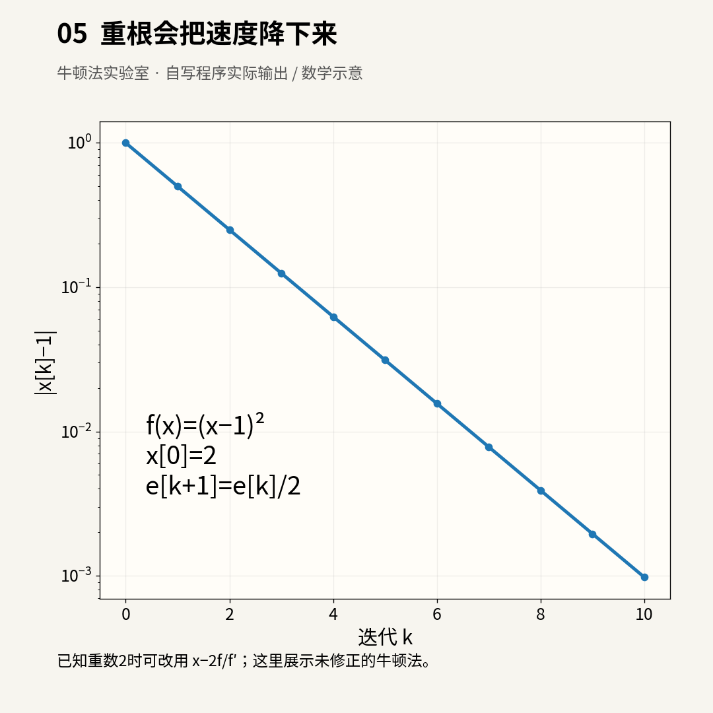
图5｜从2出发求 (x−1)² 的根，误差1、1/2、1/4……按固定比例缩小。

如果事先知道重数m，可以研究修正公式 x−m f/f′；这个平方例子取m=2会一步到根。但不知道重数时不能随便猜，更不能把“用更大步长总会更快”当规则。本文程序保持普通牛顿公式，让这个慢下来的例子真实出现。

## 4｜失败不是一种：先看两点循环

考虑 f(x)=x³−2x+2，导数是3x²−2。

从0出发：f(0)=2，f′(0)=−2，下一步是1。

到了1：f(1)=1，f′(1)=1，下一步又是0。

于是0→1→0→1，永远绕圈。在精确算术中这已是完整反例，不需要归咎于计算机舍入。这个多项式又不是没有实根：f(−2)=−2，f(0)=2，由连续性可知两者之间至少有一根。

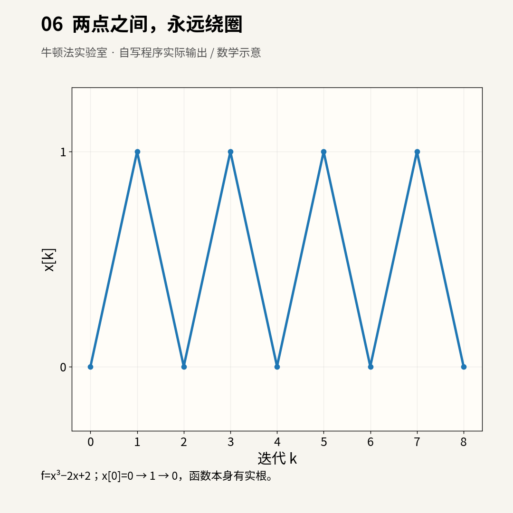
图6｜同一公式反复给出0和1；程序在预算耗尽时退出，不能把退出包装为成功。

再看 f(x)=x³−1，从0开始。函数值−1，但导数为0。切线是水平的 y=−1，它根本不与横轴相交。这里正确的行为是报告导数问题，不是除以0，也不是因为“动不了”就宣布已经收敛。

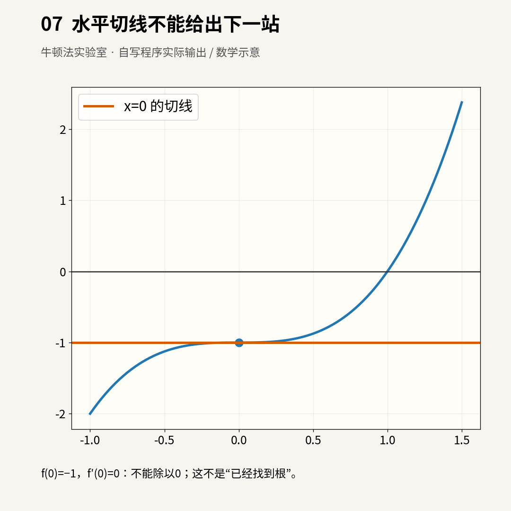
图7｜在0处，水平切线无法提供下一个横轴交点；f(0)仍明显不为0。

从0稍微挪到0.1，导数虽然不为0，却只有0.03；函数值是−0.999。于是步长−f/f′=33.3，下一站竟是33.4。

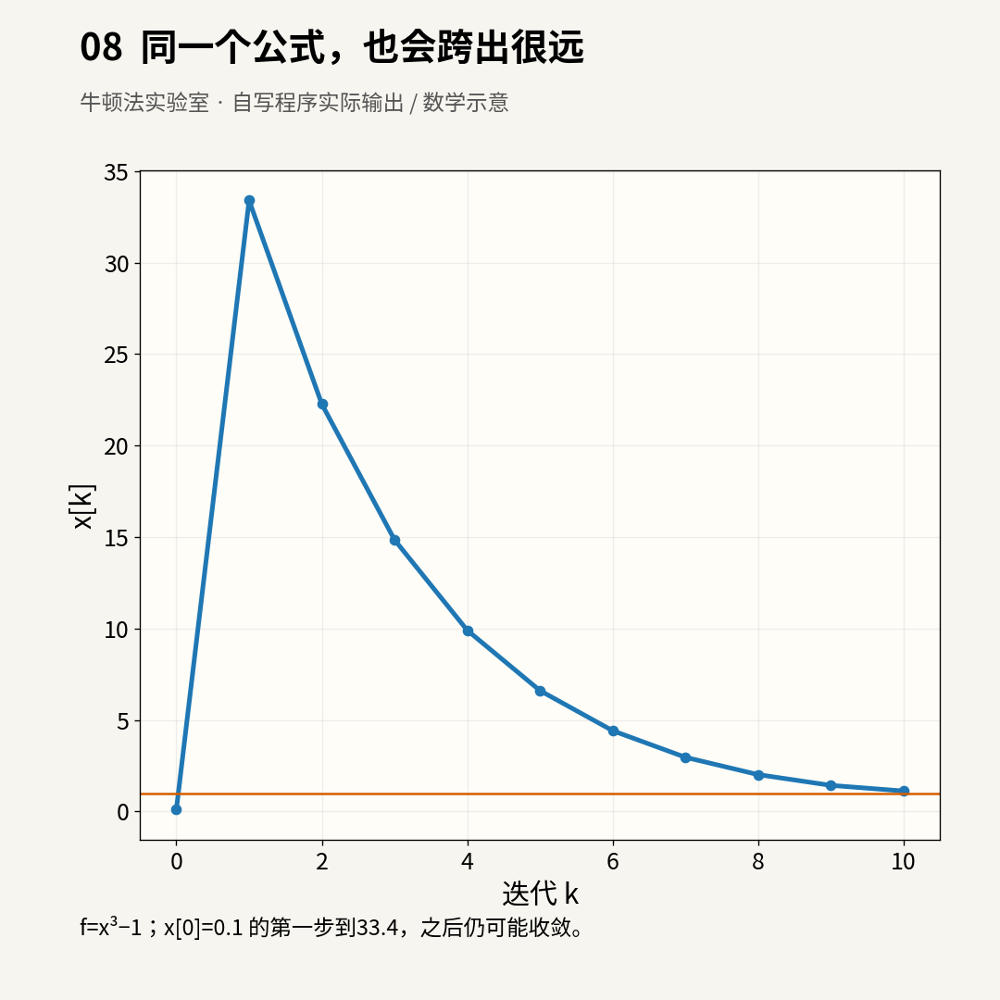
图8｜x³−1 从0.1出发先跳到33.4；一次变坏不等于永远失败，本例完整步后来仍收敛。

这解释了为什么单纯检查“导数不为0”还不够。导数相对于函数值过小，也可能带来巨大步长。函数本身还可能在候选点无定义，或者像 exp(1000) 一样超出浮点表达范围。程序要分别记录这些情况，而不是把所有错误都折成一个“没算出”。

## 5｜阻尼不是改方向，而是先缩短这一脚

把完整步写成 p=−f/f′，然后试 x新=x+αp，其中0<α≤1。α=1是原来的完整步；α小一点，就是沿同一方向少走一些。

问题不是永远取0.1。固定的小步可能浪费本来很好的局部加速。更自然的做法是：先试完整步，不好就减半，再试。

为了说清“好不好”，选一个评分 φ(x)=½f(x)²。它越小，残差越小。只要f、f′非零且都有效，沿牛顿方向的瞬时变化率是：

φ′(x)p = f(x)f′(x) · [−f(x)/f′(x)] = −f(x)² < 0。

所以在精确光滑模型下，足够短的正向步会下降。但这只说明当前位置附近有下降步，不保证一定到根，也不保证有限次回溯预算内一定找到它。

本文用一个明确的充分下降条件，取c=1/4：

φ(x+αp) ≤ φ(x)+cαφ′(x)p = (1−α/2)φ(x)。

为了避免 f² 本身溢出，代码采用等价的绝对值比较：

|f(x+αp)| ≤ √(1−α/2) |f(x)|。

这是本文自定的教学实现，不是照抄资料里的求解器。α从1开始，最多连续减半40次；无有限有效候选、没有足够下降或候选因舍入等于原点，都可能返回明确的 line_search 状态。

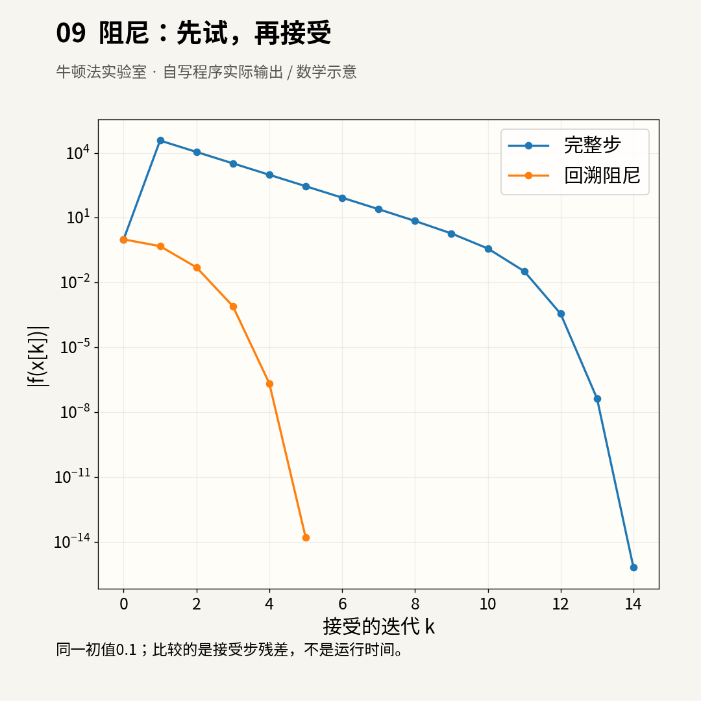
图9｜对 x³−1 的同一初值0.1，回溯阻尼避免了第一步残差的大幅上升；横轴只数接受步，不计运行耗时。

别只看接受后的漂亮曲线。每一轮被拒绝的试探同样要花函数计算。第一轮程序把α、候选点、残差和判定全部保存下来：

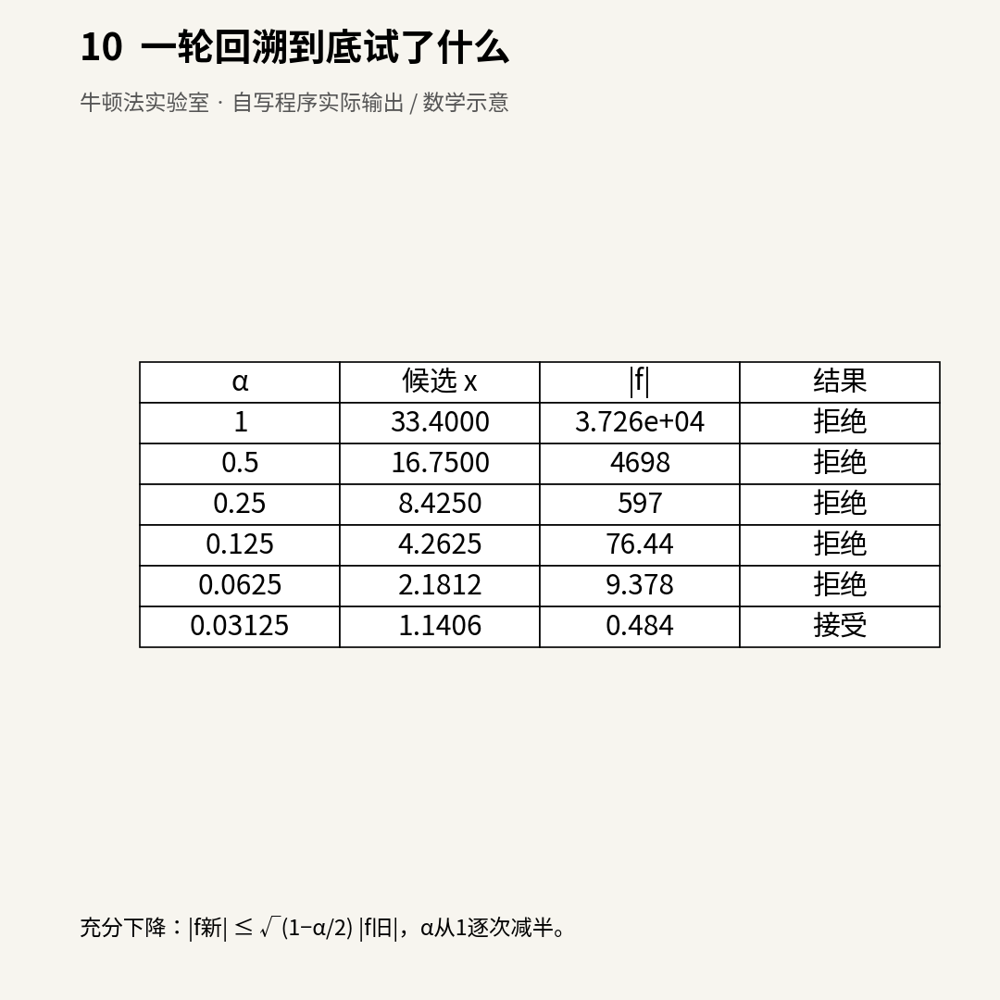
图10｜第一轮完整试探表从α=1开始逐次减半；这是真实执行记录，不是事后挑出的几次成功点。

本例的阻尼轨迹明显更稳，但它不是对所有函数的竞速结论。若一次函数计算非常昂贵，反复试探可能成为主要开销。若完整步本来很好，回溯检查也有自己的成本。

## 6｜下降到一个低谷，不一定下降到零

看看 f(x)=x²+1。实数范围内根本没有根。评分 φ=½(x²+1)² 却有一个很漂亮的最低点x=0。

从x=1出发，牛顿步恰好到0：残差从2降到1，满足上面的充分下降条件。下一轮导数为0，程序停止。不能因为φ降了就说“找到了根”，更不能把x=0当作 f(x)=0 的解。

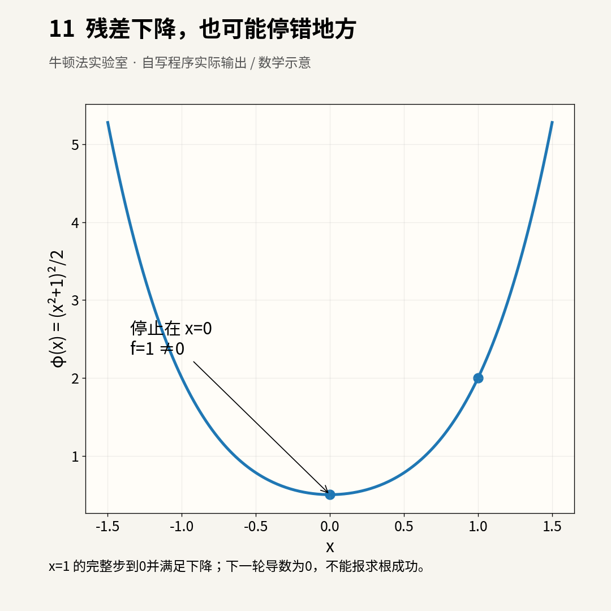
图11｜评分最低点的残差仍是1；实际程序返回 derivative，而不是 residual。

即便原函数有根，平方残差也可能存在非零残差的驻点。φ′=ff′，所以φ′=0既可能是f=0，也可能只是f′=0。阻尼改善的是试探接受机制，不会凭空制造根，也不会自动排除所有不理想的驻点。

## 7｜另一种保护：始终留住异号区间

如果已知连续函数在[a,b]两端异号，就掌握了比“朝某个方向下降”更直接的信息：区间中至少有一根。

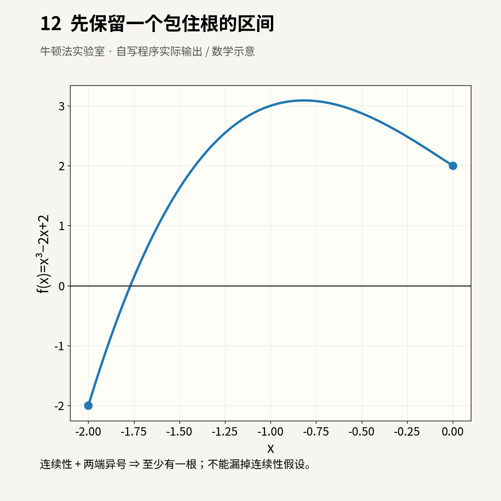
图12｜对发生两点循环的多项式，区间[−2,0]的函数值为−2和2，可用连续性把根包住。

这里不能省略连续性。1/x在[−1,1]两端也异号，中间却是断点而不是根。程序只能检查端点符号和数值是否有限，不能自动证明用户传入的函数在整段连续。

最朴素的二分法试中点，再留下异号的一半。能否也借用牛顿的聪明？可以，但不要只规定“落在区间里就接受”。候选若无限贴近一个端点，区间可能缩得很慢。

本文采用便于证明的保守规则：从残差较小的端点生成牛顿候选，只有它落在中央半区 [a+(b−a)/4, b−(b−a)/4] 才接受，否则改试中点。

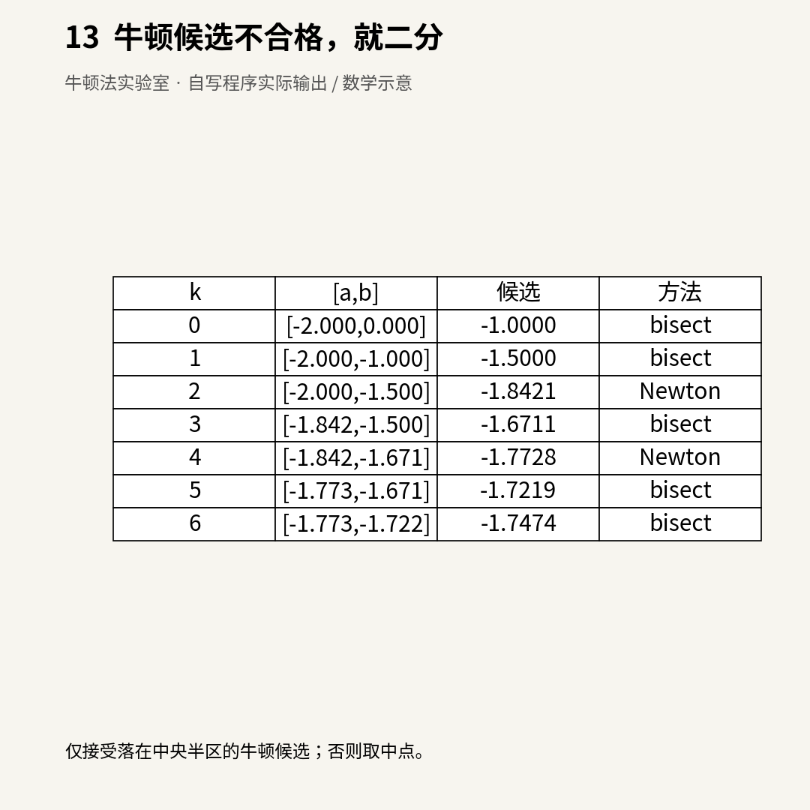
图13｜前几轮同时列出旧区间、候选和采用的方法；Newton与bisect来自程序实际选择。

候选点求值后，如果不是计算出的零，就保留与它异号的一端。由于试探点离两侧至少旧宽度的1/4，剩余宽度最多为旧宽度的3/4。

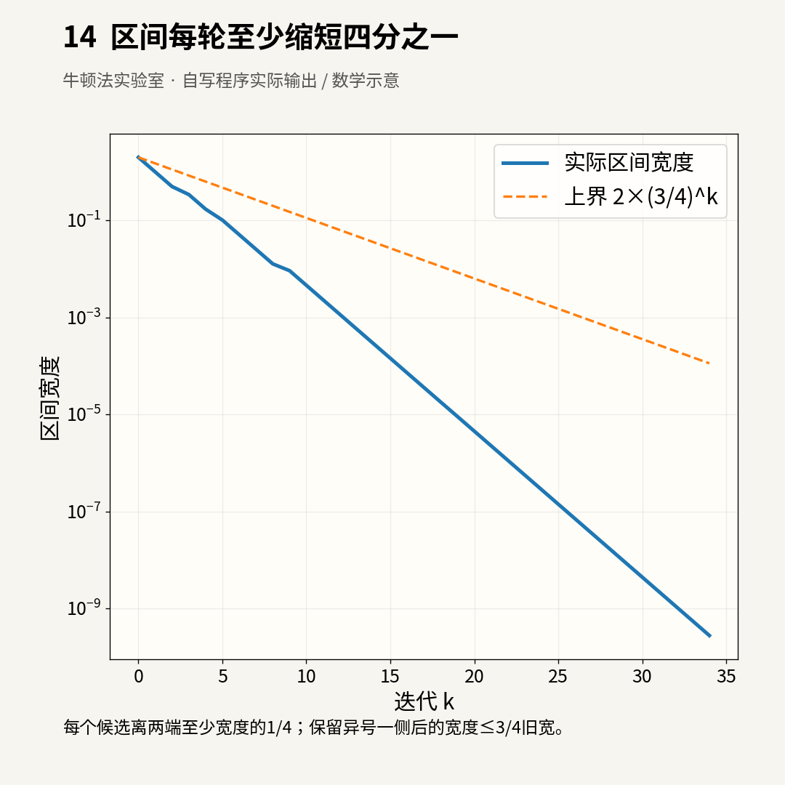
图14｜真实区间宽度与 2×(3/4)ᵏ 上界对照；这里初始宽度是2。

在精确算术、连续性和可靠符号的前提下，这保证区间收缩，不依赖牛顿候选一定高明。代价也要说明：这么严格的中央半区规则可能拒绝很好的近端点牛顿步，因此本文不宣称混合法最终一定保持纯牛顿的二次速度。它是容易检查的安全教学版本，不是成熟数值库全部技巧的替身。

代码在区间宽度≤2xtol时返回中点。在上述精确前提下，中点离区间内某个根不超过xtol。普通浮点求值有舍入，端点符号和“计算为0”都不构成严格实数认证；做认证求根需要额外的区间算术等手段。相邻浮点数无法再分时，程序返回roundoff，而不伪装成满足任意小容差。

## 8｜停止条件也有尺度

残差 |f(x)| 小，看起来很有说服力。但把同一方程乘以10⁻²⁰，根完全没变，残差却突然变得微小。

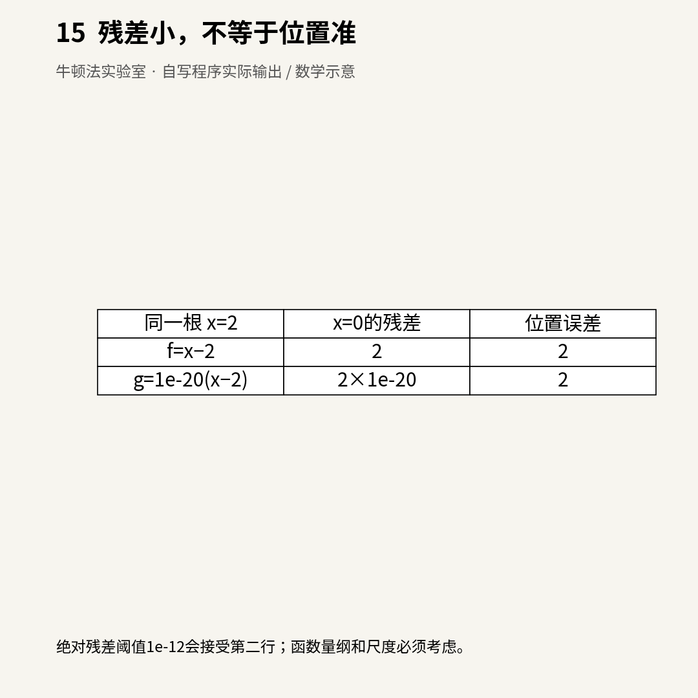
图15｜x−2与10⁻²⁰(x−2)的根都为2；在x=0处位置误差同为2，但绝对残差相差20个数量级。

本文求解器刻意把状态叫 residual：它只表示当前计算残差满足给定绝对阈值，不承诺位置误差也满足某个阈值。实际问题应该考虑单位、尺度、相对阈值，以及是否能估计根附近斜率。

如果在相关区间已知 |f′|≥m>0，那么中值定理能给出 |x−r|≤|f(x)|/m。没有这样的斜率下界，不能直接把残差当位置误差。

也不能只用“这一步很小”作为成功证据。舍入可能使x+αp恰好等于x，函数仍离0很远。代码遇到这种停滞会拒绝候选或报告失败，不偷偷把它叫作成功。

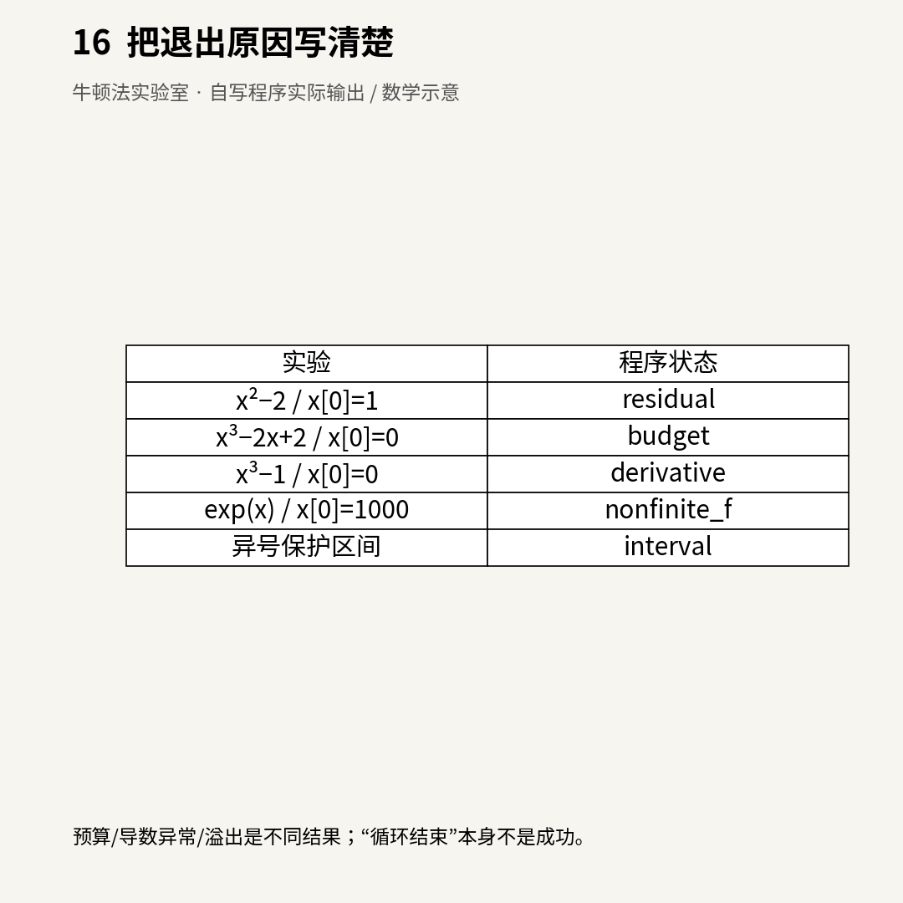
图16｜残差通过、预算耗尽、导数异常、非有限值、区间达标是不同状态；调用者需要分别处理。

## 9｜把实验交给你，而不是只给一张结论图

后附 newton_lab.py 是完整核心，标准库即可运行。solve实现纯牛顿或上述回溯，bracket实现中央半区保护。函数由调用者提供，假设它是确定性的实值函数、导数对应正确。设置错误会抛ValueError；求值中的数学域错误、溢出和除零会转为非有限求值状态；其他编程错误不被吞掉。它不是适合任意Python对象或任意不连续函数的通用接口。

solve每轮一次导数，另有函数试探；若最多K轮、每轮最多B+1次试探，函数评价次数为O(K(B+1))、导数O(K)。保存完整trace/trials也需要O(K(B+1))记录空间。bracket每轮常数量函数/导数评价与O(K)日志。这是把每次函数/导数求值视为一次黑箱操作的计数，不保证复杂回调同样便宜，也不是高精度位运算复杂度。

作者自查另用70位十进制平方根作参照，检查200个 x²−n/13 的异号区间求解和逐轮候选范围，共7,591项检查；另逐条验证两点循环、无根驻点、导数零、指数溢出以及接受步充分下降条件。它们支持这些具体实现与案例，不是对全部可微函数正确性的穷尽证明。

你可以做三个有区分度的实验：

1. 把x³−1的初值从0.1换成0.01，比较完整步跳跃与回溯次数，而不只数接受步。
2. 把残差阈值缩小，再给函数整体乘一个常数，观察“成功”状态为何改变。
3. 把中央半区限制去掉，只要求候选在区间中，寻找区间收缩非常慢的案例。

牛顿法最值得学的，不只是那一行公式，而是把局部模型、试探接受、全局信息与停止证据分开。公式负责提出建议，剩下的机制负责决定：这一步值得走吗？走完之后，我们究竟知道了什么？

## 附录：完整核心程序 newton_lab.py

```python
"""Scalar real teaching solvers. No claims of certified floating-point roots."""
import math


def value(fun, x):
    try:
        y = float(fun(x))
    except (OverflowError, ValueError, ZeroDivisionError):
        return None
    return y if math.isfinite(y) else None


def settings(x, ftol, steps):
    if not math.isfinite(x) or not math.isfinite(ftol) or ftol < 0:
        raise ValueError('finite x and nonnegative finite ftol required')
    if type(steps) is not int or steps < 0:
        raise ValueError('steps must be a nonnegative integer')


def solve(f, df, x, *, damped=False, ftol=1e-12, steps=60, backtracks=40):
    """Return status, x, accepted trace, trial log; no tiny-step success rule."""
    x = float(x)
    settings(x, ftol, steps)
    if type(backtracks) is not int or backtracks < 0:
        raise ValueError('backtracks must be a nonnegative integer')
    trace, trials = [], []
    for k in range(steps + 1):
        y = value(f, x)
        if y is None:
            return dict(status='nonfinite_f', x=x, trace=trace, trials=trials)
        trace.append(dict(k=k, x=x, f=y))
        if abs(y) <= ftol:
            return dict(status='residual', x=x, trace=trace, trials=trials)
        if k == steps:
            status = 'budget'
            break
        d = value(df, x)
        if d is None or d == 0:
            status = 'derivative'
            break
        p = -y / d
        if not math.isfinite(p):
            status = 'nonfinite_step'
            break
        accepted = False
        for j in range(backtracks + 1 if damped else 1):
            alpha = 2.0 ** (-j)
            z = x + alpha * p
            q = value(f, z) if math.isfinite(z) else None
            # Equivalent to phi(z) <= (1 - 2*c*alpha)*phi(x), c=1/4.
            # Compare |f| instead of squaring, avoiding square overflow.
            ok = q is not None and (not damped or
                 abs(q) <= math.sqrt(1 - 0.5 * alpha) * abs(y))
            trials.append(dict(k=k, j=j, alpha=alpha, x=z,
                               f=q, accepted=ok and z != x))
            if ok and z != x:
                x = z
                accepted = True
                break
        if not accepted:
            status = 'line_search' if damped else 'invalid_or_stagnant'
            break
    return dict(status=status, x=x, trace=trace, trials=trials)


def bracket(f, df, a, b, *, xtol=1e-10, steps=120):
    """Central-half Newton or midpoint. Caller supplies continuous f and bracket."""
    a, b = float(a), float(b)
    settings(a, xtol, steps)
    if not math.isfinite(b) or not a < b or not math.isfinite(b-a):
        raise ValueError('finite ordered endpoints and finite width required')
    fa, fb = value(f, a), value(f, b)
    if fa is None or fb is None:
        raise ValueError('finite endpoint evaluations required')
    if fa == 0 or fb == 0:
        x = a if fa == 0 else b
        return dict(status='computed_zero', x=x, interval=[x,x], trace=[])
    if (fa > 0) == (fb > 0):
        raise ValueError('opposite signs required')
    trace = []
    for k in range(steps):
        width = b-a
        mid = a + width/2
        if width <= 2*xtol:
            return dict(status='interval', x=mid, interval=[a,b], trace=trace)
        if mid == a or mid == b:
            return dict(status='roundoff', x=mid, interval=[a,b], trace=trace)
        x, y = (a,fa) if abs(fa) <= abs(fb) else (b,fb)
        d = value(df,x)
        z = x-y/d if d not in (None,0) else math.nan
        kind = 'Newton'
        if not math.isfinite(z) or not a+width/4 <= z <= b-width/4:
            z, kind = mid, 'bisect'
        fz = value(f,z)
        if fz is None:
            return dict(status='nonfinite_f', x=z, interval=[a,b], trace=trace)
        trace.append(dict(k=k,a=a,b=b,x=z,f=fz,kind=kind))
        if fz == 0:
            return dict(status='computed_zero',x=z,interval=[z,z],trace=trace)
        if (fz > 0) == (fa > 0):
            a,fa = z,fz
        else:
            b,fb = z,fz
    return dict(status='budget',x=a+(b-a)/2,interval=[a,b],trace=trace)


if __name__ == '__main__':
    f, df = lambda x: x*x-2, lambda x: 2*x
    print(solve(f,df,1))
    print(bracket(f,df,0,2))
```

## 短读版｜牛顿法快，但切线不替你保底

求 f(x)=0 时，牛顿法用当前位置切线的零点作下一次猜测：x新=x−f/f′。对 x²−2，从1出发很快逼近√2；当根简单、函数足够光滑且初值已在附近，误差可进入局部二次收敛。

局部不是全局。x³−2x+2从0出发会在0、1之间循环；x³−1在0处导数为0，从0.1出发又会先跳到33.4。

阻尼先试完整步，不满足充分残差下降就把步长减半。但残差下降也可能止于非零残差驻点：x²+1根本没有实根，从1到0后导数为0，不该报成功。

若有连续函数的异号区间，可以保留它，并只接受中央半区的牛顿候选，否则二分。这个保守版本让区间每轮最多保留原宽的3/4，却不承诺最后一定维持纯牛顿的二次速度。

长文附16幅真实实验图与完整标准库代码，还讨论溢出、舍入、重根与停止尺度。尤其要记住：把方程乘10⁻²⁰不会改变根，却会改变绝对残差；残差小不是位置误差小的无条件证明。

---

[来源、材料权利与编写说明](sources.md)
