# 一块屏幕位置，为什么只记一个深度？从遮挡到 Z-fighting

## 01｜先别问物体离相机多远，先问它们是否争同一个位置

游戏画面里，一面墙挡住一把椅子。最直觉的做法是把远东西先画、近东西后画。但两张三角形可能穿插：左边 A 在前，右边 B 在前。给整张三角形排一个全局顺序，未必有答案。

深度缓冲换了问题：在屏幕的这个采样位置，所有覆盖它的表面中，谁离观察者最近？每个位置维护一张小纸条，写下目前留下来的深度，再配一份颜色。后来者不靠出场顺序抢位置，而是先比较纸条。

图1不是某款游戏截图。它来自本文完整附带的三角形光栅器。橙片和蓝片各有固定轴深度，紫片一端近、一端远；紫片在不同位置可以挡住不同表面。本文研究的是“已覆盖以后谁留下”和“有限精度能否分清”，不是重复推导像素画线算法或纹理的透视正确插值。

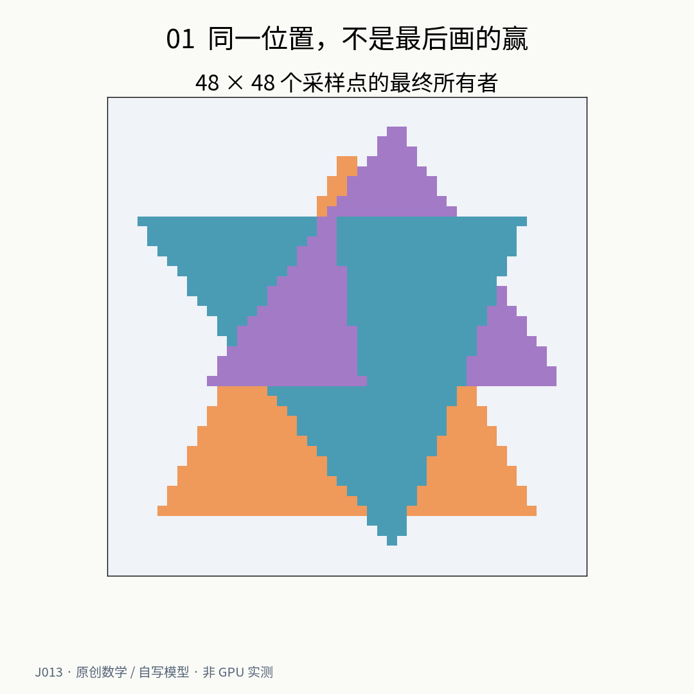
图1｜自写单采样光栅器输出：橙、蓝、紫三片三角形相互遮挡，浅灰是背景。

## 02｜一次比较，两个可能的动作

先固定全篇约定：相机朝正 z 看，z 表示相机坐标系的正向轴深度，不是到相机原点的欧氏距离。near=n>0，far=f>n。正常映射把近裁面变成 d=0、远裁面变成 d=1；本模型的投影后深度范围就是 [0,1]，不混入另一套 [-1,1] 约定。

清屏时深度填 1。候选 d 小于已存值才通过；通过后同时更新深度和颜色，失败则两者都不动。图2把三次动作完整展开。注意“开启测试”和“允许写深度”是两个独立开关：只测试、不写，后续片元比较的仍然是旧纸条。

这里用严格 LESS，因此候选深度等于纸条时不通过。清除值是 1，于是恰在远裁面、映射为 1 的表面也过不了这次严格测试；这不等于它必然被裁剪剔除。用 LESS_EQUAL 会改变等深度和远端行为，不能把这个边界藏起来。

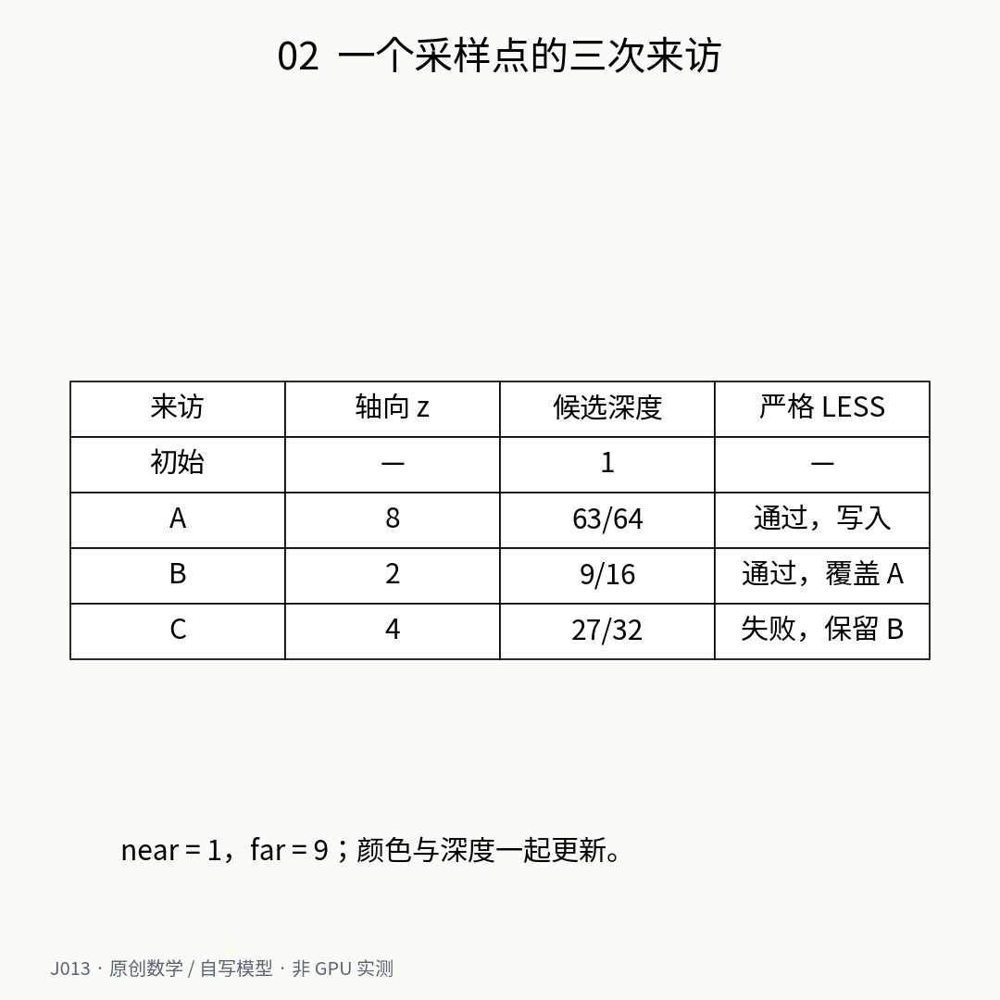
图2｜比较的是映射后的深度；C 虽然后画，却比已经留下的 B 更远。

## 03｜为什么一个数够用？因为我们只要最近的那一层

假设每个采样位置只需要一个不透明表面，没有特殊着色器改写深度，没有其他测试改变参与集合。处理完前 k 个覆盖候选后，纸条保持其中最小的深度（还要与初始清除值比较）。第 k+1 个更小就替换，否则不动，因此这个性质一直成立。它就是最小值扫描，不必把所有历史候选都存下来。

这说明在候选集合固定、深度可比较、没有决定性平局时，提交顺序不影响最近结果。颜色不是额外的几何答案，只跟随胜出的候选。若两个表面深度完全相等，严格 LESS 留下先到者；LESS_EQUAL 则让后到者覆盖。所谓“不依赖顺序”必须把平局条件说完。

图3确实分别运行了六次，不是把一张图复制六遍。代码还检查正向与反向映射的所有六种排列，比较完整所有者数组。

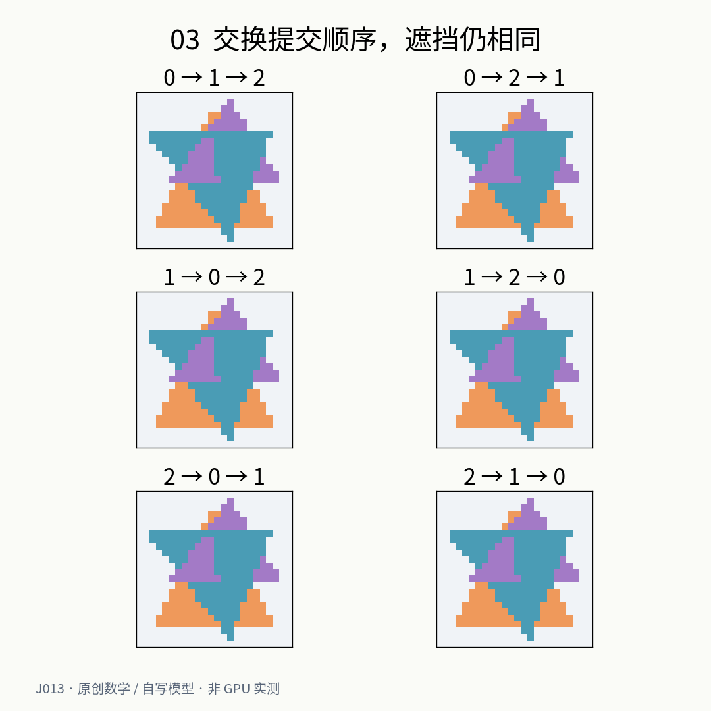
图3｜三片三角形的六种提交顺序，在这组无决定性深度平局的样本上得到同一结果。

## 04｜“每像素一个数”只是简写

光栅器先判断一个采样点落不落在三角形内部，再判断深度。像素边缘只覆盖一部分时，覆盖问题仍然存在；深度缓冲并不会自动消除锯齿。

本文每个像素只在中心采一次，因此一个深度够表达这个单采样模型。多重采样可以在同一个像素内安排多个位置；不同位置可能看到不同表面，深度存储通常需要相应地按采样点处理。图4右侧只用来解释这个差别，代码没有实现 MSAA。

代码采用三角形边界包含的重心判定，不实现真实 API 的 top-left 共享边归属规则；相邻三角形共边处可能同时成为候选，最后仍按深度与平局规则处理。不要拿这个简化版去验证某张显卡的精确边界覆盖。

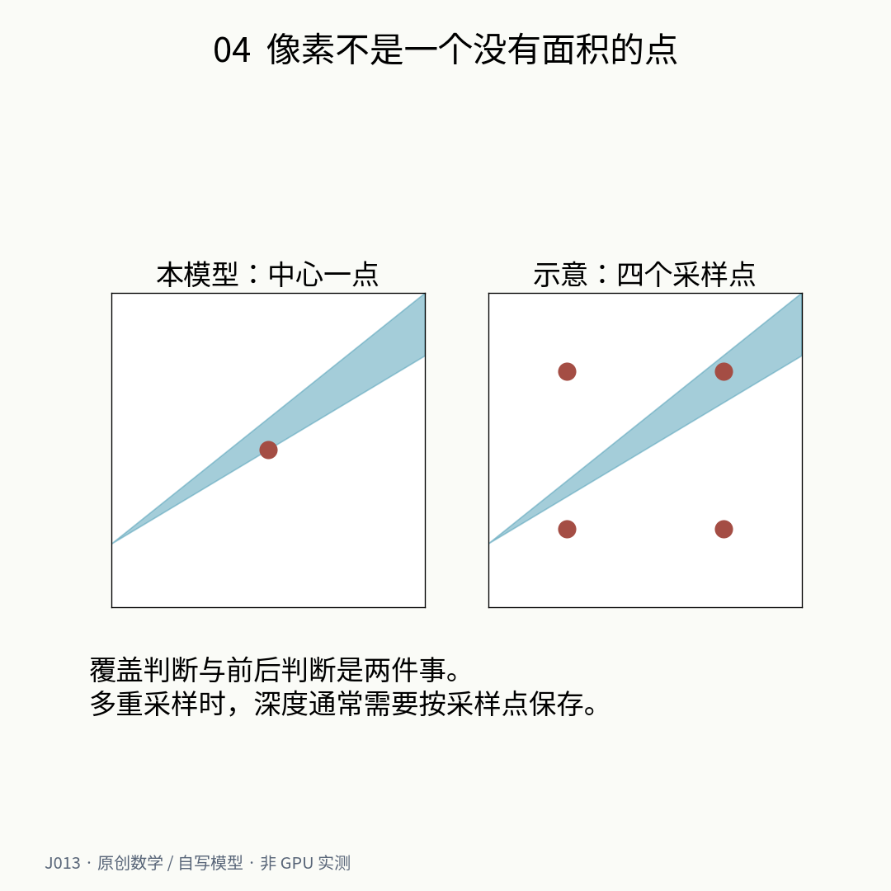
图4｜同一像素内的多个采样点可能被不同表面覆盖；右图只是采样布局示意。

## 05｜深度值不是把 z 除以 far

一种常见透视投影可写成 z_clip=A z+B、w_clip=z。透视除法后 d=z_clip/w_clip=A+B/z。现在要求 d(n)=0、d(f)=1，解得：

A=f/(f−n)，B=−fn/(f−n)。
d(z)=f/(f−n)−fn/((f−n)z)=f(z−n)/(z(f−n))。

这不是神秘的压缩技巧，而是投影矩阵的线性运算接上除以 w 的结果。因为导数 d′(z)=fn/((f−n)z²)>0，正向深度随 z 增加而增加，所以比较 d 的大小仍能判断同一条视线上的前后。但增长速度按 1/z² 下降，远处空间变化很大，d 也可能只动一点点。

屏幕不同位置的相同 z 不意味着到相机的径向距离相同。深度缓冲服务于各自采样位置的可见性，不是一张未经处理的激光测距图。

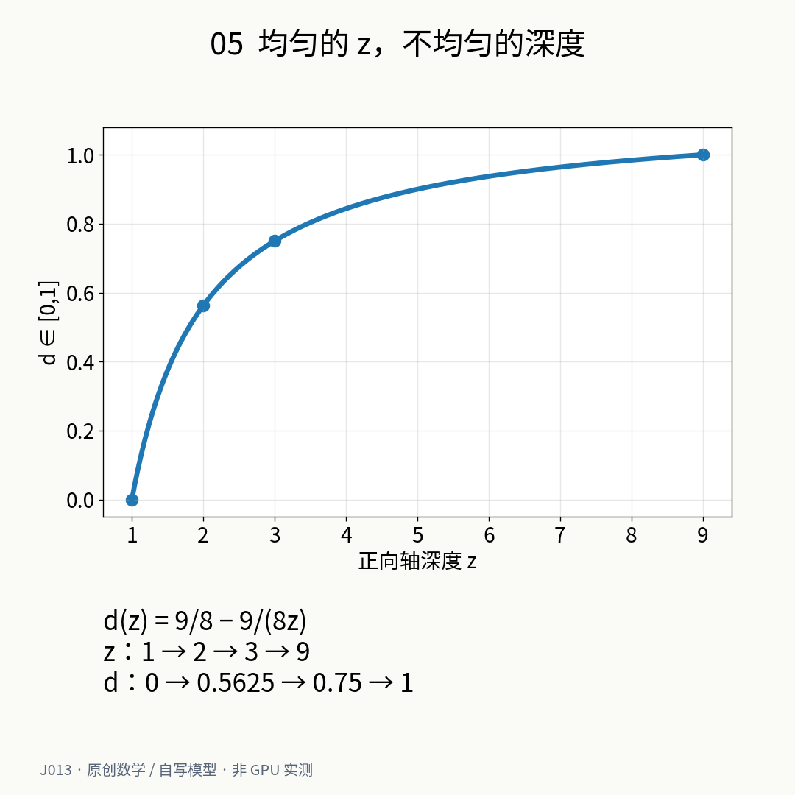
图5｜near=1、far=9 时的独立公式计算：远处很长一段空间挤在深度值 1 附近。

## 06｜投影深度在屏幕里可以线性插值，轴深度不行

三角形投影后，先求采样点在屏幕三角形中的重心权重 λ0、λ1、λ2，三者和为 1。对默认的投影深度，可以直接算 d=Σλi di。这是本程序实际做的事。不能把顶点轴深度 z 直接做同样插值，然后再套 d(z)。

一个边上的例子最容易算清：端点 z 分别为 2、8，屏幕中点两端权重各为 1/2。此处 1/z=(1/2+1/8)/2=5/16，所以 z=16/5=3.2，而非 5。用 n=1、f=9，两个端点 d 是 9/16、63/64，平均是 99/128；反解恰好得到 3.2。

原理是投影后的 1/z 在屏幕三角形上是仿射函数，d 又是它的仿射变换。这与“普通顶点属性通常要做透视正确插值”并不冲突：不要把已经透视除法后的 d 当作普通属性再额外除一次 w。本文只讨论这条深度通道，不重讲纹理坐标课程。

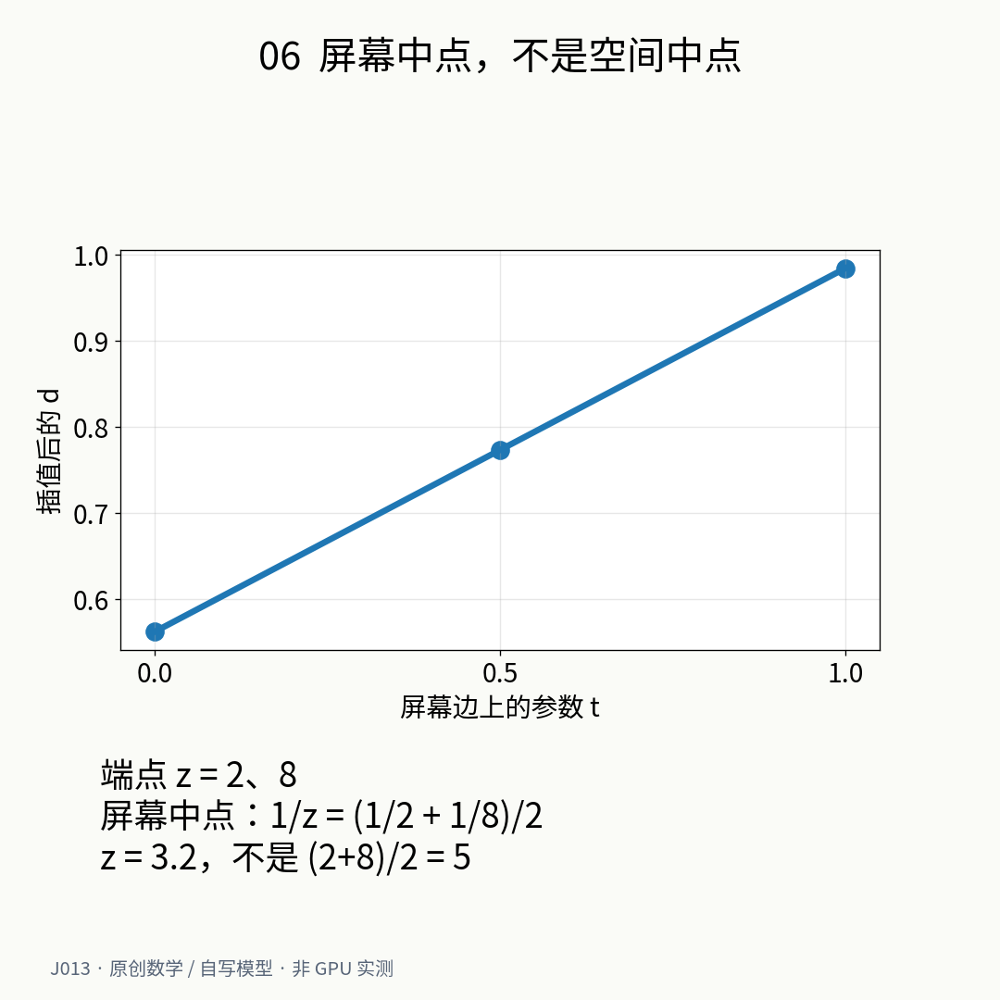
图6｜先对顶点投影深度做屏幕线性插值，屏幕中点深度为 99/128，对应轴向 z=3.2。

## 07｜把缓冲读出来，会看到什么

图7把图1同一次计算里的深度数组画出来。背景一直是清除值 1；有几何的地方保存最近通过者的 d。固定 z 的三角形可以是一块固定色，斜着的三角形出现梯度。

若想恢复轴向 z，可以解方程：z=nf/[f−d(f−n)]。必须使用产生这份深度的 near、far 与映射约定。把别的相机参数、反向 Z 或非默认深度范围混进来，所得“距离”会错。

还要先知道这个值是否来自背景。有的工作流会另存覆盖或对象标记；本文用 owner=-1 区分没有表面留下的位置。仅见 d=1，并不能在所有比较策略下断言那里必无几何。

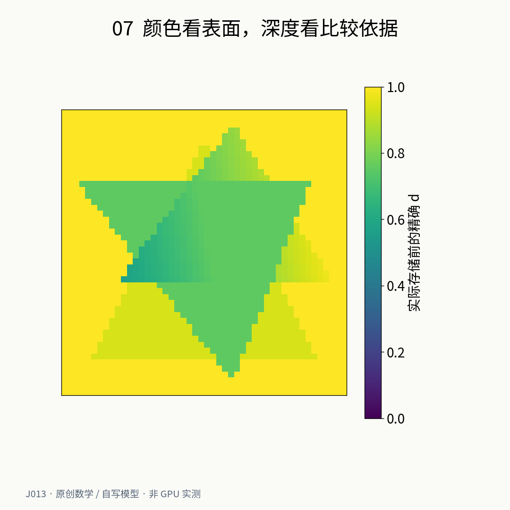
图7｜图1同一次运行的深度缓冲；背景为清除值 1，颜色梯度不是世界空间距离的线性刻度。

## 08｜有限位数把连续世界压进格子

假设用 b 位无符号归一化整数存深度。它能表示 k/(2^b−1)，k 从 0 到 2^b−1；深度空间中的步长固定。代码使用就近舍入，恰在半格时取偶数编码，这只是本模型明确选定的规则，不冒充所有硬件的内部细节。

图8把极小的4位格式展开：它只有16个值，反解后不是16个均匀的 z。最远那两个编码之间往往跨度惊人。实际常见格式位数更多，但这种非均匀分配仍然存在。

用微分估算，一个深度小误差 Δd 会变成约 Δz≈(f−n)z²Δd/(fn)。这是足够小范围内的一阶近似，不是每一格都精确成立的等式。图8、图9则直接反解编码端点，没有把近似当精确数据。

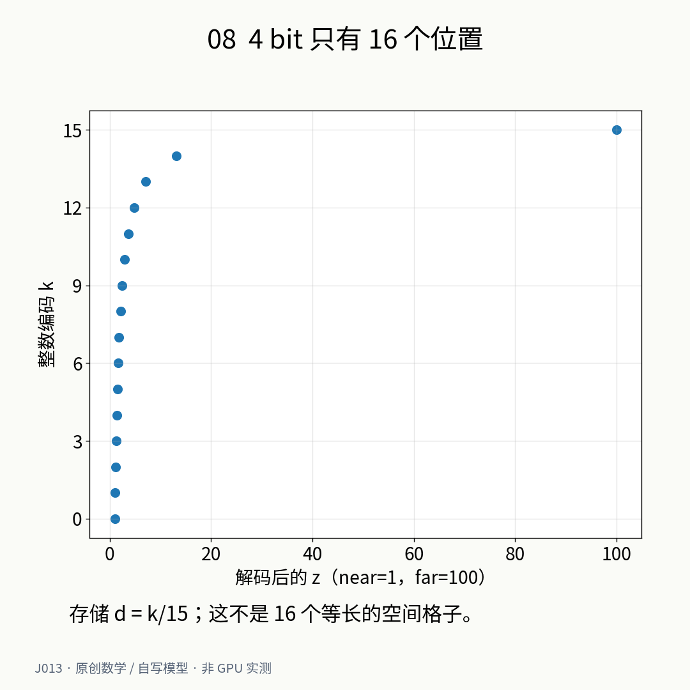
图8｜把4位整数的16个可表示深度逐一反解为空间位置，可以直接看到远端格距变大。

## 09｜为什么近裁面会影响远处的闪烁

近裁面如果离相机非常近，会把很多整数深度刻度花在近处。图9只改变 n，保持 f=1000，用16位整数最后两个编码对应的 z 间隔衡量最远端的分辨率。

把 near 从 0.1 推到 1，再推到 10，远端间隔明显缩小。但这不是免费的画质按钮：离相机更近的几何将被裁掉。合理选择 near 的意思是“满足场景需求的前提下别无谓地贴近零”，而不是把它推到玩家看不到手和武器。

缩短 far 也会影响范围与精度，但当 far 已经远大于 near 时，公式中 f/(f−n) 接近 1；继续盯着 far 一个参数，可能忽略 near 的主要影响。应针对实际投影、存储格式与场景距离计算，而不是背一条万能比例。

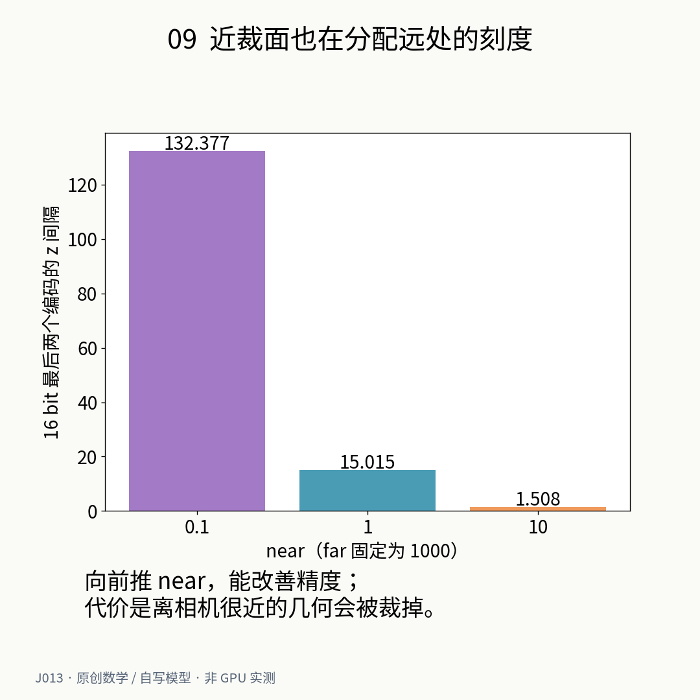
图9｜固定 far=1000 的16位整数模型：最后两个深度编码对应的空间间隔随 near 增大而缩小。

## 10｜Z-fighting：不同表面被判成同一个深度

图10故意构造一个很小的存储实验：near=1、far=100，两个完全重叠的屏幕三角形分别在 z=80 和81。真实深度不同，但8位就近量化后都成为同一个编码。严格 LESS 无法再分清前后，只好让先画者留下。

这张图没有模拟随相机运动的闪烁；它展示的是闪烁背后的一类原因——有限精度让原本应有序的表面产生平局或不稳定的比较结果。真实 Z-fighting 还可能夹杂投影运算误差、几乎共面的几何、不同变换路径和偏移设置。

可行处理包括去掉重复表面、合理拉开几何、改善裁剪范围、选择合适格式、按用途使用深度偏移。偏移过大会把本该被挡住的东西顶出来，具体符号还受深度方向影响。任何单招都不保证消除全部问题。

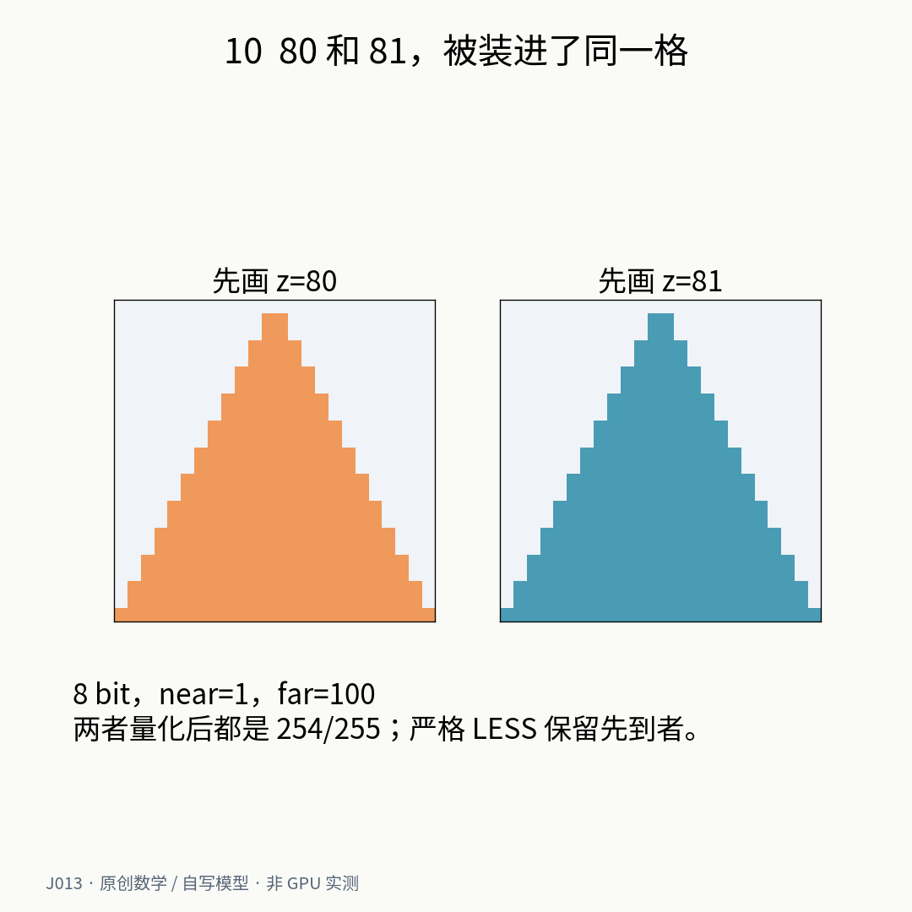
图10｜自写实验中的量化平局：两张完全重叠的三角形交换提交顺序，最终颜色随之改变。

## 11｜反向 Z 不是把整数编码倒过来就多出精度

令 d_rev=1−d，得到 d_rev=n(f−z)/(z(f−n))。它把 near 映射到 1，far 映射到 0，比较方向自然改成 GREATER。

对于均匀的整数格式，反转后的可表示集合还是那一组等间距点，不会凭空增加空间区分能力。半格平局处的具体舍入结果还与取整规则有关，因此这里不声称每个输入的正反向舍入编码都严格互补。

反向 Z 真正常被看重的精度优势要与浮点格式一起讨论。浮点数在接近零的正数区间更密集；把远端映射到靠近零处，就可能让它的刻度密度补偿透视映射在远处的挤压。

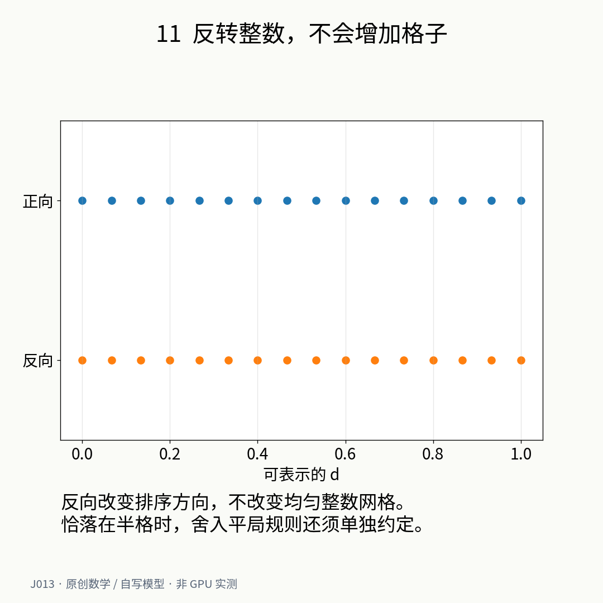
图11｜正反向4位整数的可表示集合相同；反向 Z 的主要精度收益不能归功于“整数倒序”。

## 12｜把浮点收益与整个管线的误差分开

图12采用一个可重复但刻意收窄的实验：先用精确有理数算出 d，再转换到 binary32 可表示数，最后用精确公式反解 z，比较误差。五个位置不是随机挑出来的统计结论；它们只是本模型中明确列出的测试点。

正向深度在远处挤到 1 附近，浮点在那里无法提供越来越细的步长；反向深度更接近零，结果在这组数据中明显更好。有限 far 下的曲线也受参数影响。图上没有测量真正 GPU 的顶点矩阵乘法、插值、深度写入或驱动实现。

代码的 float32 路径先经 Python 的二进制64位浮点转换，再打包为32位，因此它是明确的两级转换存储模型，不承诺等同任意硬件的一次舍入。其他几何和公式运算保持 Fraction 精确值。把误差来源拆开，是为了知道实验回答了什么，而不是宣称现实中会得到零误差。

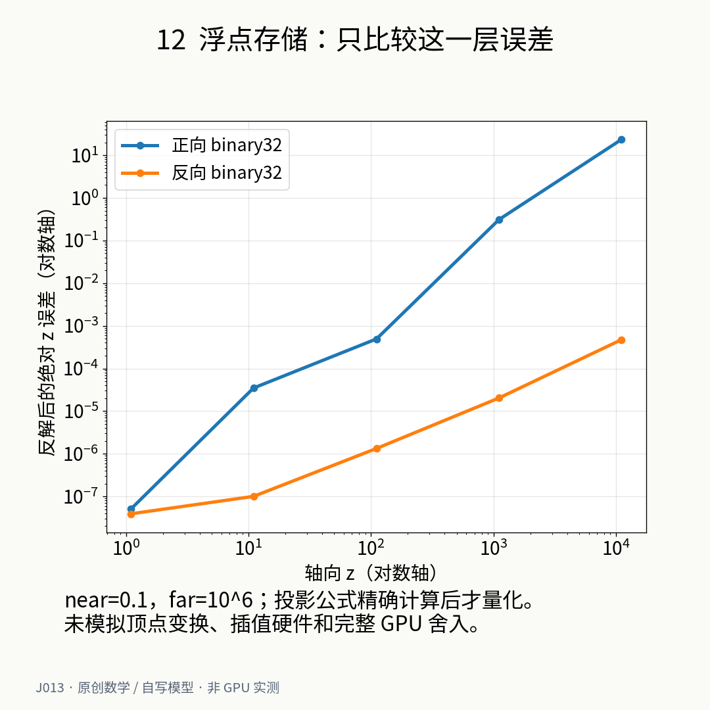
图12｜五个测试位置的 binary32 存储误差实验：本例反向映射更精确，但不是完整渲染管线的保证。

## 13｜启用反向 Z，要把整条约定改一致

本篇约定下，反向要同步修改投影深度映射、清除值和比较方向。清成 0，再用严格 GREATER；相等仍失败，远裁面恰为 0 的候选仍有同样的边界问题。后处理若读取深度重建位置，也要改用反向反解公式 z=nf/[n+d_rev(f−n)]。

还要核对 API 的裁剪空间和窗口深度约定，以及实际深度格式。尤其不能把 [0,1] 的反向浮点结论不加检查地搬到另一套默认范围和映射流程中。本文没有提供未经核验的 OpenGL 配置代码。

若数学上令 far 趋于无穷，正向公式趋于 1−n/z，反向趋于 n/z。这是极限公式，不是本文有限 far 代码已经支持的一个开关；代码明确拒绝无穷参数。阴影、深度预处理和所有读取深度的通道也要共享一致约定。

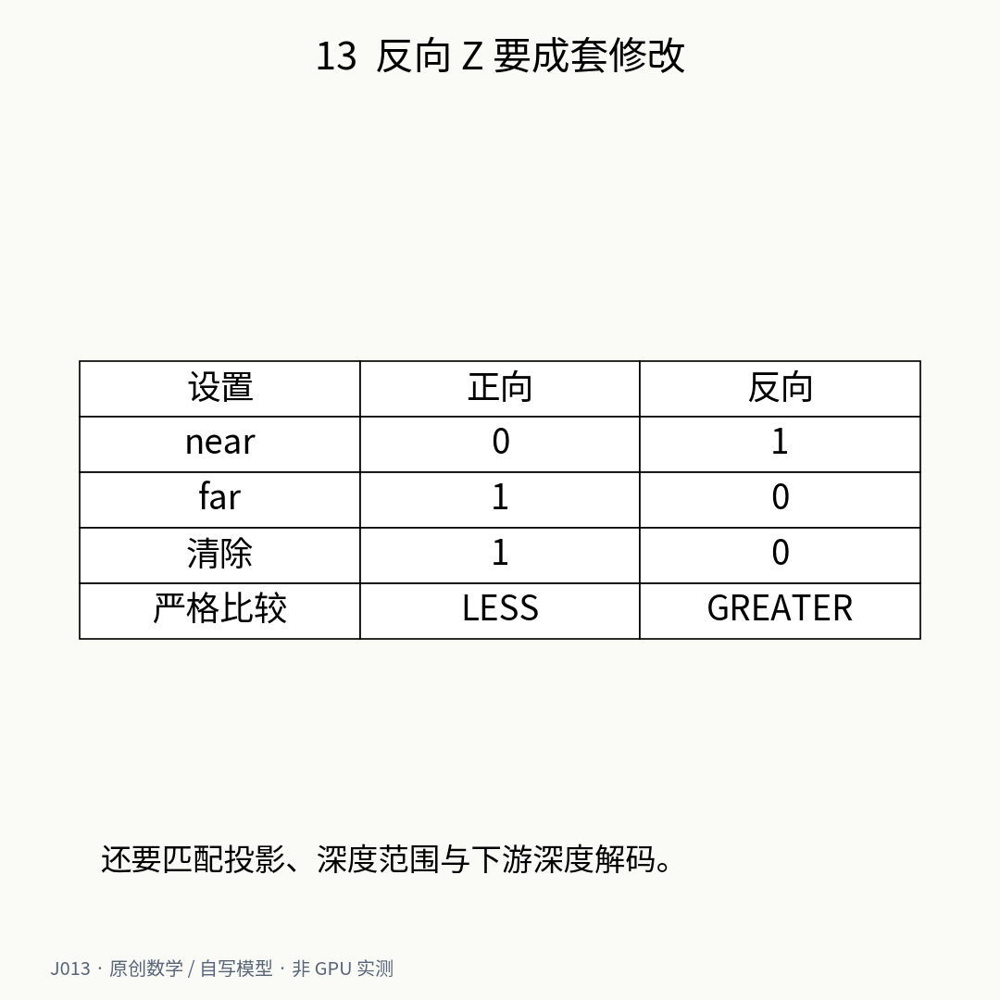
图13｜本篇 [0,1] 深度约定下的配置对照；只换比较符号会让结果错误。

## 14｜透明表面为什么不能只留最近的一张纸条

不透明表面把后方完全遮掉，因此最近者够用。半透明表面却要让后面的颜色贡献进来。普通 alpha 合成 C_out=α C_src+(1−α) C_dst，运算通常不交换。

图14令红、蓝 alpha 都为0.5，背景为黑。先画远蓝再画近红，线性数值结果为 (0.5,0,0.25)；反过来是 (0.25,0,0.5)。只留下近红则是 (0.5,0,0)，丢掉了蓝色贡献。示意色块显示这些数值，不是经过完整色彩管理的材质效果模拟。

常见透明流程先画不透明物体，再让透明表面测试已存的不透明深度、关闭透明深度写入，并尽量从后向前合成。但相互穿插的透明几何仍可能无法按整物体排出正确顺序，还需要更细粒度处理或顺序无关透明算法。单个最近深度不是透明层列表，也不负责替你解决这件事。

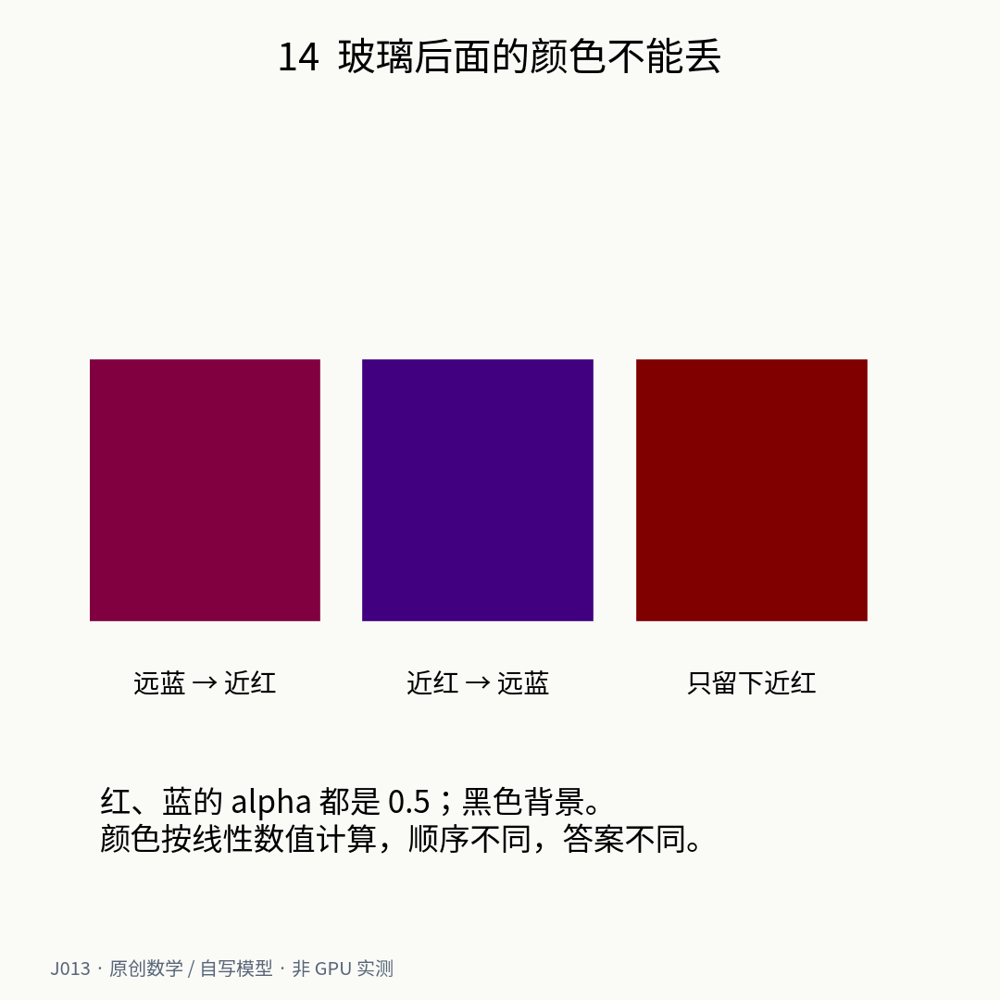
图14｜普通 alpha 合成必须保留后方贡献；单个最近深度不能独自表达这层颜色关系。

## 15｜这份小光栅器到底实现了什么

输入的顶点是已经投影的屏幕 x、y 和正向轴深度 z，屏幕采样范围为 [-1,1]²。每个三角形顶点必须已经在 near 与 far 之间；本代码拒绝跨近远裁面的输入，不实现几何裁剪。三角形朝向不影响内部判定，不做背面剔除。屏幕外的部分自然不会命中这块采样网格。

render 输出 owner 与 depth 两个二维数组。先验证有限输入序列中的唯一非负整数 ID、三角形和参数，再扫描每个像素中心。它只为教学保存对象 ID，不算纹理与光照；每个候选先插值、可选量化，然后比较并更新。

接口只接受内建 int 与 Fraction，不默默吞浮点输入；near 至少1/1000，far 至多1000000，图像尺寸1到128。对于 T 个三角形、W×H 个采样点，光栅循环执行 O(TWH) 次候选测试，两个输出缓冲占 O(WH)。但完整函数还先复制输入为 entries，并用列表 ids 逐个检查编号是否重复：这段验证最坏要 O(T²) 次比较，两个列表另占 O(T) 空间。因此本实现的总时间上界为 O(T²+TWH)，含输出的额外空间为 O(T+WH)。这里把单次有理数运算和整数比较视作单位操作，真实大整数位复杂度另计。它不是用于性能竞争的软件渲染器。

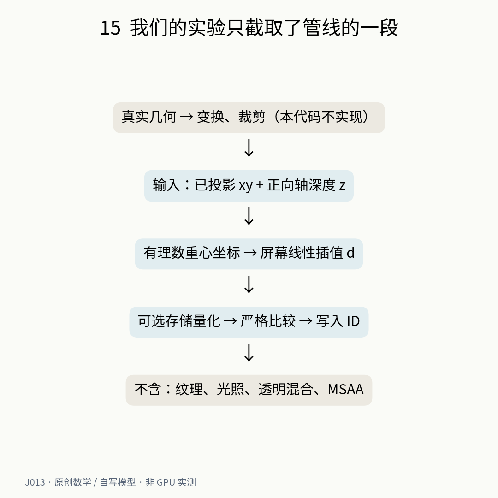
图15｜模型边界：用精确有理数隔离深度机制，不能把这些输出当作显卡精度或速度评测。

## 16｜让学生能亲手推翻错误直觉

将文末完整代码保存为 depth_lab.py，用 Python 3 运行，不需要第三方库。自检会实际遍历参数、排列和量化输入；没有把“测试通过”写成固定字符串。测试失败直接抛出异常。

第一道实验：把 sample_depth 改成先线性插值 z 再映射，屏幕中点测试应失败。第二道：保留映射却关闭深度写入，思考图3的顺序无关性为什么不再有保证。第三道：把图10的8位改成更高位数，检查两张三角形是否重新可区分；不要只看颜色猜原因，打印量化后的值。第四道：画一个恰在 far 的三角形，解释为什么严格 LESS 下它没有 owner。

最后回到开头：深度缓冲不是记住整个三维世界。它只记住“在这套采样、映射、格式和比较规则下，目前谁有资格留下”。理解了这句带条件的话，遮挡、精度、闪烁和透明的边界就连起来了。

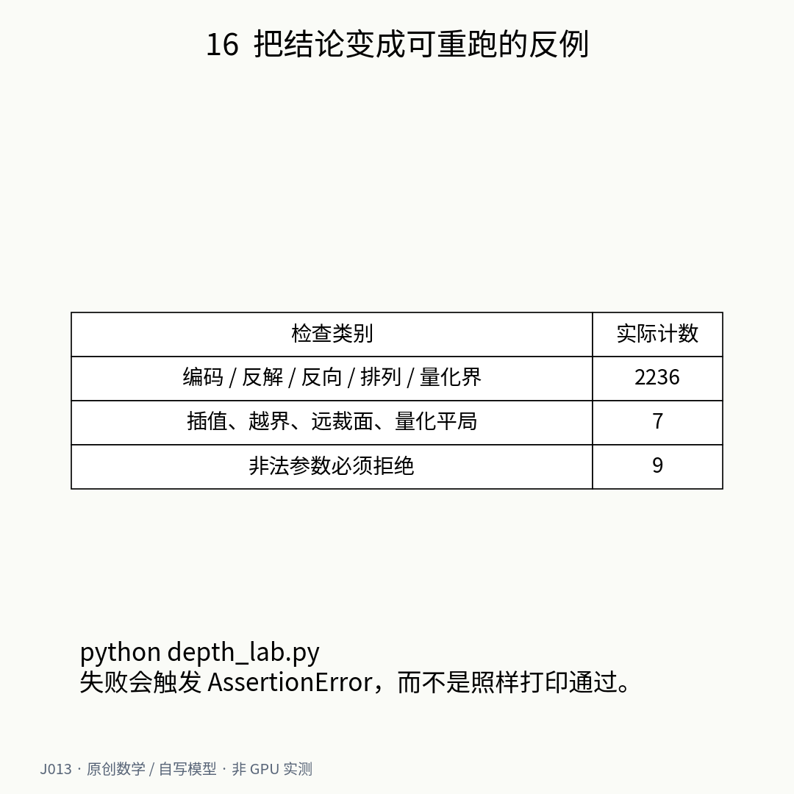
图16｜本次自写代码实际运行的检查计数；测试覆盖模型契约，不声称覆盖所有 GPU 行为。

## 完整可运行实验

保存为 `depth_lab.py`，运行 `python depth_lab.py`。仅依赖 Python 标准库。

```python
"""Exact rational, one-sample opaque depth teaching model; not GPU emulation."""
from fractions import Fraction as F
from itertools import permutations
import struct


def rat(x):
    if type(x) not in (int, F):
        raise ValueError('built-in int or Fraction required')
    return F(x)


def planes(n, f):
    n, f = rat(n), rat(f)
    if not F(1, 1000) <= n < f <= 10**6:
        raise ValueError('1/1000 <= near < far <= 1000000 required')
    return n, f


def depth(z, n=1, f=9, reverse=False):
    n, f = planes(n, f)
    z = rat(z)
    if type(reverse) is not bool or not n <= z <= f:
        raise ValueError('boolean reverse and in-frustum positive z required')
    return n*(f-z)/(z*(f-n)) if reverse else f*(z-n)/(z*(f-n))


def decode(d, n=1, f=9, reverse=False):
    n, f = planes(n, f)
    d = rat(d)
    if type(reverse) is not bool or not 0 <= d <= 1:
        raise ValueError('boolean reverse and unit depth required')
    return n*f/(n+d*(f-n)) if reverse else n*f/(f-d*(f-n))


def store(d, mode='exact'):
    d = rat(d)
    if not 0 <= d <= 1:
        raise ValueError('unit depth required')
    if mode == 'exact':
        return d
    if type(mode) is int and 1 <= mode <= 24:
        q = 2**mode-1
        return F(round(d*q), q)  # exact round-to-nearest, ties-to-even
    if mode == 'float32':
        # float64 conversion followed by binary32; a storage-only model.
        return F(struct.unpack('!f', struct.pack('!f', float(d)))[0])
    raise ValueError('exact, float32, or integer bits 1..24 required')


def barycentric(p, vertices):
    if type(p) not in (list, tuple) or len(p) != 2:
        raise ValueError('2D sample required')
    if type(vertices) not in (list, tuple) or len(vertices) != 3:
        raise ValueError('three screen vertices required')
    pts = []
    for v in vertices:
        if type(v) not in (list, tuple) or len(v) != 2:
            raise ValueError('2D vertices required')
        pts.append(tuple(rat(t) for t in v))
    x,y = map(rat,p)
    (a,b),(c,d),(e,f) = pts
    den = (d-f)*(a-e)+(e-c)*(b-f)
    if den == 0:
        raise ValueError('degenerate triangle')
    l0 = ((d-f)*(x-e)+(e-c)*(y-f))/den
    l1 = ((f-b)*(x-e)+(a-e)*(y-f))/den
    return l0,l1,1-l0-l1


def sample_depth(p, tri, n=1, f=9, reverse=False):
    if type(tri) not in (list, tuple) or len(tri) != 3:
        raise ValueError('three (screen x, screen y, positive z) vertices')
    verts = []
    for v in tri:
        if type(v) not in (list, tuple) or len(v) != 3:
            raise ValueError('three coordinates per vertex')
        verts.append(tuple(rat(t) for t in v))
    ds = [depth(v[2], n, f, reverse) for v in verts]
    w = barycentric(p, [v[:2] for v in verts])
    if min(w) < 0:
        return None
    return sum((a*b for a,b in zip(w,ds)), F(0))


def render(triangles, size=24, n=1, f=9, reverse=False, mode='exact'):
    if type(size) is not int or not 1 <= size <= 128:
        raise ValueError('integer size 1..128 required')
    planes(n,f)
    if type(reverse) is not bool:
        raise ValueError('boolean reverse required')
    clear = store(F(0 if reverse else 1),mode)
    owners = [[-1]*size for _ in range(size)]
    values = [[clear]*size for _ in range(size)]
    # Caller supplies finite sequence of unique integer IDs and valid triangles.
    entries = list(triangles)
    ids = []
    for ident,tri in entries:
        if type(ident) is not int or ident < 0 or ident in ids:
            raise ValueError('distinct nonnegative integer IDs required')
        ids.append(ident)
        sample_depth((0,0),tri,n,f,reverse)  # validate before mutating output
    for ident,tri in entries:
        for j in range(size):
            for i in range(size):
                p = (F(2*i+1,size)-1, F(2*j+1,size)-1)
                d = sample_depth(p,tri,n,f,reverse)
                if d is None:
                    continue
                v = store(d,mode)
                passed = v > values[j][i] if reverse else v < values[j][i]
                if passed:
                    values[j][i],owners[j][i] = v,ident
    return owners,values


def demo_triangles():
    return [(0, ((F(-4,5),F(-3,4),6),(F(4,5),F(-3,4),6),(0,F(4,5),6))),
            (1, ((F(-9,10),F(1,2),3),(F(3,4),F(1,2),3),(F(1,5),F(-9,10),3))),
            (2, ((F(-3,5),F(-1,5),2),(F(9,10),F(-1,5),8),(F(1,5),F(9,10),4)))]


def self_test():
    checks = 0
    for n,f in [(F(1,10),1000),(1,9),(3,20)]:
        for k in range(101):
            z=n+(f-n)*F(k,100)
            for rev in (False,True):
                d=depth(z,n,f,rev)
                assert decode(d,n,f,rev)==z
                assert d+depth(z,n,f,not rev)==1
                checks+=2
    tris=demo_triangles()
    baseline=render(tris,size=12)[0]
    for order in permutations(tris):
        assert render(order,size=12)[0]==baseline
        assert render(order,size=12,reverse=True)[0]==baseline
        checks+=2
    for bits in range(1,9):
        q=2**bits-1
        for k in range(2*q+1):
            d=F(k,2*q)
            assert abs(store(d,bits)-d)<=F(1,2*q)
            checks+=1
    a=((0,0,2),(1,0,8),(0,1,4));p=(F(1,2),0)
    assert sample_depth(p,a)==depth(F(16,5))
    assert sample_depth(p,a)!=depth(5)
    assert sample_depth((2,2),a) is None
    # Far-plane equality fails strict comparison with the clear value.
    far=[(0,tuple((x,y,9) for x,y,_ in tris[0][1]))]
    assert all(i==-1 for row in render(far,6)[0] for i in row)
    assert all(i==-1 for row in render(far,6,reverse=True)[0] for i in row)
    # Equal quantized depths: first submitted primitive wins.
    full=((-1,-1,80),(1,-1,80),(0,1,80))
    close=tuple((x,y,81) for x,y,z in full)
    assert store(depth(80,1,100),8)==store(depth(81,1,100),8)
    assert render([(0,full),(1,close)],8,1,100,mode=8)[0]!=render([(1,close),(0,full)],8,1,100,mode=8)[0]
    bad=[lambda:depth(True),lambda:depth(0),lambda:depth(2,2,2),
         lambda:depth(2.0),lambda:decode(2),lambda:store(F(1,2),True),
         lambda:barycentric((0,0),((0,0),(1,1),(2,2))),
         lambda:render(tris,0),lambda:render(tris,reverse=1)]
    for fn in bad:
        try:fn()
        except ValueError:pass
        else:raise AssertionError('invalid accepted')
    return {'exact_checks':checks,'special_checks':7,'invalid_cases':len(bad)}


if __name__=='__main__':
    import json
    print(json.dumps(self_test()))
```

## 短版｜深度缓冲不是一张线性的距离表

两个三角形抢同一个屏幕采样点时，深度缓冲先比较，再决定谁能写入颜色。对不透明表面，只要留下最近者；这等价于不断维护最小值，不用存下所有候选。

本文统一相机朝正 z、near=n、far=f，深度范围 [0,1]。正向映射 d=f(z−n)/(z(f−n))，清除为1，用严格 LESS。相等不通过，因此量化成相同深度时会留下先提交者；恰在 far 的候选也过不了这个严格比较。

透视让 d 与1/z成线性关系，而不是与 z 成线性关系。屏幕三角形内可以线性插值投影后的 d，却不能直接线性插值轴深度 z。固定整数深度步长反解到远处，会对应更大的空间间隔：这就是两个近乎重合表面可能无法区分的原因之一。

别把 near 无谓地放得太小；反向 Z 通常要配合合适浮点格式、[0,1]约定、反向投影、清0、GREATER和正确的后续解码。它不是所有闪烁问题的万能药。透明表面还要保留后方颜色贡献，单个最近深度不够。

长版用16张原创教学图和一份完整可运行的有理数光栅模型，把这些条件逐项拆开；实际自检包含2236项精确检查、7项特殊情形与9项非法输入。这里只模拟单采样覆盖、深度插值、可选存储量化与比较，不是GPU评测。

---

[来源、材料权利与编写说明](sources.md)
