# 泊松圆盘采样：随机撒点，怎样不挤成一团？


## 1. 随机种树，为什么总有几棵挤在一起？

想在一块草地上放树。最直接的办法，是每棵树都独立抽两个均匀随机数，当作横纵坐标。结果却常常出现三棵贴得很近、另一处空一大片。

这不是随机数坏了。“每个位置机会一样”不等于“每一小块最后都一样拥挤”。独立抽样甚至不知道上一棵树在哪里，自然不会替它留座位。如果你要的是树冠不相撞、装饰点不粘成团，就得换问题：下一点不仅要随机，还得离已有点足够远。

先看同样49个点的实际对照。右侧不是手工挑出来的一张漂亮草图，而是文末程序的输出；左侧另外生成49个独立均匀点。共同seed只是方便复现，不能把两个不同算法的第i个随机数解释成相同实验对象。

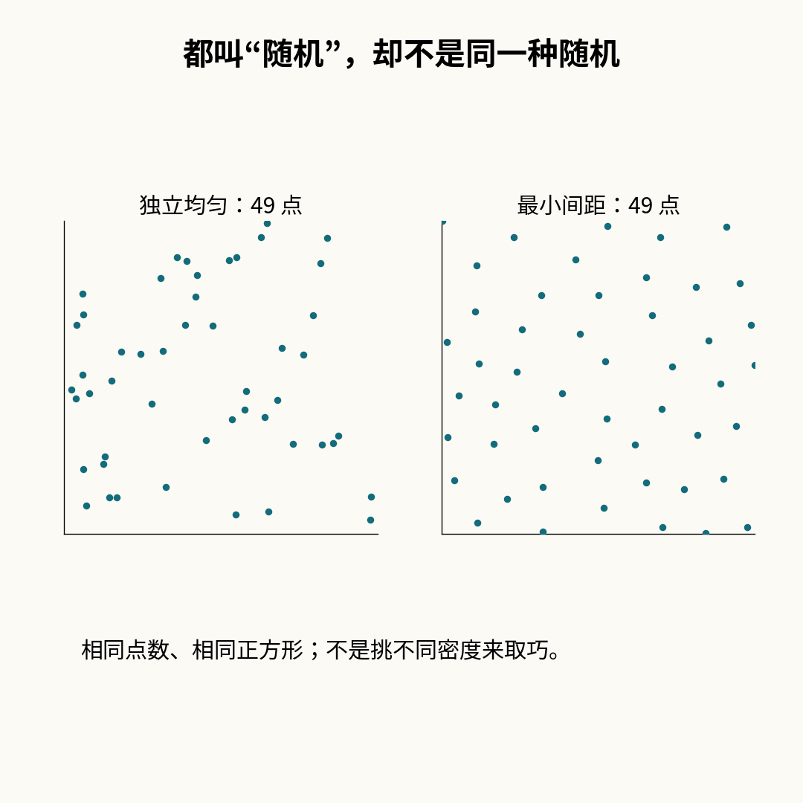

图1：本程序实际生成的49点与49个独立均匀点对照；两者seed都为7，但消耗随机数的方式不同，不是一一对应配对。


## 2. 先立规矩：两点之间至少留出 r

把活动区域固定成单位正方形：[0,1)×[0,1)。选r=0.12，意思是任何两个接受点的欧氏距离都不能小于0.12。这里r是点心间距，不是画出来的圆半径。

为什么图里只画r/2？如果两点相距至少r，那么以它们为圆心、半径r/2的两个圆，内部就不会重叠。这是一种理解距离约束的辅助画法，不表示算法真的在移动圆盘。

反过来，彼此分开也不等于铺满。只有两个点也可能完全满足规则，却留下大片空地。我们先解决“别撞在一起”，以后再问“还剩多少位置”。程序用普通双精度浮点数做比较；本节的圆与不等式是精确几何解释，不是对浮点误差的自动担保。

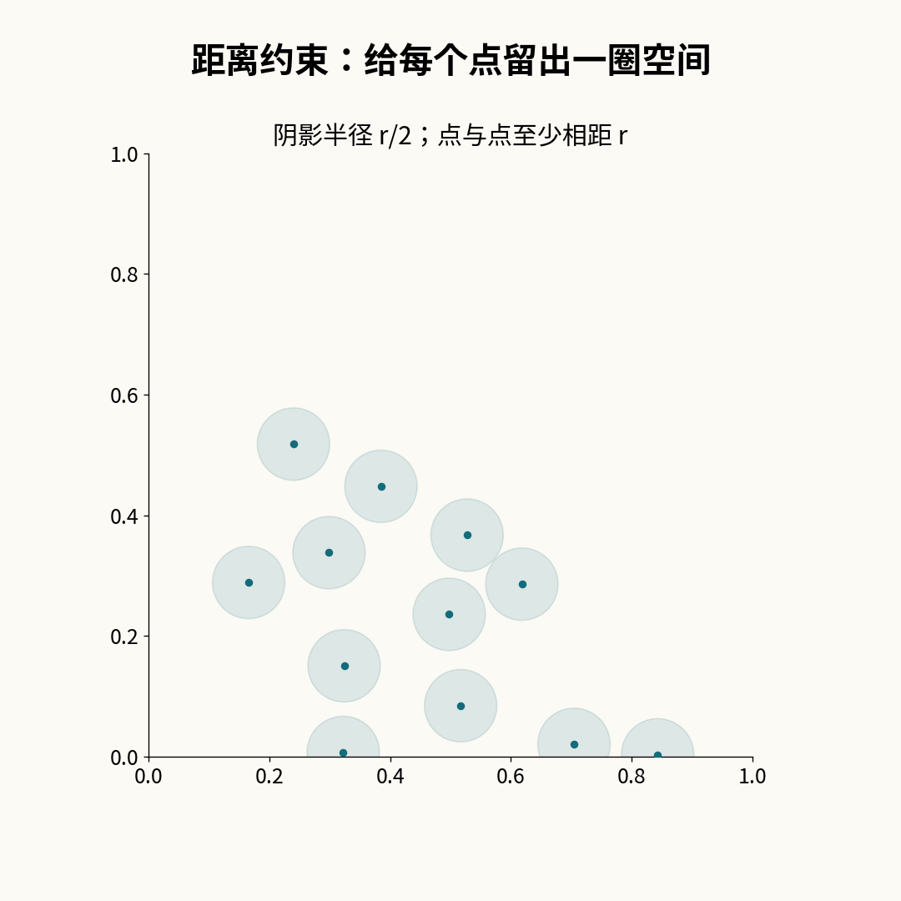

图2：前12个实际样本周围画半径r/2的圆。理想精确几何中内部不重叠；圆越出边界不表示生成了域外样本。


## 3. 笨办法为什么越来越慢？先给点建地址簿

每个候选都与所有旧点比较，当然能检查距离，但点越多，查表越长。空间网格的用途不是把点强行放在格点上，而是让任意连续位置的点拥有一个桶地址。

本文取格边长h=r/2。一个正方形内任意两点的距离，不超过它的对角线h√2=r/√2，小于r。因此两个合法样本不可能落在同一格。一个桶只需存一个样本索引。

坐标(x,y)的地址是(floor(x/h),floor(y/h))。代码在非负域用int(x/h)实现向下取整。点的位置仍是浮点坐标，不会被吸附到格子中心。与常见的h=r/√2相比，我们用更小的格子，换取简单而保守的邻域范围；没有声称这是最省常数的实现。

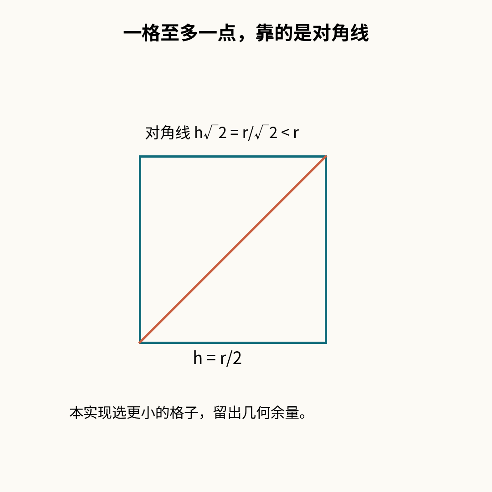

图3：本文实现取h=r/2，而非最大允许边长r/√2；同格任意两点距离小于r，所以不能同时接受。


## 4. 只查附近，但“附近”要有理由

设候选所在桶的横索引为i。另一个桶若横向相隔至少4格，即使把两点摆在最接近的边缘，横向间隔也至少是3h=1.5r，已经大于r。纵向同理。所以检查横纵各±3格，覆盖7×7个桶，足够保守。

这49个桶不是49次必做的距离计算：空桶没有点。每个非空桶最多一点，随后才做dx²+dy²与r²的比较。用平方距离避免了每次开平方，但不消除浮点舍入。

图里的小方格只是局部放大，不是说整个单位正方形只有这些格。实际代码用字典保存已占用桶，避免先申请一整张可能极大的空网格。这里的正确性依赖域、桶大小和检查半径一起成立，不能只抄一个“邻居±2”的数字。

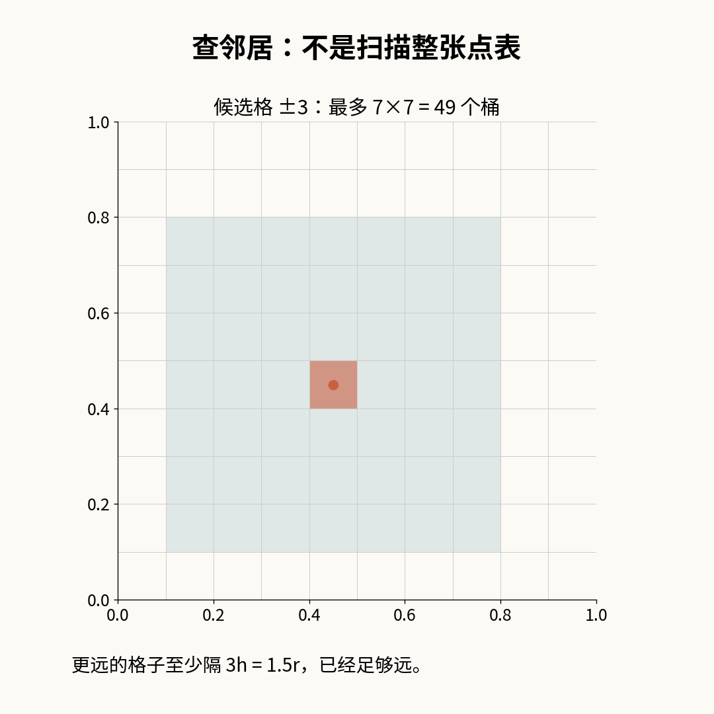

图4：局部7×7查询示意，不是整个单位域网格。本实现保守检查横纵各±3格，桶中存样本索引。


## 5. 在圆环里随机，最容易写错的是半径

下一步让新点从旧点附近长出来。以父点为圆心，候选半径落在[r,2r)之间，角度在[0,2π)均匀抽取。注意：半径在[r,2r)均匀，和在这片环带的面积上均匀，是两件事。

我们自己算一遍。半径从r长到ρ时，覆盖面积是π(ρ²−r²)；整个环带面积是3πr²。令面积比例等于U∈[0,1)，便得ρ=r√(1+3U)。角度还要用另一个独立随机数。

如果写成ρ=r(1+U)，同样宽的一条内圈和外圈分到相同概率，但外圈面积更大，于是内圈单位面积密度偏高。本实现采用前一个公式。它只说明单次候选相对父点的环带分布；经过越界拒绝、近邻拒绝和活跃点选择以后，最终点集不再是相互独立的均匀点。

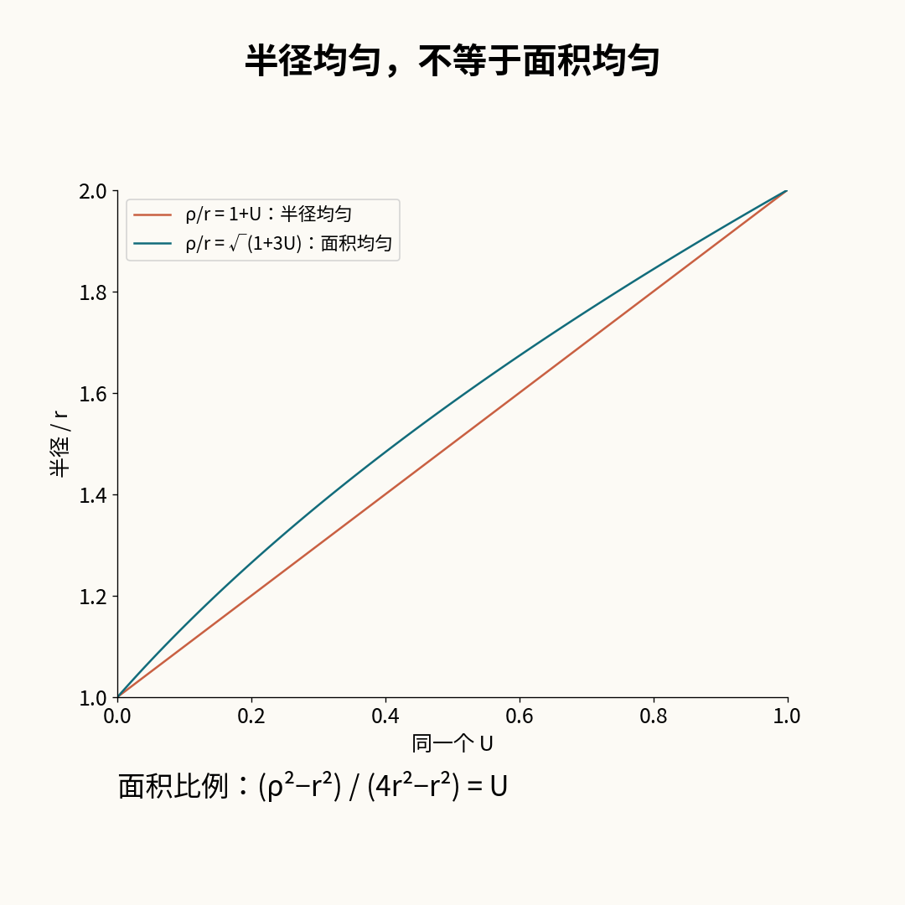

图5：独立推导的二维环带逆CDF；角度另取均匀值。直取均匀半径会把单位面积密度偏向内圈。


## 6. 离父点够远，还得问旁边的人

一个候选离它的父点至少r，不代表离所有点都够远。图中的两个旧点相距0.30，令r=0.25。右上方(0.65,0.65)的候选离左侧父点约0.335，已经够远，却离右侧旧点仅0.15，因此不合格；更上方(0.5,0.82)的候选离两点均超过0.25，才可通过这个例子的距离关。

一般流程是：先检查是否仍在域内，再查近邻，再决定接受。不能只检查父点，也不能只看桶是否空。桶空意味着“没有人占这个小格”，不意味着隔壁没有一棵树伸过来。

数学规则允许恰好相距r；代码以平方距离<r²时拒绝。精确相等附近可能被浮点舍入影响。若任务要求可证明的精确接触边界，就需要更严格的数值方案，而不是给比较式随手加一个没有解释的epsilon。

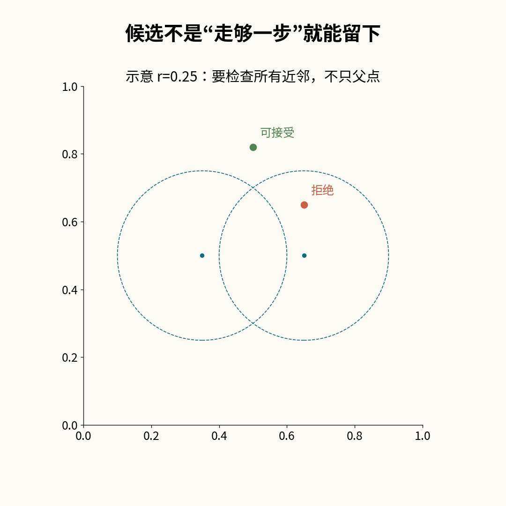

图6：自造反例：两个旧点相距0.30；右上候选距左侧父点约0.335，却距右点仅0.15而被拒绝；更上方候选距两点都超过r=0.25。


## 7. 活跃表：不是排队服务，是保留尝试机会

我们维护两份不同的东西：全部已接受点，以及仍可作为父点的活跃索引。最开始在域内均匀抽一个点，两份表都只有它。

每轮随机选一个活跃父点，最多尝试k个候选。找到一个合法点，就加入全部点和活跃表，并立即结束本轮；父点仍然活跃，以后可能再次被选中。连试k次没有成功，才让这个父点退休。

退休绝不是删除样本。那棵树已经在那里，仍须阻止别的新树挤到它身边。代码通过“把活跃表最后一个索引换到被删位置，再pop”完成退休，不必移动整段列表。默认k=30是尝试预算，不是神奇的正确性常数。


图7：本实现每轮最多接受一个点。退休只停止从该父点发起候选，不撤销它对后续候选的距离约束。


## 8. 一小段真正跑出来的生长过程

看seed=7、r=0.12、k=30的前12点。连线只表示“这个新点由哪个父点提议”，不表示最终结果必须保留一张树网，更不表示线段附近有禁区。

你会看到生长并不是整齐的一圈一圈，也不是按坐标从左向右扫描。父点是从当前活跃表随机选的；早加入的点未必早退休，晚加入的点也可能很快找不到新位置。

本文把每次候选的父索引、坐标、结局保存为可选trace。结局分成域外、太近、接受。默认不保存trace，以免把教学日志误当算法必要状态；正文图由实际运行数据绘制，不拿手画的点假装执行轨迹。

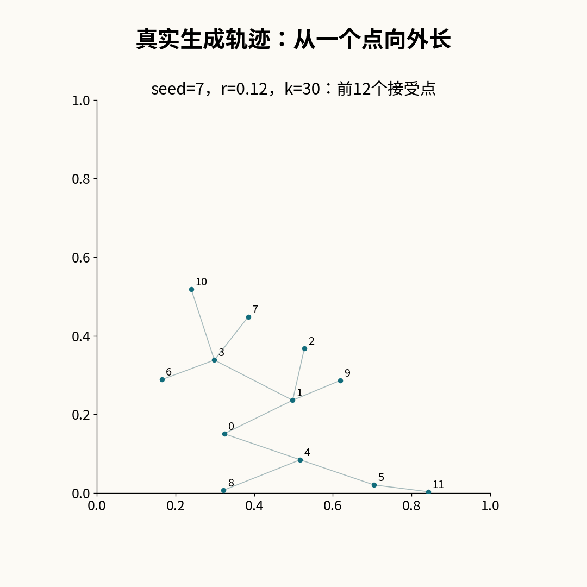

图8：真实接受顺序与父子连线；线不是禁入边界，也不是最终网格边。生成顺序不等于空间扫描顺序。


## 9. “已经停了”不等于“已经铺满了”

把同一程序的k改成1，seed仍为7。它只放下2点就结束了。我们再用一个独立的81×81探针网格搜索，发现红点(0.5/81,0.5/81)离所有旧点都至少r，完全可以再加入。

这一个明确见证，就足以推翻“活跃表空了，所以任何位置都放不下点”。有限k只是说若干次随机尝试没碰到空位，不是对连续区域所有位置的穷尽检查。

术语也别混：“极大”表示不能再添加一个合法点；“最大”表示在所有合法配置中点数尽可能多。极大仍可能不是最大。本程序不交付这两种最优性证书。探针若找不到空位，也只能说明这批探针没找到，不能反过来证明连续域没有空隙。

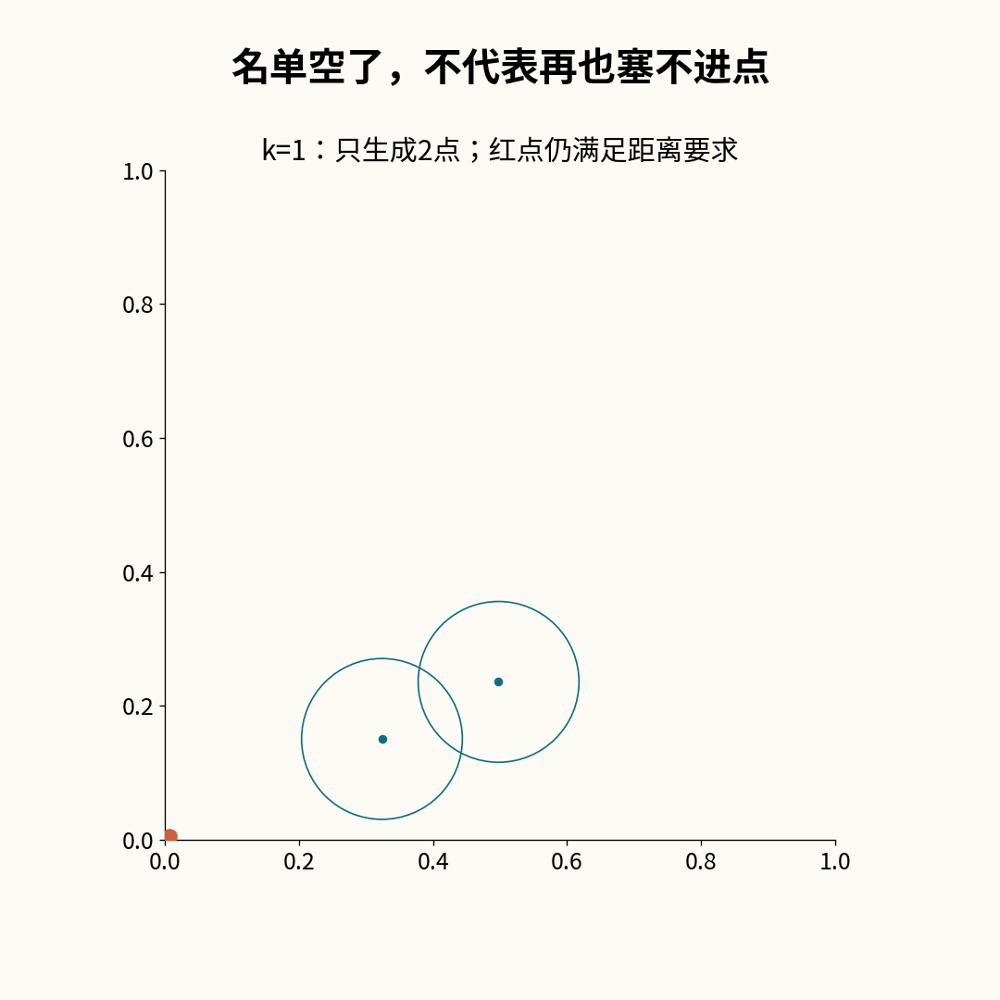

图9：真实反例seed=7、r=0.12、k=1已终止，但红色探针(0.5/81,0.5/81)仍可插入。有限候选失败不是连续域已饱和的证明。


## 10. 靠近边缘，圆环会被切掉一块

本例没有周期边界。候选x<0或x≥1，或者y越出同样范围，就拒绝；不会取模从另一侧绕回来，也不会强行夹到边缘上。后者会把大量候选挤在边界线上，还可能破坏间距。

边缘父点的圆环有一部分在域外，因此它的有效尝试区域与内部父点不同。不要从“初始点均匀”直接推出“最终每处统计完全一致”。如果要无缝平铺纹理，距离本身就得换成周期距离，桶索引也要相应环绕，那是另一个实现。

本程序也只承诺这个连续方形域。换成两个隔开的岛屿，仅从一座岛上的初始点生长，不能保证发现另一座岛，例如两岛最近距离已经超过2r时。域的连通性、候选可达性、初始化方式需要重新讨论。

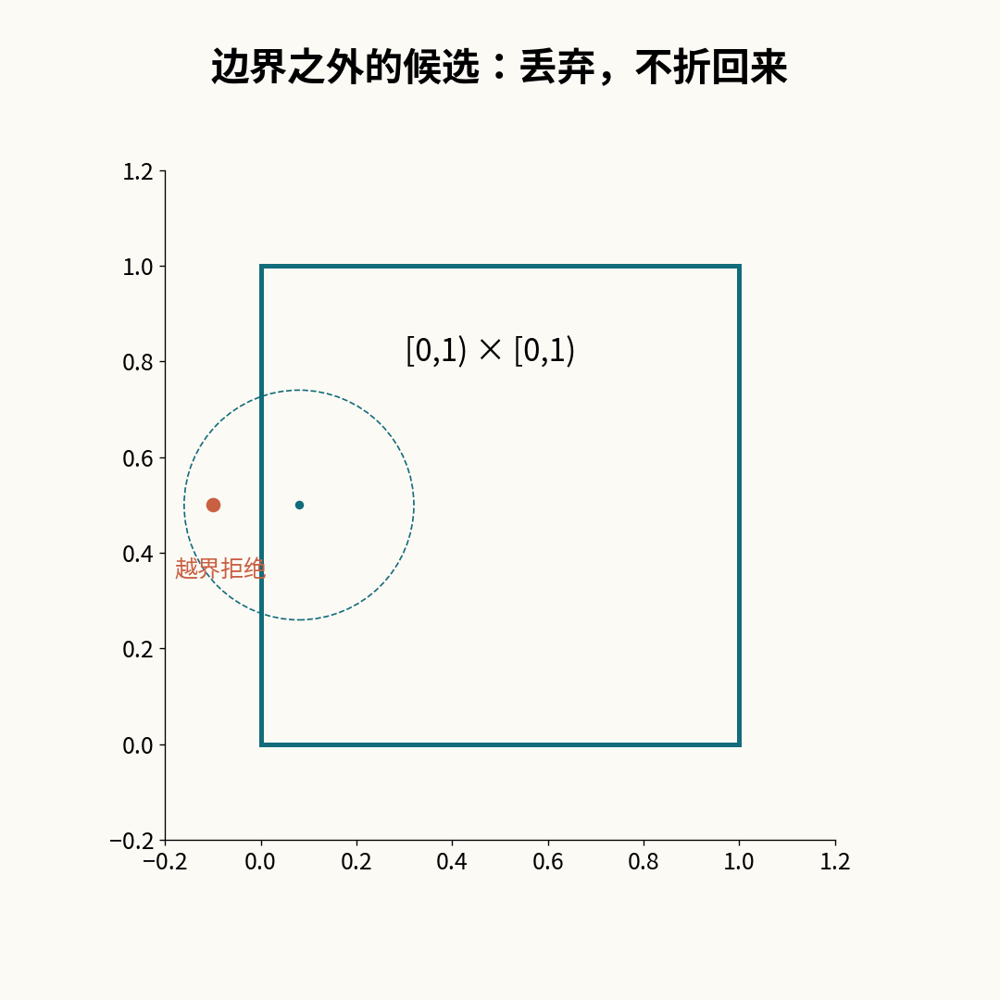

图10：非周期单位方形示意。边缘父点的部分环带在域外，本实现拒绝它们；不取模，也不承诺边缘统计与内部完全相同。


## 11. 线性时间的记账，先别把三个数混起来

设最终得到N个点。初始点不是外层循环成功生成的，所以成功添加的轮数是N−1。每个点最终都从活跃表退休一次，所以失败退休的轮数是N。加起来，外层恰好2N−1轮。

本次N=49，因此是97轮；但实际尝试了1748个候选，并做了3990次距离计算。这三个数对应三个不同层次，不能把97写成“只检查97次距离”。每轮最多k个候选，因此候选数≤k(2N−1)。

这个计数证明依赖“成功一次就break”的控制流。若修改成一轮接受很多候选，算法可能仍有别的分析，但2N−1这个结论就不能原封不动贴过去。时间复杂度不是贴在算法名字上的标签，它要跟着你真正写出的循环走。

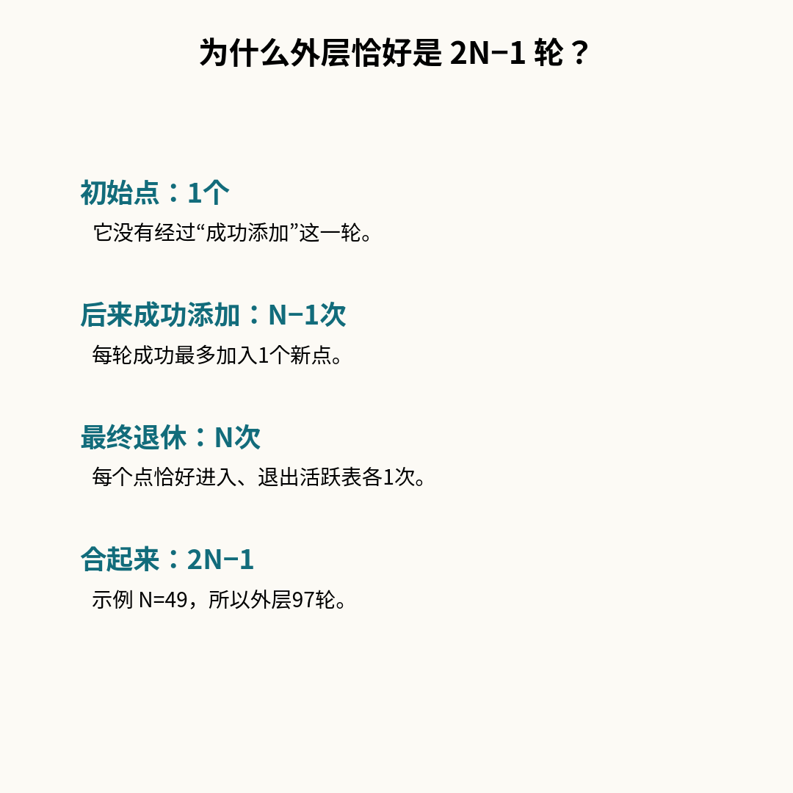

图11：对本文控制流的独立记账；97是外层轮数，不是1748次候选尝试，也不是3990次距离计算。


## 12. 把 O(N) 后面的条件写完整

在固定二维、固定k、每桶最多一点、每次查询49桶的前提下，每轮工作有一个与N无关的上界。再采用常见的常数成本浮点运算与期望常数时间哈希模型，本文实现是期望O(kN)，固定k后简写期望O(N)。

字典和活跃表、全部点合计O(N)辅助空间。若打开trace，日志最多记录k(2N−1)个候选，是O(kN)。若改成稠密网格，初始化和内存还要计入总格数，不能只数已经放下的点。

二维的49桶也不能随手推广成任意维度同样便宜。随着维度上升，满足间距所需格子变小，邻域组合数迅速增长。原研究讨论任意维度；这里刻意只实现二维，不把维度藏进一个看起来很小的常数里。r很小会生成很多点；参数通过检查不代表机器有无限内存。

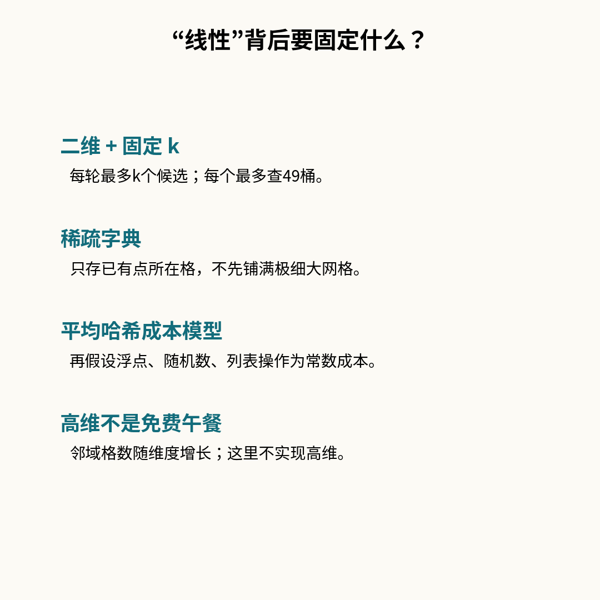

图12：本文期望O(kN)时间、O(N)辅助空间的限定模型；固定k时才简写O(N)。不声称任意精度、任意哈希最坏情况或任意维度都同样便宜。


## 13. 原论文为什么同时放一张点图和一张频谱？

Robert Bridson在2007年的一页研究短文中给出了快速泊松圆盘采样方法。我们这里只引用其Figure 1图像区，讨论它的证据结构：左边是空间里的点，右边是原文说明为多次运行平均的periodogram。

这正好提醒人别只凭一张“挺均匀”的点云下结论。图像中心附近的低频结构与外围环状结构，把问题从“挤不挤”带到不同空间尺度上的统计。本文不从截图读出精确频率数值，也没有把自己的49点图冒充原论文实验复现。

最小距离是可以逐对检查的约束；蓝噪声性质则涉及频域或相关统计。一个规则方格也能满足最小间距，却带有明显规则方向。两者不能画等号。原图保留原权利，作者主页下载区对示例代码的public-domain表述，不自动给论文图授予相同许可。

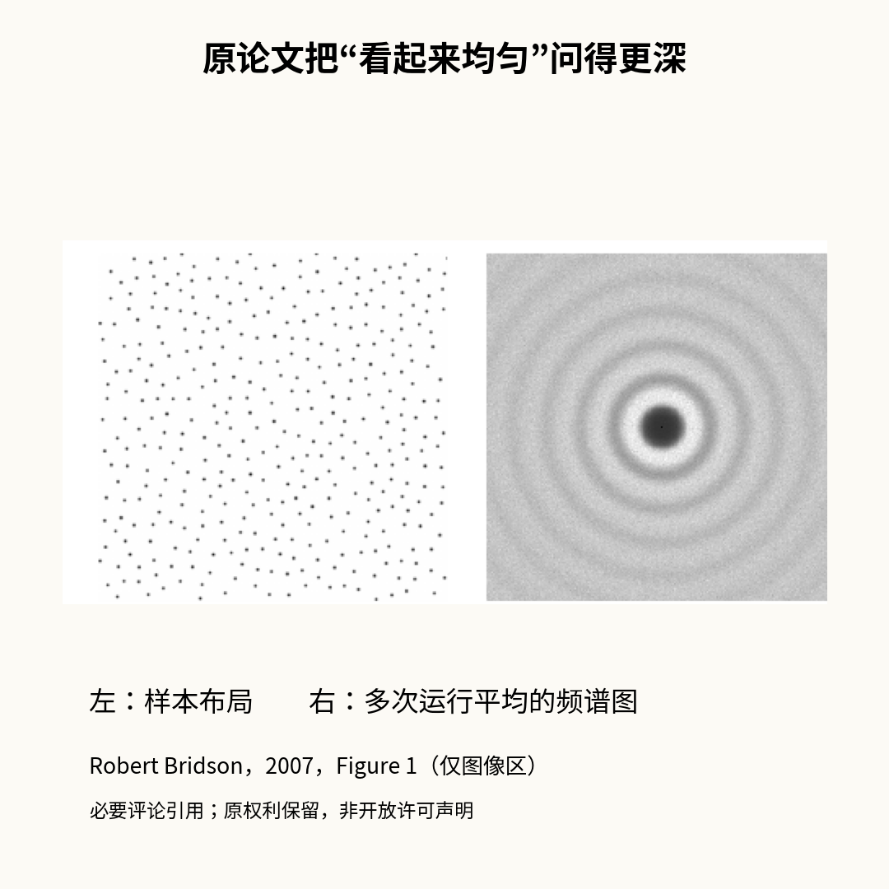

图13：Bridson（2007）Figure 1的两幅原图像区，来自作者公开PDF，第1页；右图在原文明确为多次运行平均的periodogram，不是左侧单次图的直接证书。


## 14. 用途先问清，别让算法替你选目标

如果想给场景铺草、摆石头，最小间距通常是个有用的起点，但碰撞体的形状、坡度和可行走区域仍需额外处理。点心距离不等于任意形状物体绝不相交。

如果想做数值积分，独立均匀样本与相关样本的估计方式、误差分析也不相同。不能因为点分布好看，就宣称任何积分器都无偏、任何渲染都没有噪声。

因此先写目标：要随机外观？要硬间距？要连续域极大性？要规定频谱？要固定点数？本文输入r与k，输出点数由运行产生，不接受“必须正好1000点”的合同。把目标拆开，才知道哪一项已经由算法解决，哪一项需要新的方法。

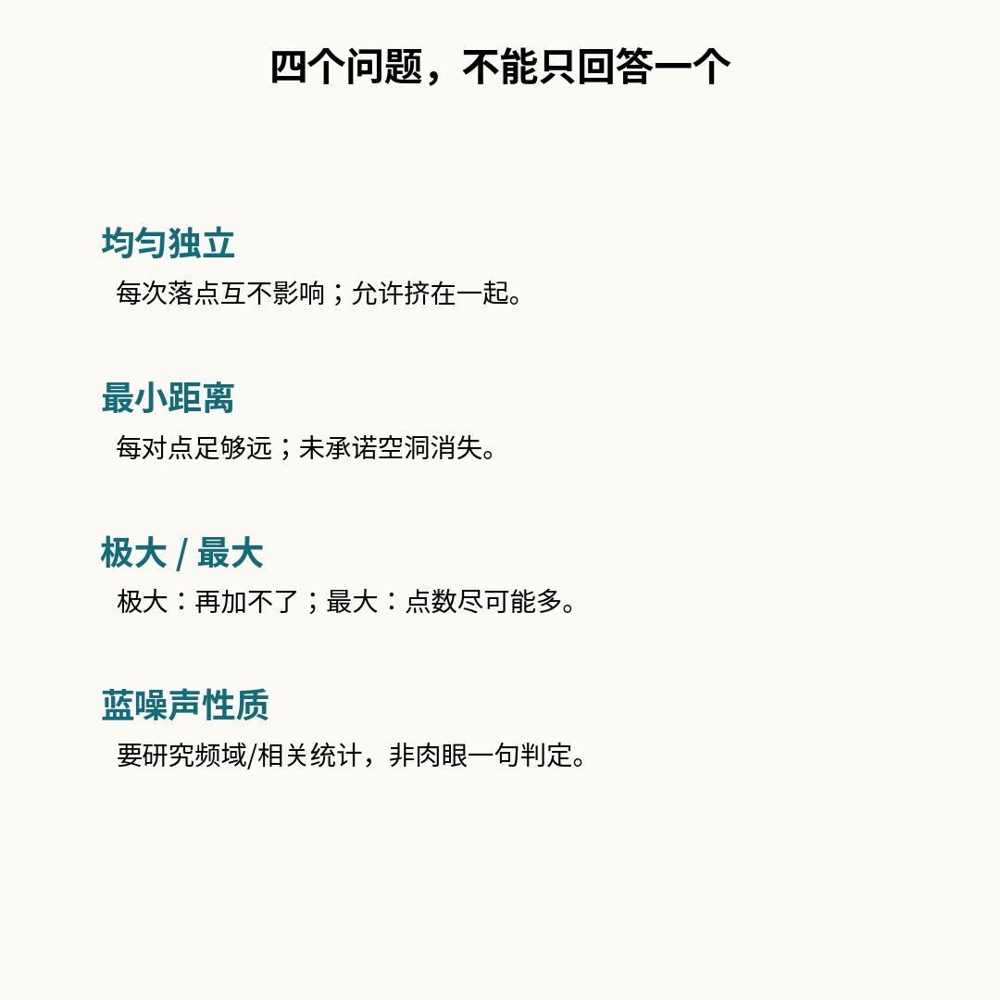

图14：四类不同问题。“极大”不是“最大”；本程序的有限k输出不附带连续域极大性证书，更不承诺最大点数。


## 15. 换 seed 做实验，比挑一张最好看的图诚实

固定r=0.12和k=30，画出seed=0到19的点数。图里的变化来自实际运行，不是为了说明波动而手工填的柱子。它说明本实现会产生不同的最终点数，但20次运行不是总体分布的证明。

想研究k的影响，可以对一组固定seed报告点数、候选次数、耗时和最小距离，提前约定指标，不要只挑点最多的一次。更大的k增加单轮尝试预算，却不能承诺对每个相同seed都得到更多点：改动k会改变后续随机数消耗和演化路径。

两个实现若要验证逻辑一致，最好共享完全相同的候选过程。这就是下面测试所做的事：网格版与全表扫描版只更换邻域查询，比较整个接受序列和候选结局，而不是仅比较最后点数差不多。

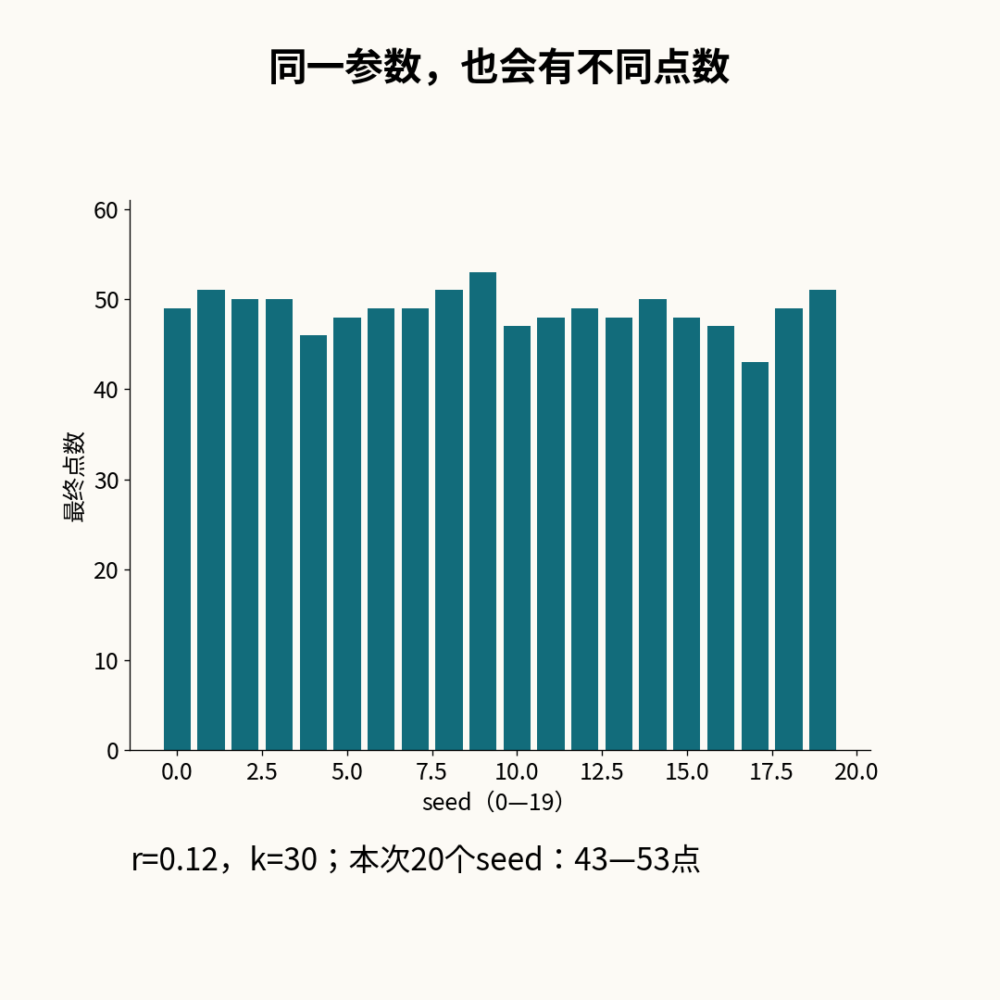

图15：本实现20个固定seed的实际点数，展示运行间变化；不是总体置信区间，也不证明k与点数在每个seed上单调。


## 16. 带着几个反例运行代码

文末代码只用Python标准库。输入合同是有限的内置数字r∈[10⁻⁴,1]、整数k∈[1,100]、整数seed；布尔值不伪装成整数通过。它不是抵抗恶意对象的安全沙箱，也不是精确几何库。

自测覆盖240组参数，逐候选比较网格与全表扫描；另外检查所有点仍在半开方形内、所有点对距离、外层轮数、尝试数分解和9组错误输入。最小距离测试的1e−14仅是测试容差，算法本身没有用它放宽拒绝条件。这些检查不是对所有浮点输入的形式化证明。

第一次探索可以做三件事：把k改成1找可插入的空位；把环带半径误写成r(1+U)，观察候选分布而不急着看最终图；再把“每次成功就break”删掉，亲自检验2N−1为什么不再是原来的计数。每次只改一个机制，记录你改变了哪一个保证。

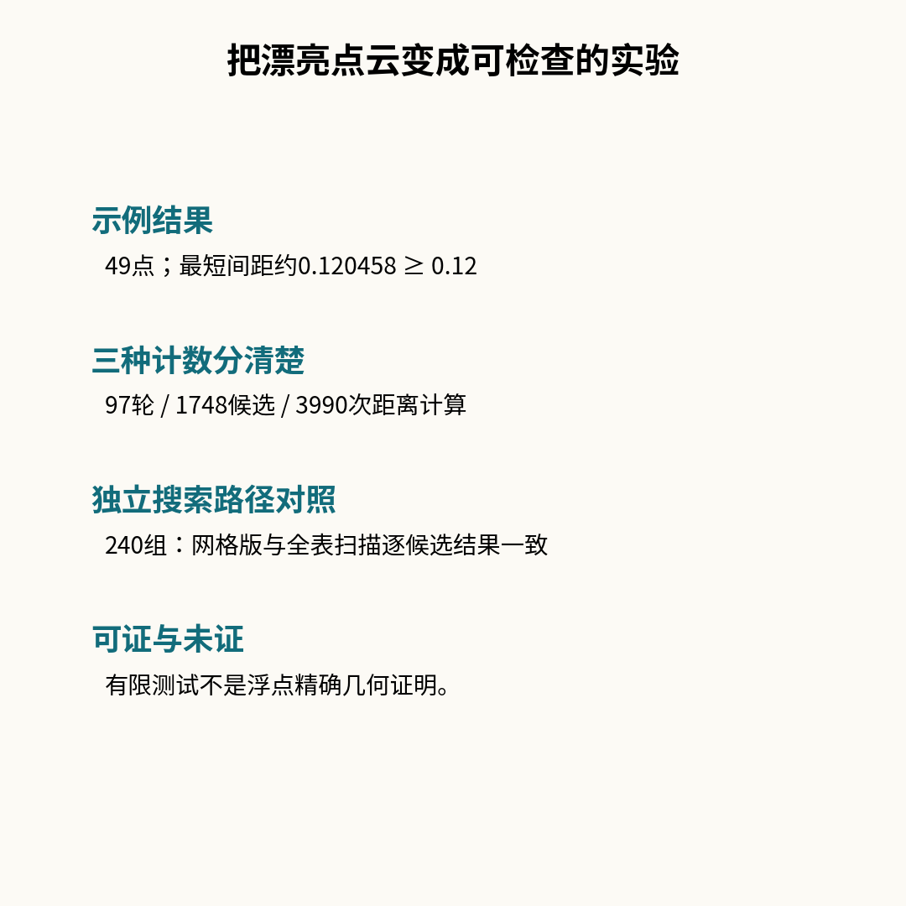

图16：作者本地可复现实验记录，非性能基准或正式证明。最短距离来自全部点对复核，距离测试次数依遍历顺序而变。


## 可以直接运行的完整教学代码

```python

"""Original 2-D teaching model. Unit square, finite built-in inputs, no periodic wrap."""
import math
import random


def poisson(r=0.12, k=30, seed=7, *, scan=False, keep_trace=False):
    if type(r) not in (int, float) or not 1e-4 <= r <= 1 or not math.isfinite(r):
        raise ValueError('r must be a finite built-in number in [1e-4, 1]')
    if type(k) is not int or not 1 <= k <= 100:
        raise ValueError('k must be a built-in int in [1, 100]')
    if type(seed) is not int or type(scan) is not bool or type(keep_trace) is not bool:
        raise ValueError('seed must be int; flags must be bool')
    rng = random.Random(seed)
    r = float(r)
    h = r / 2  # deliberately smaller than r/sqrt(2)
    r2 = r * r
    points = [(rng.random(), rng.random())]
    active = [0]
    grid = {(int(points[0][0] / h), int(points[0][1] / h)): 0}
    stats = dict(iterations=0, attempts=0, outside=0, close=0,
                 accepted=0, retired=0, distance_tests=0)
    trace = []
    while active:
        stats['iterations'] += 1
        slot = rng.randrange(len(active))
        parent = active[slot]
        x, y = points[parent]
        added = False
        for _ in range(k):
            stats['attempts'] += 1
            theta = math.tau * rng.random()
            rho = r * math.sqrt(1 + 3 * rng.random())
            q = (x + rho * math.cos(theta), y + rho * math.sin(theta))
            if not (0 <= q[0] < 1 and 0 <= q[1] < 1):
                stats['outside'] += 1
                if keep_trace: trace.append((parent, q, 'outside'))
                continue
            cell = (int(q[0] / h), int(q[1] / h))
            if scan:
                neighbors = range(len(points))
            else:
                # +/-3 is conservative: >=4-cell separation has gap >=3h > r.
                neighbors = [grid[(a, b)]
                             for a in range(cell[0]-3, cell[0]+4)
                             for b in range(cell[1]-3, cell[1]+4)
                             if (a, b) in grid]
            valid = True
            for j in neighbors:
                stats['distance_tests'] += 1
                dx, dy = q[0]-points[j][0], q[1]-points[j][1]
                if dx*dx + dy*dy < r2:
                    valid = False
                    break
            if not valid:
                stats['close'] += 1
                if keep_trace: trace.append((parent, q, 'close'))
                continue
            # Grid occupancy should never collide under the separation rule.
            assert cell not in grid
            grid[cell] = len(points)
            points.append(q)
            active.append(len(points)-1)
            stats['accepted'] += 1
            if keep_trace: trace.append((parent, q, 'accepted'))
            added = True
            break
        if not added:
            active[slot] = active[-1]
            active.pop()
            stats['retired'] += 1
    return points, stats, trace


def min_distance(points):
    return min((math.dist(a, b) for i, a in enumerate(points)
                for b in points[:i]), default=math.inf)


def hole_witness(points, r, side=81):
    """Finite probe search, not a certificate that no continuous hole exists."""
    for iy in range(side):
        for ix in range(side):
            q = ((ix + .5)/side, (iy + .5)/side)
            if all(math.dist(q, p) >= r for p in points):
                return q
    return None


def test():
    cases = 0
    for r in (.08, .12, .25, .7, 1.):
        for k in (1, 3, 10, 30):
            for seed in range(12):
                p, s, t = poisson(r, k, seed, keep_trace=True)
                slow, slow_stats, slow_trace = poisson(r, k, seed, scan=True, keep_trace=True)
                assert p == slow and t == slow_trace
                assert all(0 <= x < 1 and 0 <= y < 1 for x, y in p)
                assert min_distance(p) >= r - 1e-14
                assert s['iterations'] == 2*len(p)-1
                assert s['retired'] == len(p) and s['accepted'] == len(p)-1
                assert s['attempts'] <= k*s['iterations']
                assert s['outside'] + s['close'] + s['accepted'] == s['attempts']
                cases += 1
    for args in [dict(r=True), dict(r=float('nan')), dict(r=0), dict(r=1.01),
                 dict(k=True), dict(k=0), dict(k=101), dict(seed=False), dict(scan=1)]:
        try: poisson(**args)
        except ValueError: pass
        else: raise AssertionError(args)
    print('PASS', cases, 'grid-vs-full-scan cases; 9 invalid-input cases')


if __name__ == '__main__':
    test()
    p, s, _ = poisson()
    print('demo', len(p), 'min_distance', min_distance(p), s)
    p, _, _ = poisson(.12, 1, 7)
    print('k1', len(p), 'hole', hole_witness(p, .12))

```

## 短篇导读｜“随机”为什么还要留距离？

独立均匀随机只保证每次落点的位置机会相同，不负责给上一点留空位。泊松圆盘采样换了一条规则：点与点至少相距r。

本文的二维教学实现先放一个点，再从活跃点附近的环带提出候选。候选先过域边界关，再用背景网格找近邻；合格才加入。父点连试k次失败便退休，但仍然占据空间。环带按面积均匀的半径是r√(1+3U)，不是简单的r(1+U)。

seed=7、r=0.12、k=30的实际运行得到49点、97个外层轮次、1748次候选尝试。97来自(N−1)次成功添加加N次退休，不是距离比较次数。

最值得记住的反例是k=1：同seed只生成2点就结束，却仍有可合法插入的红色探针。算法停止不等于连续域铺满，最小间距不等于蓝噪声证明，更不等于最多能放多少点。

长文用16张图、完整标准库代码和逐候选网格/全扫描对照，把这些边界逐项拆开。原论文Figure 1仅作必要评论引用，权利与再用边界见全文。

---

[来源、材料权利与编写说明](sources.md)
