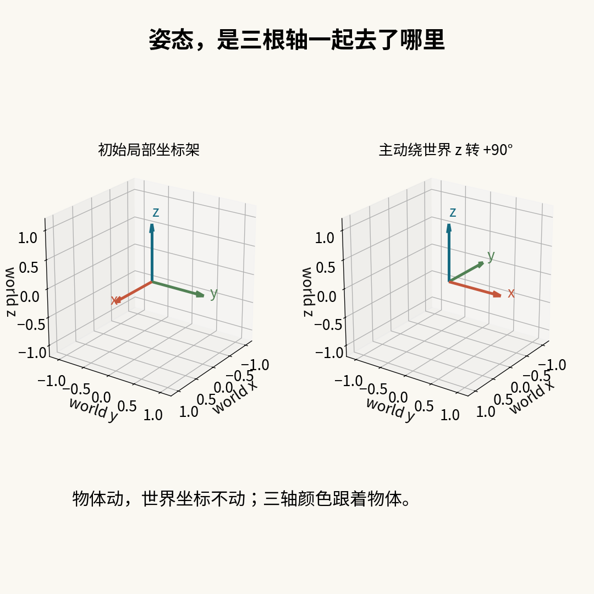
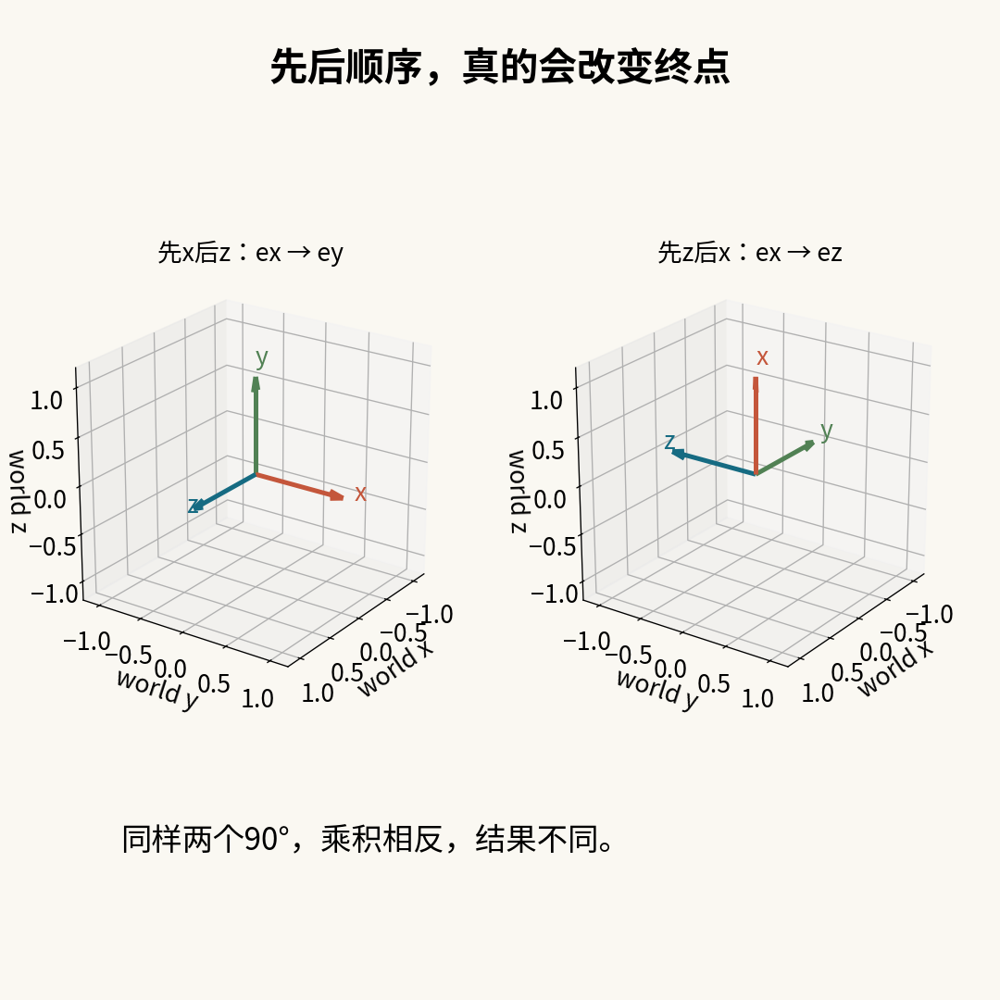
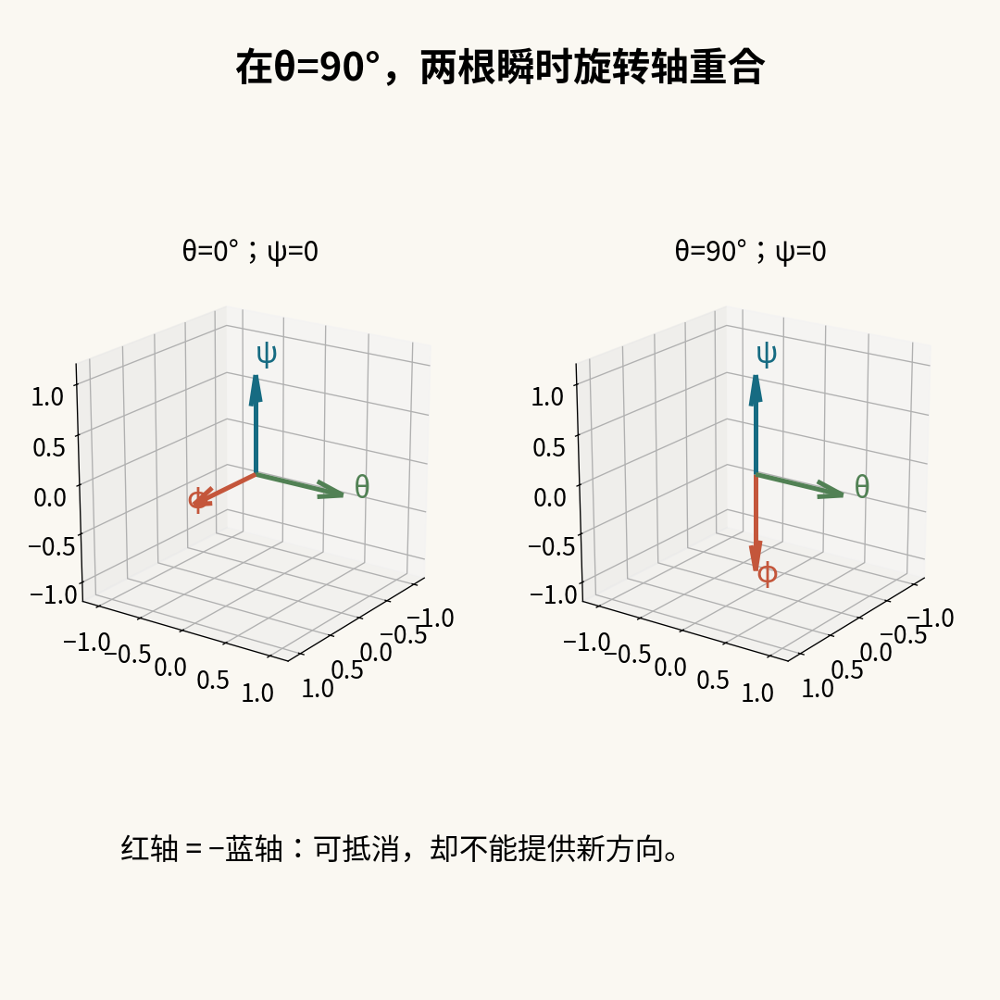
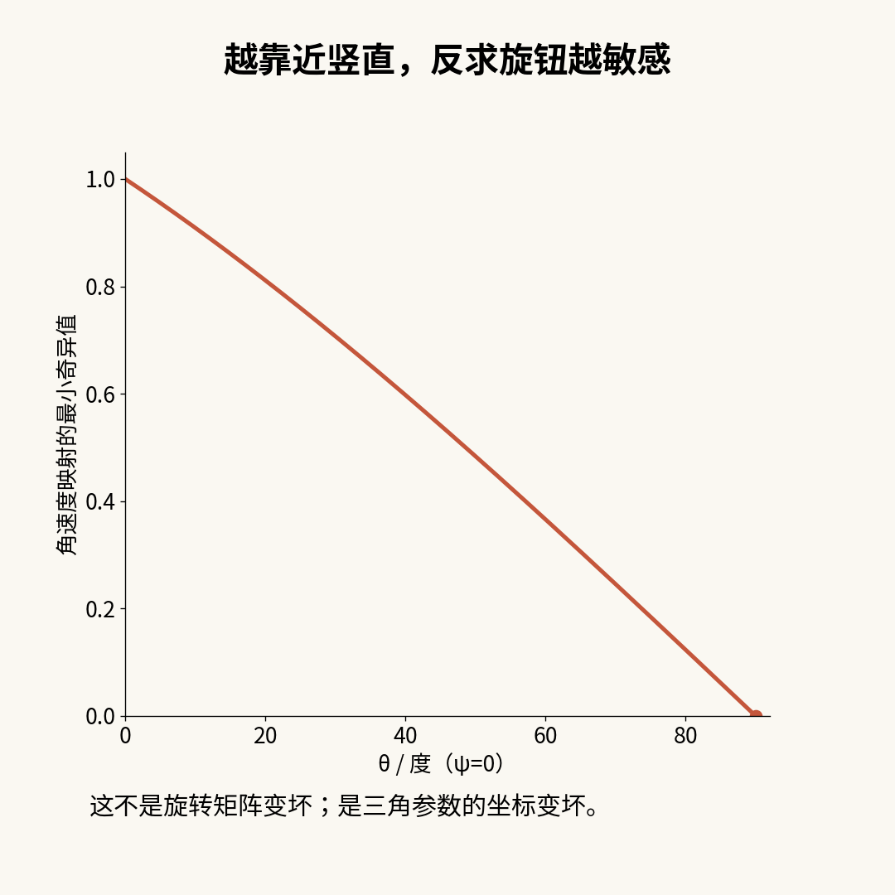
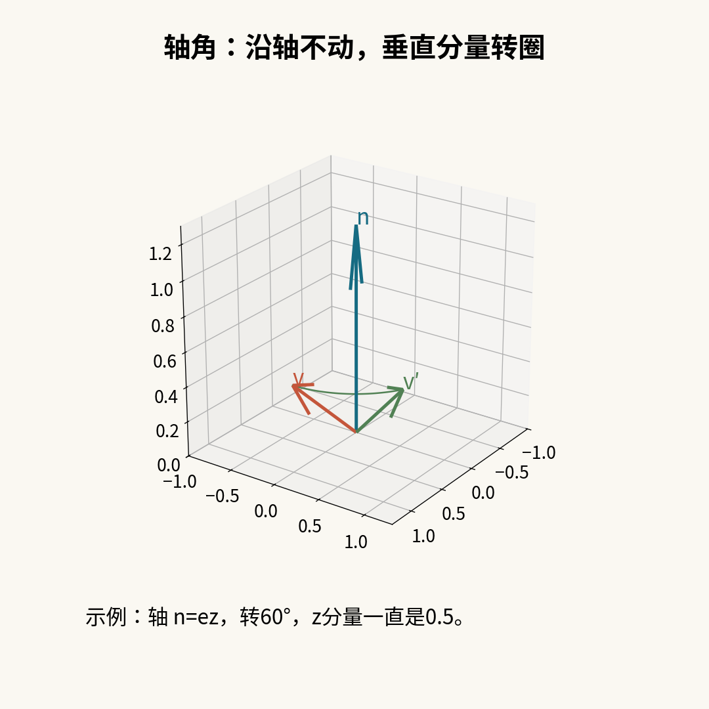
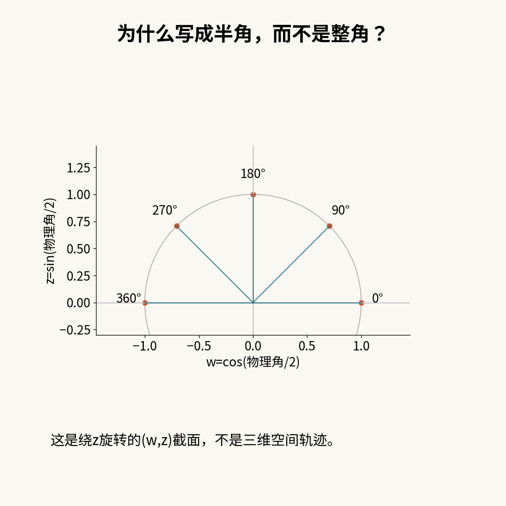
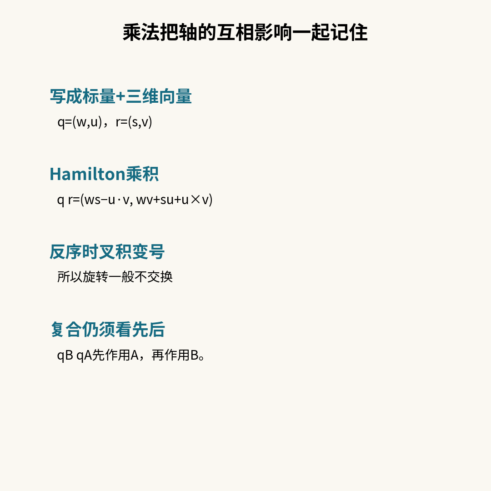
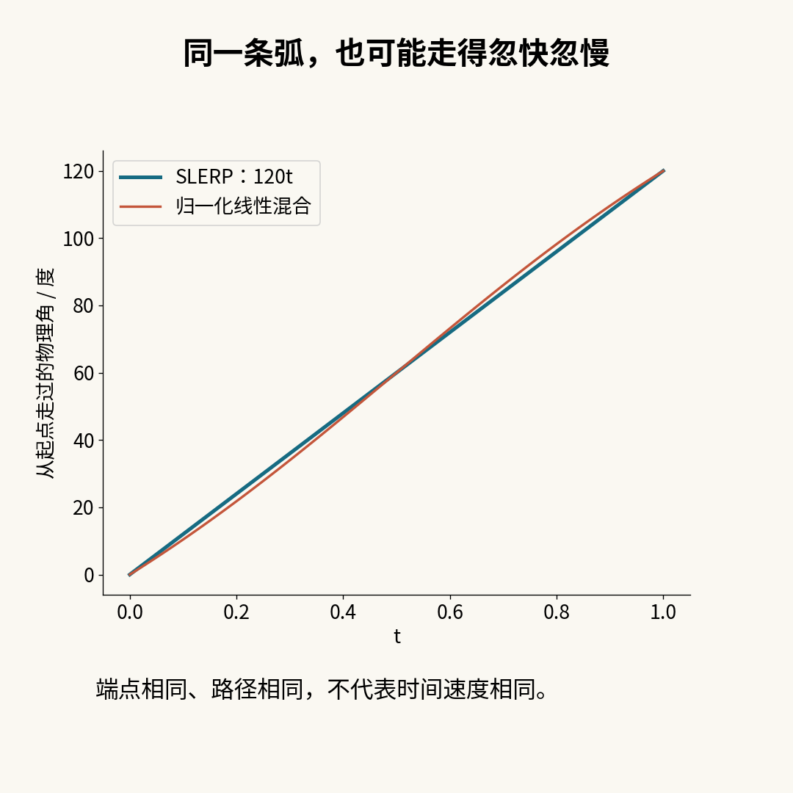
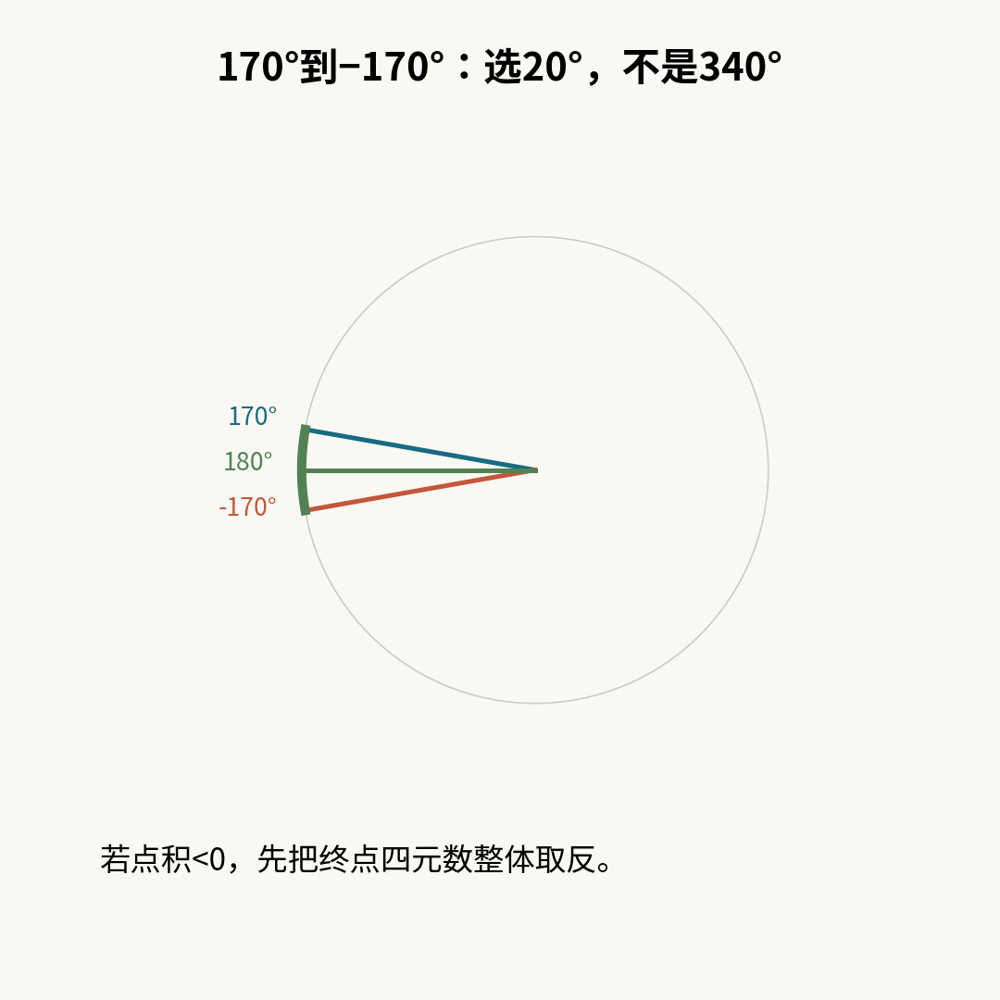

# 四元数旋转：相机抬到头顶，为什么两个旋钮突然像同一个？

你在做一个三维相机。水平转向好好的，俯仰也好好的；可当它几乎朝天时，另一个旋钮开始做出奇怪的动作：你明明想让它“侧着转”，结果它好像又在“转头”。

先别急着把三行欧拉角换成四个神秘数字。真正值得弄清楚的是：**坏掉的是物体的旋转能力，还是我们给姿态起名字的方法？**

下面从一个小坐标架开始。所有例子都能用文末的Python程序复算，不需要游戏引擎，也不用先背四元数乘法表。

## 1｜姿态不是一个朝向箭头

一支箭指向北方，并不能告诉你相机有没有倒着拿。相机镜头朝向相同，画面仍可能上下颠倒。因此，完整的三维姿态要交代一组三根互相垂直的轴，而不只是一个“前方”。

给物体固定三根彩色小棍：红x、绿y、蓝z。物体转动时，小棍一起转；房间里的世界坐标轴不动。我们关心的是：初始的三根棍，最后分别指到哪里。


图1：本程序实际旋转的两组三轴。红x、绿y、蓝z是物体局部轴；黑色坐标刻度是固定世界轴，采用右手主动旋转。

将三根转后的轴作为列排起来，就得到旋转矩阵R。任意初始向量v写成列，转后是Rv。纯旋转不拉长、不压扁，也不把左右手性翻过来，所以RᵀR=I，det R=+1。这里不含平移、缩放或镜像。

先统一语言：本文是**右手坐标系、主动转动物体、列向量、Hamilton四元数乘法、分量顺序(w,x,y,z)**。正角按右手定则。代码角度用弧度，讲故事时另写度数。


图2：全文与代码统一约定。外部库即使也叫Quaternion，分量顺序、主动/被动与乘法定义仍可能不同。

这不是挑字眼。固定物体、反过来转坐标系，正负号会翻转。NASA/JPL的[旋转文档](https://naif.jpl.nasa.gov/pub/naif/toolkit_docs/C/req/rotation.html)特意区分这两种操作。查公式时先核约定，通常比多抄一页公式更省时间。

## 2｜先转哪根轴，不是无关紧要的操作习惯

拿初始向量ex=(1,0,0)做实验。

- 先绕世界x转90°：它就在x轴上，所以不动。再绕世界z转90°：它到了ey=(0,1,0)。
- 反过来，先绕世界z转90°：它到了ey。再绕世界x转90°：它到了ez=(0,0,1)。

两个终点不一样。这就是“不交换”：RzRx≠RxRz。矩阵乘积中最右边的变换先作用，因此先A后B写成RBRA。


图3：同一初始向量ex的自造数值反例；画完整旋转后坐标架，红轴分别落在世界ey、ez。

容易误会的是：我们没有否定“任意一个最终三维旋转可以用某个轴和一个角表示”。两次转动仍有一个等效轴角，只是那个轴通常不等于最初两根轴中的任何一根。

## 3｜欧拉角：一种方便的坐标，不是姿态本身

本文固定一种三角参数：

R(φ,θ,ψ)=Rz(ψ) Ry(θ) Rx(φ)。

按时间解释：绕固定世界x转φ，再绕固定世界y转θ，最后绕固定世界z转ψ。别把它和另一套软件里的内禀轴旋转顺序直接混用。即使两套接口都出现“XYZ”，字母的解释也未必一样。

绕z的矩阵是：

Rz(ψ)=[[cosψ,−sinψ,0],[sinψ,cosψ,0],[0,0,1]]。

绕x、y同样能按右手定则写出。把三个矩阵相乘，就把三个旋钮转成一个姿态。


图4：本文采用固定世界轴x→y→z的执行顺序。它对应矩阵Rz Ry Rx；不把内禀/外禀的不同命名混用。

欧拉角没有“一无是处”：它们直观、适合某些界面和受限动作。问题在于，这套坐标有特殊位置；在那些位置，三个数不能独立地分辨附近的三个转动方向。

## 4｜万向节锁：三个旋钮只剩两个独立方向

先令ψ=0，观察三个参数各自微小增加时，对应的世界角速度轴。

- ψ的轴是ez。
- θ的轴是ey。
- φ的轴已经被中间的Ry(θ)带走，成为(cosθ,0,−sinθ)。

当θ=90°，最后这根轴变成−ez。φ和ψ的轴反向共线：转一个可以抵消另一个，却不能因此创造第三个独立方向。


图5：欧拉参数微小变化对应的世界角速度方向示意，不是硬件照片。θ=90°时φ轴与ψ轴反向共线，参数到角速度的映射降秩。

这里画的是参数的瞬时轴，不是说物体的三根局部坐标轴真的挤到一起。旋转后的局部轴依旧互相垂直。**丢掉独立性的是“参数变化→角速度”的映射，不是R本身。**

还可以不靠图，用乘法核实。将θ=90°代入三个矩阵的乘积，令δ=ψ−φ，得到：

R=[[0,−sinδ,cosδ],[0,cosδ,sinδ],[−1,0,0]]。

只有δ留下了，φ、ψ不能各自辨认。因此(10°,90°,40°)和(30°,90°,60°)给出同一姿态，因为两个ψ−φ都是30°。代码验证它们的旋转距离接近浮点零；把中间角改为45°，相同的两组外侧角就不再等价。


图6：由本程序验证的欧拉奇异反例；中间角为+90°时矩阵只依赖ψ−φ，两个外侧角不可分别辨认。

“差一点锁住”也会麻烦。把上面三根瞬时轴排成一个3×3矩阵，其最小奇异值是√(1−|sinθ|)。这个数接近零，意味着某个方向很难用有限的小旋钮变化表达；反求参数速率会变得敏感。


图7：对图5三根轴组成矩阵的独立解析结果，最小奇异值√(1−|sinθ|)。旋转矩阵本身仍正交，不能混淆两个矩阵。

这是软件参数的奇异性。真实三轴云台也可能有机构轴重合的问题，但单纯替换软件存储格式不会改造硬件。本文不提供云台控制方案。

## 5｜换个问法：绕哪根轴，转多少？

设单位轴为n，向量v可以拆成平行和垂直两部分：

v平行=n(n·v)，v垂直=v−n(n·v)。

沿轴的分量不动；垂直分量在平面里转圈。把平面旋转写开，得到Rodrigues公式：

v′=cosα·v+(1−cosα)n(n·v)+sinα(n×v)。

例如n=ez、v=(1,0,0.5)，转60°以后是(0.5,√3/2,0.5)。最后的0.5保持不变，不是巧合，而是平行分量不动。


图8：自造向量(1,0,0.5)绕ez主动转60°；垂直分量走圆，平行分量不变。这是Rodrigues公式的几何拆分。

轴角更接近这次转动的整体形状，但它也有不唯一：零角时轴随便选；180°时把轴反向仍是同一最终姿态。我们不是寻找“完全没有边界的三个数”，而是选择更适合组合与插值的表示。

## 6｜四元数：四个数，加一个长度约束

先把它看作一对东西：q=(w,u)，w是标量，u=(x,y,z)是三维向量。用于旋转时，要求w²+x²+y²+z²=1。

单位轴n、物理转角α对应：

q=(cos(α/2), n sin(α/2))。

例如绕z转90°，q=(√2/2,0,0,√2/2)。为什么出现半角？先记住结论，下一节把它算出来，而不是用“因为四维很神秘”搪塞。


图9：物理角0→360°时，四元数截面只走半圈，从+1到−1。空间向量旋转角是这条圆上参数角的两倍。

四个分量不是四个独立旋转自由度：单位长度约束拿走一个连续自由度。q与−q又代表同一个姿态，这是离散的双覆盖，不是再拿走一个连续维度。

不要把四维单位球S³画成普通三维球后就忘记维度差别。图9只是绕固定z轴时的(w,z)二维截面，方便检查数值，并非完整姿态空间的照片。

## 7｜双覆盖的一个实用后果：相同姿态也会平均出零

共轭q*=(w,−u)。本文用p=(0,v)装入向量，然后计算p′=q p q*。对单位q，共轭就是逆。

把q换成−q，左右两处负号相消，p′不变。所以q与−q对每个三维向量的作用完全相同。

但如果把它们当普通四维点平均，(q+(−q))/2=0。零四元数无法归一化，也不表示某个“折中姿态”。这不是偶发精度误差，而是先忽略了表示的双重性。


图10：单位四元数的双覆盖及错误平均反例。只改一个分量通常不是同一姿态；连续符号选择不等于整个旋转空间存在全局唯一无缝坐标。

常见补丁是总让w≥0，但连续运动跨越180°时，这条规则会强迫整组分量突然翻号。最终姿态可以连续，所选的那组四个数却不连续。动画中通常对相邻关键帧选相近的符号，而不是声称找到了全局唯一无缝坐标。

## 8｜乘法并不只是四个数分别相乘

Hamilton乘法为：

(w,u)(s,v)=(ws−u·v, wv+su+u×v)。

叉积把两根轴的相互作用放进来了；交换左右，叉积变号，所以一般不交换。乘法仍满足结合律，能够把多次旋转串起来。


图11：本文自推与实现采用Hamilton乘积；一般非交换但结合。叉积方向对应右手主动约定。

为什么它真的能转向量？将q p q*展开，向量部分为：

(w²−u·u)v+2u(u·v)+2w(u×v)。

取w=cosβ、u=n sinβ，利用二倍角公式，就变成：

cos(2β)v+(1−cos(2β))n(n·v)+sin(2β)(n×v)。

这恰好是转角2β的Rodrigues公式，因此β必须取物理角的一半。半角不是额外的经验修正，而是这套乘法两侧共同作用的结果。

复合也能直接看：先A再B，向量变成qB(qA p qA*)qB*=(qB qA)p(qB qA)*。所以用qB qA，而不是把两个四元数分量相加。

## 9｜动画还要问：中间怎么走？

已知起点q0、终点q1，直线混合后归一化，往往能给出合理姿态；但通常不会恒定角速度。

用恒等姿态到绕z转120°做实验，起点q0=(1,0,0,0)，终点q1=(0.5,0,0,√3/2)。归一化线性混合沿同一旋转短弧走，却在中间快、两头慢。SLERP则让物理角等于120°×t。


图12：恒等姿态到绕z转120°的实际程序结果；SLERP物理角随t线性，归一化线性插值一般不恒角速。

推导不用碰完整四维图形。先在q0、q1张成的二维平面里工作。选好终点符号后，设q0·q1=cosΩ，0≤Ω≤π/2。若Ω不为零，可以把q1写成cosΩ q0+sinΩ e，其中e与q0垂直且为单位量。

沿单位圆匀速走，就写成cos(tΩ)q0+sin(tΩ)e。消去e得到：

SLERP(q0,q1,t)=sin((1−t)Ω)/sinΩ·q0+sin(tΩ)/sinΩ·q1。

这里Ω是四元数球面上的角，物理转角是2Ω。线性变化的t给出恒角速度；如果把t换成缓入缓出的时间函数，速度自然就不恒定。SciPy官方[Slerp说明](https://docs.scipy.org/doc/scipy/reference/generated/scipy.spatial.transform.Slerp.html)同样把相邻姿态间的固定旋转轴、恒角速度和最短路径放在一起说明。

## 10｜短弧、近重合、180°：代码里真正容易出错的三处

**先处理符号。**若单位q0与q1点积小于零，把q1四个分量全部取反。这样不会改终点姿态，却会选到较短的四元数弧。

绕z的170°与−170°就是好试题。它们只隔20°，不是必须倒转340°。两组按公式直接生成的四元数点积约−0.984808；翻终点符号后，SLERP中点是180°。


图13：二维投影显示三维物理朝向的短弧；端点四元数点积约−0.984808，翻终点符号后走20°，中点为180°。

**再处理接近相同。**Ω很小时直接除sinΩ不舒服。本文把权重改写为：

A=(1−t)sinc((1−t)Ω)/sincΩ，B=t sinc(tΩ)/sincΩ，sinc(x)=sin(x)/x，sinc(0)=1。

小x用1−x²/6+x⁴/120，输出再归一化。数学上与上式同一条SLERP；代码里仍有浮点截断和三角函数误差，不冒充任意精度实现。接近相同到点积被舍入成1时，差异也会落入该数值处理范围。

**相差恰好180°不唯一。**两个方向相反的半圈都同样短。此时点积理想为零，本程序保留给定端点符号；微小浮点扰动可能改变所选一侧。这不违反“最短”，因为“最短”不保证唯一。想让动画遵守特定转向，必须额外给约束或中间关键帧。

同理，若你想完整转一圈，不能只给“起始姿态”和“360°后的同一姿态”，再指望最短路径插值替你保留圈数。要把运动意图编码进关键帧或额外状态。

## 11｜原论文给我们的提醒：球面几何还不够

Ken Shoemake在1985年的[《Animating Rotation with Quaternion Curves》](https://www.cs.cmu.edu/~kiranb/animation/p245-shoemake.pdf)中讨论旋转插值及更高阶球面曲线。这里讨论第249页左上的小图（请通过下方原站链接查看）：它把球面与投影平面联系起来，提醒读者对径点识别不是一张普通欧氏坐标网格。

[图14｜在原站查看 Shoemake（1985）第249页左上原图](https://www.cs.cmu.edu/~kiranb/animation/p245-shoemake.pdf#page=5)。本公开版本不归档该图；下文讨论投影与对径点识别，不把二维截面当作完整四元数空间。

这张历史示意不是三维物体的旋转轨迹，也不意味着“旋转空间就是一张二维平面”。它服务于原文关于局部几何与整体拓扑差别的讨论。本文只实现两端点SLERP，不声称复现论文的完整球面样条；简单拼接多段SLERP仍可能在关键帧处改变角速度方向。

还有一个很适合拿来训练查资料的差异：原文的向量作用写为q⁻¹vq，而本文写为qvq*。直接照抄原文矩阵的正负号，会与本文主动旋转约定冲突。数学没有互相否定，是约定需要一起搬运。

原图©1985 ACM，出处为Computer Graphics 19(3)，SIGGRAPH ’85，第249页。原首页说明再出版需要费用和/或特别许可；本公开版本不复制或归档该图，只提供原站查看链接和上述评论。原图不适用本文原创正文的许可。

## 12｜把它放回相机代码，而不是把问题包一层壳

如果当前姿态q把相机局部向量转到世界空间：

- 想绕**世界**中指定轴做增量Δ，更新qnew=Δq。
- 想绕**相机自身局部**指定轴做增量Δ，更新qnew=qΔ。

这两句话可以用矩阵结合律验证：世界增量作用在已经变换后的向量上，局部增量作用在变换前的局部向量上。


图15：本文主动列向量约定下的左右乘更新。用四元数存储不能修复外部仍用奇异欧拉参数控制的接口，也不能改变真实云台结构。

持续相乘会积累浮点长度误差，归一化能把表示拉回单位球附近，但它不是所有数值问题的万能药。若每帧都先把q转回欧拉角，再在奇异位置上做三角参数运算，问题仍在。相机的仰角限制、碰撞、镜头约束和真正的机械可达性也需要另外设计。

## 13｜一个可以自己拆开的实验室

下面代码只使用Python标准库。公开函数要求普通list/tuple、普通int/float且为有限量，分量绝对值不超过10¹⁰⁰；轴角的角度额外限制在±10⁶弧度。零轴即使配零角也拒绝：要表达恒等姿态直接用(1,0,0,0)。这些是教学实现的明确输入合同，不是数学上旋转只能到这个范围。

unit先除以最大绝对分量，再计算缩放后的长度，避免最小次正规数的长度舍入破坏归一化；axis_angle对非零轴也采用这个缩放步骤。新增四条闭式边界回归覆盖最小正浮点数，独立于仅用于普通随机轴的Rodrigues对照函数。unit会归一化非零四元数；compose参数顺序明确写成(after,before)。distance返回两个最终姿态间[0,π]的物理角，不是四维分量的欧氏距离。内部用atan2而不是只对几乎为1的点积求acos，改善近重合时的距离计算，但仍无全域浮点误差证书。

测试把四元数转向量与独立的Rodrigues表达式比较，再查双覆盖、组合顺序、插值的两段距离和特殊边界。只比较两个写法“最后长得差不多”还不够：这里逐个方向、逐个t检查具体结果。


图16：作者自写测试共15000条随机断言、12条特殊断言与8个非法输入案例；有限浮点测试不构成所有实数输入的形式证明。

试着做三个小改动：把compose的左右交换，图3会怎样？去掉slerp里的符号处理，170°→−170°会怎样？把θ从89°逐渐改到90°，究竟哪个矩阵变得敏感？每一次都先预测，再运行，比只背“四元数能避免万向节锁”更容易真正记住。

### 完整可运行代码

```python
"""Teaching rotations: RH active, column vectors, Hamilton wxyz; Python 3."""
import math
import random


def number(x):
    if type(x) not in (int, float):
        raise ValueError('ordinary real number required')
    try:
        y = float(x)
    except (OverflowError, ValueError):
        raise ValueError('finite bounded number required') from None
    if not math.isfinite(y) or abs(y) > 1e100:
        raise ValueError('finite bounded number required')
    return y


def vector(v, n):
    if type(v) not in (tuple, list) or len(v) != n:
        raise ValueError('tuple/list of specified length required')
    return tuple(number(x) for x in v)


def unit(q):
    q = vector(q, 4)
    scale = max(abs(x) for x in q)
    if scale == 0:
        raise ValueError('zero quaternion')
    scaled = tuple(x / scale for x in q)
    length = math.hypot(*scaled)
    return tuple(x / length for x in scaled)


def cross(a, b):
    return (a[1]*b[2]-a[2]*b[1], a[2]*b[0]-a[0]*b[2],
            a[0]*b[1]-a[1]*b[0])


def _product(a, b):
    w, x, y, z = a
    W, X, Y, Z = b
    return (w*W-x*X-y*Y-z*Z, w*X+x*W+y*Z-z*Y,
            w*Y-x*Z+y*W+z*X, w*Z+x*Y-y*X+z*W)


def compose(after, before):
    """Apply before, then after; normalize both and the result."""
    return unit(_product(unit(after), unit(before)))


def axis_angle(axis, radians):
    a = vector(axis, 3)
    scale = max(abs(x) for x in a)
    angle = number(radians)
    if scale == 0 or abs(angle) > 1e6:
        raise ValueError('nonzero axis and |angle| <= 1e6 required')
    a = tuple(x / scale for x in a)
    length = math.hypot(*a)
    s = math.sin(angle / 2)
    return unit((math.cos(angle / 2), *(s*(x/length) for x in a)))


def rotate(q, v):
    w, *u = unit(q)
    v = vector(v, 3)
    uv = cross(u, v)
    uuv = cross(u, uv)
    return tuple(v[i] + 2*w*uv[i] + 2*uuv[i] for i in range(3))


def matrix(q):
    columns = [rotate(q, e) for e in ((1,0,0), (0,1,0), (0,0,1))]
    return tuple(tuple(columns[j][i] for j in range(3)) for i in range(3))


def euler(phi, theta, psi):
    """Rz(psi) Ry(theta) Rx(phi), all about fixed world axes in time order x,y,z."""
    x = axis_angle((1,0,0), phi)
    y = axis_angle((0,1,0), theta)
    z = axis_angle((0,0,1), psi)
    return compose(z, compose(y, x))


def distance(a, b):
    a, b = unit(a), unit(b)
    rel = _product((a[0], -a[1], -a[2], -a[3]), b)
    return 2*math.atan2(math.hypot(*rel[1:]), abs(rel[0]))


def sinc(x):
    if abs(x) < 1e-4:
        x2 = x*x
        return 1-x2/6+x2*x2/120
    return math.sin(x)/x


def slerp(a, b, t):
    a, b = unit(a), unit(b)
    t = number(t)
    if not 0 <= t <= 1:
        raise ValueError('0 <= t <= 1 required')
    d = sum(x*y for x,y in zip(a,b))
    if d < 0:
        b = tuple(-x for x in b)
        d = -d
    omega = math.acos(min(1.0, max(0.0, d)))
    den = sinc(omega)
    A = (1-t)*sinc((1-t)*omega)/den
    B = t*sinc(t*omega)/den
    return unit(tuple(A*x+B*y for x,y in zip(a,b)))


def rodrigues(axis, angle, v):
    """Test oracle only: ordinary random axes, not subnormal inputs."""
    n = math.hypot(*axis)
    a = tuple(x/n for x in axis)
    c, s = math.cos(angle), math.sin(angle)
    dot = sum(x*y for x,y in zip(a,v))
    axv = cross(a, v)
    return tuple(c*v[i] + s*axv[i] + (1-c)*a[i]*dot for i in range(3))


def self_test():
    rng = random.Random(12)
    checks = 0
    for _ in range(1000):
        axis = [rng.uniform(-1,1) for _ in range(3)]
        angle = rng.uniform(-6,6)
        v = [rng.uniform(-3,3) for _ in range(3)]
        q = axis_angle(axis, angle)
        expected = rodrigues(axis, angle, v)
        assert max(abs(x-y) for x,y in zip(rotate(q,v),expected)) < 2e-12
        assert max(abs(x-y) for x,y in zip(rotate(q,v),rotate(tuple(-x for x in q),v))) < 2e-12
        other = axis_angle((1,2,3), rng.uniform(-3,3))
        assert max(abs(x-y) for x,y in zip(rotate(compose(other,q),v),rotate(other,rotate(q,v)))) < 4e-12
        D = distance(q,other)
        for t in (0,.1,.25,.5,.9,1):
            r = slerp(q,other,t)
            assert abs(distance(q,r)-t*D) < 3e-12
            assert abs(distance(r,other)-(1-t)*D) < 3e-12
        checks += 15
    rad = math.radians
    a = euler(rad(10),rad(90),rad(40))
    b = euler(rad(30),rad(90),rad(60))
    assert distance(a,b) < 1e-12
    assert distance(euler(rad(10),rad(45),rad(40)),euler(rad(30),rad(45),rad(60))) > .1
    q = axis_angle((0,0,1),rad(170))
    r = axis_angle((0,0,1),rad(-170))
    assert abs(math.degrees(distance(q,r))-20) < 1e-10
    assert distance(slerp(q,r,.5),axis_angle((0,0,1),math.pi)) < 1e-12
    for q in ((1,0,0,0), (0,1,0,0), (1,1e-14,0,0), (1e-300,0,0,0)):
        assert distance(slerp(q,tuple(-x for x in q),.4),q) < 1e-12
    # Closed-form subnormal regressions; do not use the Rodrigues oracle.
    tiny = math.nextafter(0.0, 1.0)
    u = unit((tiny,tiny,0,0))
    assert abs(math.hypot(*u)-1) < 3e-16
    assert max(abs(x-y) for x,y in zip(u,(math.sqrt(.5),math.sqrt(.5),0,0))) < 3e-16
    assert max(abs(x-y) for x,y in zip(rotate((tiny,tiny,0,0),(0,1,0)),(0,0,1))) < 1e-15
    a = axis_angle((tiny,tiny,0),math.pi)
    assert max(abs(x-y) for x,y in zip(rotate(a,(1,0,0)),(0,1,0))) < 1e-15
    bad = [lambda: unit((0,0,0,0)), lambda: unit((True,0,0,0)),
           lambda: unit((float('inf'),0,0,0)), lambda: axis_angle((0,0,0),0),
           lambda: axis_angle((1,0,0),1e7), lambda: rotate((1,0,0,0),(1,2)),
           lambda: slerp((1,0,0,0),(1,0,0,0),1.1),
           lambda: slerp((1,0,0,0),(1,0,0,0),float('nan'))]
    for f in bad:
        try: f()
        except ValueError: pass
        else: raise AssertionError('invalid input accepted')
    return {'random_assertions':checks, 'special_assertions':12,
            'invalid_cases':len(bad), 'seed':12}


if __name__ == '__main__':
    import json
    print(json.dumps(self_test()))
```

## 短篇导读｜坏掉的不是相机，而是三个角的坐标

想让相机朝天，再让它轻轻侧转，为什么两个旋钮像突然变成了一个？

先区分两个东西：**姿态**是物体的三根局部轴分别指向哪里；**欧拉角**只是给姿态写下三个数字的一种方法。本文约定右手系、主动旋转、列向量，R=Rz(ψ)Ry(θ)Rx(φ)。先绕固定x，再y，再z，乘法从右向左作用。

旋转不交换。ex先绕x转90°再绕z转90°，落到ey；反过来落到ez。同样两个角，先后不同，终点就不同。

当中间角θ=90°，外侧两个旋钮对应的瞬时轴共线。把矩阵展开，它只剩下ψ−φ：于是(10°,90°,40°)与(30°,90°,60°)是同一个姿态。物体并没有被空间锁死，旋转矩阵也没有坏；是“参数变化到角速度”的映射丢了一个独立方向。

四元数换了一种表示：单位轴n、物理角α写成q=(cos(α/2),n sin(α/2))。四个分量受单位长度约束，不是四个独立转动自由度。向量装成p=(0,v)，用q p q*转动；展开乘法会出现二倍角，这就是半角的来历。

它还有一个不能漏掉的特点：q与−q是同一姿态。直接平均它们却会得到零，连归一化都做不了。因此插值前先看点积，必要时把终点整体翻号，再沿单位球的短弧走。170°到−170°应走20°，中点在180°，不是绕远路340°。

SLERP让这段物理转角随t匀速变化。归一化线性混合可能走同一条弧，却不是一般恒角速。相差恰好180°时，最短半圈不唯一；要规定转向，还需要额外信息。想完整转一圈，也不能只给两个相同的端点姿态。

本公开版本有15张逐步图、完整Python代码和可复算测试，还通过原站链接指向1985年Shoemake论文的一小幅图，讨论双覆盖与投影。它不是运动匹配教程，不运行引擎或硬件。原小图的版权与再用限制保留；其余图为原创教学绘制。四元数不消除所有拓扑、浮点或机械问题，也不能拯救一个仍在奇异处反复解欧拉角的控制接口。

---

[来源、材料权利与编写说明](sources.md)
