# 三角形里究竟哪些像素？从三个边测试到“这条边归谁”

把一个正方形切成两个三角形，本来是最省心的建模操作。可如果两个三角形各自决定“边上的点也算我的”，共同的对角线就会被处理两遍；如果大家都客气，谁也不收边界，那里又会漏掉一排点。

不透明颜色可能暂时把重复处理藏起来。换成累加计数，问题就无处可躲。本文不靠截图里有没有一条黑线来判断正确，而是为每个采样点数清：究竟有几个三角形声称拥有它？

我们会从三个边测试出发，写出一个只有标准库依赖、能精确返回重心权重的教学光栅器。核心不是上一讲的“谁挡住谁”：深度测试是在候选片元已经产生之后比较远近；这一次，要先决定候选者有没有资格进门。

这也不是给直线选像素的 Bresenham 实验，不重讲透视正确纹理插值，也不把浮点方向谓词的精度故事再讲一遍。它们与本篇共享一些数学，却在回答不同的问题。

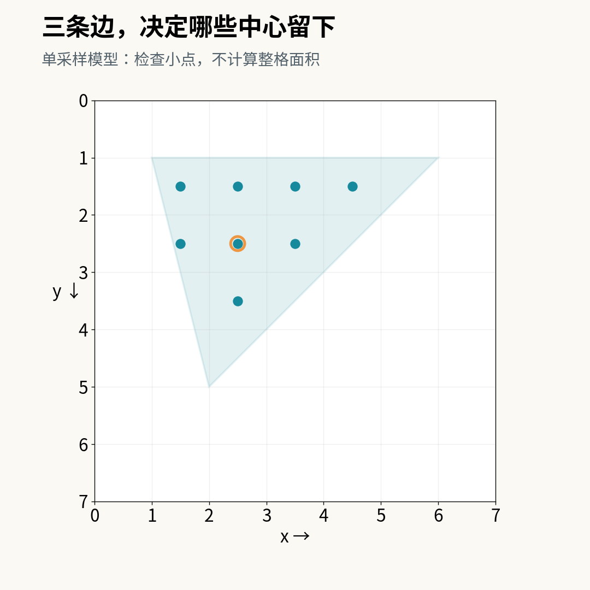
图1｜整数网格线之间的点是像素中心；橙圈标出后文验算的 P=(2.5,2.5)。

## 1. 先约定：屏幕上的点到底在哪里

本文的 x 向右，y 向下。像素编号是整数 (i,j)，左上角位于 (i,j)，中心位于 (i+1/2,j+1/2)。例如编号 (2,2) 的中心是 (2.5,2.5)，不是 (2,2)。

先只做单采样：每个像素检查一个中心。三角形哪怕擦过了一个格子的角，只要没有盖到中心，本模型就不给那个像素生成片元。反过来，中心被覆盖，也不等于整格都在三角形里。

这解释了一种常见困惑：“明明图形碰到了格子，为什么没画？”因为你问的是面积相交，算法回答的是采样点是否属于三角形。它们不是同一个判断。极细的三角形甚至可能与很多格相交，却没有命中任何中心。

多采样会改成检查更多预先规定的位置，保守光栅化又有不同的覆盖契约；本文代码不实现它们。把顶点保留得更精细，也不会自动把一个采样点变成多个。

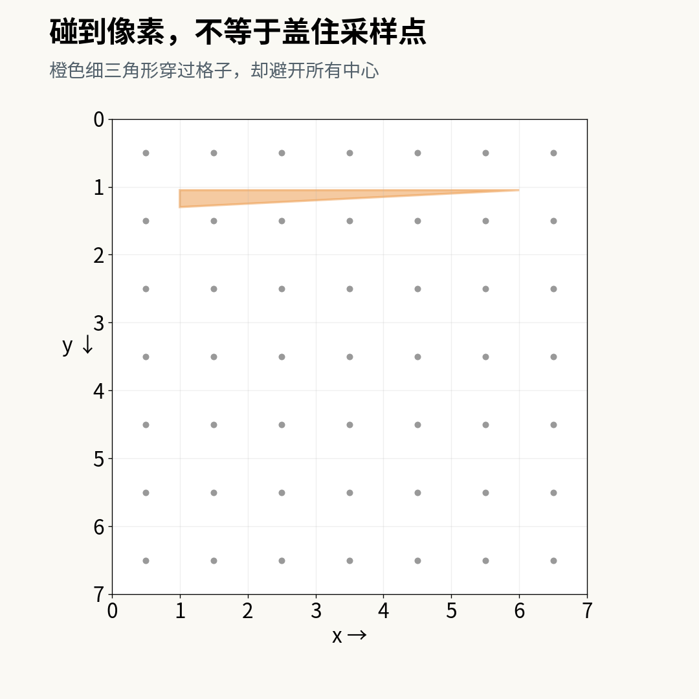
图2｜细三角形与多格相交，但本例所有像素中心都在它外面；这不是保守光栅化。

## 2. 把一条边当作一个“有正负的尺子”

给定有向边 A→B，记 dx=Bx−Ax、dy=By−Ay。对于待检查的 P，定义：

E(A,B,P) = dx×(Py−Ay) − dy×(Px−Ax)。

先把 A=(1,2)、B=(6,2) 代进去。因为 dy=0，式子只剩 5×(Py−2)。P 在线下方，也就是屏幕上更大的 y 那边，结果为正；在线上方为负；恰好共线为零。斜边只是把这把尺子转了个方向。

E 的绝对值是三角形 ABP 面积的两倍，符号还保存了方向。把 A、B 交换，所有结果都反号。所以“正数表示里面”不是公式凭空承诺的事，还需要把三角形三条边的方向安排一致。

在我们的 y 向下约定里，E(A,B,C)>0 对应屏幕上看起来的顺时针绕序。代码若发现面积为负，就交换后两个顶点；若为零，就把它作为退化三角形返回空集合。这里没有背面剔除：两种输入绕序都画，只是内部统一方向。返回的权重还会重新放回原始顶点顺序，避免颜色跟着交换错位。

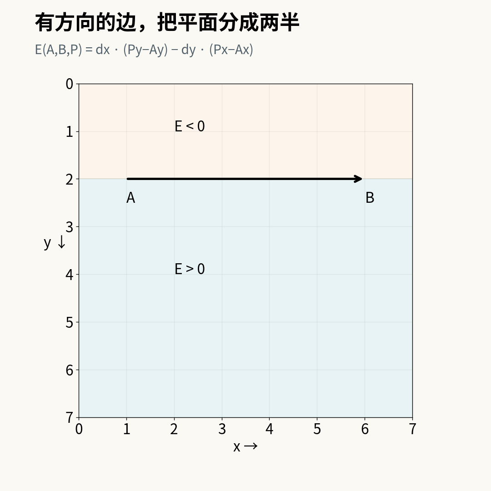
图3｜y 向下时，向右水平边下方为正；交换端点，整个符号翻转。

## 3. 一条边给半个平面，三条边留下一个三角形

统一绕序后，A→B、B→C、C→A 都把内部放在 E≥0 的一侧。因此，一个点若通过三次非负检查，就在闭三角形里：

E(B,C,P)≥0，E(C,A,P)≥0，E(A,B,P)≥0。

每一个条件都只管自己的无限半平面。三个条件取交集，才把范围收成有限的三角形。只看一条边不够，只看包围盒也不够。包围盒能帮你少问一些点，但不能替三角形回答“里面还是外面”。

暂时使用 ≥，是为了先理解几何。它还不是最终共享边规则。内部的点没有争议，真正需要补上的协议全藏在 E=0 那一刻。

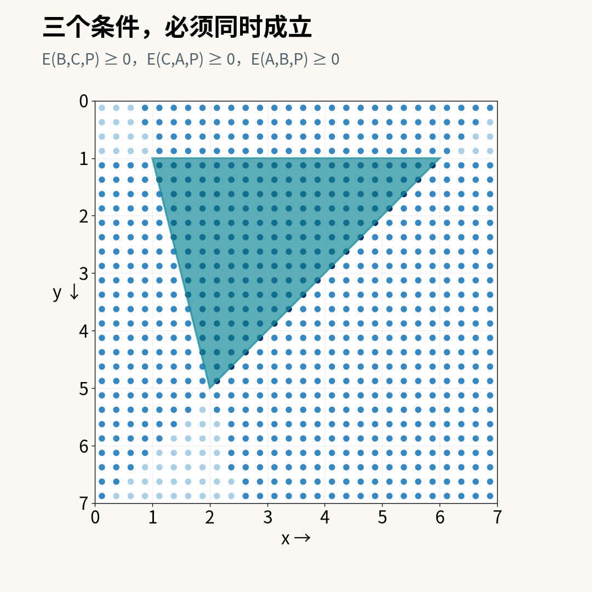
图4｜浅深表示通过一、二、三个半平面测试；有限三角形来自三个条件的交集。

## 4. 顺手得到的，不只是一个布尔值

取 A=(1,1)、B=(6,1)、C=(2,5)，待测像素中心 P=(2.5,2.5)。总的两倍面积是 E(A,B,C)=20。按“某顶点对应它对面的边”的顺序计算：

wA 的分子 E(B,C,P)=8；
wB 的分子 E(C,A,P)=4.5；
wC 的分子 E(A,B,P)=7.5。

三者相加恰好是 20。除以总量，得到 (2/5,9/40,3/8)。它们既非负又总和为 1，而且能重建 P：

x = (2/5)×1 + (9/40)×6 + (3/8)×2 = 2.5；
y = (2/5)×1 + (9/40)×1 + (3/8)×5 = 2.5。

这就是重心权重。在 A 点，它是 (1,0,0)；离开三角形以后，某些权重可以变负。权重本身能描述整个平面上的位置，覆盖测试才决定是否接纳这个位置。

若顶点给的是在屏幕上应当仿射变化的属性，就能用同样权重求和。但透视投影后的纹理坐标一般还需要透视校正，不能凭“权重和为一”就跳过那一步。本篇只验证权重，不重新展开上一类插值专题。

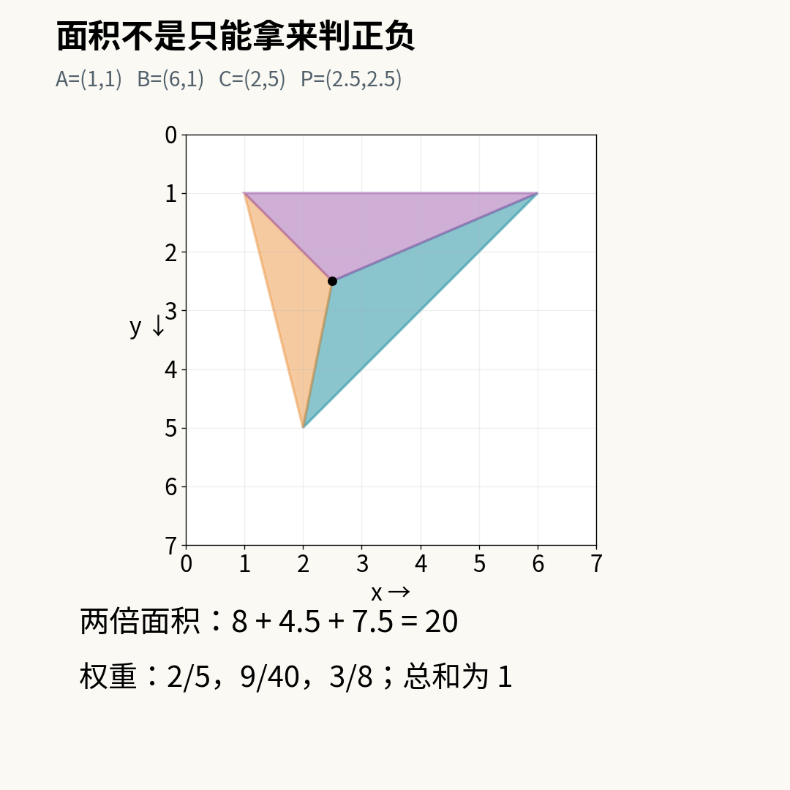
图5｜三个子三角形的带符号两倍面积除以总量 20，得到 P 的重心权重。

## 5. 正方形的对角线，暴露了 ≥ 的问题

取 A=(1,1)、B=(5,1)、C=(5,5)、D=(1,5)。画蓝片 ABC 和橙片 ACD。正方形内部有 4×4=16 个像素中心，其中四个恰好落在 A→C 这条对角线上。

若两片都要求三条边 ≥0，这四个中心各被接受两次：一共二十次接受，只有十六个不同中心。若全部改成 >0，它们又被两边一起拒绝：只剩十二个中心。

注意这里的“缝”是覆盖集合缺了四个样本，不是已经断言某个特定 GPU、某种混合方式会出现同样颜色。计数实验把渲染状态的干扰拿掉，留下一个更直接的问题：拼接的两片能否对每个中心恰好负责一次？

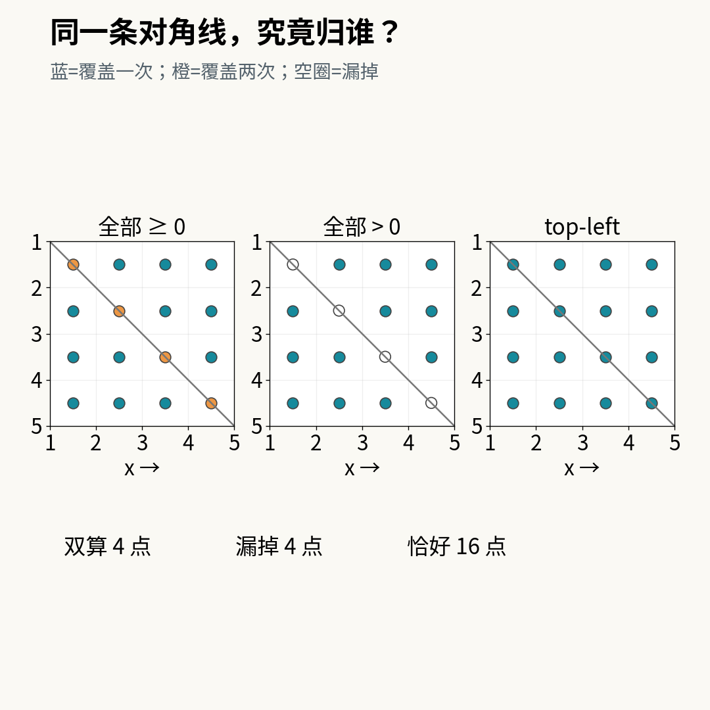
图6｜同一正方形拆成两片：全闭重复四点，全开漏四点，top-left 恰好覆盖十六点。

## 6. top-left：不是挪动几何，而是约定边界所有权

Microsoft 的三角形光栅规则用 top-left 约定处理边界，让相邻三角形共同边上的样本只归一片。[Microsoft：Rasterization Rules](https://learn.microsoft.com/en-gb/windows/win32/direct3d11/d3d10-graphics-programming-guide-rasterizer-stage-rules)

落实到本文自己的坐标与绕序，边 A→B 的“含边”条件为：

include = (dy < 0) 或 (dy == 0 且 dx > 0)。

也就是向上的非水平边包含边界，向右的水平边包含边界；其余边不包含。想象 A=(1,1)、B=(5,1)、C=(1,5)：A→B 是上边，应当包含；C→A 是左边，也包含；B→C 是斜右边，不包含。

不要只背“向上、向右”。若 y 改成向上，或改变符号定义、统一绕序，条件也要跟着重新推导。Giesen 的原文是很有用的实现讨论，但它的具体坐标与采样约定不能整段照搬到这里。[Giesen：Triangle rasterization in practice](https://fgiesen.wordpress.com/2013/02/08/triangle-rasterization-in-practice/)

内部 E>0 的点一律收下；外部 E<0 一律拒绝；只有 E=0 才问这条边是否包含。这不是把三角形几何边界移动半格，更不是偷偷扩大一个三角形去盖住裂缝。

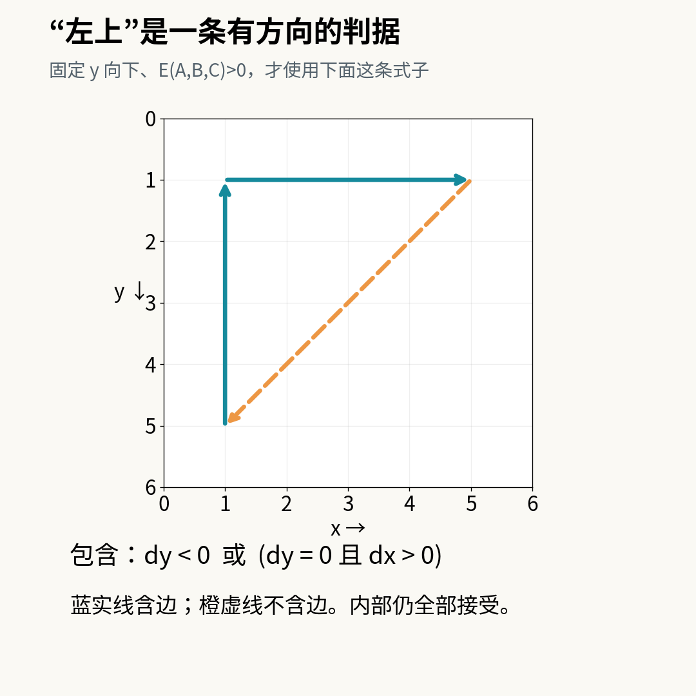
图7｜此判据依赖坐标方向和绕序；不能把另一套约定的代码直接贴过来。

为什么共同边会刚好分给一边？前提是两个不重叠的非退化三角形，使用完全相同的共享端点，并且内部方向都规范化了。此时共同边在两片中的方向相反。非水平边的 dy 一正一负；水平边的 dx 一正一负。于是“含边”判据恰好一真一假。

正方形例子里，蓝片 ABC 的 C→A 是含边，橙片 ACD 的 A→C 不含边。最终蓝片接十点、橙片接六点，合起来仍是完整十六点。

这个保证不能修好本来就不一致的输入：如果两片经过不同计算后，共享顶点舍入成不同位置，那不再是同一条边；若两个三角形本来面积重叠，规则也不会替你消除内部重叠；T 型接缝还需要保证细分后的几何一致。边界协议不是网格修复工具。

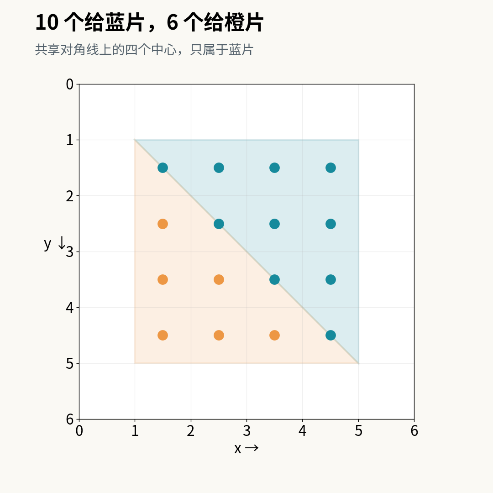
图8｜蓝片 (A,B,C) 获得十点，橙片 (A,C,D) 获得六点；共同边在两片中方向相反。

共同边的端点值得单独查。因为一个点可能同时落在两条边上，不能只拿“一正一反”就省略顶点案例。代码还把正方形连到内部点 O=(2.5,2.5)，分成四片，让 O 恰好压在一个采样中心上。

每一片仍需同时通过自己的三条边；最终 O 只归一片，其余正方形内样本也各有一个所有者。测试枚举四片分别是否翻转输入绕序的全部 16 种组合。这不是对任意坏网格的证明，却是一个能抓住符号、顶点归属及绕序规范化错误的具体检查。

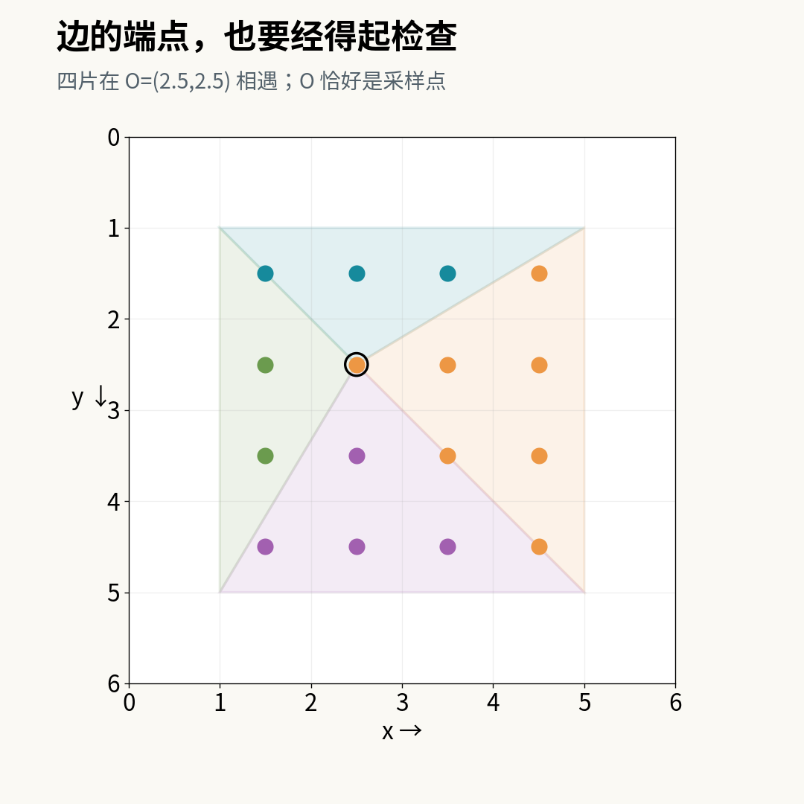
图9｜四片扇形分割覆盖同一十六个中心；相交中心 O 只有一个所有者，测试也枚举绕序翻转。

## 7. 用整数偏置统一比较，但把它关在覆盖这一步

本文模型用 S=16 表示每个像素分成十六份。像素坐标 (1,1) 存成整数 (16,16)；编号 (2,2) 的中心存成 (40,40)。所有参与边函数的坐标都是整数，因此 E 也是整数。

对整数 E，E>0 等价于 E−1≥0。于是含边的 bias=0，不含边的 bias=−1，三条边统一检查 E+bias≥0。这里的 −1 是边函数的整数单位，不是把顶点移动一个像素，也不是随意选择的浮点 epsilon。

关键的分工是：覆盖用 E+bias，重心权重仍然用未经修改的 E。前面的面积样例全部放大 S²=256 倍，三个值是 (2048,1152,1920)，总量 5120。只有 B→C 不含边，所以覆盖测试临时用 (2047,1152,1920)。若把这些偏置后的值直接除以 5120，权重和就成了 5119/5120。

想象三顶点属性全为 1。正确插值不管到哪里都应为 1，错误权重却把它变小了。误差虽小，契约已经坏掉；没必要用“肉眼看不出来”来替代正确实现。代码从头保留原始 values，只在 all(...) 的比较里加 bias。

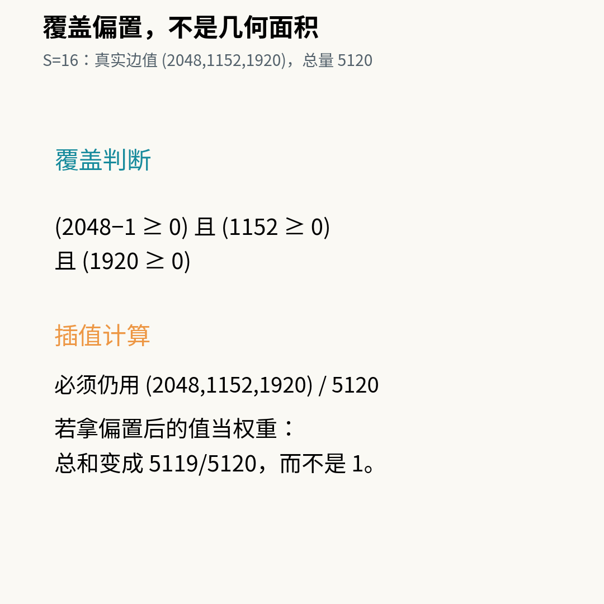
图10｜非含边只在覆盖测试里加 −1；原始边值单独保留，否则连常量插值都可能变错。

## 8. 把“每次重新算”改成“往前加一步”

展开边函数，固定一条边后，它对 P 是一个仿射表达式：

E = (Ay−By)×Px + (Bx−Ax)×Py + Ax×By−Ay×Bx。

因此 P 向右移动一个像素，E 增加 −dy；向下移动一个像素，E 增加 dx。固定点坐标里，一个像素步长是 S，所以实际整数增量是 −dy×S、dx×S。这里 dx、dy 自己也已在子像素单位中，别漏掉这一层。

对 B=(6,1)→C=(2,5)，dx=−4、dy=4，在图示的像素坐标数值里，右移或下移一格都会减四。先算包围盒左上候选中心的三个边值；每走一列加横向增量，每换一行在行起点加纵向增量，就不必在内层重复乘法了。Giesen 的另一篇说明也从这种仿射性质解释逐步求值。[Giesen：Optimizing the basic rasterizer](https://fgiesen.wordpress.com/2013/02/10/optimizing-the-basic-rasterizer/)

我们实现了直算与增量两个模式，测试要求它们的整个“中心→精确权重”字典相等，而不是只比覆盖数量。两种错误算法有时会恰好画出相同数量的点，逐项比较更严格。此处没有跑 GPU 性能，也没有声称 Python 版因此更快。

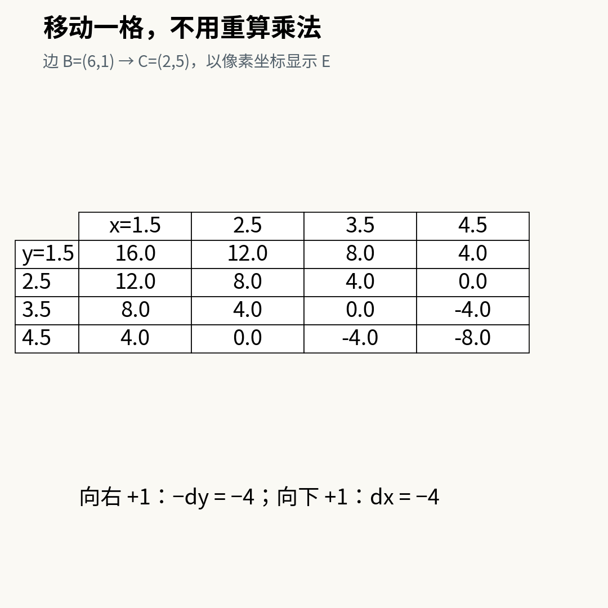
图11｜表格来自边函数直接计算；固定点代码中的一步是 S，所以增量还要乘 S。

## 9. 包围盒、屏幕边界，以及没做的裁剪

中心坐标是 iS+S/2。若三角形顶点 x 的最小、最大整数坐标为 xmin、xmax，候选列可限制为：

i_min = ceil((xmin−S/2)/S)，
i_max = floor((xmax−S/2)/S)。

再与 [0,width−1] 求交；行也一样。注意负数的向上、向下取整，不能想当然用截断到零。代码的 ceildiv(a,b)=−((-a)//b) 配合 Python 向下整除，能处理负坐标。

这个操作只是把访问的像素范围截在屏幕内，三角形的边函数仍取自原有顶点。它不是三维渲染中的齐次裁剪，也不处理穿过近裁剪面、w 为零、透视除法等问题。喂给本模型的输入已经是二维屏幕坐标。

输入也有明确合同：三组整数子像素坐标；S 为 2 到 256 的二次幂；视口宽高为 0 到 256 的整数。尺寸上限只是防止教学程序随手跑出巨大循环，不是数学或硬件上限。退化面积为零时返回空；视口为空也返回空。代码不在函数内部猜测用户想用什么舍入策略。

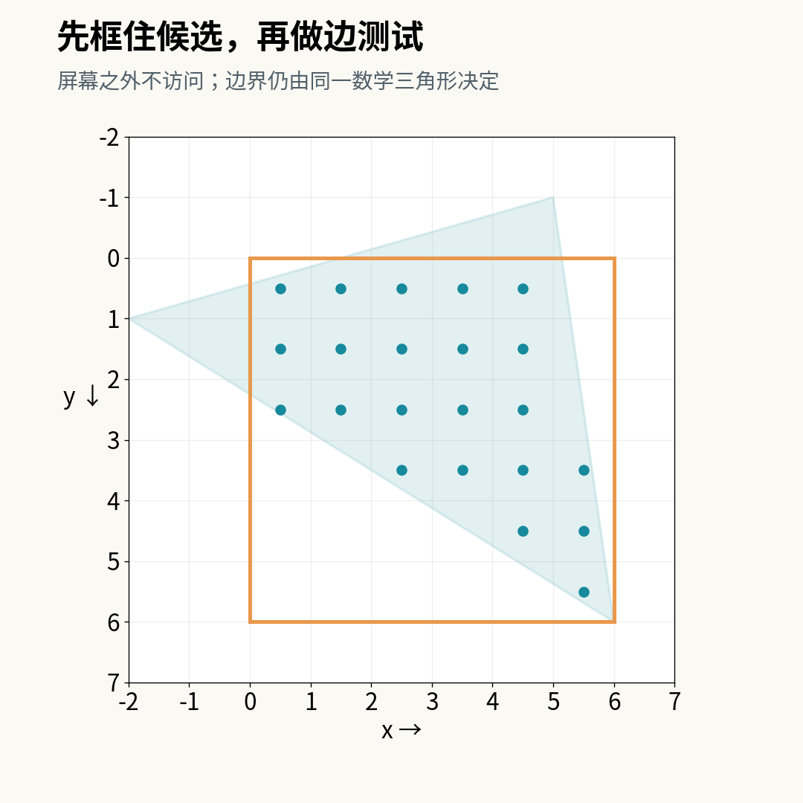
图12｜橙框是 6×6 视口；限制候选像素范围不是对跨近裁剪面的三维三角形做齐次裁剪。

## 10. 子像素、浮点和溢出，分别管什么

子像素让顶点能在整数像素之间移动。S=16 时，一次可移动 1/16 像素；它仍然是有限网格，不是连续实数。图中三角形逐次右移 0、1/4、1/2 像素，采样点没有移动，命中的集合会在跨过中心时改变。这种离散变化正是单采样契约，不应宣称子像素完全消除了锯齿。

代码的 fixed() 只接收恰好落在选定网格上的数，转成 Fraction 后检查分母；例如 1.5 可精确表达。任意十进制输入应先由调用者明确采用哪种量化约定，最好直接给 Fraction 或整数字符串的精确值，不要让二进制浮点近似悄悄替你决定边界。

量化还可能把极窄三角形的三个顶点压成共线。此时模型判断的是量化后的退化几何，不能假装保留了原来实数形状的所有覆盖信息。若相邻片共享顶点，最好共享同一份量化结果，而不是各自走一条略有不同的计算路径。

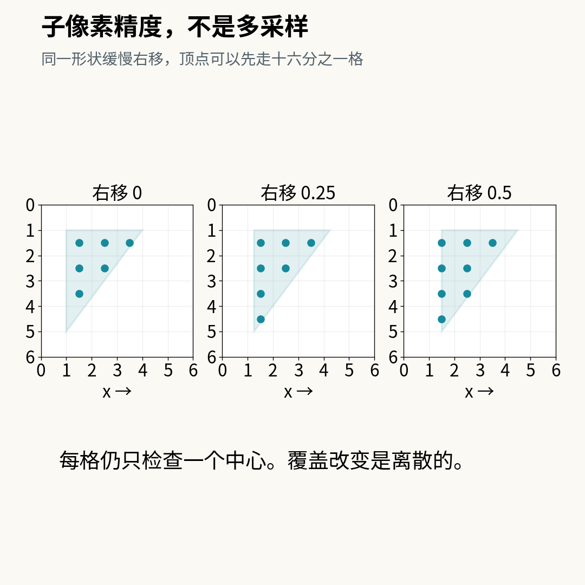
图13｜三幅使用同样单中心采样；子像素网格细化顶点坐标，不会自动消除锯齿。

Python 的整数可以按需增长，所以本模型不会遭遇 32 位整数回绕。这不意味着把类型改成 int32 就安全。独立做一个保守估计：若全部坐标，包括待测样本，都在 [−M,M]，每个差的绝对值不超过 2M，每个乘积不超过 4M²，两项相减不超过 8M²。

取 M=16000，8M²=2048000000，小于 32 位有符号整数最大值 2147483647。这是一个便于手算的充分界，不是最紧范围。还应把偏置、初始化、逐步增量的中间值、循环末尾多走一步的实现细节以及语言的溢出语义一起审查。地址计算的安全也不由面积范围自动保证。

相同屏幕范围换成更大的 S，会把整数坐标和面积单位一起放大。位数预算要跟着改。浮点计算则有另一个问题：理论上的零可能因不同求值顺序变成微小正负。随手加 epsilon 会让边界变成一条带宽，未必维持两片严格互补。本篇不展开稳健谓词算法，只强调整数模型的结论建立在相同、精确、已量化输入上。

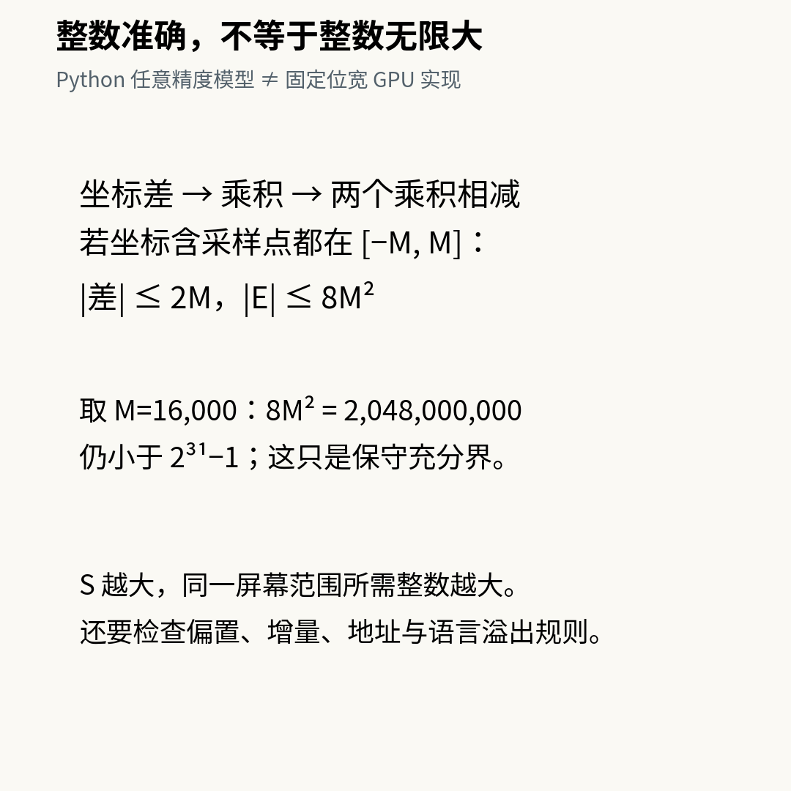
图14｜给出独立推导的保守范围示例，不把 Python 测试通过冒充 32 位实现安全。

## 11. 从逐点到小块：知道可以做，不假装已经做了

边函数在矩形区域内的最大最小值可以从角点取得。因此，若某一条边在整个采样块四角的值都小于零，块内不可能有一个点同时通过全部三条边，整块可以拒绝。更准确的实现应把同一个含边偏置纳入比较。

反过来，若三条边在所有角点的带偏置最小值都非负，则块内全部样本通过覆盖测试。介于两者之间，仍需细分或逐点检查。这里的“角点”应包住实际采样位置，例如从第一到最后一个中心的矩形；若使用像素外框，也可得到保守但可能较松的判定。

这给分块遍历留下了入口，但交付代码只有直算与逐行增量，没有 tile 快速路径、SIMD、并行调度或多采样。图中的橙块只是用具体数值解释拒绝条件，不是硬件内部结构截图。

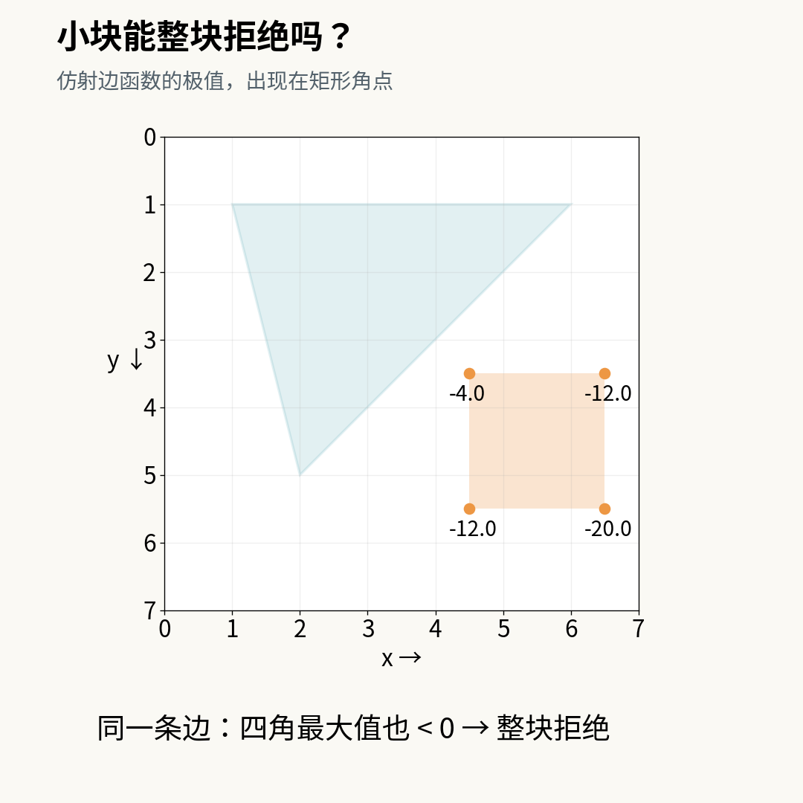
图15｜橙块四角对 B→C 的值都是负数，因此块内无采样点能通过该边；本模型未实现 tile 遍历。

## 12. 用能失败的测试，替代“看着还行”

运行后报告四类案例数量：

- 648 对矩形分割：子像素网格 S=4，左上坐标分别遍历 −2、−1、0，宽高分别 1、2、3 像素，两种对角线，两片各自的两种绕序。期望集合直接由矩形半开区间 x∈[left,right)、y∈[top,bottom) 计算，不用再调用三角形判据来造答案。要求并集等于矩形、交集为空，并要求逐项直算/增量一致。
- 504 个顶点排列案例：在九个格点中选三点，再枚举每组三点的六种排列。对每个接受的中心，验证权重总和为 1、权重非负、精确重建 x 和 y，并比较两种遍历模式。
- 16 个四片扇形绕序案例：验证共享采样顶点与全部内部中心都只被接收一次。
- 3 个显式退化案例：重复点、共线、重复端点都不产生覆盖。另检查零宽视口、正文的数值权重，以及超过常见机器整型范围的精确整数运算。

这些有限穷举不能证明任意图形、任意硬件规范的一切性质。它们的价值是把容易写反的符号、错位的权重、漏掉的共享顶点和负坐标取整，变成会立即报错的条件。

到这里，可以把光栅器的职责说得更清楚了：不是把一个漂亮的连续三角形“差不多涂满”，而是在给定坐标、采样位置、数值表示与边界协议后，稳定地回答一组离散问题。三个边值负责几何，含边规则负责归属，未经偏置的面积负责插值。分工清楚，后面的深度测试才有可靠的候选者。

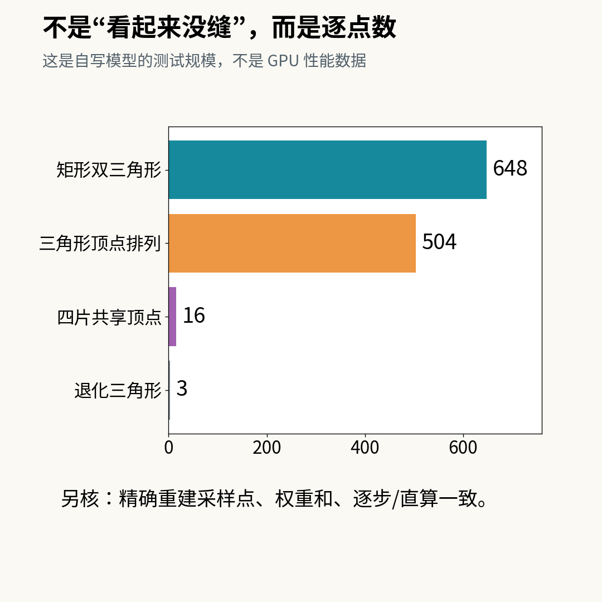
图16｜648 个矩形分割案例、504 个顶点排列案例、16 个扇形绕序案例、3 个退化案例全部通过。

## 自己动手的三个小实验

1. 把正方形案例 rule 改成 closed、open，分别统计总接收次数和不同中心数量。两者为什么不能混为一谈？
2. 删除权重顺序恢复的 order 映射，再交换 B、C。覆盖不变时，插值属性还会不会变？给三个顶点不同颜色更容易看出错误。
3. 把 shared edge 的一个端点只移动 1/S，观察“无缝”保证为什么不再适用。先检查输入是否仍共享同一条边，再讨论规则有没有坏。

这三项是建议实验，不计入已经报告的测试次数。

---

## 短导读｜两个三角形之间，谁负责那条边？

把正方形切成两个三角形，如果两边都收下边界，对角线上的采样点会被处理两遍；如果两边都不收，它们又一起漏掉。

解法不是把边挪开，而是制定一致的所有权协议。三个有向边函数先判断点在各边哪侧；top-left 规则只处理恰好等于零的情况，让共同边只属于一片。

正文固定 y 向下、像素中心在半整数位置，并用自写整数子像素模型逐点核对：16 个中心分成蓝片 10 个、橙片 6 个，无漏点也无重复。更容易踩的坑是把覆盖判断的 −1 偏置拿去插值——这样连权重总和都不再等于 1。

16 幅原创数学图，从半平面、重心权重、共享顶点走到逐步求值与范围边界；附完整标准库代码。它讨论“这个点归不归三角形”，不是“哪个三角形更近”，也不冒充 GPU 实测。

---

## 完整可运行代码

保存为 edge_lab.py，Python 3 执行：python edge_lab.py。只用标准库；绘图工具不属于这段运行依赖。

```python
"""Original teaching model: y down, integer subpixels, exact weights. Python 3."""
from fractions import Fraction
from itertools import permutations, product
import json

def edge(a,b,p):
    return (b[0]-a[0])*(p[1]-a[1])-(b[1]-a[1])*(p[0]-a[0])

def inclusive(a,b):
    dx,dy=b[0]-a[0],b[1]-a[1]
    return dy<0 or (dy==0 and dx>0)

def setup(vertices,width,height,scale):
    if type(scale) is not int or scale<2 or scale>256 or scale&(scale-1):
        raise ValueError('scale must be a power of two in [2,256]')
    if any(type(x) is not int or not 0<=x<=256 for x in (width,height)):
        raise ValueError('viewport dimensions must be integers in [0,256]')
    if len(vertices)!=3 or any(len(p)!=2 or any(type(x) is not int for x in p) for p in vertices):
        raise ValueError('three integer coordinate pairs required')
    v=list(vertices); order=[0,1,2]
    area=edge(*v)
    if area<0:
        v[1],v[2]=v[2],v[1]; order[1],order[2]=order[2],order[1]; area=-area
    edges=[(v[1],v[2]),(v[2],v[0]),(v[0],v[1])]
    h=scale//2
    ceildiv=lambda a,b:-((-a)//b)
    lo=[max(0,ceildiv(min(p[k] for p in v)-h,scale)) for k in (0,1)]
    hi=[min(d-1,(max(p[k] for p in v)-h)//scale) for k,d in enumerate((width,height))]
    return area,order,edges,lo,hi

def raster(vertices,width=8,height=8,scale=16,incremental=False,rule='top-left'):
    """Return {(pixel_x,pixel_y): exact weights in ORIGINAL vertex order}.
    No backface culling. Degenerate triangles return empty. Not a GPU emulator.
    'closed' and 'open' are deliberately wrong shared-edge comparison controls.
    """
    if rule not in ('top-left','closed','open'): raise ValueError('unknown rule')
    area,order,edges,lo,hi=setup(vertices,width,height,scale)
    if not area or any(a>b for a,b in zip(lo,hi)): return {}
    biases=[0 if rule=='closed' or (rule=='top-left' and inclusive(a,b)) else -1 for a,b in edges]
    p=(lo[0]*scale+scale//2,lo[1]*scale+scale//2)
    row=[edge(a,b,p) for a,b in edges]
    sx=[-(b[1]-a[1])*scale for a,b in edges]
    sy=[(b[0]-a[0])*scale for a,b in edges]
    out={}
    for y in range(lo[1],hi[1]+1):
        values=row.copy()
        for x in range(lo[0],hi[0]+1):
            if not incremental:
                values=[edge(a,b,(x*scale+scale//2,y*scale+scale//2)) for a,b in edges]
            if all(z+b>=0 for z,b in zip(values,biases)):
                w=[None]*3
                for k,i in enumerate(order): w[i]=Fraction(values[k],area)
                out[x,y]=tuple(w)
            if incremental: values=[z+d for z,d in zip(values,sx)]
        row=[z+d for z,d in zip(row,sy)]
    return out

def fixed(points,scale=16):
    """Only exact representable coordinates; no silent floating rounding."""
    out=[]
    for p in points:
        q=[Fraction(x)*scale for x in p]
        if any(x.denominator!=1 for x in q): raise ValueError('off subpixel grid')
        out.append(tuple(int(x) for x in q))
    return out

def tests():
    counts={'rectangle_pairs':0,'triangle_order_cases':0,'fan_cases':0,'degenerate_cases':0}
    S=4
    # 3*3 origins, 3*3 sizes, both diagonals, both windings for each triangle.
    # Rectangle expected coverage is independently computed from half-open x/y.
    for l,t,w,h,diag,rev1,rev2 in product(range(-2,1),range(-2,1),range(1,4),range(1,4),range(2),range(2),range(2)):
        r,b=l+w*S,t+h*S; A=(l,t);B=(r,t);C=(r,b);D=(l,b)
        pair=[(A,B,C),(A,C,D)] if diag==0 else [(A,B,D),(B,C,D)]
        pair=[v[::-1] if rev else v for v,rev in zip(pair,(rev1,rev2))]
        a,bm=[raster(v,5,5,S) for v in pair]
        expected={(x,y) for x in range(5) for y in range(5) if l<=x*S+S//2<r and t<=y*S+S//2<b}
        assert not (a.keys() & bm.keys()) and a.keys()|bm.keys()==expected
        for v,m in zip(pair,(a,bm)): assert m==raster(v,5,5,S,True)
        counts['rectangle_pairs']+=1
    # Exhaust all triangles in a 3x3 vertex grid; test every input ordering.
    points=list(product((0,3,7),repeat=2))
    from itertools import combinations
    for v in combinations(points,3):
        base=set(raster(v,3,3,S))
        for perm in permutations(v):
            out=raster(perm,3,3,S)
            assert set(out)==base and out==raster(perm,3,3,S,True)
            for (x,y),ww in out.items():
                assert sum(ww)==1 and all(q>=0 for q in ww)
                assert sum(q*p[0] for q,p in zip(ww,perm))==x*S+S//2
                assert sum(q*p[1] for q,p in zip(ww,perm))==y*S+S//2
            counts['triangle_order_cases']+=1
    # Four triangles meeting at an exact sample center, all 16 winding patterns.
    A,B,C,D,O=fixed([(1,1),(5,1),(5,5),(1,5),(2.5,2.5)],S)
    for flips in product(range(2),repeat=4):
        acc={}
        for tri,flip in zip([(A,B,O),(B,C,O),(C,D,O),(D,A,O)],flips):
            for p in raster(tri[::-1] if flip else tri,7,7,S): acc[p]=acc.get(p,0)+1
        assert acc=={(x,y):1 for x in range(1,5) for y in range(1,5)}
        counts['fan_cases']+=1
    for v in [((0,0),)*3,((0,0),(2,2),(6,6)),((0,0),(0,0),(4,0))]:
        assert raster(v)=={}; counts['degenerate_cases']+=1
    v=fixed([(1,1),(6,1),(2,5)])
    assert raster(v)[2,2]==(Fraction(2,5),Fraction(9,40),Fraction(3,8))
    assert raster(v,0,8)=={}
    # Exact arbitrary precision translation, beyond fixed-width machine integers.
    huge=10**30
    assert edge((huge,huge),(huge+3,huge),(huge,huge+4))==12
    return counts

if __name__=='__main__': print(json.dumps({'result':'PASS','counts':tests()},indent=2))
```

---

[来源、材料权利与编写说明](sources.md)
