# Robin Hood 哈希：把住得近的键请走，为什么查找反而更稳？

一排储物柜只剩几个空位。每个人先去自己的编号，发现有人就往右找。早到的人刚好站在门口，晚到的人可能绕出去很远。

如果允许晚到的人说一句“我已经走了好几格，你才刚到家门口，要不你再往前走一步？”，会发生什么？

这就是 Robin Hood 哈希的入口。它会搬动已经存好的元素，听起来像在给插入添麻烦；但搬动过程中保留下来的信息，也能帮我们更早认定“这个键根本不在表里”。

先别急着背复杂度。我们只用八个格子、几把字母钥匙，把插入、查找和删除从头做一遍。这里讨论的是“线性探测 + Robin Hood 交换 + 回移删除”这个具体组合，不把所有同名变体混在一起。

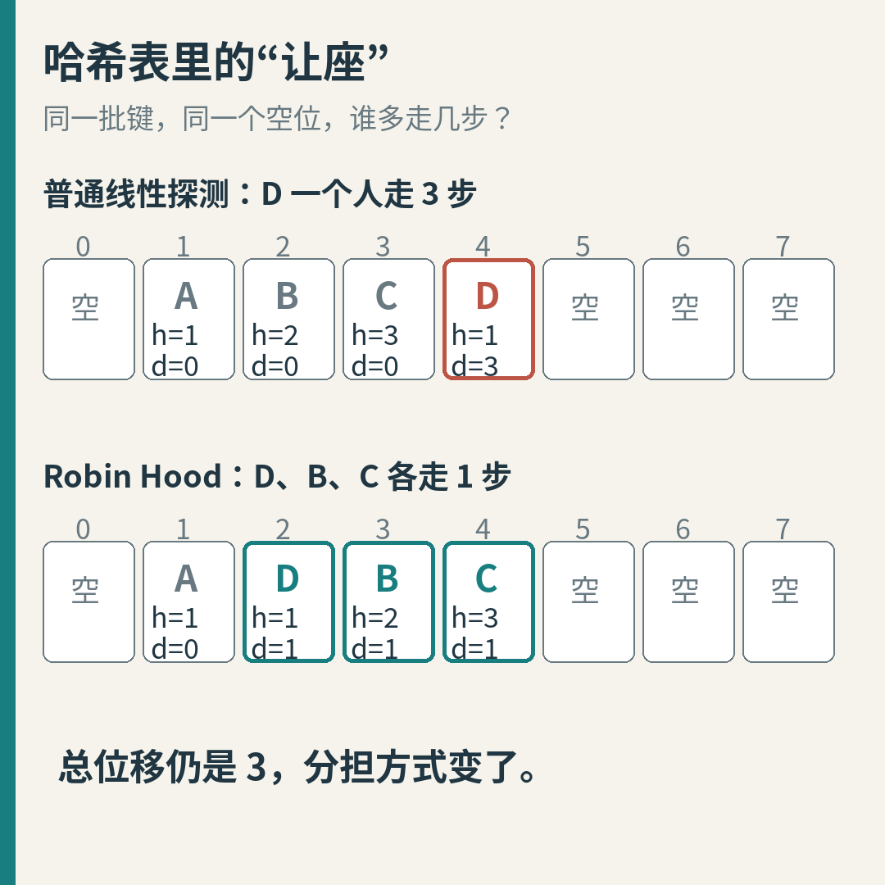

图1：自造八槽例子，同序插入 A、B、C、D。上方普通线性探测把三步都留给 D；下方 Robin Hood 把位移分给 D、B、C。这里的 h 是起点，d 是向前走的格数。

## 1. 先认清三个数：起点、当前位置、走过几步

哈希表要保存“键”。键可以是用户名、文件路径或资源编号。哈希函数先把键映射成一个数字，再根据表的容量算出一个起点。

本文把这一步的结果直接给出来，方便手算。A 的起点是 1，B 是 2，C 是 3，D 也是 1。这些字母不是字符编码取模的结果，也不是一款推荐使用的哈希函数。

八个槽编号从 0 到 7。每槽最多装一个键。撞上占用的槽，就看下一格；到了 7 之后回到 0。这种沿相邻槽继续寻找的位置安排叫“线性探测”。它是开放寻址的一种：键仍住在这一个数组里，而不是挂在额外链表上。

再给每个键记一个数 d，表示它从起点顺着探测方向走了多少格。英文材料常写 DIB，即 distance to initial bucket。住在起点时 d=0；走到下一格是 d=1。

请区分两个容易混的量：位移 d=0，并不代表查询一次都没看。你仍然要检查它所在的槽。用本文从起点顺序查的办法，找到一个现存键，检查的槽数是 d+1。

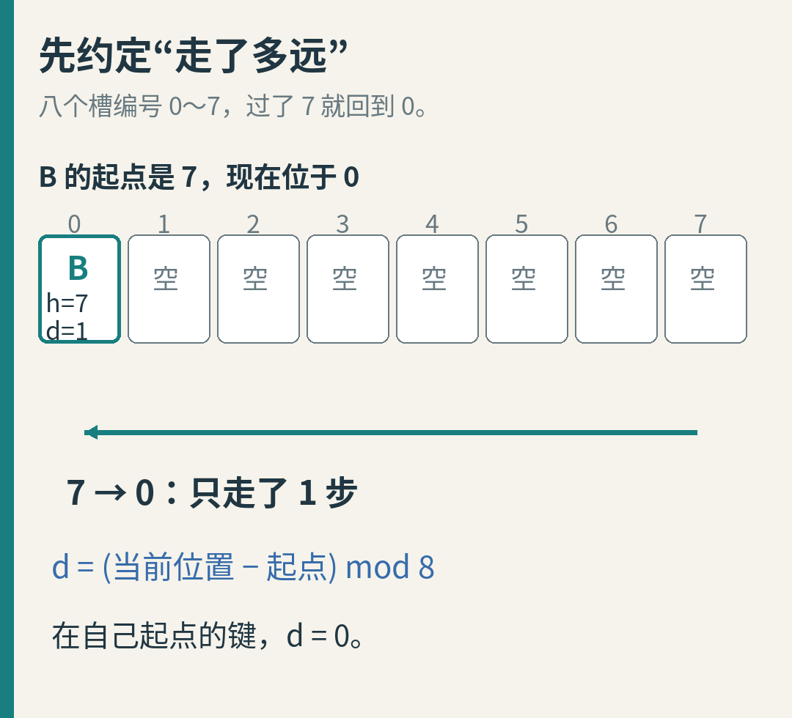

图2：位移沿探测方向计算，跨数组边界也要算。起点 7 到位置 0 的位移为 1，不能直接得到负七。 此图仅示意模距离，其他空格不表示一张有效完整表的状态；在本文维护的合法表中，从键的起点到当前位置的探测路径不得有空洞。

如果不跨边界，当前位置减起点就行；跨边界时，采用模运算：d=(当前位置−起点) mod 8。例如起点 7、当前位置 0，d=1。可以把“mod 8”理解为绕八格圆环后，只保留还走了几格。

哈希相同或起点相同不代表键相同。A 和 D 可以争同一个位置，查找时仍必须比较真正的键，不能只看起点就认亲。

## 2. 四把钥匙，一次接力

先依次放入 A、B、C。它们各自在 1、2、3 号槽，d 全为 0。然后放 D，D 从 1 出发。

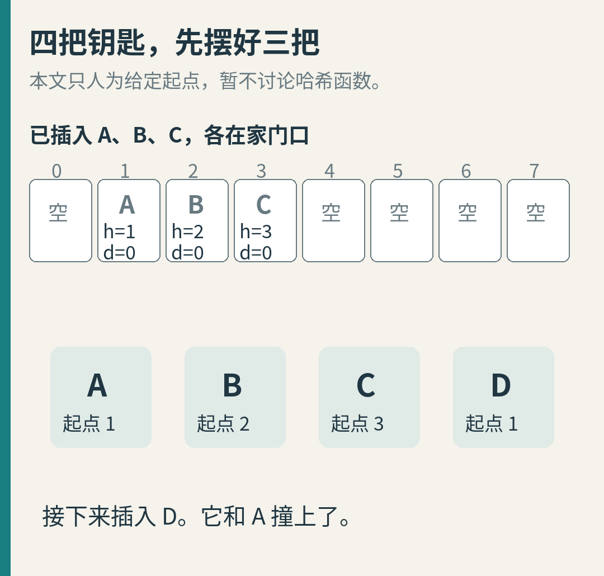

图3：A、B、C 的起点依次为 1、2、3；D 的起点也是 1。后续每一幅都沿用这些起点，不暗中更换哈希结果。

Robin Hood 的规则只有一句核心话：当来客已经走得比住户更远时，让来客留下，原住户继续向前走；距离相等时，本文不交换。

NIST 的算法词典把它概括为让探测序列较长的元素保住位置，让另一个继续移动。这条交换思想比本文的小表更一般；我们接下来只沿线性探测把它具体化。

第一站是槽 1。D 刚出发，d=0；A 在家门口，d=0。平局，A 留下。D 往槽 2 走，自己的 d 加一，变成 1。

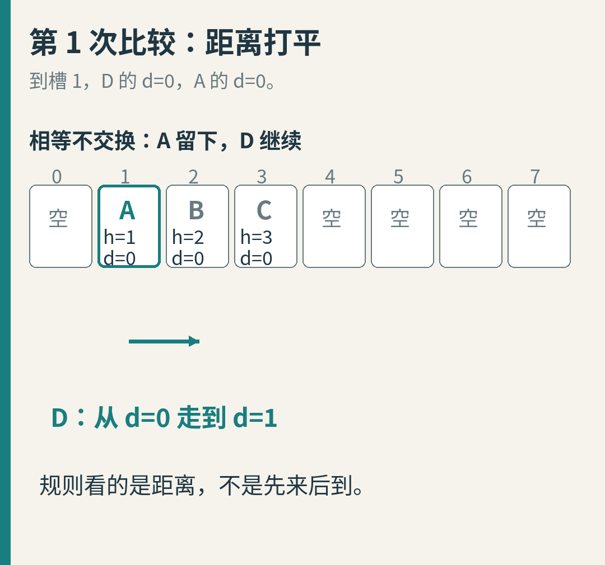

图4：D 在槽 1 与 A 的位移同为 0。本文选用严格大于才交换的规则，平局保持原住户，D 走向槽 2。

第二站是槽 2。D 已走一步，B 一步没走。D 的 1 大于 B 的 0，所以两者交换身份：槽 2 装 D，接下来手里等待安置的键变成 B。

这里有个很容易写错的细节：此后计数跟着 B 走。B 原本的起点是 2，在槽 2 时 d=0，走到槽 3 后 d=1。不能继续替 D 数“第二步”，然后把错误距离塞给 B。

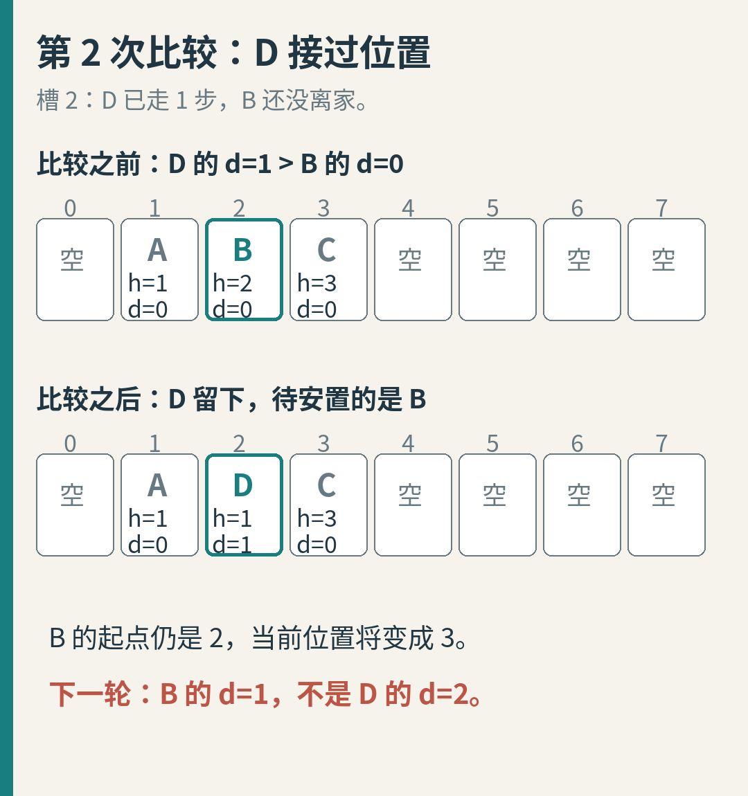

图5：槽 2 原住户 B 的位移为 0，来客 D 的位移为 1，所以 D 留下。后续继续搬的是 B，要沿用 B 的起点与位移，不能把 D 的计数硬套给 B。

第三站是槽 3。来客 B 的 d=1，住户 C 的 d=0，于是 B 留下、C 继续。C 到槽 4 时 d=1，那里是空的，就把 C 放进去，结束插入。

最终槽 1～4 装着 A、D、B、C，位移分别是 0、1、1、1。它们没有丢失，没有复制，也没有凭空增加空位。只是把谁留在前面、谁多走一点重新分配了。

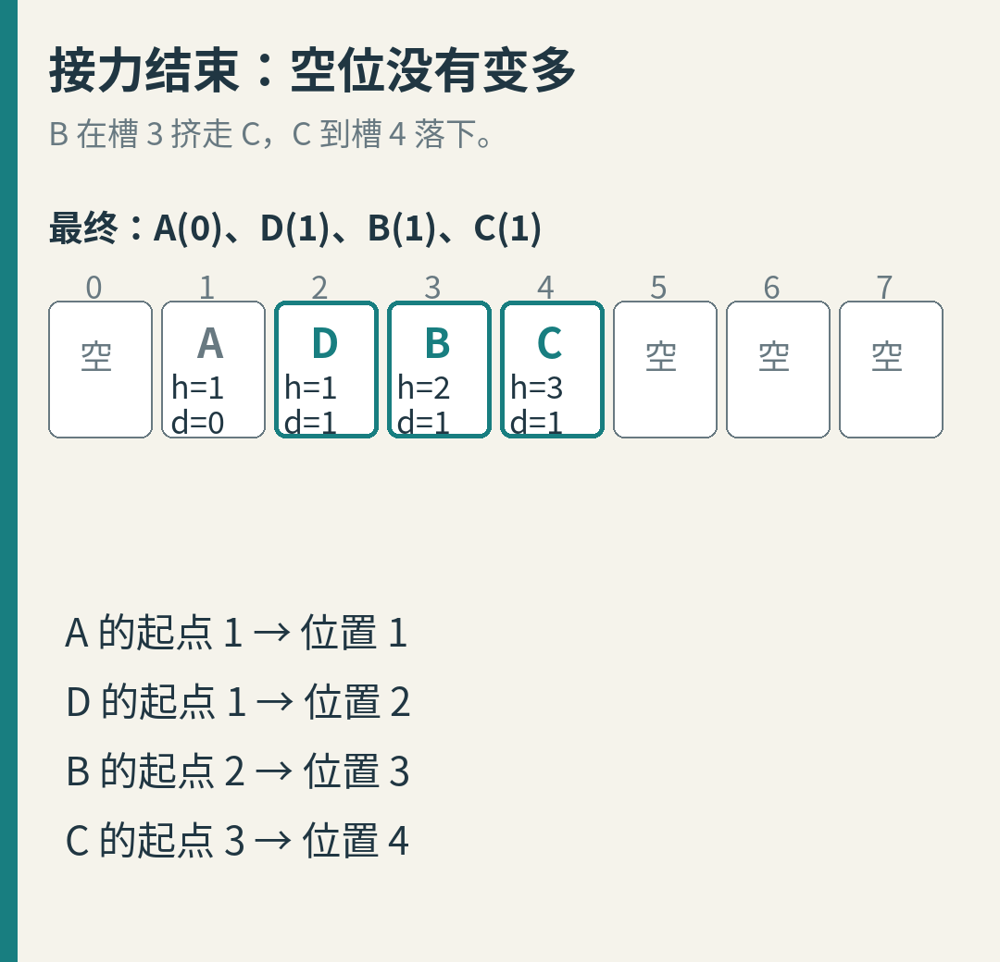

图6：B 与 C 再交换后，C 落入槽 4，插入完成。四把键都还在，原先的第一个空槽 4 被填上。

可以自己暂停一下：若把 D 的起点改成 2，这一遍还会在槽 2 交换吗？不会。D 到槽 2 时 d=0，与 B 打平，要继续走。交换看的是当前相对距离，不是字母顺序，也不是后来者必然优先。

## 3. 为什么说它“公平”，而不是“所有查询都更快”

不交换的普通线性探测，会让 A、B、C 原地不动，D 一路走到槽 4。它们的位移是 0、0、0、3。

Robin Hood 的位移是 0、1、1、1。两组数加起来都是 3，平均都是 3÷4=0.75。对应四个键各查询一次，平均检查槽数也都是 1.75。

这件事很值得停一下：这一轮平均数没改善，最倒霉的那个却不必走那么远了。A 的代价保持不变，B、C 各多检查一格，D 少检查两格。并不是每个键都同时获益。

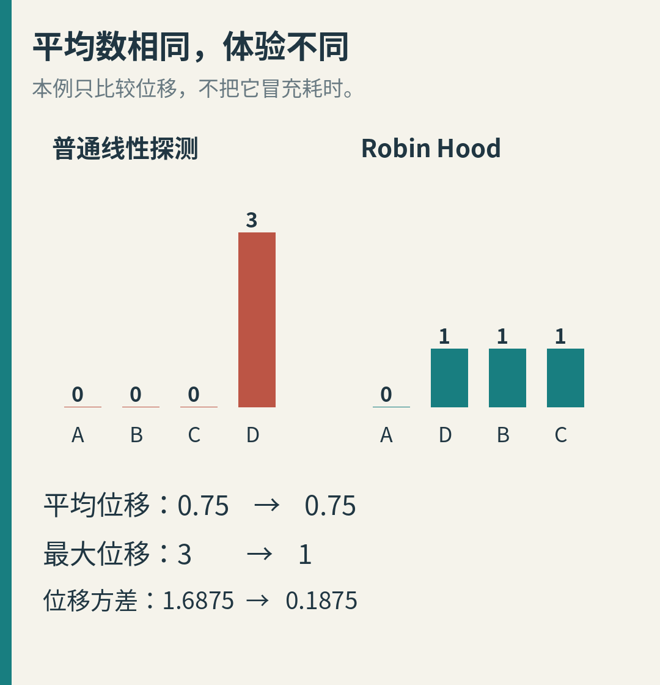

图7：图1同一例子的精确算数。两种方法位移总和都是 3，四个键的平均位移都是 0.75，但本例最大值与方差减小。一次成功查询探测数为位移加 1；这不是通用性能基准。

想再向前走一步，可以算方差。先让每个数减去平均数 0.75，平方，再把四个平方平均。普通方法得到 1.6875，Robin Hood 得到 0.1875。方差用一个数表示“大家离平均水平有多分散”。这四个数是本文实例的精确算术，不是随机试验，更不是 CPU 用时。

Robin Hood 这名字借用了“从富者那里拿一点，给穷者一点”的直觉。在这里，“富”是少走了很多路，“穷”是已被迫探测较久。但实现时不会判断谁“值得同情”，只做整数比较和交换。

历史上，Pedro Celis 的 1986 年滑铁卢大学论文研究了这类探测代价的均衡问题，之前也有 Celis、Larson、Munro 的 1985 年论文。原论文包含特定模型与搜索策略，不能把摘要里的数值直接当成这份线性教学实现的通用保证。本文不复刻论文实验，也不声称读完了其全部证明。

## 4. 查找：为什么还没遇到空位，就能说“不在”？

现在仍用四把键的表：槽 1～4 是 A、D、B、C。

假设我们想找 E，给定 E 的起点也是 1，但 E 还没插入。查找时也从 1 出发，并单独记“这次查询已经走了几步”。

看槽 1：查询距离是 0，住户 A 的位移是 0，键不相同。继续。

看槽 2：查询距离是 1，住户 D 的位移是 1，键不相同。继续。

看槽 3：查询距离是 2，住户 B 的位移只有 1。此时可以停下，E 不在表里。不必继续查 C，也不必等到槽 5 的空位。

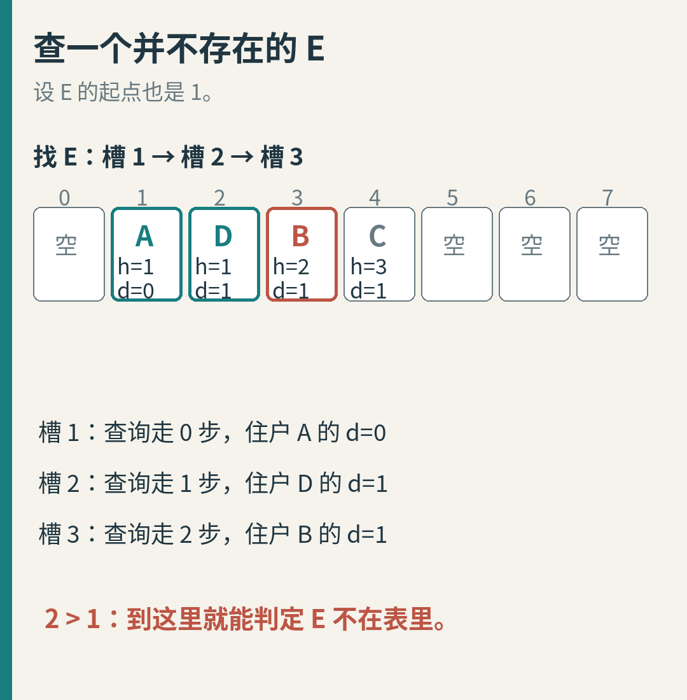

图8：查询 E 的当前位置离起点已有两步，却遇到仅离家一步的 B。满足住户位移小于查询距离的停止条件，不必继续读槽 4 或空槽 5。

提前停止的比较方向一定要写对：住户的 d 小于本次查询已经走过的距离，就停止。相等不能停止，因为前面那个 D 就与 E 的查询距离打平。

为什么这有道理？想象 E 真在更后面。E 插入时必然先经过槽 3，而它到槽 3 时已经走了两步，应该把只走一步的住户挤走、自己留在这里。一个始终按规则维护的表，不会允许这种“本应留下的键偷偷在低位移住户后面”的状态。


图9：提前停止依赖整个表一直维护 Robin Hood 顺序。直观反证是，若同起点的 E 真在后方，它早先经过低位移住户时就会夺取位置。混入普通插入、错误删除或另一套探测序列后，不能照搬这条判断。

这个说法还需要一点维护上的解释，不能只拿“插入那一刻”就跳过后来的变化。对于线性探测，可以在一个空槽后把圆环剪开，观察连续的一段占用区：插入时，起点更早的来客若追上起点更晚的住户，就会交换；回移删除又按同样的探测方向补洞。这样的操作让我们用于查找的先后关系持续成立。

同一个当前位置下，“来客距离更大”也就是“来客起点更靠前”。遇到起点已经更靠后的住户，意味着要找的那个更早起点的键不可能藏到它后面。这是理解早停的另一种方式。

但不要把它简化为“整张表的 d 从小到大排好”。稍后我们会亲手构造反例。

这套判断有明确前提：所有插入都维护同一 Robin Hood 规则，删除也正确补洞，查找与插入采用一致的探测顺序。不能把早停条件随手加到一张由普通线性插入建成的旧表里，那样可能把现存键误判成不存在。

## 5. 再放一个 E，为删除准备一条稍长的链

在四键表里真的插入 E，起点为 1。

槽 1 的 A 与 E 打平；槽 2 的 D 也与 E 打平。到了槽 3，E 已走两步，B 只走一步，于是 E 留下。B 接着到槽 4，把位移为 1 的 C 挤走；C 最后落在槽 5。

现在槽 1～5 是 A、D、E、B、C，位移为 0、1、2、2、2。

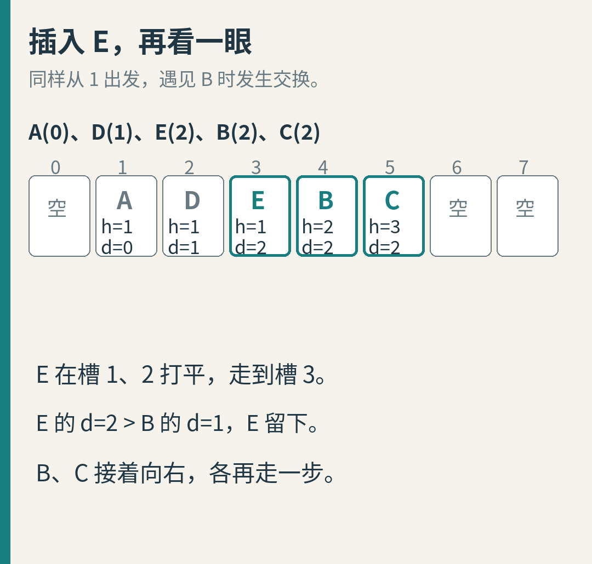

图10：在 A、D、B、C 的表中再插入起点为 1 的 E，得到 A、D、E、B、C，位移 0、1、2、2、2。这张表用于后面的删除演示。

如果继续查一个同起点但不存在的 F，查询距离会依次是 0、1、2、3；到槽 4 时，住户 B 的位移是 2，3 大于 2，因此在这里停。注意：尚未遇到空位也能提前停，是因为额外维护了结构信息，不是因为哈希函数能够预言不存在。

## 6. 删除：空位会把后面的键“藏起来”

现在删除 D。D 在槽 2。

最直觉的写法是把槽 2 清空。可是下次查 E，从槽 1 出发，走到槽 2 看见空位，就返回不存在。E 明明仍在槽 3，却从查询路径上消失了。

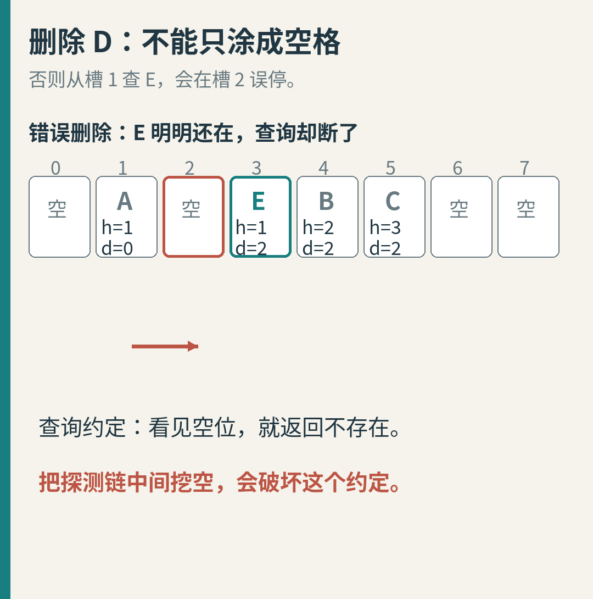

图11：错误地把 D 所在槽 2 清空。查询 E 从槽 1 开始，在槽 2 遇空就会结束，漏掉槽 3 的 E。图中故意展示的是坏状态，不能用于实际查找。

有些开放寻址方案用“墓碑”标记解决：这里曾经有元素，查询不能在此停下。本文选择另一条路线，回移删除，也常称 backward-shift deletion。它不留下墓碑，而是把后面的元素挪回来补洞。

把槽 2 想成一个洞。看它下一格槽 3：E 的位移是 2，说明 E 从自己的起点走过了这个洞，所以 E 可以后退一格，放到槽 2，位移减为 1。新的洞在槽 3。

继续看槽 4，B 的位移也是 2，可以移到槽 3，减为 1。再看槽 5，C 移到槽 4，位移也减为 1。到了槽 6，它本来就是空的，因此停止，最终把槽 5 留空。

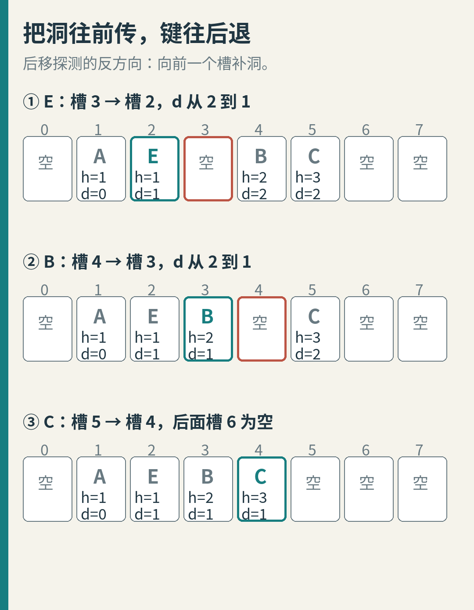

图12：回移删除的三个中间状态。E、B、C 各朝起点方向挪一格、位移减一，洞依次从 2 到 3、4、5；槽 6 已空，因此最终把槽 5 留空。

“回移”是沿着前进探测的反方向退一格。在线性数组中看起来通常是向左；跨边界时，则可能从 0 搬到 7。别把它写死成索引减一后不处理边界。

还有第二种必须停的情形：下一位已经在自己的起点，d=0。它没有经过这个洞，不能硬拖过去。


图13：回移删除遇到位移为 0 的键必须停。这里 C 的起点是 3，不能为了填槽 2 的洞，把 C 放到查找路径开始之前。

例如洞在槽 2，C 的起点和当前位置都是 3。若把 C 搬到 2，查 C 却从 3 开始，之后只会向前查，不会立刻回头看 2；清空 3 更会让查找立刻失败。停止回移，才能保住查找路径。

Emmanuel Goossaert 在 2013 年记录过自己为实现加入回移删除的过程，以及 Paul Khuong 提供修改的帮助。这是一份实现者的经验记录；文中的 DIB 分布图不等于纳秒级运行时间，也不能把某个百分位当成理论最坏情况。我们这里没有搬用那些实验图，图12是由本文小表逐步算出的独立例子。

## 7. 数组的尾巴，也是一条正常的路

再换一组起点：A=6，B=7，C=6，D=0，仍依次插入 A、B、C、D。

结果是槽 6 装 A，槽 7 装 C，槽 0 装 B，槽 1 装 D。它们的位移分别为 0、1、1、1。把数组画成一条直线时，簇好像被切成了两段；沿探测方向看，其实是 6→7→0→1 的连续路径。

删除 A 后，C 从 7 回到 6，B 从 0 回到 7，D 从 1 回到 0。每一位的 d 都从 1 变成 0，槽 1 最后清空。

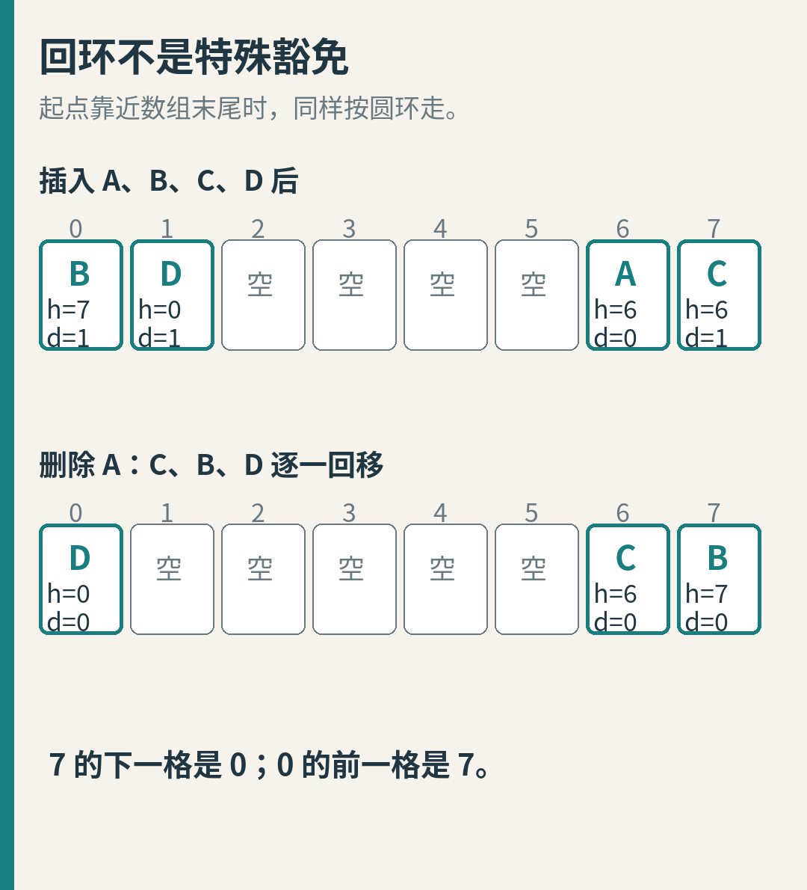

图14：另一组自造起点 A=6、B=7、C=6、D=0。上图跨末尾形成簇；删除 A 后 C 从 7 到 6，B 从 0 到 7，D 从 1 到 0，每次位移减一。

写代码时，把“下一格”统一写成 (i+1) mod m，会比四处夹杂特殊判断更容易检查。下面的教学程序还给查找加了至多 m 次的循环上界，防止一个错误状态让它转圈不止。

## 8. 一个反例，帮你忘掉错误口诀

请构造四个键：A、B、C 的起点都为 1，D 的起点为 4。依次插入后，槽 1～4 的位移就是 0、1、2、0。

没有违反任何规则。D 在槽 4 恰好碰到空位，直接住下，不需要先去与 C 比较。

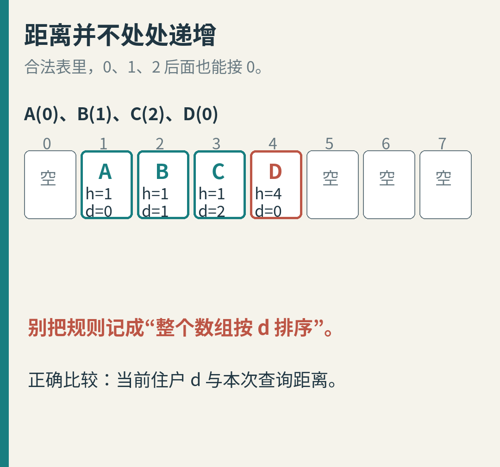

图15：A、B、C 都从 1 出发，D 从 4 出发，所得连续非空区域位移是 0、1、2、0。它完全合法，说明不能把提前停止理由误说成整段位移单调不减。

因此，“位移在整个连续非空段里单调递增”是错的。图8的提前停止成立，但成立理由不能是这个假命题。

一个好用的学习方法是，每遇到“总是”“一定递增”这样的口诀，就尝试找最小反例。四个键足够戳穿它，而无需跑一百万次随机试验。

## 9. 什么时候它也会变慢？

假设七个不同键的起点全为 0，容量仍是 8。它们会排成位移 0、1、2、3、4、5、6。距离相等时不会交换，后来的键照样一路向前。找最后一个键仍需检查七个槽。

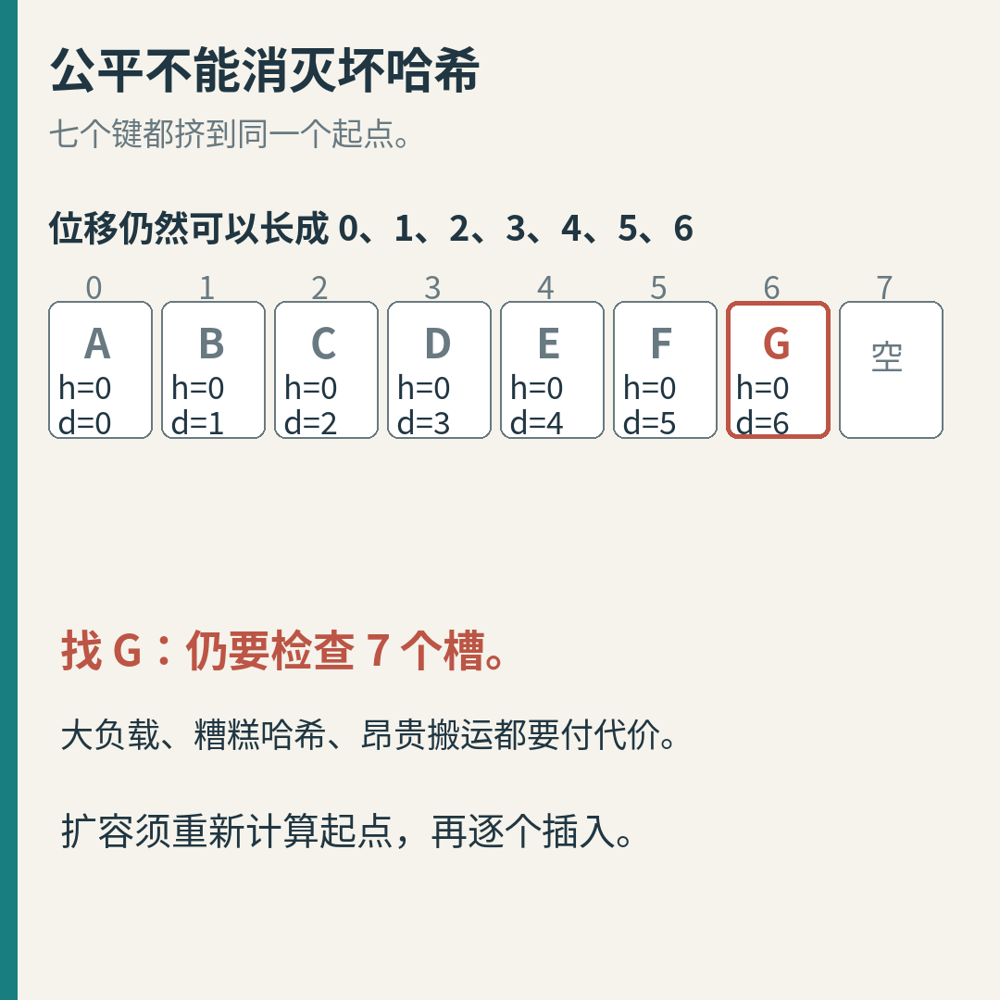

图16：七个不同键的起点都为 0，Robin Hood 也会形成很长的探测链。此构造说明不存在“每次查询都只查几格”的无条件保证。

Robin Hood 不能替你制造一个优质哈希函数。输入分布糟糕，或者攻击者故意让键落在一起，它也会遇到长链。普通平均表现依赖模型和实现，不能许诺每一次操作都是常数成本。

装载因子 α=元素数÷槽数。比如五个键、八个槽，α=5/8。空位越少，插入越容易遇见长连续段，交换和回移可能涉及更多元素。回移删除要真的搬动数据，若元素很大，搬动本身就可能昂贵。缓存局部性、键比较成本、元数据布局、扩容策略都会影响实际时间。

扩容时，也不是把旧数组后面接几个空格就结束。容量 m 改了，哈希数字映射出的起点也可能改变；通常要重新算每个键的起点，再按规则插入新表。旧表里的位置和 d 不能原样当成新表有效状态。

如果保存的是对象指针而不是完整对象，搬动成本可能不同；如果有人在别处持有槽地址，搬动还涉及引用失效。并发读写则需要另一整套同步与内存安全设计，本文的单线程程序不提供这些保证。

## 10. 自己跑一遍：有边界的教学实现

下面是一份本文独立编写的 Python 集合模型。它只存键，不存关联值；起点由 homes 明确给定；容量固定，并且始终保留至少一个空槽。满到 m−1 个不同键时，再插入新键会抛 OverflowError，不会先改坏半张表。

为了把“重复键”问题讲清楚，add 先调用 locate，确认没有现存副本，再开始搬动。所以它可能多做一趟查询，并非用于竞争性能的实现。已有键重复插入返回 False，删除不存在的键也返回 False。

它也不接收未知的键名：homes 里没有该键会触发 KeyError。这是显式给定起点的实验接口限制，不是一般哈希表应该具备的用户接口。

建议做三件事：

1. 手算图6的状态，再运行 build(8, homes, 'ABCD').snapshot() 对照。不要只看最终“PASS”。
2. 临时去掉 discard 中的回移循环，只清空洞，再跑测试，观察哪个仍存在的键丢了。实验后恢复代码，不把故意破坏版当成成品。
3. 改变起点表，寻找“平均查询差不多，但少数键代价明显不同”的例子，再分别测探测次数与运行时间。两种指标不要混用。

随附测试穷举五槽三键的全部起点、插入顺序及删除顺序，共 4500 个完整案例；另有固定随机种子的 20000 次混合操作，对照 Python set 核验内容。还检查回环、重复键、缺失删除、容量拒绝时状态不变，以及每个键的 d 是否等于实际圆环距离。

这些测试覆盖的是这份程序的具体模型。有限测试不能代替一般正确性证明，更不是多线程或生产负载验收。你可以把它当成一个能随手改坏、再找到反例的小实验台。

## 最后，回到第一排储物柜

值得记住的，是三件互相配合的小事：插入时，已经走得更远的键获得当前位置；查找时，利用这条维护关系提前停止；删除时，把经过洞的后续键退回来，而不是留下一个会误导查询的空洞。

单看任意一个步骤，都容易觉得它是额外开销。把三者放在一起，你会看到一种数据结构设计方法：修改布局，不只是为了把元素塞进去，也是为了让未来的查询能够做出更强的判断。

## 来源与图像说明

- [NIST 算法词典：Robin Hood hashing](https://xlinux.nist.gov/dads/HTML/robinHoodHashing.html)：交换原则及原始文献线索。
- [Pedro Celis，Robin Hood Hashing，1986](https://cs.uwaterloo.ca/research/tr/1986/CS-86-14.pdf)：实际取得的74页扫描论文；本文只使用核读的标题页、摘要及书目信息，没有将未逐页核验的证明或特定性能界限套给教学模型。
- [Stanford CS106B 原课程作业](https://web.stanford.edu/class/archive/cs/cs106b/cs106b.1214/build/assignments/7-hash-off/)：已核读的简介将 Robin Hood 描述为线性探测的改进。本文不将具体交换、早停与回移规则归因于该页面未核读的章节。本文例子、图与代码均另写，未复制作业题或实现。
- [Emmanuel Goossaert 的回移删除实现记录](https://codecapsule.com/2013/11/17/robin-hood-hashing-backward-shift-deletion/)：用于核对回移机制和实现背景，没有复用原实验数字为本文性能结论。

16张配图均是本文原创程序绘制的教学示意，数值来自文中小例子，不是论文原图、产品截图或真实耗时测试。源网页和论文并未被当作开放图像素材库；完整原文及原图不随稿转载。


## 短版正文

把已经存好的键请走，哈希表会不会更乱？

看一个八格小例子：A、B、C 各住在自己的起点，后来 D 从 A 那里出发，一路撞车。普通线性探测让 D 独自走三格；Robin Hood 让它在遇到“走得更少”的住户时接过位置，原住户继续往前。

最后，位移从 0、0、0、3 变成 0、1、1、1。总和和平均数都没变，但本例最倒霉的人少走了两格。这种重新分配，也为查找留下了线索：当查询已走得比眼前住户更远时，可以提前判断目标不存在。

删除同样有讲究。把探测链中间直接挖空，会让后面的键被误判成不存在；回移删除把经过这个洞的后续键挪回来，直到遇见空格或一个已经在自己起点的键。

全文用16张图走过交换、早停、补洞和数组回环，附可运行的小实验。还有一个重要反例：合法表的位移可以是 0、1、2、0，所以别背成“整张表按距离递增”。

Robin Hood 也救不了所有键都撞在一起的坏哈希。更均衡、探测更少、CPU更快，是三件需要分别验证的事。

图片为原创教学示意，非性能实测；完整来源与实现边界见长文。

## 完整实验代码

保存为 robinhood_lab.py，用 Python 3.10 或更新版本运行，无第三方依赖。

```python
"""Original teaching model: linear Robin Hood set, no tombstones, one empty slot.
Python 3.10+, standard library only. Not a production hash table.
"""
from dataclasses import dataclass
import itertools, random, json

@dataclass
class Entry:
    key: str
    home: int
    dib: int = 0

class RobinHoodSet:
    def __init__(self, capacity, homes):
        if capacity < 2:
            raise ValueError('capacity must be at least 2')
        self.m, self.homes = capacity, dict(homes)
        self.slots = [None] * capacity
        self.size = 0

    def locate(self, key):
        i, d, trace = self.homes[key] % self.m, 0, []
        for _ in range(self.m):
            e = self.slots[i]
            trace.append((i, d, None if e is None else (e.key, e.dib)))
            if e is None:
                return None, trace, 'empty'
            if e.key == key:
                return i, trace, 'found'
            if e.dib < d:
                return None, trace, 'early-stop'
            i, d = (i + 1) % self.m, d + 1
        return None, trace, 'full-cycle'

    def add(self, key):
        # Deliberately do a separate lookup: clarity over minimum work.
        if self.locate(key)[0] is not None:
            return False
        if self.size >= self.m - 1:
            raise OverflowError('teaching table keeps one empty slot')
        x = Entry(key, self.homes[key] % self.m)
        i = x.home
        for _ in range(self.m):
            e = self.slots[i]
            if e is None:
                self.slots[i] = x
                self.size += 1
                return True
            if x.dib > e.dib:
                self.slots[i], x = x, e
            # x may now be the displaced old resident.
            i, x.dib = (i + 1) % self.m, x.dib + 1
        raise AssertionError('an empty slot was promised')

    def discard(self, key):
        hole = self.locate(key)[0]
        if hole is None:
            return False
        nxt = (hole + 1) % self.m
        while self.slots[nxt] is not None and self.slots[nxt].dib > 0:
            e = self.slots[nxt]
            self.slots[hole] = Entry(e.key, e.home, e.dib - 1)
            hole, nxt = nxt, (nxt + 1) % self.m
        self.slots[hole] = None
        self.size -= 1
        return True

    def snapshot(self):
        return [None if e is None else [e.key, e.home, e.dib]
                for e in self.slots]

    def check(self, expected):
        actual = [e.key for e in self.slots if e is not None]
        assert len(actual) == len(set(actual)) == self.size
        assert set(actual) == expected
        for i, e in enumerate(self.slots):
            if e is not None:
                assert e.dib == (i - e.home) % self.m
        for k in self.homes:
            assert (self.locate(k)[0] is not None) == (k in expected)

def build(m, homes, keys):
    t = RobinHoodSet(m, homes)
    for k in keys:
        t.add(k)
    return t

def run_tests():
    homes = dict(A=1, B=2, C=3, D=1, E=1, F=1)
    t = build(8, homes, 'ABCD')
    assert t.snapshot() == [None,['A',1,0],['D',1,1],['B',2,1],['C',3,1],None,None,None]
    assert t.locate('E')[2] == 'early-stop'
    assert [z[0] for z in t.locate('E')[1]] == [1,2,3]
    t.add('E')
    assert t.snapshot() == [None,['A',1,0],['D',1,1],['E',1,2],['B',2,2],['C',3,2],None,None]
    t.discard('D')
    assert t.snapshot() == [None,['A',1,0],['E',1,1],['B',2,1],['C',3,1],None,None,None]
    t.check(set('ABCE'))
    # Exhaust all homes, insert orders, and delete orders for three keys.
    exhaustive = 0
    for hs in itertools.product(range(5), repeat=3):
        h = dict(zip('ABC',hs)); h['X'] = 0
        for ins in itertools.permutations('ABC'):
            for rem in itertools.permutations('ABC'):
                t = build(5,h,ins); present=set(ins);t.check(present)
                for k in rem:
                    assert t.discard(k);present.remove(k);t.check(present)
                    assert not t.discard(k)
                exhaustive += 1
    rng=random.Random(20261023);h={str(k):rng.randrange(17) for k in range(40)}
    t=RobinHoodSet(17,h);present=set()
    for step in range(20000):
        k=str(rng.randrange(40))
        if rng.randrange(2):
            if k not in present and len(present)>=16:
                before=t.snapshot()
                try:t.add(k)
                except OverflowError:pass
                else:raise AssertionError('overflow not detected')
                assert t.snapshot()==before
            else:
                assert t.add(k)==(k not in present);present.add(k)
        else:
            assert t.discard(k)==(k in present);present.discard(k)
        t.check(present)
    wrap=build(8,dict(A=6,B=7,C=6,D=0,X=6),'ABCD')
    assert wrap.snapshot()==[['B',7,1],['D',0,1],None,None,None,None,['A',6,0],['C',6,1]]
    wrap.discard('A');wrap.check(set('BCD'))
    return dict(exhaustive_insert_delete_cases=exhaustive,random_operations=20000,
                wraparound='PASS',checks='membership,uniqueness,DIB,duplicate,no-op deletion,capacity atomicity',result='PASS')

if __name__ == '__main__':
    print(json.dumps(run_tests(),ensure_ascii=False,indent=2))
```

---

[来源、AI 辅助与许可范围](sources.md)
