# 把图片缩窄，却不把所有东西一起压扁：沿着一条像素缝，走进动态规划

一张横图要塞进窄一点的框，通常有两个省事办法：把整张图横着压一压，或者从两侧裁掉一块。前者会让圆变成椭圆；后者可能把边上的人裁走。

能不能不按整列删，而是在背景里找一条弯弯曲曲的细缝，每行各拿走一个像素？

这就是这篇文章要拆开的操作：**seam carving，缝隙雕刻**。它不是修复被删掉的内容，也不需要先让模型“画出”一张更窄的图。它确实删除像素，再把剩下的像素挪到一起。

先看我们自己的实验。输入不是网上找来的照片，而是代码定义的32行、40列灰度阵列：背景为35，两块矩形为220。每个数字、每条路径、每张结果都能由文末程序重算。几何场景有意简单：它能让我们看清操作，却**不能代表真人照片的画质表现**。

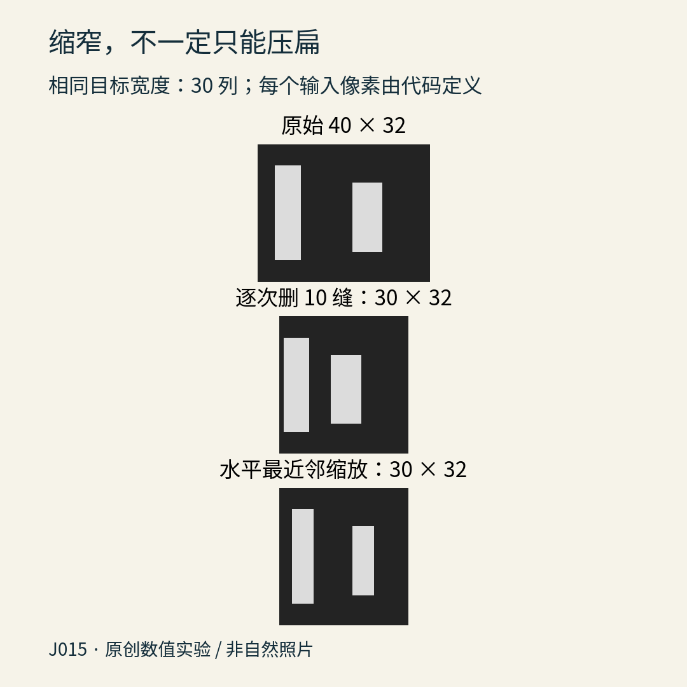

图1｜同一个原创灰度阵列：原始、逐次删缝和最近邻缩放的真实输出。显示保持方形像素，未横向拉伸结果。

图中的水平最近邻缩放只是一种明确可复现的比较基线，不代表所有高质量缩放方法。这里的关键区别是：缩放按位置取样，缝隙雕刻按代价选像素。后者有时能留下矩形的宽度，却也会改变间距，甚至把主体本身删薄。本文会把成功和失败都摆出来。

## 1. 先把问题缩小：只删除一条竖缝

把图像当成一个表格。行号y向下增加，列号x向右增加，都是从0开始。高为H、宽为W。

一条竖缝可以写成一个长度为H的列表：

`[x₀, x₁, …, x(H−1)]`

列表的第y项说明：第y行删除哪一列。它必须同时满足三件事：

- 每行恰好选一个像素，所以删除后每行都从W格变成W−1格；
- 所有列号都在0到W−1之间；
- 相邻两行的列号之差绝对值不超过1，所以路径只能向左下、正下或右下走一步。

这叫8邻域意义下的连接，但路径本身每一步必须进入下一行，不能横着游走，也不能掉头。它比“删掉整列”自由，又比“每行随便删一个像素”更受约束。

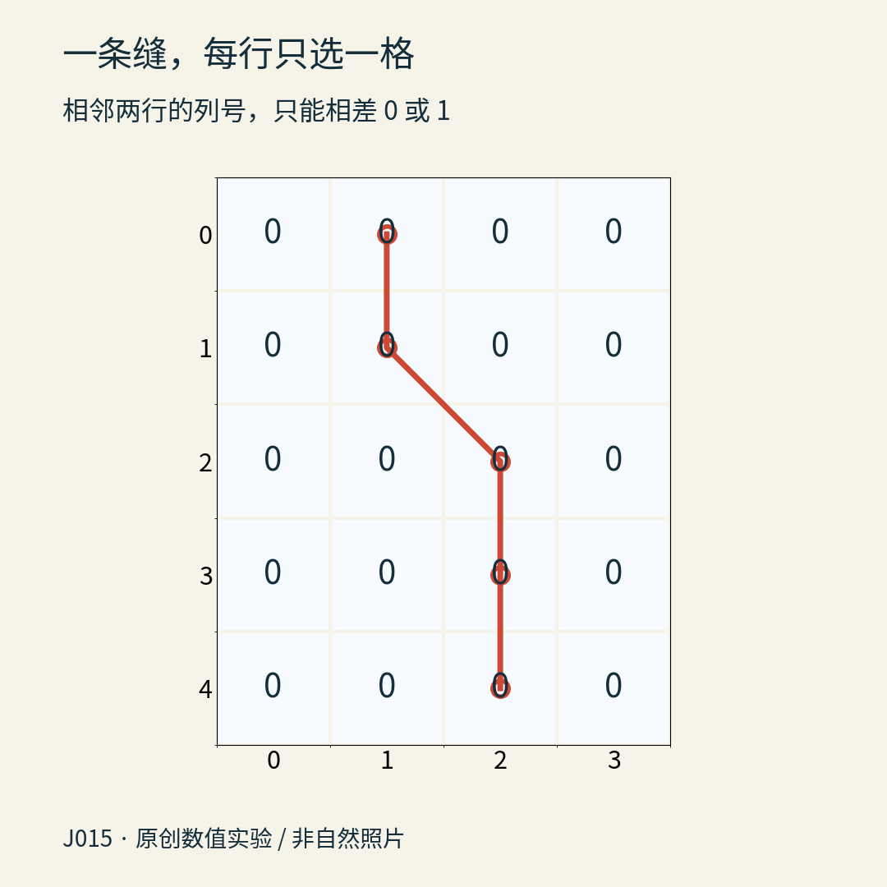

图2｜列号从0开始。红线[1,1,2,2,2]满足竖缝约束；一次删除后每行都少一个像素。

为什么还要连接？设上一行删在很左边，下一行突然删在很右边，两行被左移的区域就差很多，原来连续的边界可能错开。连接约束减少这种局部撕裂，但它不是画质保证书：连续的一条缝照样可能穿过眼睛、建筑边缘或文字。

## 2. 给像素标价，而不是假装机器懂审美

我们先采用一个很朴素的代价：像素附近变化越大，删除它越贵。

对灰度图I，本文的离散能量定义为：

`e(y,x) = |I(y,右邻) − I(y,左邻)| + |I(下邻,x) − I(上邻,x)|`

两项分别测横向、纵向变化。这里没有除以2，所有计算都是精确整数。这个选择不影响理解DP，却会影响具体数值，因此不能拿本例的数字去对比另一套边缘算子。

还有一个容易藏起来的约定：边界怎么办？本文把越界位置夹到最近的合法位置。最左边像素的“左邻”就是它自己，最上边的“上邻”也是它自己。不把图像首尾连成环，不额外给四周设置无穷大。

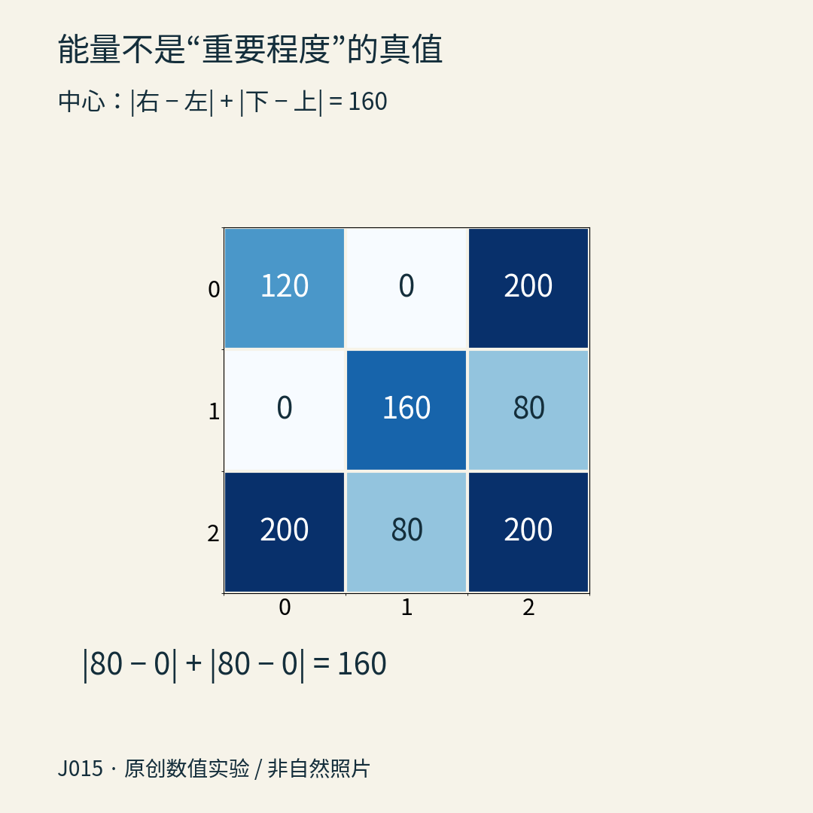

图3｜实际输入左上3×3区域：中心灰度160，左右差80、上下差80，所以本文约定的能量为160。

我们接下来反复使用的3×4灰度输入是：

```
120    0  200   80
  0  160   80    0
200   80  200  160
```

例如中心附近的160，左邻0、右邻80、上邻0、下邻80，所以能量是80+80=160。左上角则是`|0−120|+|0−120|=240`。同一个公式，边界只换索引处理。

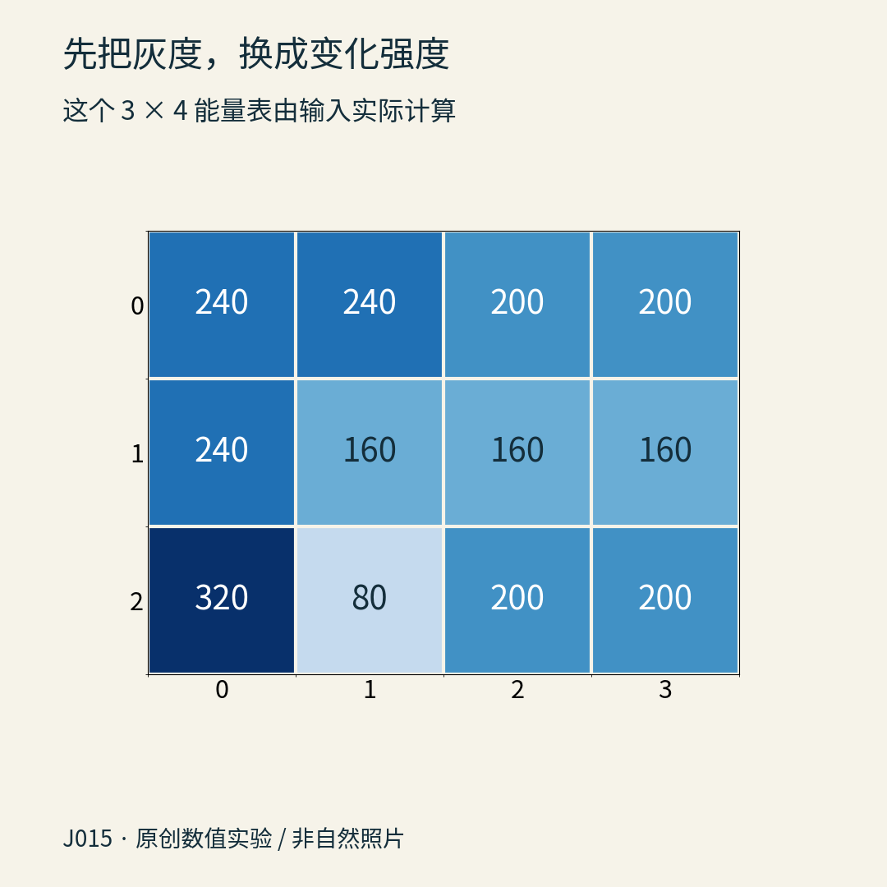

图4｜反例输入的完整能量矩阵。边缘用夹紧索引，不首尾相接；能量并不等于灰度值。

注意：白的地方不一定贵，黑的地方也不一定便宜。决定代价的是邻域变化，不是颜色深浅。大片平滑区域内部可能全是零；而有纹理的草地、砖墙可能很贵。一个平滑的人脸区域，未必会比背后的纹理得到更高代价。

这正是“能量”这个词要小心使用的地方。它在这里是我们定义的评分，不是物理能量，也不是人的视觉价值。

## 3. 为什么不能看到便宜就往那里走？

现在先暂停图像，给一张足够小的代价表。它是专门编排的教学输入，不是上一幅图的能量输出。

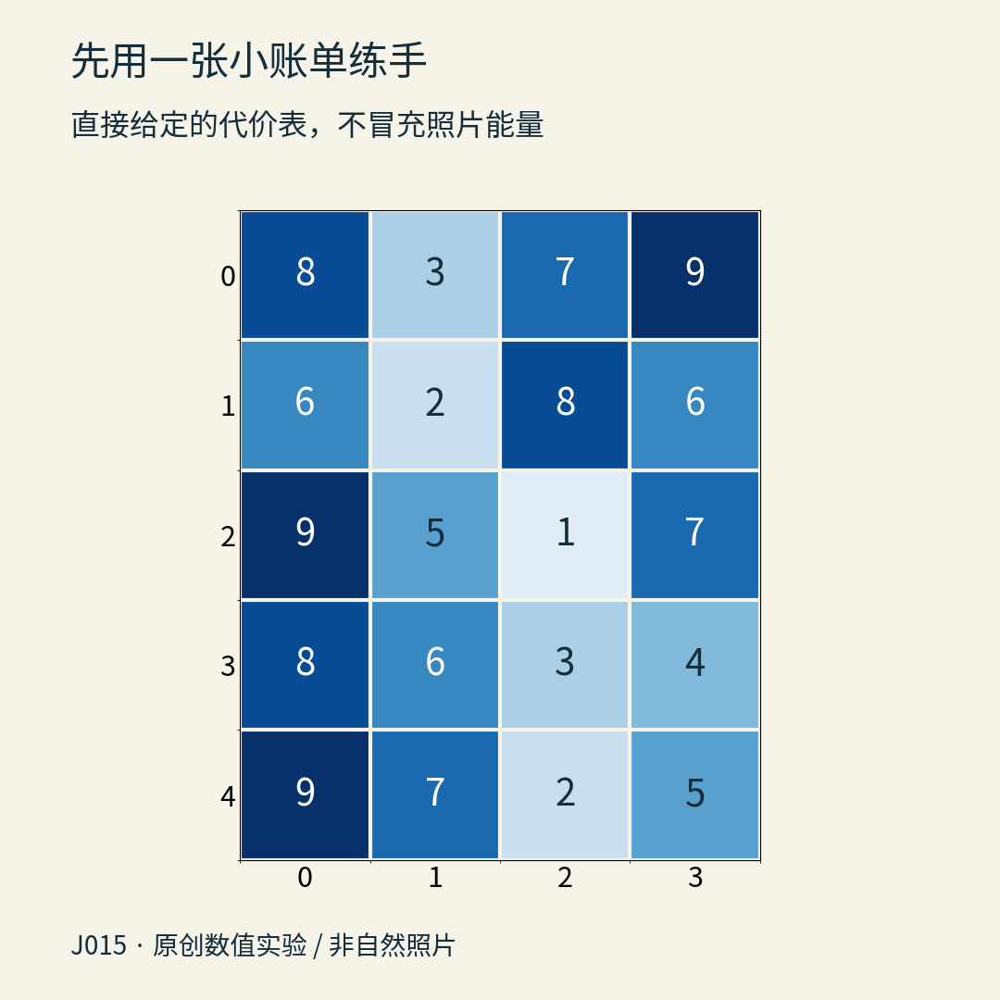

图5｜教学用5×4代价矩阵直接由代码定义，用来逐格核算DP；它不是图4的延续。

一条路径的总价，就是它经过的格子相加。我们的目标是：在所有合法竖缝里，找到总价最低的一条。

“每一行单独选最便宜的格子”可能连不起来。“从最便宜的起点出发，以后每步选附近最便宜的格子”也可能走进死胡同式的高价区域。比如这个额外小表：

```
1  2  9
1  9  2
9  9  1
```

从第一行的1出发，下一行贪便宜选左边的1，最后一行只能付9，总价11。但从第一行中间的2出发，接右下的2，再接1，总价5。我们并不是走不下去了，而是早先的便宜限制了后面的选择。

有没有必要把所有路径一条条列出来？小图可以，大图不合算：每走一行最多有三种选择，直接枚举会迅速膨胀。

动态规划做的事很克制：**把“已经到达同一个格子”的不同走法归为一组，只保留最便宜的前缀。**

为什么敢扔掉别的前缀？因为图像和代价表在这一次求缝中是固定的。从同一个格子往下，后续允许走到哪里、后续要付多少钱，并不依赖之前是从哪条路线过来的。较贵的前缀接上同一段后缀，只会更贵。

这里的“状态”就是当前格子。若额外规定“整条路径只能转弯两次”，只记格子就不够，还要记已用转弯次数及必要的方向信息。这说明DP不是一个看到表格就能套的咒语：状态必须装下影响未来的东西。

## 4. 累计表怎么填：先别急着背公式

令M(y,x)表示“从顶行出发，到达(y,x)的合法路径中，最小总代价”。

第一行没有更早的路径，所以直接抄代价：

`M(0,x) = e(0,x)`

其余行的一个格子，最多只能从上一行左上、正上、右上三个位置到达。于是：

`M(y,x) = e(y,x) + min(上一行中合法前驱的 M)`

最左和最右的格子没有三个前驱，只比较真实存在的那些。不要把越界项当零，那会凭空开出一条免费通道。

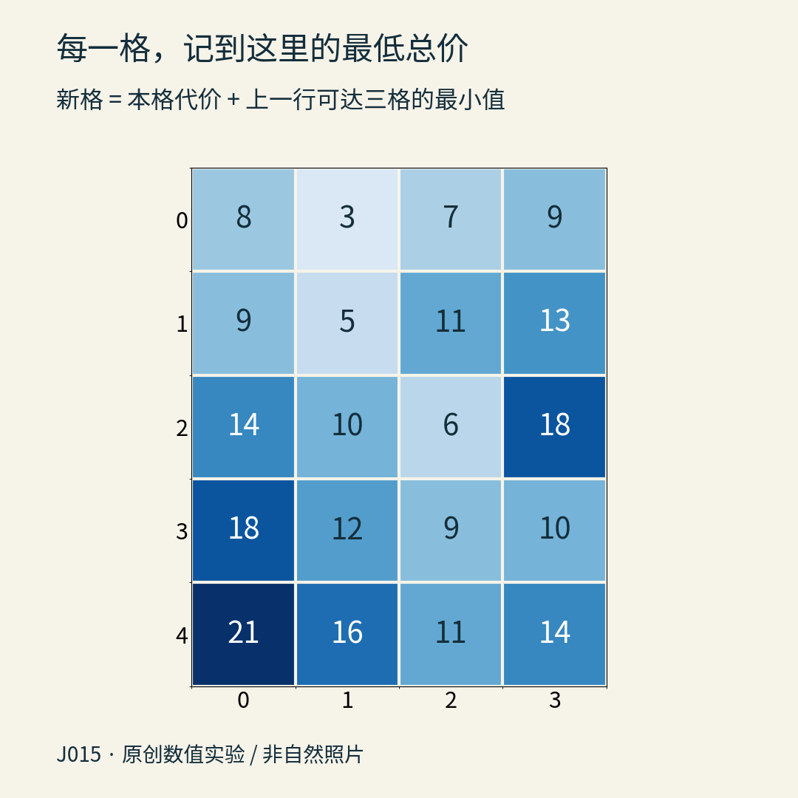

图6｜图5对应的累计表。第三行第三列为1+min(5,11,13)=6，末行最低值为11。

拿第三行第三列，即从0开始的(y=2,x=2)，算一遍：本格代价1，上方三个累计值是5、11、13，最小为5，所以累计值是6。它表达的是“走到这里一共最低花6”，不是这个像素本身只值6。

填完最后一行，得到21、16、11、14。最便宜的终点是第三列，总价11。到这里，我们已经知道最低总价，却还没真正拿到整条路径。

## 5. 回溯：为什么只存一个总价还不够方便？

每次填M的时候，同时记下“这格的最便宜前驱在哪一列”。这就是父指针。

从末行选出的终点往上追父指针，一行一行走回顶行，最后把顺序翻转，就得到从上到下的缝。

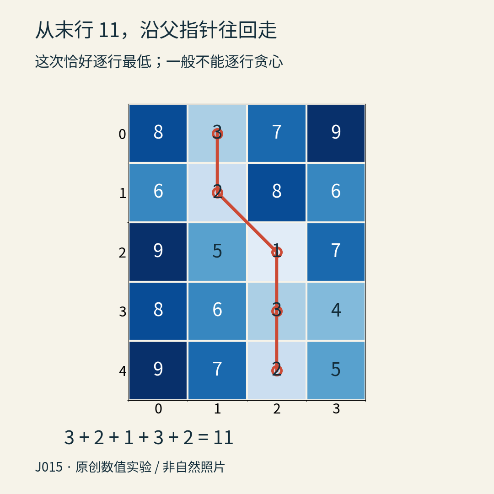

图7｜真实回溯路径[1,1,2,2,2]，总代价11；父指针保证路径连接且达到累计最小值。

本例路径为`[1,1,2,2,2]`，代价为3+2+1+3+2=11。它恰好经过每行的最低值，但这是这个输入的特点，不是算法成立的理由。上一节的反例已经说明，一般不能逐行贪心。

如果多条路径同价怎么办？最低代价仍然有定义，但“返回哪一条”需要约定。代码的规则是：填表时，累计代价相同就选列号更小的前驱；末行终点同价也选更小的列号。这样每次运行相同输入都得到相同路径。

这只是确定性的局部并列规则，**不宣称返回所有最优路径中字典序最小的一整条路径**。如果你的产品需要别的偏好，例如少转弯、远离主体或居中，得明确把偏好加入代价或状态，不能靠“不管了，随便返回一个”来代替设计。

对一张H×W的固定代价图，填表每格至多比较三个前驱，时间为O(HW)。本文保存完整累计表和父指针，空间也是O(HW)。如果只想知道最小值、不回溯，可只保留相邻两行；但本文要画表、展示路径，所以没有这样压缩。

## 6. 真正删除：路径上的像素不再存在

现在回到3×4灰度输入。由它的实际能量求得的第一条路径是`[2,1,1]`，能量总和为440。

把第一行第2列、第二行第1列、第三行第1列删掉。每行其余像素保持原有顺序。

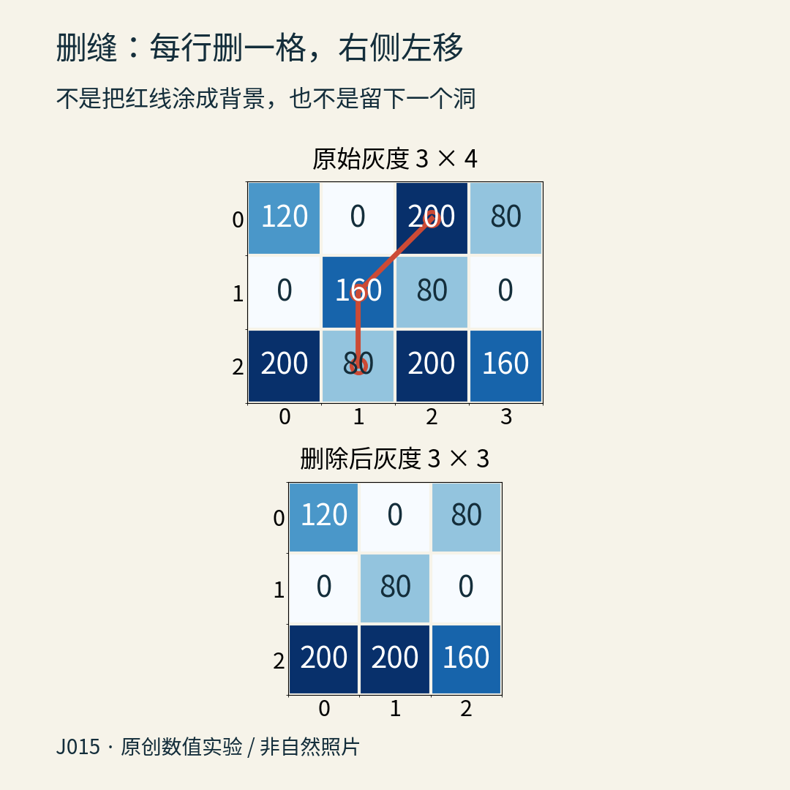

图8｜对原始3×4阵列删除路径[2,1,1]后，真实得到3×3阵列；不同的行可以删除不同列。

第一行`[120,0,200,80]`删除200后变成`[120,0,80]`。第二行删除的是160，第三行删除的是80。没有插值，没有填洞，也没有把右侧像素的颜色改成别的值。

因此，找缝函数和删缝函数应该分开。找缝回答“删哪几个位置”；删缝回答“怎样据此构造更窄的矩形阵列”。分开后，路径是否合法、行宽是否一致，都能单独测试。

## 7. 第二条缝，不能继续相信旧能量

第一次删完，像素的邻居变了。例如原来隔着一个像素的两点，现在直接相邻。差分算子看到的是新图，当然可能得到新值。

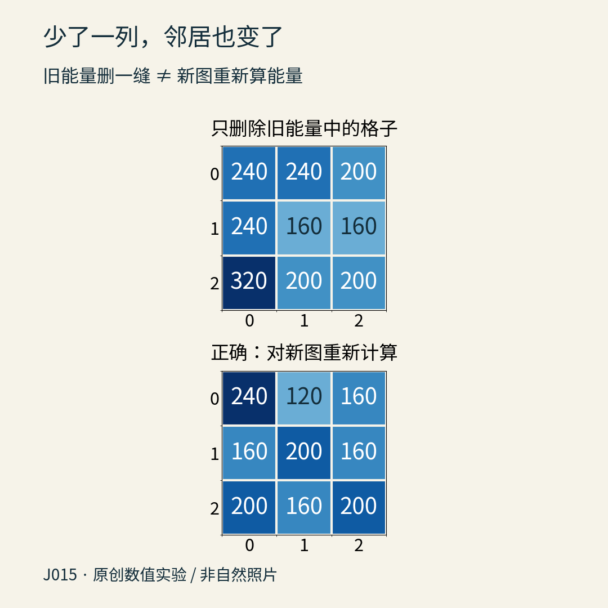

图9｜同一条缝删除后，上表是错误的能量更新捷径，下表是实际重算；新邻接关系改变了差分。

这是一个很常见的实现陷阱：把旧能量图也删掉同一条缝，就当成下一轮的能量图。图中上下两张矩阵直接证明，这个捷径在本例是错的。

准确的教学版流程是：

1. 根据当前图像计算能量；
2. 加上当前保护掩码的惩罚（若有）；
3. 求当前代价下的一条最小缝；
4. 同时从图像和掩码中删除这条缝；
5. 回到第一步，直到删够次数。

实际工程中可以研究局部能量更新，但必须把所有受影响的邻接关系更新对；并且能量的局部变化仍可能影响远处的累计最优路径。本文宁可全量重算，不把尚未证明的优化混进基础算法。

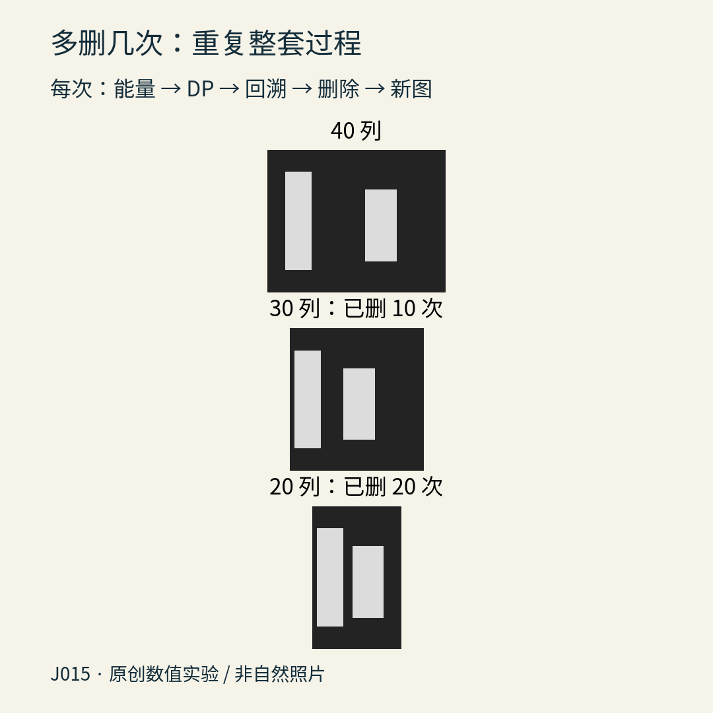

图10｜原创几何场景从40列减到30列、20列的实际结果；每次重新计算，不把第一次的路径表反复套用。

删除k条竖缝的时间上界是O(kHW)，更细地说，每轮宽度从W逐渐减到W−k+1。核心一次求缝需要O(HW)空间；**本文为了教学保存每一轮完整trace，返回全部轨迹时，额外存储可达O(kHW)**。因此这份程序是透明可检查的实验版，不是节省内存的生产版。

## 8. 最值得保留的，偏偏可能很平滑

来做一个故意让算法出丑的输入：中间是一条宽8列的平滑暗带，两边是变化较多的条纹。

假设我们真正关心的是暗带的宽度。程序不知道这个偏好，它只看到内部差分为零。连续删除5次，最便宜的缝每次都穿过暗带，最后宽8列变成宽3列。

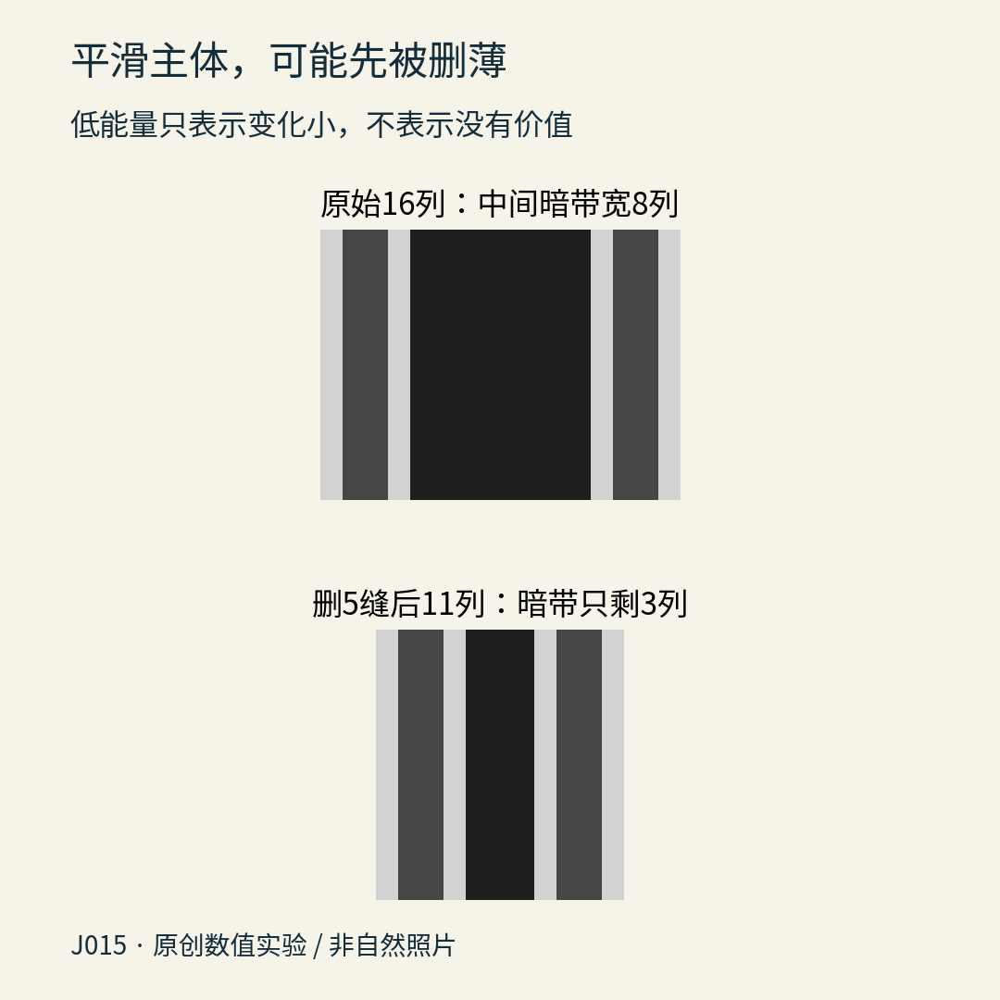

图11｜自建失败输入：有纹理的两侧包着平滑暗带。五次最低能量缝都穿过暗带内部，使暗带从8列缩到3列。

这里算法没有算错。它准确优化了一个不充分表达我们意图的目标。

把这句话换到真实照片里，风险就很好理解：保住高梯度，不等于保住人的脸部比例；尽量少动边缘，不等于保住建筑的直线关系；压缩大片平滑天空可能很好，压缩大片平滑皮肤则可能很糟。

这是数值实验，不是“证明所有平滑物体都一定会被删坏”。它只给出一个可复现的反例，让“低能量=不重要”这个过强结论站不住脚。

## 9. 保护掩码：额外告诉它什么不能轻易动

最简单的干预，是给想保护的像素加额外惩罚：

`总代价(y,x) = 基础能量(y,x) + 保护惩罚(y,x)`

在这个12行、16列的例子里，我们人为知道暗带在哪里，所以给暗带每格加1000。注意这是人工指定的区域，不是程序自己识别出了主体。

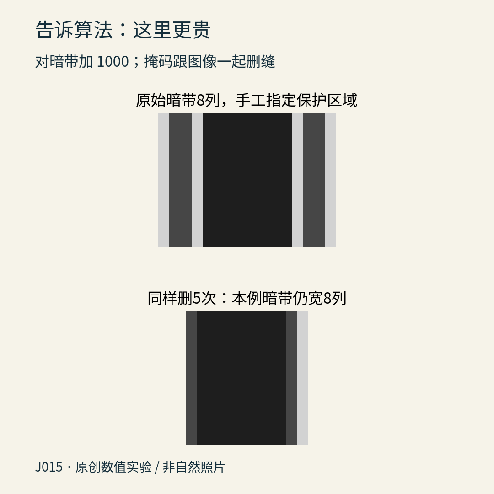

图12｜相同输入，给暗带每个像素加1000软惩罚后实际输出。该掩码是人工已知的区域，不是算法识别人脸或物体。

这一次，同样删除5条缝，暗带仍是8列宽。程序把删除预算花在了两侧。由于图像每轮变窄，掩码必须跟着删除；不移动掩码，下一轮“保护”的就可能不是原来的像素。

不过，1000不是魔法数字。换一个图的高度、基础能量范围、保护区域布局，同一个数值不一定有相同效果。更重要的是，**有限惩罚是软约束，不是绝对禁止**。

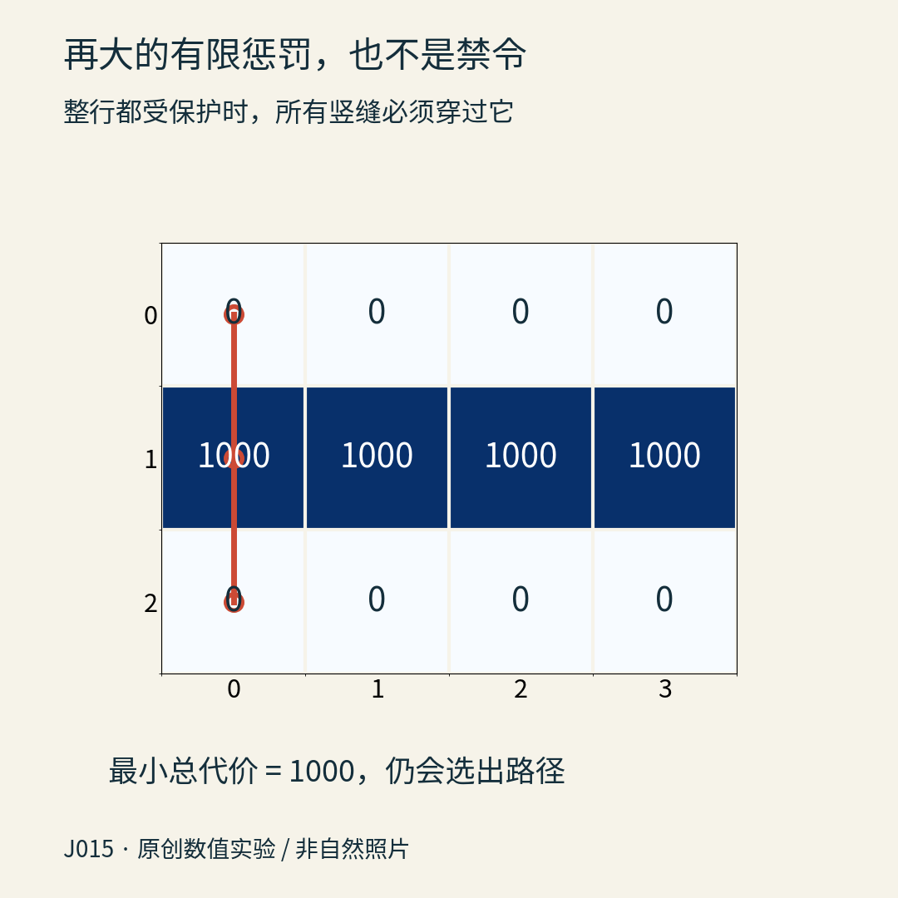

图13｜全零基础代价叠加整行1000惩罚：实际最优缝仍穿过保护行。若要求绝不碰，需硬约束并允许报告无解。

图中整行都被罚1000，任何从顶到底的路径都绕不过这一行。算法还是会返回一条最低总代价1000的路径。如果你的需求是“一个保护像素都不能碰”，就必须实现硬约束：把这些状态标为不可到达，并在所有终点不可到达时明确报告无解。本文的代码不实现硬约束，不会假装已经保证绝不伤害主体。

即使硬约束实现正确，缩窄需求也可能无解。没有足够空间，并不能通过更聪明地调一个参数凭空创造空间。

## 10. 最容易被“最优”两个字骗到的地方

固定能量图上的一条最小缝，DP能给出全局最小代价。这里的“全局”是指这一张固定图上所有合法单缝。

但连续删两次时，第一条缝改变了图像，也改变了第二轮的能量。每次都选眼前最小，未必让两次代价总和最小。

我们对前面的3×4输入做了一次很小的穷举：枚举第一条所有合法缝，删除、重算能量，再枚举第二条所有合法缝。比较目标严格定义为“两次各自在当前图上计算的被删缝能量之和”。

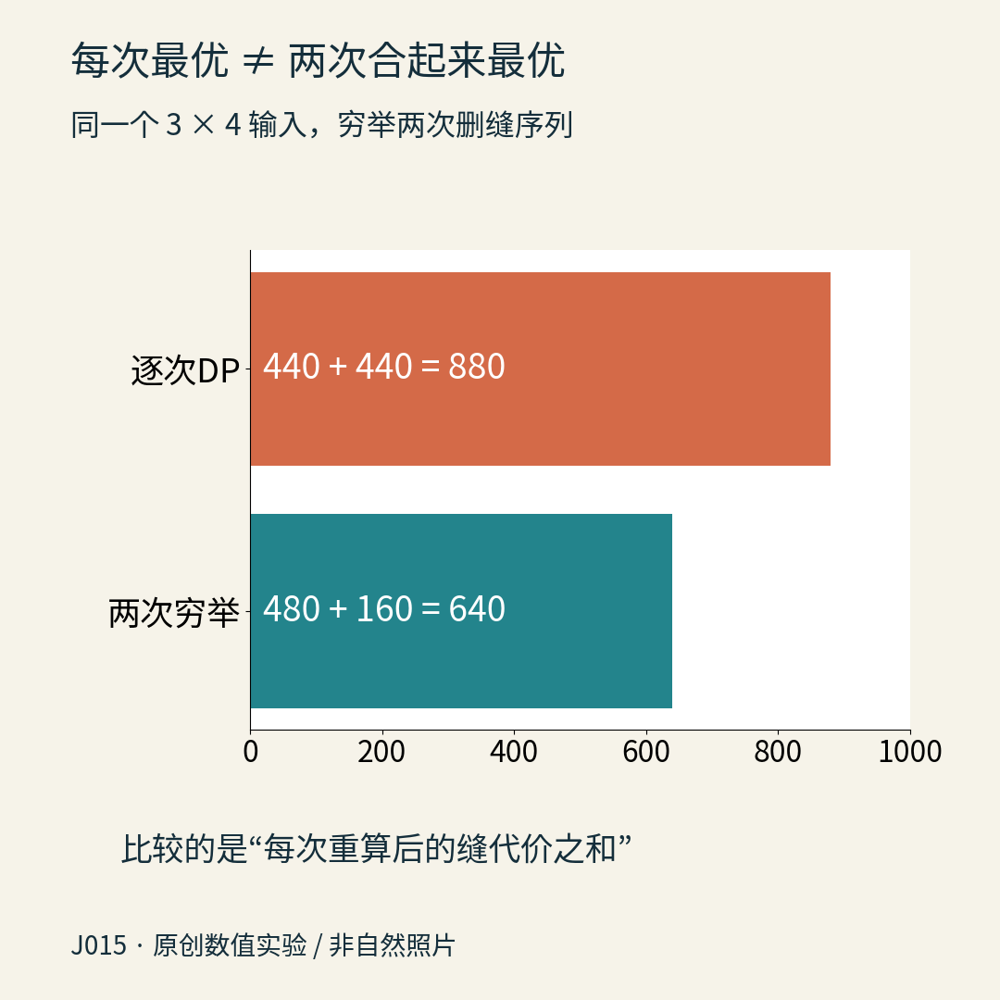

图14｜原始3×4反例：逐次DP总代价880；独立枚举全部两缝序列得到640。目标是两次重算能量后的被删缝代价之和，不是主观画质评分。

实际结果：本文的确定性逐次DP先删`[2,1,1]`，代价440；第二次删`[1,0,1]`，代价440，合计880。

穷举则发现，先删`[1,2,1]`要付480，比440贵一点；但接着删新图上的`[1,1,1]`只要160，合计640。这里的第二条路径列号属于删过一次的新图，不是原图坐标。

这不说明DP错了，也不证明640对应的结果在人眼看来一定更美。它只说明：**固定图的单路径优化，与会改变状态空间的多步图像优化，是两个不同问题。**

如果把完整当前图像当成状态，当然可以继续思考更大的搜索或DP；只是状态数量已不再是H×W那么简单。不要把“用了动态规划”误读成“所有层面的全局最优都免费拿到了”。

## 11. 前向能量：不只问删掉多少，还问新接出了什么

到目前为止，我们实现的是一种简单的backward-energy方法：先在现有图上评估像素的局部变化，再选低价路径删除。

但删除后会产生新的邻接。可以换个提问方式：“如果删这个像素，原本不相邻的哪两点会被接到一起？新接缝有多突兀？”

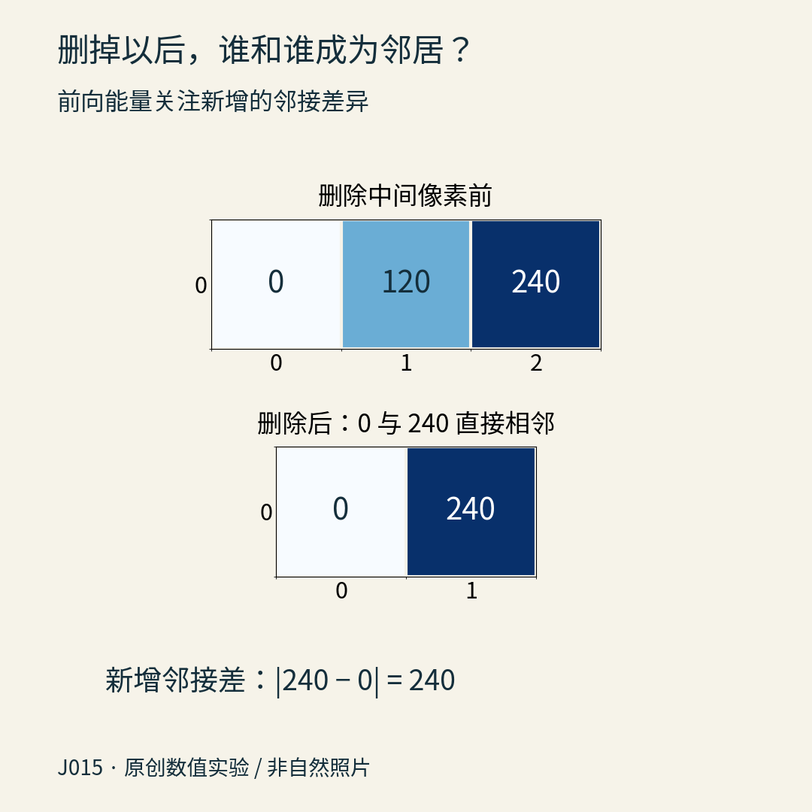

图15｜原创一行数组的删除示意：新增邻接差是240。这只解释前向能量要关心什么，不是完整前向算法或其效果实验。

一行`[0,120,240]`删除中间像素后，0与240成为直接邻居，新增邻接差为240。这是前向思路的一个局部直观解释，并不是完整前向公式。真正的forward energy还需要根据缝从不同方向进入时产生的邻接变化，构造相应的转移代价。

Rubinstein、Shamir和Avidan在2008年的工作中提出前向能量准则，关注删除后引入的变化；作者机构资料同时区分了图像上的DP与视频中的时空处理。本文只解释这种区别，没有实现完整forward energy，也没有生成它的对比效果图。不能把“下一轮重算backward能量”叫作“已经实现forward energy”：两者问的不是同一件事。[来源2]

它同样不等于语义识别。不认识人物的算法，即使更细心地计算接缝，也不会因此自动知道谁的脸最重要。

## 12. 把代码的边界说在前面

这份程序接收非空矩形的Python列表或元组。图像元素必须是0到255的整数；布尔值、浮点数、RGB三元组、空行、负数、参差不齐的行都会被拒绝。

为什么不默默接受彩色图？因为RGB能量有多种定义：先转亮度、每通道梯度求和、换到其他颜色空间，都可能选出不同路径。本篇只实现灰度版，不偷偷丢掉两个通道，也不把“能读RGB”当成“彩色评价已设计正确”。

`minimum_seam`可以处理任意非负整数代价，不限255，因为累计能量和惩罚可能更大。Python整数不会像固定宽度无符号8位数组那样在减法时回绕；若换到NumPy图像实现，应先转到合适的有符号或浮点类型再相减。

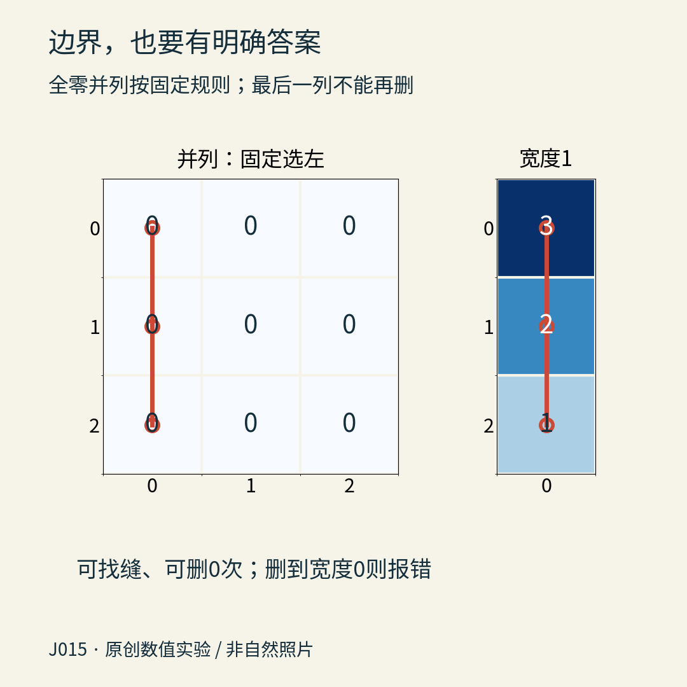

图16｜两个实际边界输出：全零3×3返回[0,0,0]；宽度1仅有[0,0,0]这条路径，但删除它会被契约拒绝。

高度1仍有意义：从该行挑最小代价。宽度1也能求缝，但不能把最后一列删掉。允许删除0次，返回数值相同的新阵列。删除次数必须满足`0 ≤ count < W`；路径长度、列号范围和连接性都会验证。

这些不是收尾时随手补的异常处理。它们决定你对“图片”的假设是什么，也决定别人能不能放心复用代码。

## 13. 测试怎样避免“算法自己证明自己”？

我们实际运行了以下检查：

- 穷举所有3×3、每格只可能是0、1、2的代价矩阵，共3⁹=19,683个。对每一个输入，不用DP递推，而是列举所有合法路径，直接求和，核对最低代价。
- 固定随机种子生成400个高度、宽度在1到5之间的灰度小图。核对求缝代价与路径枚举结果一致；宽度大于1时一路删到1列，并检查每轮记录的能量确实来自当前图。
- 16个无效输入契约检查，覆盖空矩阵、非矩形、类型错误、越界像素、非法路径、删除最后一列、惩罚尺寸错误等。
- 额外明确检查全零并列规则、1×1能量、删除0次、单列路径。

这是有独立计算方式的作者自测，不等同于另一个审稿人的独立审查，也不等于现实照片的质量评测。它增强了我们对“实现了所声明的离散算法”的信心，不能替代视觉任务本身的验收。

你可以先把下面代码存成`seam_lab.py`，用Python 3运行。无需第三方包即可运行核心与测试。结果应包含19,683、400、16、4四项计数。

下一步适合亲手做的练习不是立刻处理一张巨大的照片，而是改动图5里一个格子的价格，先猜路径会怎样变化，再运行核对。更难一点：把图13改成硬约束版本，并为“无路可走”设计一个明确返回值和测试。

## 14. 历史的位置与材料边界

Avidan与Shamir的《Seam Carving for Content-Aware Image Resizing》发表于2007年ACM Transactions on Graphics第26卷第3期。作者机构所存PDF封面标注August 2008，这是所见报告文件的封面日期，不把它写成算法首次发表于2008年。原论文第3节给出缝与DP算子，第6节讨论失效情况。[来源1]

原论文的自然图像效果确实值得看，尤其是第6节及其相邻图例；但所取得的MERL文件明确限制商业复制，非营利教育研究复制也有附带条件，图中照片另有第三方来源。当前用途未确认满足相应条件，因此本文不复制那些照片或图表。读者可通过原始出处查看；本文16图全部是自建数值输入、实际计算结果或清楚标明的概念示意，不把它们冒充原论文实验复现。

把图片“缩得更聪明”，本质上并不是找到一个万能的聪明算法。先决定哪一种变化值得付出代价，再承认哪些东西这个代价还表达不了，最后让实现、实验和说法彼此对得上——那条窄窄的像素缝，才真正连到了问题本身。

## 附录A｜完整核心程序与自测

```python
"""Exact-integer teaching implementation; Python 3 standard library only.
Grayscale only. Not the original authors' software; no forward energy.
"""
from itertools import product
import random

def matrix(a, maximum=None):
    if not isinstance(a, (list, tuple)) or not a:
        raise ValueError('nonempty list/tuple matrix required')
    if not isinstance(a[0], (list, tuple)) or not a[0]:
        raise ValueError('nonempty rows required')
    w = len(a[0])
    for row in a:
        if not isinstance(row, (list, tuple)) or len(row) != w:
            raise ValueError('rectangular rows required')
        if any(type(v) is not int or v < 0 or
               (maximum is not None and v > maximum) for v in row):
            raise ValueError('nonnegative integer cells required; no bool/RGB/float')
    return [list(row) for row in a]

def energy(image):
    a = matrix(image, 255)
    h, w = len(a), len(a[0])
    return [[abs(a[y][min(w-1,x+1)] - a[y][max(0,x-1)]) +
             abs(a[min(h-1,y+1)][x] - a[max(0,y-1)][x])
             for x in range(w)] for y in range(h)]

def minimum_seam(cost):
    e = matrix(cost)
    h, w = len(e), len(e[0])
    m = [row[:] for row in e]
    parent = [[None]*w for _ in range(h)]
    for y in range(1, h):
        for x in range(w):
            p = min(range(max(0,x-1), min(w,x+2)),
                    key=lambda j: (m[y-1][j], j))
            m[y][x] += m[y-1][p]
            parent[y][x] = p
    x = min(range(w), key=lambda j: (m[-1][j], j))
    value = m[-1][x]
    path = [x]
    for y in range(h-1, 0, -1):
        x = parent[y][x]
        path.append(x)
    path.reverse()
    return {'path': path, 'cost': value, 'cumulative': m}

def remove(image, path):
    a = matrix(image)  # also usable for nonnegative penalty masks
    h, w = len(a), len(a[0])
    if w <= 1:
        raise ValueError('cannot delete the last column')
    if not isinstance(path, (list, tuple)) or len(path) != h:
        raise ValueError('one column index per row required')
    if any(type(x) is not int or not 0 <= x < w for x in path):
        raise ValueError('column index out of range')
    if any(abs(path[y]-path[y-1]) > 1 for y in range(1,h)):
        raise ValueError('seam must be connected')
    return [row[:x]+row[x+1:] for row,x in zip(a,path)]

def carve(image, count, penalty=None):
    a = matrix(image,255)
    h,w = len(a),len(a[0])
    if type(count) is not int or not 0 <= count < w:
        raise ValueError('count must be integer in [0,width-1]')
    p = [[0]*w for _ in range(h)] if penalty is None else matrix(penalty)
    if len(p) != h or len(p[0]) != w:
        raise ValueError('penalty shape mismatch')
    trace=[]
    for _ in range(count):
        e=energy(a)
        c=[[v+p[y][x] for x,v in enumerate(row)] for y,row in enumerate(e)]
        s=minimum_seam(c)
        trace.append({'image':[r[:] for r in a], 'energy':e,
                      'penalty':[r[:] for r in p], **s})
        a=remove(a,s['path'])
        p=remove(p,s['path'])
    return a,trace

def all_paths(h,w):
    """Independent exhaustive oracle: no DP recurrence."""
    for path in product(range(w),repeat=h):
        if all(abs(path[y]-path[y-1])<=1 for y in range(1,h)):
            yield path

def brute(cost):
    h,w=len(cost),len(cost[0])
    return min(sum(cost[y][p[y]] for y in range(h)) for p in all_paths(h,w))

def best_two(image):
    """Exhaust all first/second seams under recomputed energy; tiny inputs only."""
    image=matrix(image,255)
    h,w=len(image),len(image[0])
    if w<3:raise ValueError('two deletions require width >= 3')
    e=energy(image);best=None
    for p in all_paths(h,w):
        b=remove(image,p);f=energy(b)
        first=sum(e[y][p[y]] for y in range(h))
        for q in all_paths(h,w-1):
            value=first+sum(f[y][q[y]] for y in range(h))
            item=(value,p,q)
            if best is None or item<best:best=item
    return best

def scene():
    # Original numerical input: constant background, two bright rectangles.
    return [[220 if (4<=x<10 and 5<=y<27) or (22<=x<29 and 9<=y<25)
             else 35 for x in range(40)] for y in range(32)]

def run_tests():
    n=0
    for cells in product(range(3),repeat=9):
        e=[list(cells[i:i+3]) for i in range(0,9,3)]
        s=minimum_seam(e)
        assert s['cost']==brute(e)
        assert sum(e[y][x] for y,x in enumerate(s['path']))==s['cost']
        n+=1
    rng=random.Random(15015)
    for _ in range(400):
        h,w=rng.randint(1,5),rng.randint(1,5)
        a=[[rng.randrange(256) for x in range(w)] for y in range(h)]
        e=energy(a);s=minimum_seam(e)
        assert s['cost']==brute(e)
        if w>1:
            b,t=carve(a,w-1)
            assert len(b)==h and all(len(r)==1 for r in b)
            for step in t:assert step['energy']==energy(step['image'])
    assert minimum_seam([[0]*4 for _ in range(4)])['path']==[0]*4
    assert energy([[7]])==[[0]]
    assert carve([[7]],0)[0]==[[7]]
    assert minimum_seam([[3],[2],[1]])['path']==[0,0,0]
    invalid=[lambda:energy([]),lambda:energy([[]]),lambda:energy([[1],[1,2]]),
             lambda:energy([[True]]),lambda:energy([[1.0]]),lambda:energy([[256]]),
             lambda:energy([[[-1,0,1]]]),lambda:minimum_seam([[-1]]),
             lambda:remove([[1]],[0]),lambda:remove([[1,2],[3,4]],[0]),
             lambda:remove([[1,2,3],[4,5,6]],[0,2]),lambda:remove([[1,2]],[2]),
             lambda:carve([[1,2]],2),lambda:carve([[1,2]],True),
             lambda:carve([[1,2]],1,[[0]]),lambda:carve([[1,2]],1,[[-1,0]])]
    for f in invalid:
        try:f()
        except ValueError:pass
        else:raise AssertionError('invalid input accepted')
    return {'exhaustive_3x3_ternary_costs':n,'random_grayscale_cases':400,
            'invalid_contract_cases':len(invalid),'explicit_edge_assertions':4}

if __name__=='__main__':
    import json
    print(json.dumps(run_tests(),indent=2))
```

## 附录B｜复算文章中的关键结果

将以下内容放在同目录的`demo.py`，运行`python demo.py`。它打印手算表、连续两缝反例、掩码前后的暗带宽度，以及场景输出尺寸。画图用的是这些数值，不需要照片素材。

```python
from seam_lab import minimum_seam,energy,carve,best_two,scene

cost=[[8,3,7,9],[6,2,8,6],[9,5,1,7],[8,6,3,4],[9,7,2,5]]
print('hand example:',minimum_seam(cost))
trap=[[1,2,9],[1,9,2],[9,9,1]]
assert minimum_seam(trap)['cost']==5
image=[[120,0,200,80],[0,160,80,0],[200,80,200,160]]
print('energy:',energy(image))
result,trace=carve(image,2)
print('greedy paths:',[t['path'] for t in trace])
print('greedy total:',sum(t['cost'] for t in trace))
print('exhaustive best (cost,path1,path2):',best_two(image))
assert sum(t['cost'] for t in trace)==880
assert best_two(image)[0]==640
failure=[[30 if 4<=x<12 else (210 if x%3==0 else 70)
          for x in range(16)] for _ in range(12)]
mask=[[1000 if 4<=x<12 else 0 for x in range(16)] for _ in range(12)]
plain,_=carve(failure,5)
protected,_=carve(failure,5,mask)
assert all(row.count(30)==3 for row in plain)
assert all(row.count(30)==8 for row in protected)
print('dark band widths:',plain[0].count(30),protected[0].count(30))
for k in (0,10,20):
 out,_=carve(scene(),k)
 print('scene width,height:',len(out[0]),len(out))
```


---

## 附：短读版

## 三分钟读懂：为什么删一条弯曲的像素缝，能让图变窄？

横着压缩图片，会把东西一起压瘦。缝隙雕刻换了个办法：从顶到底找一条连续像素路径，每行删一个像素，把余下的像素拼拢。

难点不在“删”，而在“删哪条”。

先给像素标价。本文用左右灰度差、上下灰度差的绝对值之和作为能量：变化越大越贵。但这只是一个人为定义的指标，平滑的人脸不一定比有纹理的背景贵。

接着做动态规划。每个格子记住“到这里最低一共花多少”，它只需要比较上一行可到达的最多三个格子。填到最后一行，选最小值，沿父指针向上回溯，就能得到一条最低总代价的缝。教学小表实际算出的路径总代价是11。

删一条还不够？再来一遍。不过必须对新图重算能量：删除改变了邻居，不能只把旧能量表少抹一列。

最重要的三个限制：

1. **低能量不等于不重要。** 本文的真实数组实验里，中间平滑暗带被连续删薄，从8列变成3列。程序并没算错，是目标表达得不够好。
2. **软保护不是绝对保证。** 给暗带加惩罚，在本例中保住了8列宽；但整行都受保护时，任何竖缝都得穿过它。要绝不触碰，需要硬约束，并接受无解。
3. **一条最优，不等于多条一起最优。** 同一个3×4输入，逐次DP删两条付出880；枚举所有两次序列，只需640。这比较的是定义好的数值代价，不是人的画质评分。

2007年Avidan与Shamir的工作给出缝隙雕刻算子；2008年的后续工作提出前向能量，进一步考虑删除后新出现的邻接差异。本文只实现简单的灰度backward-energy版本，不宣称实现了前向算法、人脸识别或照片级效果验证。

长文配16幅原创数值图，附完整可执行代码。所有3×3三值代价表共19,683个，都已与直接枚举合法路径核对。图里的结果是程序真算出来的，不是生成或手工修饰的“算法效果”。

先学会问“这个最优究竟在优化什么”，再去问“这个算法够不够聪明”。

---

[来源、材料权利与编写说明](sources.md)
