# 一张矩阵，怎样拆成一层层有用的结构？从方格到奇异值分解

如果把一张灰度图看成一张数表，有没有办法先留住大轮廓，再逐层补回细节？

先别急着谈压缩。看一个更小的问题：矩阵把正方形拉成了斜四边形，这个动作能不能拆得更容易理解？从这个问题走到图像，正好能看清奇异值分解（SVD）的两个面孔：它既在描述一个线性动作，也在拆一张数表。

本文只讨论实矩阵。16幅图都是原创坐标、数组和实际数值实验；没有自然照片，也不把小实验当真实图片压缩产品。只需会二维坐标、矩阵乘法和平方和。不熟悉矩阵乘法也没关系，先记住：矩阵的每一列，说明一根基箭头被送去了哪里。

## 1．先问两根箭头去哪了

取 A=[[3,1],[1,3]]。它把 (1,0) 送到 (3,1)，把 (0,1) 送到 (1,3)。于是任意点 (x,y) 的去向，就是 x 倍第一根新箭头，加上 y 倍第二根新箭头。这解释了方格为什么被拉斜，而不是凭图猜测。

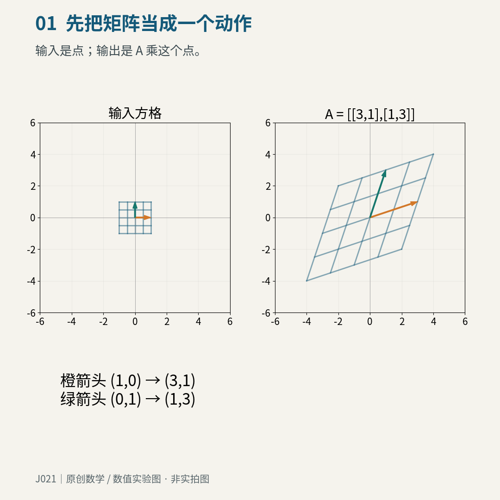
图1｜同一方格经 A=[[3,1],[1,3]] 变成斜四边形；两列给出两根基箭头的去向。

## 2．换一个方向看，斜拉就成了沿轴伸缩

这张矩阵有两条特别方便的方向：v₁=(1,1)/√2，v₂=(−1,1)/√2。它们长度都为1，互相垂直。

直接相乘：Av₁=4v₁，Av₂=2v₂。沿第一条方向走一小步，输出走四步；沿第二条方向，输出走两步。设 U 的两列就是这两个方向，本例 V=U，Σ=diag(4,2)，便有 A=UΣVᵀ。

为什么右边先作用？把 x 输入 A，实际是 U(Σ(Vᵀx))。Vᵀ先问“你沿这两根新坐标轴各占多少”，Σ把两个坐标分别乘4、2，U再把坐标合成输出箭头。这里选的U是45°旋转，Vᵀ是−45°旋转。三个动作合在一起，仍是最初那个A。

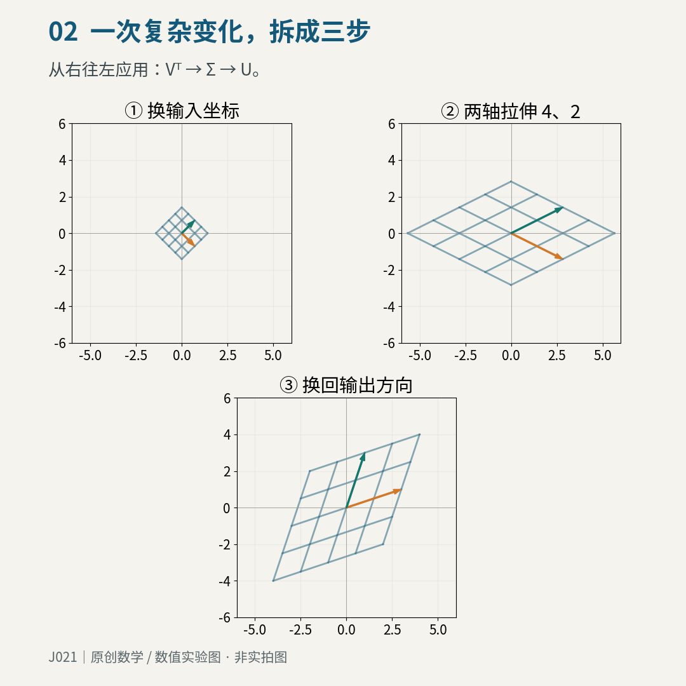
图2｜本例选 U 为45°旋转、Vᵀ为−45°旋转；三步相乘回到 A，各图坐标尺度一致。

## 3．一个必须补上的词：反射

常见口头解释是“旋转—拉伸—旋转”。它很形象，但一般实SVD里的U、V是正交矩阵，不保证都是保持方向的旋转。

正交意味着 QᵀQ=I，因此 ||Qx||²=xᵀQᵀQx=||x||²，长度不变，内积与夹角也保持。Q=diag(1,−1)满足这一点，却把平面翻了面，行列式为−1。比如diag(2,−1)，就可以拆成沿两轴拉伸2、1，再反射。因此更稳妥的说法是“正交换坐标—非负拉伸—正交换坐标”，正交动作可能含反射。

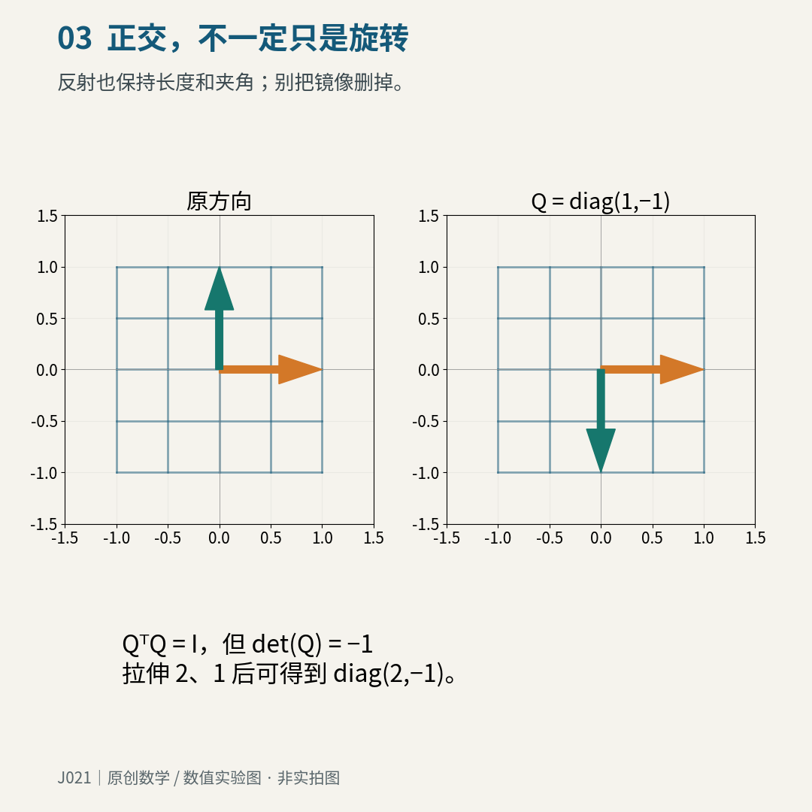
图3｜反射矩阵 Q 保长度但翻转方向；一般实 SVD 的正交因子可能含反射。

## 4．奇异值是伸长量，不是随便的两个特征值

一般实矩阵A的SVD写成 A=UΣVᵀ，Σ对角线上的σ₁≥σ₂≥…≥0叫奇异值。选对输入方向vᵢ后，Avᵢ=σᵢuᵢ：输入方向和输出方向可以不同。本例恰好相同，不要把这个特例推广成所有矩阵都如此。

把单位圆送进去，本例得到半轴长4和2的椭圆。输入向量可写成c₁v₁+c₂v₂；单位长度意味着c₁²+c₂²=1，输出长度平方就是16c₁²+4c₂²，所以伸长量落在2到4之间。

从等式还能得到 AᵀAvᵢ=σᵢ²vᵢ。它解释了奇异值与特征值的联系：要看的是AᵀA，而不是把A的特征值直接取绝对值。只有特殊矩阵才能这样偷懒。这个推导是理解工具，不是建议实际程序先形成AᵀA再求SVD；那样可能放大条件数问题。下面直接调用数值库的SVD。

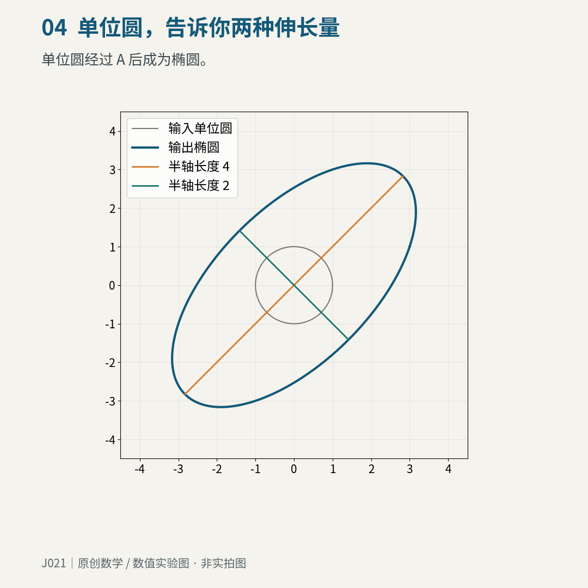
图4｜椭圆半轴长4与2是奇异值，不是所有输入方向都只放大4倍。

## 5．长方形也能做，先把尺寸对上

设A有m行n列，它把n维输入映射到m维输出。完整SVD中U为m×m、V为n×n，Σ为m×n，只有对角位置可能非零。并不要求方阵，更不要求可逆。

程序使用精简形式，q=min(m,n)：Uq是m×q，奇异值数组长q，Vqᵀ是q×n。因而 Uq diag(s) Vqᵀ 的结果仍为m×n。Uq的列互相正交；当m>q时，UqUqᵀ不是m维单位矩阵，而是投影。不要把完整形式的性质机械搬给精简形式。

如果某个σ为0，对应方向被压没了；如果整个A是零矩阵，所有σ都是0。SVD依然存在。本文代码的k可以从0取到q，并非只能取到数学秩；多保留零项不增加信息。

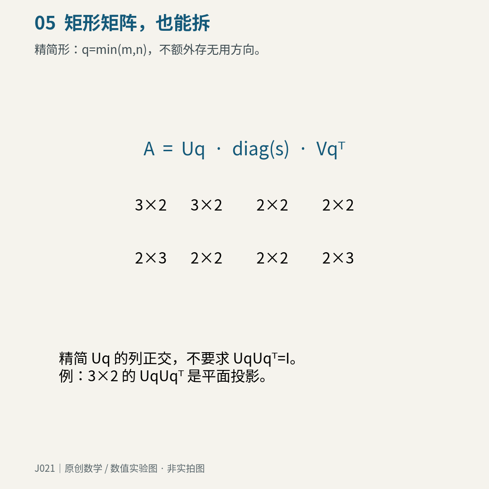
图5｜高矩阵与宽矩阵的精简SVD维度逐项匹配；高矩阵的精简U并非方阵。

## 6．从“一个动作”换到“一张表”：外积

列向量u乘行向量vᵀ，得到一张矩阵，其第(i,j)项是uᵢvⱼ。只要u、v都不为零，它的每一列都是u的倍数，列空间只有一个方向，所以秩为1。

例如[1,2,3]ᵀ乘[2,−1,0]，三列分别是原列向量的2倍、−1倍、0倍。这种结构很省描述：不必逐格记9个数，只需描述一根列和一根行。小尺寸时存储未必更省，后面会认真算账。

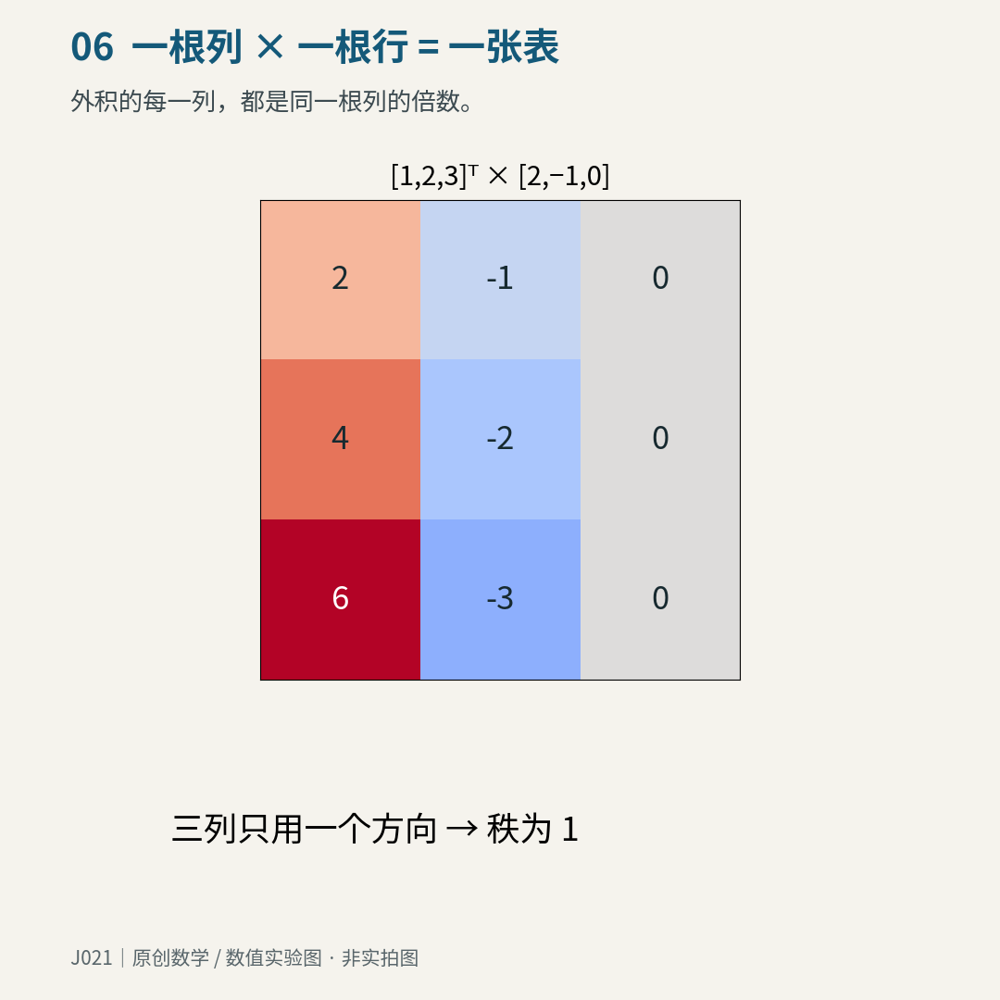
图6｜外积得到[[2,−1,0],[4,−2,0],[6,−3,0]]，列彼此成比例。

## 7．SVD就是把一张表写成秩1层的和

把矩阵乘法按列展开：A=Σᵢ σᵢuᵢvᵢᵀ。每一非零项是一张秩1层，通常铺满整个矩阵，并不是从原表切下一块。

对本例，第一层为4×[(1,1)/√2]×[(1,1)/√2]ᵀ=[[2,2],[2,2]]。第二层为2×[(−1,1)/√2]×[(−1,1)/√2]ᵀ=[[1,−1],[−1,1]]。相加才得到[[3,1],[1,3]]。

注意第二层的负数：层可以负责抵消，不必长得像一张普通灰度图。“第1层是背景，第2层是人物”也不是SVD保证的语义分工。

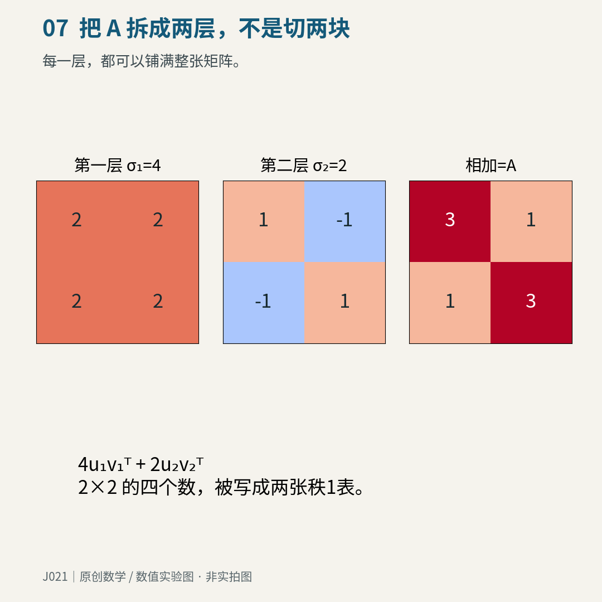
图7｜本例两层分别为全2矩阵和[[1,−1],[−1,1]]；第二层有负数，层不是普通灰度照片。

## 8．删掉一层，为什么能直接算误差？

先定义一把尺：Frobenius范数 ||M||F，就是把M每个数平方后相加，再开平方。它把所有格子的平方误差一视同仁。

不同SVD层在矩阵内积下正交，因为两层的内积可分成σᵢσⱼ(uᵢᵀuⱼ)(vᵢᵀvⱼ)，i≠j时为0。因此 ||A||F²=Σᵢσᵢ²。只留前k层得到Ak，残差 ||A−Ak||F²=Σᵢ>k σᵢ²。

本例总平方量4²+2²=20。只留第一层，剩余误差平方是4，误差范数是2；保留的平方量比例是16/20=80%。这个“能量”只是平方量的数学简称，不是物理能量，更不是“保住了80%的内容”。

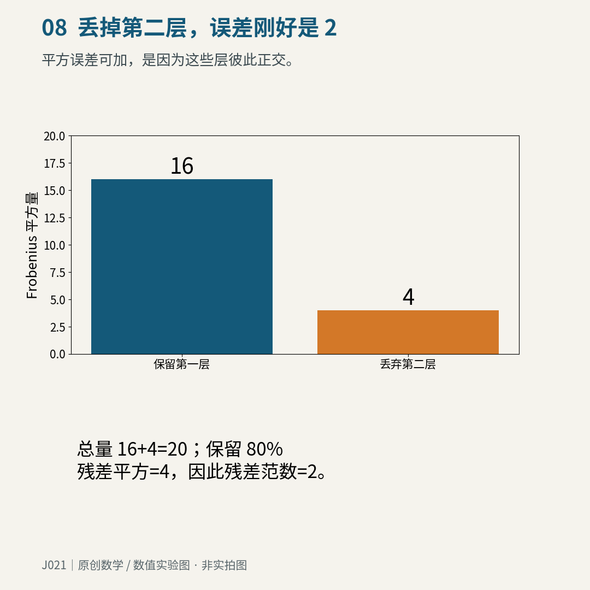
图8｜奇异值4、2对应平方量16、4；80%能量不是80%语义或画质。

## 9．为什么留最大的，不随便挑几层？

Eckart–Young低秩近似结论说：在所有秩不超过k的矩阵中，截断SVD在Frobenius范数和谱范数下都达到最小误差。谱范数 ||M||₂ 是单位输入向量经M作用后能达到的最大长度；它不是逐格最大误差。

先看本例的短证明。任何秩≤1的2×2矩阵B，总有一个单位向量x被它压成0。于是||(A−B)x||=||Ax||≥2，所以谱误差至少2。截断的残差恰好只在第二方向伸长2，达到了这个下界。

一般情形也有直观理由：B的输出被限制在最多k维空间S。把A投影到S之外的那部分，无论B怎么选都补不回来。设P是到S的正交投影，有 ||A−B||F²=||(I−P)A||F²+||PA−B||F²。第二项非负；要让第一项小，就要让S接住尽可能多的平方量。

将A按SVD展开，S能接住的量为Σᵢσᵢ²||Puᵢ||²。每个权重介于0和1，它们之和不超过k；因此不可能超过最大的k个σ²之和。选择前k个u方向恰好达到。这给出尾部平方和的下界，而截断达到下界。

结论不保证唯一。也不适用于任意换了一把尺的目标：若你要求某些像素必须保真、数值非负、结果为整数，或者更在意人脸文字，那是另一种约束或目标。

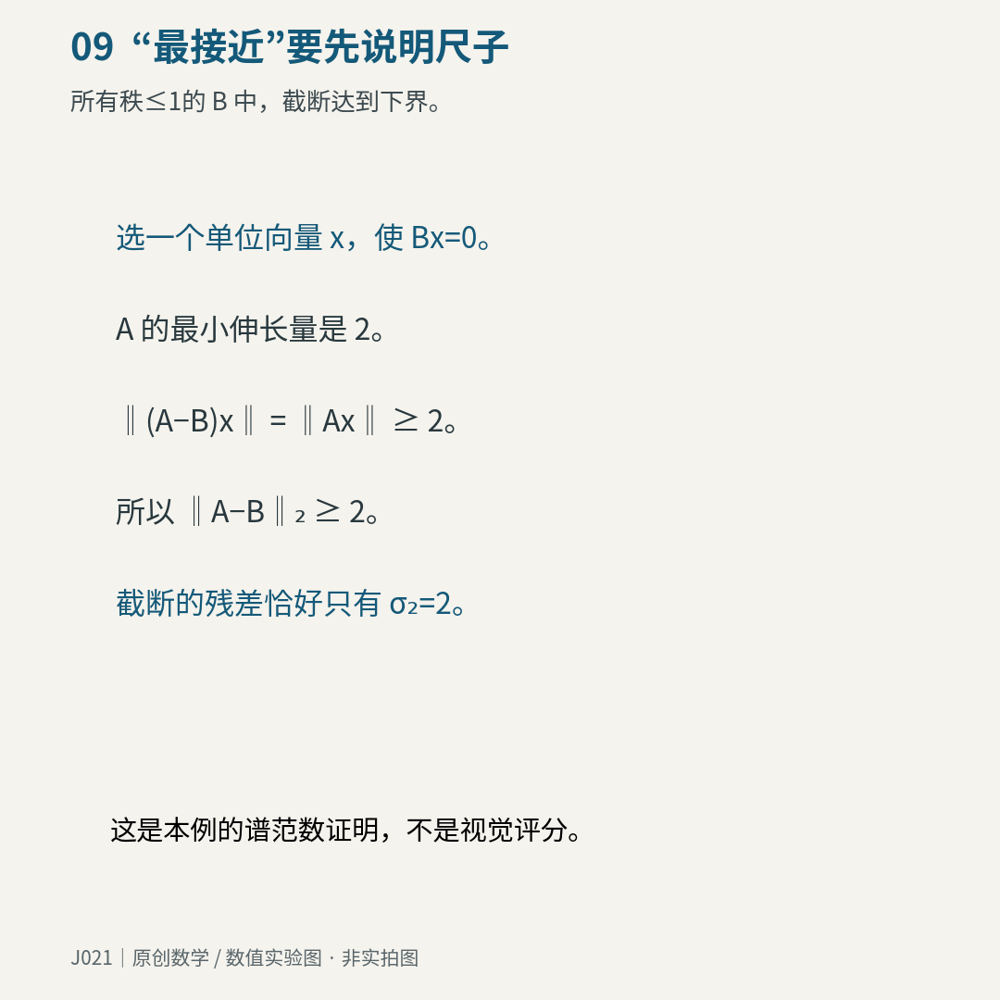
图9｜本例任意秩≤1近似都有非零核方向，谱范数误差至少2；截断达到2。

## 10．让代码真的处理一张“图”

实验输入是48×64实数阵列：渐变背景、矩形区域、一个平滑亮斑、一条窄斜线和右上角3×3亮块。它来自文末synthetic()的明确公式，不是AI生成照片，不含外来图片资产。

用NumPy实际算出奇异值。首项就占总平方量约94.06%，前4项约97.86%，前12项约98.70%。这些数字是真实数组结果，保留小数只是为阅读方便；不同数值库末位可能略异。

谱上前几项大，说明部分结构容易共享行列模式。斜线却需要更多方向表达。不要从一张特制数组推出“所有照片都低秩”。单位矩阵的所有奇异值相等，截断时就不存在几个特别占优势的方向。

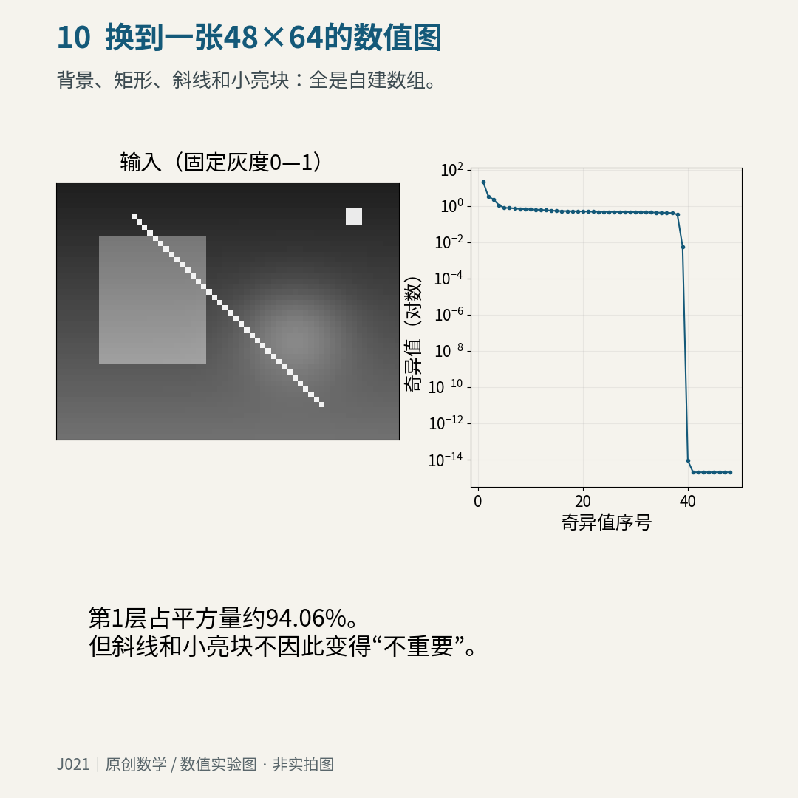
图10｜原创48×64数组及实际奇异值谱；首项能量占比94.06%，这不是自然照片测试。

## 11．先看结果，再看百分比

图11显示实际k=1、4、12、48重建。k=1已抓住大面积趋势，但细线和局部亮块会发生变化；提高k才逐步补回。k=48在浮点舍入误差内还原原阵列，而不是保证每个比特完全相同。

为了并排展示，所有灰度图的显示范围固定为0到1；超出范围的数只在显示时被钳住。计算残差和能量时用的是原始重建数组，没有悄悄先钳制、再宣称仍是截断矩阵。

为什么要强调？低秩重建不受逐像素0到1约束，可能出现区间外的值。显示钳制是另一道非线性操作；逐项钳制还可能改变矩阵的秩，不能把钳后图直接拿来冒充原定理的对象。

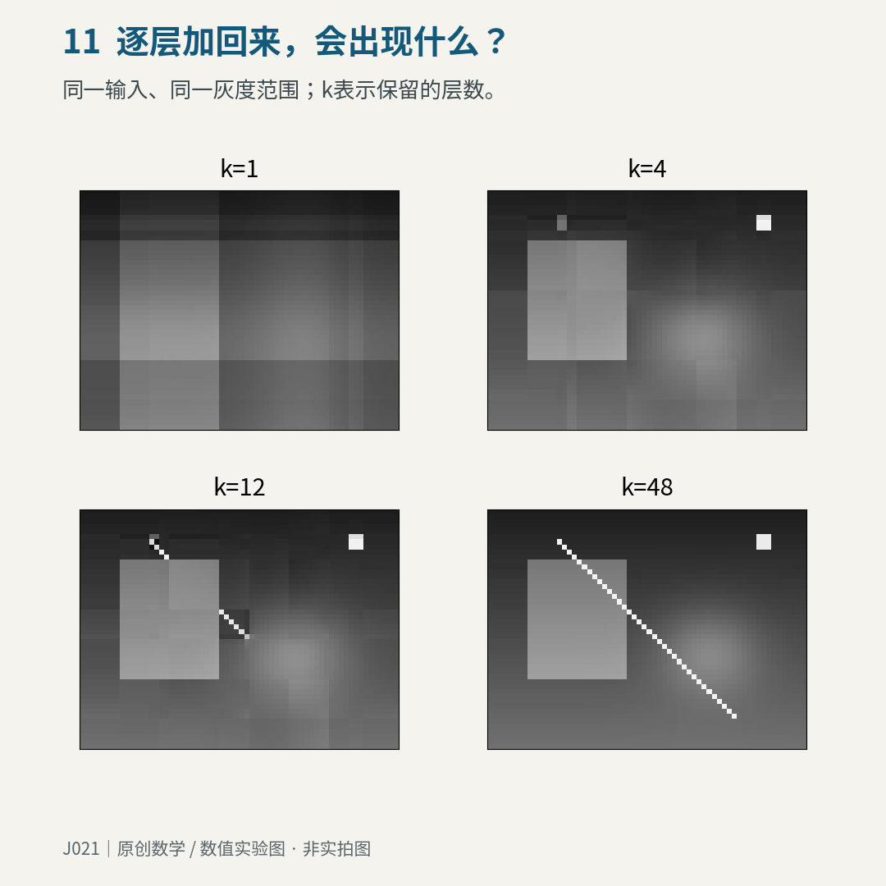
图11｜k=1、4、12、48的实际重建；展示时灰度钳在0—1，误差计算使用未钳制数组。

## 12．误差不能只有一个数

本实验k=1的Frobenius残差约5.2085，k=12约2.4354。它们告诉我们整体平方误差变小，但没有告诉我们哪几个位置改变最多。把绝对残差逐格画出来，窄斜线附近的变化更容易看清。

这也是排查图像实验的好习惯：同一输入、同一色阶、未改变的尺度，并且明确展示的是有符号残差、绝对残差，还是归一化后颜色。本图是绝对残差，统一0到0.7色阶，没有每个面板各自自动拉满。

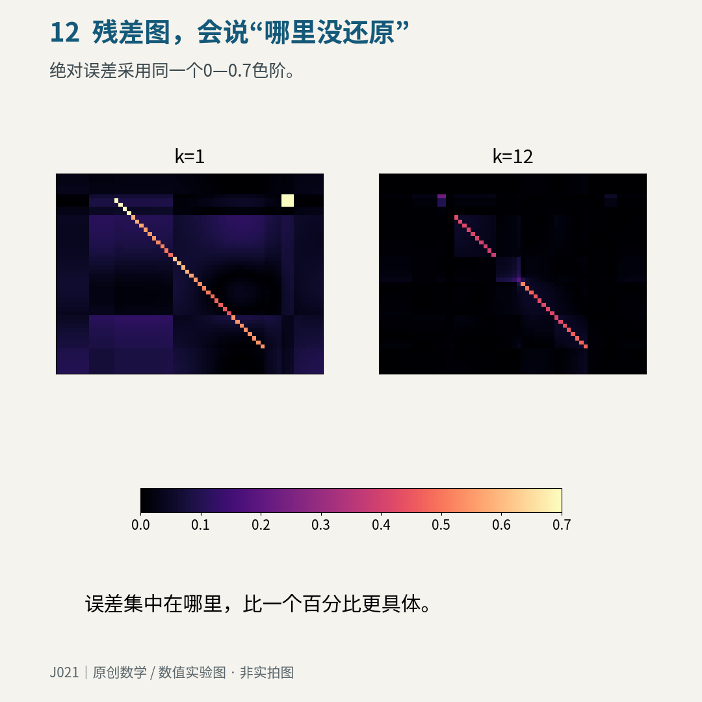
图12｜未钳制重建的逐像素绝对残差，两个面板使用同一固定色阶。

## 13．一个小亮块，能比大片背景重要

放大行3—9、列52—59（Python切片[3:10,52:60]，零起始且右端不含）的窗口。原阵列的小亮块只有9个像素；全图有3072个像素，因此它即使变化明显，也未必主导总平方误差。

这不是SVD出错了，而是你给它的任务本来就没有“这个亮块更重要”。不应把94%能量保留解释为文字可识别、身份特征可靠或医学信息无损。本实验只说明指标的盲区，不作任何这些场景的效能验证。

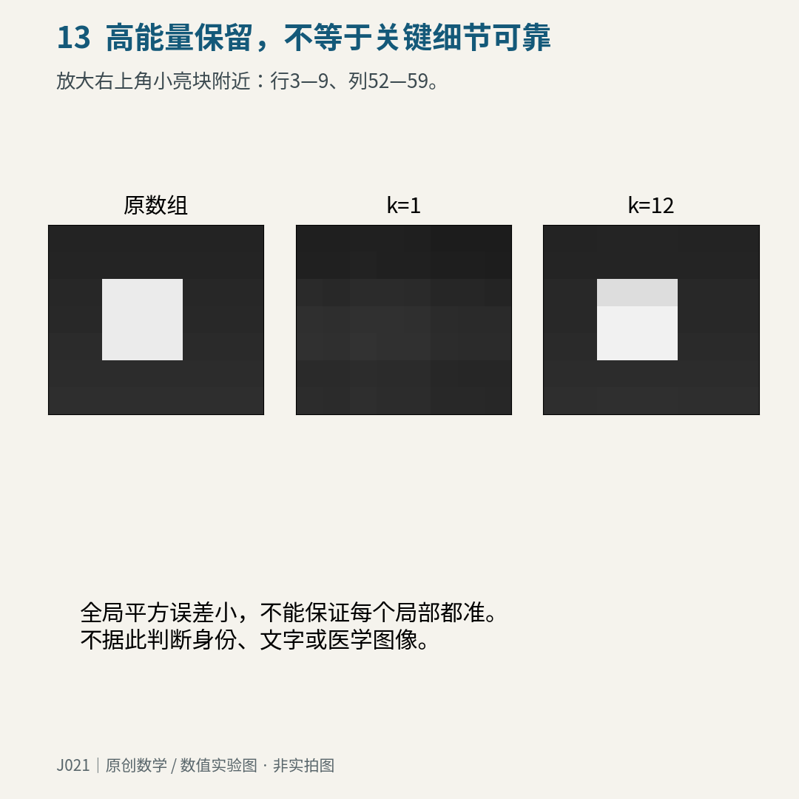
图13｜固定窗口放大小亮块附近；全局能量目标没有对每个局部赋予语义保护。

## 14．不同机器给出不同方向，未必谁算错了

若同时将uᵢ和vᵢ乘−1，外积uᵢvᵢᵀ不会变。所以两次分解的列符号不同，不足以判断错误。

当奇异值重复时，还能在相应子空间内更换正交基。例如I₂的奇异值都是1。只留水平方向得到diag(1,0)，只留竖直方向得到diag(0,1)，两者都是最优秩1近似，Frobenius误差都为1；还可以选择别的方向。

因此验证应先看A≈UΣVᵀ、正交性、奇异值和残差，而不是硬比每一个u/v元素。只有在相应边界奇异值有严格间隔时，截断子空间才具有更强的唯一性；本文不靠固定符号或固定基底得出结论。

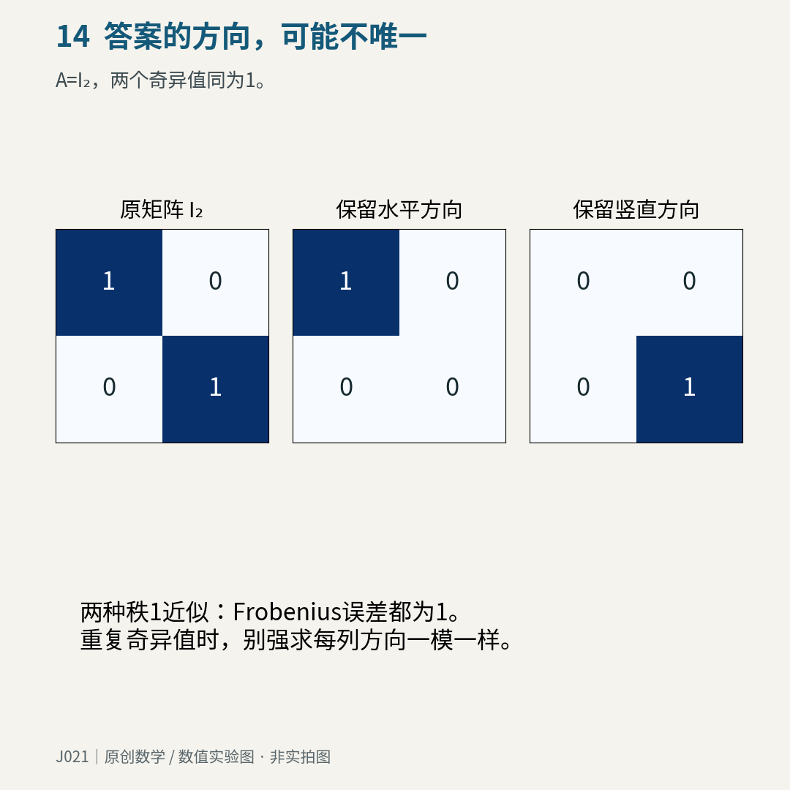
图14｜重复奇异值1、1使最优秩1近似不唯一；同时翻转一对u/v符号也不改变外积。

## 15．最后才来算“省了多少”

存一个m×n数组需要mn个标量。存前k列U、k个奇异值和Vᵀ前k行，需要k(m+n+1)个标量。对48×64数组，原来3072个数，因子要113k个数：k=27时3051个，k=28时3164个，反而更多。

这只是相同位宽下的粗账。本实验数组是float64；若原图是8位像素而因子用64位浮点，每个数的代价不同。还没算文件头、元数据、量化、熵编码，更没和PNG/JPEG实际文件比较。不能用“保留12/48项”直接宣称压到原体积的四分之一。

稠密SVD本身也有代价；常见完整精简分解的运算量量级为O(mn·min(m,n))，具体算法和实现影响常数与细节。下面的教学函数每次调用都重新分解，重建前k项还要约O(mnk)运算，不适合拿来做最快实现的演示。这里只限制每边≤256，便于普通机器复现实验，不做性能承诺。

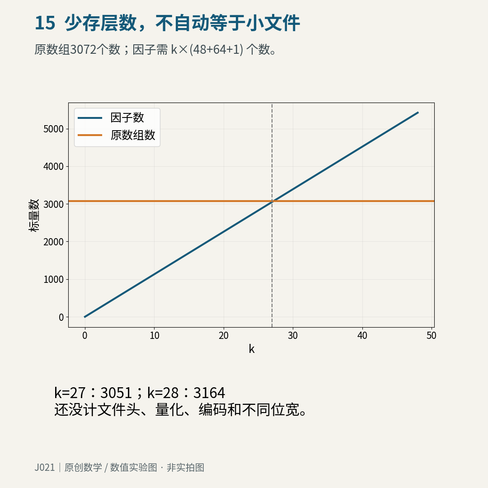
图15｜按相同标量位宽粗算，k≤27才少于原数组标量数；这不是PNG或JPEG体积比较。

## 16．数学的零，与数值的零

diag(1,10⁻⁸,10⁻¹⁴)在精确数学里秩为3；若任务指定阈值10⁻¹⁰，按“奇异值大于阈值”计算的数值秩就是2。后者依赖尺度、噪声和你允许的误差，并不是宣布第三个数真的等于0。

下面代码直接接收k，不擅自替你选“足够好”。它只处理非空二维实数数组，每边不超过256，元素有限且绝对值≤10⁶；拒绝布尔、复数、NaN/Inf和越界k。它复制输入，不会原地修改。极小奇异值、极端尺度与临界能量比例仍受float64舍入/下溢影响，不是认证数值程序。tail_frobenius是按奇异值尾部公式给出的估计，并非重新相减后测出的残差；k=q时它为0，但重建仍可能有舍入残差。

核心分解调用NumPy/LAPACK，不谎称我们手写了可靠SVD。自写的是输入契约、截断重建、能量/尾误差计账与测试数组。NumPy返回的vt已经是Vᵀ；(u[:,:k]*s[:k])利用广播给每列乘对应σ，不应再把vt转置一次。

零矩阵总平方量为0。为了让返回值有明确含义，代码约定它的retained_energy为1、尾误差为0，即已完全重建；这不是计算0/0得到的比例。k=0时非零阵列的保留比例则为0。

## 可以自己动手的三件事

1. 把[[3,1],[1,3]]中的非对角元素改成0，先手算奇异值再跑程序。
2. 把synthetic()最后那个小亮块删掉，比较总误差与局部误差如何变化，不只盯着能量比例。
3. 用I₂测试k=1，想想为什么另一个方向也同样好。

最值得带走的并不是一句“SVD可以压缩图像”，而是：先说清输入、允许的秩、衡量误差的尺，再判断一层结构值不值得留下。数学给了最优性，但只对你明确提出的那个问题负责。

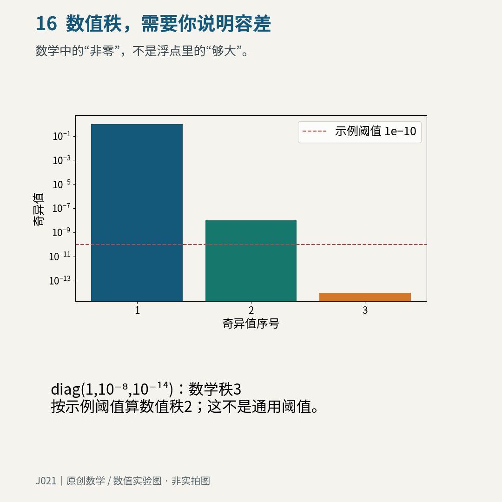
图16｜显式对角例的数学秩与指定阈值下的数值秩不同；容差依尺度与任务而定。


## 完整可运行核心代码

```python
"""Educational real, dense SVD truncation; requires NumPy. Not an SVD implementation."""
import numpy as np

def matrix(a):
    a = np.asarray(a)
    if a.ndim != 2 or min(a.shape, default=0) == 0 or max(a.shape) > 256:
        raise ValueError('expected a nonempty 2-D matrix, each dimension <= 256')
    if a.dtype.kind not in 'iuf':
        raise ValueError('expected real integer or float entries, not bool/complex')
    a = np.array(a, dtype=np.float64, copy=True)
    if not np.isfinite(a).all() or np.max(np.abs(a)) > 1e6:
        raise ValueError('finite entries with absolute value <= 1e6 required')
    return a

def factors(a):
    a = matrix(a)
    # The numerical factorization is NumPy/LAPACK, not handwritten here.
    u, s, vt = np.linalg.svd(a, full_matrices=False)
    return u, s, vt

def approximation(a, k):
    a = matrix(a)
    q = min(a.shape)
    if isinstance(k, (bool, np.bool_)) or not isinstance(k, (int, np.integer)):
        raise ValueError('k must be an integer')
    if not 0 <= k <= q:
        raise ValueError('k out of range')
    u, s, vt = factors(a)
    # Broadcasting scales columns of u; vt is already V transpose.
    b = (u[:, :k] * s[:k]) @ vt[:k, :]
    scale = s[0]
    if scale == 0:
        retained, tail = 1.0, 0.0
    else:
        weights = (s / scale) ** 2
        retained = float(weights[:k].sum() / weights.sum())
        tail = float(scale * np.sqrt(weights[k:].sum()))
    return dict(array=b, singular=s, retained_energy=retained,
                tail_frobenius=tail, stored_scalars=int(k * (sum(a.shape) + 1)))

def synthetic():
    """An invented 48x64 grayscale numerical field, not a photograph."""
    y, x = np.mgrid[0:48, 0:64]
    a = 0.12 + 0.32 * np.outer(np.linspace(0, 1, 48), np.ones(64))
    a += 0.28 * ((y >= 10) & (y < 34) & (x >= 8) & (x < 28))
    a += 0.22 * np.exp(-((y-28)/9)**2) * np.exp(-((x-44)/10)**2)
    a[(x == y + 8) & (y > 5) & (y < 42)] = 0.95
    a[5:8, 54:57] = 0.92
    return a

def demo():
    a = np.array([[3., 1.], [1., 3.]])
    one = approximation(a, 1)
    assert np.allclose(one['array'], [[2, 2], [2, 2]])
    assert np.allclose(one['singular'], [4, 2])
    assert np.isclose(one['tail_frobenius'], 2)
    assert np.isclose(one['retained_energy'], .8)
    print('2x2:', one)
    a = synthetic()
    for k in (0, 1, 4, 12, 24, 48):
        r = approximation(a, k)
        print(k, r['retained_energy'], r['tail_frobenius'], r['stored_scalars'])

if __name__ == '__main__':
    demo()
```

## 短读版
一张矩阵既可以看成线性动作，也可以看成一张数表。SVD把动作拆成正交换坐标、非负拉伸、再换坐标；正交可能含反射，不能一律叫旋转。

换个视角，A是许多σᵢuᵢvᵢᵀ秩1层的和。保留最大的k项，在Frobenius和谱范数下给出最优秩≤k近似；前者的误差平方正好等于被丢奇异值的平方和。

但最小平方误差不保证局部语义可靠。本文自建48×64阵列，第1层已经保留约94.06%的平方量，小亮块和细线仍会改变。16图展示几何、逐层重建、残差、重复奇异值、存储和数值边界，含完整可运行代码。

还要算账：因子需k(m+n+1)个标量，并非k/min(m,n)的文件体积。全流程用真实数组实验，不是自然照片或压缩产品评测。


文末全部核心代码可保存为svd_lab.py运行；实验依赖Python 3与NumPy。读者可在自己的环境安装NumPy后运行`python svd_lab.py`。浮点结果末位可能随库变化；比残差和正交性，不盲比奇异向量符号。


## 来源与素材权利

参见[来源、素材权利与 AI 辅助说明](sources.md)。
