# 扫描线：一万个时间段，怎样找到最拥挤的那一刻？

## 1. 一万条记录，未必要看一万次钟

学校开放日，有五位同学陆续进入一间讨论室。我们只记了每人的进入和离开时间：A 是1到5，B是2到6，C是4到7，D是5到8，E是6到8。想知道最多同时有几人在场。
最直觉的方法，是在每一分钟数一次。可如果记录精确到毫秒呢？如果有人只停留半分钟，整点采样又会漏掉什么？算法不应该靠“把时间切得足够细”碰运气。
先定语义：本文的第一组例子都用半开区间 [l,r)。l时刻已经在场，r时刻已经离开。如果A在5离开，D在5进入，模型允许立即交接。这是数据规则，不是宇宙真理；真实房间需要清场缓冲时，应先把缓冲写进占用区间。

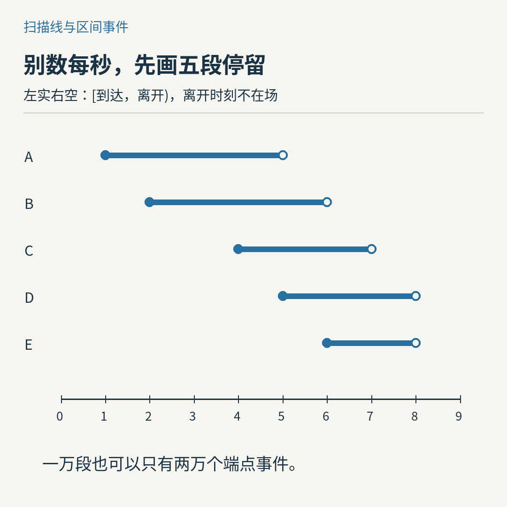

图1：自造五段半开停留记录；实心点计入，空心点不计入，横轴单位为分钟。

## 2. 不发生变化的地方，可以直接跳过

把所有进入、离开时刻标在数轴上。在两相邻端点之间，没人进入，也没人离开。名单不变，人数当然不变。
于是，问题从“无数个时间点分别是什么情况”变成“有限次变化发生以后是什么情况”。扫描线就是这样的思考方法：想象一根指针从左向右走，只在值得处理的位置停下来。
这里的线只是一种帮助理解的想象。程序不需要做动画，也不需要真的移动一条像素线。它只需要排序和更新状态。

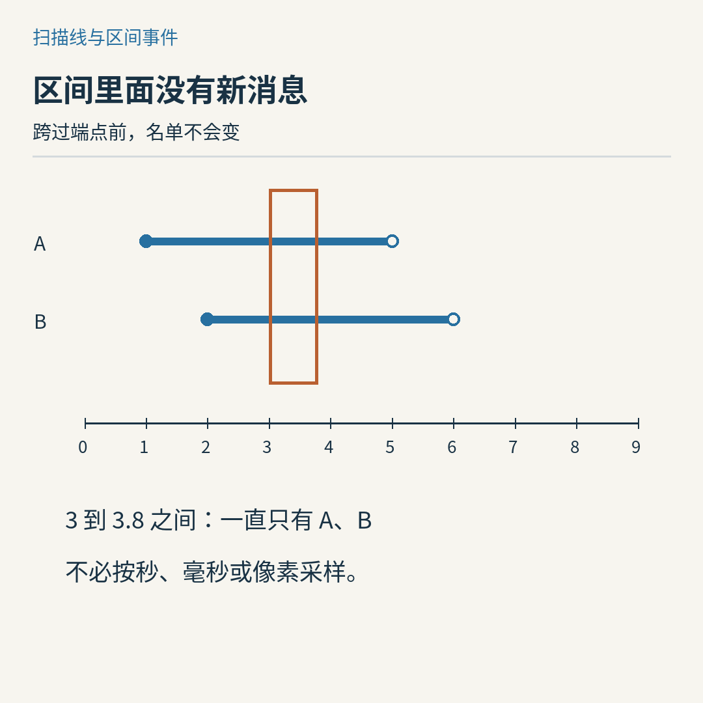

图2：两相邻端点之间，成员关系恒定；图中橙框只是没有事件的一个内部片段。

## 3. 只记变化，不抄整份名单

每条非空半开区间产生两条消息：在l处+1，在r处−1。从0开始累加，就能得到人数。
注意这份压缩记录丢失了身份。如果你还要回答“具体哪些同学同时在场”，只有一个整数不够，还需要维护活跃ID集合。压缩不是免费保留全部信息，而是只保留当前问题所需的信息。
同一组数据可以有不同的状态设计：只问人数用计数器；问有哪些区间要用集合；问带宽总量要累计权重。先写清问题，再选状态。

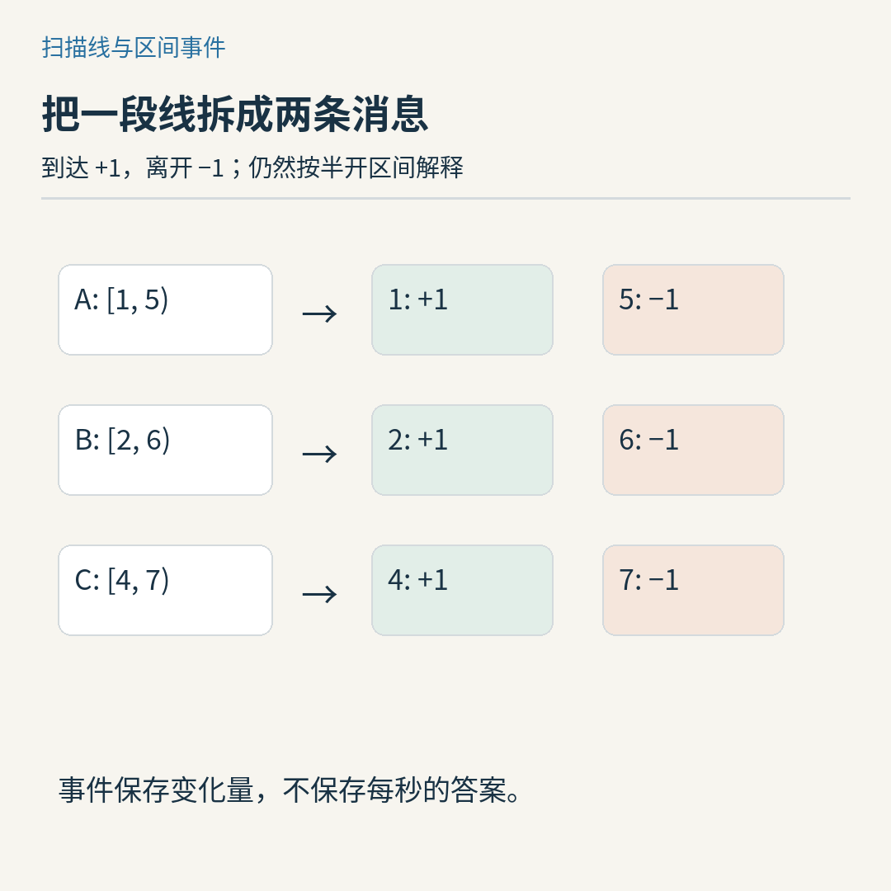

图3：A、B、C 的端点事件。D、E 用同样规则生成，两端事件不表示真的有人在端点间移动。

## 4. 同一个时刻，别观察不存在的中间态

完整例子在1、2、4处各增加1；5处A离开且D进入，净变化0；6处B离开且E进入，净变化也是0；7处减少1；8处减少2。
半开模型下，同坐标事件可以先合并，再把累计值视作这个坐标及其右侧、直到下一端点之前的人数。因此从4到7之前，人数一直是3。5、6处虽然换了人，却没有换人数。
如果坚持逐项处理，同坐标时必须让结束先于开始，且空半开区间要事先忽略。不过更不容易误解的写法，是把同坐标作为一个事件组，一起结账，不把排序实现的临时状态当成答案。

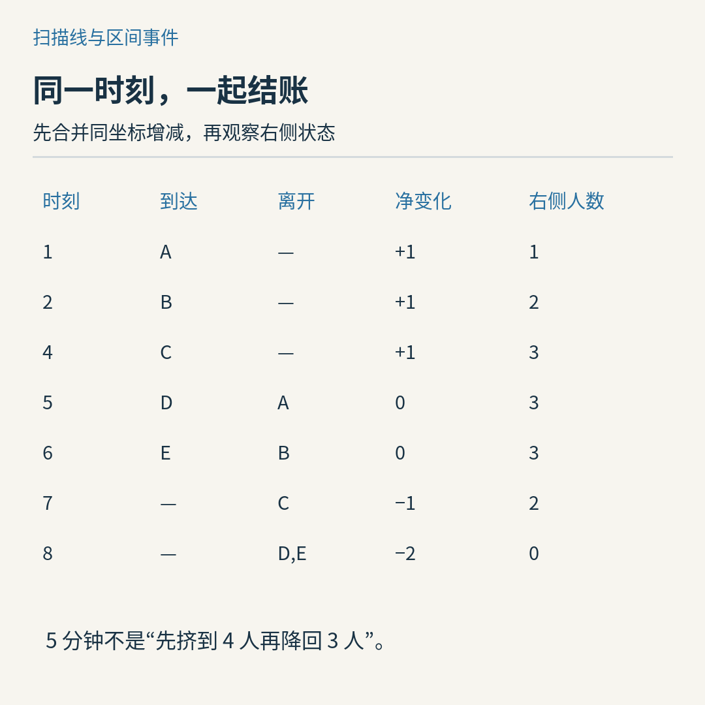

图4：完整事件表；5、6分钟净变化为零，但在场者身份已更换，计数器不会保存身份。

## 5. 三个看起来相似、实际不同的问题

这五条记录的最大并发是3，达到峰值的时间集合为[4,7)。这回答的是“至少要承受多大瞬时负载”。
有人在场的总时长是7分钟：从1到8一直有人。把每条停留长度直接相加会重复计算重叠部分，所以它不是联合覆盖长度。
把人数阶梯下面的面积相加，则是16人·分钟：1×1 + 2×2 + 3×1 + 3×1 + 3×1 + 2×1 =16。也等于五段长度4+4+3+3+2。本例每条记录代表一个人；换成设备日志时，累计量的单位就要相应改成“设备·分钟”。
最大值、联合长度、累计占用量可以来自同一次扫描，但答案和单位都不同。别把“忙了多久”与“忙的时候最多有几个人”混成一件事。

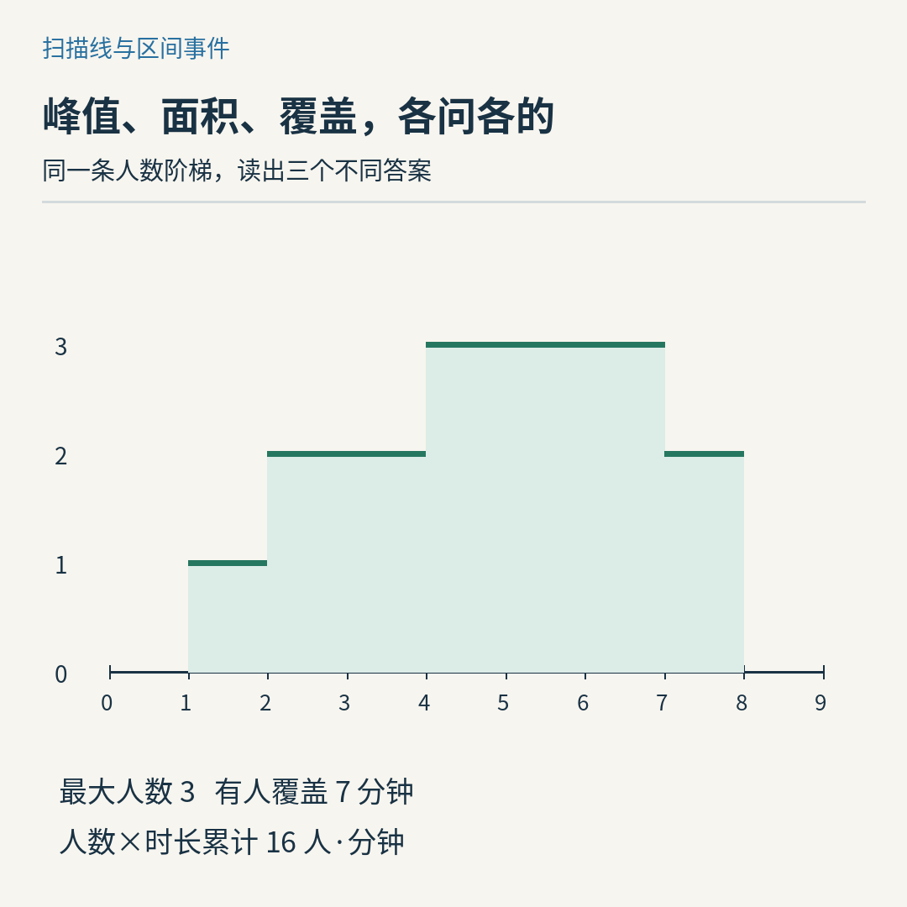

图5：五段记录的峰值为3，联合覆盖长度为7，人数积分为16；后三者单位不同，不能互换。

## 6. 只改一个排序细节，就能错出一个峰值

考虑[1,3)和[3,5)。它们从不同时在场，正确峰值是1。
如果到了3，程序先+1，再把当前值2写进最大值，最后才−1，就造出了一个并不存在的两人时刻。错误不在加法，而在你给“更新到一半”的状态赋予了现实含义。
这个反例特别适合做单元测试：只有两段，端点完全相同，不需要随机生成十万条数据才能暴露问题。

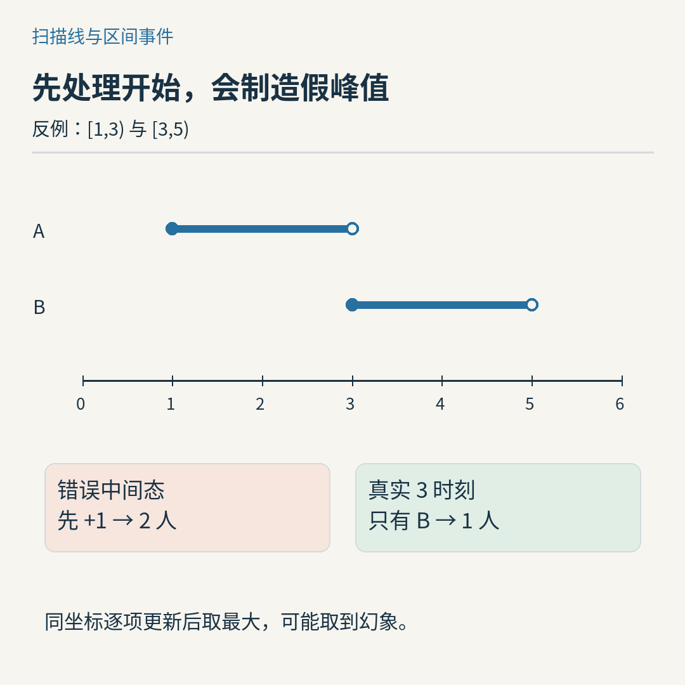

图6：半开端点交接时不存在两人同时在场；错误来自观测了无现实含义的中间态。

## 7. 把括号改成方括号，答案真的会变

现在改成[1,3]和[3,5]。3这个点被两条区间都包含，峰值就是2。可是一个孤立点没有正长度，所以联合长度仍为4。
因此“结束先于开始”不是所有区间题的口诀。闭区间若要处理端点并发，可以在同坐标先加入所有开始项、观察点上人数，再移除所有结束项。半开、全开、混合开闭不能不加区别地套同一顺序。
当需求允许任意开闭方式，与其背四种排序规则，不如把每个坐标拆成三个观察位置。

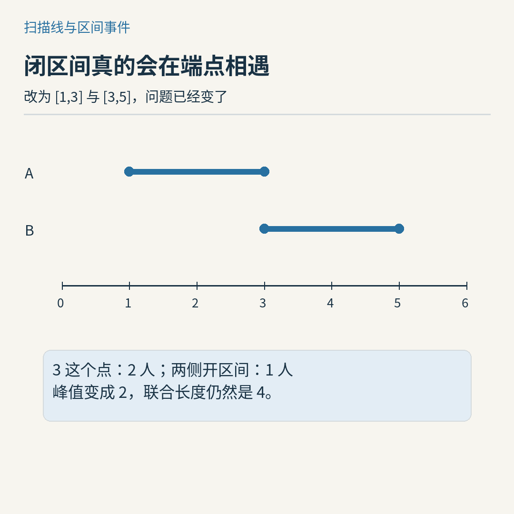

图7：两个闭区间在3这个单点相交。单点可以改变最大并发，却不贡献连续长度。

## 8. 一套同时处理四种括号的办法

设L是紧挨x左边、开间隔内的人数。先不要移动到右边。
点x的人数P，等于L减去在x结束但不包含x的区间，再加上在x开始且包含x的区间，再加上单独的[x,x]数量。
右边开间隔的人数R，则是L减去所有在x结束的非零区间，再加上所有在x开始的非零区间。不论端点开闭，只要跨到端点右边，结束项都不在了，开始项都已经开始了。
通用实现分别检查P和R。若最大值只出现在开区间内部，例如(1,3)，就不存在最早的最大值时刻：任取一个内部点，总能找到更靠左的内部点。代码返回一个确实达到峰值的见证点，不承诺它是“最早”。用相邻端点的有理数中点，避免浮点舍入把它推到边界。


图8：混合开闭端点的通用计数式；零长度单点单列，非零区间才计入开始和结束。

## 9. 零长度、重复记录和反向输入

[3,3]包含3这个单点，可能增加瞬时峰值。[3,3)、(3,3]和(3,3)都是空集合；不该先减少再增加制造负数，也不该误记一次占用。
重复记录会重复计数。两条相同区间如果代表两台设备，就应该算两份；如果是日志重复上报，就应在上游按业务ID去重。算法不会自行猜测。
端点反向，例如[8,2)，示例程序直接报错。自动交换可能把错误数据变成看似合理的结果。时间戳的时区、夏令时、单位和清场缓冲，同样应在进入算法前统一；本实验只接受精确整数坐标，不接收float、bool或任意比较对象。

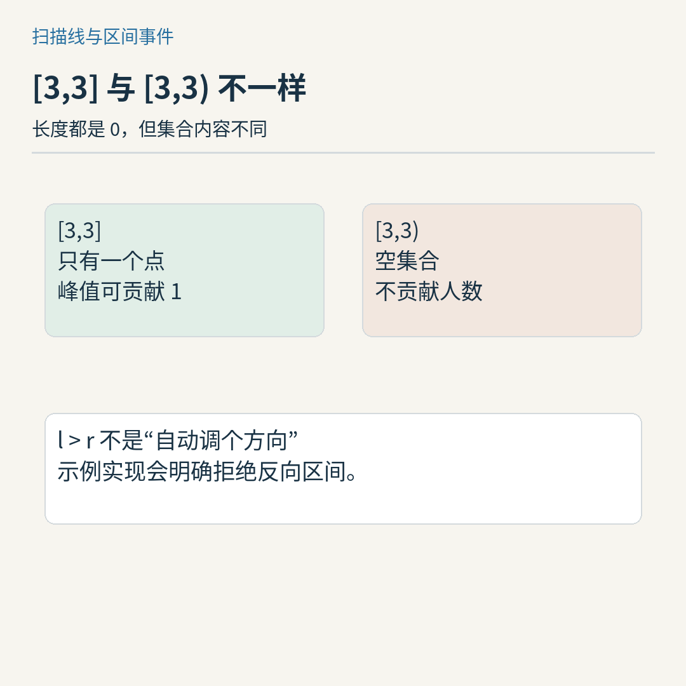

图9：仅左右都闭的零长度区间是单点，其余三种零长度区间为空；反向端点是非法输入。

## 10. 为什么坐标压缩之后，长度还要看原坐标

只关心顺序时，0、1、100可以映射到秩0、1、2。这样可以用较小的索引组织数组或数据结构。
但前两个原端点相差1，后两个相差99。若把两个秩间隔都当成长度1，联合长度和面积会完全失真。压缩的是存储位置，不是几何距离。
本代码没有建立每秒数组，只排序真实端点；大到10³⁰的整数也不需要分配10³⁰个格子。Python大整数没有固定字长溢出，但比较、加减、乘法的位复杂度并非恒为常数。常见O(n log n)描述，默认坐标操作的成本可视作常数。


图10：压缩排序位置只保存顺序；要计算长度或面积，仍需原坐标差，不能用秩差代替。

## 11. 从人数到带宽，少了一次乘法，题目就变了

若每个任务有非负资源需求w，到达时加w、结束时减w，就得到累计负载。权重2和5的任务重叠，负载为7，不是2。
这是相同事件思想的扩展，不是附录单位计数代码已经实现的接口。若需要统计“有任务在运行”的时间，最好另维护任务计数；零权任务的存在不能由负载是否大于0判断。允许正负权重时，负载正负更不能代表是否有覆盖。
不要把不同单位加在一起：CPU核数、内存字节和请求数不是同一种权重。扫描只负责按规则算，规则的物理含义还得由人负责。

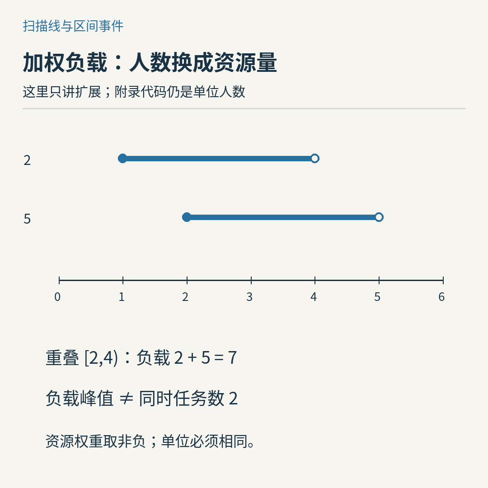

图11：两个任务的资源权重为2、5，重叠负载7而任务数2；这不是单位计数代码的既有功能。

## 12. 扫矩形：现在每一步要维护一段长度

二维里也能做类似的降维。想象竖直线从左向右扫轴对齐矩形。遇到左边界，加入它的y区间；遇到右边界，移除。两相邻x边界之间，活跃矩形集合不变。
这一竖条的联合面积，等于条宽乘活跃y区间的联合长度。不是乘活跃矩形数量，也不是乘它们高度之和，因为y区间可能重叠。
图中两个2×2正方形重叠一个1×1小方块，联合面积是4+4−1=7；按三条宽1竖条计算，也得到2+3+2=7。
如果每次事件都重新排序所有活跃y端点，一个直白实现可能花O(n² log n)时间。想达到常见的O(n log n)矩形联合面积算法，需要合适的动态覆盖结构，例如带覆盖次数和覆盖长度的线段树；那是下一层内容，不是给计数器换个名字就自动获得的速度。

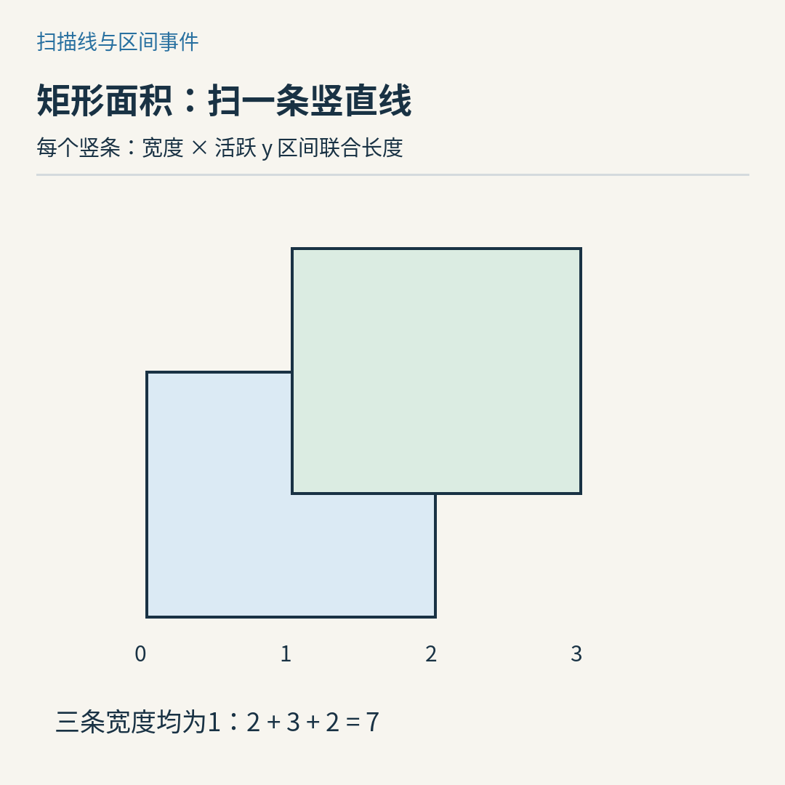

图12：两矩形[0,2]×[0,2]与[1,3]×[1,3]联合面积为7；重叠区域不能计两次。

## 13. 为什么一般线段求交更难

对斜线段，扫描线上的上下次序可能在交点处交换，而交点不一定是任何输入线段的端点。只扫描端点会漏掉这种变化。
所以不能把本文的一维整数区间实现宣传成完整的计算几何库。一般线段求交通常还要管理交点事件、活跃线段次序和重复事件，处理共线、多个线段同点相交以及数值稳健性。
这里保留一个小而清楚的边界：我们已经理解“事件之间状态稳定”，却还没有实现所有几何问题所需的状态和事件发现规则。

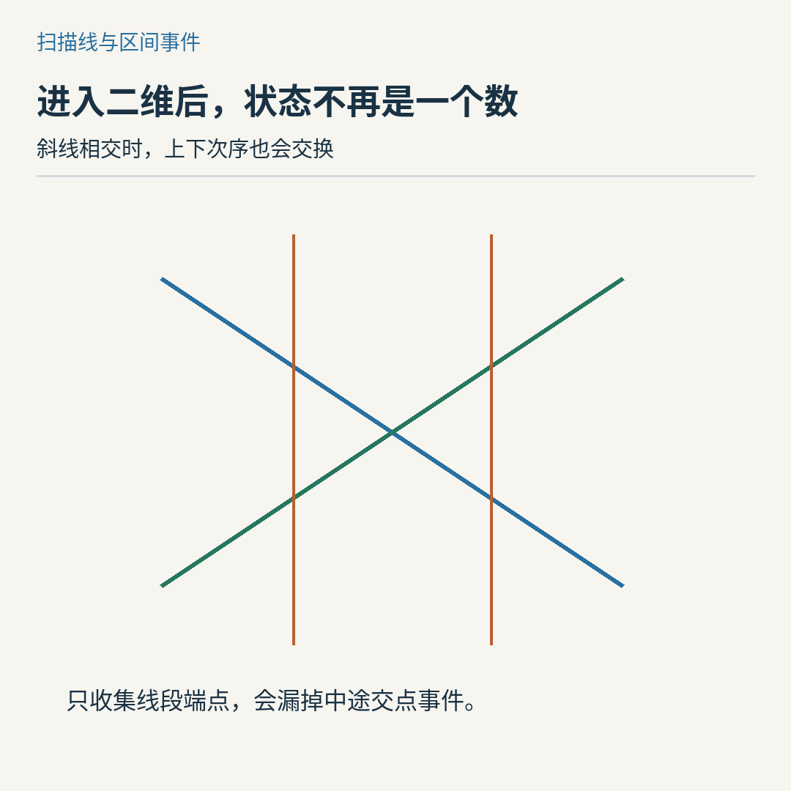

图13：原创两斜线示意；交点改变扫描线上的相对次序，不能把一维加减计数直接当成完整几何求交算法。

## 14. 原始讲义图里，扫描线把什么分开了

David M. Mount的2012年CMSC 754讲义Figure19，用一条竖直虚线区分已扫过区域与未来事件。左侧标出已发现交点，右侧还留着待处理位置。这张原图有用，不是因为它比时间线更复杂，而是它把“过去的结果、当前的状态、未来的事件”放在同一幅图里。
对应章节讨论一般位置下的线段求交：端点与交点都可能成为事件。它的假设包括相关x坐标互异、没有共线重叠、没有三线共点等；原文把退化情况另作讨论。不能借这张图暗示本文程序已处理这些二维问题。
原图仅选Figure19区域，周围正文未搬运；原作者与出处保留。其余十五幅图及示例都是为本篇自制，不是讲义原图的改色复刻。

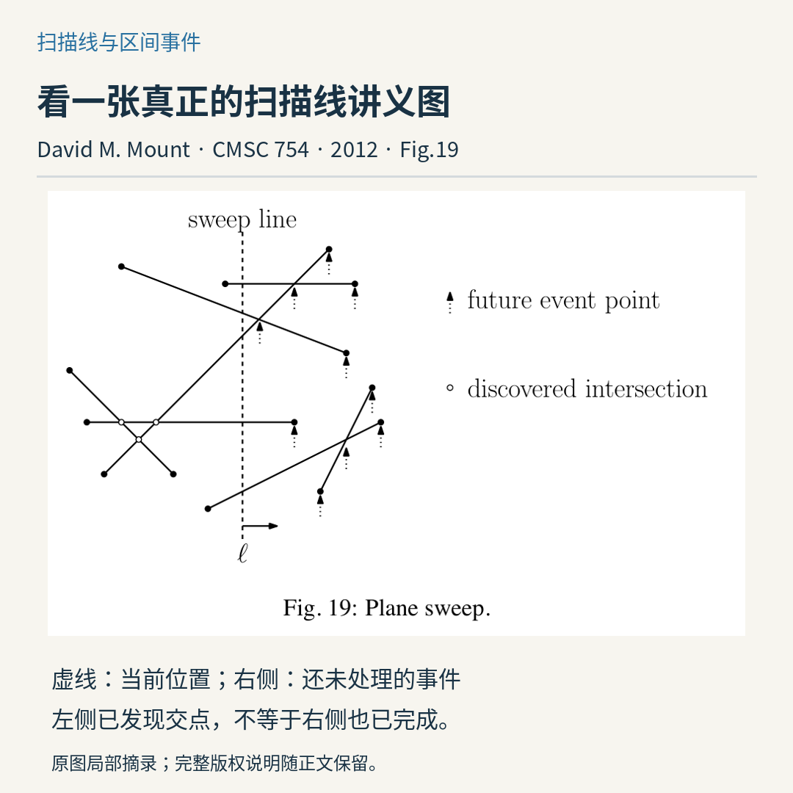

图14：Mount讲义第23页Figure19原图区域，仅裁去周围正文；虚线两侧分别提示已处理部分和未来事件。

## 15. 把正确性说成一句能检查的话

在一个不含端点的开间隔里，每条区间对“是否包含当前点”的回答固定不变；于是总人数也固定不变。所有可能改变答案的位置都在端点。
排序后，点与相邻点之间的开间隔把有关数轴划分完整。初始最左侧人数为0；由L计算P，再计算R，正好枚举了这个划分的每一部分。最后最右侧也回到0。这就是循环不变量的直观证明。
对n条区间，最多2n个不同端点。创建事件期望O(n)（使用哈希字典）、排序O(n log n)、扫描O(n)，总额外空间O(n)。代码还返回O(n)个点/间隔单元，便于检查；不需要这些单元时可以不保存。哈希碰撞最坏情况和大整数算术成本不在这个简化的单位成本估计内。


图15：正确性来自对数轴的完整划分；端点逐点检查，间隔取任意内部一点即代表整段。

## 16. 先写一个慢而明显正确的对照

测试不靠“看输出像不像”。对很小的坐标集合，直接在每个端点和相邻中点判断每条区间是否包含该点，再取最大值，并按原坐标差计算覆盖长度。这种做法慢，却容易检查，适合与扫描结果交叉验证。
附录枚举端点{0,1,2}上24种区间（含四种开闭与零长度），再枚举长度0到3的有序列表，共14425组，包括重复记录。它对照峰值、联合长度、累计占用量，并核见证点确实达到峰值。另测试反向端点、bool/float坐标、错误闭合标志和超大整数。
这不是任意输入上的形式化证明。它的价值是把最容易忘的同坐标、空集合、单点与重复情况挤到很小的空间里，让错误没处躲。你可以继续加负坐标、更多区间、置换不变性与坐标平移不变性测试。
小练习：①把五段示例全部改成闭区间，峰值是多少？②只保留(1,3)，为什么不能返回“最早峰值时间1”？③把所有端点加1000，哪三个输出应保持不变？答案：①4，在5和6这两个点出现；②1不在区间内，且内部没有最小点；③峰值、联合长度和累计占用量不变，见证点随之平移。

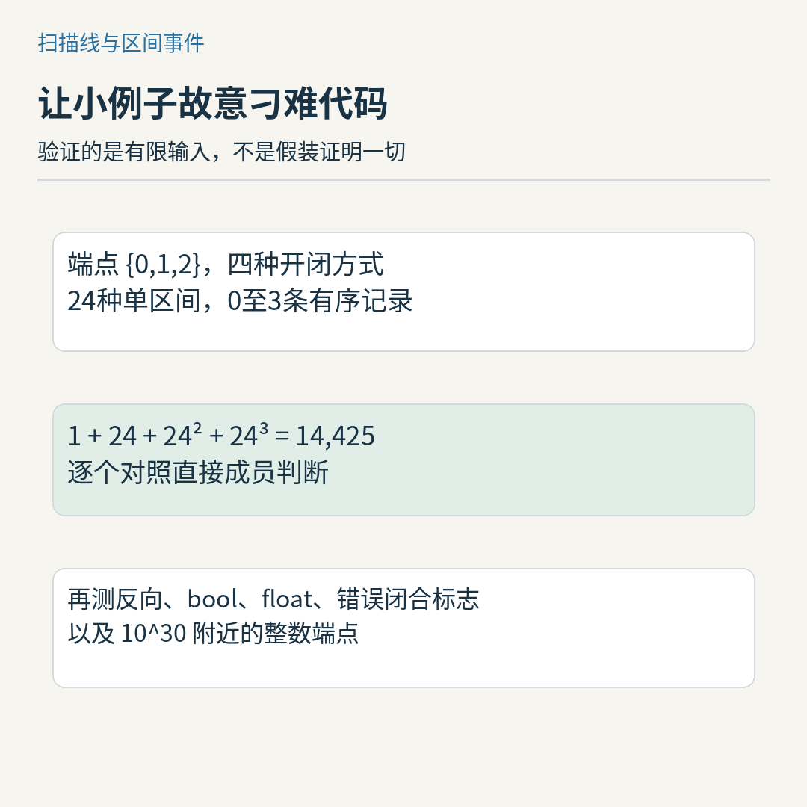

图16：作者穷举14425组区间列表，对照端点及中点直接成员判断；另测5个输入边界，不声称覆盖任意类型或任意规模。

## 来源、原图与使用边界

一手参考：[David M. Mount，《CMSC 754 Computational Geometry》，Spring 2012](https://www.cs.cmu.edu/afs/cs/academic/class/15456-f15/Handouts/cmsc754-lects.pdf)，实际读取首版权页及印刷页22–25，亲眼检查第23页Figure19；仅引用扫描线一般框架与二维边界，不声称完整阅读161页讲义。全文的一维例子、三状态公式、程序和十五幅教学图为独立组织与推导。

Figure19按原文件说明用于本篇免费教育性讲解，保留完整版权与许可说明如下；这不是无条件商业授权，也不是CC0或公共领域声明。若后续付费或商业再利用超出许可条件，需要另核授权。

Copyright, David M. Mount, 2012, Dept. of Computer Science, University of Maryland, College Park, MD, 20742. These lecture notes were prepared by David Mount for the course CMSC 754, Computational Geometry, at the University of Maryland. Permission to use, copy, modify, and distribute these notes for educational purposes and without fee is hereby granted, provided that this copyright notice appear in all copies.


AI辅助起草与程序制图；原始讲义图非AI生成。例子为自造，不是实际学校、人流或平台性能数据。

## 完整可运行实验

保存为 sweep_lab.py，运行 python sweep_lab.py。只依赖Python标准库，输入契约见函数说明。此代码是教学实现，不包含权重、二维矩形面积、一般线段求交或生产日志清洗。

```python
"""Original exact-integer endpoint teaching model; no third-party code."""
from dataclasses import dataclass
from fractions import Fraction
from itertools import product

@dataclass(frozen=True)
class Interval:
    left: int
    right: int
    left_closed: bool = True
    right_closed: bool = False

def sweep(intervals):
    """Return peak + one witness, union length, person-time, event cells.

    Inputs: finite iterable of Interval objects, exact built-in integer endpoints,
    boolean closure flags. Empty intervals are ignored; reversed ones rejected.
    Cells: (kind, left, right, count). Point cells have left == right.
    Witness is not claimed to be an earliest time for arbitrary open intervals.
    """
    events = {}  # x -> [starts, ends, closed_starts, open_ends, singletons]
    for it in intervals:
        if not isinstance(it, Interval):
            raise TypeError('Interval required')
        l, r = it.left, it.right
        if type(l) is not int or type(r) is not int:
            raise TypeError('integer endpoints required (not bool/float)')
        if type(it.left_closed) is not bool or type(it.right_closed) is not bool:
            raise TypeError('boolean closure flags required')
        if l > r:
            raise ValueError('reversed interval')
        if l == r:
            if it.left_closed and it.right_closed:
                events.setdefault(l, [0]*5)[4] += 1
            continue
        a = events.setdefault(l, [0]*5)
        b = events.setdefault(r, [0]*5)
        a[0] += 1
        a[2] += int(it.left_closed)
        b[1] += 1
        b[3] += int(not it.right_closed)
    xs = sorted(events)
    active = peak = union = person_time = 0
    witness = None
    cells = []
    for j, x in enumerate(xs):
        starts, ends, closed_starts, open_ends, points = events[x]
        # active describes the open gap immediately LEFT of x.
        at = active - open_ends + closed_starts + points
        cells.append(('point', x, x, at))
        if at > peak:
            peak, witness = at, Fraction(x)
        active += starts - ends
        if j + 1 < len(xs):
            y = xs[j+1]
            cells.append(('gap', x, y, active))
            if active > peak:
                peak, witness = active, Fraction(x+y, 2)
            if active > 0:
                union += y-x
            person_time += active*(y-x)
    assert active == 0
    return {'peak': peak, 'witness': witness, 'union_length': union,
            'person_time': person_time, 'cells': cells}

def contains(it, x):
    return (it.left < x or (it.left == x and it.left_closed)) and \
           (x < it.right or (x == it.right and it.right_closed))

def brute(intervals):
    """Independent direct-membership baseline for finite endpoint cells."""
    xs = sorted({v for it in intervals for v in (it.left, it.right)})
    samples = [Fraction(x) for x in xs]
    samples += [Fraction(a+b,2) for a,b in zip(xs,xs[1:])]
    counts = [sum(contains(it,x) for it in intervals) for x in samples]
    union = sum(b-a for a,b in zip(xs,xs[1:])
                if any(contains(it,Fraction(a+b,2)) for it in intervals))
    person = sum(it.right-it.left for it in intervals)
    return max(counts, default=0), union, person

DEMO = [Interval(1,5), Interval(2,6), Interval(4,7), Interval(5,8), Interval(6,8)]

def self_test():
    opts = [Interval(l,r,lc,rc) for l in range(3) for r in range(l,3)
            for lc,rc in product([False,True], repeat=2)]
    checks=0
    for n in range(4):
        for case in product(opts, repeat=n):
            got=sweep(case); expected=brute(case)
            assert (got['peak'],got['union_length'],got['person_time'])==expected
            if got['witness'] is not None:
                assert sum(contains(it,got['witness']) for it in case)==got['peak']
            checks += 1
    assert (sweep(DEMO)['peak'],sweep(DEMO)['union_length'],sweep(DEMO)['person_time'])==(3,7,16)
    for bad in [Interval(2,1), Interval(True,2), Interval(0,2.0),Interval(0,2,1,False)]:
        try:sweep([bad])
        except (TypeError,ValueError):pass
        else:raise AssertionError(bad)
    assert sweep([Interval(10**30,10**30+3)])['union_length']==3
    return {'exhaustive_cases':checks,'demo':(3,7,16),'extra_boundaries':5}

if __name__=='__main__':
    print(self_test())
    print(sweep(DEMO))

```

---

## 短篇导读：别盯着每秒，盯着变化

想知道一万个停留时间段何时最拥挤，不一定要每秒数一次。两相邻端点之间没人进入或离开，人数就不会变：把端点排序，只处理变化即可。

半开区间[进入,离开)在开始处+1、结束处−1，同一时刻一起结账。最小反例是[1,3)与[3,5)：先加后减并立刻取最大值，会编出不存在的2人峰值。

但[1,3]与[3,5]真的在3相交，峰值2。端点开闭不是排序小技巧，而是题目本身。通用做法分别看坐标左侧、点上和右侧；[3,3]是单点，[3,3)是空集。

本篇五段例子峰值3、联合覆盖7分钟、累计占用16个计数单位·分钟。这三个问题不能混算。再往二维走，扫矩形要维护活跃y区间的联合长度，一般斜线求交还要考虑交点引起的顺序交换。

长文含16幅图、完整整数端点实验与14425组小规模穷举。原讲义Figure19有出处和使用条件，其余为原创图解；不宣称生产性能或任意输入已验证。

---

[来源、AI 辅助与许可范围](sources.md)
