# Treap：给搜索树一副骰子，为什么反而不容易长歪？

主题：随机化数据结构、二叉搜索树、算法中的期望保证
适合读者：会比较整数大小、愿意跟着节点挪动的学生。本文就地解释搜索树、堆与旋转，不要求先学过平衡树。
历史定位：Cecilia R. Aragon 与 Raimund G. Seidel 的《Randomized Search Trees》发表于 1989 年 FOCS；作者资料页另列 1996 年 Algorithmica 期刊版。下面核读的是 1989 年论文，不把两个版本混写。

短版

把 10、20、30……按顺序放进普通二叉搜索树，树可能长成一条链。Treap 的办法不是要求输入更随机，而是给每个键另发一个随机优先级：键决定谁在左边、谁在右边，优先级决定谁有资格待在上面。

插入时，先按键找到空位，再让新节点通过局部旋转越过优先级更差的父亲。旋转会换父子关系，却不改变从小到大的排列。删除、分裂和合并也能只修改少数路径。

随机性负责的是概率分布，不是许愿。优先级独立、同分布且不被对手利用时，常用操作的期望时间是 O(log n)；某一次树仍可能退化到线性高度。理解 Treap 最有用的收获，是分清“操作永远正确”和“代价在什么假设下足够小”。

长版

一、排好序的数据，为什么反而把树弄坏了？

假设你在做一个小词典，只存七个编号：10、20、30、40、50、60、70。你希望不断加入、删除编号，也能很快回答“50 在不在”。

二叉搜索树，英文缩写 BST，给了一个自然的规则：每个节点至多有两个孩子；左子树里的所有键都比自己小，右子树里的所有键都比自己大。这里的“键”就是用来比较和查找的编号。节点还可以携带名字、分数等内容，但那些内容不决定本篇的树形。

下面是一棵符合搜索规则的树。暂时只看每个圆里上方的数，不用管绿色的 p。

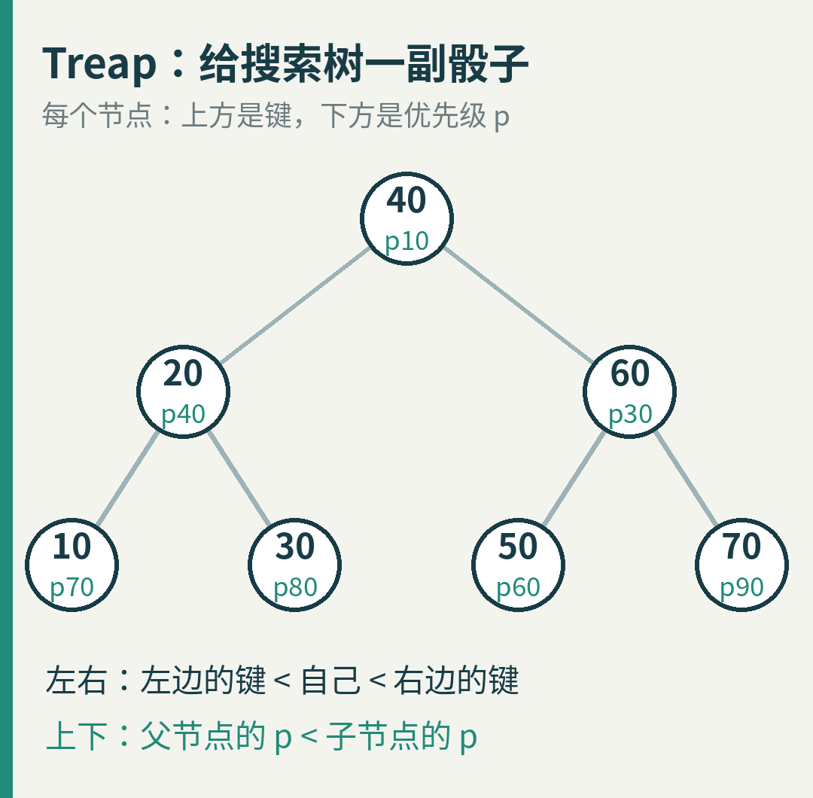
图1：贯穿全文的七键例子。圆内上方是键，下方 p 是稍后要用的优先级；灰线表示父子连接。键负责左右次序，较小的 p 负责占据较高的位置。这是本文原创教学示意，不是历史截图或性能实测。

查找 50 时，先和根节点 40 比。50 较大，所以整个左子树都不用看；来到 60 后，50 较小，再向左；第三个节点就是 50。树的分叉帮我们排除了不可能的答案。

但 BST 规则只管大小，没有规定树长得多高。如果从空树开始，依次插入 10、20、30，一直插到 70，会怎样？10 先成为根；20 比它大，放右边；30 比前两个都大，继续向右。最终没有任何一次向左的机会。

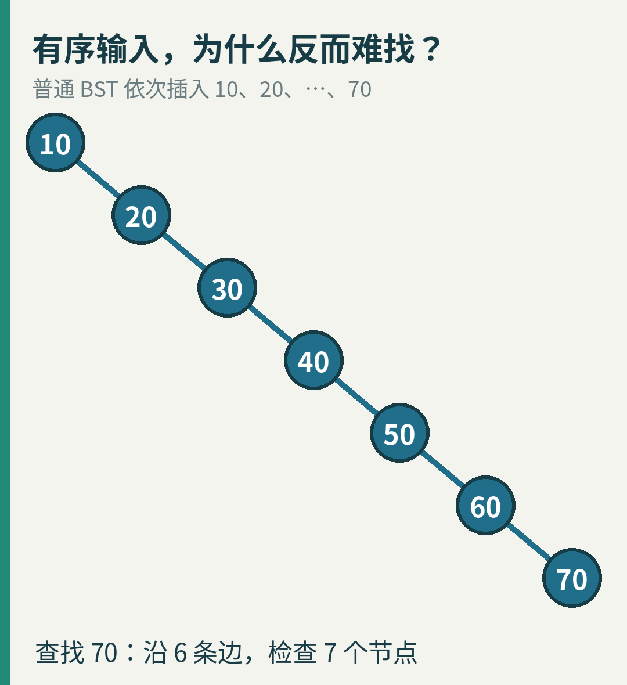
图2：普通 BST 按递增顺序插入七个键，形成一条右链。找 70 要经过六条边、检查七个节点。每个左子树都为空，因此这棵难用的树仍完全符合搜索规则。

如果有 n 个键，最后一个键就可能要检查 n 个节点，时间是 O(n)。问题不是数据错了，而是我们对树形管得太少。

一种办法是维护严格的平衡条件，例如 AVL 树或红黑树。Treap 选择另一条路：不直接计算“左右高度差多少”，而是在键之外，为每个节点增加一个随机优先级。

二、两套顺序，各管一件事

回到图1。我们固定使用这些“键：优先级”配对：

10：70；20：40；30：80；40：10；50：60；60：30；70：90。

这些小整数是为了方便手算而选定的例子，不是某个随机数生成器的采样记录。例子中的优先级互不相同。实际随机模型和碰撞问题稍后再讲。

现在增加第二条规则：父节点的优先级必须比孩子小。于是 40 的 p10 可以待在 20 的 p40 和 60 的 p30 上面，20 的 p40 又可以待在 10 的 p70 和 30 的 p80 上面。

这叫最小堆次序。这里借用的是“父亲不大于孩子”的次序约束，不是二叉堆那种必须按层填满的形状，也不要求用数组存储。Treap 中的左右两个孩子谁的优先级更小，不受额外限制。

本篇一律采用“优先级数字越小，地位越高”。1989 年论文采用相反的最大堆约定，数字越大越靠上；把所有优先级的比较方向一致地反过来，两种定义等价。不能只改插入判断，却忘了改合并判断。

Treap 把 tree 和 heap 的两种规则放进同一棵树：对键来说，它是搜索树；对优先级来说，它符合堆次序。查找时仍然只看键。

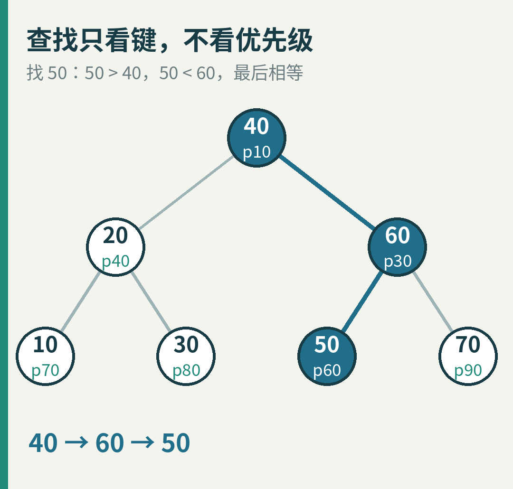
图3：蓝色路径是查找 50 实际检查的三个节点：40、60、50。优先级影响树怎样组织，却不参与“往左还是往右”的查找判断。

为什么这两条规则不会互相打架？可以先不用插入算法，直接构造一棵树：选优先级最小的节点做根；按它的键把其余节点分成左右两组；每组再重复同样的选择。

图1中，p10 最小，所以根只能是 40。左组 {10、20、30} 的最小优先级是 20 的 p40，右组 {50、60、70} 的最小优先级是 60 的 p30。继续下去，所有位置都被确定。

只要键和优先级各自互异，同一批配对只有一个合法树形。这件事很有用：保持配对不变，不论先插哪个键，最后都应该得到同一棵 Treap。改变插入顺序不应改变答案；改变随机优先级，则可能改变树形。

三、旋转不是把两个数字交换一下

找到一种合法树形，还不等于能方便地维护它。如果每插入一个键都从头重建整棵树，代价仍然很大。我们需要一种局部动作：把该上来的节点提上来，同时保住搜索规则。

1989 年论文第一幅图画的正是这个动作。

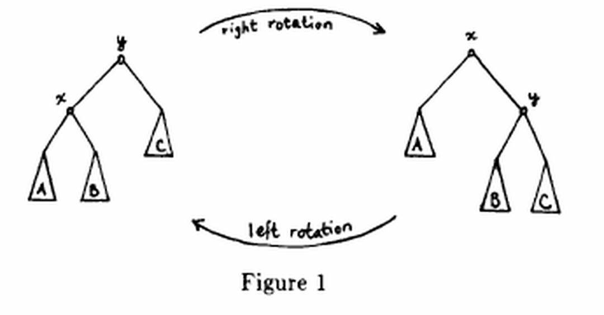
图4：Aragon 与 Seidel《Randomized Search Trees》（FOCS 1989）印刷页 540 的 Figure 1 局部原图。右旋把 x 提到 y 上方，子树 B 从 x 的右边转接到 y 的左边；反向是左旋。仅裁取原图并等比例放大，保留原始 Figure 1 标记，未重绘。© 1989 IEEE；为介绍、评论该原始图示所作的必要局部引用，未获得开放许可证或另行再授权。

先看图4左侧。把 x 左边整团节点叫 A，x 右边整团叫 B，y 右边整团叫 C。由于它原本是搜索树，键的顺序必须是：

A 中所有键 < x < B 中所有键 < y < C 中所有键。

右旋后，x 成为这块局部结构的新根，y 成为 x 的右孩子。A 仍在 x 左边，C 仍在 y 右边。真正需要小心的是 B：它不能继续占着 x 的右孩子位置，因为这个位置要交给 y；但 B 中的键既比 x 大、又比 y 小，正好应该成为 y 的左子树。

换成五个具体键，再看一次。图5是单独的 BST 旋转示范，不是图1整棵树的下一状态，所以暂时省略优先级。

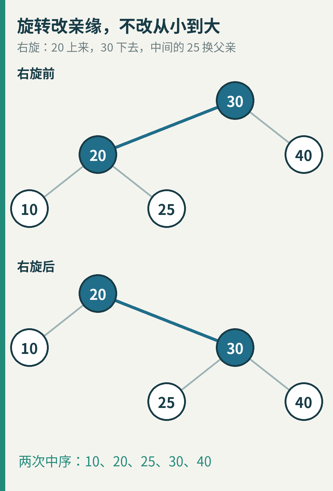
图5：右旋前后，20 与 30 改变父子关系，夹在两者之间的 25 从 20 的右边移到 30 的左边。按“左子树、自己、右子树”访问，两次都会得到 10、20、25、30、40。原创局部示意。

这种访问方式叫中序遍历。搜索树的中序结果是有序的。旋转保住的不是图上节点的高度，也不是父亲是谁，而是这条有序序列。

因此，旋转不应该只交换两个节点里的键。节点可能还绑定了业务对象、优先级与外部引用；真正要改的是少数父子指针。如果局部结构上面还有父亲，还必须让那个父亲指向旋转后的新根。

四、把 25 插进去：让一处错误往上走

现在回到图1的七键 Treap，插入新键 25，并给它优先级 20。记作 25:p20。插入有两个阶段，不能揉成一句“自动平衡”。

第一步完全按普通 BST 查找空位：25 小于 40，向左；大于 20，向右；小于 30，向左。30 的左孩子为空，于是把 25 放在那里。键顺序没有问题，但 p20 比父亲 30 的 p80 小，堆次序被破坏了。

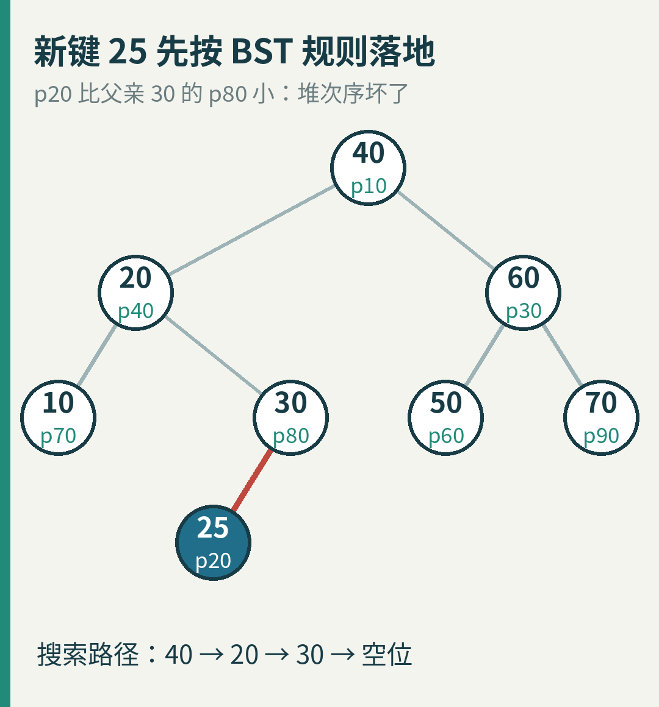
图6：25 先落到 30 的左边。红边指出当前违反堆次序的连接：父节点 p80 大于孩子 p20；其余原有边仍然合法。蓝色节点是新插入的 25。

第二步，让 25 越过这个父亲。因为它是 30 的左孩子，所以在 30 处右旋。25 上来，30 变成它的右孩子。

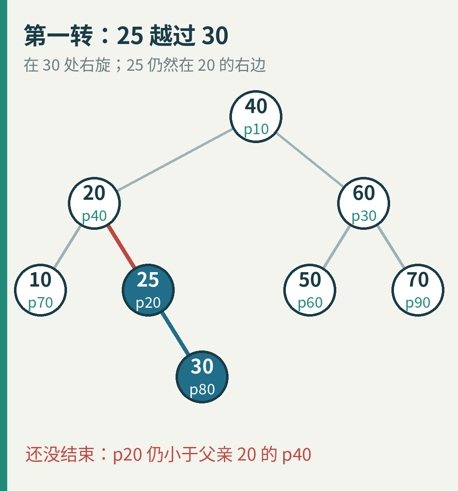
图7：第一次右旋修复了 25 与 30 的上下关系，但新父亲 20 的 p40 仍大于 25 的 p20。红边已经向上移动，说明局部修复还要继续。

这时 25 是 20 的右孩子，所以在 20 处左旋。25 再上升一层，20 变成它的左孩子。现在 25 的父亲是 40，父亲 p10 小于它的 p20，可以停止。

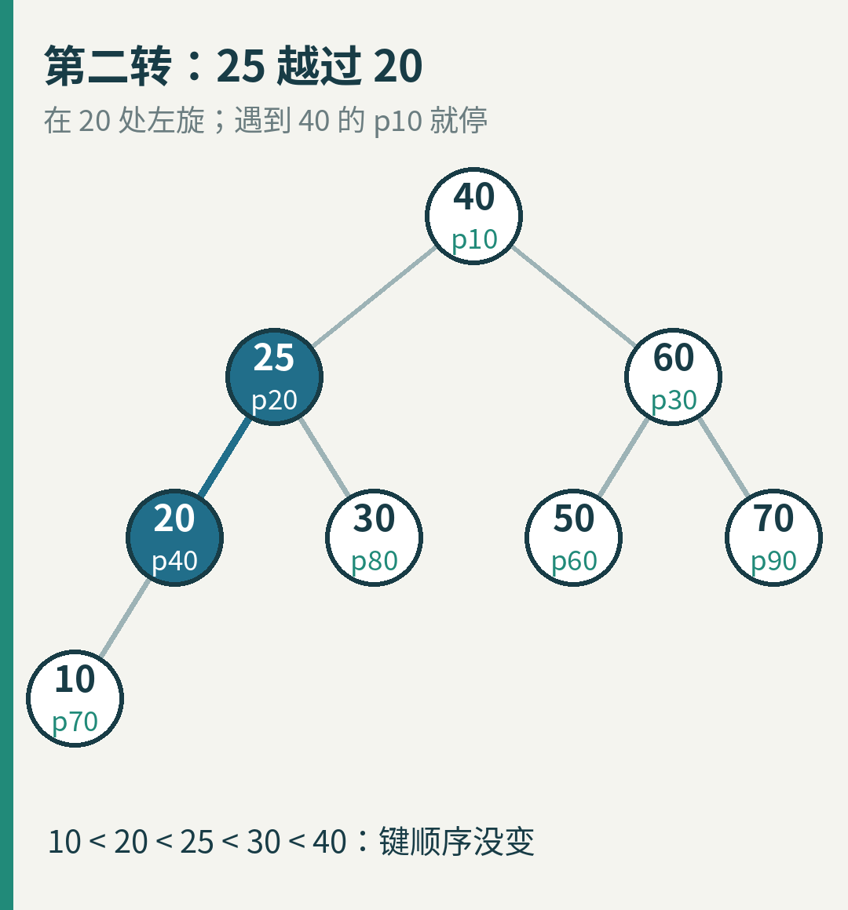
图8：第二次左旋后，25 成为 40 的左孩子；20 和 30 分居 25 两侧。整棵树重新同时满足搜索次序与最小堆次序，节点携带的键和优先级都没有改值。

为什么只需要盯着新节点向上的那条路径？原树的边已经符合堆次序，新加入的节点是唯一的变化。一次旋转让它越过不合格的父亲；转接过去的中间子树原本就排在旧父亲下面，不会凭空拿到更小的优先级。继续检查它和新父亲即可。

我们没有每一步都测量树高。旋转执行的是明确的局部次序规则，而不是看到“有点歪”就凭感觉调整。

五、删掉根以后，不必重新排全体节点

下面先撤销刚才的插入，重新使用图1的七键树。现在删除 40。

40 左子树里的所有键都小于 40，右子树里的所有键都大于 40。因此删除它后，剩下的工作是：把一棵全部装小键的树 L，和一棵全部装大键的树 R，合成一棵树。这种带有大小分界条件的操作叫 merge，原论文也称 join。

注意这个前提：L 的每一个键都必须小于 R 的每一个键。它不是“随便给两棵树就能求集合并集”的通用操作。

谁来做合并后的根？L 内最小的优先级就在 L 的根，R 内最小的优先级就在 R 的根。所以只需比较两个根，不必扫描全部节点。

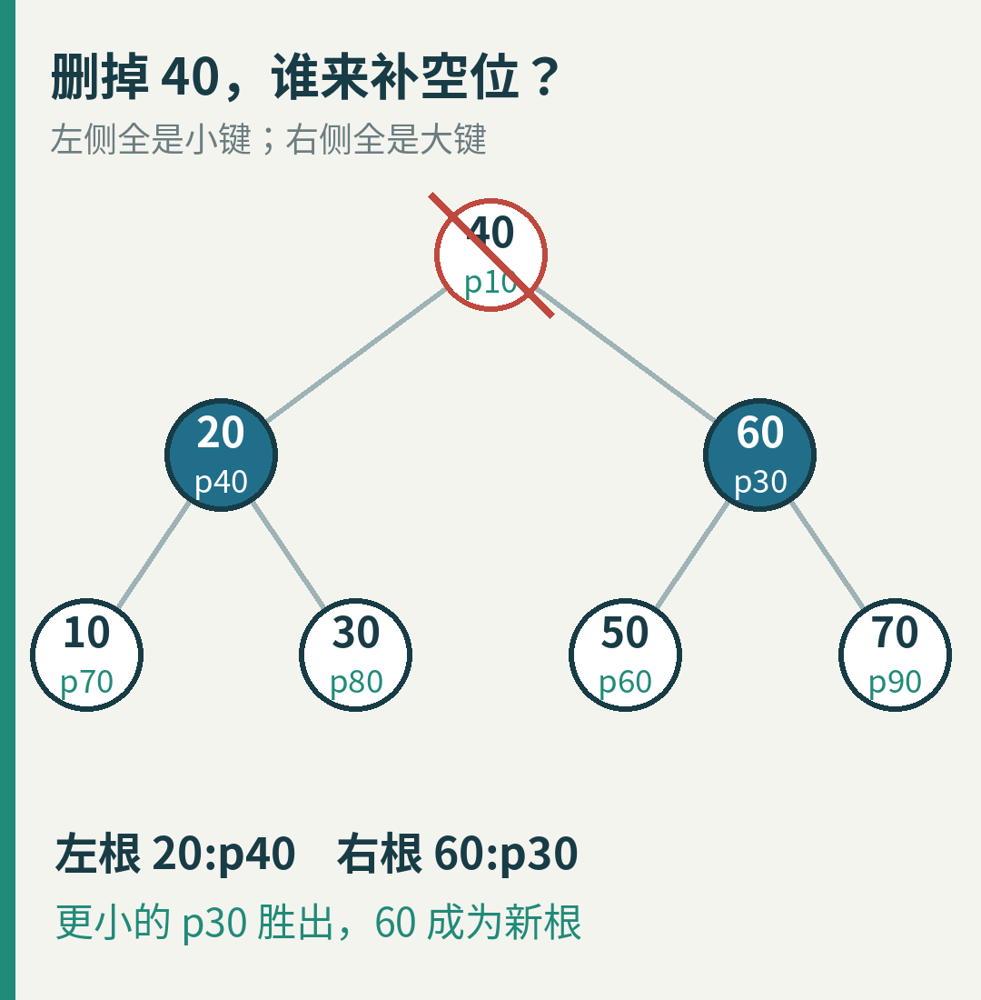
图9：删除 40 后，待合并的两棵树分别以 20:p40、60:p30 为根。p30 更小，因此新根只能是 60，而不是较小的键 20。划线仅表示删除目标，不表示连同子树一起丢弃。

既然选了 60，原来 60 的右子树仍然可以留在原位。变化发生在它的左边：那里要容纳整个 L，以及原本 60 的左子树 50。于是原问题缩小为 merge(20 所在的树，50 所在的树)。

这次 p40 小于 p60，选 20。20 的左子树 10 不动，只把 20 的右子树 30 与 50 继续合并。再比较 p80 和 p60，选 50；50 的左边接上剩下的 30，完成。

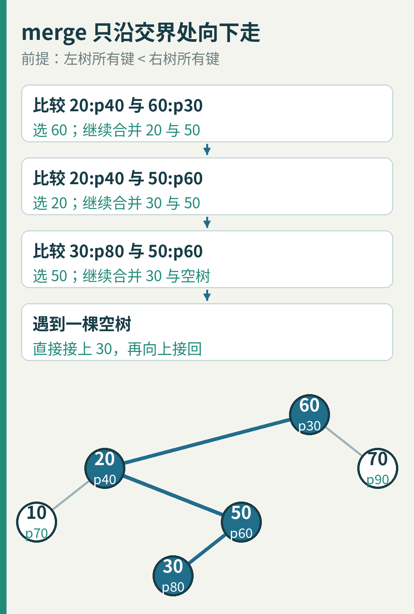
图10：删除 40 所需的合并依次选择 60、20、50，最后遇到空树而接上 30。下方是最终结果。只修改两棵树交界处的指针，10 与 70 等不在交界路径上的子树无需重建。

一般规则可以记成两句。若 L 的根优先级较小，保留 L 的根和左子树，把 merge(L 的右子树，R) 接到右边。若 R 的根优先级较小，就对称地保留 R 的根和右子树，把 merge(L，R 的左子树) 接到左边。任一输入为空，返回另一棵树。

因此删除任意键也不复杂：按键找到那个节点，用它左右子树的 merge 结果替换它。键不存在时不改树。论文还给出了把待删节点旋到叶子再移除的视角；本文的合并写法直接完成相同的边界重接，不要求真的制造一个“无限坏”的优先级。

六、split：不是拿刀横着砍树

再回到图1。假设我们想把所有小于 50 的键拿出来，另一份保留大于等于 50 的键。这叫 split。先把等号归哪边讲清楚，后面的代码才不会丢键或重复放键。

本文约定 split(T, a) 返回 L、R：L 的键严格小于 a，R 的键大于等于 a。a 本身可以不在树里。

从根 40 开始。40 < 50，所以 40 和它的整个左子树都属于 L；只有右子树里还有可能混着两边的键。进入右子树 60。60 ≥ 50，所以 60 和它的整个右子树属于 R；继续拆它的左子树 50。50 也属于 R，再向左便遇到空树。

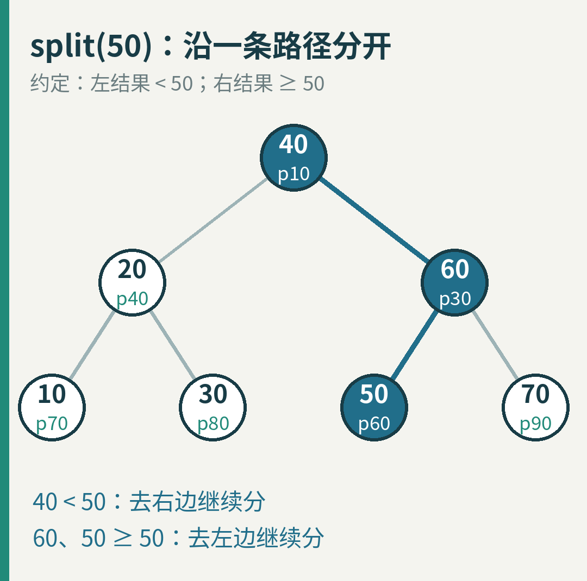
图11：按边界 50 分裂，递归只经过 40、60、50。路径外的整片子树已经能确定归属。蓝线是需要继续判断的路径，不是按图上几何位置画的一条切割线。

回来的时候，要把拆开的边接好。50 的左边仍为空；60 的左边仍接 50；40 原来指向 60 的右指针要断开，因为 60 及其剩余部分都属于另一边。

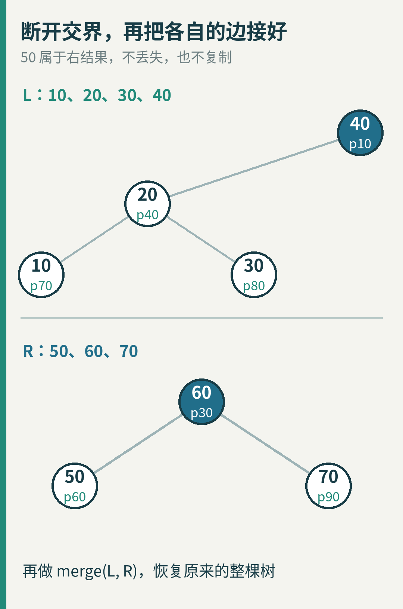
图12：分裂结果 L 有 10、20、30、40，R 有 50、60、70。两边各自仍是合法 Treap。保持所有键和优先级不变，再执行 merge(L, R) 会恢复图1的树形。

为什么重接后仍符合堆次序？例如 T 的键属于 L 时，我们只会从 T 原本的右子树中取出“也属于 L”的那部分接回去。那部分的根原本就是 T 的后代，优先级比 T 大；不会突然变成一个应该压在 T 上面的节点。键的大小关系也同样继承下来。

split 与 merge 组合起来，还能截取一段键的区间：先按下界分一次，再对右边按上界分一次。这样得到区间前、区间内、区间后三棵树。要恢复时依大小顺序合并。本文说的是按显式键划分；按“第几个元素”分裂的隐式 Treap 还需要维护子树大小，不是无条件换一个参数名就完成。

常见的短小实现会原地修改指针。调用 split 以后，原来的 T 不再是一棵可以继续当作完整旧树使用的独立副本。如果想同时保留新旧版本，需要额外的持久化设计或复制策略。

七、骰子究竟帮了什么忙？

到这里，我们只是证明了两条次序规则可以维护。尚未解释：随机优先级为什么值得增加？

关键不是某一个随机数大不大，而是全体优先级的相对顺序。先想象一种理想模型：每个新键得到一个与键无关、独立地从同一个连续分布抽出的优先级。连续模型下相等的概率为零。

按优先级从小到大，把这些键插进一棵普通 BST，会得到同一棵 Treap：最小优先级先成为根，其余键按大小进入两边，然后递归重复。因为各个优先级对称，任何一个键都有同样机会排第一，所有相对排列也等可能。这相当于把“普通 BST 遇上随机插入次序”的树形分布带进了数据结构内部。

实际输入即使是 10、20、30……这样整齐的顺序，也不再自动决定谁当祖先。我们并不是假定用户会随机输入，而是自己为结构提供随机性。

要看清期望为什么是对数级，可以只研究一个键。假设键按大小排成 x1、x2、……、xn，目标是第 k 个键 xk。另一个键 xi 何时会成为 xk 的祖先？

答案只取决于两者之间的闭区间：xi 必须是这个区间里优先级最小的节点。

理由是，区间外先成为祖先的节点只能把这整个区间一起留在某一侧。不断向下，区间内最先被选为根的节点就是其中优先级最小者。如果这个节点恰好是 xi，xk 会留在它下面；如果是中间的另一个节点，xi 和 xk 被分到不同侧；如果是 xk，xi 更不可能反过来成为它的祖先。

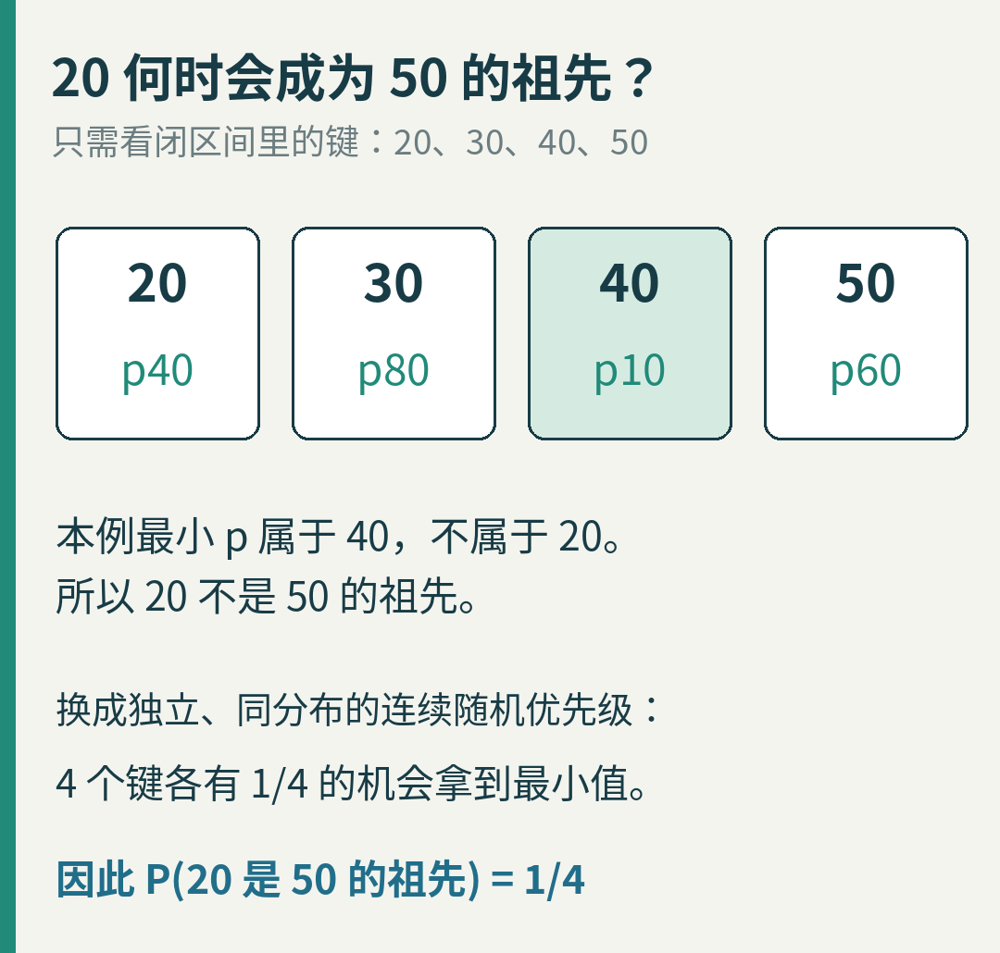
图13：比较 20 与 50，只看 {20、30、40、50}。固定例子中 p10 属于 40，所以 20 不是 50 的祖先；在独立、同分布的连续随机优先级模型中，四个键各有四分之一的机会取得区间最小值，因此 20 成为 50 祖先的概率是 1/4。

如果两者在有序表里相隔 d 个位置，闭区间一共有 d+1 个键，所以这个概率是 1/(d+1)。越远的键，成为目标祖先的机会越小。

一个节点的深度，正是它有多少个祖先。本篇把根的深度记为 0，也就是从根到它经过的边数。我们可以给每个其他键记一个小账：它是祖先就记 1，不是就记 0；把所有账加起来就是深度。期望可以逐项相加，不需要这些“是不是祖先”的事件彼此独立。

以七个键中的 40 为目标。左侧 30、20、10 的贡献依次为 1/2、1/3、1/4，右侧对称。

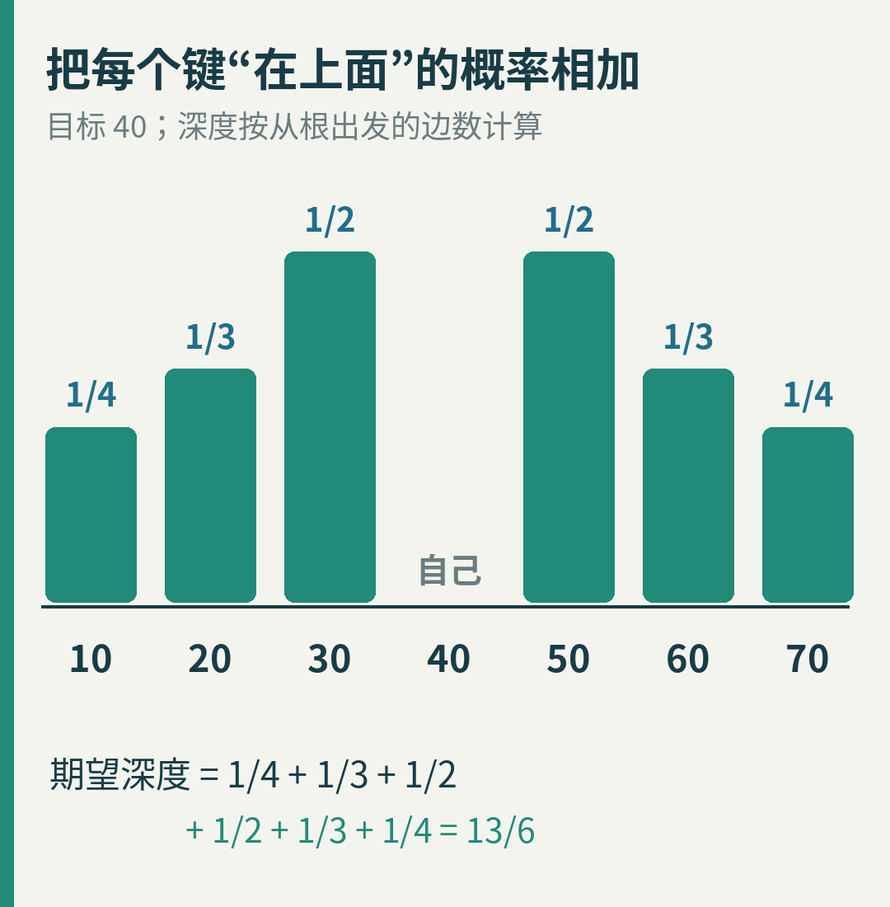
图14：在七键的随机优先级模型下，目标 40 的期望深度为 2×(1/2+1/3+1/4)=13/6，约 2.17。柱高表示成为祖先的概率，不是程序运行时间；它也不是图1那一棵固定树的深度。图1中 40 恰好是根，实际深度为 0。

一般情况下，把 Hm 定义为 1+1/2+……+1/m，就有：

第 k 个键的期望深度 = Hk + H(n-k+1) - 2。

Hn 增长很慢。把分母按 1、2～3、4～7、8～15……分组，每一组的和至多为 1，而组数只有对数级。因此 Hn 是 O(log n)，期望查找路径也是 O(log n)。成功查找要检查的节点数比边数多 1。

插入先走查找路径，再修复局部次序；删除、分裂与合并也沿相关路径进行。在上述随机模型及适用的操作序列条件下，它们有对数级期望代价。合并两棵树时，可以写成 O(log(n+1)+log(m+1))，这里 n、m 是两棵输入树的大小。

1989 年论文还分析了更新所需的旋转数：一次插入或删除的期望旋转次数小于 2。这不等于更新总共只花常数时间，因为找到位置还要走路径；也不等于任意一次更新最多转两次。我们的两次旋转小例子，与这个平均性质并不冲突。

八、三种容易误读的“随机”

第一种误读是：期望 O(log n)，就意味着每次都这么快。

假设优先级恰好随着键递增。最小键拿到最小优先级，必须做根；剩下的最小键又必须做右子树的根。结果会重新长成一条链。

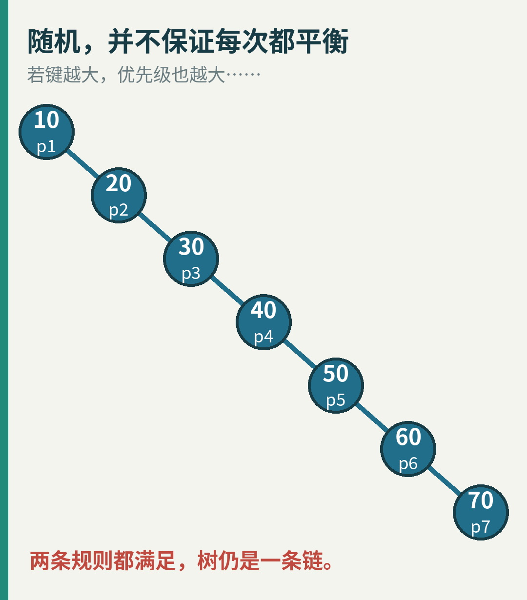
图15：键 10～70 分别配优先级 1～7，形成一棵完全合法但高度为六条边的 Treap。搜索次序和堆次序都正确；随机化的期望保证并不排除某次 O(n) 的坏形状。这是构造的边界例，不是随机实验统计。

在七个互异优先级的全部相对排列中，图15这种指定的递增排列只占 1/7!，也就是 1/5040。但不要把它误说成“所有链形的总概率”，其他优先级排列也可能产生链形。坏例少不少与绝对不会出现，是两回事。

第二种误读是：随便找个看起来乱的数，就已经满足证明条件。

实际机器一般用有限位整数，不会真的抽出无限精度实数。两个节点可能抽到同一优先级。实现必须定义平局规则，否则“谁应该在上面”会含糊。

一种明确的约定是按二元组比较：(随机整数，唯一编号)。先比较随机整数，碰撞时再比较唯一编号。编号必须在会合并的那些节点之间也保持唯一，不能两棵树各从 0 计数却不做区分。

这能恢复严格的全序，保证算法知道怎样连边；却不能自动恢复理想随机分布。假如所有随机整数都一样，排序就完全由编号决定，树仍可能严重偏斜。更大的随机空间能降低碰撞概率，正确处理碰撞是必要的，随机源质量与分布假设则是另一件事。

重复键也要有自己的约定，不能让它和优先级碰撞混在一起。本篇把 Treap 当集合：再次插入已有键时保持原节点和原优先级不变，删除不存在的键不改变树。如果要存多重集合，可以在一个键上维护计数，或把“键、唯一编号”一起当搜索键；随后查找、分裂边界与删除语义都得相应说明。

第三种误读是：随机化能无条件挡住知道内部情况的对手。

1989 年论文在讨论适用条件时，专门提醒了优先级对使用者隐藏的重要性。若对手看见优先级后再选择保留、删除哪些键，就可能筛出高度偏斜的集合；若可预测随机生成序列，还可能把键的选择和优先级关联起来。这样的过程不能直接套用“固定键集合获得独立随机优先级”的推导。

普通伪随机数生成器通常适合可复现测试，不应因此被当作对抗攻击的安全措施。生产系统面对不可信输入时，需要结合威胁模型审视随机源、内部信息泄露与可操纵的操作；如果必须给出每次操作的严格时限，就应考虑具有最坏情况保证的平衡树，而不是把“平均很好”改写成承诺。

九、真的写出来时，先检查什么

Treap 的短代码容易让人低估接错一根边的后果。图画得像树，不代表内存里没有环，也不代表删键时没有误丢一个子树。

至少应检查三类性质：

- 搜索性质：每个节点都在祖先规定的键区间里，不能只和直接孩子比较大小。
- 堆性质：每条父子边都满足同一种优先级比较规则。
- 内容性质：中序结果必须恰好等于参考集合的排序结果，既不多键，也不少键。

还可以利用前面的唯一树形性质做逆操作检查：split 后按原顺序 merge，应恢复同一棵树；插入一个新键，再删除它，应恢复原树。如果删除已有键后又给它抽了一个新的优先级再插回去，则不能要求原树形不变。

本文配套校验实现实际跑过：固定配对的全部 5040 种插入次序；12 个含已有键、缺失键和范围外边界的 split/merge 测试；以 Python 集合为参考的 10000 步混合操作；空树、单节点、重复插入、缺失删除以及随机分量全部碰撞的边界。另枚举七键的全部 5040 种优先级相对排列，得到第 4 个键的平均边深度恰好为 13/6。

这些检查能帮助发现例子和实现错误，不能代替一般证明，也不是实际产品的速度基准。递归实现还会使用调用栈：随机模型下路径通常较短，但最坏情况仍可达到 n 层，不能忽略语言的递归深度限制。若维护子树大小、区间和等附加信息，旋转和重接后也必须按依赖顺序更新；本文的基础集合实现没有加入这些功能。

最后留一个可以在纸上验证的问题：对图1做 split(35)，结果会是什么？

左边应当是以 20 为根、10 和 30 为孩子的三键树。右边以 40 为根，右孩子仍是 60，60 下面还是 50 与 70；40 的左边为空。35 不在树里，没有关系。分裂找的是大小边界，不是必须存在的节点。

再把两边合回去，你会重新得到图1。走到这里，Treap 就不再只是一个“tree 加 heap”的名称：你已经知道随机数怎样决定祖先，旋转为什么不毁掉查找，指针怎样沿分界重接，以及一份期望保证究竟没有承诺什么。

十、可以自己运行的完整小实验

把下面代码保存为 treap_lab.py，用 Python 3.10 或更新版本运行 python treap_lab.py。只用标准库，不需要安装依赖。运行后会输出每类检查的实际次数与精确期望值；如果某个性质不成立，assert 会在对应位置报错。

先看 Node、insert、split、merge 和 erase，前面的每一幅状态图都能找到相应指针操作。validate 是用来检查树的辅助函数，不能把它每一步遍历全树的成本算成 Treap 本身的操作成本。run_tests 刻意用很小的例子穷举，再做固定种子的混合校验，不代表对全部输入的证明，也不是速度测试。

这里的优先级由调用者传入，方便复现课文中的每一个数。真正的随机整数只在测试部分产生；生产使用时还必须落实前面讨论的唯一编号和随机源选择。代码采用会修改原节点的版本，不保留旧版本快照。

```python
"""Self-contained teaching Treap and invariant tests. Python 3.10+, stdlib only.
Keys are distinct integers; smaller (random_priority, unique_id) wins.
This code uses mutable nodes. split/merge consume their input structure.
Not a production or cryptographically secure implementation.
Run: python treap_lab.py
"""
from __future__ import annotations
from dataclasses import dataclass
from itertools import permutations
import json
import random
from fractions import Fraction
from pathlib import Path

@dataclass
class Node:
    key: int
    priority: tuple[int, int]
    left: Node | None = None
    right: Node | None = None

def rotate_right(t):
    q = t.left
    assert q is not None
    t.left, q.right = q.right, t
    return q

def rotate_left(t):
    q = t.right
    assert q is not None
    t.right, q.left = q.left, t
    return q

def insert(t, key, priority):
    if t is None:
        return Node(key, priority)
    if key == t.key:
        return t  # Set semantics: keep the existing node and its priority.
    if key < t.key:
        t.left = insert(t.left, key, priority)
        if t.left.priority < t.priority:
            t = rotate_right(t)
    else:
        t.right = insert(t.right, key, priority)
        if t.right.priority < t.priority:
            t = rotate_left(t)
    return t

def contains(t, key):
    while t is not None:
        if key == t.key:
            return True
        t = t.left if key < t.key else t.right
    return False

def split(t, boundary):
    """Return keys < boundary and keys >= boundary; destructive."""
    if t is None:
        return None, None
    if t.key < boundary:
        t.right, right = split(t.right, boundary)
        return t, right
    left, t.left = split(t.left, boundary)
    return left, t

def merge(left, right):
    """Destructive join. PRECONDITION: every left key < every right key.
    All node priority pairs across both inputs must be distinct.
    """
    if left is None:
        return right
    if right is None:
        return left
    if left.priority < right.priority:
        left.right = merge(left.right, right)
        return left
    right.left = merge(left, right.left)
    return right

def erase(t, key):
    if t is None:
        return None
    if key == t.key:
        return merge(t.left, t.right)
    if key < t.key:
        t.left = erase(t.left, key)
    else:
        t.right = erase(t.right, key)
    return t

def inorder(t):
    return [] if t is None else inorder(t.left) + [t.key] + inorder(t.right)

def signature(t):
    if t is None:
        return None
    return (t.key, t.priority, signature(t.left), signature(t.right))

def validate(t, model, priorities):
    seen_nodes, seen_priorities = set(), set()
    def visit(n, lo, hi):
        if n is None:
            return []
        assert id(n) not in seen_nodes, 'Cycle or shared node'
        seen_nodes.add(id(n))
        assert lo < n.key < hi, ('BST violation', n.key, lo, hi)
        assert n.priority == priorities[n.key], 'Priority changed'
        assert n.priority not in seen_priorities, 'Priority-pair collision'
        seen_priorities.add(n.priority)
        for child in (n.left, n.right):
            if child:
                assert n.priority < child.priority, 'Heap violation'
        return visit(n.left, lo, n.key) + [n.key] + visit(n.right, n.key, hi)
    keys = visit(t, float('-inf'), float('inf'))
    assert keys == sorted(model), ('Content mismatch', keys, model)
    return len(keys)

def build(items):
    t = None
    for key, priority in items:
        t = insert(t, key, priority)
    return t

def depth(t, key):
    d = 0
    while t:
        if key == t.key:
            return d
        t = t.left if key < t.key else t.right
        d += 1
    raise KeyError(key)

def run_tests():
    fixed = {10:(70,0),20:(40,1),30:(80,2),40:(10,3),50:(60,4),60:(30,5),70:(90,6)}
    t = build(fixed.items())
    validate(t, set(fixed), fixed)
    assert t.key == 40 and t.left.key == 20 and t.right.key == 60
    original = signature(t)
    fixed[25] = (20,7)
    t = insert(t,25,fixed[25]); validate(t,set(fixed),fixed)
    assert t.left.key == 25 and t.left.left.key == 20 and t.left.right.key == 30
    t = erase(t,25); del fixed[25]
    validate(t,set(fixed),fixed); assert signature(t)==original
    t = erase(t,40)
    validate(t,set(fixed)-{40},fixed)
    assert t.key==60 and t.left.key==20 and t.left.right.key==50 and t.left.right.left.key==30
    # All insertion orders with fixed priorities give exactly the same shape.
    canonical = signature(build(fixed.items()))
    order_checks = 0
    for order in permutations(fixed):
        t=build((k,fixed[k]) for k in order)
        validate(t,set(fixed),fixed)
        assert signature(t)==canonical
        order_checks += 1
    # split/merge inverse, existing/missing/min/max/outside boundaries.
    split_checks = 0
    for boundary in [-100,10,11,20,25,30,35,40,50,70,71,100]:
        t=build(fixed.items())
        l,r=split(t,boundary)
        validate(l,{k for k in fixed if k<boundary},fixed)
        validate(r,{k for k in fixed if k>=boundary},fixed)
        assert signature(merge(l,r))==canonical
        split_checks+=1
    assert split(None,0)==(None,None) and merge(None,None) is None
    assert erase(None,5) is None and not contains(None,5)
    t=Node(1,(0,0)); assert signature(insert(t,1,(-999,99)))==signature(t)
    assert erase(t,1) is None
    # Deliberately collide every random component, resolved only by unique IDs.
    coll={k:(0,k) for k in range(30)}
    t=build(coll.items()); validate(t,set(coll),coll)
    assert depth(t,29)==29  # Correctness does NOT imply balanced shape.
    # Against a Python set over mixed operations, including duplicates/misses.
    mixed_steps=0
    for seed in range(20):
        rng=random.Random(seed); t=None; model=set(); ps={}; serial=0
        for step in range(500):
            k=rng.randrange(-30,31); op=rng.randrange(4)
            if op==0:
                p=(rng.randrange(0,8),serial); serial+=1
                t=insert(t,k,p)
                if k not in model: ps[k]=p; model.add(k)
            elif op==1:
                t=erase(t,k); model.discard(k); ps.pop(k,None)
            elif op==2:
                assert contains(t,k)==(k in model)
            else:
                before=signature(t); l,r=split(t,k)
                validate(l,{x for x in model if x<k},ps)
                validate(r,{x for x in model if x>=k},ps)
                t=merge(l,r); assert signature(t)==before
            validate(t,model,ps); mixed_steps+=1
    # Exhaust all 7! relative-priority orders: exact expected depth of rank 4.
    total_depth=0; priority_orders=0
    for order in permutations(range(7)):
        ps={k:(order[k],k) for k in range(7)}
        t=build(ps.items()); total_depth+=depth(t,3); priority_orders+=1
    expected=Fraction(total_depth,priority_orders)
    assert expected==Fraction(13,6)
    return {'result':'PASS','fixed_example':'PASS','insertion_orders':order_checks,
      'split_merge_boundary_cases':split_checks,'mixed_operations':mixed_steps,
      'priority_orders_enumerated':priority_orders,'rank4_expected_edge_depth':str(expected),
      'collision_test':'all random parts identical; unique IDs retain correctness; height degenerates',
      'not_a_benchmark':True,'python_random':'deterministic test generator, not security RNG'}

if __name__=='__main__':
    result=run_tests()
    print(json.dumps(result,ensure_ascii=False,indent=2))
```

来源、历史与素材说明

1. Cecilia R. Aragon 的 Treaps 资料页：https://faculty.washington.edu/aragon/treaps.html 。用于确认作者给出的定义及 1989 会议版、1996 期刊版的版本区分；未把网页上的应用举例当成本篇实测。
2. Cecilia R. Aragon、Raimund G. Seidel，《Randomized Search Trees》，FOCS 1989，作者提供的原论文：https://faculty.washington.edu/aragon/pubs/rst89.pdf 。本次核读到六页扫描，印刷页码 540～545；定义、旋转、插入删除及 split/join 见第 2 节，随机模型、期望界与对手条件见第 3 节，分析见第 4 节。
3. 历史归因不要省掉前身。1989 年论文第 2 节的脚注指出，Jean Vuillemin 在 1980 年介绍过同样的结构，称为 Cartesian tree；也提及“treap”一词曾被 Ed McCreight 用于另一种结构。因此本文把 Aragon 与 Seidel 的贡献表述为这里核读的随机化搜索树方案与分析，而不宣称他们在 1989 年从无到有发明了所有相关树结构。上述前身说明来自该论文脚注，本篇未独立核读 1980 年原文。
4. 图4为原论文中一幅必要局部图示的引用，权利仍属相应权利人，不属于公共领域，也没有以 CC 授权给本文。其他图为针对本篇小例子新作的程序绘图，均是教学模型，不冒充历史图、产品截图或真实性能结果。原创正文与图片的许可范围见文末说明。
5. 正文中的固定优先级由讲解需要选定，测试中的伪随机序列只服务于可复现校验。

---

[来源、AI 辅助与许可范围](sources.md)
