# 三个数字，为什么比一个时间戳多知道这么多？

你在A机器上改了一份配置，B机器转发了它，C机器随后执行任务。日志里的时间写着先后，但C到底有没有机会读到A的修改？这是“几点几分”之外的另一个问题。

上一篇标量逻辑时钟处理过“必须先发生的事，编号就应更小”。这篇不重写它，而是追问反方向：编号更小，能不能说明前者的信息确实有机会到达后者？先给答案：一个数字不够；在下面固定成员、通信被完整记录的模型里，一列数字可以。

## 1．先把我们说的“先”画出来
固定三个进程A、B、C，每个进程内部事件排成一条顺序。发送和接收各算独立事件，内部计算也算事件。我们把十件事依次编号e1到e10；这个编号只是模拟器选择的一次合法调度，不是远程机器共同拥有的时间。

同一进程的前一个事件先于后一个；一条消息的发送先于对应接收；两条这样的关系可以接起来。除此之外，不偷偷添加关系。这个关系就是本文的happens-before，用“→”表示。

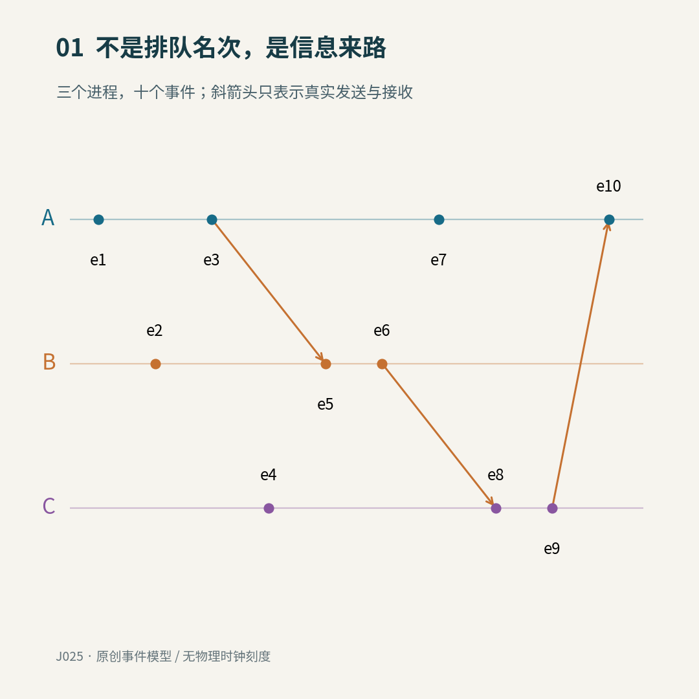

图1｜三条本地顺序与三条消息边构成主实验；横向位置只服务排版，不是秒数。

## 2．路径可以拐弯
A在e3把消息x发给B。B在e5接收，e6再把y发给C，C在e8接收。于是e3→e5→e6→e8。C不用直接接到A的包，也能处在A这次发送的因果后方。

“有机会影响”不等于“内容确实影响”：B可能收到配置却完全没使用它。我们在这里判断通信和程序顺序形成的结构，不分析每一位业务数据的依赖。如果系统还有未记录的共享文件、人工操作或另一个通信通道，这张图就没有完整描述系统，结论也只能限于被记录的模型。

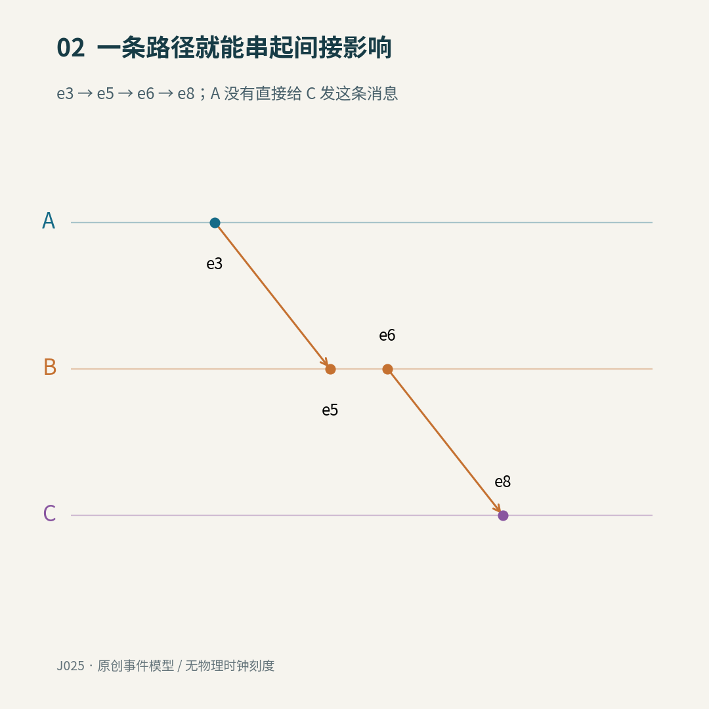

图2｜A的发送事件e3沿B再到C，信息经转发形成传递因果。

## 3．标量哪里不够？用一个反例就够了
给每个进程一个从0起步的整数L。每个事件加1；接收先把L和消息携带的L取大，再加1。这个规则保证沿因果路径数字增加。

看主实验：C的e4是它第一个本地事件，L=1；A的e3是它第二个事件，L=2。但e4到e3没有路径，反向也没有。1<2是真的，“e4导致e3”却推不出来。

两件事在这张图上互相不可达，我们称它们并发。并发不是“在同一纳秒发生”，更不是“两个CPU真的同时执行”。模拟器完全可以一件一件执行它们，只要没有额外因果边，这个偏序判断就不变。

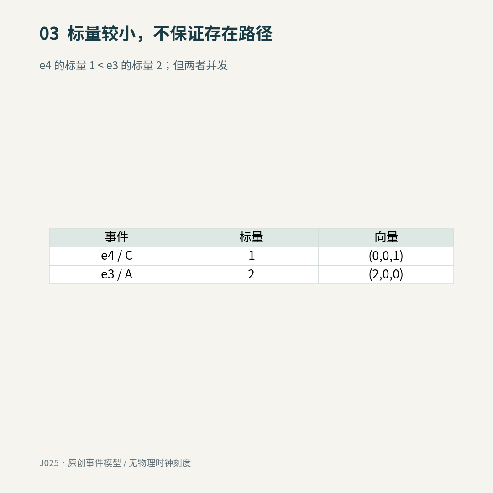

图3｜主实验中e4与e3无因果路径，标量大小不是充分证据。

## 4．给每个进程留一格
现在每个进程保存三个整数，固定次序为(A,B,C)，最初都是(0,0,0)。在A发生事件，只把第一格加1；B动第二格；C动第三格。

例如B处的(2,3,0)可以读成：截至这个事件，A前两个事件、B前三个事件已经处在它的因果过去中，或就是事件自身；C还没有任何事件通过模型内路径传到这里。它不是在广播“全世界现在只做了这些事”。A可能已经偷偷走到第五步，只是B尚未收到相关信息。

为什么是前缀而不是散乱集合？同一进程内部有顺序：知道A的第2件事沿路径到来，也就把A第1件事纳进来了。一格整数因此能代表一整段本地历史。

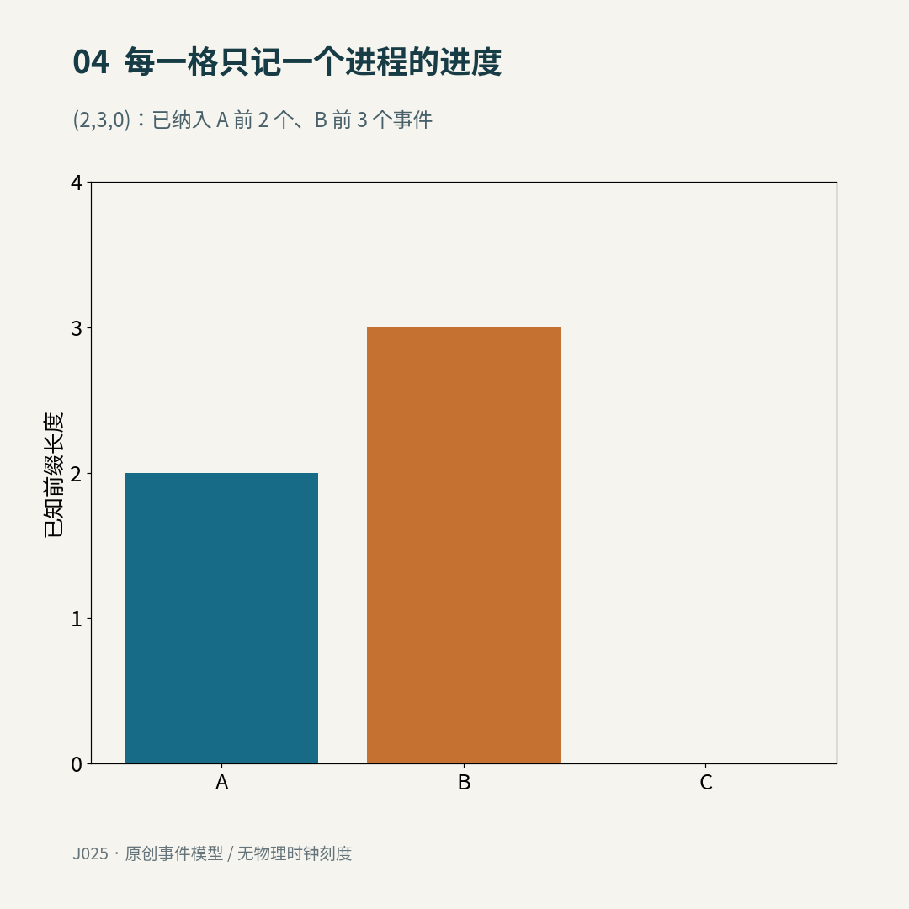

图4｜e6的向量(2,3,0)不是全局最新状态，而是它的因果过去加自身。

## 5．收消息时，别把知识覆盖掉
发送先记录发送事件的本地加1，再携带当前向量的不可变副本。接收时，我们约定先逐分量取最大值，再把接收者自己的格加1，并给接收事件打这个最终时间戳。

B原来是(0,1,0)，收到A发来的(2,0,0)。逐格max得到(2,1,0)，再记一次B接收事件，得到(2,2,0)。直接把本地向量替换成消息会把B已经知道的本地历史抹掉；把所有格都加1则会凭空编造别的进程的新事件。

这个顺序是本文程序的明确约定。原文也讨论“先tick再同步”的写法；在不允许伪造未来计数的标准模型里，消息中关于接收者自己的格不会超过它已经完成的本地计数，因此这两种写法可得到同一最终值。不能脱离这个前提，对任意外部数组随意交换步骤。

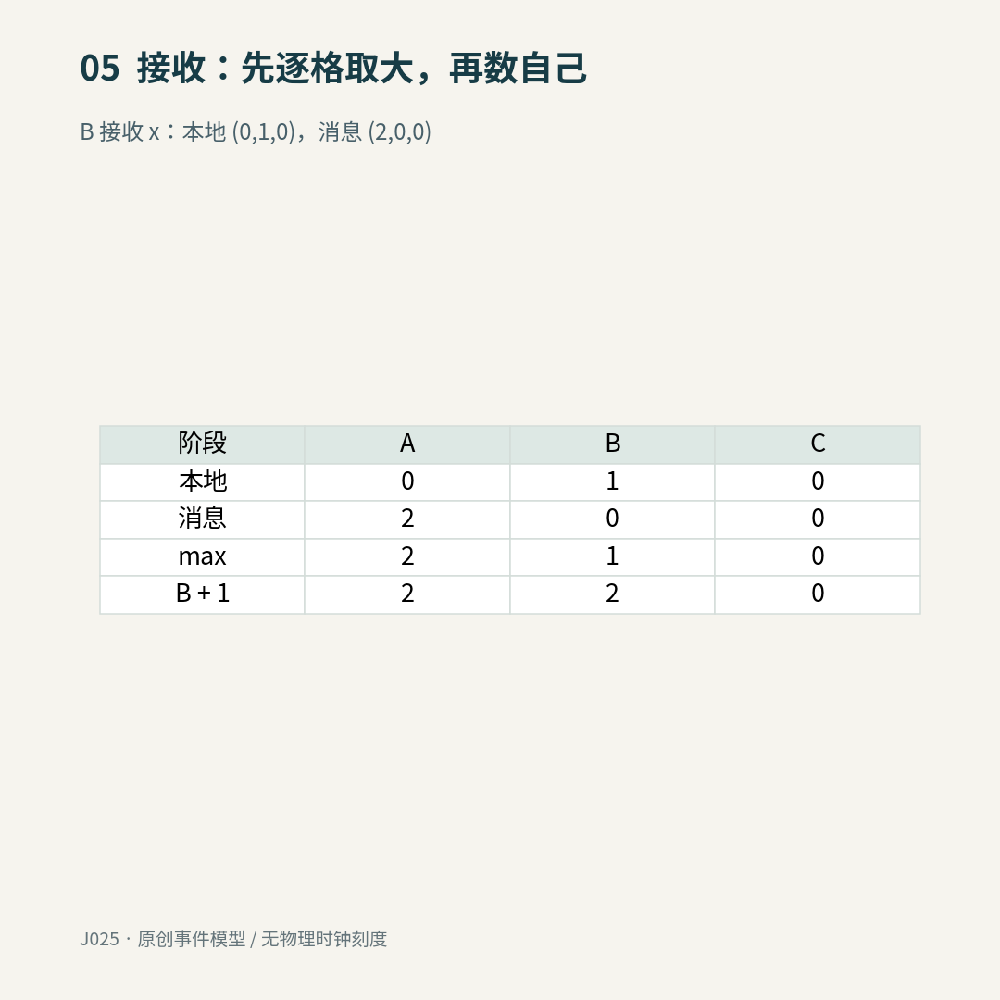

图5｜e5接收先合并得到(2,1,0)，再把B分量加一得到(2,2,0)。

## 6．把整条链算完
e6发送y时，B的向量为(2,3,0)。C本来有(0,0,1)，接收y后得到(2,3,2)。注意第二格是3，不是只记“B刚发了一次”：消息携带了B此刻已有的整段知识。

e7是A稍后的本地事件，得到(3,0,0)。e8仍然只有A的前两件事，说明e7与e8并发。再往后，C在e9发送z，向量(2,3,3)；A收到时先合并已有(3,0,0)，再记自身，得到e10的(4,3,3)。把这几行手算一遍，比记住术语更重要。

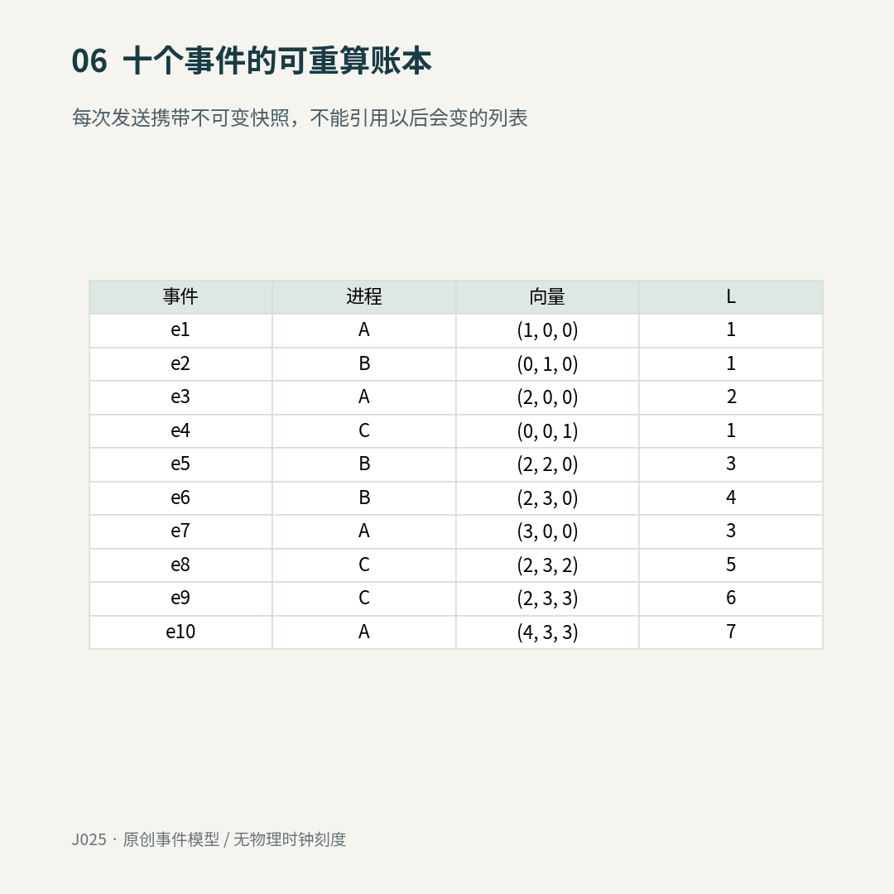

图6｜主实验完整输出：每个事件向量均唯一，接收包含消息知识并记录自身。

## 7．严格小于，不是逐格都严格小于
定义u≤v：每一格u都不超过v。定义u<v：u≤v，而且至少一格严格更小。

因此(2,0,0)<(2,2,0)，虽然第一格相等。如果误写成每格都必须小，就会漏掉真实因果。

再看(3,0,0)与(2,3,2)：第一格前者更大，后两格后者更大，谁也没包含谁的全部前缀，它们不可比较。对于本模型中两个不同事件，这正好对应并发。相同向量作为一般输入表示相等，不能直接叫两个不同事件并发；正确模型会给不同事件不同的向量。程序的before只判断严格偏序，其输入前提是两个同维的合法非负整数向量，不是任意Python对象。

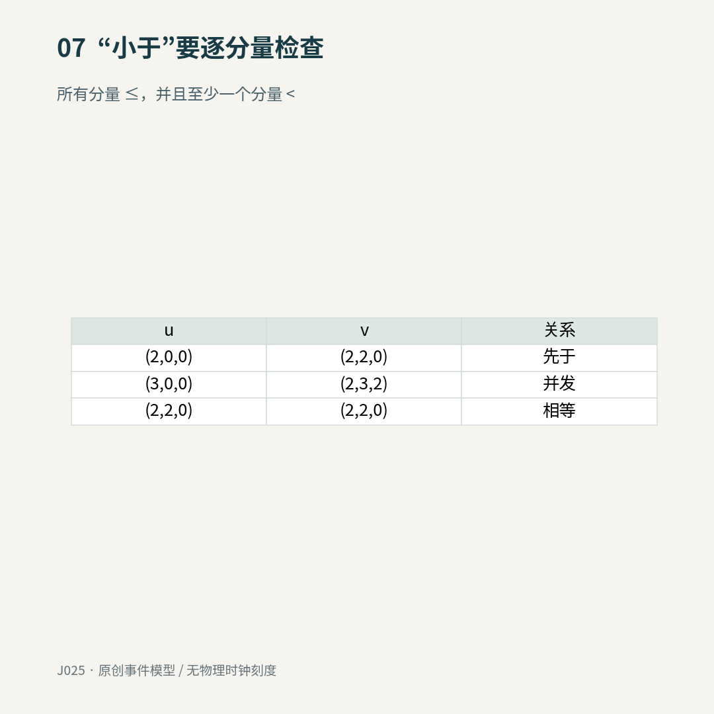

图7｜相等不是严格先于；跨分量一大一小才给出不可比较反例。

## 8．为什么这次反方向也成立？
下面是本模型的一份简短论证，不借助物理时钟。

首先保持一个不变量：某事件向量的第i格，等于它的因果过去加自身中，第i个进程最大的本地事件序号，没有则为0。本地事件让自己的前缀延长一格；接收把本地已有过去与发送者的过去合起来，逐格max正是取前缀并集。用事件顺序归纳就能维持这个不变量。

若a→b，知识沿路径只增不减；b还包含路径末端的新事件，因此V(a)<V(b)。反过来，设a是进程i的第k件事。如果V(a)≤V(b)，那么V(b)[i]≥k，按不变量，a已在b的过去加自身里。再排除a=b，就有a→b。这就是向量的“多知道了一点”：在这些前提下，严格向量顺序与事件可达关系等价。

我们的检验没有拿向量给自己判卷。另一路代码只看本地邻接和发送接收边，用Floyd式传递闭包得到所有可达关系，再逐个事件对比较。图8中两种答案完全一致。

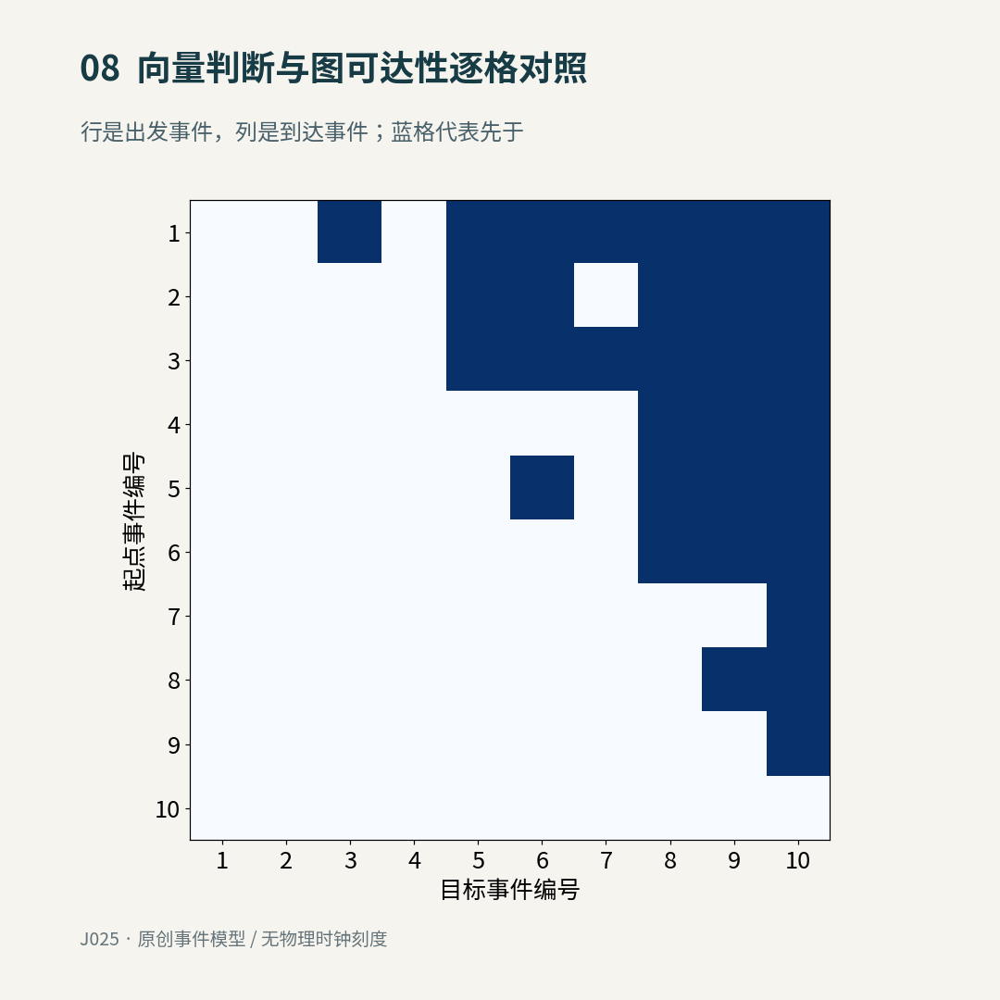

图8｜由本地边和消息边计算传递闭包；100个有序对与向量严格偏序完全一致。

## 9．并发不是可以传下去的朋友关系
主实验中e1=(1,0,0)，e2=(0,1,0)，e3=(2,0,0)。e1与e2并发，e2与e3也并发，但e1→e3。

所以不能把“互相并发”分组后当作一个等价类，再想当然地说组内都独立；它不具传递性。也不能根据并发关系自动认定程序有bug：两个只读操作可能完全没问题，两个写不同对象的操作也未必冲突。向量告诉你结构，业务语义还要另外判断。

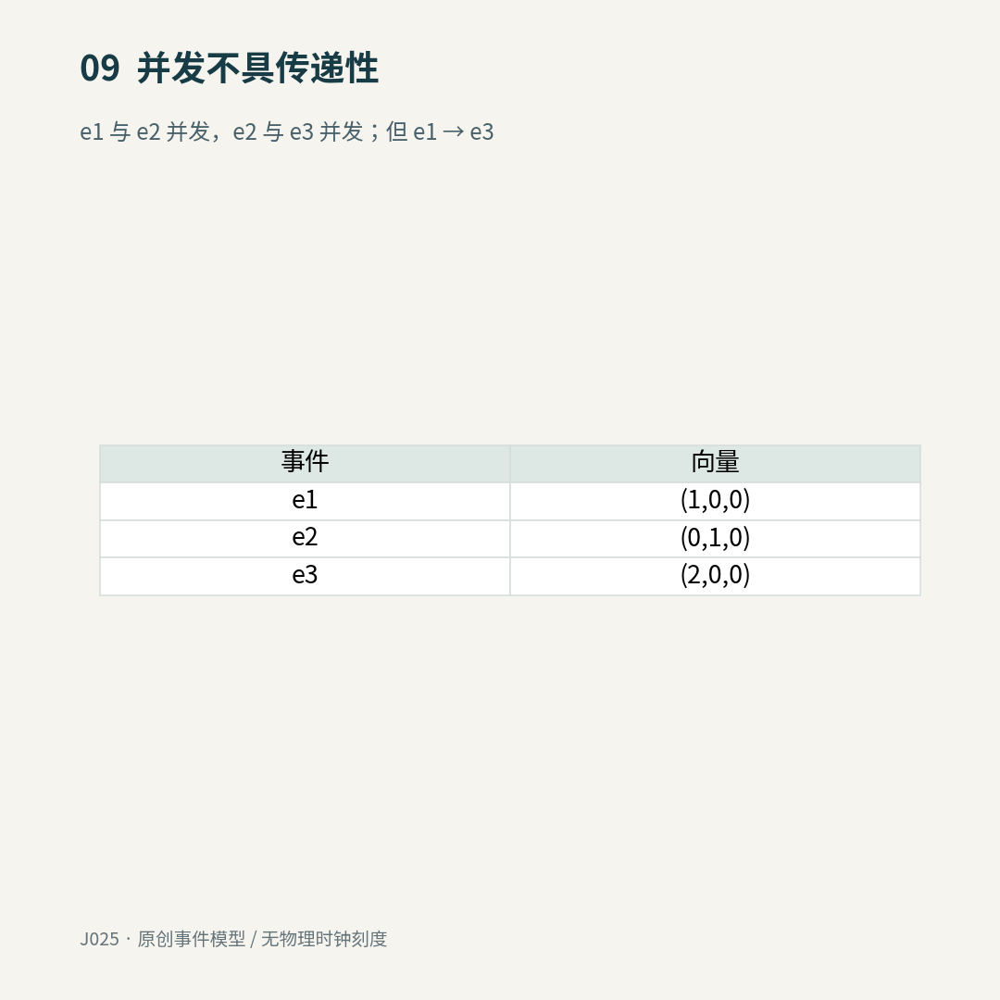

图9｜两个并发判断不能拼成第三个；并发不是等价关系。

## 10．消息乱序，为什么仍能处理？
换个两进程小实验：A发送m1=(1,0)，再发送m2=(2,0)。B先收到m2得到(2,1)，后收到m1得到(2,2)。旧消息没有把A那一格从2降回1；不过后一次接收本身确实是B的新事件，所以B那格继续加1。

本模型不要求FIFO。它要求每条接收对应已存在的发送、目的进程正确、同一消息最多接收一次。消息可以一直未接收；这表示轨迹结束时仍在途或没有被纳入后续轨迹，不由时钟保证它最终送达。真正网络重传若被视为多个接收事件，需要另外规定事件身份与去重策略，不能绕过本程序的拒绝检查。

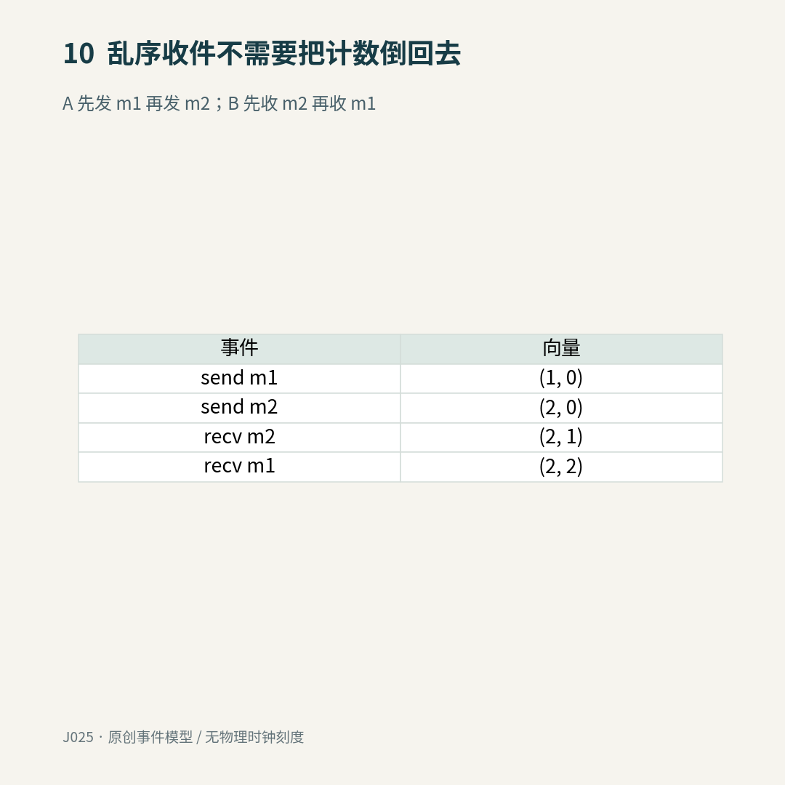

图10｜先收到m2已获A前两个事件，迟来的m1仍是一个新的B接收事件。

## 11．图上距离不是延迟测量
把同一组事件的显示间隔拉长或缩短，局部顺序和消息边不变，向量也不变。因果时钟根本没观察秒、毫秒或CPU周期。

如果要回答“服务是不是在200毫秒内响应”，需要物理时间与测量误差；如果要回答“这次接收是否可能依赖那次发送”，需要事件关系。两个工具可以共存，不必硬选一个去完成另一个的工作。本文图表没有真实服务器压测或网络延迟数据。

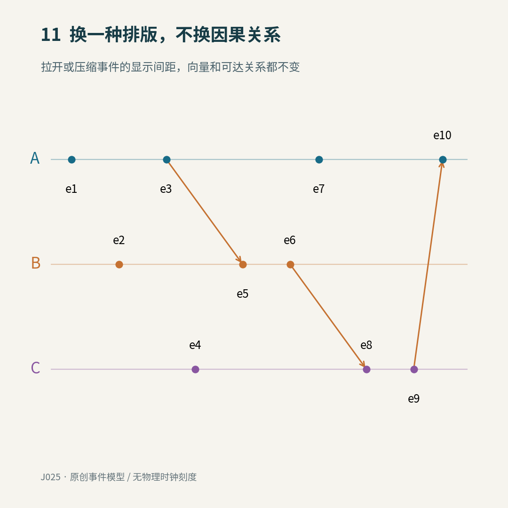

图11｜主实验只改变横坐标，消息端点和本地顺序未变；不据此推断耗时。

## 12．算法正确，不代表日志完整
设A发送一次，时间戳(1,0)。B确实接收了它，但埋点把接收误写成无消息的本地事件。B算出(0,1)，程序就会认为两事件并发；正确接收应得到(1,1)。

算法没有能力凭空发现遗漏的边。部署时必须回答：一个事件究竟指网络到达，还是应用处理完成？跨线程移交是否记录？共享存储读写是不是另一个因果通道？不同边界可以建立不同的模型，但不能一边漏记，一边声称得到了整个现实系统的因果真相。

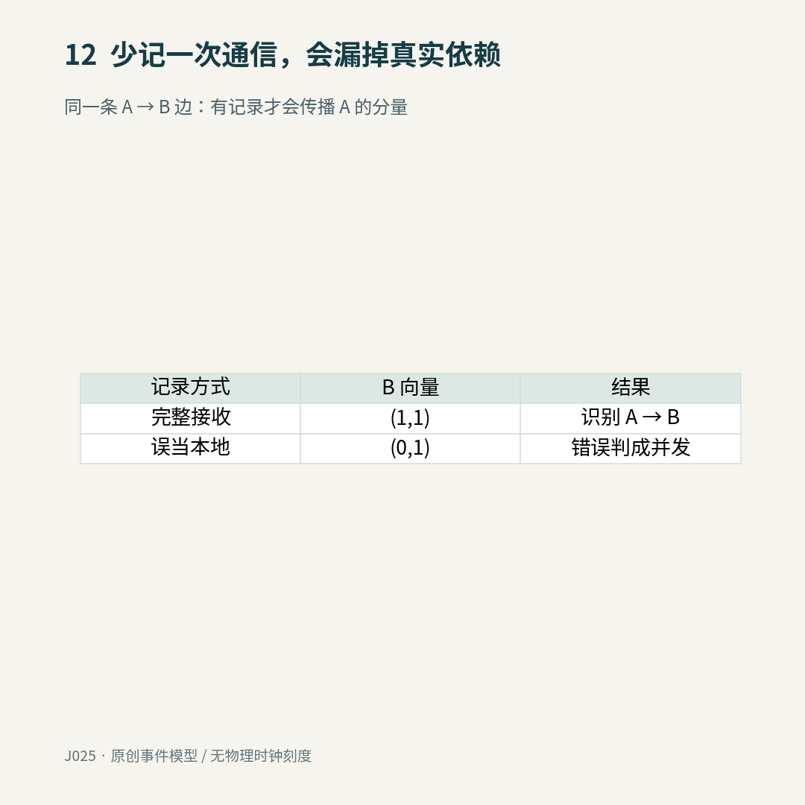

图12｜若A发送(1,0)，B只记录一个本地事件而漏记接收，就丢掉因果；模型需要完整捕获相关通信。

## 13．代价：n格不是免费的
稠密实现每个进程保存n个计数，整个n进程系统是O(n²)个计数；每条消息带O(n)个计数，逐格合并与比较是O(n)次整数操作。这里计的是元素和操作，不是固定字节：若最多有M个事件，计数器位数会增长到O(log(M+1))。

本教学模拟器为了打印日志，每个事件都复制向量，m事件的日志与未收消息最多占O(mn)存储，逐事件处理共O(mn)时间；加上初始化的n×n时钟表，总时空均为O(n²+mn)，另加消息字典查找的通常平均成本。验证用的闭包另要O(m²)布尔元素、O(m³)步；全事件对的向量比较另要O(m²n)。这不是可扩展生产实现，也不是时钟本身必须付出的全局闭包代价。标识符比较/哈希和大整数的位复杂度未作为单位成本细拆。

稀疏表示或压缩可以在某些结构上节省实际开销，但不能据此承诺任意通信图、任意时刻都只需常数空间。

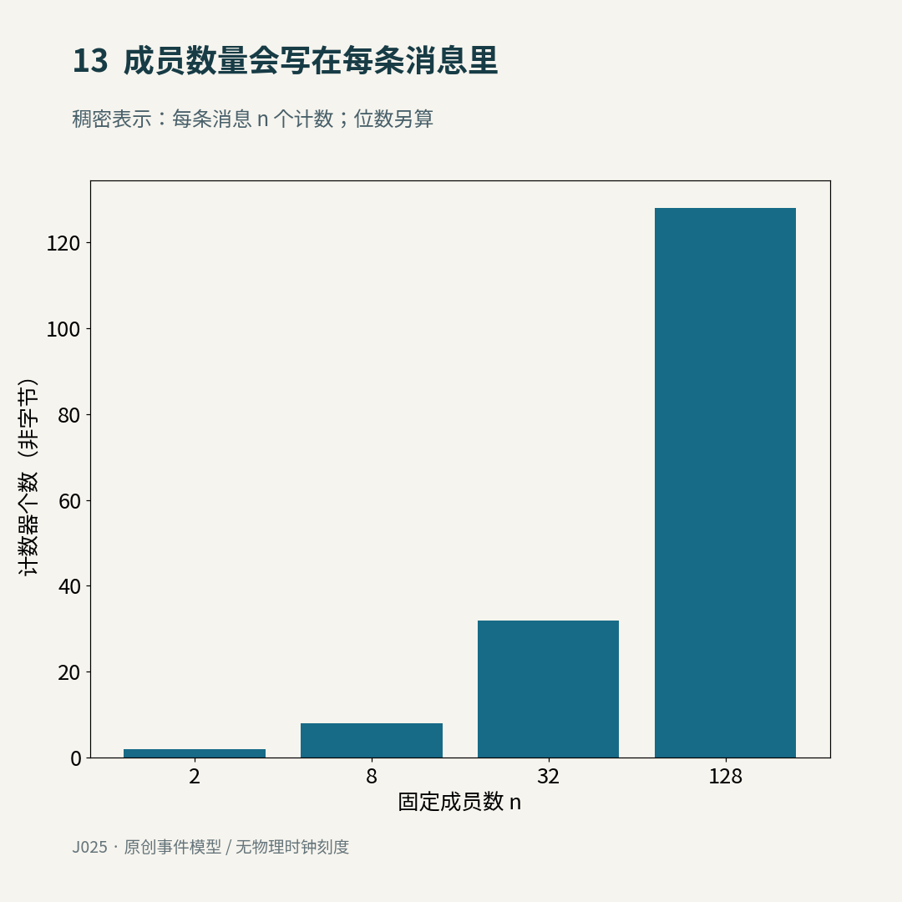

图13｜稠密向量的传输与合并工作随n线性增长；128只是结构示意，不是本程序允许的n上限。

## 14．成员、重启和版本向量：三个容易越界的地方
本程序把进程编号0…n−1固定下来，不支持动态加入退出。重启后把旧A计数清零、继续沿用旧身份，会让“旧A第1件事”和“新A第1件事”撞在同一个坐标。生产协议通常还得处理世代身份、映射、持久化、旧消息与回收；这不是简单在列表末尾加一格就自动正确。

Python整数不按固定位宽回绕，但内存与运行时间仍有限。换成固定宽度计数器，也必须设计溢出边界。代码不会接收任意外部向量；只有模型自己的发送能产生消息，所以它没有在模拟恶意伪造“未来知识”的节点。

版本向量与事件向量有相似的逐格比较外形，但计数对象可能是某个对象在各副本上的更新，而不是本文每一次内部、发送和接收事件。把这份代码塞到数据库里，不能就宣称实现了正确的版本冲突检测或合并。

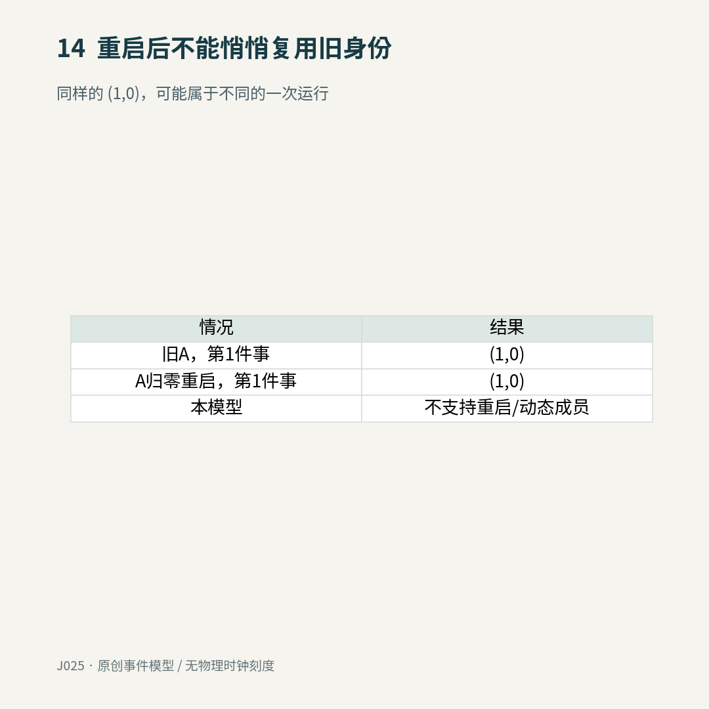

图14｜固定身份和不回绕计数是前提；新世代标识、映射迁移与回收需要另外设计。

## 15．让代码也接受反例
附录是完整标准库程序，保存为vector_lab.py后运行python vector_lab.py，会打印十事件账本与测试结果。

固定六个事件的双进程模板，遍历6!种排列，筛出所有保持本地顺序且发送早于接收的15种调度，逐一核完整闭包。再固定随机种子生成400条、每条30事件的合法轨迹，包含1到6个进程、在途消息和乱序接收。连同主例，共360640个有序事件对一致。

11类拒绝案例包括非法进程、自己发给自己、没有发送就接收、收错目的地、重复发送标识、重复接收等。n限制在1到32仅为教学接口约束，并非算法只能处理32进程。simulate读取由四字段元组或列表组成的有限操作序列，生成全新的局部状态；上述格式/协议非法情形会抛ValueError，不返回部分成功轨迹。调用者自身迭代器的异常、任意自定义对象及资源耗尽不在此错误承诺内。before和closure是受信模型数据的辅助函数，别把它们当任意输入的安全解析器。

这是作者测试，不代替独立审查，更不是对所有网络协议的证明。理论不变量给出模型内理由，测试负责发现实现有没有违背它。

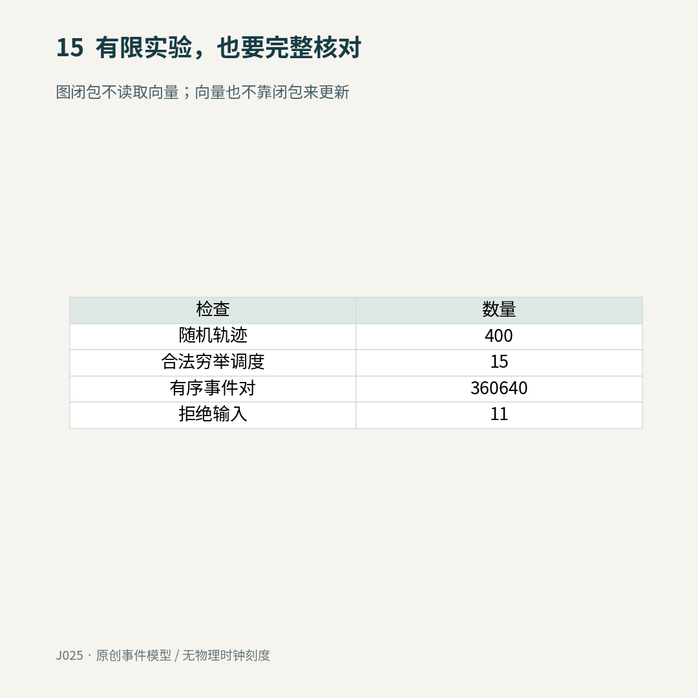

图15｜400个随机轨迹、15个穷尽调度和主例共360640有序对通过，另11种非法输入被拒绝。

## 16．最后只留一个判断动作
拿到两个向量，先检查它们是否属于同一套固定成员与事件约定。然后逐格比较：一个完全包含另一个且不同，就有严格先后；互有大小，对本模型的不同事件就是并发。

但不要顺手再添一句“所以选最新的那份”。没有可比关系时，时钟没有替你作出业务决定；即便有先后，也不代表后来的内容更正确。真正的收益是：我们终于能把“我不知道谁先”改成一个精确问题——模型里是否存在一条信息能够走过的路径？

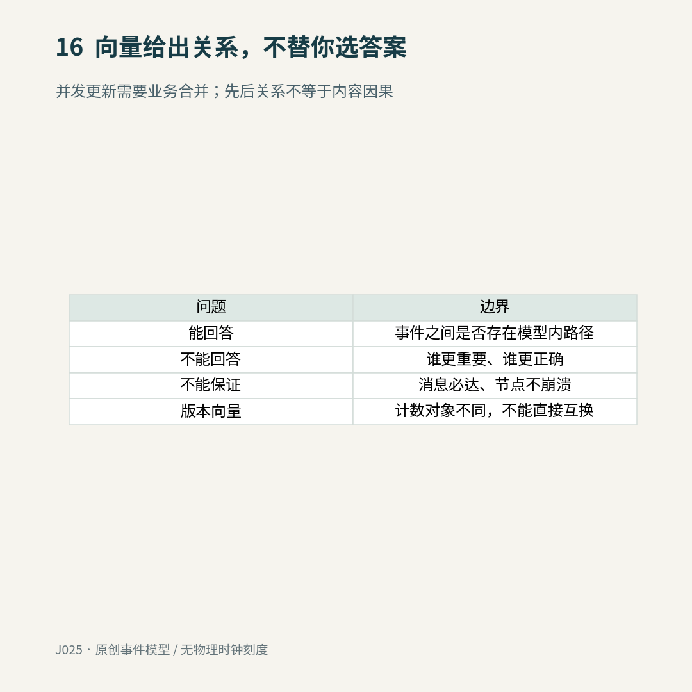

图16｜事件时钟不提供冲突解决、可靠传输或成员管理；版本向量通常计更新而非本文所有事件。

## 短读版
单个逻辑整数能保证“有因果路径就编号更小”，不能反推。向量时钟给每个固定进程留一格：本地事件增加自己的分量，发送携带快照，接收先逐格max再增加自己。主实验里，B收到(2,0,0)并与已有(0,1,0)合并，得到接收事件(2,2,0)。

在通信完整记录、固定身份、不回绕的事件模型里，u严格小于v表示每格都≤且至少一格<，恰好对应事件的happens-before。互有大小的两个不同事件并发，不等于同一时刻，也不自动意味着业务冲突。并发不具传递性。

本文用完整标准库事件模拟器生成16幅原创图，再用只看本地边与消息边的传递闭包核对360640个有序对。它不是网络运行时：不处理重启、动态成员、恶意消息或版本合并。向量说明信息路径，不负责决定哪份数据更正确。

## 完整代码

```python
"""Fixed-membership event clocks; sequential simulation, not a network runtime."""
from itertools import permutations
import random


def before(a, b):
    if len(a) != len(b):
        raise ValueError('same vector dimension required')
    return all(x <= y for x, y in zip(a, b)) and any(x < y for x, y in zip(a, b))


def simulate(n, operations):
    if type(n) is not int or not 1 <= n <= 32:
        raise ValueError('n must be an integer in 1..32')
    clocks = [[0] * n for _ in range(n)]
    scalar = [0] * n
    pending, used, events = {}, set(), []
    for op in operations:
        if not isinstance(op, (tuple, list)) or len(op) != 4:
            raise ValueError('operation = (process, kind, message, peer)')
        p, kind, message, peer = op
        if type(p) is not int or not 0 <= p < n:
            raise ValueError('invalid process')
        if kind == 'local':
            if message is not None or peer is not None:
                raise ValueError('local has no message or peer')
        elif kind == 'send':
            if type(message) is not str or not message or message in used:
                raise ValueError('unique nonempty message id required')
            if type(peer) is not int or not 0 <= peer < n or peer == p:
                raise ValueError('send to a distinct valid process')
        elif kind == 'recv':
            if type(message) is not str or message not in pending or peer is not None:
                raise ValueError('receive an outstanding message without peer')
            if pending[message]['receiver'] != p:
                raise ValueError('wrong receiver')
        else:
            raise ValueError('unknown event kind')
        if kind == 'recv':
            packet = pending.pop(message)
            clocks[p] = [max(x, y) for x, y in zip(clocks[p], packet['vector'])]
            scalar[p] = max(scalar[p], packet['scalar'])
        clocks[p][p] += 1
        scalar[p] += 1
        event = dict(index=len(events), process=p, kind=kind, message=message,
                     peer=peer, vector=tuple(clocks[p]), scalar=scalar[p])
        events.append(event)
        if kind == 'send':
            used.add(message)
            pending[message] = dict(receiver=peer, vector=event['vector'],
                                    scalar=event['scalar'])
    return events


def closure(events):
    """Independent graph definition: local sequence plus send->receive edges."""
    m = len(events)
    reach = [[False] * m for _ in range(m)]
    last, sends = {}, {}
    for i, e in enumerate(events):
        p = e['process']
        if p in last:
            reach[last[p]][i] = True
        last[p] = i
        if e['kind'] == 'send':
            sends[e['message']] = i
        elif e['kind'] == 'recv':
            reach[sends[e['message']]][i] = True
    for k in range(m):
        for i in range(m):
            for j in range(m):
                reach[i][j] = reach[i][j] or (reach[i][k] and reach[k][j])
    return reach


EXAMPLE = [(0,'local',None,None), (1,'local',None,None),
           (0,'send','x',1), (2,'local',None,None),
           (1,'recv','x',None), (1,'send','y',2),
           (0,'local',None,None), (2,'recv','y',None),
           (2,'send','z',0), (0,'recv','z',None)]


def check(events):
    reach = closure(events)
    for i, a in enumerate(events):
        for j, b in enumerate(events):
            assert before(a['vector'], b['vector']) == reach[i][j]
            if reach[i][j]:
                assert a['scalar'] < b['scalar']
    assert len({e['vector'] for e in events}) == len(events)
    return len(events)**2


def tests():
    comparisons = check(simulate(3, EXAMPLE))
    # All linear extensions of two local chains with crossing messages.
    ops = [(0,'send','a',1),(0,'local',None,None),(0,'recv','b',None),
           (1,'local',None,None),(1,'send','b',0),(1,'recv','a',None)]
    schedules = 0
    for order in permutations(range(6)):
        pos = {v:i for i,v in enumerate(order)}
        if not(pos[0]<pos[1]<pos[2] and pos[3]<pos[4]<pos[5]
               and pos[0]<pos[5] and pos[4]<pos[2]):
            continue
        comparisons += check(simulate(2,[ops[i] for i in order]))
        schedules += 1
    rng = random.Random(25025)
    for case in range(400):
        n = rng.randrange(1,7); ops=[]; pending=[]
        for t in range(30):
            p=rng.randrange(n)
            if pending and rng.random()<.4:
                k=rng.randrange(len(pending)); msg,receiver=pending.pop(k)
                ops.append((receiver,'recv',msg,None))
            elif n>1 and rng.random()<.5:
                receiver=(p+rng.randrange(1,n))%n; msg=f'{case}:{t}'
                pending.append((msg,receiver)); ops.append((p,'send',msg,receiver))
            else:
                ops.append((p,'local',None,None))
        comparisons += check(simulate(n,ops))
    invalid = [(True,[]),(0,[]),(33,[]),(2,[(False,'local',None,None)]),
               (2,[(0,'send','x',0)]),(2,[(0,'recv','x',None)]),
               (2,[(0,'send','x',1),(0,'recv','x',None)]),
               (2,[(0,'send','x',1),(1,'recv','x',None),(1,'recv','x',None)]),
               (2,[(0,'send','x',1),(0,'send','x',1)]),
               (2,[(0,'local','x',None)]),(2,[(0,'oops',None,None)])]
    for n,ops in invalid:
        try: simulate(n,ops)
        except ValueError: pass
        else: raise AssertionError('invalid case accepted')
    return dict(random_traces=400, exhaustive_schedules=schedules,
                ordered_pair_comparisons=comparisons, invalid_cases=len(invalid))


if __name__ == '__main__':
    import json
    print(json.dumps(dict(events=simulate(3,EXAMPLE), tests=tests()),indent=2))
```


## 来源与素材权利

参见[来源、素材权利与 AI 辅助说明](sources.md)。
