# 没有画一盏灯，墙角为什么也会变暗？从八条射线理解环境光遮蔽

把一个球放在平面上，给球涂蓝色、地面涂浅色。如果每个表面只显示自己的底色，画面会很像剪纸：球是一个平坦的圆，脚下没有让它“站住”的暗部。

现在不添加太阳，也不摆台灯，只做一件事：问每个表面位置，向外看时，有多少方向很快会被别的表面挡住。拿这个结果调整底色，球脚下就出现了柔和的暗部。

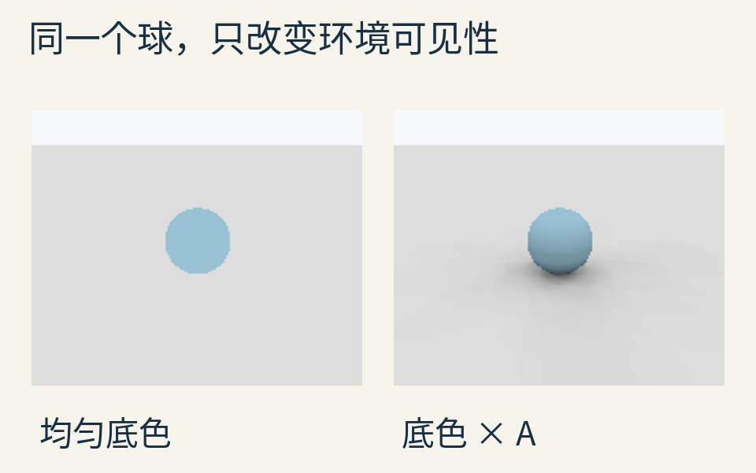

这是本文自写射线程序的实际输出，不是游戏截图。球半径为 0.8，球心在 `(0,0,0.8)`，地面为 z=0；右图每个表面位置检查 128 个方向，遮挡搜索距离为 4 个场景长度单位。画面最终转换到 sRGB 显示。

这种方法通常叫**环境光遮蔽**，英文 Ambient Occlusion，简称 AO。它很擅长提示接触、凹陷与缝隙，但它保存的信息也很少。理解它最有用的一步，是弄清楚：这个黑白数究竟在数什么，又没有数什么。

## 一个位置，为什么要向“半个天空”看？

先把眼睛放到地面上的一点。地面上方来的光可能照到它；从地面下方来的方向，却属于表面的背侧，不在这里讨论的反射范围内。

在这个位置想象一个上半球，每个球面方向对应一种可能的来光方向。若表面是墙，半球就跟着转到墙外侧。

决定“外侧”朝哪儿的短箭头，叫作**法线**。对平面，它垂直于表面；对球，某点的外法线从球心指向该点。它不是一根真实插在模型上的针，而是一个用来表示朝向的向量。

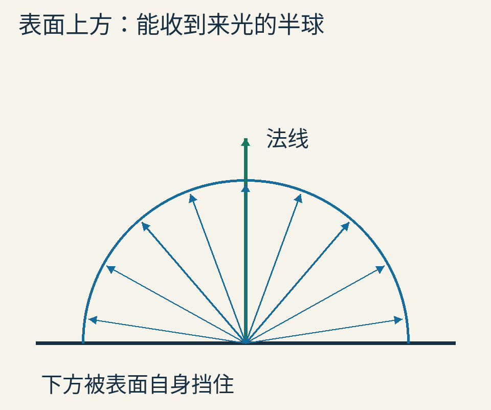

蓝箭头只是半球的平面切面示意，不能用这九根等角箭头的数量，直接代替三维环境可达率。真正的采样还要覆盖绕法线旋转的所有方向。

接下来，对一个方向发出测试射线：若在指定范围内撞到不透明表面，记 0；没有撞到，记 1。这个数叫**可见性**，回答的是“这一条路通不通”。

AO 要把许多条路的结果合在一起。本文把合并后的**可达率**记作 A：1 表示完全通畅，0 表示完全挡住。有些软件把“AO”贴图叫作遮挡程度，可能反过来用 1 表示遮挡；还有些贴图白色代表不暗。先查约定，别仅凭名字决定乘还是减。

## 八个方向，先完成一次真正的计算

在主场景地面上选点 `(1,0,0)`。它位于球心右边 1 个单位，法线向上。

附带程序固定随机种子为 24，按稍后解释的余弦分布产生 128 个方向。先只拿前 8 个，逐一测试。结果是：第 5 条被挡住，其余 7 条通畅。

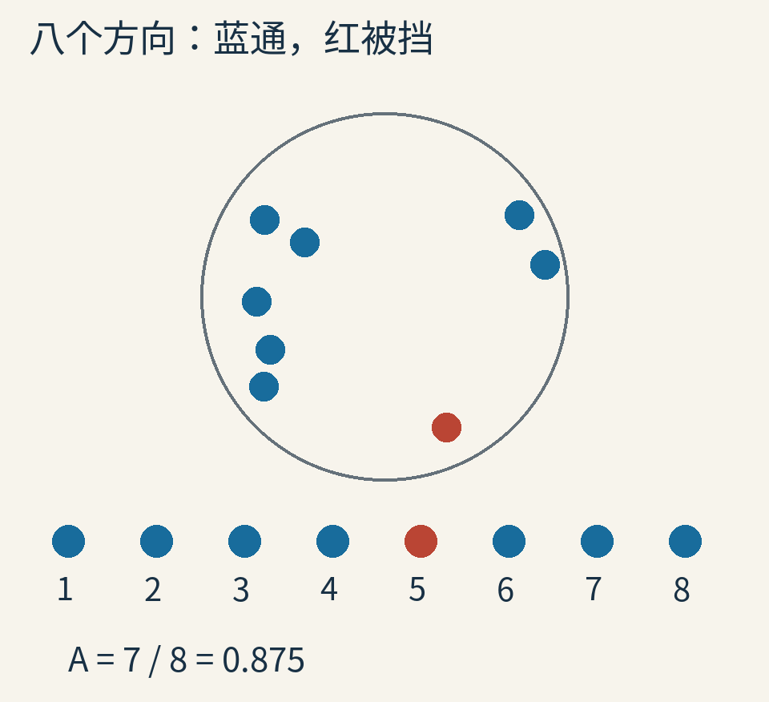

圆内位置是方向的横向分量，不是地面上八个测试点。每一个方向都从同一个地面点发出；圆下方的一排编号沿用结果文件中的采样顺序，逐项标明是否通畅。圆边对应接近掠过表面的方向，圆心对应接近法线的方向。

由于这一组方向已经按余弦分布抽取，估计可达率可以直接算：

`A估计 = (1+1+1+1+0+1+1+1) / 8 = 7/8 = 0.875`。

这不是“球准确挡住了八分之一的环境”。它是八个样本给出的估计，换种子可能变化，增加样本也可能改动结果。数值看上去有三位小数，不意味着几何精度就有三位小数。

若本来给这一点的线性灰色底色是 0.72，这个简单显示模型就得到 `0.72×0.875=0.63`。它是怎样得到图像的，现在已经可以一步步追溯了：场景几何决定射线是否相交，计数产生 A，A 再调节底色。

## 为什么不能朝半球随便撒点，然后都算一票？

想象一束平行光照在桌面。正对桌面时，它集中覆盖较小区域；斜着照时，同样一束光摊在较大面积上。单位面积分到的光会减少。

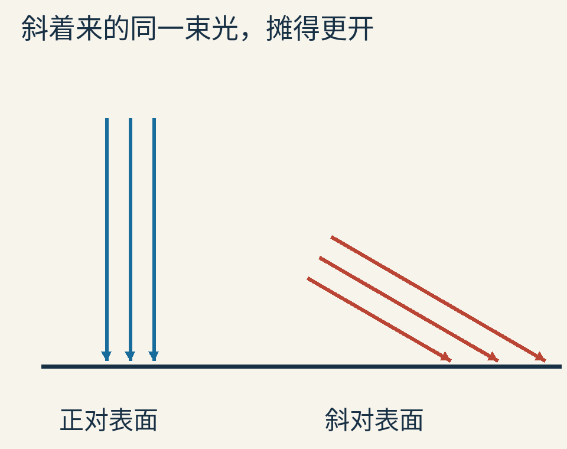

蓝、红各三根平行线代表两束等截面宽度的光。图只解释投影关系，不是测量到的真实光轨，也没有表示所有方向亮度都相同。

当方向与法线夹角为 θ，这个投影权重是 `cos θ`：正对时是 1，几乎贴着表面来时接近 0。即使还没学三角函数，也可以先把它理解为“越斜，单位表面获得的份额越小”。

于是，“未遮挡的方向面积占比”和“适合均匀环境、漫反射表面的来光占比”，并非天然是同一个数。前者给半球各块等面积区域同等地位；后者还带了余弦权重。

一种做法是均匀采半球，再对每个样本加上相应权重。另一种做法更方便：抽样本身就偏爱法线附近，出现概率正比于余弦。这样每个样本在最终平均时可以同票计数，权重已经体现在“更可能被抽中”这件事里。

这就是本文采用的**余弦加权半球采样**。[PBRT 作者的采样章节](https://pbr-book.org/4ed/Sampling_Algorithms/Sampling_Multidimensional_Functions#Cosine-WeightedHemisphereSampling)给出了从均匀圆盘提升到半球的方法。它不同于在纬度、经度上各均匀取数：那种方法容易在某些区域堆积方向。

我们的程序取两个 `[0,1)` 随机数 u、v，令圆盘半径 `r=√u`，绕圆角度 `φ=2πv`，得到圆盘坐标 `(r cosφ,r sinφ)`，再补上 `z=√(1−r²)`。为什么半径要开平方？半径 r 以内的圆盘面积占比是 r²；让面积比例均匀，才需要 r=√u。这个小步骤避免把样本过多堆在圆心。

## “附近”的范围，也是算法的一部分

如果无限远的墙都算遮挡，室内一个完全封闭房间几乎看不到外部环境，很多位置都可能很暗。但游戏经常想用 AO 强调的是墙角、桌脚、接缝这样的局部结构。

于是，常见实现会设一个最大遮挡距离。射线超过这个距离仍未命中，就按通畅处理。也有实现按命中距离逐渐减弱遮挡，而不是硬切断。

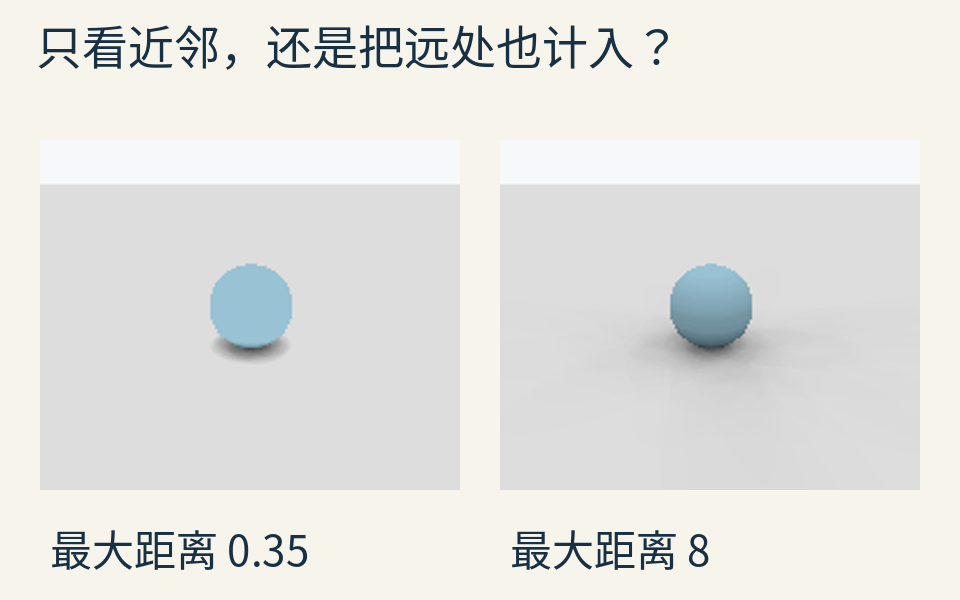

这组图只改距离上限，其他输入保持一致。短范围保留更局部的接触变化；长范围把更多远处几何纳入。本文程序使用硬距离截断，不冒称某个引擎的具体距离衰减公式。

范围不是免费提升“真实性”的旋钮。扩大范围改变了问题本身：你开始询问更远的遮挡。若场景单位从米改成厘米，却仍把范围参数写成 1，效果也会完全不同。

还有一个很好用的检查：同一位置、同一组方向，扩大硬遮挡范围，不应让更多已被挡住的方向突然变通。本篇代码实际检查了这个单调关系。它比“看起来黑一点”更容易暴露距离比较写反的错误。

## 为什么接触的地方通常特别明显？

回到球与地面。离球很近的地面点，向球那边看时，较大一片方向很快被球挡住。走远一些，球在半球中占据的方向范围变小，可达率往往增大。

把球整体抬高 0.35 个单位后，球底与地面之间出现一条空隙。许多原本很快碰到球的方向，现在可能从空隙穿过去。

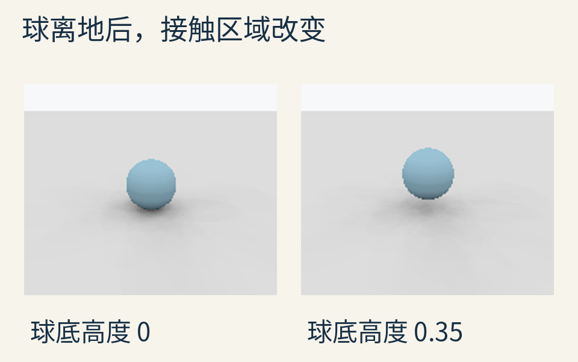

这是改变几何后重新计算的结果，不是把原来的黑影整体往下移。也没有放一盏固定灯，故不该把它读成该灯投下的精确影子。

“凹处更暗”只是常见结果，不是 AO 的定义。一个露天凹槽、一个被上盖挡住的平面、一个厚厚外壳下面的凸起，都要看它们实际能朝哪些方向看出去，不能只按曲率或名字决定深浅。

## 多发几条射线，会不会就等于全局光照？

先看样本数的影响：

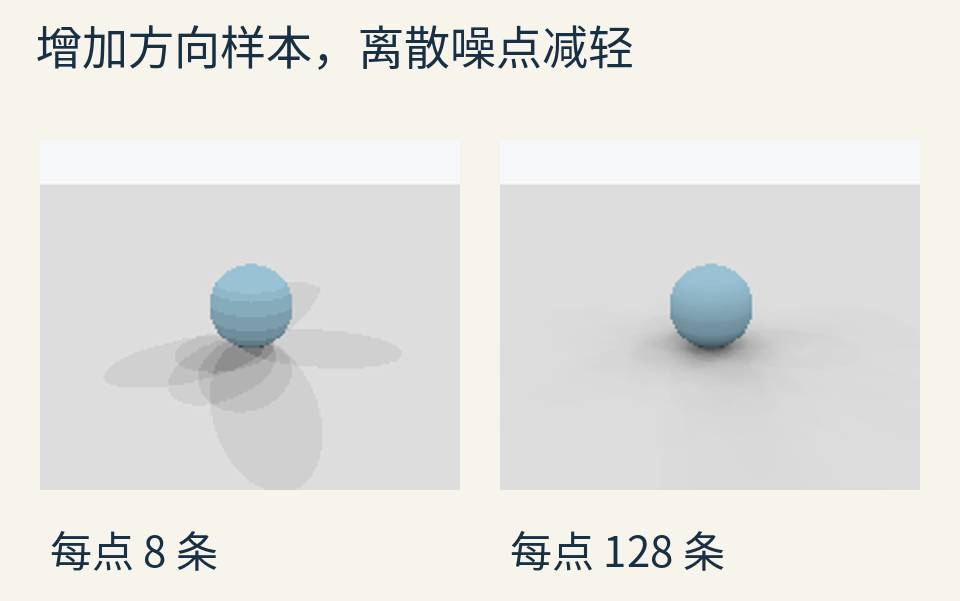

两张图使用同一固定序列，左侧取前 8 个方向，右侧取全部 128 个。少量样本会让结果只有几个离散档位，还可能出现明显的颗粒、条带或方向偏差。多取样本通常让估计更稳定，但不保证每一小块都会单调接近最终结果。

本文各表面点复用同一组局部方向，便于复算，却也会产生相关结构；它不是带时域累积、降噪器和复杂采样优化的生产渲染器。

更重要的是：即使方向数增加到非常多，程序仍然只问“第一次碰到什么了吗”。它没有追踪被碰到的墙本身有多亮，没有继续计算墙反射来的光。**减少采样误差，不能弥补模型根本没记录的信息。**

[NVIDIA《GPU Gems》的作者章节](https://developer.nvidia.com/gpugems/gpugems/part-iii-materials/chapter-17-ambient-occlusion)讨论了环境可达性、预计算和相关近似。其基础示例使用一种半球可达率定义；本文特意选择余弦加权版本，并把采样差别写明，不能把两者的计数公式无条件混用。

## 很黑的一条缝，有时是射线打中了自己

射线从表面点出发，但计算出来的点可能因浮点误差略微陷在表面里面。程序如果把极近的相交也当成真正遮挡，就可能让物体大面积自遮挡。

一种基础处理是把起点沿法线往外挪一点，并忽略极小的交点参数。本文使用 ε=10⁻⁵ 个场景单位，起点沿法线偏移 4ε；这个量针对当前尺度选择，不是通用常数。

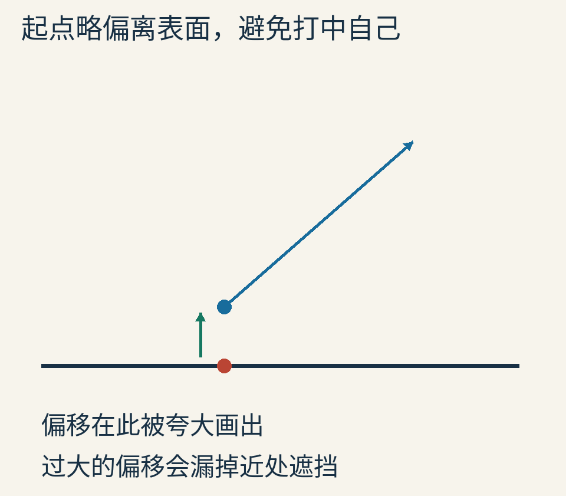

偏移过大也会出问题：薄缝中的真正遮挡可能被跳过。若把一个一米大的场景放大一百万倍，仍机械沿用同样 epsilon，浮点精度与几何尺度的关系也变了。处理自相交需要数值分析与几何约定配合，不能靠不断增大偏移把黑斑藏起来。

## 一个灰度数，为什么分不清灯在左边还是右边？

设某个点左边一半环境通畅，右边一半被墙挡住。假如光主要来自左边，它可能很亮；若唯一明亮窗口在右边，它可能很暗。

但只存“可达率大约一半”，这两种照明条件得到的是同一个数。

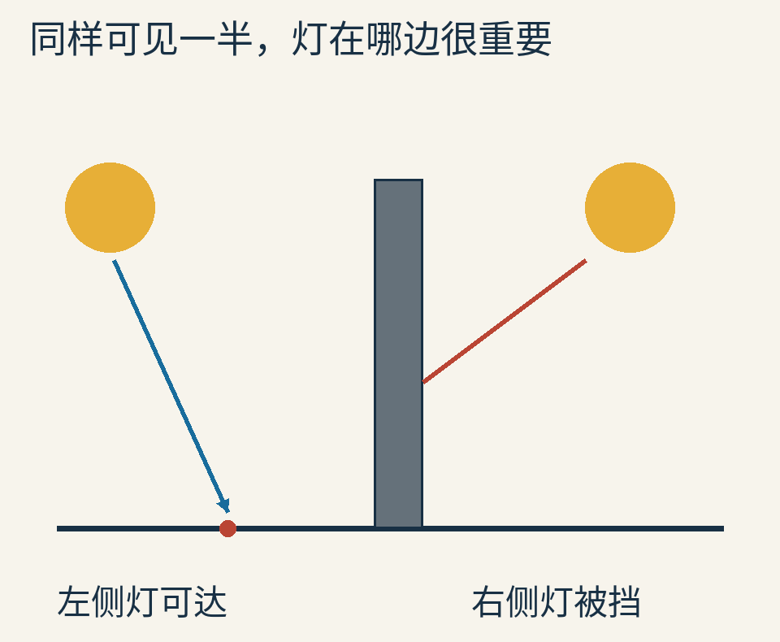

这是示意图；两盏黄色灯代表两种分别考虑的照明条件，不是程序在主场景同时摆放了这两盏灯。

把可达率 A 乘上一个均匀环境常量，对均匀、无方向偏好且只考虑一次环境入射的模型有清楚意义。若环境包含一个极亮窗口，单个 A 就丢掉了“被挡的是亮处还是暗处”的信息。

可以保存更多方向信息，例如未遮挡方向的平均朝向，常叫 bent normal；也可以直接采样带方向亮度的环境。但平均方向仍可能落在一个被挡住的区域，它也不等于完整方向分布。想回答更细的问题，就要存更多内容或执行更多计算。

## 屏幕空间 AO 为什么会在画面边缘漏东西？

到目前为止，程序可以询问整个球和地面几何。另有一大类快速方法只使用当前屏幕留下的信息，例如每个像素最近表面的深度及法线。这些通常统称屏幕空间 AO，简称 SSAO。

它们很方便，因为画面已经渲染出深度图，不必每次都遍历完整场景。但这张图只记录当前相机看到的部分：被前面物体盖住的后层、屏幕外的几何，都可能不在里面。

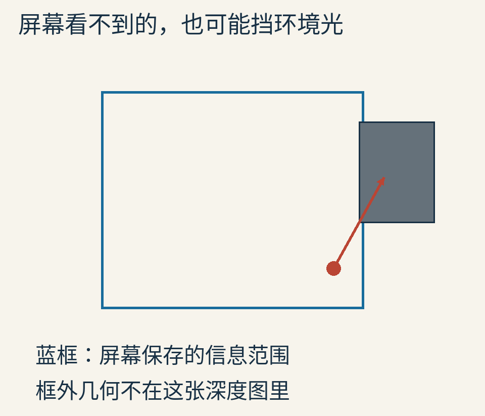

所以，移动相机时暗部忽隐忽现，不一定是物体真的在动；也可能是计算所能看到的资料变了。扩大屏幕内采样范围，无法凭空恢复屏幕外完整几何。

不同 SSAO、GTAO 等算法会用不同近似、深度处理和时间信息缓解问题。本文没有实现或测评这些产品级方法，只用信息缺失解释这一类局限。不能凭本篇慢速 CPU 小实验，比较现代 GPU 方案谁快多少倍。

## 法线和材质，也不能随便拿来凑

同一个位置，如果它属于地面，应该向上采半球；属于竖墙，就应该向外侧采。

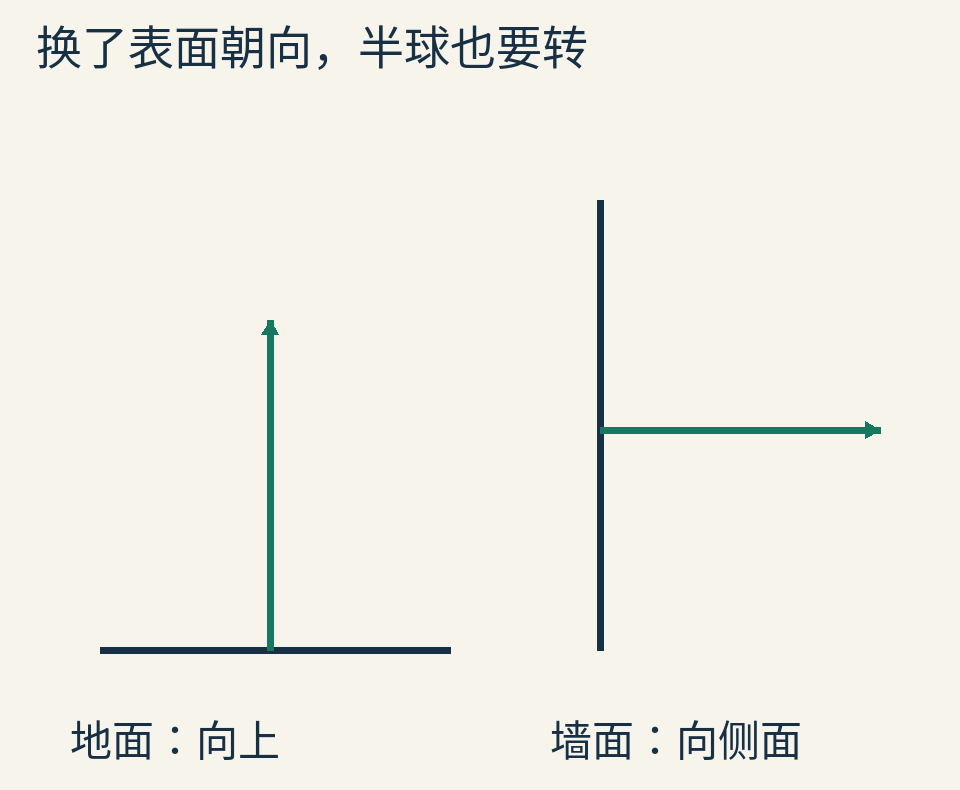

本文球面的法线由球心与表面点直接计算。实际资产里，几何法线、平滑法线和法线贴图表达的细节可能不同；到底用哪个来引导采样、哪个用来防止射线射进表面，需要与实现一致。

还要检查底色是否已经带了暗部。美术把接触阴影画进纹理，渲染时又无区别地乘一遍 AO，常会把同一遮挡效果扣两遍。

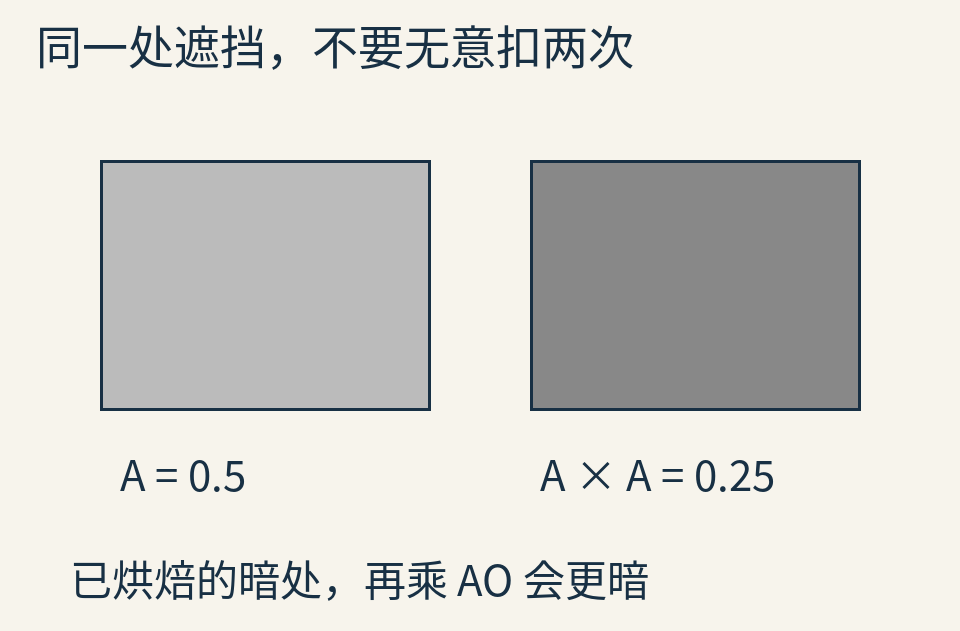

这幅图只演示数字的重复相乘，不断言所有烘焙纹理与实时 AO 的组合都不合理。关键是知道每层暗部在表达什么，以及它们应该作用于哪些照明分量。把 AO 一股脑乘到直接灯光、镜面高光、发光材质上，是艺术效果选择，不会自动变成物理必然。

## 红墙照红了白地面，AO 还没有算这件事

一束光先碰到红墙，再反射到地面，地面可能带红。AO 的遮挡测试一碰墙就记“挡住”，没有继续询问墙反射过来的颜色。

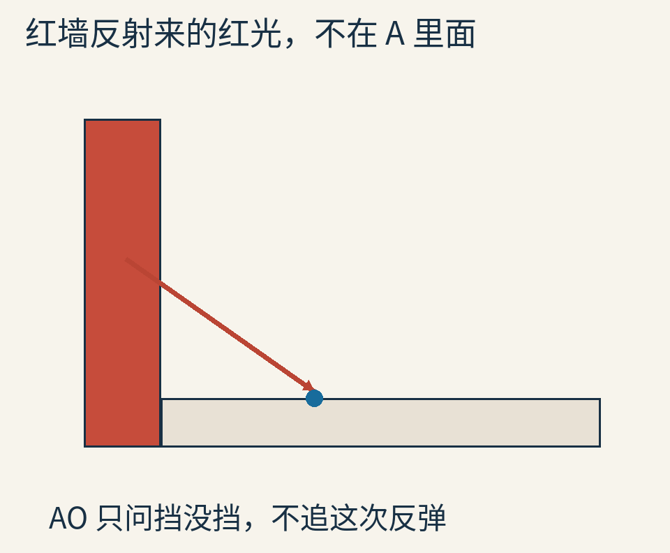

所以 AO 不是完整全局照明，也不是路径追踪的别名。它通常不负责彩色串染、镜面反射、透明材料透过来的彩光和折射。它的价值是用相对有限的信息，给几何关系增加一种容易看懂的明暗线索。

这也解释了为什么过强 AO 会把所有缝隙抹成脏黑：真实缝隙里可能仍有反弹光，而简单模型没有计算那部分补充。

## 把图像拆成一条能检查的曲线

最后，沿地面 x 轴从 x=0.82 走到 2.5，y 与 z 都保持 0。对每个点取同样 128 个方向，得到下面这条实际可达率剖面。

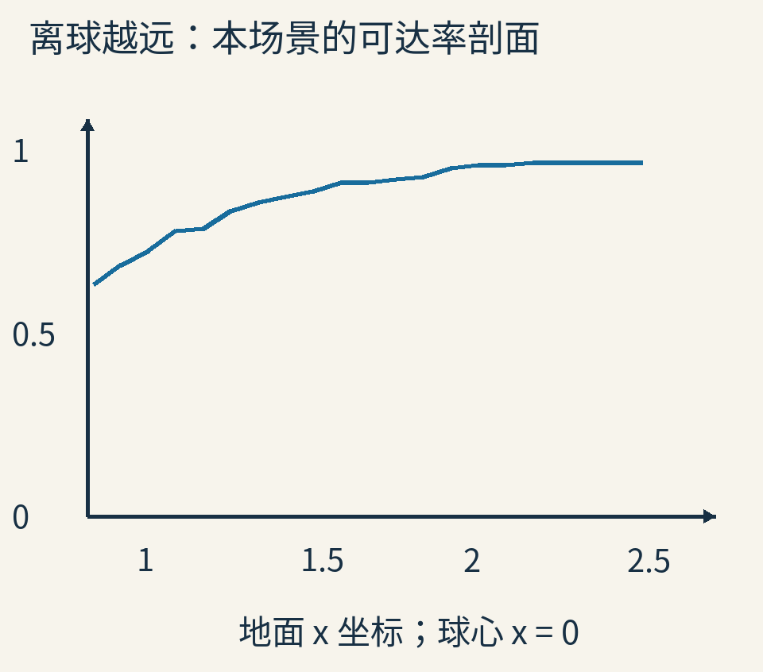

横坐标单位与球半径 0.8 一致；纵坐标 1 表示完全通畅。有限样本会产生台阶与小波动，图线不应被读成解析真值。这个剖面让我们能追问：距离改变了什么，噪声有多大，某个意外黑点究竟发生在哪儿。

[完整实验](examples/lab.py)与[结果文件](examples/results.json)给出场景、方向、种子、距离、偏移及剖面数据。运行于 Python 3.12.14、NumPy 2.3.5；图像生成需要 Pillow 和 Noto Sans CJK。`python lab.py` 会覆盖本文图像和结果。原始教学渲染为 180×150 像素，排版中放大显示，不冒称高分辨率成品或性能基准。

你可以只改球的离地高度，保持其他条件不变；再只改最大距离。比起一次把所有旋钮都拧动，单独改一个原因，更容易看出阴影为什么出现。

看到一圈接触暗部时，现在可以问得更准确：这个位置朝哪些方向看得出去？方向怎样加权？最多看到多远？这个数随后乘到了什么上？把这几个问题分开，AO 就从“让画面更立体的开关”，变成了一次可以逐条核对的可见性计算。

全部配图为原创示意与自写程序输出，未复制第三方场景或论文图片。原创正文、图与数据采用 [CC BY 4.0](https://creativecommons.org/licenses/by/4.0/)，代码采用 [MIT](examples/LICENSE.txt)。依据范围与逐图说明见 [sources.md](sources.md)。
