# 油门踩到底，什么时候该换成刹车？一次最短时间控制的手算

游戏里有一台沿轨道移动的机械臂。当前位置是0，目标在右边4米。它不能瞬间传送，也不能把速度瞬间清零；我们能控制的是加速度，最大向右1米每二次方秒，最大向左也是1米每二次方秒。

问题看起来很简单：尽快过去。

但“过去”必须说完整：**从静止出发，在4米处重新静止。**以高速冲过目标不算完成。晚一点到，停得很准，可以；早一点路过，却刹不住，不行。

如果时间是唯一要尽量缩短的东西，应该先温柔加速，再温柔减速吗？还是一路踩满，最后才猛刹？这个理想问题有一个干脆的答案：先用最大正加速度，再切成最大负加速度。真正有意思的，是切换点怎样算，以及凭什么说它最快。

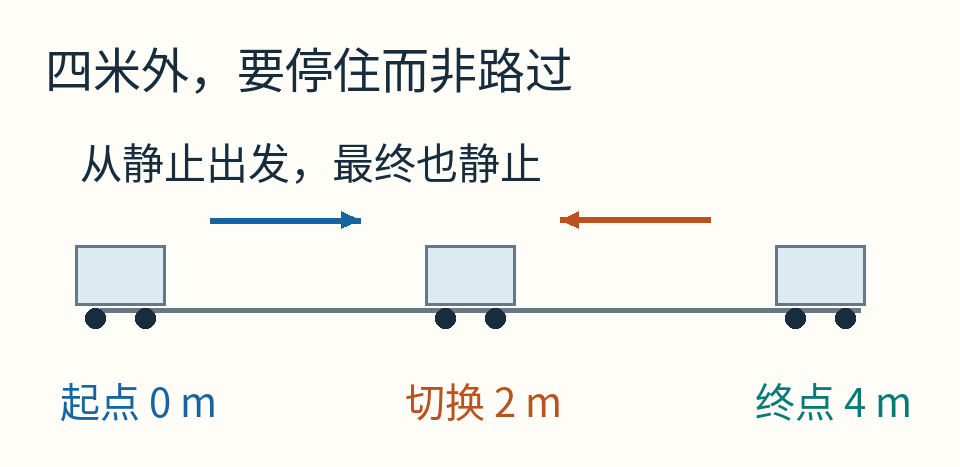

这是原创教学模型，不是某台真实机械臂的控制方案。图中向右箭头表示前半程加速度，向左箭头表示后半程加速度；后半程小车仍然可以向右运动。

## 一秒、两秒，先把发生的事算清楚

加速度1米每二次方秒，意思是每过一秒，速度增加1米每秒。初速度为0，于是：

- 1秒末，速度1米每秒。
- 2秒末，速度2米每秒。

两秒内走了多少？不能拿末速度2直接乘2，因为前面的时间没有一直跑这么快。速度从0均匀增加到2，平均速度是1米每秒，因此位移是2米。

接下来把加速度改成−1。速度每秒减少1：3秒末剩1米每秒，4秒末变成0。后两秒平均速度同样是1米每秒，又走2米。合计正好4米，而且停住了。

所以我们已经有一份可行计划：**加速2秒，减速2秒，总时间4秒。**

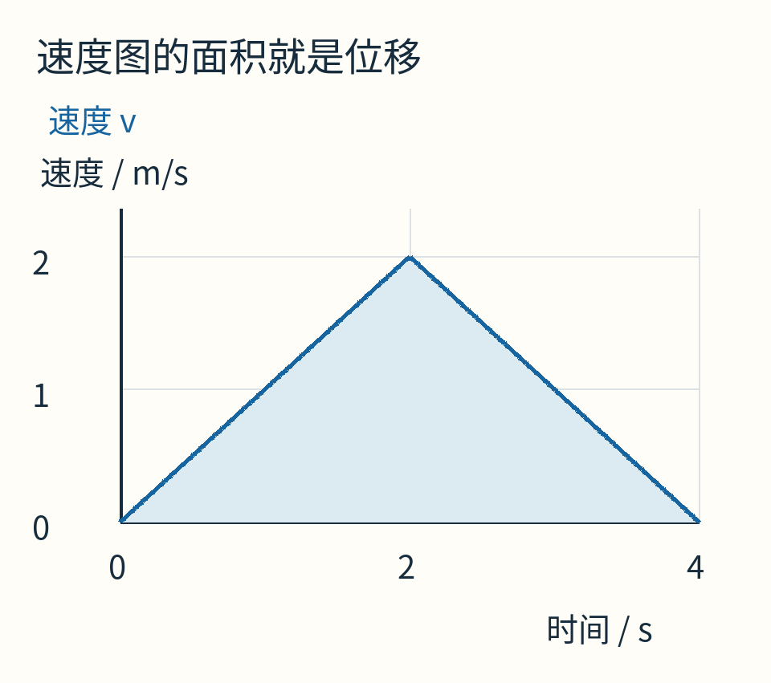

横轴是时间，纵轴是速度；蓝色线下的面积表示位移，单位是“米每秒×秒”，即米。两个三角形各有面积2米。

这只是找到一种办法，还没证明它是最快。先把几种常见的误会处理掉。

## 位置、速度、加速度是三张不同的图

位置图告诉你“在哪”；速度图告诉你“位置正在怎样变化”；加速度图告诉你“速度正在怎样变化”。它们可以讲同一段运动，但形状通常不同。

前半程位置是 `x=t²/2`。这里t以秒计，系数中的加速度是1米每二次方秒，结果以米计。

后半程，令s=t−2表示切换后又过了几秒。切换时位置2、速度2，所以：

`x=2+2s−s²/2`，`v=2−s`。

代s=1，得到位置3.5米、速度1米每秒；代s=2，得到位置4米、速度0。

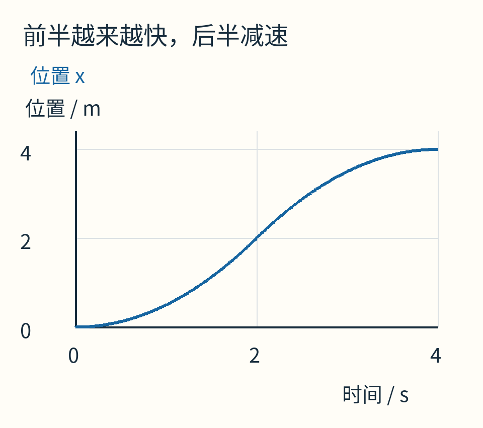

位置始终增加。图的凹凸改变，不表示车突然掉头，而是表示它从加速改成减速。

加速度图则只需要两档：前半程+1，后半程−1。中间发生一次理想的瞬时切换。

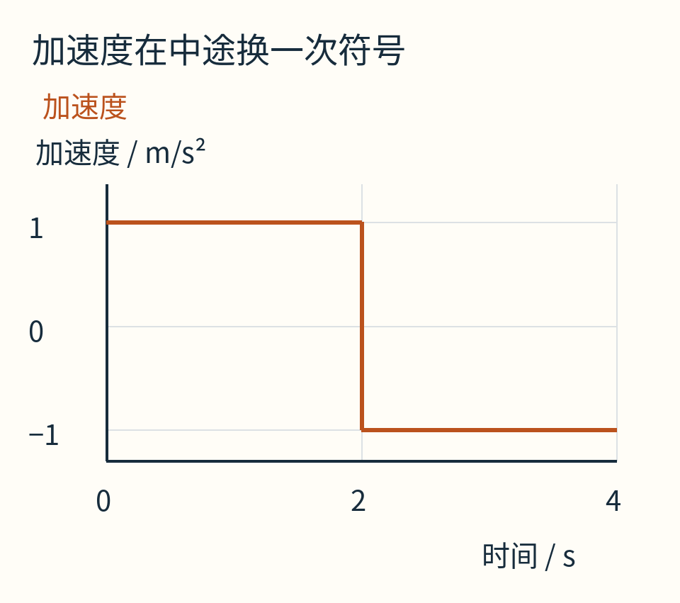

这种主要使用输入边界值、在边界值间切换的策略叫 **bang-bang控制**。名字有一种“啪、啪换挡”的感觉，但不能把名字当成一条普遍定理：不是所有系统、所有成本、所有约束下，最优控制都只有两档或只切换一次。

[MIT作者讲义](https://underactuated.mit.edu/dp.html)把这个模型称为带输入限制的双积分器：加速度积累成速度，速度又积累成位置。下面的速度面积证明只针对这套模型。

## 刹车不必等到目标出现

假设车此刻速度为v>0，最强减速度大小是a>0。这里先把a保留成一个字母，后面再代回1。

速度每秒减少a，降到0需要 `v/a` 秒。速度图是一个高v、底v/a的三角形，所以刹车距离为：

`d停 = (1/2)×v×(v/a) = v²/(2a)`。

这条关系有三个前提：减速度大小恒为a，没有延迟，期间没有别的力改变模型。它不是“拿去就能估计现实汽车安全距离”的完整公式。

代回我们的小车，v=2、a=1，需要2秒、2米刹停。于是当它位于2米、速度2米每秒时，剩余2米刚好够用。

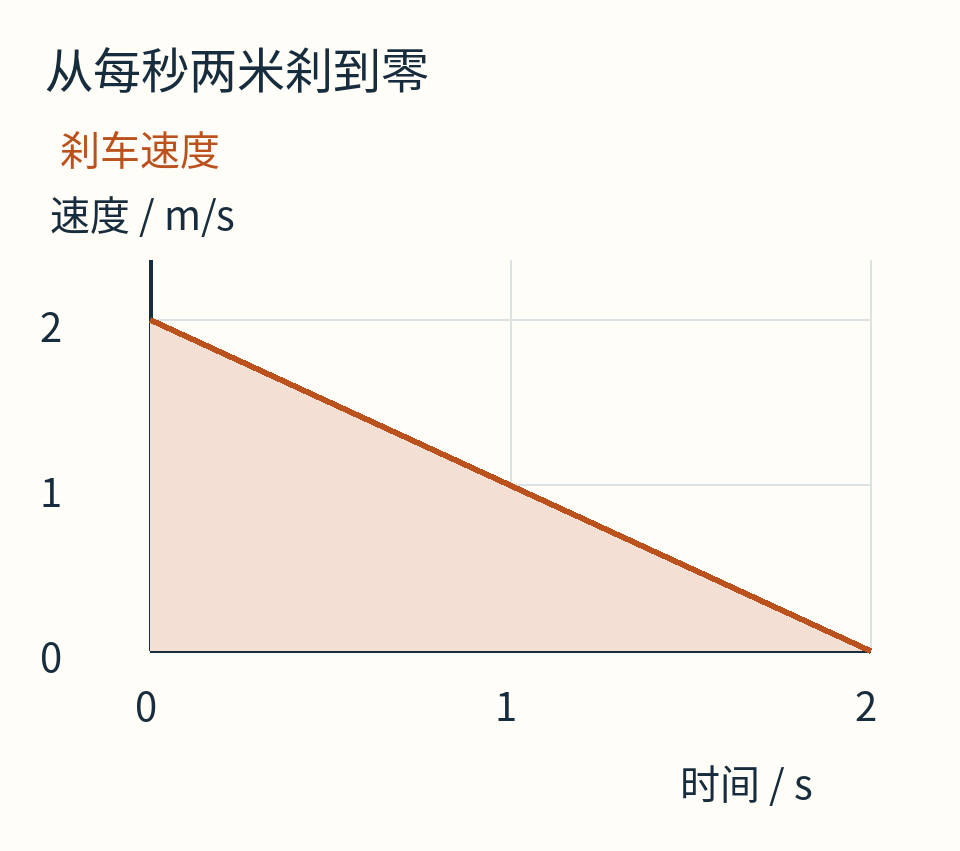

图中只画刹车这一段，横轴从开始刹车重新计时。不要把这里的0秒误读成整趟行程的0秒。

如果目标是L=4米，那么“现在开始最强刹车，正好停在目标”的状态满足：

`当前位置 x + v²/(2a) = L`，这里v>0。

这就是一条**切换曲线**。它不是地面上一个固定标记，因为不同速度需要不同的刹车位置。速度1时，在3.5米刹车刚好；速度2时，在2米；速度3时，甚至得在−0.5米开始。

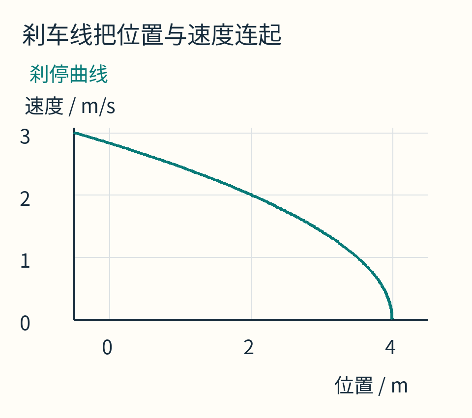

横轴是当前位置，纵轴是当前正速度。图中任何点都代表一对位置和速度，不是一条小车经过的空间弯道。

只看距离决定什么时候刹车，会漏掉这第二个坐标。同在3米处，速度0.5与速度3，面临的是完全不同的问题。

## 为什么切换不能随便早一点或晚一点？

在这套从静止出发的对称模型里，先加速τ秒，再用同样强度减速τ秒，正好回到零速度。两段位移各为 `aτ²/2`，总位移是 `aτ²`。

a=1时：

- τ=1.5秒，3秒后停在2.25米，还没到目标。
- τ=2秒，4秒后停在4米。
- τ=2.5秒，5秒后停在6.25米，已经过头。

早刹并不一定“不安全”，但要继续到目标，就必须再安排后续动作。晚刹也不是只多花一点时间的问题，它把停止位置一起改掉了。

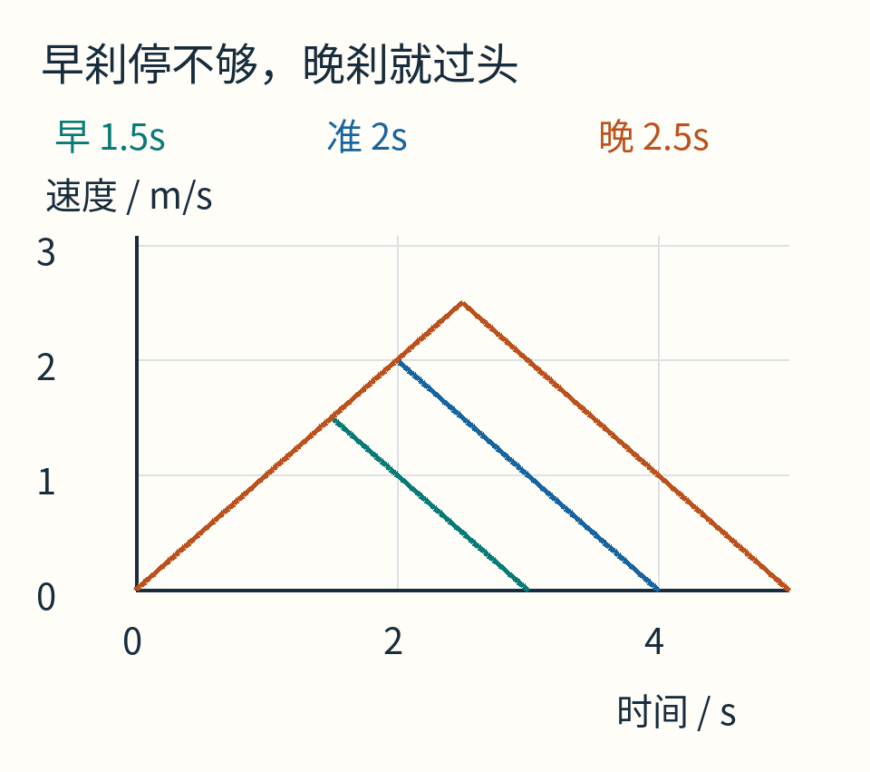

三条线共享同一时间轴和速度轴，面积才可以直接比较。图中每条线结束时都已停止，但并不都停在目标位置。

从 `aτ²=L` 得到τ=√(L/a)，因此这份计划的总时间是 `T=2√(L/a)`。把L从4米改成9米、a仍为1，它就变成加速3秒、减速3秒，总时间6秒。

距离增为原来的2.25倍，时间只增为1.5倍；这是平方关系，不是算错了比例。

## 真正证明“最快”：把所有可能的计划一起罩住

假设有人说，他有另一份更聪明的控制计划，能在总时间T里从静止出发又静止，途中可以任意调整加速度，但始终满足 `|u|≤a`。

不用知道他的每个动作，只看某个时刻t的速度。

从起点出发，最多一直以+a加速，所以 `v(t)≤at`。

从终点倒着看，也有一条限制。剩下T−t秒，他必须把当前速度降到0；最大减速度只有a，所以 `v(t)≤a(T−t)`。否则最后无论怎样努力都刹不完。

因此任何合法速度曲线都不能超过两条直线中较低的一条：

`v(t)≤min(at, a(T−t))`。

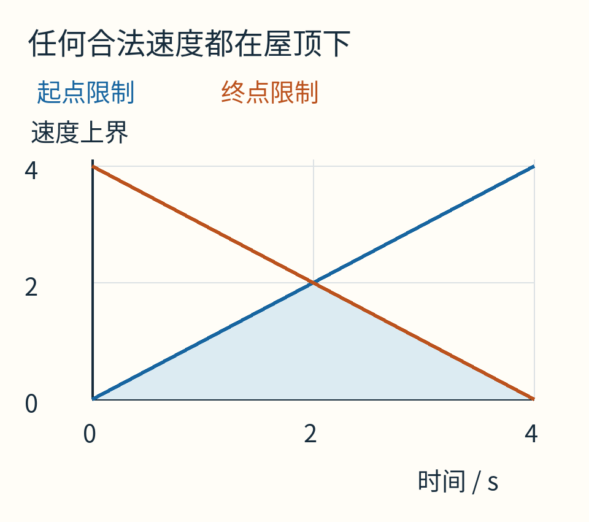

蓝线来自起点的加速能力，橙线来自终点的刹停要求。两者较低处拼成一个屋顶形三角形；阴影就是它的面积。

整个行程的位移是速度的积分，也就是速度曲线的有符号面积。既然曲线处处不高于这个屋顶，位移就不可能大于屋顶面积：

`L≤(1/2)×T×(aT/2)=aT²/4`。

重新整理，任何合法计划都必须满足：

`T≥2√(L/a)`。

而我们的“前半最大加速、后半最大减速”恰好处处贴着屋顶，正好达到这个下界。因此它最快。

这段证明甚至不需要先禁止倒车：如果某段v为负，那段面积还会扣掉一部分位移，不可能突破相同的上界。它也没有靠“试过很多计划都比它慢”来冒充证明。

## 加一个限制，答案的形状就会改变

现在给车再加一条速度上限：不能超过1米每秒，距离仍为4米，加速度限制仍为±1。

原计划最高速度2，已经不合法。新的速度屋顶要再被水平线v=1削平：先用1秒加速，走0.5米；最后用1秒减速，再走0.5米；中间剩3米，以1米每秒巡航3秒。总时间5秒。

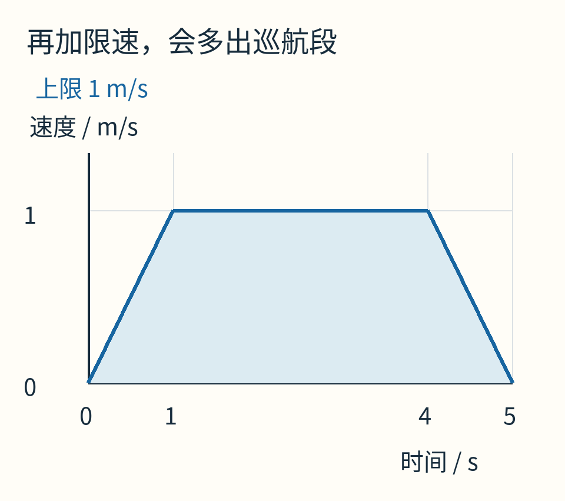

三段分别是加速、匀速、减速，对应加速度+1、0、−1。中间的0不是程序偷懒，而是速度上限要求的。

更一般地，若速度上限为V，距离L≤V²/a，来不及触及速度上限就该刹车，仍是三角形；若L>V²/a，才出现巡航段，总时间是 `L/V+V/a`。在分界L=V²/a处，两种公式恰好接上。

请留意这里比较的是静止到静止的一维理想运动。加入坡度、摩擦变化、外力、方向不同的加减速能力，推导就需要重做。

## 电机未必喜欢这一下“啪”

理想图里，加速度从+1瞬间跳到−1。但现实机构可能不允许力矩骤变，乘坐的人也可能不喜欢突兀的冲击。

加速度的变化率称为jerk，常译为加加速度或跃度。若限制它，加速度就必须花时间从正值滑到负值。常见运动规划会得到带圆滑过渡或S形变化的轨迹，不能再把刚才的瞬时切换当作可实现答案。

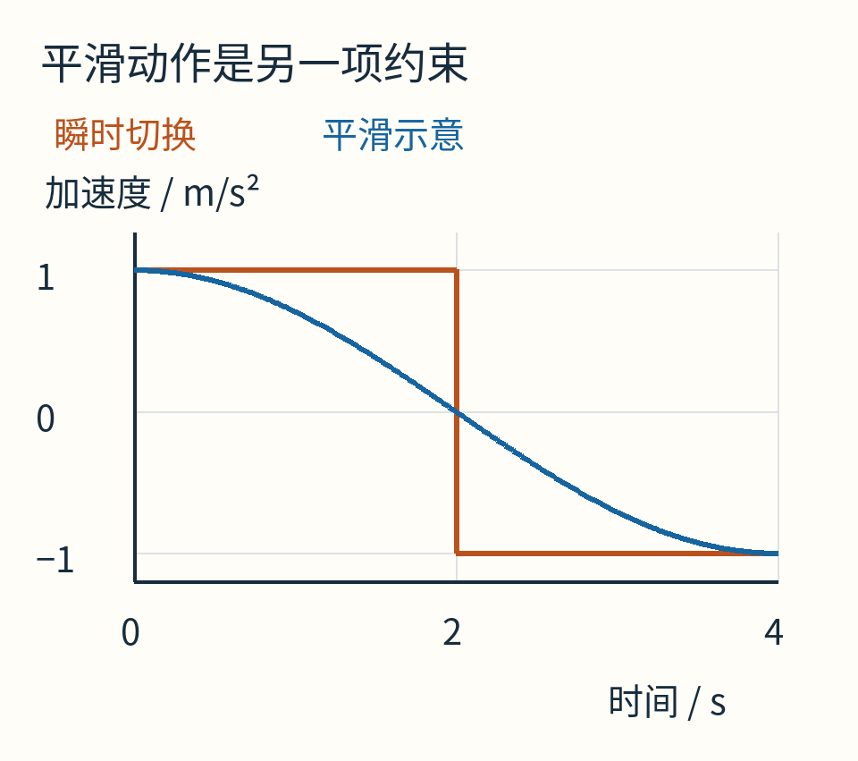

蓝色余弦曲线只是展示“平滑变化”长什么样，**没有声称它在4秒内走完相同4米，也没有声称它满足某个最短时间问题的最优条件**。这是换约束前需要说明的区别。

还可能有另一种目标：时间不是唯一成本，耗电、峰值力、振动、磨损都重要。此时少花一点时间未必值得。最短时间控制中的“最优”，只对已经写下来的评分与边界负责。

这也解释了它与LQR的不同：LQR常用状态偏差和动作大小的二次成本做权衡；本篇把到达时间作为目标，输入大小则由硬限制约束。它也不同于MPC的滚动规划结构；即便同样用了小车，回答的问题并不相同。

## 控制器每隔一会儿才看一次，会发生什么？

假设我们仍想在2秒切换，却因为检查或执行延迟，直到2.1秒才把+1换成−1。若随后一直减速到静止，停止时间变成4.2秒，停止位置变成 `2.1²=4.41` 米。

只是晚0.1秒，最后却过头0.41米。原因并非车只在多出的0.1秒里多走一点：它还多获得了速度，后面需要更长的刹车过程。

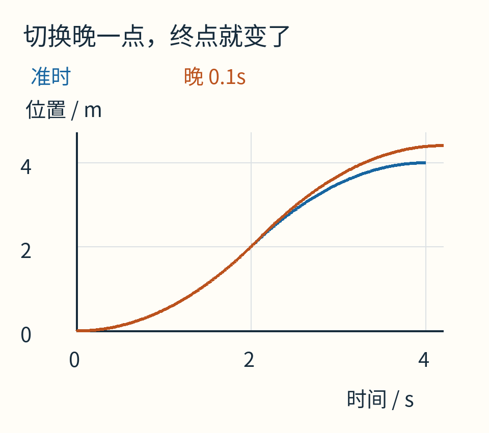

这两条曲线由分段匀加速公式精确计算。橙线假设一次明确的0.1秒事件延迟；没有把它说成所有采样控制器都会出现的固定误差。

如果时钟恰好每0.1秒检查一次，2秒又恰好落在采样网格上，本例可以准时切换；不能仅凭采样间隔就断言一定晚0.1秒。真实实现要检查事件判定、传感器延迟、执行延迟以及每步内的运动模型。

因此常用的做法是根据当前位置与速度重新计算剩余刹车距离，而不是只盯开机以来的秒数。但有反馈也不会凭空增加刹车能力。

## 已经太快时，承认“必须越过”也是答案的一部分

换一个起点：车已经在3米处，以3米每秒向右跑，目标仍为4米，最大减速度仍为1。

只剩1米，可刹车距离需要 `3²/2=4.5` 米。就算立刻最大减速，它也要到7.5米处才停止。原点到4米那条漂亮的计划，无法穿越时间，把已经发生的加速撤销。

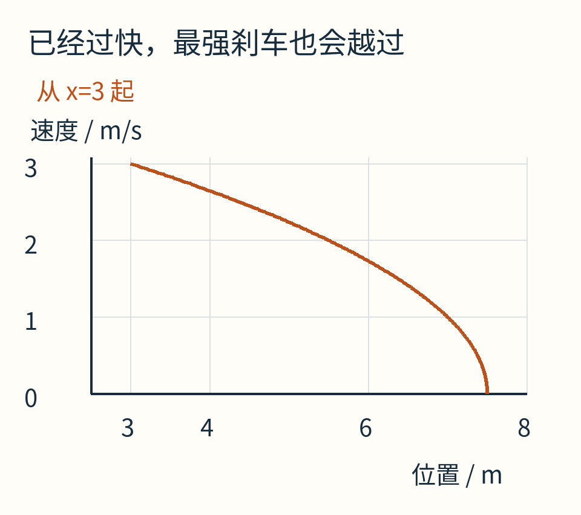

横轴这次仍是位置，纵轴是速度。橙线到7.5米时才接近零速度；不是小车绕着一条曲线行驶。

如果轨道允许反向运动，之后可以掉头回来；如果4米后就是不能越过的边界，那么这个初态已没有满足该边界的解。控制程序应该能区分“可以较慢到达”与“给定约束下已经无解”，不能统一回报一个看起来温和的动作。

## 带走一张可以自己重画的图

只需要纸笔，就能重做核心推导：画时间轴，画从起点长起来的斜线at，再画从终点倒过来的斜线a(T−t)，取较低的一条，算它的面积。若给定距离超过面积，再聪明的动作也到不了。

[随文代码](examples/lab.py)用精确分段公式计算主行程、延迟行程和刹车曲线，数据与图片同源；[附件说明](examples/README.md)列出输入、单位和验证范围。

现在再看“油门到底什么时候换刹车”，答案不只是“走到一半”。在这道对称、静止到静止、没有限速的题里，一半恰好成立；更有用的规则，是看清当前速度还欠多少刹车距离，再问它和目标之间是否还配得上。

原创正文与图解采用CC BY 4.0。AI辅助了说明组织和代码制作；[来源与素材身份](sources.md)。
