# 把字母排成一团，为什么还能原样还原？BWT 的可逆重排

你收到一段文字：`BANANA`。

里面有三个 A、两个 N、一个 B。假如把同样的字母搬到一起，变成 `AAABNN`，游程编码就能很舒服地写成“3 个 A、1 个 B、2 个 N”。可香蕉的英文名字也没了。`ANANAB`、`NABANA` 等许多排列都会落到同一份字母清单，朋友无法知道你原来写了什么。

压缩最怕这种省法：把区别省没了。

Burrows–Wheeler 变换，简称 BWT，提供了一个更有意思的入口。它也重排字符，让某些原本分散的重复容易靠在一起；但它把顺序关系藏进了一套可以逆向追踪的排列。重排后的字符一个不少，仍然能还原。

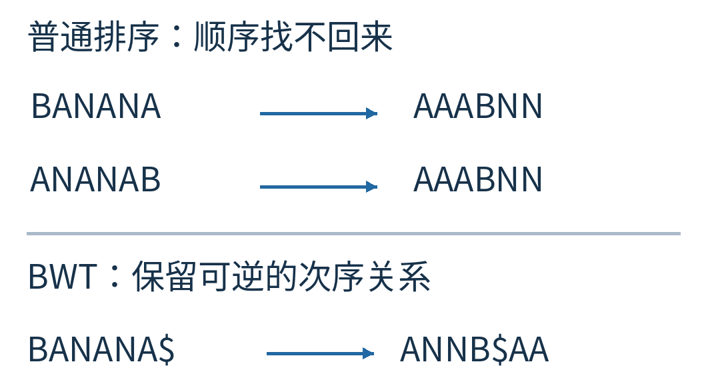

图1｜上方两条不同的输入经普通字符排序得到同一串，箭头无法唯一倒走。下方是本文要走通的变换：加入唯一结束标记后，输出 `ANNB$AA`，仍能找回 `BANANA$`。

先别急着问它压缩了几字节。**BWT 本身不把字符变少。**它负责重新组织数据，让后面的编码器更容易看出重复。我们先把这件“看似弄乱、实则可逆”的事弄明白，再讨论省空间的机会来自哪里。

## 把一句话接成一个圈

为了让开始和结束不再含糊，在 `BANANA` 后面加一个特殊标记 `$`，得到 `BANANA$`。本文约定：

- `$` 只出现一次，原始内容里没有它。
- 排序时 `$` 比 A、B、N 都小。
- 所有索引从 0 开始。

真实文件可以包含任何字节，实际格式要另行设计结束标记或记录原行位置。这里的 `$` 是教学字母表里的一个额外符号，不是说给任意文件尾部随手加一个美元符号就安全了。

现在把这七个字符想象成接在一起的环。选不同位置作为起点，顺着同一个方向读一圈，会读出七行。第一行是原串，第二行把最左边的 B 移到最右边，第三行再移一次。

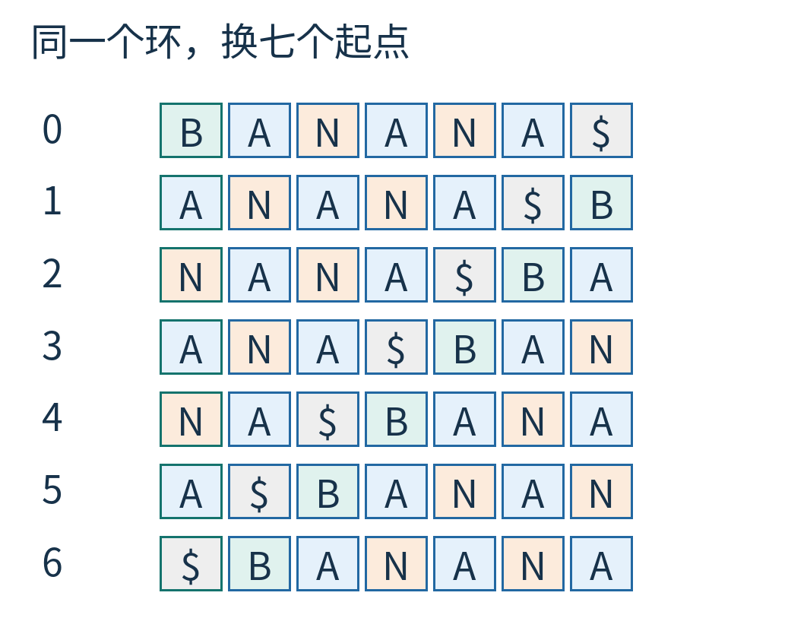

图2｜每行恰好有七个字符，没有新增或删除。每行最左一格就是这一行的起点；从左到右读完就是从相应起点绕原环一圈。表格是在列举旋转，不是把原文切成七段。

这些行叫循环旋转。为什么要做它们？因为每一行都同时告诉我们两件事：从这个位置往后是什么，以及这个位置前面的那个字符是什么。前者在行首，后者绕了一圈后落在行末。

例如 `ANA$BAN`，从一个 A 开始往后看，先遇到 N、A、结束标记；它的末尾 N，则是这个起点在原环上的前一个字符。

## 先按后文排队，再取前一个字符

把七行按字典顺序排列。比较两行时，从最左边开始；第一处不同的字符决定先后。短例子的所有行等长，不涉及“短单词先结束”的额外规则。

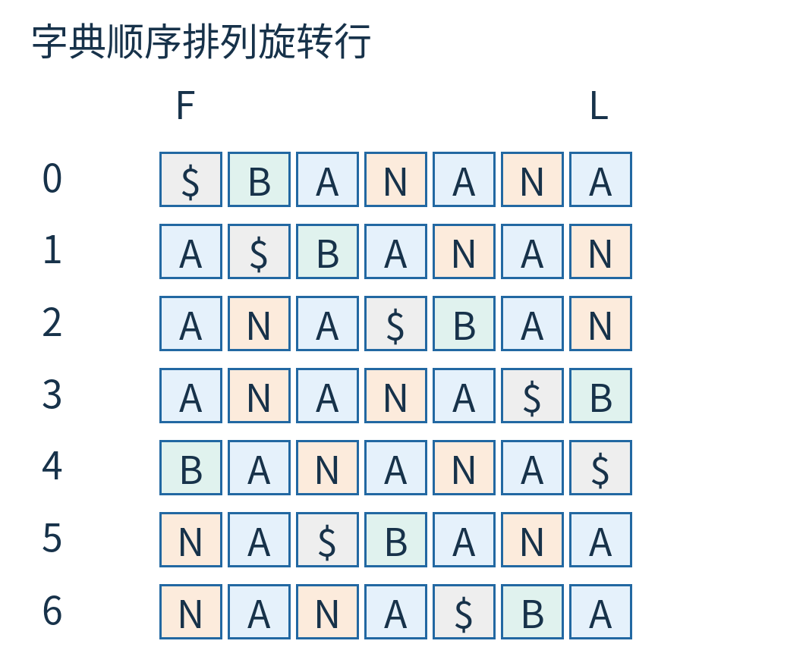

图3｜行号 0—6 是排序后的新位置。第一列 F 为 `$AAABNN`，最后一列 L 为 `ANNB$AA`。中间各列暂时保留，让你能检查每行是从哪里来的。

接下来，保存最后一列 L：

`ANNB$AA`

其余列先扔掉。

这一步最让人不放心：七行各七字，刚刚画了 49 个格子，最后只留七个字符，怎么可能够？

关键在于，那 49 个格子并没有装着 49 个独立字符。它们是同一个七字符环的七种读法，重复信息非常多。我们没有在压缩一个任意的 7×7 表格，而是在利用这张表格原本就有的结构。

先看第一列为什么不用保存：每一行从小到大排序，第一列自然也是从小到大。L 又恰好包含原串的所有字符各一次，所以只要把 L 的字符排序，就能得到 F。这里普通排序没有单独承担还原原文的任务，它只是帮我们找回第一列。

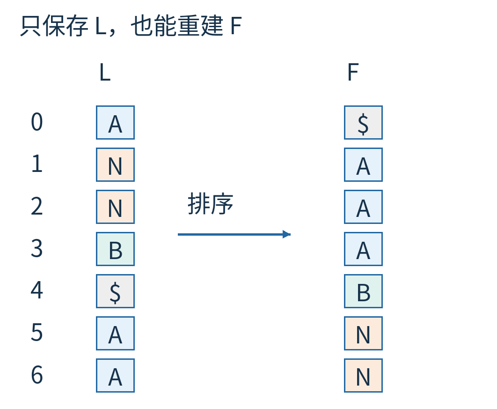

图4｜左边是保存下来的 L，右边是把相同字符排序得到的 F。两列每种字符的数量一致，但只看颜色还不知道该把哪个 A 连到哪个 A。

## 三个 A 该怎样一一认领

L 里有三个 A，F 里也有三个 A。随便连线行不行？不行。我们需要一种不会猜错的匹配。

按各自在列中从上往下出现的次序，给同字符临时编号：A 的第一次、第二次、第三次，N 的第一次、第二次。于是：

L 是 `A₁ N₁ N₂ B₁ $₁ A₂ A₃`。

F 是 `$₁ A₁ A₂ A₃ B₁ N₁ N₂`。

把相同的“字符＋出现次序”连起来。这些下标只是帮助认领的临时记号，不需要发送给接收者；接收者看着 L 和排序后的 F，自己数就能得到。

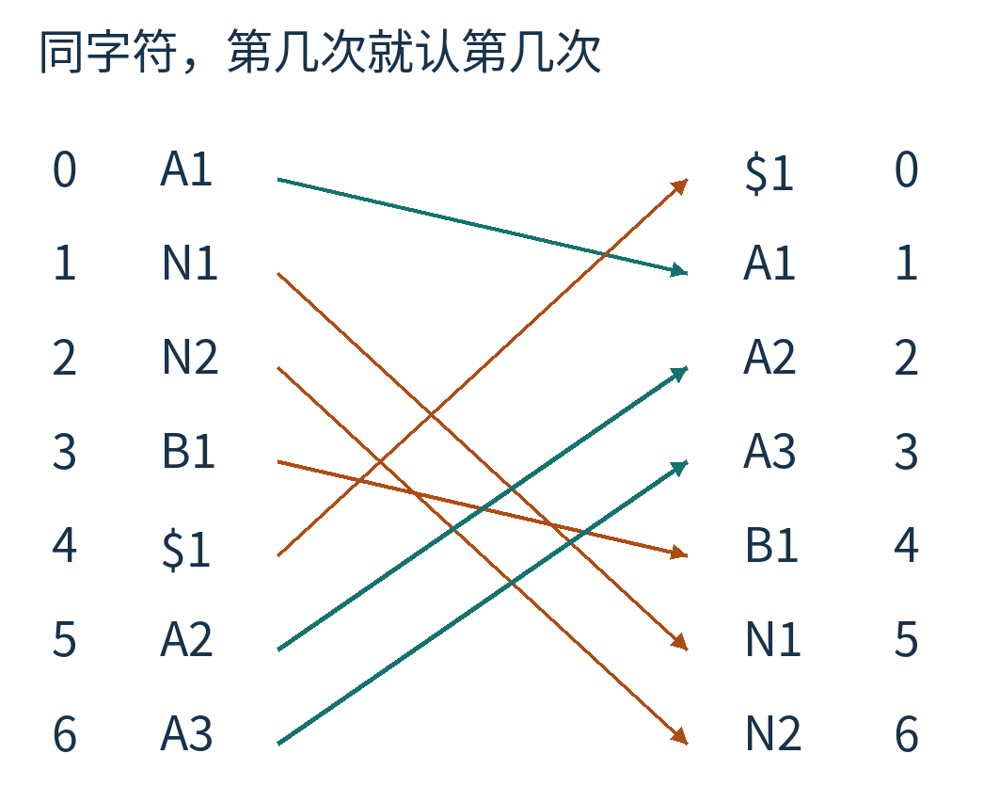

图5｜左列按 L 的顺序，右列按 F 的顺序。连线仅在同一字母的第几次出现之间建立；蓝色的三个 A 不会互换编号。最右边的 0—6 是目标行号；A1、A2 等表示同字符的出现次序。

为什么这套认领可信？拿两行都以 N 结尾的情况看：

`A$BANAN`

`ANA$BAN`

它们在排序表里依次为第 1、2 行。把最后的 N 移到最前面，就变成：

`NA$BANA`

`NANA$BA`

它们仍然按这个顺序，分别落在第 5、6 行。原因是新行开头同为 N，接下来比较的内容，就是旧行从开头往后比较的内容。共同的末尾 N 去掉，不会改变这两行第一次不同的位置。

因此，**所有以同一字符结尾的行，移尾到头之后，彼此先后顺序不变。**最后一列里的第一个 N，就对应第一列里的第一个 N；第二个对应第二个。A 也是一样。

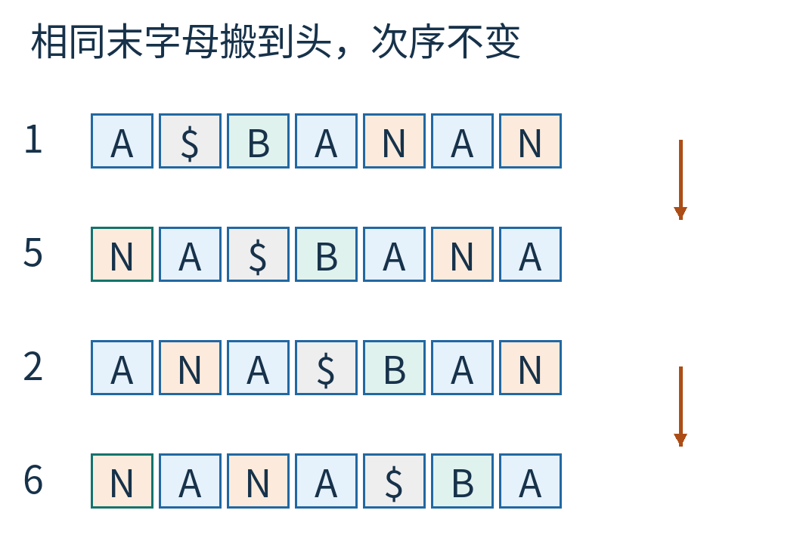

图6｜第一对为原行 1→5，第二对为原行 2→6；每对都把上行的末尾 N 搬到下行的开头。比较原行 1、2，再比较目标行 5、6：共同的首字母 N 不决定先后，余下内容保留旧次序。这是稳定匹配的理由。

## 一张七格路标表

把刚才的连线记录成行号，就得到一张表：

| 当前行 i | L[i] | 去往的行 LF(i) |
|---|---|---|
| 0 | A | 1 |
| 1 | N | 5 |
| 2 | N | 6 |
| 3 | B | 4 |
| 4 | $ | 0 |
| 5 | A | 2 |
| 6 | A | 3 |

LF 是 Last-to-First 的简称：把最后一列里的这个字符，认到第一列中对应的位置。

它不是“跳到下一个字符所在的行”。它做的是：**把当前旋转行最后的字符搬到最前面，找出新行的位置。**这相当于把环上的起点向前挪一格。

例如第 1 行为 `A$BANAN`，末字母是 N。移尾到头得到 `NA$BANA`，它在第 5 行，所以 LF(1)=5。

计算 LF 也不必真搬整行。只要知道两件事：F 中有多少字符严格小于当前字符，以及当前字符在 L 中是第几次出现。把出现次数从 1 开始数，则

`LF(i) = 比 L[i] 小的字符总数 + L[i] 在 L[0…i] 中的出现次数 − 1`。

这里的 `−1` 只是在把“一号、二号、三号”换成“零号、一号、二号”。

以 i=5 为例，L[5]=A。比 A 小的只有一个 `$`；从 L[0] 数到 L[5]，这是第二个 A。所以 LF(5)=1+2−1=2。你可以回到完整矩阵检查：第 5 行 `NA$BANA` 移尾到头，确实是第 2 行 `ANA$BAN`。

## 从结束标记倒着走回香蕉

L 中唯一的 `$` 在第 4 行。它说明这一行以结束标记收尾，因此这一行恰好就是我们想找回的 `BANANA$`。

虽然整行已经丢掉，但现在有 LF 路标。先取这一行的末字母 `$`，然后反复把末字母移到头，沿路记录新的末字母：

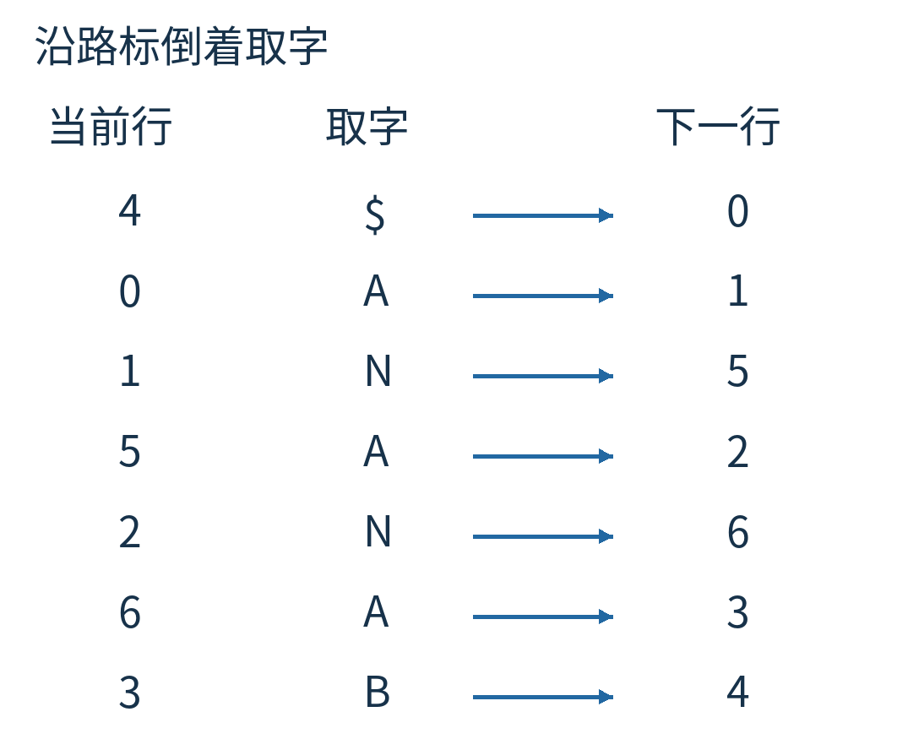

图7｜每一行给出“当前行号、取到的末字母、下一行号”。读出的顺序是 `$ A N A N A B`。箭头让起点向原环的前方挪一格，所以字符是倒着出来的。

七次读完，得到 `$ANANAB`。把它反过来就是 `BANANA$`，再去掉约定的结束标记，原文回来了。

请留意“七次”这个停止条件。不是走到看起来像单词的地方就停；我们知道 L 有七个字符，所以恰好恢复七个位置。唯一结束标记使这个有效变换在这些行之间形成一个完整循环。

这也解释了为什么不能随意改变同字符的匹配。比如把三个 A 的认领次序打乱，路标可能走错、提前绕圈，不能保证重建的是原来那条环。可逆性来自结构，不是“多试几种总能猜到”。

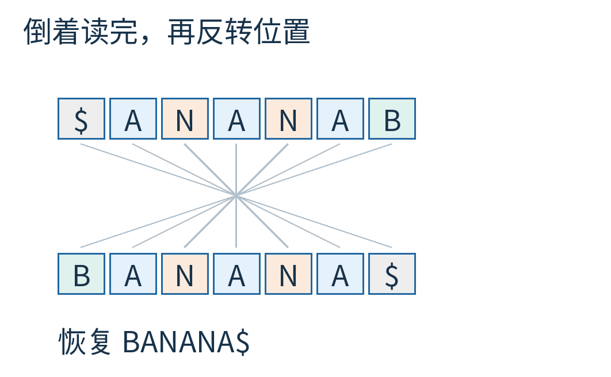

图8｜上行是从 LF 读取的倒序，下行是反转后的完整字符串。细线表示位置反转，而不是再次按字母排序。结束标记仍在最后。

## 还有一种慢办法，能看见缺失的列长回来

如果 LF 还是有点抽象，可以做一个更慢、但很直观的实验。

先准备七个空字符串。每轮，把 L 的第 i 个字符加到当前第 i 行前面，再把所有行排序。做七轮。

第一轮得到第一列。第二轮得到排序后各旋转行的前两列。第三轮得到前三列……直到整张旋转矩阵重新出现。

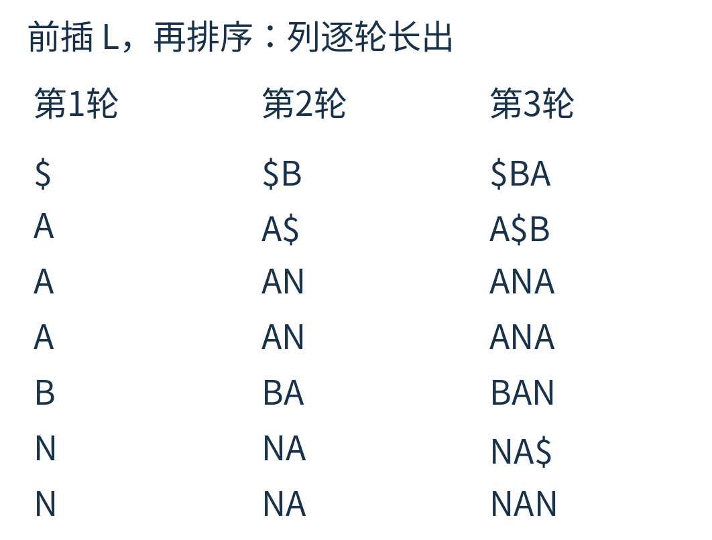

图9｜这里只画前三轮的实际输出。每轮都先按 L 的顺序前插字符，再整体排序；不是把同一个排序好的 F 一直加到各行前面。

为什么每次能多长出一列？因为上一轮的行已经代表各旋转起点之后的一段内容；L 给出每段内容前面的字符。相同字符的稳定次序把这两部分正确配在一起，重新排序就按更长的前缀排好了队。这和 LF 使用的是同一件事实，只是把整段字符串写了出来。

附带程序同时运行这两种逆变换并核对结果。慢方法要保存越来越长的整张表，适合看清过程；LF 方法只保存字符、出现次序和行号，不需要恢复所有旋转行。

## 还没少一个字，压缩的机会在哪里

看回排序后的矩阵。三行以 A 开头的旋转聚在一起；开头不仅是 A，而且后续内容相似的行，也容易排到附近。L 收集的则是这些相似后文之前的字符。

真实文字中，字词和短语并非随意组合。某些后文之前常出现相同字符，于是排序后，L 的局部区域可能更偏向少数几个字符。这是 BWT 有用的统计机会。它不是一句“排序必然创造重复”的定理。

我们的 `ANNB$AA` 里，NN 和 AA 形成了连续段。但长度仍是七，字符频数也完全没变。如果一个编码器只看全局三个 A、两个 N、一个 B 和一个 `$`，不管前后位置，它看不出新的好处。我们还需要利用**局部**重复的办法。

一种常见搭档叫移到最前，Move-to-Front，简称 MTF。维护一张字符列表，初始为 `[$, A, B, N]`。每读一个字符，输出它在当前列表中的位置，然后把这个字符挪到列表最前面。

读第一个 A：它在位置 1，输出 1，列表变为 `[A, $, B, N]`。

再读 N：它在位置 3，输出 3，列表变为 `[N, A, $, B]`。

再读一个 N：N 已经在最前面，输出 0，列表不动。

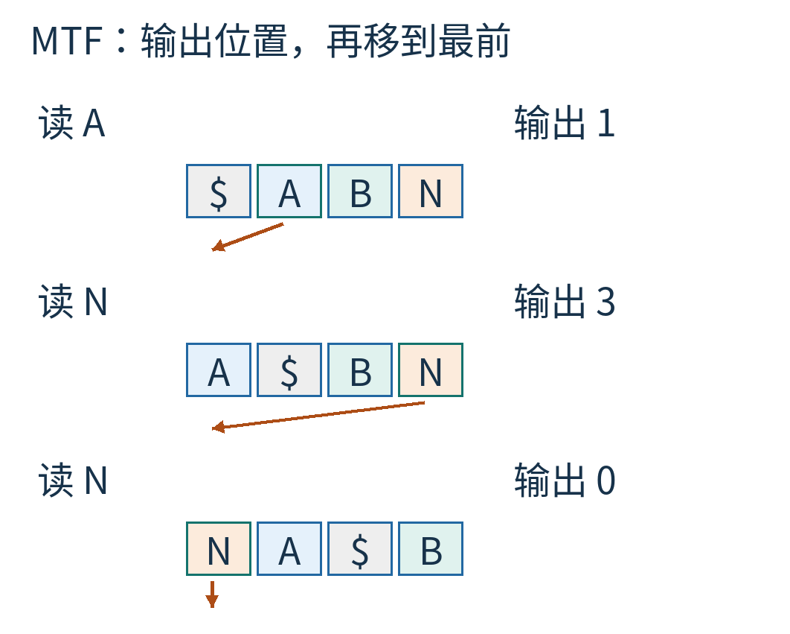

图10｜每步左上方标出本次读取的字符，橙色箭头表示它移到队首；右边数字是移动前的位置。连续重复会产生 0，但首次出现或间隔较远的字符仍可能产生较大的数。

整串 `ANNB$AA` 经这份初始字母表得到：

`1, 3, 0, 3, 3, 3, 0`。

小例子并没有突然变成一串惊人的零。它适合手算机制，却太短，不能拿来证明某个压缩器效果优秀。MTF 也可逆：接收者使用同一张初始列表，每次按位置取字符，再把它移到最前，双方列表就同步变化。

BWT、MTF、游程处理以及熵编码可以接在一起，每步分别完成自己的任务。本文只走通前两步，不把它们的中间整数冒充完整压缩文件。

## 没有一种排列能让所有文件都省空间

拿 `ABCD$` 试试。排序后的最后一列是 `D$ABC`。几个互不相同的字符仍然互不相同，没有变成大段重复。唯一标记、块长度和其他封装还可能增加费用。

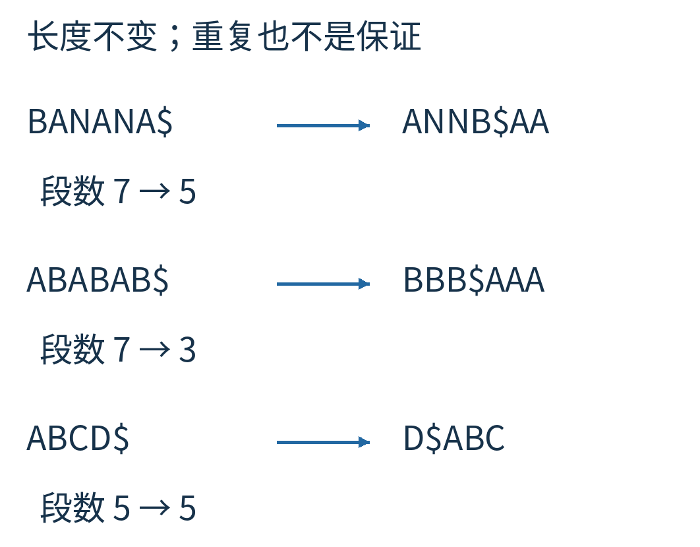

图11｜三组字符串都只是重新排列字符，长度不变。下方的无重复输入没有产生连续同字段。图中的“段数”按相邻字符变化直接计数，不等于压缩后的字节数。

再看工程中的分块。直接写出 n 个长度为 n 的旋转，会占 n² 级别的字符位置，长文件根本受不了。实际实现可以借助后缀排序等方法避免真的复制整张矩阵，也常把文件分成块处理。本文的教学程序有意选择小输入，用最直观的方法构造矩阵；它不是高性能 BWT 库。

分块还带来一项取舍：块大，能观察到更长范围的上下文，但工作内存、延迟以及出错影响范围也会变化；块小，局部处理方便，却可能截断可利用的重复。这里不指定“最佳块大小”，因为没有给出真实数据分布、实现和内存预算。

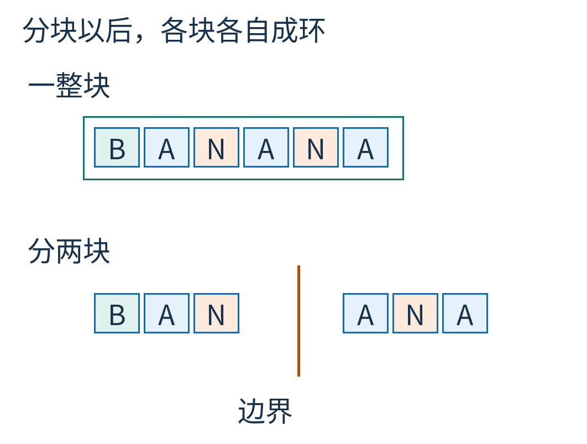

图12｜同一条教学文本可作为一块，也可以在标出的边界处分成两块。两个块各自独立变换，不能把跨界的字符当成同一块里的循环邻居。图只是边界示意，不是某种文件格式。

还有两个常被混淆的边界：BWT 不是加密，知道规则的人能直接还原；BWT 也不是错误纠正，某个字符或行号损坏时，不保证只能影响恢复后的一小处。

## 把可逆性交给程序再问一次

附带的 [verify.py](examples/verify.py) 用 `BANANA$` 生成旋转表、LF 表与 MTF 轨迹，然后穷举字母表 `{A,B,C}` 上长度 0—7 的所有字符串。每个字符串都追加唯一 `$`，分别走“变换—LF 逆变换”和“变换—逐列重建”。

总共 3,280 个输入全部回到原串。这个数来自 `1+3+3²+…+3⁷`；空字符串也计入，追加标记后只剩 `$`。

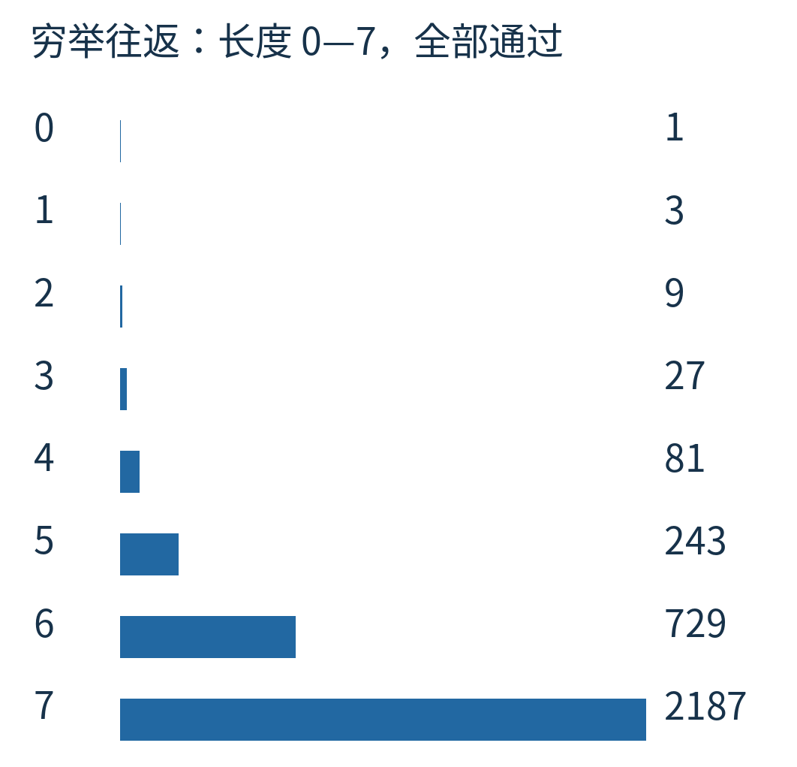

图13｜每行是一个输入长度，右侧是实际完成往返核对的案例数。蓝条共用同一尺度。它验证这份教学实现的有限测试范围，不能替代对任意长度算法的证明。

你现在可以改一个具体对象来检查自己的理解：把原串改成 `BANDANA$`，重新排旋转行，找到 L 中的 `$`，沿 LF 走八步。若每次都能说明“这一步把哪个末字母搬到了前面”，你已经抓住了逆变换的关节。

Burrows 和 Wheeler 在 1994 年的 [SRC 研究报告](https://www.eecs.harvard.edu/~michaelm/CS222/burrows-wheeler.pdf)中介绍了这种分块排序压缩方法。本文采用唯一结束标记的教学版本；这个小程序没有实现某种现成压缩文件格式，不能拿它的输出冒充实际格式的兼容文件。

有时，一个好办法不急着把信息删掉。它先改变信息站在一起的方式，让下一步更容易发现什么可以用更短的描述来表达。

图片来源：图1—13均为原创教学示意或随附程序的计算结果，图中字符串均为自拟算例。原创正文及这些原创图片采用 CC BY 4.0；代码许可与一手来源范围见 [sources.md](sources.md)。
