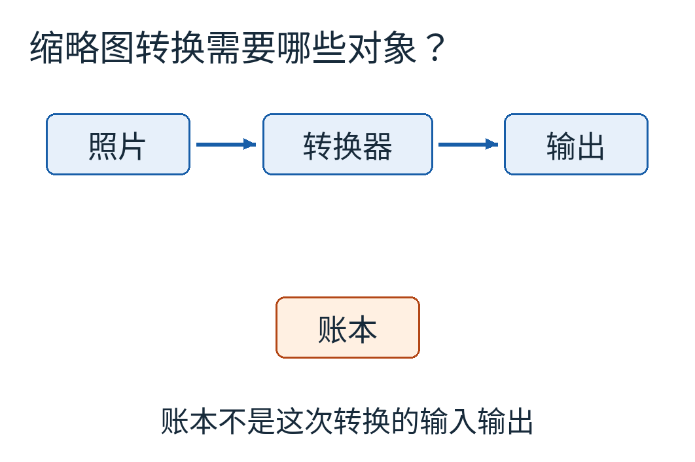
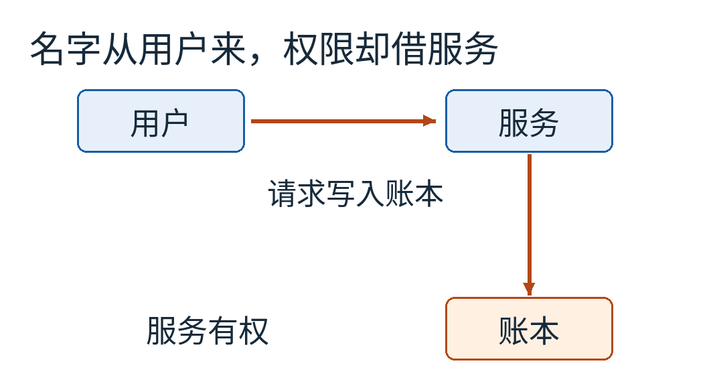
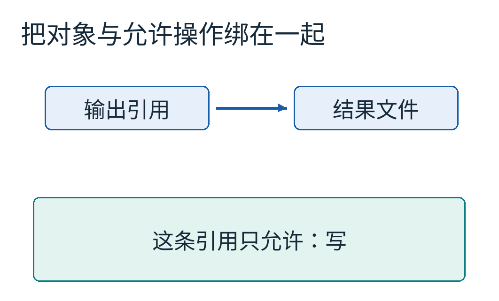
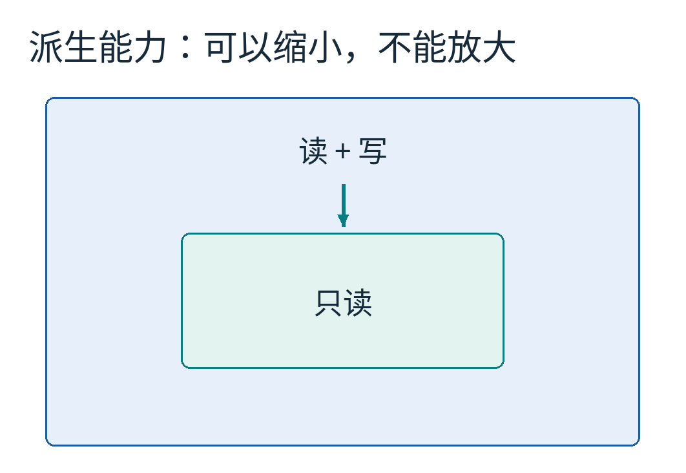
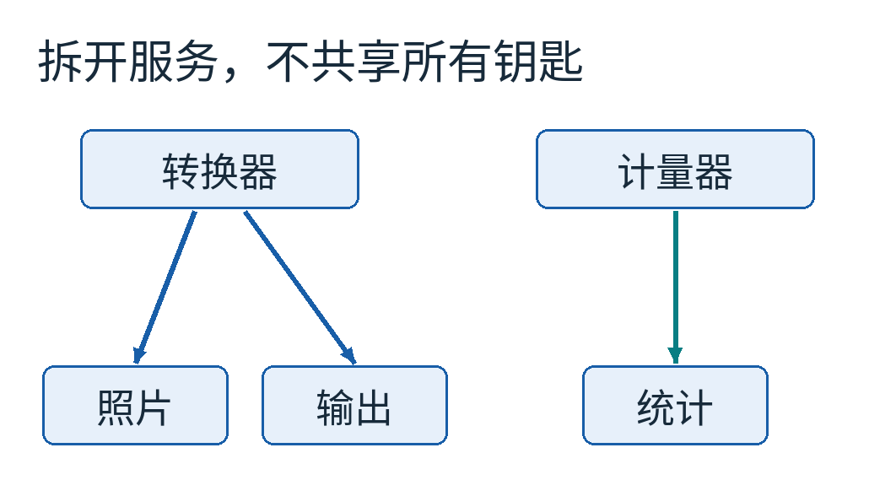
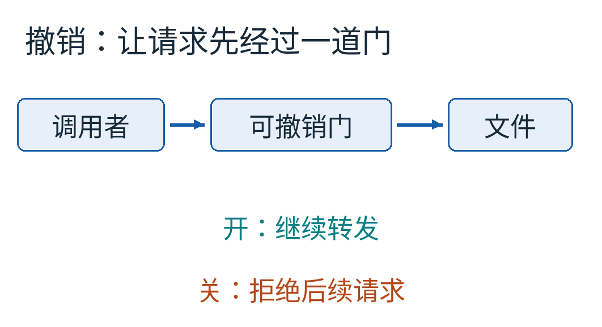
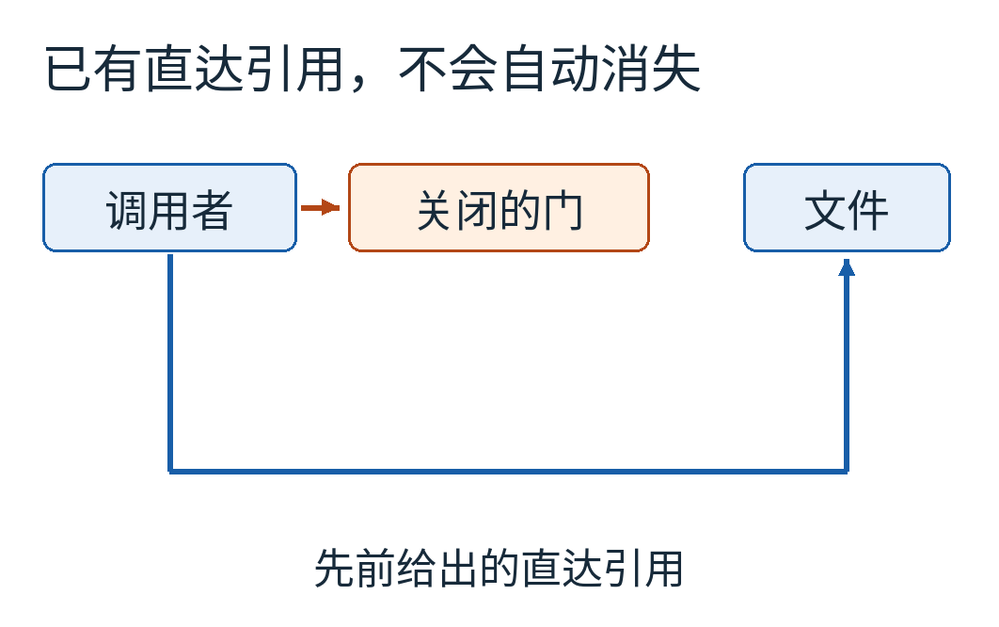
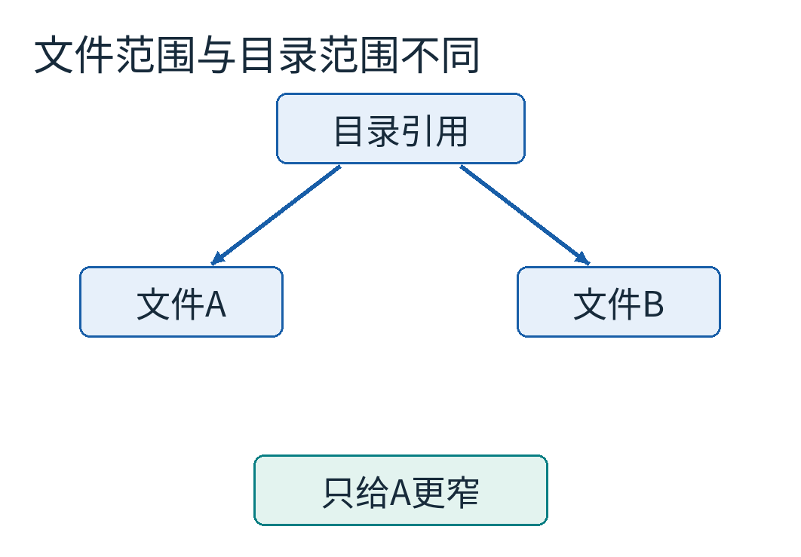
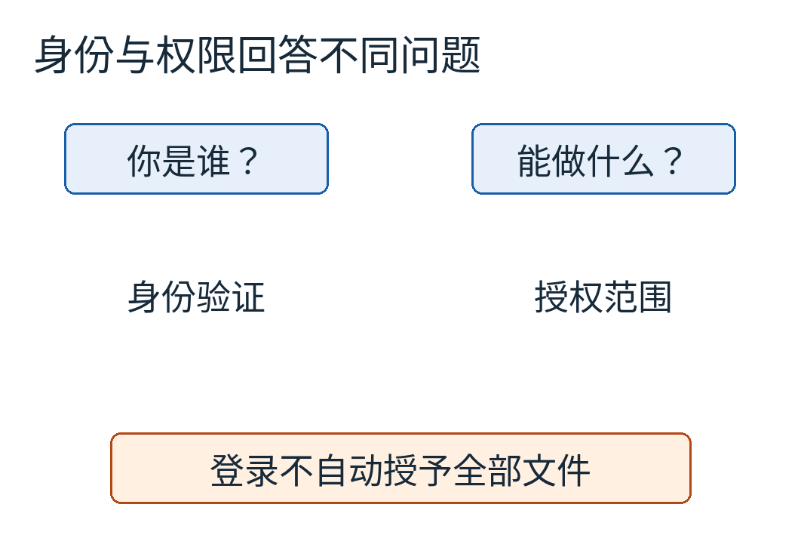

# 一个文件名，怎么借走了服务的权限？从“混淆代理人”理解能力安全

假设你写了一个图片转换服务。用户给它一张大照片，希望换回一张缩略图。服务理应读照片、写结果，再把处理次数记进自己的统计文件。

它不应该顺手改掉公司的账本。

这句话听起来毫无难度。可是，如果接口长这样：“把结果写到用户给出的文件名”，而服务恰好有权写账本，错误就可能从“文件名”与“有权打开它”之间钻出来。

本文用虚构的照片、结果文件、统计文件与账本讲解，不访问真实文件。蓝色箭头表示本次转换所需要的数据流；账本被放在下方，是因为它不属于这次任务。

问题不一定出在服务认错了用户。即使已经知道请求来自谁，它仍然可能**为一个目的取得权限，却在处理另一个目的时用了这份权限**。

能力安全，capability-based security，试图让这种混用变得更难：让“指的是哪个对象”和“获准对它做什么”，随同一份受保护的引用一起传递。

## 名字负责找东西，谁负责允许你碰它？

先拆开一次普通的文件打开动作。程序传入路径，操作系统沿着目录找到对象，再根据当前进程的身份与权限规则，判断能否打开。

路径回答“找谁”，权限检查回答“凭什么”。两件事可以来自不同地方：路径由用户输入，而权限来自运行服务的账号。

在我们的错误设计里，用户把输出文件名填成账本的名字。转换服务没有能力理解这是不是“好意”，它只是按参数打开输出。系统看到的是服务发出的请求，恰好服务对账本有写权限，于是批准。输出图像的字节就可能覆盖账本。

橙色箭头表示危险路径：用户选目标，服务提供打开目标的权力。关键不是这个文件名有多难猜，而是猜到以后，调用链是否会替请求补上原本不属于它的权力。

Norm Hardy的《The Confused Deputy》描述了一个相关的编译服务事例：用户指定调试输出位置，编译器却使用了为另一任务取得的权限，写坏计费文件。作者在开头明确说，叙述更改了非关键细节。因此它适合作为当事人对设计问题的说明，不宜被补写成细节精确的现场故事。本文的图片转换服务是独立教学例，不是那段历史的复原。[Hardy原文](https://css.csail.mit.edu/6.858/2015/readings/confused-deputy.html)

“混淆代理人”里的代理人，是替请求者办事的服务。它有两种不同来历的权力，却没有让这次操作明确指出究竟使用哪一种。

## 如果交过去的不是名字，而是一条获准的引用呢？

换一种接口。用户先通过正常授权取得一个“只许写结果文件”的引用，把它交给转换器。转换器不再接收任意输出路径，而是沿着这条引用执行写操作。

这条引用同时携带两层含义：目标是这个结果对象；可执行的动作包括写，不包括任意操作其他对象。

可以把它暂时想成一张写着门号和可做动作的票，但比喻有两个限制：票不能靠随手复印一串文字伪造；拿到票也不一定能修改票上的权限。真正保证这些性质的是操作系统、硬件、语言运行时或其他可信机制。

在这种设计里，用户即使知道账本的路径，也不能把结果引用的目标改成账本。字符串知识与操作能力被分开了。服务自己的统计写入，则应该使用明确授予统计用途的另一条引用。

这不表示服务从此绝不可能犯错。如果它同时持有输出与统计的写引用，代码仍可能把两者传错。能力设计让权力路径可以收窄、检查与分隔，不会自动证明程序所有逻辑都正确。

更强的做法，是让负责图像转换的组件根本不持有统计或账本的写引用。稍后我们就把服务这样拆开。

## “引用不能伪造”，为什么可以表现为一个小整数？

你可能见过文件描述符：程序打开文件后得到一个整数，例如3，后续读取或写入都使用它。既然数字这么小，不能直接猜一个吗？

重点在于数字并不是独立的全球通行证。内核会在**这个进程自己的描述符表**里找第3项。一个进程的3可能指向照片，另一个进程的3可能指向日志；没有被授予的表项，不会因为猜中别人的数字就出现在自己的表里。

表是本文模型的抽象。转换器的3是照片读引用，4是结果写引用；计量器的3指向统计文件。数字只是本地索引，表项与目标之间的受保护关系才承担安全职责。

并非所有能力系统都用整数表，也不是所有文件描述符都自动具备完整的最小权限属性。目录引用、设备句柄、继承的连接，各自可能附带比你想象更多的操作权。需要逐项审视它们实际允许什么。

2010年的Capsicum论文讨论了把能力机制逐步加入UNIX环境的方法，用文件描述符关联受限权利，同时通过能力模式约束全局名字空间访问。它是具体操作系统设计，不是给普通整数加一个好听名字。[Capsicum原论文](https://www.cl.cam.ac.uk/research/security/capsicum/papers/2010usenix-security-capsicum-website.pdf)

## 把权利缩小一点，再交给下一位

假设主程序持有某文件的读和写权，但给预览插件时只需要读。可以派生一条目标相同、权利更少的引用，再把它交出去。

用集合来写，主程序的权利是 `{读, 写}`，插件拿到的是 `{读}`。后者必须是前者的子集。插件不能反过来申请 `{读, 写, 删除}`，因为那不是缩减，是加权。

内层绿色区域表示更小的动作集合。图上的面积只表达包含关系，不代表两种权利各占多少字节。

FreeBSD的 `cap_rights_limit` 接口就提供权利限制操作；本篇只说明“限制已持有描述符的权利”这个机制，不把论文中历史接口名字当作今日代码示范。[官方手册](https://man.freebsd.org/cgi/man.cgi?query=cap_rights_limit)

这也解释了“最小权限”为什么不是一句口号。最小到什么程度，需要由具体任务决定：读取照片是否需要写它？输出是否必须可以读取？拿到一个文件是否有必要同时取得整个目录？范围与动作，都有缩小的空间。

但“我只给了读权限”也不代表信息不会离开。一旦对方读到了照片，它可以在其他已拥有的输出渠道中传走内容。控制对象操作与控制信息传播，是相关但不同的问题。

## 权限图，比“这个服务很可信”更具体

把转换器和计量器分开。转换器只得到照片的读引用、结果的写引用；计量器持有统计的写引用。两者之间只传递“完成一项转换”这样范围明确的信息。

每条箭头表示一条允许的访问路径。图里没有从转换器到统计或账本的边，才是我们希望保持的隔离性质；不是给转换器贴一张“谨慎工作”的提醒。

这里的拆分需要真实隔离边界来支持。两个对象只是放在同一个普通Python进程里，变量名叫private，并不能阻止任意恶意代码查看或修改整个进程。可以用对象模型教授权传播，却不能因此声称造出了操作系统沙箱。

现实部署还要检查已有的权限是否从旁门漏进来：继承的文件描述符、共享内存、网络连接、全局目录访问，都可能重新连出一条边。Capsicum的 `cap_enter` 进入能力模式，正是把对全局名字空间的访问也纳入约束；只减少一个句柄的权利，却留下任意打开全盘文件的入口，并不构成完整限制。[FreeBSD cap_enter手册](https://man.freebsd.org/cgi/man.cgi?query=cap_enter)

## 已经交出去的权利，还能收回来吗？

最直接的引用一旦复制给别人，撤销就不一定简单。删除自己手里的那份，不等于删除别人的副本。

一种常见设计是在中间加一道可撤销的门。调用者只得到这道门的引用；门保存真正的文件引用。开着时转发请求，关掉后拒绝后续请求。

这解决的是“此后经过这道门的操作”。如果操作已经开始或数据已经被读出，关闭开关不自动把它们倒带。若用户曾拿到直达文件的引用，也能绕开这道门。

蓝色绕行线不是攻击技巧，而是授权图中的事实：如果系统以前亲手给过一条独立的直达边，后来只关闭另一条边，前者仍然存在。想让撤销可控，就要从授权之初决定所有相关操作都必须经过哪个可撤销点。

不同能力系统提供的复制、转交、派生、撤销机制并不相同。不能只因为两种系统都用了capability一词，就假定它们都具有相同的生命周期规则。

## 一个文件与一个目录，能差多少权力？

给插件结果文件的写引用，只允许它改这一个目标。给它一个目录引用，则可能允许它在目录范围内查找、创建或修改许多对象，具体还要看附带权利。

目录图的分支表示命名范围，不意味着任何目录引用都默认有图中全部权限。把范围画出来以后，才能问“我是不是只需要给A，而没有必要给整层目录”。

当请求需要临时打开多个资源时，程序仍可能需要一个负责检查策略的可信组件。能力并没有消灭所有策略判断，它改变了判断完成后，权力如何被明确传递与限制。创建权限、授予权限与日常使用权限，可以分开设计。

这与登录也不同。身份验证回答“你是谁”，授权回答“这次对这个对象做这个动作，依据哪份权力”。一个用户已成功登录，不代表他自动取得所有文件的读写权；一条限定范围的能力引用，也未必携带使用者的完整实名身份。

## 用一个内存模型，把五种请求真的跑一遍

[模型代码](examples/model.py)在字典里放四个虚构对象，不打开任何真实文件。一个被假设为可信的Broker维护各主体的句柄表。测试脚本用参数`who`代入已经确定的调用主体，再给出槽号与操作；Broker查表后决定允许还是拒绝。

这里有一条不能省略的前提：真实系统里的调用主体必须来自可信调用上下文，例如操作系统识别出的进程，不能让请求者自由填写。本模型没有实现主体鉴别。假如转换器能够自称`meter`，传入`meter`的槽号3，就会使用计量器的表；仅仅查表并不能阻止这种冒充。代码中的`who`是测试驱动提供的条件，不是建议向不可信客户端开放的身份字段。

这只是顺序授权模型，不是Python安全沙箱。若让不可信代码直接进入同一个解释器并任意检查Broker内部数据，本模型的可信边界就不成立。

在规定接口下，程序实际测试了五项请求：读照片允许；改照片拒绝；写输出允许；猜一个未授予的账本槽号拒绝；把只读派生为读写拒绝。账本字典项仍是原来的内容。

这里的“拒绝”来自模型规则，不是操作系统审批，也不是在真实服务上做的安全测试。我们验证的是：在这张受保护表被正确维护的前提下，接口调用不能从未授予的槽号取得新权力。

程序还检查撤销的边界：关闭门以后，经门请求失败；但之前授予的直接写引用仍能使用。这是预期结果，用来防止把“有撤销按钮”误认为“撤销了所有复制出去的权利”。

如果你愿意改一次模型，可以把转换器的照片权利从 `{读}` 改成 `{读,写}`。第二项请求就会通过。再删除输出槽号4，写结果会被拒绝。这个练习没有复杂数学，却能让“最小权限”从抽象原则变成一组看得见、改得动的边。

下次设计插件、文件处理服务或任务执行接口时，可以先画三个东西：谁持有引用，引用指向谁，沿着它允许做什么。再检查有没有一条请求只提供了名字，却让别人不知不觉补上权力。

那一条多余的边，有时比再加一层“请小心验证输入”的提醒更值得先处理。

图片来源：12张均为本文原创权限关系图与内存模型结果图；没有复制第三方论文图或人物照片。[来源、许可与复现说明](sources.md)
