# 排错一个方案，怎样把所有选择原样放回？Dancing Links

桌上有六种编号的零件，1 到 6。你需要每种恰好一件，但供应商只按固定组合卖小包，不能拆包，也不能重复买同一包。可选的小包如下：

A 装 1、2；B 装 1、3；C 装 2、4；D 装 3、5；E 装 4、6；F 装 5、6；G 装 1、4。

选哪些包，才能不多不少凑齐六种编号？

这是一个特意造得很小的选择题。你也许已经看出 A、D、E 可以，B、C、F 也可以。现在把问题交给程序：它试错时，怎样把“不再能选的包”临时摘掉；发现走不通，又怎样把它们准确装回去，而不是每走一步都复制整张清单？

Dancing Links，通常缩写为 DLX，关注的正是这种撤销。它没有替搜索消灭所有岔路，却让岔路上的改动变得小、局部，而且可逆。

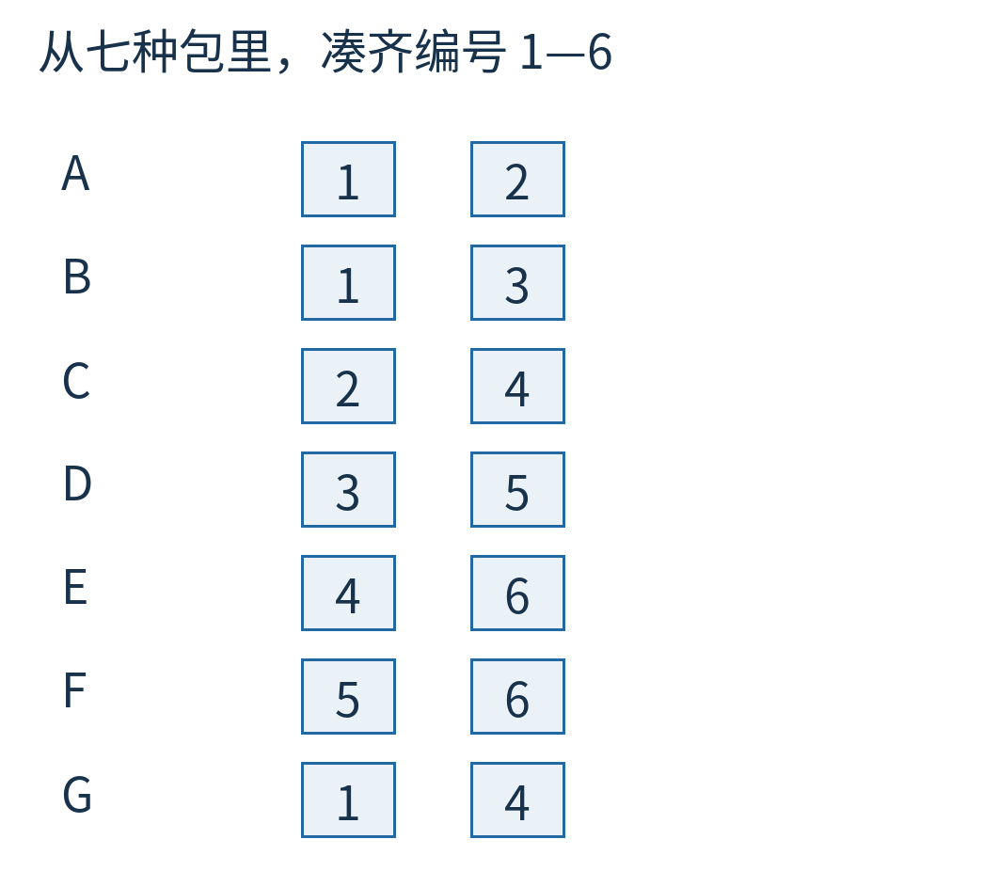

图1｜每一行是一种可选包，方格内是它携带的编号。颜色标出包中包含的编号；图中不是包的实物照片，也不表示零件必须按某种几何形状摆放。

## “恰好一次”，同时管住漏拿和多拿

先别碰指针，把题目写成一张 0/1 表。

每列对应一个必须满足的需求，也就是某个零件编号；每行对应一个可以选或不选的包。包里有这个编号，交叉格写 1；没有就写 0。

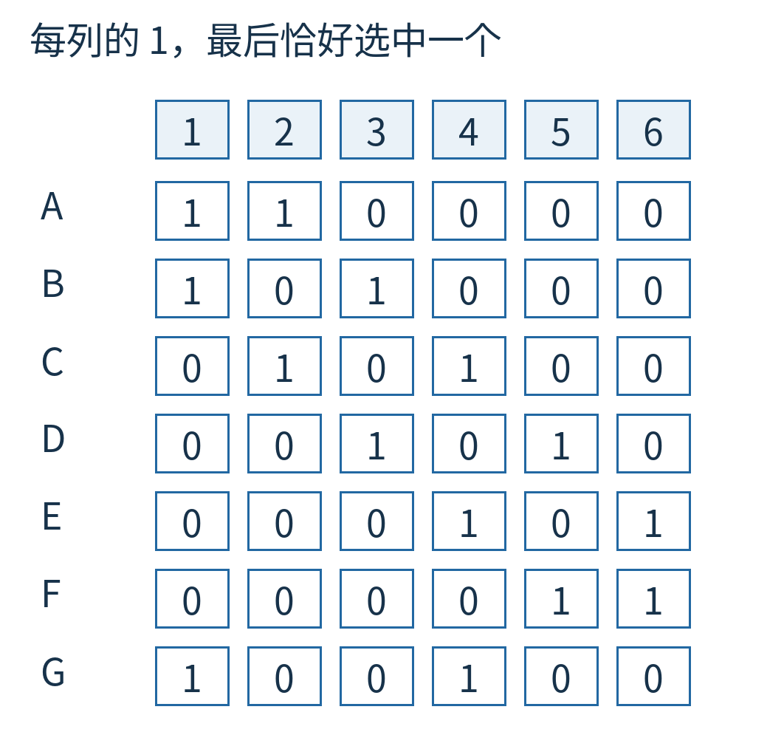

图2｜A 行在第 1、2 列为 1，G 行在第 1、4 列为 1。选中若干行之后，每一列的 1 必须恰好加成 1：加成 0 是缺件，加成 2 是重复。

这叫**精确覆盖**：在一批候选子集中，选出若干个，让目标集合中的每个元素恰好被覆盖一次。

这里“覆盖”是满足编号需求，不一定是把一块纸压在另一块纸上。拼板也可以转成这种题：每个格子一列，每种合法放置一行。如果每块拼板还必须用且只用一次，可以再为“这块拼板的身份”加一列，让每次放置同时覆盖格子和身份。但这属于另一份模型；本文一直使用桌上的七包零件，不中途换一张数独题让你重新认对象。

只有“至少一次”的集合覆盖不一样。若某个编号允许买两份，多出来也无所谓，就不能继续用这里的“有共同编号就冲突”规则。

## 先问一个编号，再试能提供它的包

挑一个尚未满足的编号，例如 1。能提供 1 的包有 A、B、G，因此任意完整答案必须在这三者中恰好选一个。

先故意试最容易出问题的 G：它提供 1 和 4。

既然 1、4 已经满足，后面不能再选任何也提供 1 或 4 的包，否则会重复。因此 A、B、C、E 都不能再选，G 也已用过。剩下的可选包只有 D、F，尚未满足的编号是 2、3、5、6。

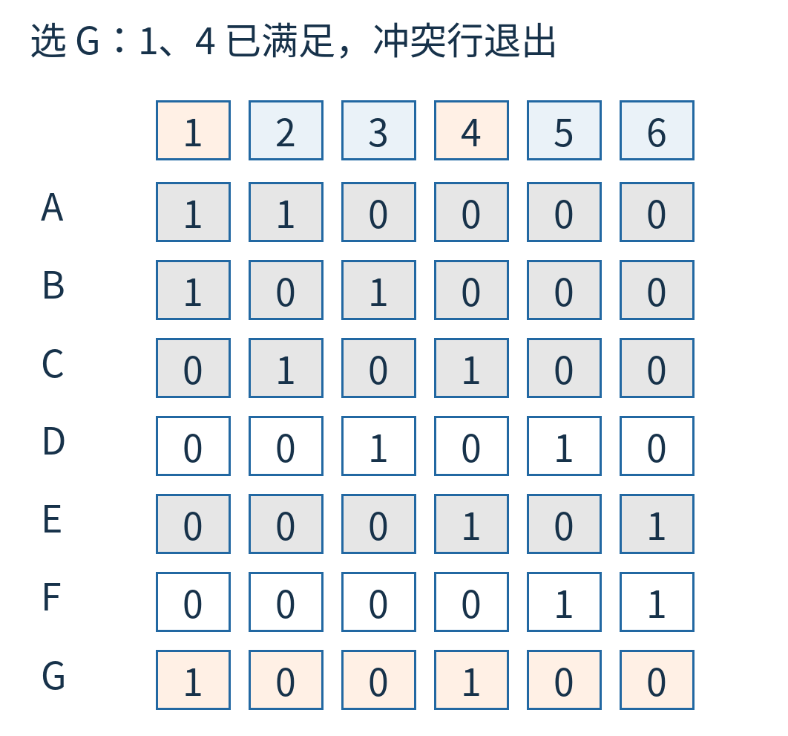

图3｜橙色列头标出 G 已满足的 1、4；浅灰行与它冲突，被临时移出候选。余下 D、F 都没有编号 2，下一张图把这个缺口单独放大。

编号 2 还有谁能提供？一个也没有。我们不必继续枚举 D 和 F 的各种组合，这条分支已经死了。

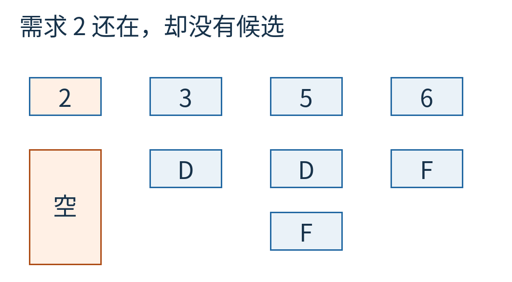

图4｜第 2 列仍是必须满足的需求，却没有任何活跃候选行。空列表示失败；它与“需求列已经全部满足、所以不再有列”是完全相反的情况。

记住这两种终点：**还有列却某列为空，失败；所有需求列都已满足，成功。**它们在代码里都可能长得像“空”，但含义不同。

## 换 A，把成功的一条路走完

撤销刚才对 G 的选择，恢复全部七行六列。再选 A，它满足 1、2，因此与 1 或 2 冲突的 B、C、G 暂时不能用。

剩下需求 3、4、5、6，候选为 D、E、F。

其中需求 3 只有 D 能提供。选 D，同时满足 3、5，并排除也提供 5 的 F。最后需求 4、6 正好由 E 满足。

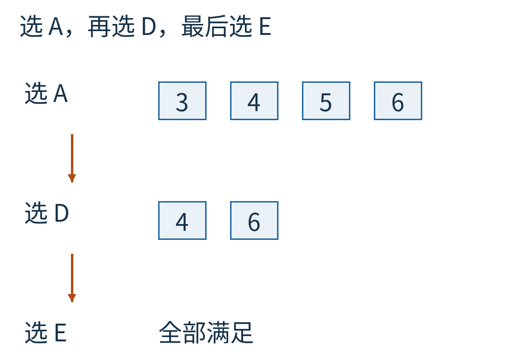

图5｜从上到下是同一分支的三个状态：选 A 后剩 3、4、5、6；选 D 后剩 4、6；选 E 后没有未满足需求。每一步显示的是剩余问题，编号始终沿用原来 1—6。

如果还要找全部答案，就撤销 E、D、A 所做的改动，回到其他岔路。这个小题的另一组答案是 B、C、F。程序不是“找到第一组就证明只有这一组”；是否继续枚举，要由任务决定。

这套“选列、逐行尝试、删冲突、递归、恢复”的搜索通常称为 Algorithm X。我们还没解释 Dancing Links，因为同一搜索也可以用集合、位数组或每次复制的新矩阵来实现。**搜索的选择规则，与保存和撤销状态的数据结构，是两层不同的事。**

## 从一个节点的消失开始

为了看清可逆撤销，先暂时离开二维表，只看三个相邻节点：左边 L，中间 x，右边 R。

双向链表给每个节点保存左右两个邻居。原来 L 的右邻居是 x，R 的左邻居也是 x；x 自己记着 L 和 R。

要把 x 从可见链里摘掉，只改两处：

`L.right = R`

`R.left = L`

这样从 L 向右走，会直接到 R；从 R 向左走，也直接到 L。**但不要清空 x 自己记下的左右邻居，也不要释放 x 的存储。**

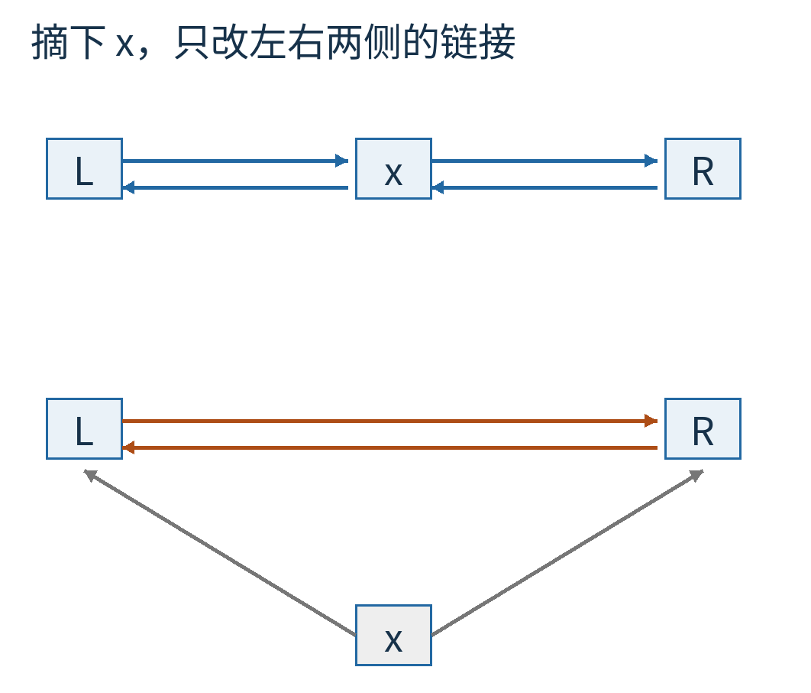

图6｜上方 L↔x↔R 是原链；下方实线表示当前可见链 L↔R，灰色细线表示被摘下的 x 仍保存旧邻居地址。灰线不是当前可见链上的通行路线。

当需要恢复，而且这一步的邻居已经回到应有状态时，只改回来：

`L.right = x`

`R.left = x`

L 和 R 从哪里找？从 x 保留下来的两个字段找。

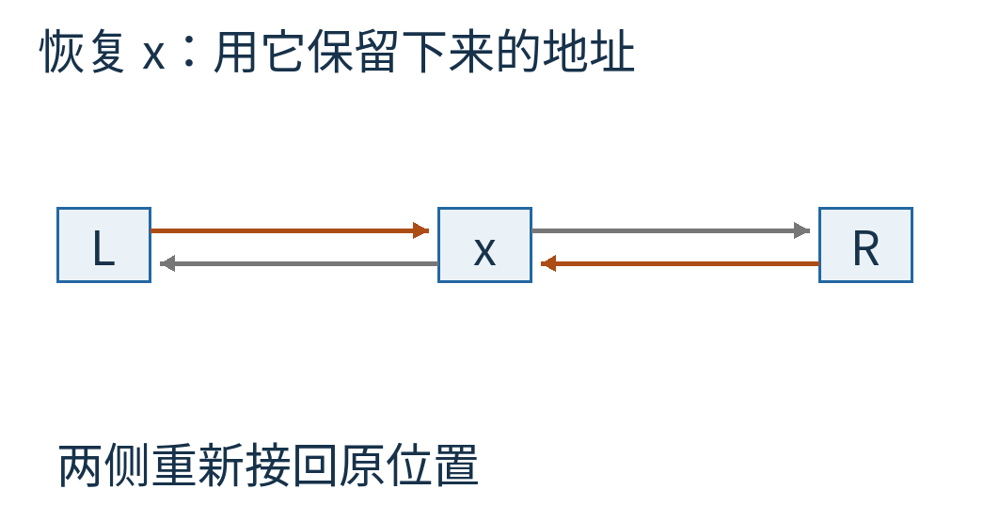

图7｜灰色箭头从 x 指向 L、R，是 x 一直保存的左右地址；橙色箭头让两侧重新接回 x。恢复后没有 L 与 R 绕过 x 的直达链接，恢复的是原位置，不是把 x 随便插到链尾。

这就是“跳舞”的基本步子：节点暂时退出可见队伍，却把回去的位置带在身上。它不适用于“删除之后释放内存、对象已被别人重用”的情况。这里是在一个受控的搜索过程中保留节点，稍后按撤销规则复原。

## 一张稀疏表，为什么要有四个方向

回到精确覆盖矩阵。大部分格子为 0，没必要为它们建立节点。只为每个 1 建一个小节点。

同一行的节点通过左右指针连成一个环；同一列的节点通过上下指针连成一个环，每列另有列头。所有仍未满足的列头，再通过左右指针连成一条带总入口的环。

于是，一个非零节点有四个邻居：左、右、上、下，还知道自己属于哪一列。列头记录当前有多少候选节点，方便发现空列和挑最受限制的需求。

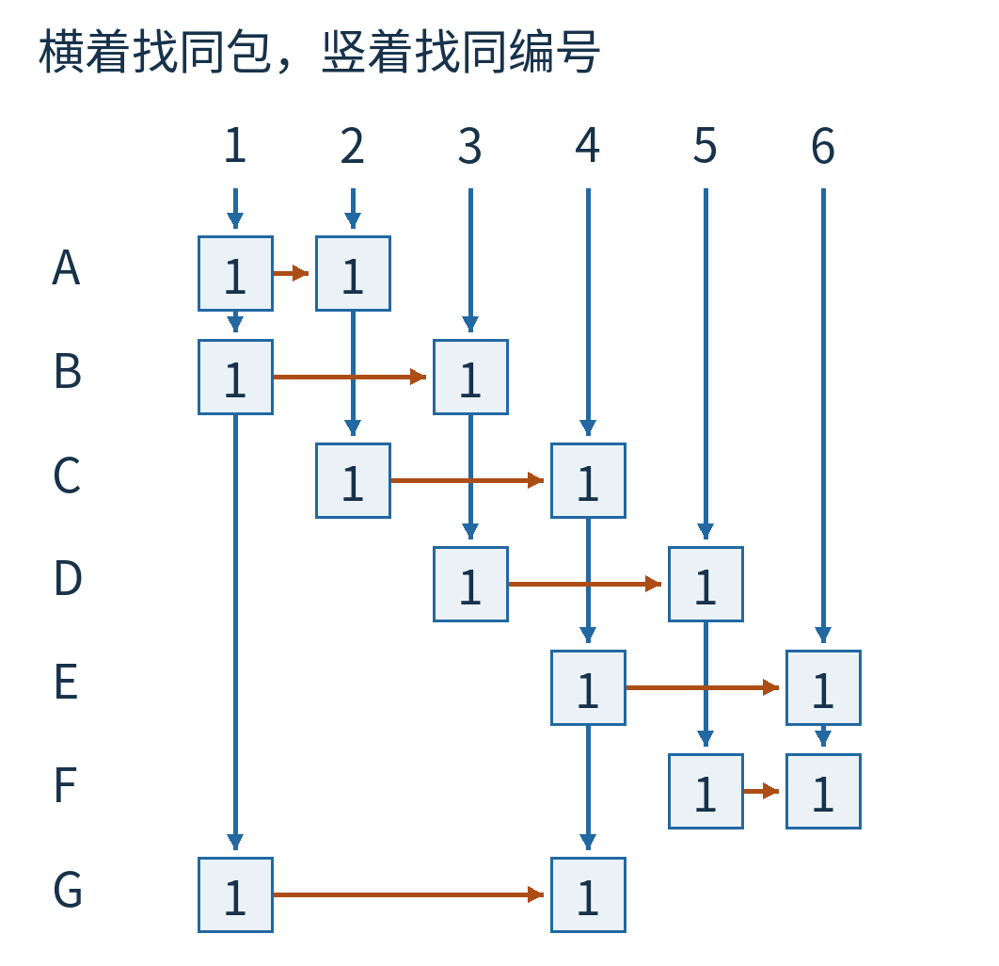

图8｜沿用完整矩阵的行列编号，只画 14 个非零节点；横线联系同一包，竖线联系同一编号。空白交叉处没有节点。这里只画向右、向下的连接；反向链接及循环链尾回到链头的线为保持可读而省略。

拿 A 来看：它的两个节点 A:1、A:2 左右互联。列 1 往下会遇到 A:1、B:1、G:1；列 2 往下会遇到 A:2、C:2。横着走是问“这个包还提供哪些编号”，竖着走是问“这个编号还有哪些包能提供”。

程序中的链是环状的，走到行末会回到起点，走到列末会回到列头。示意图为了保持可读，未把所有回绕线都绕一大圈；正文和代码里的停止条件是“回到本次起点”，不是“看见画布边缘”。

## cover 一列，到底改了什么

现在看一个具体操作 `cover(1)`。它的意思是暂时把“编号 1 这个需求”从未完成的列头链里摘走，并为围绕这列的候选分支准备剩余问题。

先摘下列头 1。接着沿第 1 列向下，依次遇到 A、B、G。对这些行，沿行向右走，把它们在**其他列**里的节点从竖向链里摘掉：

- A:2 从第 2 列移出。
- B:3 从第 3 列移出。
- G:4 从第 4 列移出。

每移出一个节点，对应列头的候选数量减一。

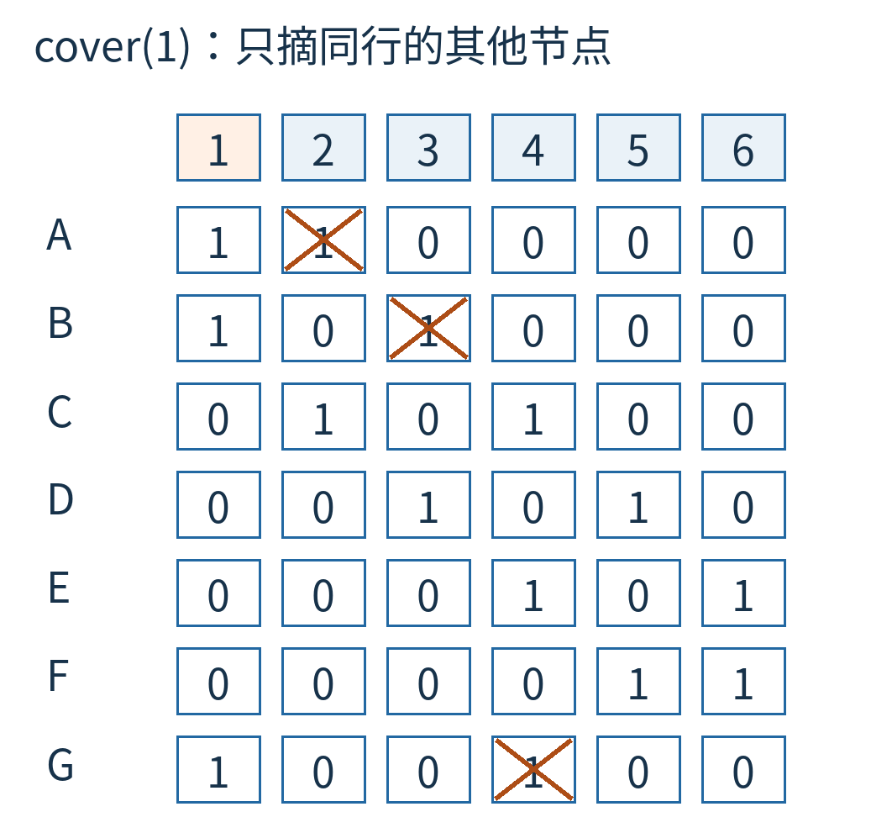

图9｜第 1 列的 A、B、G 本身仍保留为可遍历的候选分支；被摘掉的是这些行在其他列的节点。横向行链仍在，所以搜索仍能知道一个被试选的包还涉及哪些编号。

为什么不把第 1 列的三个候选一起彻底删光？因为搜索还要依次试 A、B、G。覆盖列头是在告诉更深层“这个需求由当前层负责”，不是提前决定只准用哪一行。

试某一行时，再覆盖那一行的其余列。例如从第 1 列挑到 G，接着 `cover(4)`。这样，第 1、4 列已经由 G 负责，与它们相交的其他行都从剩余可选结构中排除了，于是重现前面“第 2 列为空”的失败。

此处有个容易混淆的细节：A:2 在 `cover(1)` 后不可从第 2 列向下遇到，但 A 行的左右链接仍然保留。某个方向暂时不可见，不等于节点不存在，四个方向也不是一概全部改掉。

## 撤销要把动作倒着走

在 G 分支里，先做 `cover(1)`，再做 `cover(4)`。返回时先 `uncover(4)`，最后再 `uncover(1)`。更深层选过更多列，也同样先撤销最晚发生的改动。

列内部的恢复也采用相反遍历方向：覆盖时从上向下逐行、从左向右处理同行其他节点；恢复时从下向上逐行、从右向左把节点接回竖向链，候选数量加一，最后接回列头。

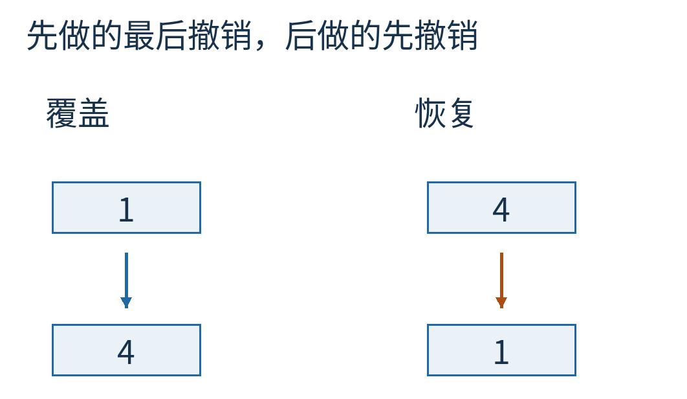

图10｜左侧是 G 分支的覆盖顺序，右侧是对应恢复顺序。不是重新猜哪些节点应该存在，而是撤销已经发生的那一串操作。

为什么强调逆序？后做的改动可能暂时摘走前一步记录的邻居。先让较晚的改动退场，较早一步保留的邻居关系才恢复到它当时看到的状态。这里遵守并验证的是这种严格的成对撤销契约，不承诺任意调换恢复次序、任意跳过某次恢复后仍然正确。

同样重要的是：搜索过程中不能擅自永久删除这些“暂不可见”的节点，否则保留在旧节点里的地址就失去意义。DLX 的优势建立在可逆地隐藏和重现，而不是垃圾回收。

## 为什么挑最短的一列

开头为了让失败清楚，我们故意先问编号 1，试 G。实际实现常挑候选数量最少的未满足列。

这不是改变题目，而是在问：哪个需求最难满足？如果只有一个候选，就先处理它；如果一个都没有，马上知道这一分支失败。如果有两种选择，总比先展开几十种选择更值得试。

在原表中，第 1、4 列各有三个候选，其余第 2、3、5、6 列各有两个。随附代码在候选数相同时按列头顺序选择，所以首先选第 2 列，尝试 A、C。

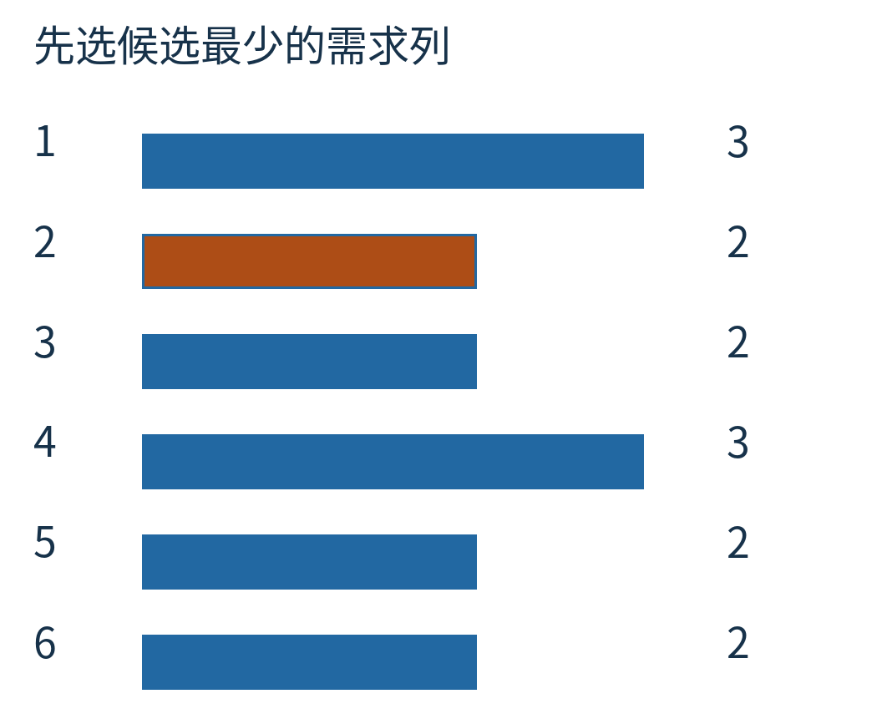

图11｜每列的候选数由完整矩阵实际统计，柱子共用计数尺度。最少为 2，对应第 2、3、5、6 列；本实现的相同计数规则使第 2 列先被选中。

你可能注意到，图3的 G 失败分支不是这份启发式实际首先走的分支。两者有意分开：前者是可手动指定的教学分支，后者是完整求解器的选择策略。附带程序分别验证它们，没有把人为选的戏剧性失败冒充程序真实首步。

这个策略并不能保证问题很快解决。若很多列都还有很多选择，回溯树仍可能很大。DLX 减少的是每次进入、退出分支的维护工作，不是把一般精确覆盖问题变成多项式时间算法。

## 验证“找得到”，也验证“放得回去”

只检查输出 A、D、E 是一个合法答案，还不够。一个恢复错误的实现，也可能先碰巧找到这组解，再漏掉另一组。

随附 [verify.py](examples/verify.py) 做了几项不同的核对：

- 枚举七包的全部 128 种选法，得到精确答案列表；再与 DLX 输出比较，双方都是 A、D、E 和 B、C、F 两组，没有漏解或多解。
- 分别强制选 G、A、B，检查剩余列和候选；每次逆序撤销后，比较所有节点的左、右、上、下、所属列和列头计数，要求与进入前完全一致。
- 用固定种子 20261024 生成 200 张小矩阵，每张四列、最多七个非空候选行，分别用穷举和 DLX 求全部答案；逐张核对相同，并要求完整搜索后的链接状态恢复。

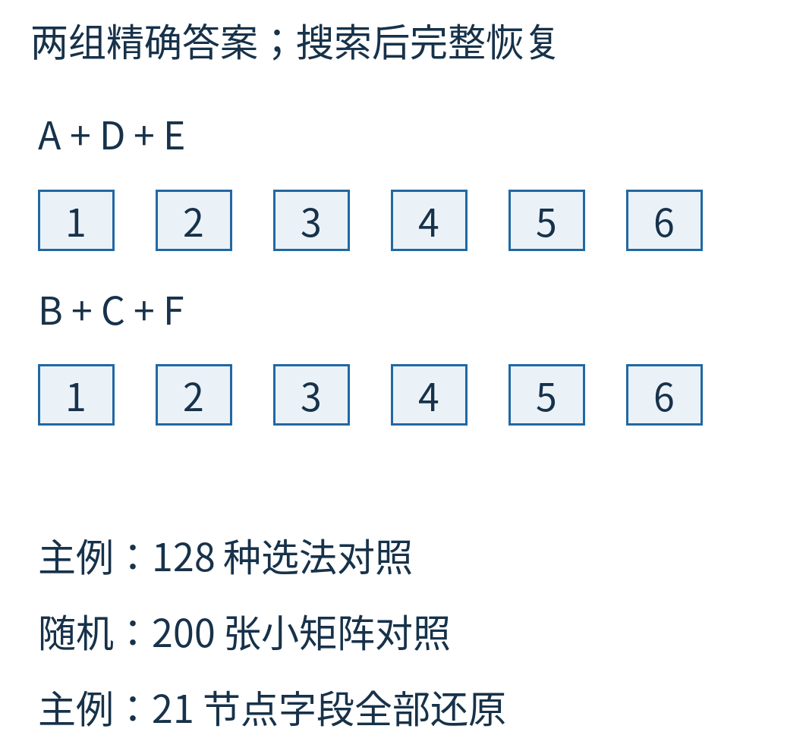

图12｜上方列出主例实际找到的两组答案及其完整覆盖，下方区分“答案一致”和“所有链接字段恢复”两项检查。200 张随机小矩阵是有限测试，不是所有精确覆盖实例的形式证明。

恢复状态的比较使用节点的稳定标签，而不是把内存地址打印出来猜是否相等。这样能明确检查每个方向重新连向了谁。本文代码是独立实现的教学模型，不是 Knuth 原程序的移植，也没有做不同求解器的速度排名。

Donald Knuth 在 2000 年的 [Dancing links 论文](https://arxiv.org/abs/cs/0011047)中讨论了用双向链表的可逆局部操作加速组合搜索，并把拼块身份等约束纳入同一种精确覆盖表达。本文只借助七包零件走通这一核心技巧，不复述他在大型拼板上的实验数字。

有一种节省，并不是少试一条路，而是把“试过以后还能退回来”做得足够便宜、足够可靠。下次看到程序把一大片候选临时删掉，可以多问一句：它是真的忘了，还是把回去的路留在了被摘下的节点里？

图片来源：图1—12均为原创教学结构、状态图或随附程序结果。没有重印论文图、历史照片或产品界面。原创正文与图片采用 CC BY 4.0；代码、事实支撑范围和素材权利见 [sources.md](sources.md)。
