# 鼠标指向哪块石头？让射线沿着格子边界走，为什么不会跳过去

在方块游戏里，你把准星对准一块石头，按下挖掘键。程序要知道的并不是“画面中央大概有什么颜色”，而是：从眼睛的位置朝准星方向看，最先经过哪一个实心格子？

一种常见办法是发出一条**射线**。它不是真有一道激光从眼睛射出去，只是用起点和方向描述一条数学路径。世界若已经划成规则小格，能不能顺着这条路径，一格一格问过去？

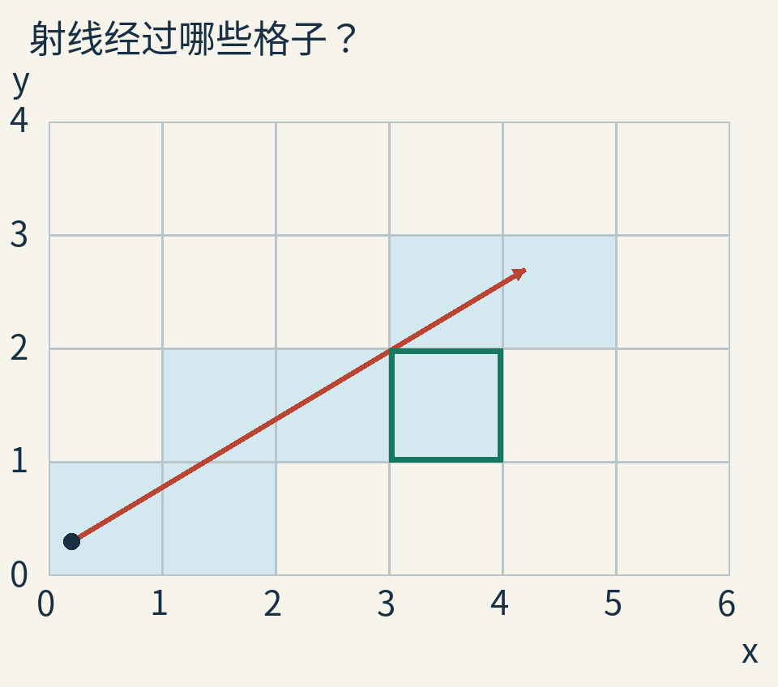

这是本文程序根据精确分数算出的二维路径。横向为 x，向上为 y；每格宽高都是 1。淡蓝表示射线在其中走过了正长度的一段，红线表示射线，绿框标出格 `(3,1)`。格号按左下角坐标命名。

三维的小格通常叫**体素**。我们先把高度这一维收起来，在方格纸上走清楚一次；之后加回第三维，只需再添一张时间表。

## 每次向前走一小步，不就行了？

先试最直接的办法：从起点出发，每隔一段距离取一个点，看看它在哪格。

若步子太大，会跳过格子。那就把步子缩短？能缓解，却没有从根上解决。射线可能几乎贴着一个角掠过，在某格里只待极短的一段。只要取样步长仍固定，就能构造一段比它更短的穿越。

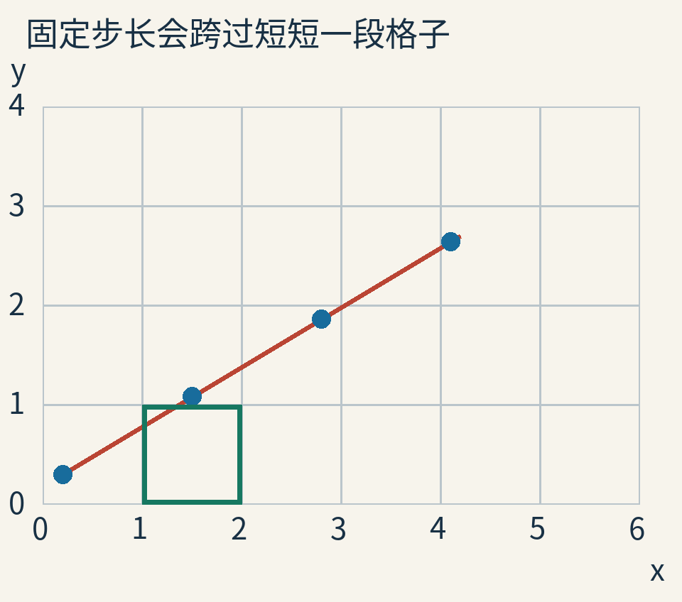

图中蓝点每隔参数 1.3 取一次，绿框是格 `(1,0)`。射线确实穿过绿框，但没有一个蓝点落在里面。这里只把“查询取样点”画出来；没有把相邻蓝点之间的所有格再检查一遍。

另一种想法是：**不要预先规定走多远，先算下一道格子边界在哪里。** 到了边界，才换格。这是网格遍历与事件驱动计算的一次相遇：重要的时刻，不是闹钟等间隔响起，而是位置真正跨入了下一个格子。

Amanatides 与 Woo 的《A Fast Voxel Traversal Algorithm for Ray Tracing》是这条路线的经典论文入口，题名和作者可在[作者公开的论文索引文件](https://www.cse.yorku.ca/~amana/research/grid.pdf)查到。下文从自设例子独立推导基础遍历，不把它当成原论文全部优化与边界规则的逐行复现。

## 先让射线有一个可以代入的名字

本文固定起点：`o=(0.2,0.3)`；固定方向：`d=(1,0.6)`。

把沿途位置写成：

`p(t)=o+t d`，也就是 `x(t)=0.2+t`、`y(t)=0.3+0.6t`。

这里 t 是一个从零增加的**行程参数**。t 每增加 1，横向走 1，纵向走 0.6。我们只考察 `0≤t≤4` 的一段，终点就是 `(4.2,2.7)`。

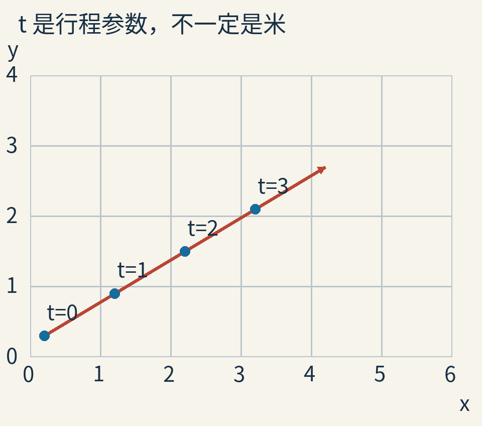

图中蓝点对应 t=0、1、2、3；不是算法必须检查的时刻，只帮助你理解参数的意义。

t 还不一定是实际距离。方向 `(1,0.6)` 的长度是 `√(1²+0.6²)≈1.166`，所以 t 增加 1，实际走约 1.166 个长度单位。若把方向先缩放成长度 1，t 才能直接读成距离。遍历算法不要求方向必须单位化，但比较射线命中距离时，所有结果必须采用同一套参数。

起点的两个坐标都在 0 与 1 之间，因此当前格是 `(0,0)`。一般说来，格号是向下取整后的坐标。尤其负数不能简单“去掉小数”：−0.2 应属于格 −1，而不是格 0。

## 第一题：先撞到右边，还是上边？

当前格的右边是 x=1，上边是 y=1。

到达右边需要：`0.2+t=1`，所以 `t=0.8=4/5`。

到达上边需要：`0.3+0.6t=1`，所以 `t=0.7/0.6=7/6≈1.167`。

0.8 更小。我们先碰右边，进入格 `(1,0)`。

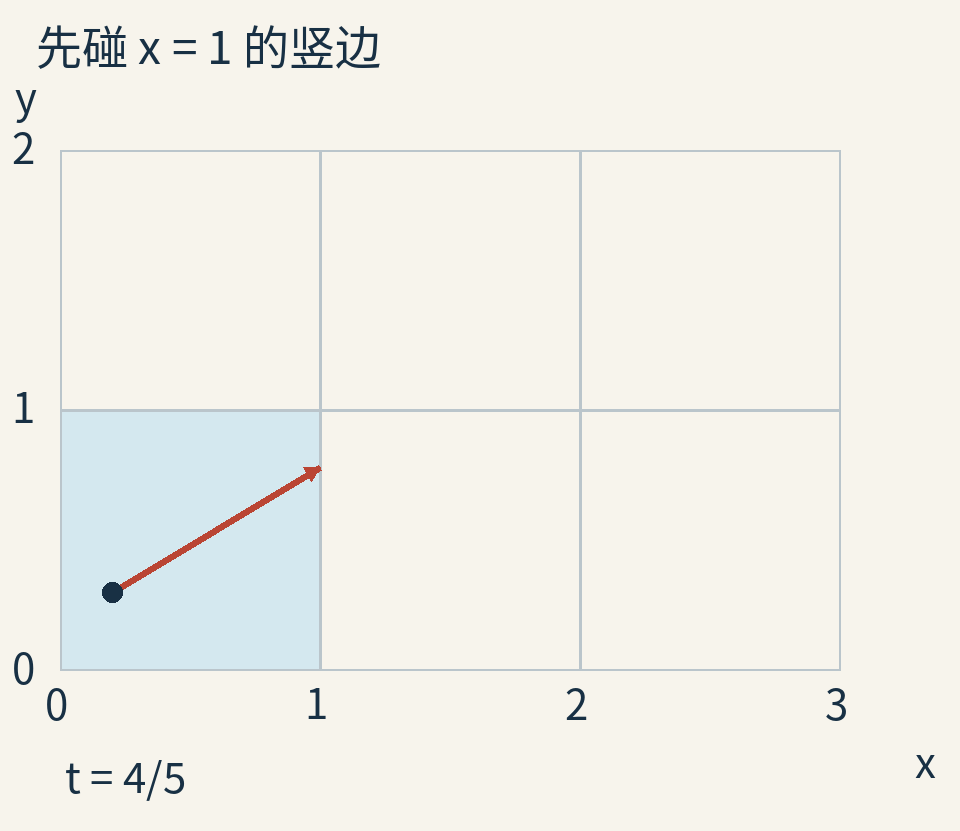

可以再核对一下位置：t=0.8 时，y=0.3+0.6×0.8=0.78，还没有到 y=1。下一个格号只改 x，不改 y。

我们现在有两张小纸条：

- `tX`：下一次碰到竖直网格线时，射线的 t 是多少。
- `tY`：下一次碰到水平网格线时，射线的 t 是多少。

它们记录的是**从原起点开始算的绝对参数**，不是“从当前位置还要走多久”。这一区别很重要。若一张纸条用绝对参数，另一张用剩余参数，比较就失去了意义。

## 到了下一格，不用把整道题再做一遍

刚跨过 x=1，下一道竖边是 x=2。重新解方程当然可以：`0.2+t=2`，得到 t=1.8。

但注意，竖直网格线间距总是 1，横向速度分量总是 1。每跨一整格，所需 t 都增加 `1/1=1`。

因此新的 `tX=0.8+1=1.8`。`tY` 没发生任何事，仍然是 7/6。两者比较，下一次该跨水平边了。

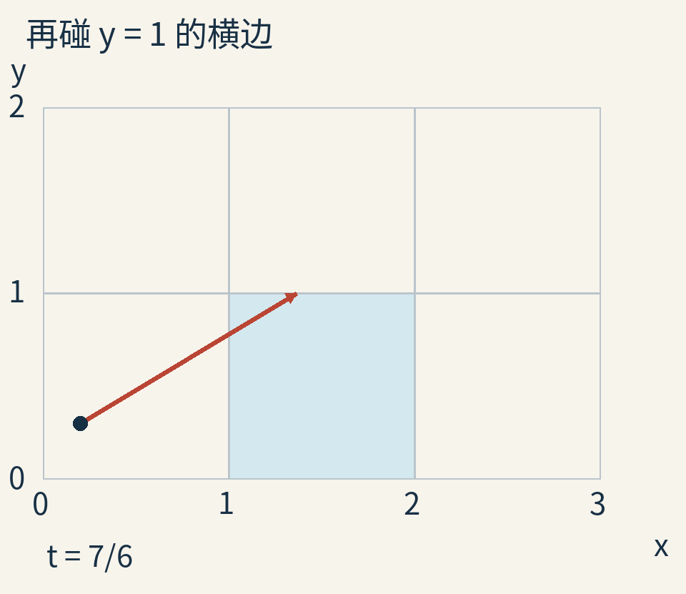

当 t=7/6 时，x=0.2+7/6=41/30≈1.367，仍在 x=1 与 x=2 之间。于是进入 `(1,1)`。

水平网格线之间也隔 1，可纵向分量只有 0.6，因此每跨一个 y 格，t 要增加 `1/0.6=5/3`。

新的 `tY=7/6+5/3=17/6≈2.833`。`tX` 保持 1.8。

把两个固定增量叫作 `ΔtX` 与 `ΔtY`，规则就是：

1. 找出较早的边界事件。
2. 只沿该方向改变格号。
3. 只给该方向的下一次事件加一个固定增量。
4. 另一方向的纸条原样保留。

这正是节省计算的地方。不是不算交点，而是利用规则网格让交点序列变成等差数列。

## 跟着两张纸条走完这条路

下面把前几次的状态列出来。图中每一行表示**进入这一格之后，尚未跨下一道边时**的状态。

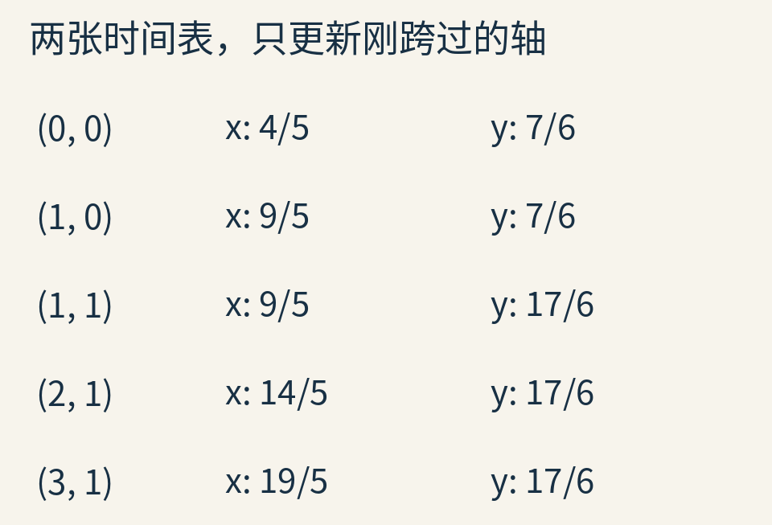

走到 `(1,1)` 后，1.8 小于 2.833，所以跨 x 边，进入 `(2,1)`，再把 tX 加 1 得到 2.8。

2.8 仍小于 2.833，于是又跨 x 边，进入 `(3,1)`。可这次只在里面停留：

`17/6−14/5=1/30≈0.0333` 个 t 单位。

这一段已经很短。若你把射线再挪一点，它还能更短，这解释了固定取样步长为什么总有漏格风险。

随后跨 y 边进入 `(3,2)`，再跨 x 边进入 `(4,2)`。在 t=4 截止时，完整格序是：

`(0,0) → (1,0) → (1,1) → (2,1) → (3,1) → (3,2) → (4,2)`。

若这些格记录的是完全填满的实心或空气，沿顺序遇到第一块实心格就能停下。若起点本来就在实心格里面，应如何返回“从内部出发”，也要由拾取规则明确，不能自动忽略起点那一格。

## 向左走时，为什么不能仍然瞄准右边界？

把起点换成 `(3.8,2.7)`，方向换成 `(-1,-0.6)`。现在横纵坐标都会减小。

当前格为 `(3,2)`。下一道 x 边应该是左侧的 x=3，而不是右侧的 x=4。

解 `3.8−t=3`，仍得到 t=0.8。跨过之后，x 格号减少 1，进入 `(2,2)`。

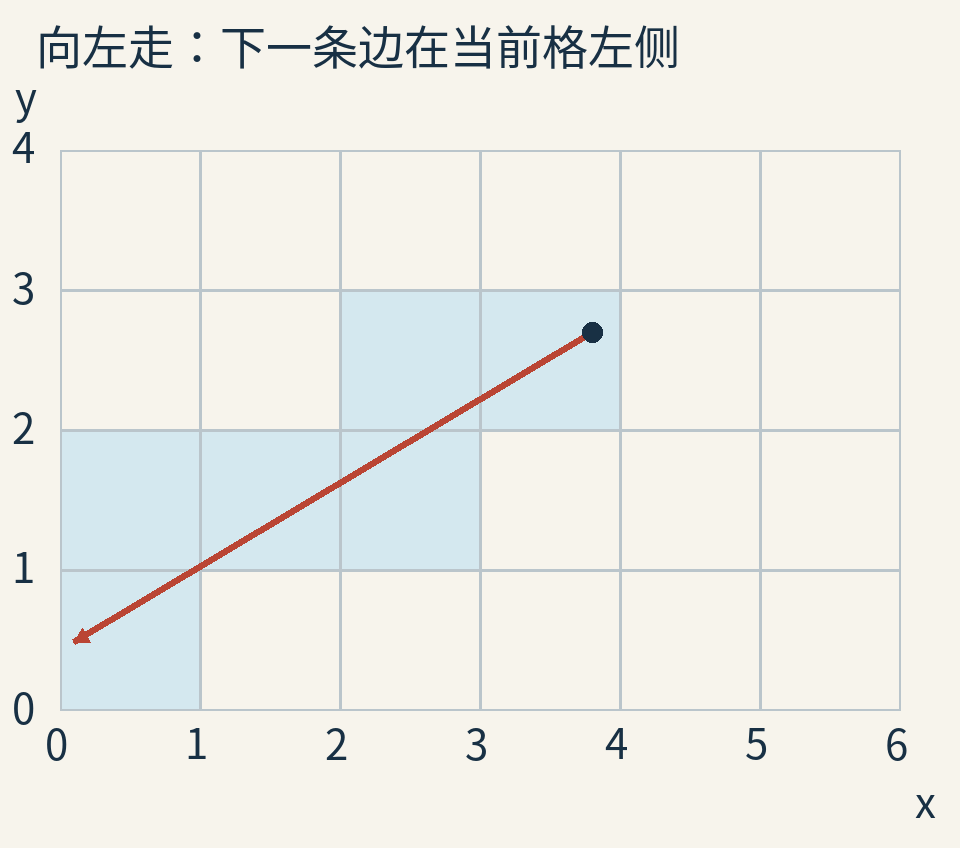

为了让图留在正坐标网格内，这张图只画到 t=3.7；配套数据继续算到 t=4，并进入 x 为负的格子。它和主例使用不同起点、方向，不要把主例的格号顺序直接照搬。

一般情况下，把每轴步进方向记为 `step`：正向为 +1，负向为 −1。格宽为 1 时，跨轴事件的固定增量是：

`Δt = 1 / |该轴方向分量|`。

这里取绝对值，是因为“未来再跨一格需要增加多少 t”应为正数。格号往左还是往右，由 step 单独负责。

## 水平射线，不能硬算一个除以零

若方向是 `(1,0)`，y 始终不变。它永远不会从当前行跨到上面或下面一行。

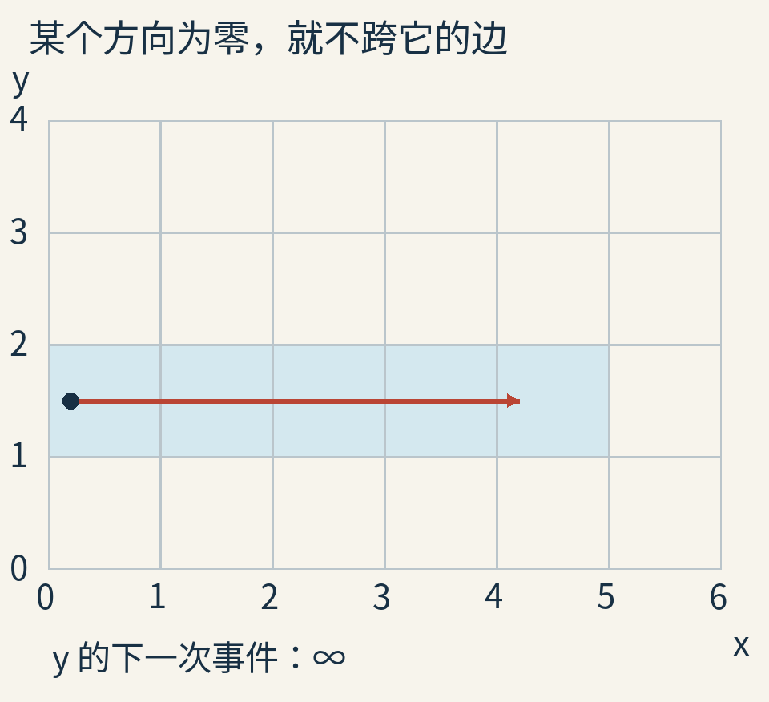

这时把 tY 视作正无穷，或者用一个明确的“该轴无事件”状态。比较时，它永远不会早于有限的 tX。不要真的计算 `1/0`，再依赖某种语言或硬件碰巧给出的结果。

若所有方向分量都为零，它就不是一条向前走的射线了。生产接口应当拒绝这个输入，或单独把它当点查询。本文可复算用例不包含全零方向。

## 恰好撞在角上，算经过几个格？

取一个新例子：起点 `(0.5,0.5)`，方向 `(1,1)`。第一道 x 边与第一道 y 边都在 t=0.5 到达，交点恰是 `(1,1)`。

这个时刻，只改 x 再访问一次，还是同时改 x、y？答案取决于你想报告什么。

本文约定：只列出射线在格内走过**正长度**的一段。仅仅碰到一个角、随后立刻离开的旁边两个格，不列入。于是相等时同时跨两个轴，从 `(0,0)` 直接进入 `(1,1)`。

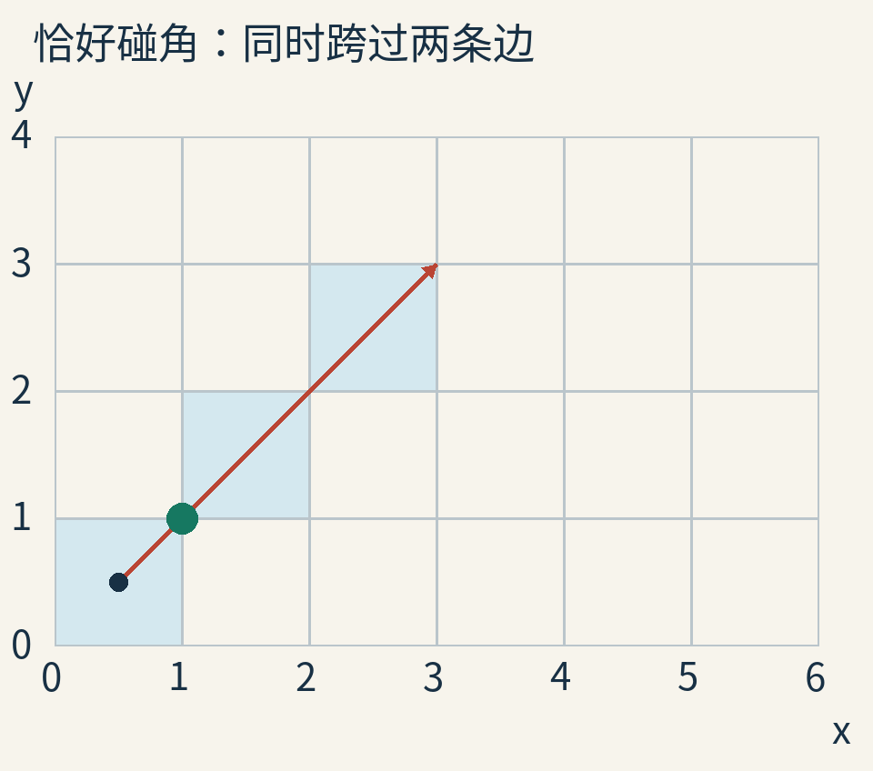

若任务是保守碰撞检测，希望所有“哪怕只触碰一下”的格都被纳入，那就需要另一种覆盖约定，也常称为 supercover 的思路。三维沿边、沿面走时，还会有更多并列归属。不能把“为了显示选一个像素”“所有相交格”“正长度经过格”混成同一个任务。

本文代码使用精确分数，所以 1/2 与 1/2 能准确相等。浮点版本可能把理论相等的事件算成略有不同。随手加一个大 epsilon，也可能误把两个本来不同的事件合并，跳过一段很短但真实存在的格。正确做法是先定清几何与接触约定，再选择相应的数值策略；这篇的分数程序是可核对的基准，不是完整的高性能浮点实现。

起点恰在边界，也有类似问题。本文向负方向出发时，直接把起始格选为刚刚进入的那一侧，例如 x=1 向左，起始 x 格号为 0。向正方向则从格 1 开始。沿边不跨轴时采用半开区间归属。这些都是明确约定，不是一个 floor 就解决了全部情况。

## 如果眼睛在网格外面，先别急着取格号

实际世界通常只存有限范围。射线从网格外出发时，可能永远碰不到世界，也可能在很远之后才进入。

先把网格整体看成一个轴对齐盒子：它的各边与坐标轴平行。每个方向分别算射线何时进入和离开这个范围，再取所有进入时刻的最大值，以及所有离开时刻的最小值。

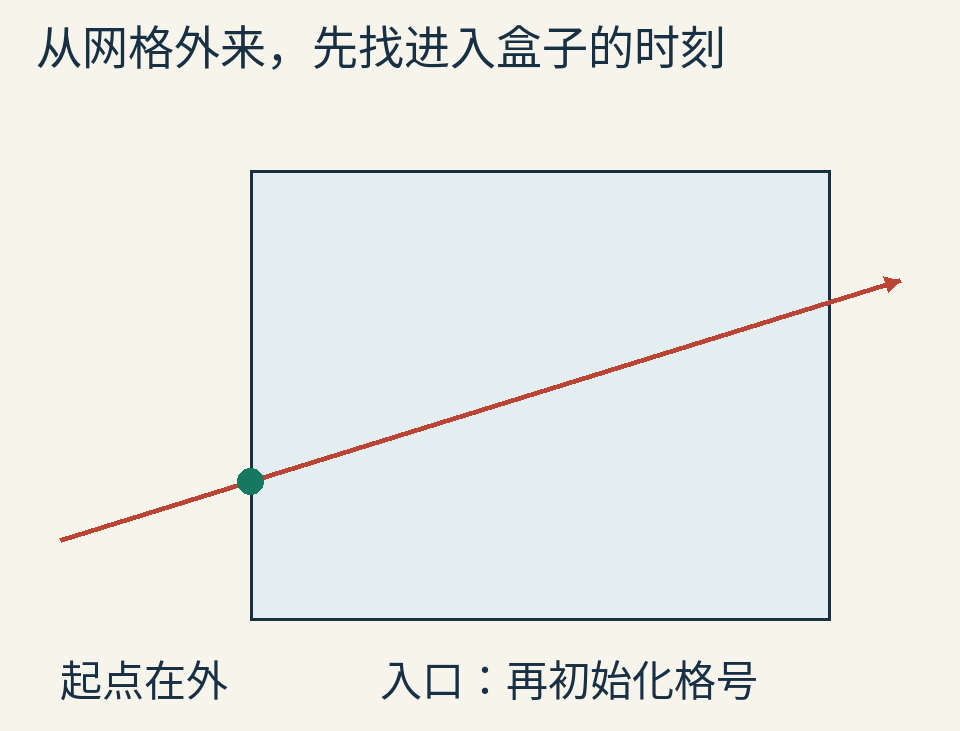

这是流程示意，不是主例坐标图。若最后的进入时刻晚于离开时刻，射线就没有穿过盒子；否则，从有效的进入时刻初始化当前格与后续事件，并在离开时刻停止。

还要区分相切：如果只在一个点接触盒子，本文的正长度约定不报告经过内部。盒子外的格不应该被当作“加载了但都是空气”的有效内存地址。

## 加回第三维，没有突然换一种算法

三维起点写成 `(x,y,z)`，方向有三个分量。除了 tX、tY，再维护 tZ；除了两个格号，再维护 z 格号。

每次选最小的事件参数，对应哪一个面，就沿那一轴前进。若多个轴同时达到最小值，按刚才明确的接触约定处理。

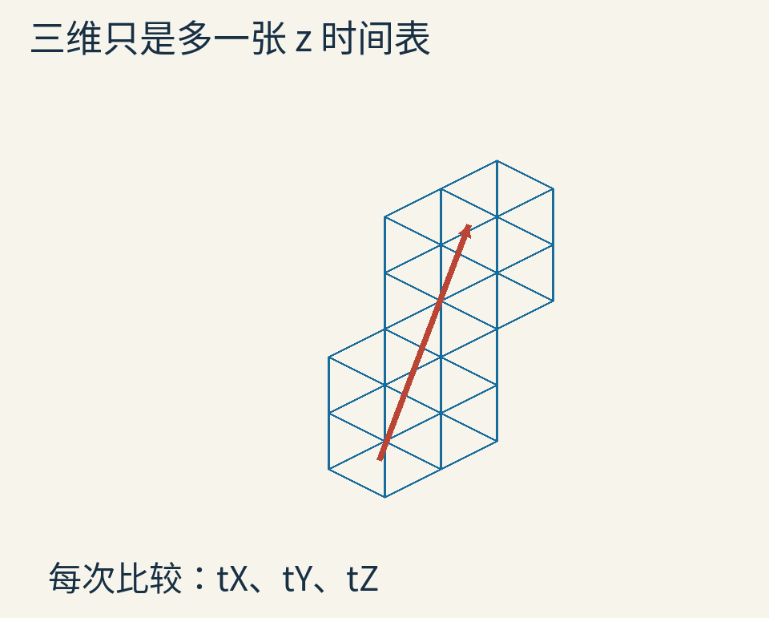

图中使用起点 `(0.2,0.3,0.4)`，方向 `(1,0.6,0.25)`，仍到 t=4。线框是实际遍历出的体素，使用斜投影帮助看清空间，不是它们在屏幕上的真实透视尺寸。

第一次 z 事件发生在 `(1−0.4)/0.25=2.4`。主例的 x 事件 1.8 之后、2.8 之前，三维程序会额外跨过一个 z 面。它没有假设 z 一定最慢，也不需要重新扫描整个世界。

## 在格子里放模型时，多了一道不能省的问题

如果格子存的是完全填满的石头，进入实心格就意味着遇到实体。但很多加速网格存的是“可能与这一格有关的三角形列表”。这时进入格子，只说明这些三角形值得检查。

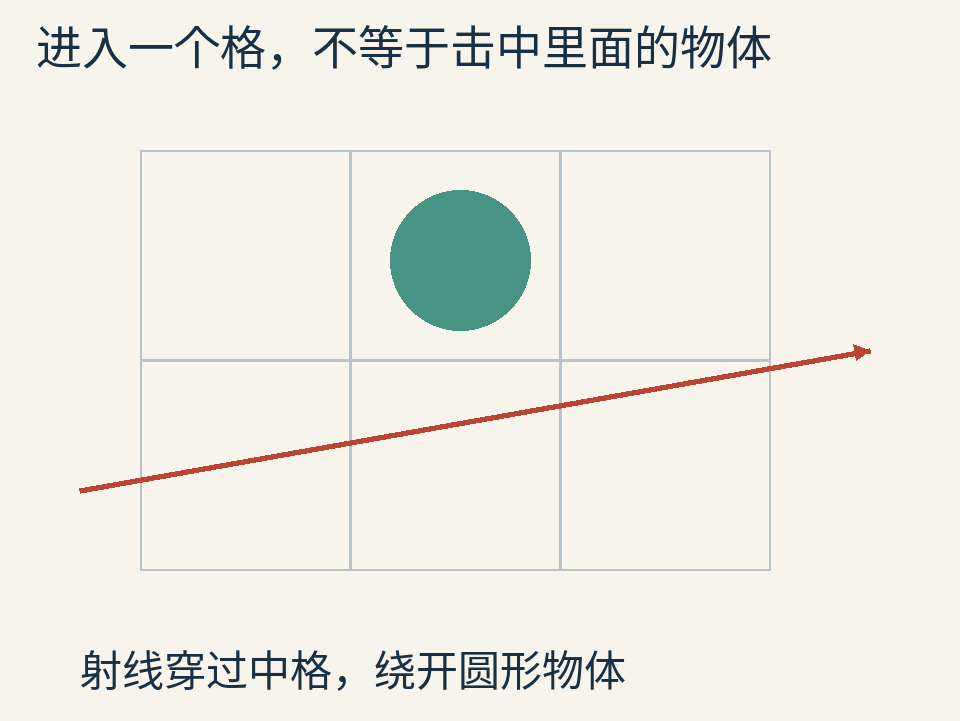

图中青色圆是二维物体，红线穿过它所在的格，却从圆的下方绕过。网格遍历提供候选；精确求交才判断有没有命中，以及命中的 t。

一个物体还可能跨好几个格，导致被重复检查。缓存已经测过的对象、合理确定何时可以停止，都属于进一步的加速设计。尤其某个格里的对象命中点可能在更远处，不能只因为“我在当前候选列表里找到一个交点”，就跳过所有更近的格。

这也是本文与“把体素外露面合成网格”不同的地方：一个在构造要画的表面，一个在按空间次序筛选要问的地方。两种方法可以在同一个引擎里合作。

## 格子不一定宽一米

本文用单位格，是为了让心算简洁。若某轴格宽为 h，跨完整一格需要增加的参数就是 `h/|d|`。若三轴格宽不同，分别用自己的 h。

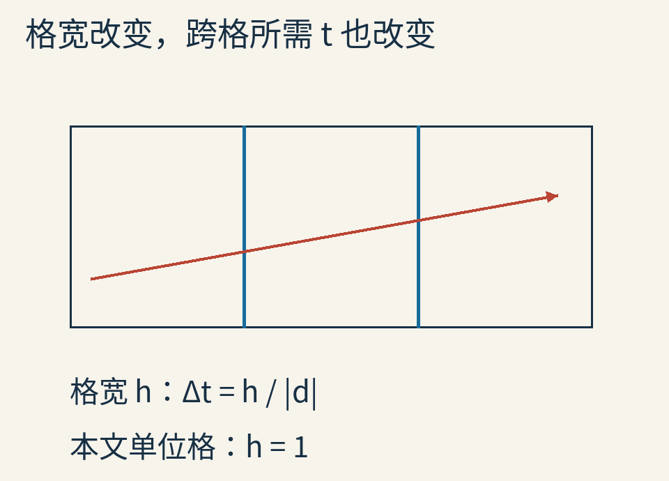

还可以把世界坐标先变换到“每格宽 1”的网格坐标再遍历。但起点、方向、盒子边界必须一起变换，不能只缩放起点而忘了方向；返回命中结果时，也要知道使用的是哪套参数与单位。

## 怎样知道程序没有碰巧画对这一条线？

[公开代码](examples/lab.py)实现了精确分数遍历，同时用了另一种慢办法核对：对候选区域里的每个格分别做线段与格子的区间求交，保留交集长度大于零的格，按进入参数排序。

后一种方法不复用前一种的 tX、tY 更新，因此能发现不少“更新了错误轴”“负方向边界选反”的错误。实际执行了 135 组组合用例，包含负起点、边界起点、负方向、零分量及同时跨轴。

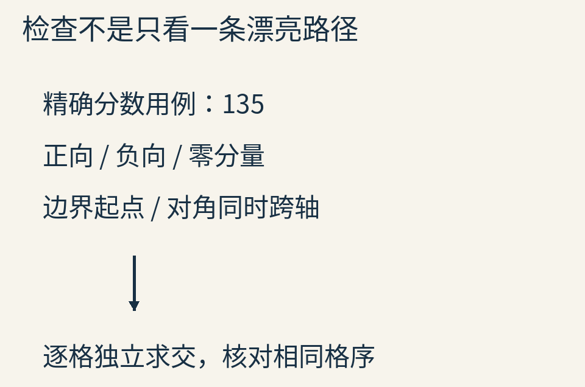

[结果文件](examples/results.json)保留了主例每一格的进入、离开参数以及下一次事件。代码运行于 Python 3.12.14；绘图另需 NumPy、Pillow 和 Noto Sans CJK 字体。执行 `python lab.py` 会重写本篇图像和结果。

这些检查只覆盖声明的二维分数基准与一组三维示例，不是任意浮点输入的正确性证明，也没有测显卡速度。你可以先把方向中的 0.6 换成 0.5，自己预测下一次先跨哪条边，再让两种算法互相核对。

射线并不是迈着越来越小的步子，努力避免踩空。它换了一个提问方式：**当前格的出口，哪一个最早到？** 规则网格让每个方向的出口时刻都排成了等差数列，而程序每次只从这几列里挑最早的一项。

图片全部由本文原创程序生成；几何图与访问序列不是游戏截图。正文、图和数据采用 [CC BY 4.0](https://creativecommons.org/licenses/by/4.0/)，代码采用 [MIT](examples/LICENSE.txt)。来源与可访问范围见 [sources.md](sources.md)。
