# 想让程序最后得到对的结果，最开始必须满足什么？跟 Dijkstra 倒着想一次

你写了两行小程序：

```text
x := 2 × x
x := x + 1
```

符号 `:=` 表示赋值：先算右边，再把结果存进左边的变量。它不是数学等式。若x最初是4，第一行后是8，第二行后是9。

现在别人给你一个要求：运行结束时，x必须至少是11。你该允许哪些输入？

可以试5，得到11；试6，得到13；试100，得到201。可是光列出成功例子还不够。是否漏掉了能成功的输入？有没有某个没有试过的输入会失败？

这一次，我们换个方向：不从一个输入往前追，而从想要的结果往回问。

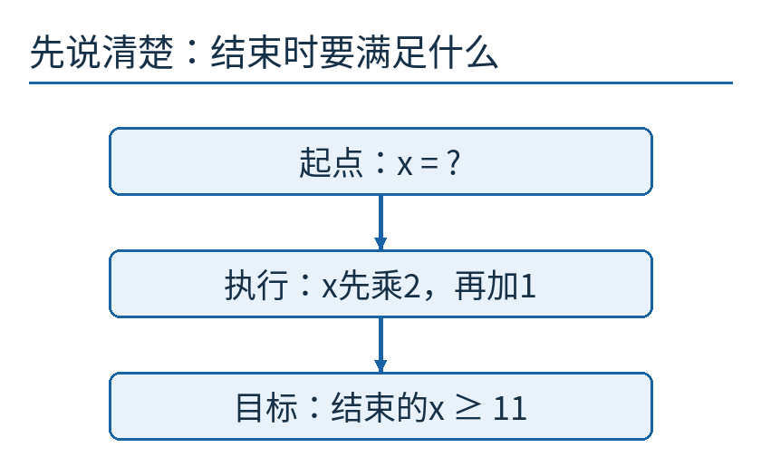

起点未知，操作固定，末尾的要求已给定。目标不是猜出一个合适的x，而是找出所有能保证成功的起点。

## 同一段程序，两种阅读方向

先顺着程序走几遍。x=3时得到7，x=4时得到9，x=5时得到11，x=6时得到13。成功与失败的分界似乎在5。

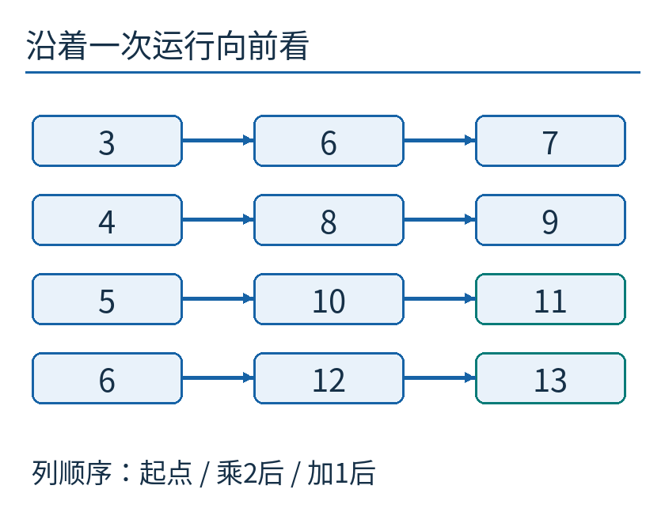

每一行是一条独立运行，三列分别是初值、乘2之后、再加1之后。右侧绿色框满足“至少11”；箭头只向右，表示实际执行顺序。

倒着想时，第一眼应看最后一行 `x := x + 1`。想让执行后的x至少11，执行前的x就必须至少10。因为“旧值加1≥11”等价于“旧值≥10”。

这里不是让计算机真的倒着执行减法，也不是恢复一份已经被覆盖的内存。我们在纸上改变的是**对状态的要求**：把“最后要什么”改写成“做这一步之前要什么”。

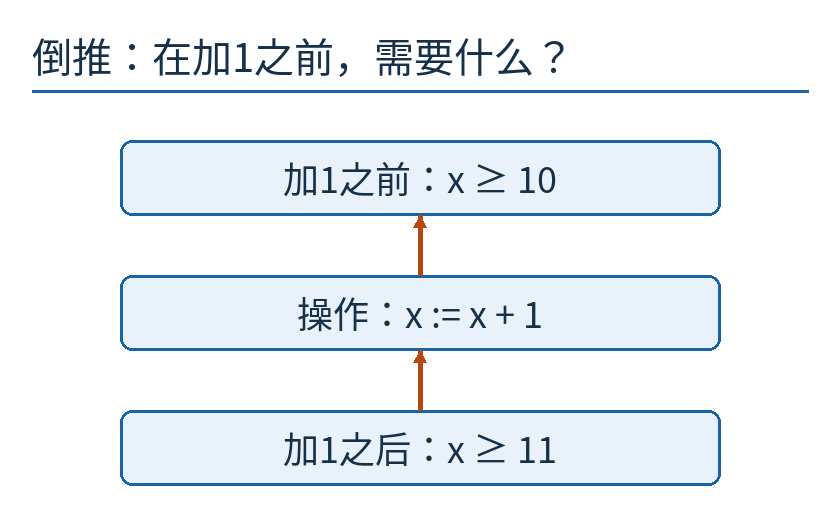

橙色向上箭头表示推理方向，蓝色框内的赋值仍然按程序向下执行。把两种箭头的意义分开，便不会以为程序本身倒着跑了。

再看前一行 `x := 2 × x`。它必须把最初的值变成至少10，所以 `2×旧x≥10`，等价于 `旧x≥5`。两步倒推结束，条件正是x≥5。

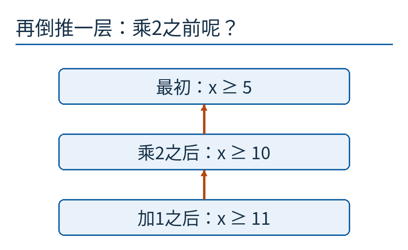

实际程序先乘2再加1，推理则先处理加1再处理乘2。中间的x≥10是一段桥梁，不能跳过它后只记最后答案。

本文使用数学整数：没有固定字长溢出，没有并发修改，乘2和加1都能正常完成。若换成可能回绕的机器整数，这份推导就需要重新写；不能把数学整数的结论无条件贴到每一种语言上。

## 为什么叫“最弱”，而不是“最强保证”

输入x≥100也能保证结束时至少11。但它太苛刻：5、6、7这些本来就能成功的输入，都被赶到门外了。

“弱条件”允许的状态更多。“强条件”额外要求更多，允许的状态更少。比如“年龄至少18岁”比“年龄至少18岁并且会游泳”弱；后一条件满足的人一定满足前一条件，反过来却未必。

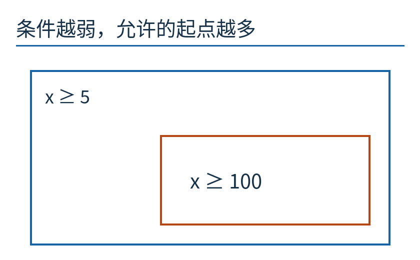

大框表示x≥5，小框表示x≥100。图画的是包含关系，不按无限集合的数量或长度比例绘制；小框里每个起点都在大框中。

**最弱前置条件**的意思是：足以保证目标，又没有多加无用限制。前置条件描述执行前的状态，后置条件描述执行后的要求。

在本例里，只要x≥5，乘2加1必然至少11；只要x<5，便有2x+1<11，必然失败。这两半都成立，才说明x≥5准确圈住了所有成功起点。只证明“门内的人都行”，还不能证明门没有建得过窄。

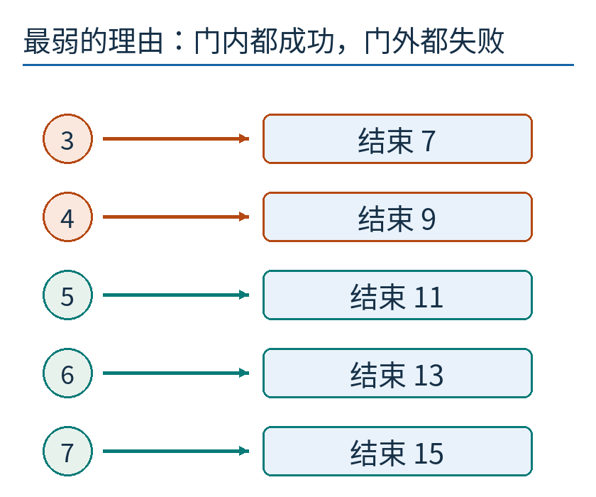

图中的有限例子帮助我们检查边界，真正覆盖任意整数的是上一段的不等式推理。运行过几个数，不等于证明过全部整数。

## Dijkstra 想把这种推理变成什么


Edsger W. Dijkstra。摄影：Hamilton Richards，[CC BY-SA 3.0](https://creativecommons.org/licenses/by-sa/3.0/)。采用德州大学档案原件的既存副本，本文未修改；不是后来Commons调色版本。[档案原页](https://www.cs.utexas.edu/~EWD/welcome.html)、[许可记录](https://commons.wikimedia.org/wiki/File:Edsger_Wybe_Dijkstra.jpg)。

Dijkstra 在EWD418中把最弱前置条件写成 `wp(S,R)`：S是一段语句，R是希望最终满足的条件。他要求的不只是“如果它结束，结果不会错”，还包括从允许的起点出发，执行能正常终止。文中也明确说，这是一套推导程序的规则，而不是自动替人发明任何正确程序的万能算法。[EWD418原文转录](https://www.cs.utexas.edu/~EWD/transcriptions/EWD04xx/EWD418.html)

我们只用到其中最容易落地的一部分：赋值怎样改变条件，顺序组合怎样倒着连接，以及分支和循环为什么需要更谨慎。这里不重讲最短路径，也不把它混同于用区间近似所有可能值的抽象解释。当前问题是：给定目标，精确找哪些起点能保证到达它。

如果愿意用简写，开篇的答案可以写成：

```text
wp(“x先乘2，再加1”, “x≥11”) = “x≥5”
```

`wp`不返回一个程序运行结果，而返回一个条件。输入“想要什么结果”，输出“起点要符合什么要求”，所以它也被称为条件变换器。

## 赋值规则，为什么是替换而不是移项口诀

对于 `x := E`，执行后的x就是执行前表达式E的值。因此，若后置条件里出现x，就用E替换它，得到执行前需要满足的条件。

例如后置条件是 `x+y≥12`，语句是 `x := x+3`。只替换后置条件中的x，得到 `(x+3)+y≥12`，再化简为 `x+y≥9`。这里的y没有被赋值，因而保持原来的意义。括号确保我们把整个表达式代入，不是随手拼字符串。

这个例子也揭示一个常见误区：不能先把代码里所有x换成x+3，又去处理已经换过的新x。语义上只发生一次赋值；推理中也只把后置条件引用的“新x”，替换成定义它的“旧表达式”。

遇到数组别名、表达式副作用、除零或异常时，还要考虑它们的语言规则。我们先用纯表达式，正是为了让“替换为什么正确”这一步看得见。

## 没有反函数，也能倒推

如果程序是 `x := x × x`，目标是结束时x≥9，该怎么办？不是盲目写“x≥3”就结束，因为最初的−3也会平方成9。

替换后得到 `旧x²≥9`，所以最弱条件是 `旧x≤−3 或 旧x≥3`。允许的起点有左右两段。这是在找目标集合在程序作用下的**原像**：哪些输入会被送进目标范围。

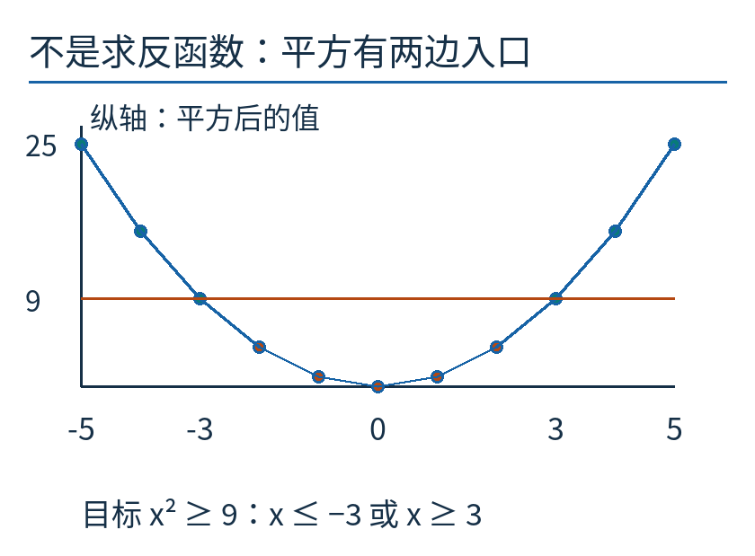

横轴是输入x，纵向是平方结果；橙色横线对应结果9。左右两侧高于或等于这条线的点都能成功。图显示−5到5的整数采样，结论由代数推导给出。

再看更极端的语句：`x := 0`。它把任何旧x都覆盖成0。如果目标是x=0，所有起点都可以；如果目标是x=1，没有任何起点可以。

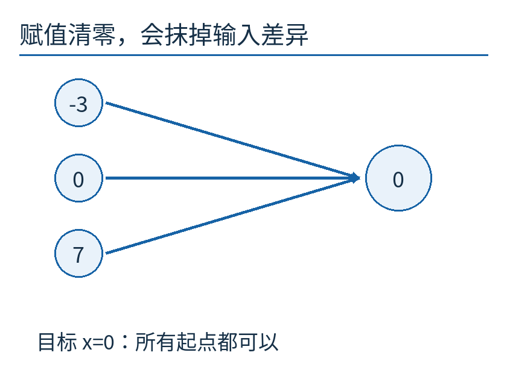

多条箭头汇到0。程序丢掉了旧值的信息，无法唯一倒放，但仍然可以准确判断哪些旧状态会满足给定目标。

所以最弱前置条件并不要求程序可逆。我们不在找唯一的过去，而在找一整组足够且必要的出发条件。

## 有分叉，就带着各自的入口条件走

下面的程序想取得整数的绝对值：

```text
如果 x ≥ 0：y := x
否则：     y := −x
```

目标是最后y≥0。第一条路中，代入y=x，要求x≥0；这恰好由进入该路的条件保证。第二条路中，代入y=−x，要求−x≥0；走这条路时已知x<0，因此也满足。

两条路覆盖所有整数，每条路都给出非负结果，所以不需要额外限制输入x。注意，单独分析 `y := x` 时需要x≥0，单独分析 `y := −x` 时需要x≤0；合起来时要连同“什么状态会走哪条路”一起看，不能机械地要求x同时满足两种路径的所有条件。

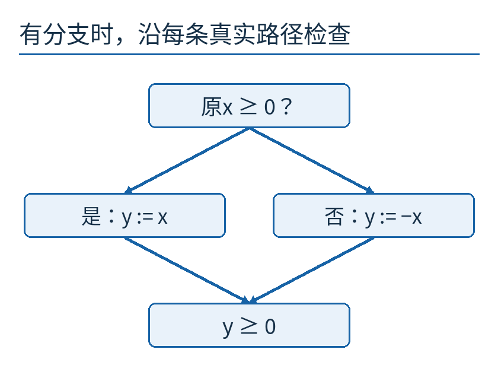

菱形不是必须的流程图符号；这里的上框表示分支判断。左右箭头带着互斥的入口条件，最终汇入同一个y≥0目标。

如果分支允许任意选择，又会怎样？假设机器可任选 `x := x+1` 或 `x := x−1`，你必须保证无论选哪条，最后x都非负。第一种要求x≥−1，第二种要求x≥1；要两者都成立，最弱条件就是x≥1。

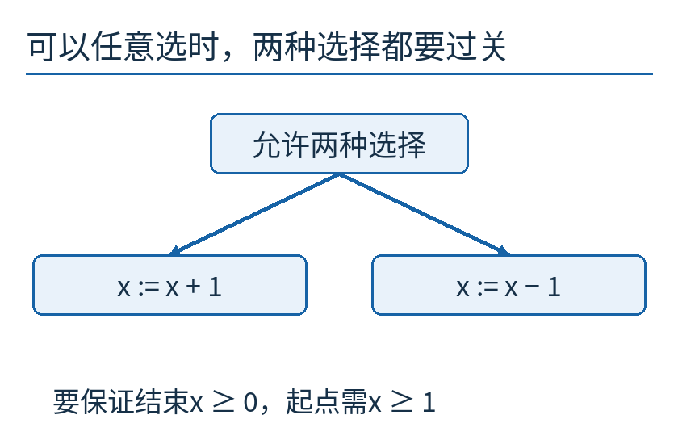

这不是问“有没有一条幸运路线能成功”。保证型推理要覆盖每一种允许选择，所以不能只挑较有利的加1路线。

## 循环多了一件不能省略的事：它会停吗

看一段倒计数：

```text
当 x > 0 时，重复：
    x := x − 1
```

要求最终x=0。对于数学整数，x≥0是最弱前置条件。x=0时循环不进入，目标已经成立；x>0时，每次减1，最后到0。若x<0，一开始就不满足x>0，循环直接结束并留下负数，目标失败。

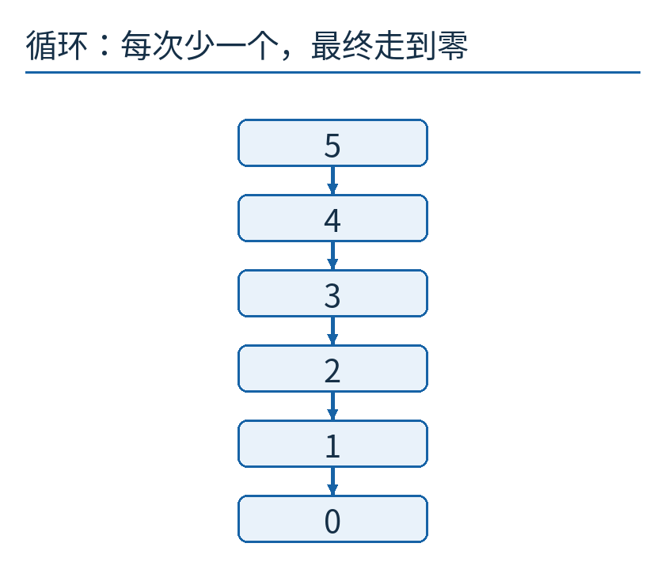

图只是输入5的具体运行。覆盖任意非负整数还要补两条理由：x≥0在循环中保持成立；当x>0时，非负整数x每次严格减少1，不能无限减少下去。

第一条是循环不变式：某个性质在入口成立，每次循环后仍成立。“不变”不是说x不变，而是说“x非负”这个判断没有失效。第二条是终止理由：用一个有下界的整数进度量说明它持续靠近出口。

把减1误写成加1呢？x≥0仍然可以保持，但从x=1开始便得到1、2、3、4……，条件x>0始终成立。光有不变式，不能证明任务完成。

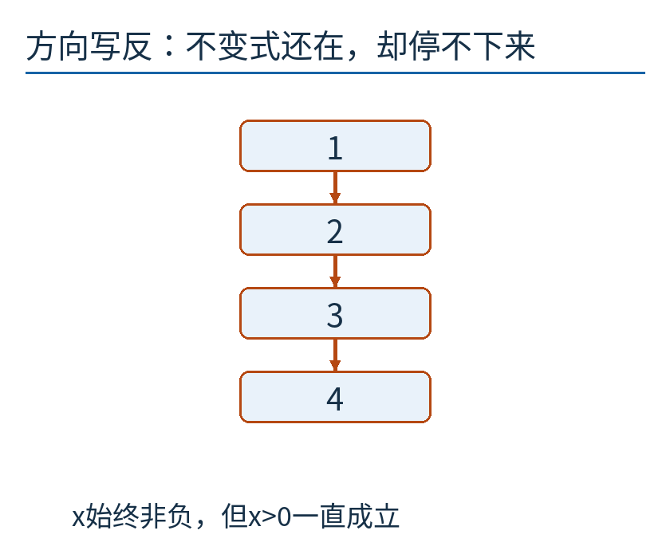

这张图的上升数值是错误循环的前四步，不是断言“只运行四步”。在无溢出的整数模型中，从正数出发会一直继续。

这正是“如果结束就正确”与“保证结束并正确”的区别。对于正确的减1版本，终止与结果都有理由；对于加1版本，x=0仍可立即成功，但正数不能进入我们要求的最弱前置条件。

## 用倒推帮助设计，而不只在写完后审判

我们常把验证想成最后一道关卡：程序写完，再问它对不对。倒推还可以更早参与设计。

假设你想让最后y≥10，打算最后一步写 `y := x+2`。先倒推，得到此步前必须x≥8。接着你就有了一个更小的问题：前面的程序怎样建立x≥8？如果前面只能保证x≥5，你现在就知道拼接处存在缺口，不必等大程序跑起来才碰运气。

这并不自动告诉你该写哪一种算法。它把各段之间的承诺写清，让“为什么能接起来”成为可检查的问题。某些条件可能很复杂，循环不变式也可能难找，完整程序还涉及堆、异常、并发和真实整数规则；方法的价值与适用边界应当同时看见。

试着自己做一道小题：程序先 `x := x−2`，再 `x := 3×x`，目标是最后x≥12。从最后一步往回，先要求中间x≥4；再要求最初x−2≥4，即x≥6。把6代入，得到4再得到12；把5代入，得到3再得到9。边界检查与一般推理相互照应，但不要互相替代。

本篇[检查程序](examples/measure.py)枚举−20到20的41个输入，核对两步赋值、平方条件和绝对值，并记录8种非负起点的倒计数。它们是有限复算；文章里的代数与终止推理负责说明更一般的结论。[结果数据](examples/results.json)与[来源、许可](sources.md)一并保留。
