# 电脑模拟十分钟，为什么不必一秒一秒等？离散事件模拟的日历

一台打印机正在打印A，要到第4分钟才结束。下一份作业B在第1分钟到达。到了第1分钟，B排进队伍；接下来第2分钟和第3分钟，打印机仍在忙，队列也没有变化。

模拟程序真的需要在第2分钟、第3分钟各醒来检查一遍吗？

如果我们已经知道这段时间没有别的事件会改变状态，就可以直接把模拟时钟拨到第4分钟。电脑可能只花了几微秒；被模拟的世界却走过了三分钟。

这就是离散事件模拟的入口：**不按固定间隔反复检查，而是把将来会改变状态的事件，放进一本按时间排序的日历。**

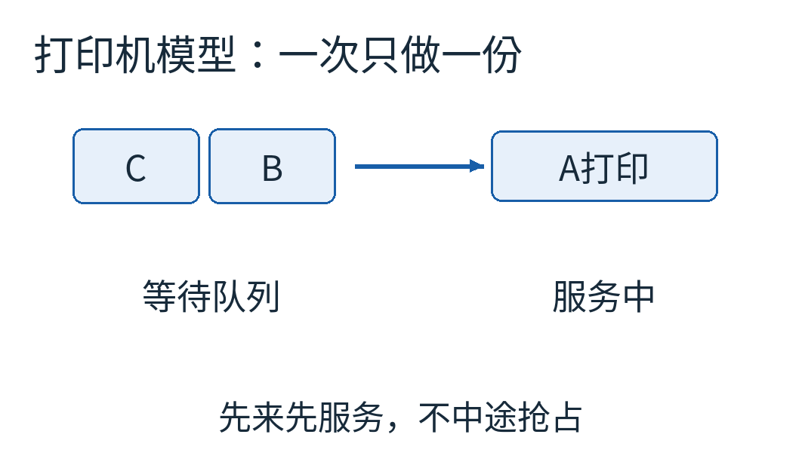

这是单台、一次只打印一份、先来先服务的教学模型。箭头朝打印机方向，等待队首B比C先服务。它不包含实际纸张、墨水、故障和网络打印协议。

## 两只钟，先分清哪只在走

现实时间是运行程序的电脑实际经过多久。模拟时间是模型里第几分钟。二者可以完全不同。

模拟一星期的仓库配送，不需要现实里等一星期；要生成十分钟的详细物理运动，也可能需要电脑算半小时。除非明确做实时模拟，否则“模拟分钟”不是命令电脑睡眠的要求。

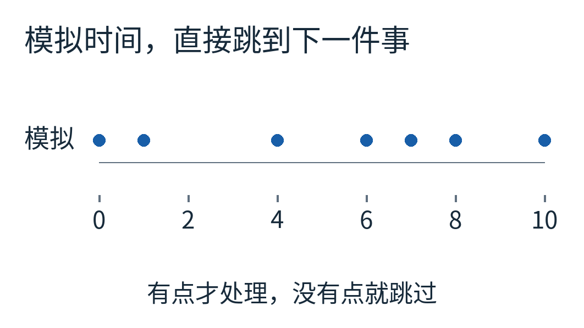

蓝点是本例可能改变状态的时刻。时刻4有两件事，点画在同一处，并不意味着两件事被合并成一件。两点之间没有事件时，时钟可以直接跳过去。

这也不是把固定时间步的游戏模拟简单改个循环就能得到。连续运动中的位置、速度不断变化，事件何时发生可能需要求交点或求根；若不知道下一次碰撞在何时，就不能随意跨过去。本文选择打印队列，是因为每份作业的服务时长已给定，下一次完成时刻可以直接算。

## 把输入完整地摆到桌上

我们只有四份作业，时间单位都是模拟分钟：A在0到达，需4分钟；B在1到达，需2分钟；C在4到达，需1分钟；D在8到达，需2分钟。

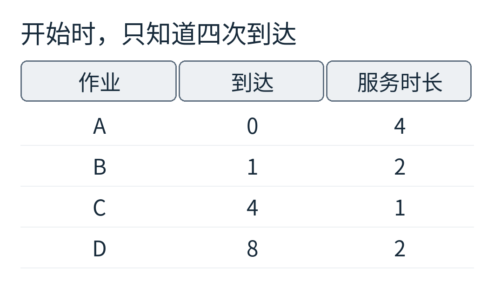

服务时长指开始打印后占用机器多久，不含前面的等待。机器不抢占已经开始的作业；等待队列按到达顺序排列。时间相同时，本模型先处理完成，再处理到达；仍然平手，就按事件登记先后处理。

这三条规定不是琐碎实现细节。它们共同决定了我们究竟在模拟哪一种世界。换成优先级打印、允许插队或可中断服务，结果都可能变。

状态也只保留必要的几样：当前模拟时刻、机器正在处理谁、等待队列、未来事件日历。日历中的事件是“在时刻t处理某份作业的到达或完成”。它不是已经发生事实的历史账本；事件处理后，才会进入我们的轨迹记录。

## 第一页日历，并不知道所有结局

程序开始时，可以把四次到达都排进去，因为它们是题目给定输入。但B、C、D具体何时完成，还不知道：它们可能要排队。

拿出最早事件“A在0到达”。机器空着，所以立即开始A。它需要4分钟，于是我们计算 `0+4=4`，把“A在4完成”插入未来日历。

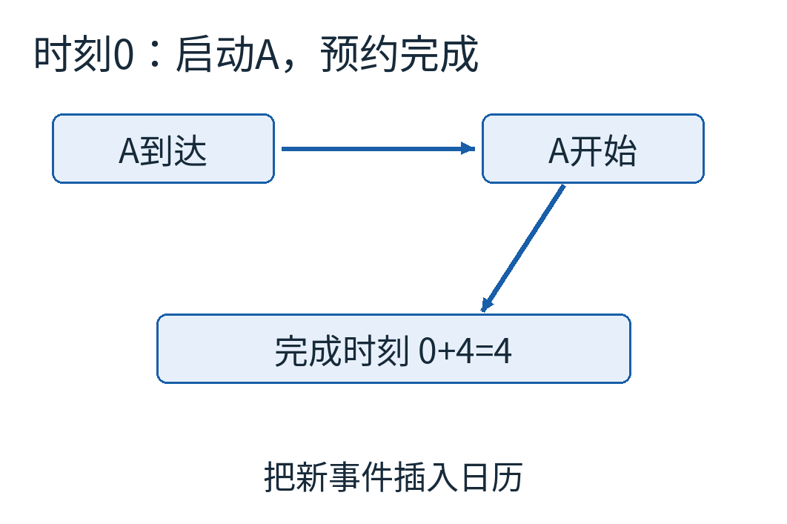

这一步揭示了事件模拟很有用的性质：**处理一个事件，可以创造新的未来事件。** 不需要在开始时就列出整段历史。模拟网络时，发送可能安排接收；模拟排队时，开始服务安排结束；模拟故障时，维修开始安排维修完成。

现在日历里有B在1到达、A在4完成、C在4到达、D在8到达。下一项当然是B。

时刻1，B来了。A仍然占用打印机，于是B进入等待队列。我们不能把B的完成时刻直接设为1+2=3，因为它还没开始服务。

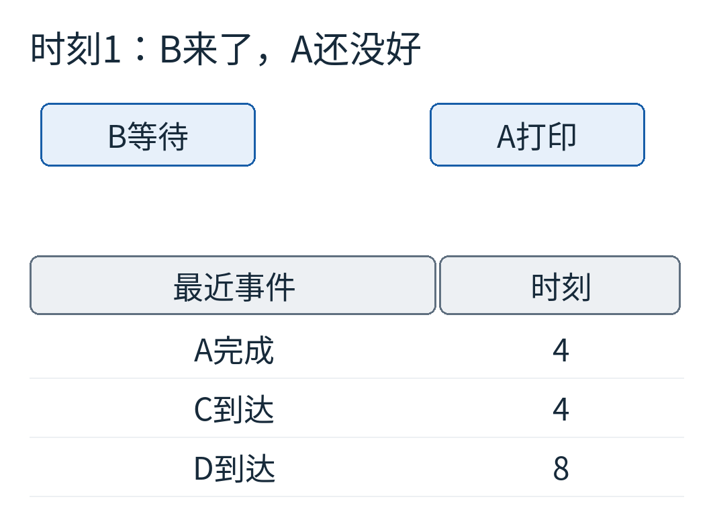

这时日历最早时刻是4。程序无需循环处理2和3，也不需要把A“还剩几分钟”每分钟减一次。A的结束已经由那个完成事件代表。

若你需要随时显示剩余时间，可以根据已知结束时刻减去当前模拟时刻计算。显示值不必反过来迫使核心模型每秒执行一次无用更新。

## 两件事都在4，谁先？

按照我们的约定，先处理A完成。机器空出来，从等待队首取B，于是B在4开始，预约在 `4+2=6` 完成。

再处理C在4到达。此时机器已经被B占用，所以C进入等待队列。

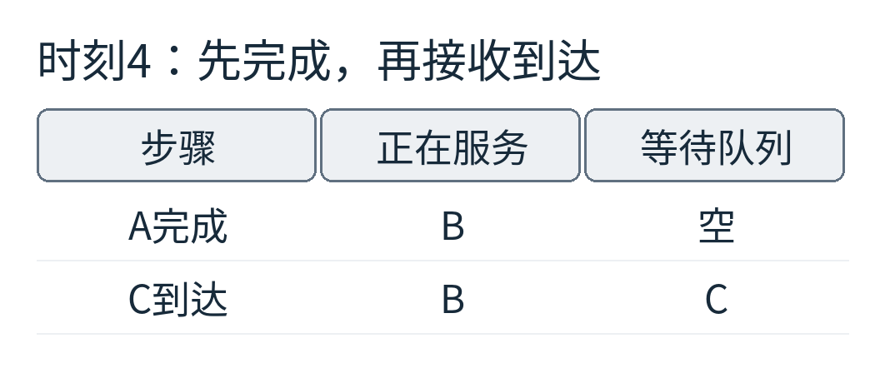

注意，时刻4处理第一件事到第二件事之间，模拟时间没有增加；状态却已经变化。这是“离散事件”里的离散：程序按一个个事件更新，并不是说每个事件必须占据不同的时间刻度。

如果本例改为先处理C到达，会怎样？C先排在B后面；随后A完成，仍然取走B，最后还是B在服务、C在等。附带程序运行了两种顺序，验证本例的服务时间表恰好相同。

但不能从这次巧合推出“同刻顺序永远无所谓”。假设B有等待截止时间4，只有仍在等待的作业会被取消。若4点先取走B开始服务，随后超时事件发现它已不在等待，就不取消；若先超时，B被移出队列，此后不会开始服务。两种顺序得到不同答案。


这个超时例是独立的小规则检查，没有加入主打印模型。它告诉我们：模拟器应当明确语义，而不是让结果偶然取决于字符串字母序或内存地址。

## 日历怎样总能取到最早的一项？

最简单的实现是保存一个列表，每次找最小时间。数据少时足够直观。事件多起来，可以使用最小堆：一种支持较快插入、并让最小元素容易取出的数据结构。

本篇不重新推导堆的维护算法。只需知道，日历需要两种操作：插入新事件，取走当前最早事件。附带代码用Python标准库的heapq完成它们。

排序键写成三部分：`(时刻, 优先级, 递增编号)`。先比较时刻，只有时刻相同才比较优先级；前两项都相同，较早登记的编号在前。

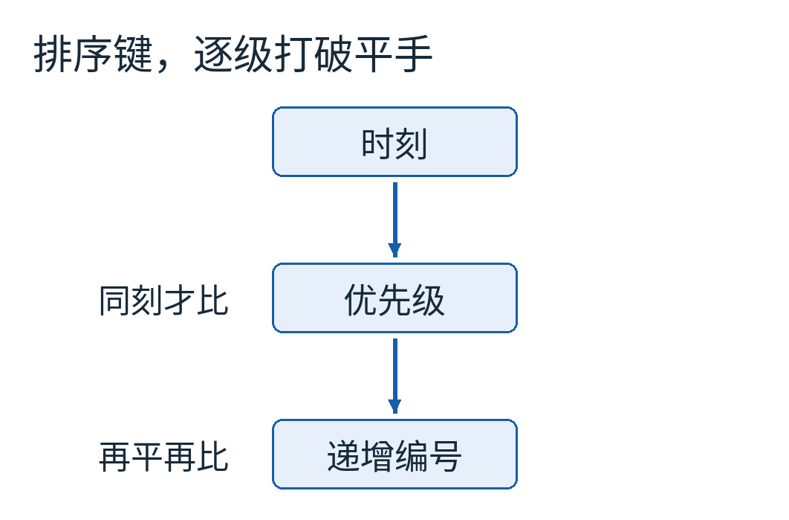

例如 `(4,0,4)` 的完成事件排在 `(4,1,2)` 的到达事件前，因为第二项0更小；编号4虽然更大，此时根本轮不到比较它。递增编号还避免了最后不得不比较两个无法排序的事件对象。

SimPy官方说明介绍了顺序处理同刻事件、用递增事件编号打破平手以及堆队列的做法。本文自己写了一个更小的模拟器，并明确添加“完成优先”的教学规则；它不是SimPy内部优先级规则的完整复制。[SimPy时间与调度说明](https://simpy.readthedocs.io/en/latest/topical_guides/time_and_scheduling.html)

## 把后半段走完，检查账是不是对得上

时刻6，B完成，C从队列中开始，预约7完成。时刻7，C完成，队列为空，机器空闲。下一件事是D在8到达，于是时钟直接跳到8；D立即开始，在10完成。

最终服务时间是：A从0到4，B从4到6，C从6到7，D从8到10。

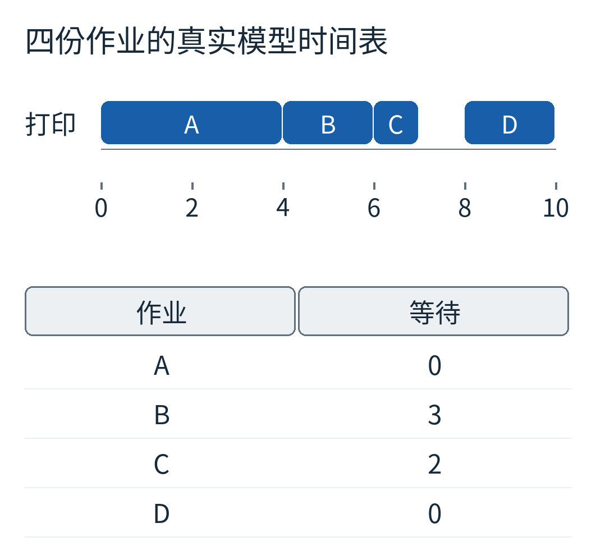

色条表示服务，不包含排队。A等待0；B等了 `4-1=3`；C等了 `6-4=2`；D等待0。总等待5，四份作业平均等 `5/4=1.25` 分钟。

从模拟开始0到最后完成10，机器忙了 `4+2+1+2=9` 分钟，因此这个观察窗口内的利用率是90%。窗口必须说清：若把时间继续观察到20，且没有新作业，忙时仍是9，比例就变成45%。比例没有脱离分母独立存在。

这几个数字都是特定四作业输入的结果，不是打印机产品指标。服务时长、到达间隔或调度规则换掉，答案也会跟着换。

## 跳过时间，会不会把统计也跳丢？

会，若你只在每次事件后记一下队长，再对这些数字取普通平均。

从1到4，B在等，等待队长为1，持续3分钟。从4到6，换成C在等，队长仍为1，持续2分钟。其他时间没有人排队。因此“队长×持续时间”的总和是 `1×3 + 1×2 = 5` 个作业·分钟。

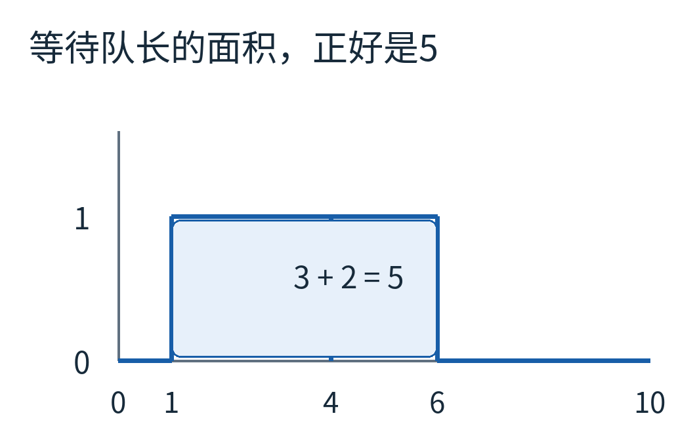

横轴是分钟，纵轴只数等待中的作业，不包括打印机里正在服务的一份。蓝色区域宽5、高1，面积为5。时刻4换人但队长不变，所以阶梯没有高度变化。

每次处理新事件之前，先用**上一次状态**的队长乘以已经跨过的时长，把这段面积累加起来。然后才更新状态。这一句顺序很关键：如果先把B移走，再用新队长0计算它过去等的三分钟，就漏账了。

程序中的核心是：

```python
area += len(waiting) * (new_time - previous_time)
previous_time = new_time
# 接着处理到达或完成，改变 waiting
```

最终面积5，恰好等于四份作业等待时间之和5。这里每份作业都在观察窗口内到达并完成，因此两种数法完整覆盖同一批等待。这个等式是很好的自检，不需要把模拟器速度当作正确性证据。

## 预约取消了，堆里那张纸条怎么办？

现实系统经常重设计时器。另举一个小例子：原来预约时刻2提醒，到了1又改成时刻5。旧的“2点提醒”已经在堆里，怎样处理？

一种办法是不立即从堆中间删除它，而是给预约一个代号。第一次代号1，重设后当前有效代号变2。取出事件时，若携带的代号不是当前有效代号，就跳过。

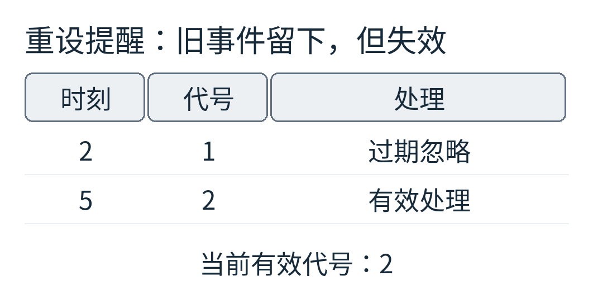

程序实际跑出的结果是：时刻2、代号1，过期忽略；时刻5、代号2，有效处理。这叫惰性取消，省去了在堆中定位任意旧事件的工作，但旧事件在出队之前仍占用内存。

不要把这个提醒例不加修改地套成“取消正在打印的任务”。取消正在服务的工作，是否释放机器、是否保留已经完成的部分、是否启动下一份，都需要额外定义和更新状态。事件日历负责次序，不替业务决定含义。

## 事件驱动也可能原地打转

假设某个事件一被处理，就安排另一个发生在“现在”的同类事件。第二个又安排第三个，时间戳永远不增加。程序可以一直忙，模拟时钟却停住。

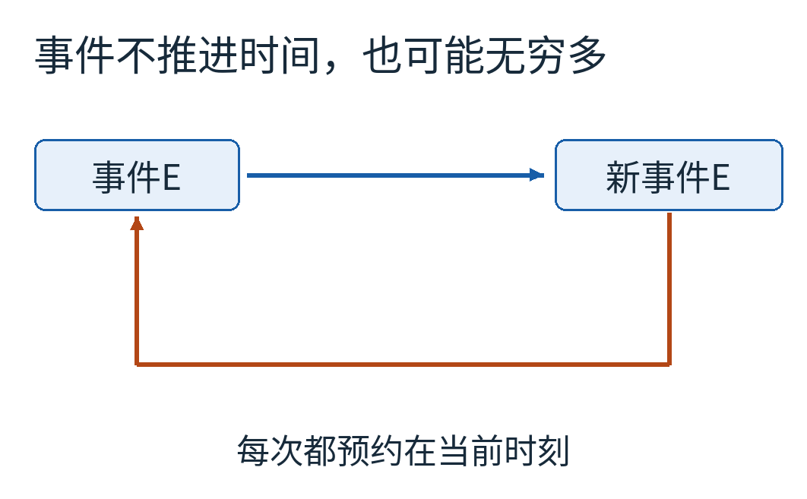

这不是等硬件快一点就能解决的问题，而是模型缺少终止性条件。需要检查零时延循环，限制不合理的即时事件链，或改变模型规则。另一方面，有限个同刻事件本来就是正常现象，不能一律当成错误。

如果事件代表连续系统穿越阈值，还要认真计算阈值时刻，防止跨过、重复触发或数值误差造成抖动。混合连续与离散状态的模拟，比本文单台打印机多了一层求解任务。

## 八个事件，就把十分钟走完了

[完整代码](examples/model.py)处理四次到达、四次完成，一共8个事件；事件时间共有7个不同值，因为4出现两次。代码没有sleep、线程或随机输入，在相同规则下结果可重复。

[输出数据](examples/results.json)保存每一步的机器、队列与未来日历，还有服务区间、等待时间和面积检查。你可以把D的到达从8改成6，先在纸上推一遍，再检查程序：它在6到达时C可能已经开始，因而要等到7，结果会怎样？

这个练习的重点不是记住一个框架的接口，而是养成一种建模习惯：哪些时刻真的会改变状态，哪些只是状态维持不变的空档？把前者准确排进日历，后者就可以放心跨过去。

图片来源：全部为本文原创模型示意与程序结果图，没有真实打印机实测或第三方软件界面。[来源、许可与复现说明](sources.md)
