# 从格子里长出模型，为什么拐角容易被削掉？Dual Contouring 多问了一个方向

想做一面能被挖洞的墙。你可以直接保存墙的三角形，但每挖一次，都要重新处理洞口周围的连接。另一条路是先在空间里铺网格，让每个采样点记录“在物体里面，还是外面”，再从这些数据重新提取表面。

困难随之而来：网格只在有限位置问问题。墙角可能藏在一个格子内部，而边上的两个交点，并没有直接告诉你墙角在哪儿。

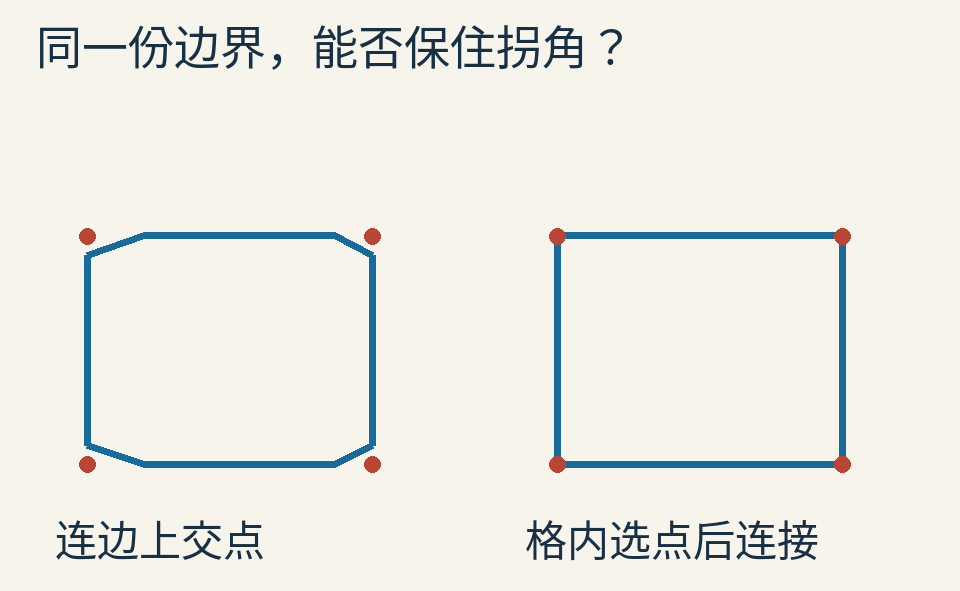

这是本文程序实际计算的二维轮廓。红点标出原矩形的四个真实角，蓝线是提取结果；两边使用相同格宽 0.5。左侧在每格中直连两个交点，右侧使用本文的均匀网格 Dual Contouring 教学实现。这里没有展示商业引擎内部数据。

**Dual Contouring** 是一种从采样的内外信息与边界信息生成网格的方法。它有个重要选择：不把所有新顶点都钉在原网格的边上，而是让每个穿过表面的格子选一个代表点，再把相邻代表点连起来。

“点可以在格内移动”本身还不够。关键是用什么信息，告诉点该停在哪儿。

## 先把三维墙角摊成方格纸

本文先只处理一个单位方格：x、y 都从 0 到 1。真实物体占据左下侧，它的边界在格内拐一个直角：从 `(0.7,0)` 向上走到 `(0.7,0.6)`，再向左走到 `(0,0.6)`。

如果你一开始只看到四角的内外标签，会知道左下角在内，其余三角在外。我们约定内为负、外为正。

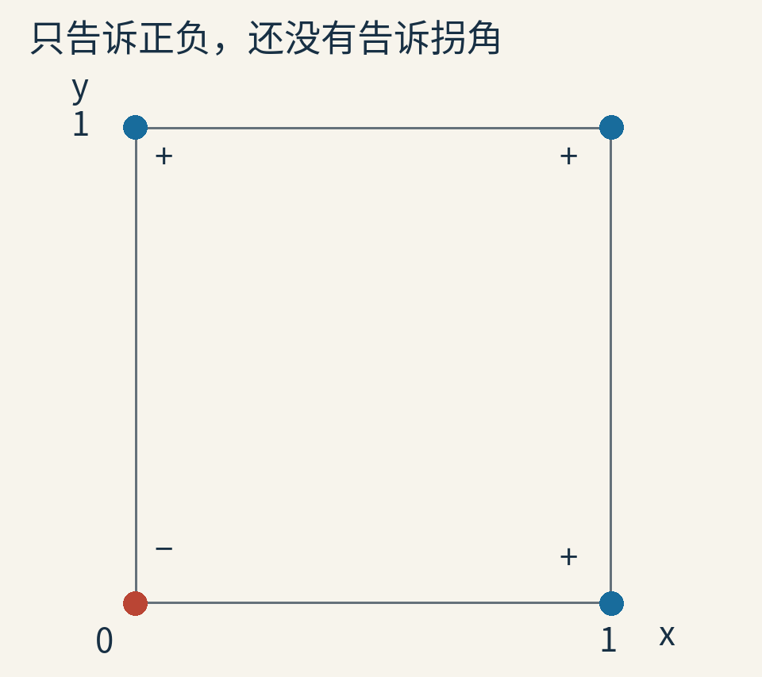

这些正负号来自一个自设函数 `f(x,y)=max(x−0.7,y−0.6)`：当两个条件都小于零，点位于左下区域，f 为负；任一条件越过边界，f 就不再为负。f=0 是要提取的轮廓。

这样的函数常叫**隐式表示**：不是直接列出轮廓上每一个点，而是给你一个判断位置的规则。这里的 f 不是一般位置上的精确距离，不应把它的数值直接当作“离物体还有多少米”。

只知道四个正负号，能唯一推出那个直角吗？不能。许多弯线、斜线甚至更复杂的形状，都可能给出相同的四角标签。输入信息的多少，决定了后面能恢复多少。

## 边界在哪儿穿过格子？先找两处交点

观察方格底边，左端在内，右端在外，所以边上某处会跨过轮廓。本例能直接求出交点 `(0.7,0)`。左边也有交点 `(0,0.6)`。

一种常见轮廓提取做法，是把这两个交点在格内用线段连接。它容易实现，与相邻格共用同一处边交点，也方便保持连接。

但这次，它把直角切成了斜边。

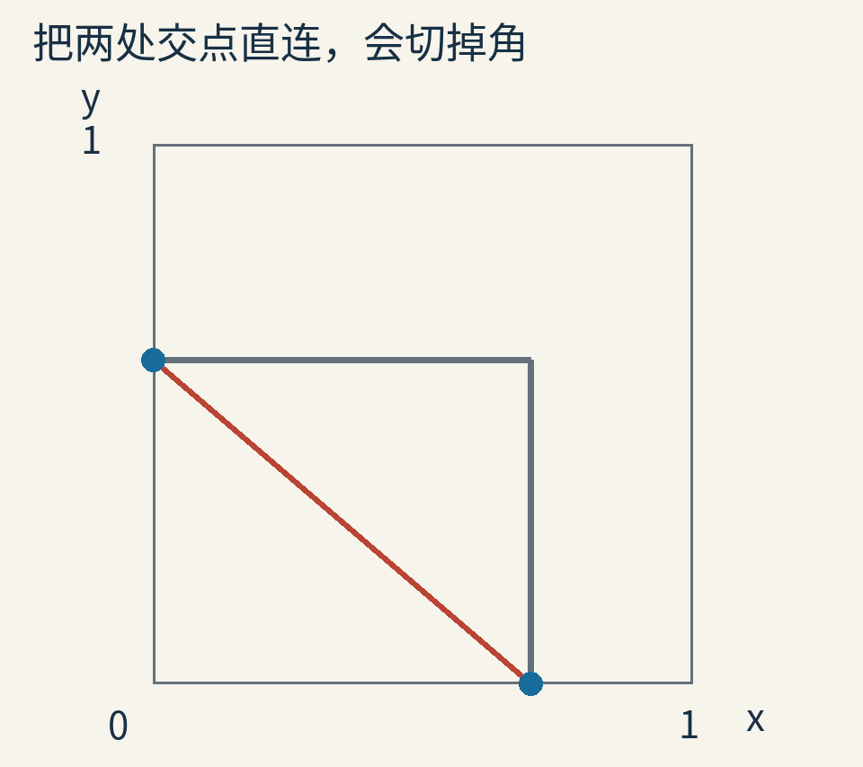

问题不在于交点不准。即使这两点完全准确，连接它们的直线仍然不能表达中间那次转弯。

增加网格分辨率通常能缩小这类误差，可若我们已经知道表面在交点处朝哪儿，能不能把这些信息也用上？

## 再给每个交点一根法线

**法线**是垂直于局部表面的方向。在二维里，轮廓局部是一条线，法线就是垂直于它的箭头；三维里，表面局部近似一个平面，法线垂直于这个平面。

本例底边交点 `(0.7,0)` 位于竖直边界上，外法线朝右，即 `(1,0)`。左边交点 `(0,0.6)` 位于水平边界上，外法线朝上，即 `(0,1)`。

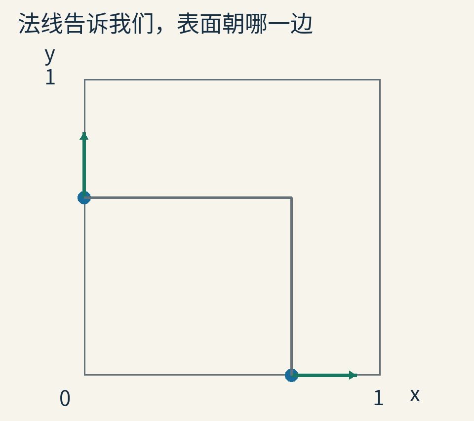

位置与法线一起，提供了比正负号丰富得多的局部信息。在相关论文里，这类交点和法线的组合称为 **Hermite 数据**。你先记住它实际存的东西就够了：边界经过哪里，在那里朝哪一侧。

这些法线不能凭空猜。若有可求导的隐式函数，可以从局部变化得到梯度方向；若源数据是模型，也可以从表面得到法线。测量噪声、离散差分、尖角附近不唯一的方向，都可能影响它们的准确性。本文盒形例子直接使用已知面方向，避免把估计法线的另一个难题混进来。

## 让两条局部切线见一面

在 `(0.7,0)` 处，法线朝右，说明局部切线垂直于 x 轴，也就是 `x=0.7`。

在 `(0,0.6)` 处，法线朝上，说明局部切线是 `y=0.6`。

把两条线延伸，它们相交于 `(0.7,0.6)`。这正好是格内藏着的角。

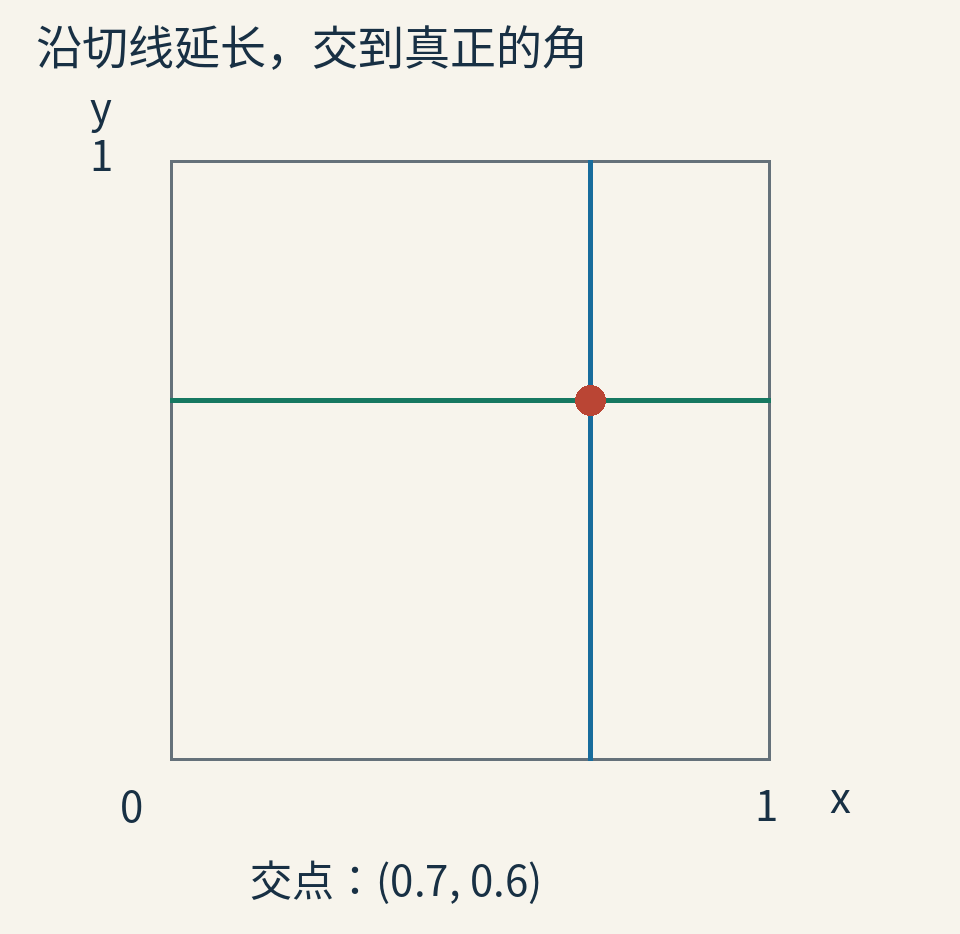

这一步已经抓住了 Dual Contouring 保留尖锐结构的直觉：**不只连接边界点，还要求新点尽量尊重边界点给出的局部朝向。**

[Tao Ju、Frank Losasso、Scott Schaefer、Joe Warren 的原论文](https://www.cs.rice.edu/~jwarren/papers/dualcontour.pdf)从带符号网格和 Hermite 数据出发，讨论了均匀网格以及八叉树上的轮廓生成。本文先走通一个二维均匀格算例，不把后面的八叉树简化、拓扑条件和多材质处理悄悄假定为已经实现。

## 现实中的线不一定正好相交：给候选位置打分

如果有三条、四条带噪声的局部切线，它们可能无法通过同一个点。此时不能简单要求“所有条件都严格满足”，而要比较不同位置偏离了多少。

先仍用本例。候选点是 `(x,y)`：它到竖直切线的有符号距离是 `x−0.7`，到水平切线的有符号距离是 `y−0.6`。把距离平方再相加：

`E(x,y)=(x−0.7)²+(y−0.6)²`。

为什么平方？正负偏差不会互相抵消，偏得更远也会付出更大代价。我们要找 E 最小的点。

试方格中心 `(0.5,0.5)`：

`E=(−0.2)²+(−0.1)²=0.04+0.01=0.05`。

试刚才的角 `(0.7,0.6)`：两项都是零，所以 E=0。每一项平方都不可能小于零，因此这个点确实取得全局最小分数。

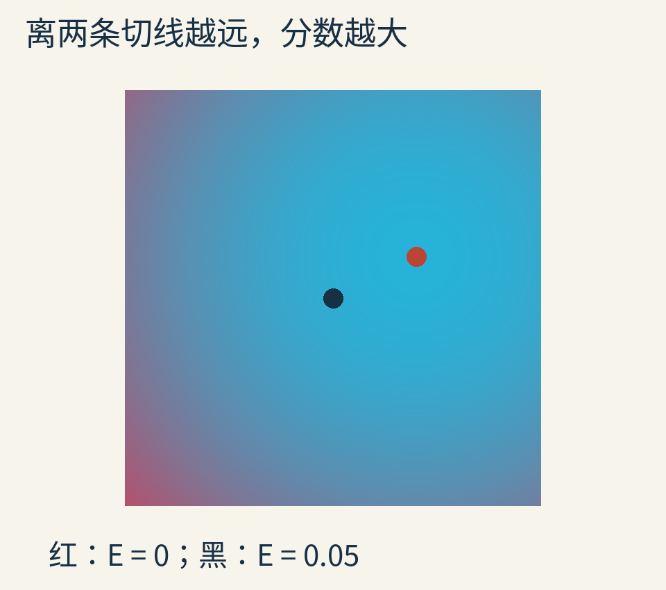

图中颜色表达误差大小，青色附近较低、偏暖处较高。它是对这个明确二维函数采样得到的图，不是某个复杂模型的普遍误差地形。

一般情况下，把第 i 个交点记作 pᵢ，把它的**单位法线**记作 nᵢ，新点记作 q。点到该局部切线或切平面的有符号距离，可以写成 `nᵢ·(q−pᵢ)`。

中间的点号叫点积：对应坐标相乘再相加。例如 n=(1,0)，那么 `(1,0)·(x−0.7,y)=x−0.7`，恰好回到刚才算过的那一项。先有这个具体操作，公式就不再是另一套神秘方法。

把所有这些距离平方相加，就是**二次误差函数**，简称 QEF：

`E(q)=Σ [nᵢ·(q−pᵢ)]²`。

必须把法线长度归一化为 1，或者明确设计额外权重。否则把同一根法线写成 `(100,0)`，它对应的平方项会无缘无故放大一万倍。

## 点找到了，怎样连成一条完整轮廓？

若每个格自己找到了一个点，然后随便把邻居连起来，仍然可能连错。连接必须听原始网格的边界信息。

在二维，某条网格边两端异号，意味着轮廓穿过它。这条边左右或上下各有一个相邻格。把这两个格的代表点连起来，就得到跨过这条边的一段新轮廓。

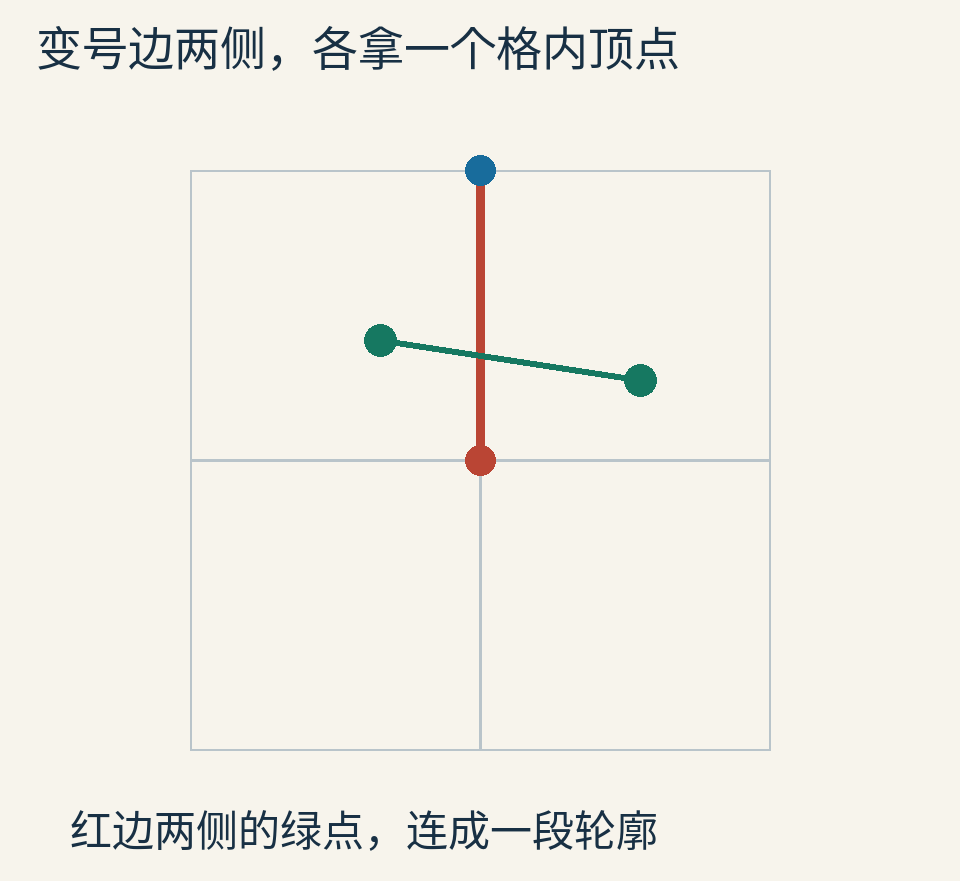

图是连接关系示意，绿色点的位置不属于前面那个单位格算例。红边两端的不同颜色表示异号；它们是原网格采样点，绿点才是生成网格的顶点。把两种点认清，才不容易把“原网格边”和“新轮廓边”混为一谈。

“Dual”常译作对偶，可以从这次交换理解：原来逐格生成轮廓片段、顶点钉在格边上；现在逐格生成代表点，再围绕原网格的变号边把代表点连起来。连接关系与几何位置，是两项分别需要做对的工作。

在完整例子中，矩形范围是 `−0.8≤x≤0.7`、`−0.6≤y≤0.6`，网格覆盖 `[-1.5,1.5]²`，格宽 0.5。程序先计算所有穿过边界的格，再连接它们。

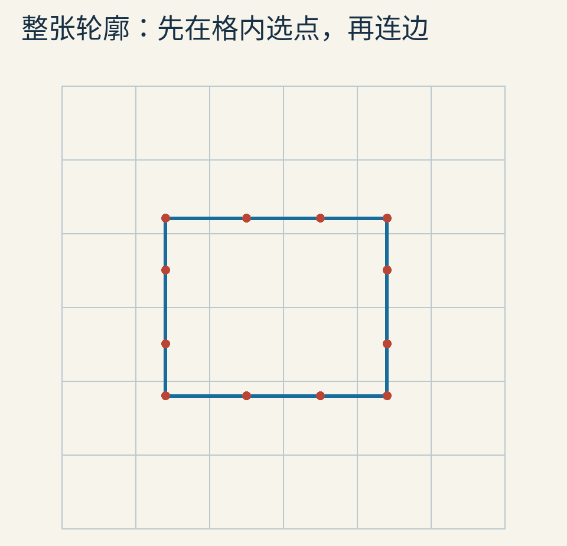

图中的四个角都被恢复出来。平坦边上的其他点还存在，所以“保住直角”不等于“已经自动输出顶点最少的四边形”。简化是可以继续做的另一项工作。

## 三维里，为什么变成四个点围成一个面？

把二维正方格换成立方格。一个穿过表面的立方格仍选一个代表顶点。但在规则三维网格内部，一条原网格边周围通常围着四个立方格。

若这条边两端异号，取四个立方格的代表点，按绕边的次序连接，就形成一个四边形表面。需要三角形输出时，再采用明确规则把它分成三角形。

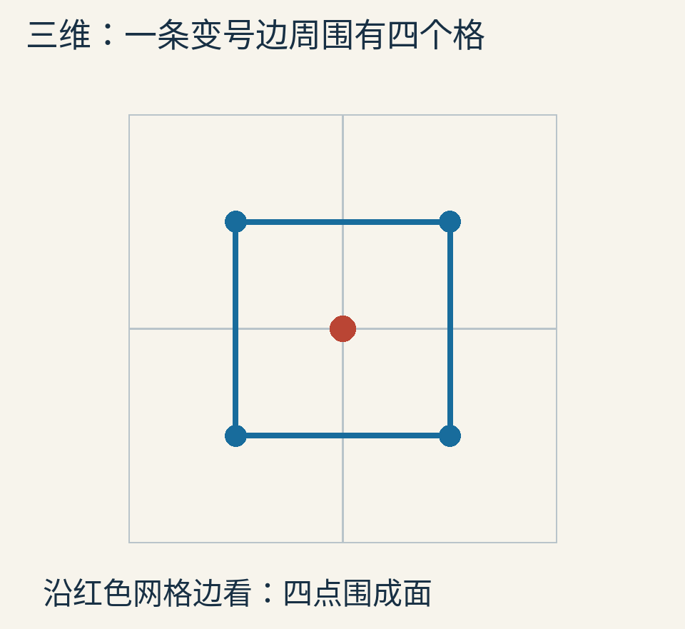

这是沿原网格边方向看的投影：中央红点代表那条朝向读者的边，并不是说四个三维顶点都必须共面且恰好是这个正方形。真正实现还需决定朝向、处理边界及退化情况。

本篇可执行实验是二维版本。三维连接图用于解释结构，没有冒称已生成、验证任意三维模型。若换成大小不一的八叉树格子，还要处理不同层级之间的连接；那是原论文继续解决的问题，不能靠把二维循环多套一层就自动得到。

## 分数最低，却没有唯一答案的时候

假设一个格子只穿过一条平直竖边。交点的法线全都朝右，所有要求都只在说 `x=0.7`。

那么 `(0.7,0.2)`、`(0.7,0.5)`、`(0.7,0.8)` 都能得到零误差。输入根本没有约束 y，当然不该逼程序凭空确定唯一 y。

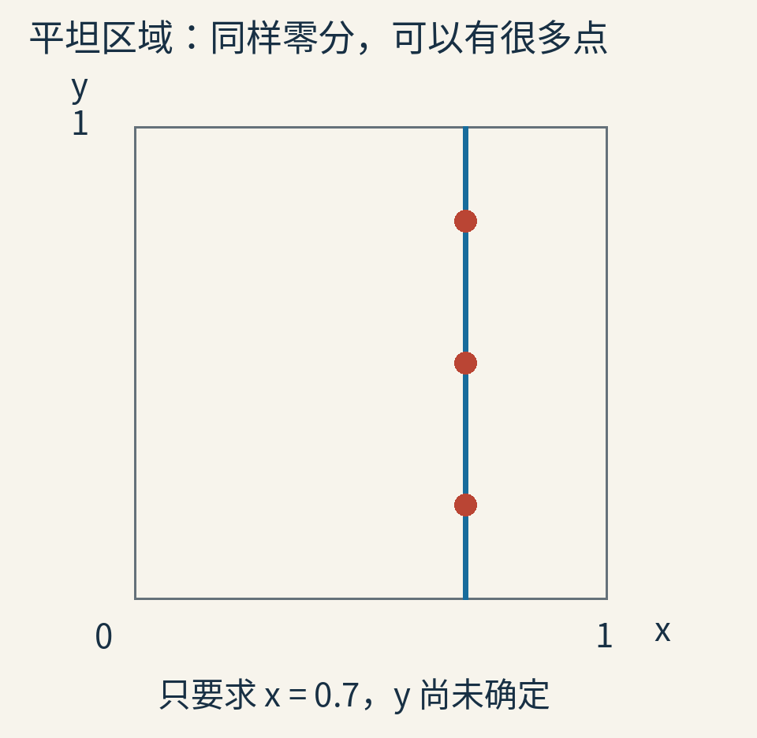

这时方程是欠约束的，直接求一个逆矩阵可能失败。本文程序先取所有交点的平均位置作为参考，再求使误差最小的修正；若存在许多同分解，保留离参考位置最近的那个。数值实现调用最小二乘求解，而不是不加判断地求逆。

对竖直平边，这会确定 x，保留交点平均提供的 y。它是一种清楚的选择规则，不意味着平均点本身总是正确的角点；前面直角例子的平均交点只有 `(0.35,0.3)`，还必须经过法线约束修正。

## 另一个麻烦：两条线几乎平行

现在换成两条局部约束：

`x=0.5`；`x+0.01y=0.52`。

第一式代入第二式，得到 `0.01y=0.02`，所以 y=2。无约束最优点是 `(0.5,2)`，已经跑出了 `[0,1]²` 的格子。

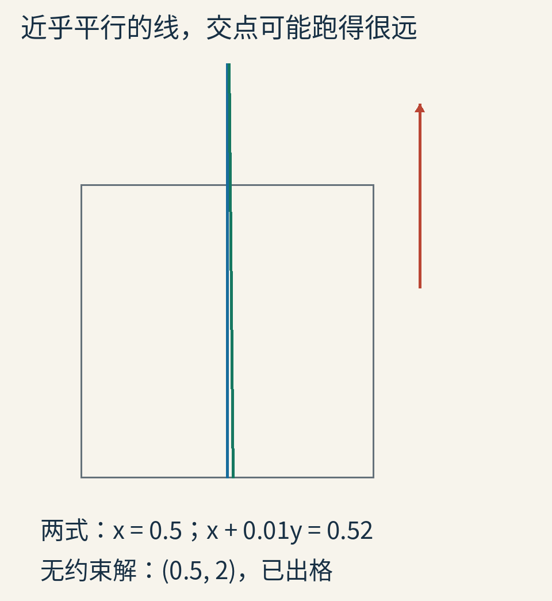

图中只显示格子附近的一段线，两线的真实交点在图外上方。输入中的微小位置变化，会让远处交点明显移动。这是几何条件不充分、接近退化时的敏感性，不是算法得到一个很大的数字就“发现了隐藏尖角”。

可以采用有界最小化，要求 q 留在当前格内；也可以设计正则化、候选回退等策略。每种都在增加新的选择条件，要说明它改变了什么。

尤其注意，先求无约束解，再把每个坐标裁到 `[0,1]`，未必等于真正的有界最优。把 `(0.5,2)` 简单裁成 `(0.5,1)`，虽然回到格内，却还可以通过略微改变 x 降低总误差。

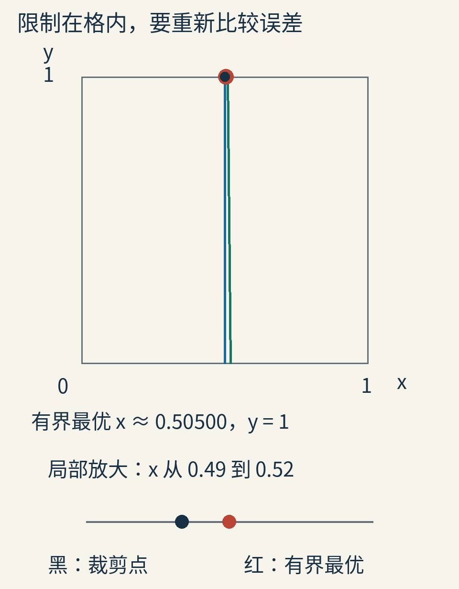

两条法线单位化后，本例误差是：

`E=(x−0.5)²+(x+0.01y−0.52)²/1.0001`。

在最优边界 y=1 上，把两项展开或配方，可得 `x≈0.50499975`。配套代码实际重算了这个值。这里的有界例子用于说明策略差异；矩形提取主程序并未宣称提供通用受约束 QEF 求解器，因为它的精确轴对齐输入没有触发这一情况。

## 没采到的东西，法线也救不回来

在一个大格子内部放一颗小圆，圆完全碰不到格子的四条边。四角都在外，所有网格边两端也都在外。只看这些采样，就没有任何变号边。

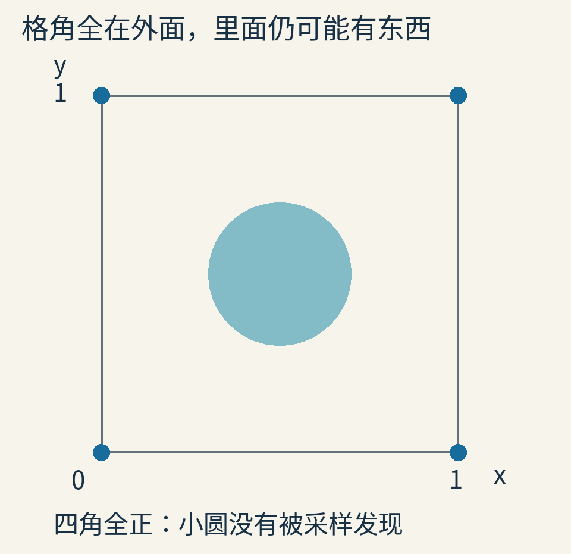

Dual Contouring 不会从不存在的交点中猜出这颗圆。类似地，一条边穿过表面两次，两端符号相同，也可能被仅检查端点异号的基础方法漏掉。

增加分辨率、增加采样条件、使用更丰富的表示，可以改善覆盖；但“用了某种轮廓算法”不等于“任何细小结构都能保证恢复”。顶点放置误差、拓扑是否正确、有没有自交，是不同问题。

一个格内若存在多个互不连接的轮廓分量，强行只给它一个代表点，也可能把本来分开的结构揉在一起。应采用能处理这些输入的扩展，或者明确限制模型；不能把适用于本文矩形的结论外推到任意复杂数据。

## 把网格变密，实际发生了什么？

将同一个矩形的格宽从 0.5 改为 0.25。本文程序分别得到 12 个与 22 个代表顶点；两者都恢复相同的四个矩形极值位置。

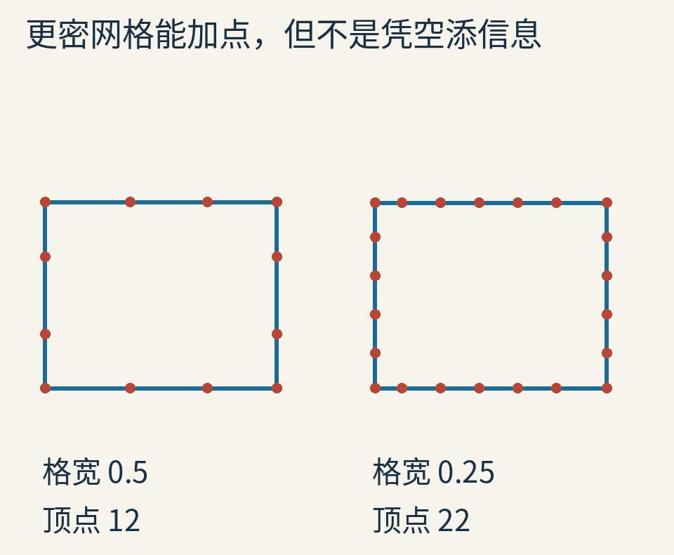

这是非常友好的精确盒形输入，不能据此说任意曲面“粗细网格都一样准确”。本例的作用恰恰是分离两件事：尖角能否恢复，取决于有无足够的交点与方向约束；输出面数则还受网格和后续简化策略影响。

[实验代码](examples/lab.py)保留两档结果、顶点、连接段及误差计算，[数据文件](examples/results.json)可直接查看。程序验证了两档轮廓的范围与真实矩形一致，且每个输出顶点恰好连着两条边，组成这里期待的封闭轮廓。它不是任意输入的拓扑证明。

运行环境为 Python 3.12.14、NumPy 2.3.5，绘图需 Pillow 和 Noto Sans CJK。`python lab.py` 会覆盖本篇结果与图。你可以先把上边界 0.6 改成另一个不落在网格线上的值，再预测角点会移动到哪里。若让边界恰好穿过采样角，须另外检查零值归属与重复交点，不应假定一般位置规则自动覆盖退化输入。

给一个边界交点再添一根箭头，看似只多了两个或三个数字，却把“这里经过表面”变成了“这里经过表面，而且局部朝这个方向”。新顶点因此可以从边上走到格内，去寻找那些单靠直连交点会丢掉的拐角。

图片全部为原创几何示意或实际程序输出，未复制原论文图片。正文、图与数据采用 [CC BY 4.0](https://creativecommons.org/licenses/by/4.0/)，代码采用 [MIT](examples/LICENSE.txt)。原论文与本篇实现边界见 [sources.md](sources.md)。
