# 不记住每个人，怎样估计到底来了多少人？

一个网站今天收到一百万次访问。这个数很容易累加：每来一次就加一。

但产品同事问的是另一件事：“今天有多少个不同的访客？”一个人来十次，只能算一人。这次不能看到一条记录就加一，得先知道这个身份以前有没有出现过。

最直接的办法，是保存所有已经见过的身份，新的才加入。这能得到精确答案，也要为越来越长的名单付出空间。若只想看大致规模和变化，能否用一小块固定大小的摘要，换一个带误差的估计？

HyperLogLog，常缩写为 HLL，做的就是这笔交换。它不保存完整名单，只观察一批由身份稳定决定的二进制模式，记录其中某种少见现象出现到什么程度，再估计不同对象的数量。

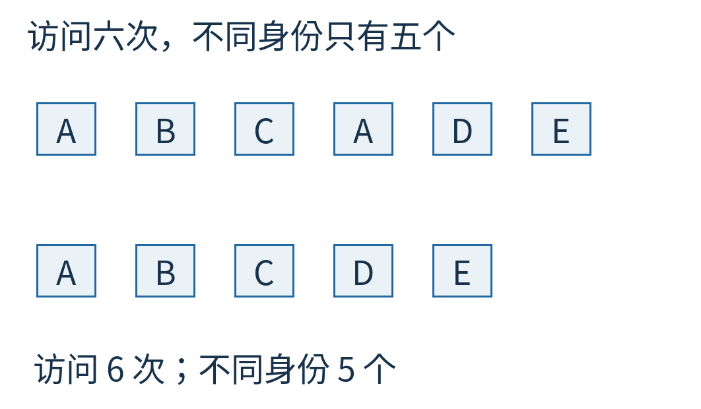

图1｜六条记录含 A、B、C、A、D、E，访问数为六，不同身份数为五。本文把“身份”视为已经定义好的输入键；算法不会替业务判断两个账号是否属于同一个自然人。

它与 Bloom 过滤器的接口也不同。Bloom 过滤器问“这个键可能在集合里吗”；HLL 问“集合大约有多大”。不要把数量摘要拿来证明某个访客一定来过或没来过。

## 先让同一个人，每次拿到同一串数

假设能把每个身份交给一个哈希函数，得到固定长度的 0、1 串。哈希函数是一套确定的计算规则：输入同样的键，输出必须一样。

对于不同的键，我们希望输出在统计上接近均匀分散，各位看起来像独立公平的硬币结果。**同一个人来两次不能重新抛两串硬币。**否则重复访问也可能制造新的“稀有现象”，算法就不再只数不同身份了。

下面先用一张人为指定的短哈希表，只为了让眼睛看清动作。这不是实际哈希函数，也不拿它测试误差精度。

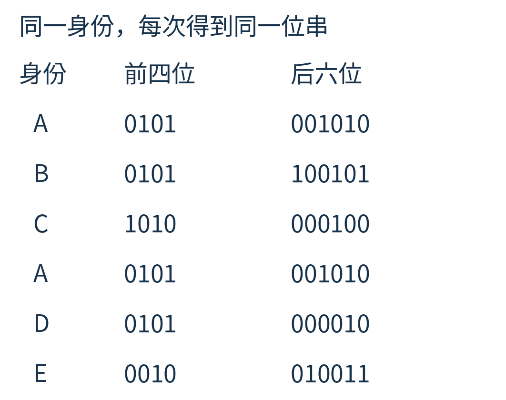

图2｜相同的 A 两次都得到 `0101 001010`。前四位稍后选桶，后六位观察前导零；短位宽只是教学放大图，不能用于估计真实大规模人数。

实际程序使用 SHA-256 输出的前 64 位，按大端顺序解释成一个无符号整数。这里使用它是为了得到可复现、较充分混合的位模式，不是在介绍加密协议，也没有证明这套哈希对任意对抗性输入都满足理想独立随机模型。

输入编码也要固定。字符串“12”和由两个字段拼出的“1、2”不能随便混成同一串字节。本文实验的键是整数编号，编码为明确的 ASCII 字符串 `salt:编号`；冒号分隔和整数规则都由代码固定。

## 为什么盯着开头的零

在理想公平位串里，第一位是 0 的概率是 1/2；前两位都是 0 的概率是 1/4；前三位都是 0 的概率是 1/8。每额外要求一个开头的 0，机会就再减半。

所以，若只看过很少的独立位串，遇到开头一长排 0 的机会不大；看过很多不同位串，遇到它的机会就增加。这给数量留下了一种粗略痕迹。

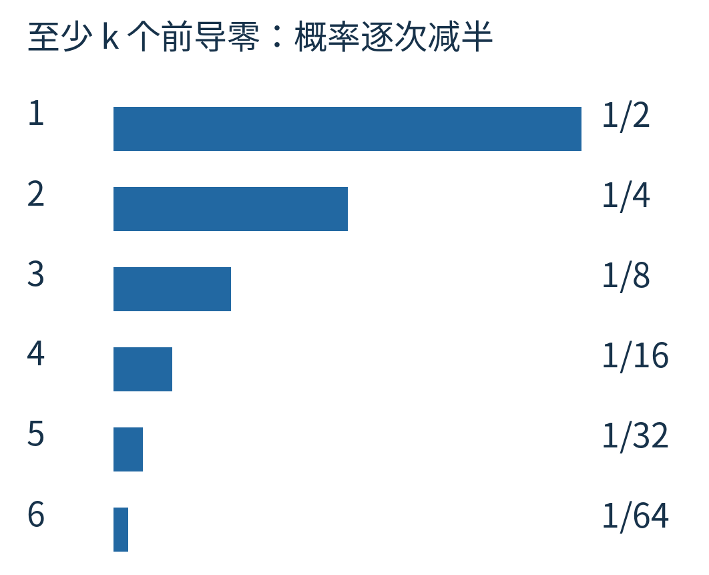

图3｜柱长共用概率尺度，表示“至少 k 个前导零”的概率 2⁻ᵏ。它与“恰好 k 个零后面接一个 1”的概率不同；后者还要再乘 1/2。

算法通常把观测值写成 `ρ`：第一个 1 出现的位置，从 1 开始计数。

- `1…` 的 ρ=1，因为前面没有 0。
- `01…` 的 ρ=2。
- `001…` 的 ρ=3。
- `0001…` 的 ρ=4。

于是，ρ 等于前导零个数加一。别把它与前导零个数混为一谈，差一位就会让后面的二次幂差一倍。

有限位串还可能全部是 0。本文代码对 q 位后缀规定此时 ρ=q+1；这是一种有限字长处理规则，不能假装真的在后面看见了一个不存在的 1。

## 一次罕见事件，不是一张人数证明

看到一个 `0000001…`，能不能立即宣布来了一百多人？不能。第一个访客也可能碰巧拿到这种哈希结果。

单独一个最大前导零长度波动太大。它给出数量级线索，却不是“至少有多少人”的确定证明。HLL 的下一步，就是不要把希望全押在一场抽签上。

准备 m 个桶。若 m=16，刚好用哈希前四位选择桶号：`0000` 是 0 号，`0101` 是 5 号，`1111` 是 15 号。然后只对余下的后缀计算 ρ。选桶的四位已经用过，不能再算进前导零。

每个桶只保存自己见过的最大 ρ，记作寄存器 M[j]。起初所有寄存器为 0，表示这桶还没见过任何身份；真正遇到一个后缀，ρ 至少是 1。

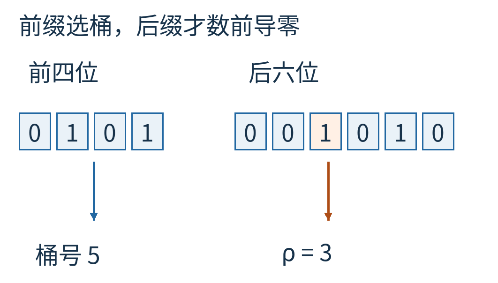

图4｜A 的前四位 `0101` 选中 5 号桶；后缀 `001010` 的第一个 1 在第 3 位，所以观测值为 3。前缀中的两个零不参与这次计数。

## 把六条记录真的放进桶

沿着图1的访问顺序 A、B、C、A、D、E，使用刚才那张短哈希表：

A 到 5 号桶，后缀 `001010`，ρ=3，把 M[5] 从 0 改成 3。

B 也到 5 号桶，但后缀 `100101`，ρ=1。1 没超过已有的 3，所以不改。

C 到 10 号桶，后缀 `000100`，ρ=4，把 M[10] 从 0 改成 4。

A 再来一次，仍是 5 号桶的 ρ=3。最大值还是 3，不会因为又访问一次而增长。

D 到 5 号桶，后缀 `000010`，ρ=5，这次把最大值从 3 改成 5。

E 到 2 号桶，后缀 `010011`，ρ=2，把 M[2] 从 0 改成 2。

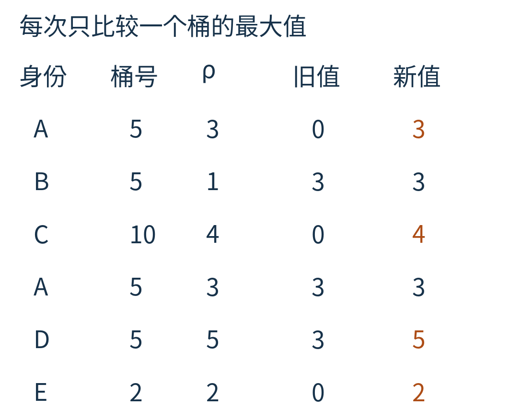

图5｜每行依次写身份、桶号、ρ、旧值和新值。B 虽然是新身份，也可能完全不改变摘要；A 虽然重复到达，也不会被额外计算一次。摘要不是每个新人的收据。

最终只有 2、5、10 号桶非零，分别为 2、5、4。

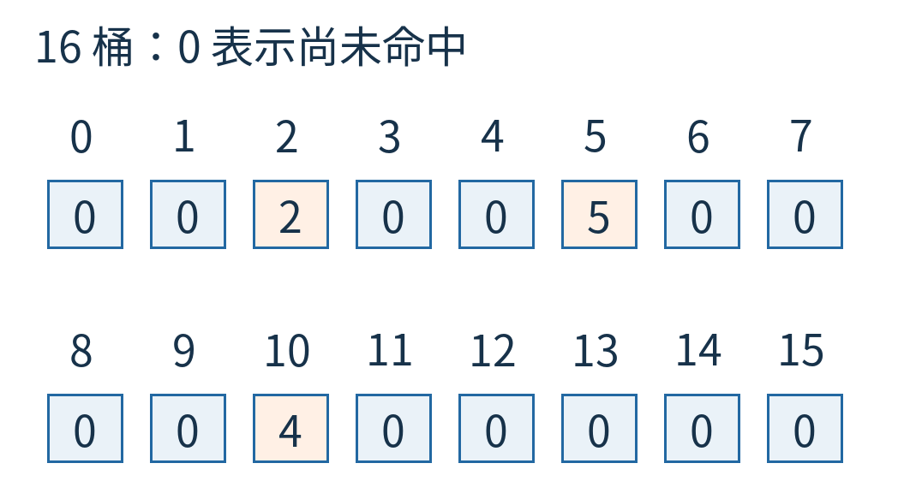

图6｜上排数字是桶号，下方大格是寄存器值。0 表示从未命中该桶，不表示遇到一个“ρ=0 的身份”。这份状态来自人为短哈希，只用于解释更新，不用于宣称五个人估得准不准。

这一更新规则已经解释了两个重要性质：重复输入不会改变状态，输入顺序也不会改变最终状态。因为一个桶最后保存的是同一批数的最大值，而最大值与排列顺序无关。

但它也说明摘要忘掉了很多事：B 来过却没留下单独痕迹，桶里究竟有谁、各有几次，已经无法完整恢复。

## 让很多桶共同投票，要怎样平均

桶越多，每个桶观察的数据越少，但有更多份观测可以综合。粗略地说，某桶最大 ρ 对应一个随 `2^ρ` 增长的规模线索；它不是该桶人数的精确等式。

为什么不直接对这些 `2^ρ` 做普通平均？因为偶然特别大的 ρ 会被指数放大，很容易拖着平均数往上跑。

看四个数字 2、4、4、128。普通平均是 34.5，几乎被最后的 128 抬起来了。另一种平均叫调和平均：先各取倒数，求平均，再取倒数。

`H = 4 ÷ (1/2 + 1/4 + 1/4 + 1/128) ≈ 3.969`。

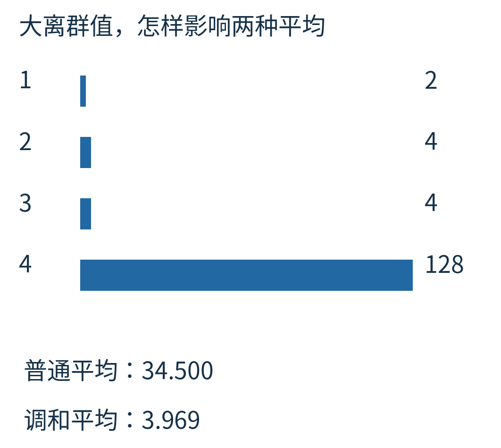

图7｜四个输入共用同一数值尺度；下方另列两种平均的算式结果。128 的倒数只有 1/128，在倒数总和里不会像原数那样独占分量。这个例子解释调和平均的行为，不是 HLL 精度证明。

HLL 的原始估计式可以写为：

`E = αₘ × m² ÷ Σ 2^(−M[j])`。

先别怕这个式子，它分成三步就是：

1. 每桶寄存器 M[j] 先变成规模线索 `2^M[j]`。
2. 对这些线索做调和平均，得到 `m ÷ Σ 2^(−M[j])`。
3. 再乘桶数 m，把每桶规模换回整体规模，最后乘校正系数 αₘ。

Σ 的意思只是“把所有桶对应的数加起来”。αₘ 则校正这套估计规则固有的统计偏差，它不是为了让某一份样例刚好等于正确人数而临时拧出来的旋钮。原始算法给出 m=16 时的系数 0.673；更一般的常数来自概率分析。本文解释它的职责，不伪装成用初中几步算术就完整推出这个常数。

## 用十六个桶算一次完整结果

换一份明确给定的寄存器状态：

`[1,2,2,3, 1,2,2,3, 1,2,2,3, 1,2,2,3]`。

这次不再沿用前面六条访问的短哈希。我们直接指定一份非空寄存器向量，专门练习估计式；没有给它虚构一个“真实人数”。

每四个桶贡献：

`2⁻¹ + 2⁻² + 2⁻² + 2⁻³ = 1/2 + 1/4 + 1/4 + 1/8 = 1.125`。

四组一共 4.5，于是：

`E = 0.673 × 16 × 16 ÷ 4.5 ≈ 38.286`。

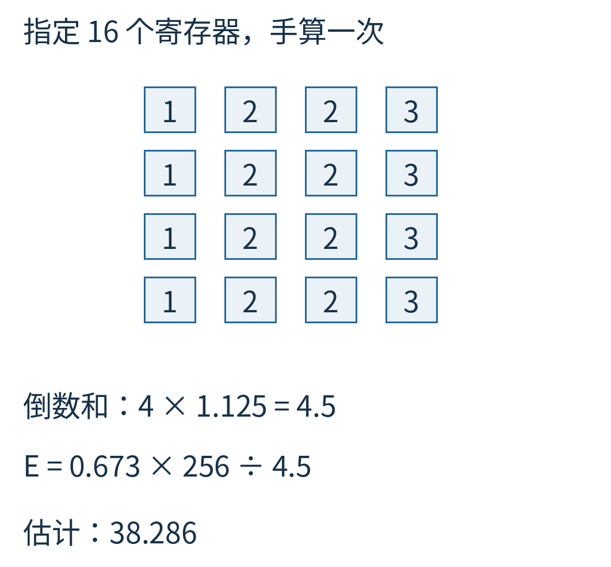

图8｜相同的四桶组重复四次，所以倒数总和为 4×1.125=4.5；图中每个数字都对应刚给出的寄存器状态。约 38.29 是估计值，不能读成恢复出了 38 个具体身份。

即使最终显示一个整数，也应该保留“估计”的身份。四舍五入只改变展示方式，不会把误差变没。

## 一个人都没来，公式为什么还会报数

如果所有寄存器还是 0，那么每项 `2⁻⁰=1`，倒数总和为 16。机械套用上式，会得到：

`0.673 × 16² ÷ 16 = 10.768`。

空集合被报成十来个，显然不行。

这说明“对非空、大量观测表现良好的估计式”不能不分情况地直接用在很小的集合上。经典 HLL 实用方案会在小范围里利用另一份尚未被丢掉的信息：还有多少个空桶。

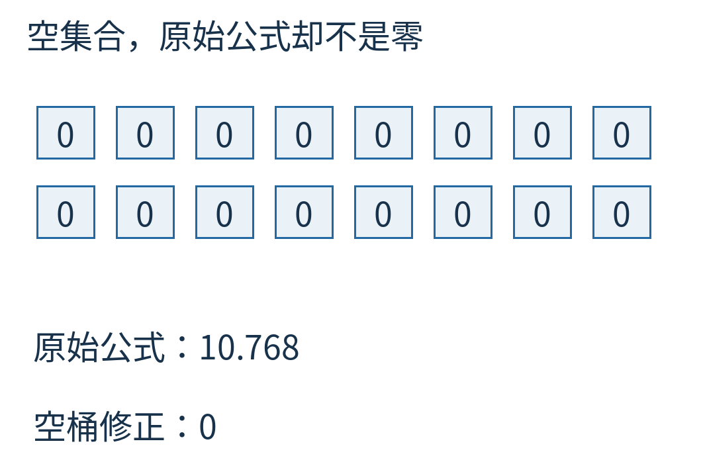

图9｜空集合的全部寄存器为零。原始公式输出约 10.768，但空桶修正输出 0；这不是程序算错乘法，而是原始统计估计在这个范围需要换规则。

设空桶数为 V，总桶数为 m。一个身份随机落入某一桶，该桶没被选中的概率为 `1−1/m`。若有 n 个不同身份且桶号近似独立均匀，一个指定桶始终未被选中的概率为 `(1−1/m)^n`。

因此，空桶所占比例 `V/m` 可以作为这个概率的观测。在常用近似下，`(1−1/m)^n ≈ e^(−n/m)`。把指数反过来解，得到：

`n ≈ m × ln(m/V)`。

ln 是自然对数，可以理解为以 e 为底的指数的反运算；这里的作用只是从“还剩多大一部分没碰到”反推出“做了大约多少次不同身份的投放”。它不是输入人数的额外秘密信息。

当 V=m，一个都没命中，结果是 `m×ln(1)=0`。m=16、V=15 时约为 1.033；V=8 时约为 11.09。空桶减少，说明不同身份通常更多。

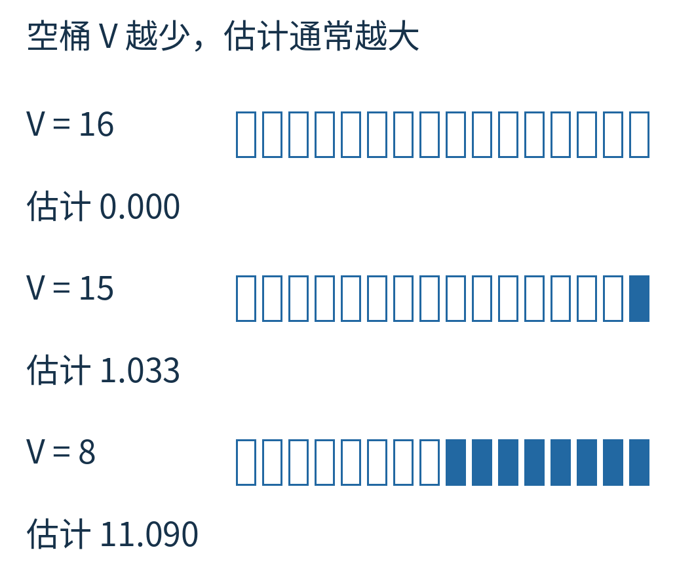

图10｜每行是16桶里的占用示意：空桶数为16、15、8，对应估计0、1.033、11.090。着色只表示“非空”，没有提供每桶具体寄存器高度。

这叫线性计数修正。本文代码采用经典切换规则：原始估计 E≤2.5m 且 V>0 时，用 `m ln(m/V)`；否则使用原始估计。V=0 时不能把 0 塞进分母或对数，必须走另一条规则。前面的十六桶手算例 V=0，所以保留 38.286 的原始估计。

后续 HLL++ 等方案还会加入偏差校正、稀疏表示与更细的切换策略。本文的小程序没有实现那些部分，也不与某个数据库的序列化格式兼容。

## 两台机器的名单重叠，摘要怎么合并

假设一半日志在机器甲，另一半在机器乙。同一个访客可能两边都出现。如果把两边估计人数相加，重叠身份会被重复算进来。

摘要却可以直接合并：对每个桶，取两边寄存器的较大值。

为什么？某桶在合并后的所有记录中见过的最大 ρ，恰好等于“甲的最大值”和“乙的最大值”的最大值。这是最大值运算的性质，不需要知道重复身份到底是哪几个。

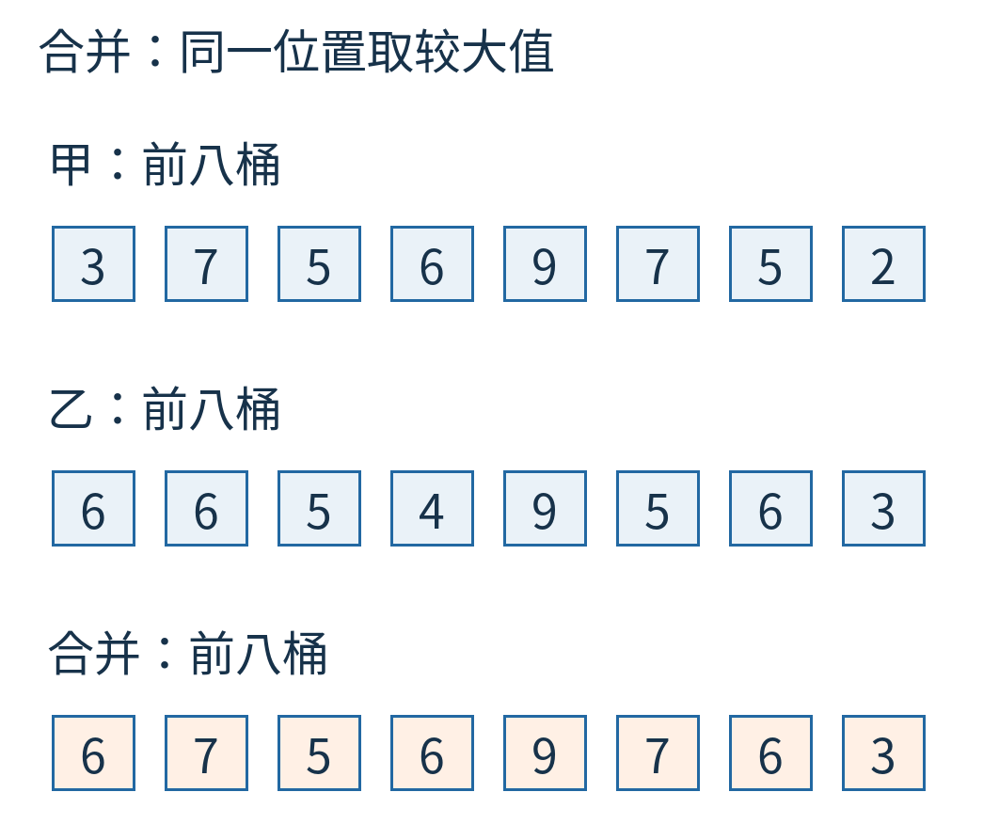

图11｜展示实际实验摘要的前八个桶，完整摘要有1,024个桶。第三行逐项取前两行最大值；它与直接把两份输入并集送入同一算法得到的寄存器逐个相等。

合并有严格前提：双方使用相同哈希函数、相同种子或盐、相同身份编码、相同位宽和分桶方式、相同寄存器含义。不能把两份“不知哪来的整数数组”逐项取大，就宣布合并成功。

本文验证中，甲处理编号 0—14,999，乙处理 10,000—24,999。两边各有15,000个不同编号，重叠5,000个，并集精确大小25,000。相加两边估计约29,399.50，而合并寄存器后估计约24,709.75。更重要的结构性检查是：合并后的每个寄存器与直接处理并集所得值完全相同。估计仍有误差，合并并没有偷偷变成精确计数。

## 可以合并，不代表可以减回来

某桶曾见过观测值 3 和 5，最后只保存 5。另一桶若只见过一个观测值 5，保存的也同样是 5。

现在要删除那个产生 5 的身份，前一种情况应该退回 3，后一种情况应该退回 0。但摘要完全相同，你无法仅从这个 5 判定该退到哪里。

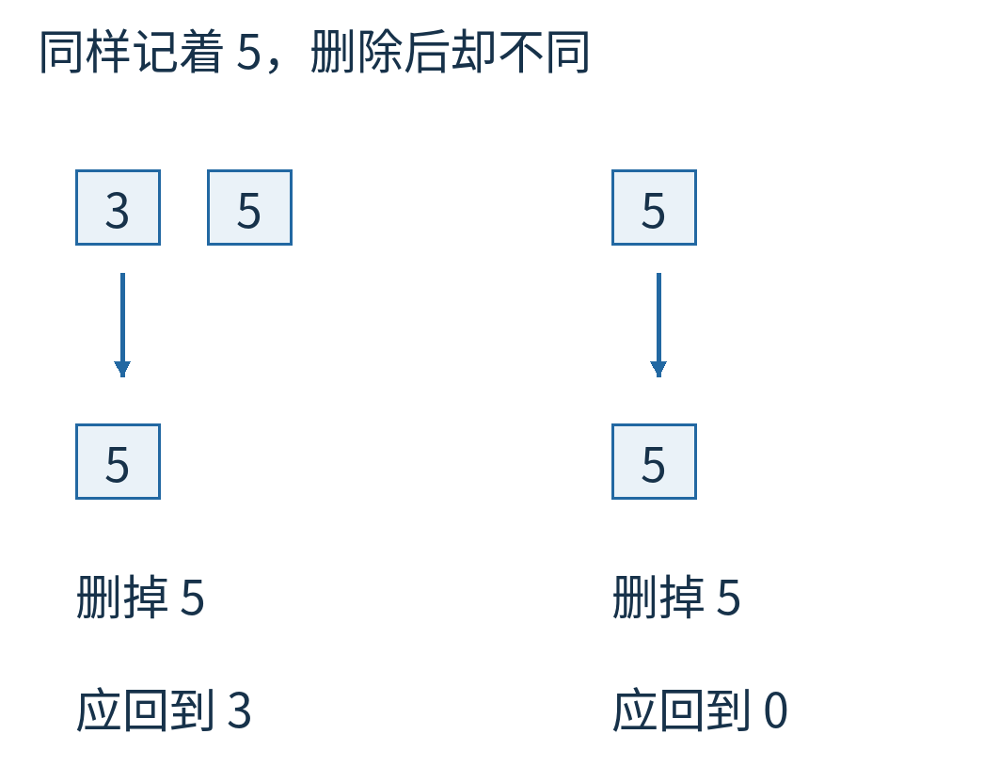

图12｜左边输入观测为3、5，右边仅为5，两者摘要都是5。删掉5之后应得到不同状态，说明单个最大值缺少恢复信息。

所以，标准这种“只取最大”的摘要不支持一般的精确删除，也不能通过两份估计数直接相减就精确得到差集大小。滑动窗口可以考虑按时间分段保存摘要，再合并需要的段，但那会带来额外状态、窗口边界和粒度误差；不能一句“过期就减掉”带过。

## “约3%的误差”，不是每次最多错3%

原始 HLL 分析给出的常用相对标准误差量级约为 `1.04/√m`，条件是理想随机模型与适用的统计范围。m=1,024 时约为3.25%，m=4,096 时约为1.625%。桶数扩大四倍，典型波动尺度大约减半。

标准误差描述一批随机化试验的分散程度，不是对单次输入的绝对上界，也不是说返回数字的每一位都可靠。

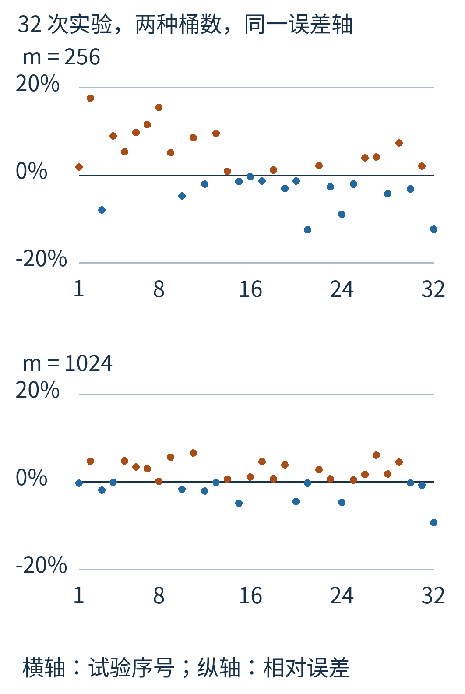

图13｜每个点是一轮不同盐值下的实际运行；两面板都使用相同的百分比纵轴，0表示恰好等于真实的20,000。上面m=256，下面m=1,024。点高于0是高估，低于0是低估；横轴只表示试验序号。

随附程序固定真实不同编号数20,000，用32个盐值分别运行m=256和m=1,024。此次样本中，相对误差的样本标准差分别约7.28%和3.56%；m=1,024的单次误差范围约为−9.34%至+6.53%。它直接提醒我们：3.25%不能当作硬边界。

每次改盐会改变同一个身份的位串，但每轮内部，同一身份始终使用同一个盐。这是在重复完整实验，不能把不同盐的摘要互相合并。32次也只是有限样本，不能据此精确重估理论常数。

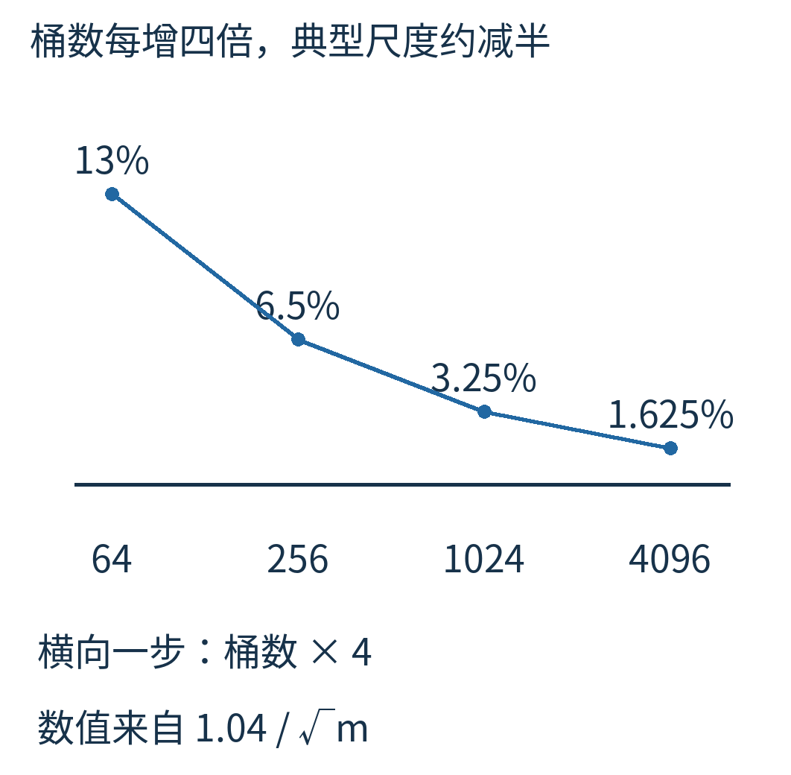

图14｜曲线点由 `1.04/√m` 计算，表示理论常用尺度而非上一张图的实测误差。寄存器数量与总内存开销不同，实际实现还包含编码、对象和元数据。

## 少记的是名单，留下的是统计线索

附带 [verify.py](examples/verify.py) 还能验证：把1,000个编号各重复五次，最终1,024个寄存器与每个编号只输入一次时完全相同。模型、哈希位宽、盐值、实验范围和数值结果都记录在 [results.json](examples/results.json)。

Philippe Flajolet、Éric Fusy、Olivier Gandouet 和 Frédéric Meunier 在 [2007 年的论文](https://algo.inria.fr/flajolet/Publications/FlFuGaMe07.pdf)中介绍并分析 HyperLogLog；Heule、Nunkesser、Hall 的 [2013 年工程论文](https://research.google.com/pubs/archive/40671.pdf)进一步讨论了小范围偏差、64位哈希和实际实现改进。这里采用64位教学实现与经典小范围规则，不把它包装成论文中所有改进的复现。

选择 HLL，首先要接受问题已经换成“估计有多少”，而不是“列出有哪些”。账单必须逐人核对、权限必须逐项确认时，这份摘要不能独自担当名单；做大规模趋势和容量观察时，省下的空间则可能很有价值。

你可以拿前面的短哈希表再加一个身份 F，让它也落进 5 号桶，但 ρ 只有 2。寄存器不会变化，不同身份却多了一个。理解这个看似“不敏感”的结果，也就理解了 HLL 怎样省空间，以及它为什么必须把答案叫作估计。

图片来源：图1—14均为原创教学模型、公式计算或随附程序实际结果，没有复制论文图。原创正文及图片采用 CC BY 4.0；代码、原始来源范围和许可说明见 [sources.md](sources.md)。
