# 算不出一个准数，能不能保证答案没有跑出这两条边？

你拿到一块长方形薄板的测量记录：长度在2到3厘米之间，宽度在4到5厘米之间。现在要估计面积，应该报多少？

取中间值，2.5×4.5=11.25平方厘米，是一种“用代表值算一算”的办法。但记录并没有说误差左右对称，也没有说中间值出现得更频繁。你若写“面积就是11.25”，比输入知道的事情还多。

换一个问题就踏实了：**不管真实长宽在各自范围里怎样取，面积一定落在哪个范围内？**

我们可以回答8到15平方厘米。这个范围没有猜测哪一个值最可能，而是承诺不漏掉任何符合输入的答案。把这种承诺一路带进加减乘除，就是区间算术想做的事。

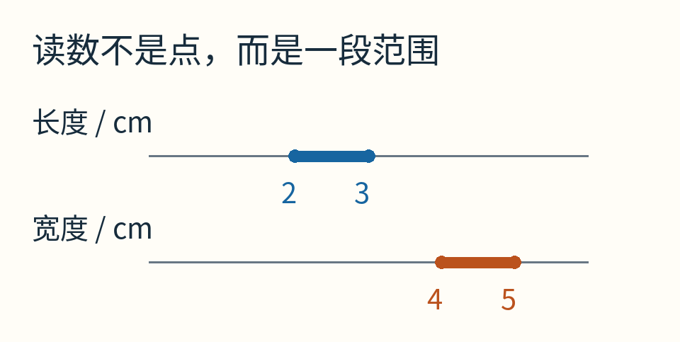

蓝线是长度，橙线是宽度；端点实心表示端点也包含在内。这是自选教学数据，没有声称真实量过某块薄板。

## 方括号装的不是两个样本

写 `[2,3]`，意思是所有满足 `2≤x≤3` 的实数：2、2.1、√5、2.999……以及3，都在里面。方括号不是一份只有两个元素的名单。

区间是一个集合的简洁表示：用两个端点描述连续的一整段可能值。

它也不是“95%置信区间”。本文没有指定概率分布，也没有指定任何置信水平。若输入只是一个有依据的确定性范围，我们要求每个允许输入都被照顾到；不是允许百分之几的输入漏出去。

这项要求叫**包含性**：若真实输入落在输入区间内，真实计算结果必须落在输出区间内。[Boost区间库的作者文档](https://www.boost.org/doc/libs/latest/libs/numeric/interval/doc/interval.htm)把它作为基本性质，并提醒读者端点计算本身也必须可靠。

不过“包含”不代表“恰好”。输出可能偏宽，宽到没有帮助。我们会看到，这往往不是算错，而是计算中遗失了一些输入之间的关系。

## 先把最容易的加法走一遍

设x∈[2,3]，y∈[4,5]。最小的和出现在两者都最小：2+4=6；最大的和出现在两者都最大：3+5=8。

于是：

`[2,3]+[4,5]=[6,8]`。

一般写法是：`[a,b]+[c,d]=[a+c,b+d]`。

每个字母都只占一个端点角色：a、b是第一个区间的下界、上界；c、d是第二个区间的下界、上界。不需要把中间无穷多个数逐一列出来，因为加法对两项都单调：任意一项增加，和不会减小。

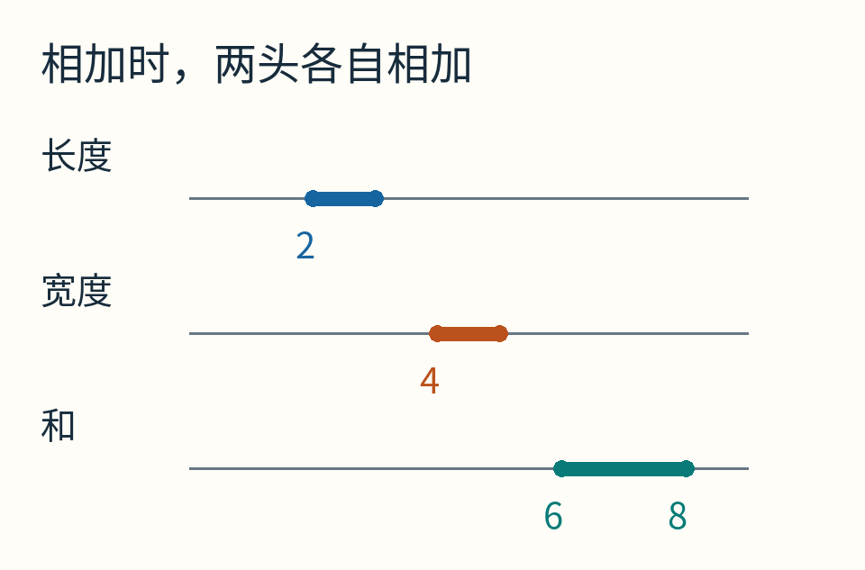

三条线使用同一把数轴尺。图中“和”是x+y，不是面积；单位仍是厘米。

减法要稍微留神。想让x−y尽量小，就选小x、大y；想让它尽量大，就选大x、小y。所以：

`[a,b]−[c,d]=[a−d,b−c]`。

比如 `[2,3]−[4,5]=[−3,−1]`，不能把端点同位相减成 `[−2,−2]`。后者漏掉了x=2、y=5时的−3。

## 乘法为什么要检查四个角？

面积例子的两个区间都是正数，直接取最小乘最小、最大乘最大就行。但只要出现负数，这条直觉就不够用了。

稳妥的一般规则，是算四个端点乘积：ac、ad、bc、bd，然后拿最小值和最大值作新端点。

为什么中间不会冒出更极端的值？先固定x，xy随y线性变化，极值必在y的端点；再固定那一个y端点，结果随x仍然线性变化，极值又在x的端点。两层检查最后只剩四种组合。

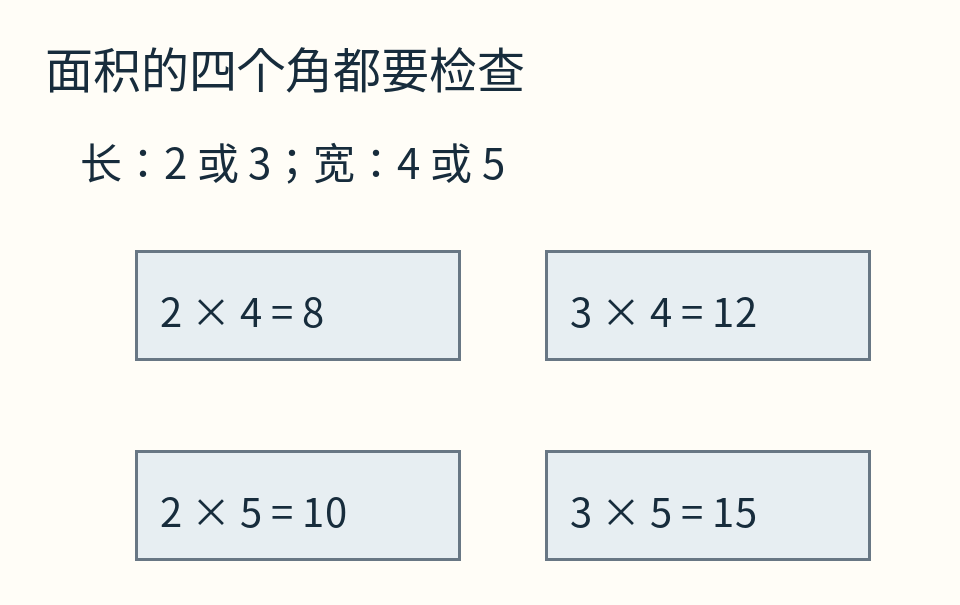

四个数分别是8、10、12、15，因此面积的包围是[8,15]平方厘米。

试一个带负数的例子：`[−2,3]×[−4,5]`。四个乘积是8、−10、−12、15，结果为 `[−12,15]`。只做左端乘左端、右端乘右端，会误报 `[8,15]`，把所有负结果都丢了。

可以把x、y分别画成横纵坐标。允许的输入对填满一块矩形；四个角就是刚才检查的四种极端组合。

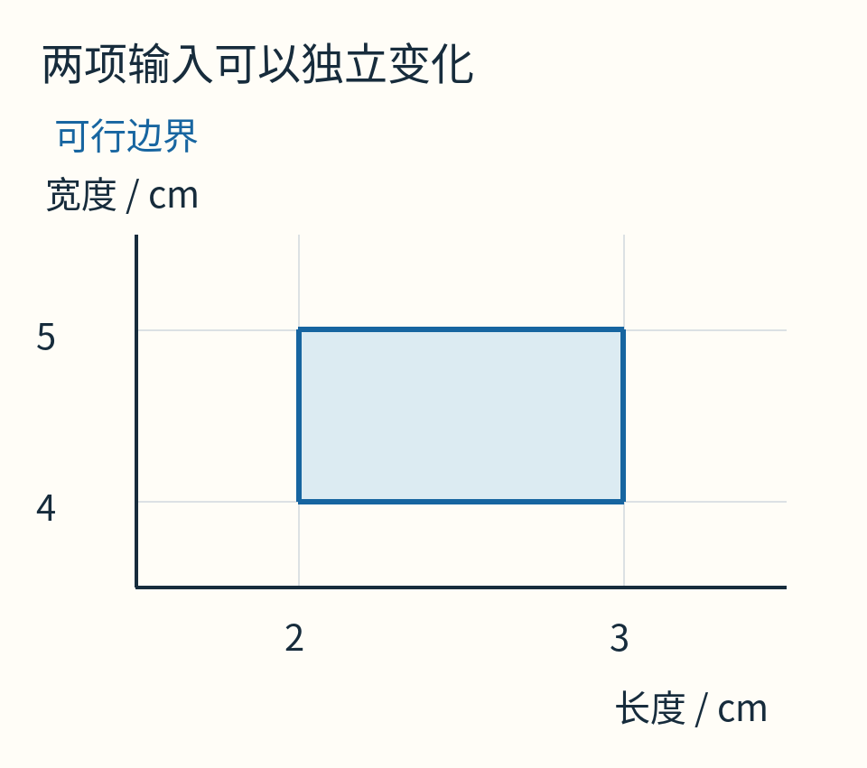

这里每个点是一种长宽组合。填色仅说明“允许”，不是说所有组合等概率，更不是实际测得的密度图。

到这里，加减乘都有一种很好的性质：一次运算就能给独立区间输入得到最紧的连续包围。麻烦常常出现在把这些操作串起来之后。

## x减去x，为什么居然不是零？

设x∈[2,3]。人人都知道 `x−x=0`。但若直接照刚才的减法规则：

`[2,3]−[2,3]=[−1,1]`。

这是区间算术坏了吗？没有。它把两个区间当成了可以独立选择的输入：第一处可以取2，第二处取3，得到−1；反过来得到1。

真正表达式里的两处x，是同一个数。若第一处是2.3，第二处也必须是2.3。允许的输入不是整个正方形，而只是其中一条对角线。

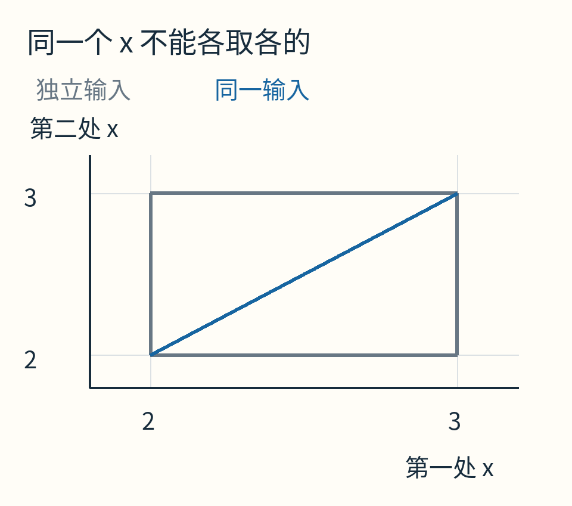

灰色边框圈出独立选择两项时的全部组合，蓝线才是“两处必须相等”的合法组合。自然的逐运算区间替换忘了蓝线关系，于是输出变宽。

这叫**依赖问题**。每一次单独的区间减法都正确，但拼成表达式时，保留的信息不够了。

若先做符号化简x−x=0，再计算，输出就可以是[0,0]。两种方法都不漏答案，但后者利用了额外关系，明显更有用。

这也是为什么“保证包住”与“精确求值”并不矛盾：区间算术宁可坦白说得宽一点，也不能在不知道关系时偷偷假定它成立。

## 平方与自己乘自己，还真值得分开做

取x∈[−1,1]。通用区间乘法给：

`[−1,1]×[−1,1]=[−1,1]`。

可x²不可能为负，正确的最紧包围应是 `[0,1]`。

原因仍是重复变量。通用乘法允许左项−1、右项1，乘出−1；平方函数知道两项必须相同，能排除这对不合法组合。

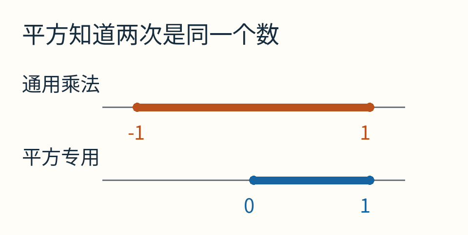

橙线较宽不是因为引入了舍入误差；即使所有端点都用精确整数计算，依赖问题仍然存在。

因此，一个认真设计的区间库常常区分通用乘法与专用平方运算。类似地，表达式改写、单调性判断和更丰富的相关性表示，都可能改善结果。它们解决的是“知道哪些关系”的问题，不只是多给几个小数位。

## 一条小抛物线，让宽松暴露出来

我们再看贯穿后半篇的函数：`f(x)=x(1−x)`，输入x∈[0,1]。

逐步区间计算：1−[0,1]=[0,1]，再相乘，得到 `[0,1]`。

但把式子配方：

`x(1−x)=1/4−(x−1/2)²`。

平方不小于0，所以函数最大值只有1/4；在x=1/2处达到。区间两端函数值都是0，整个真实值域是 `[0,1/4]`。

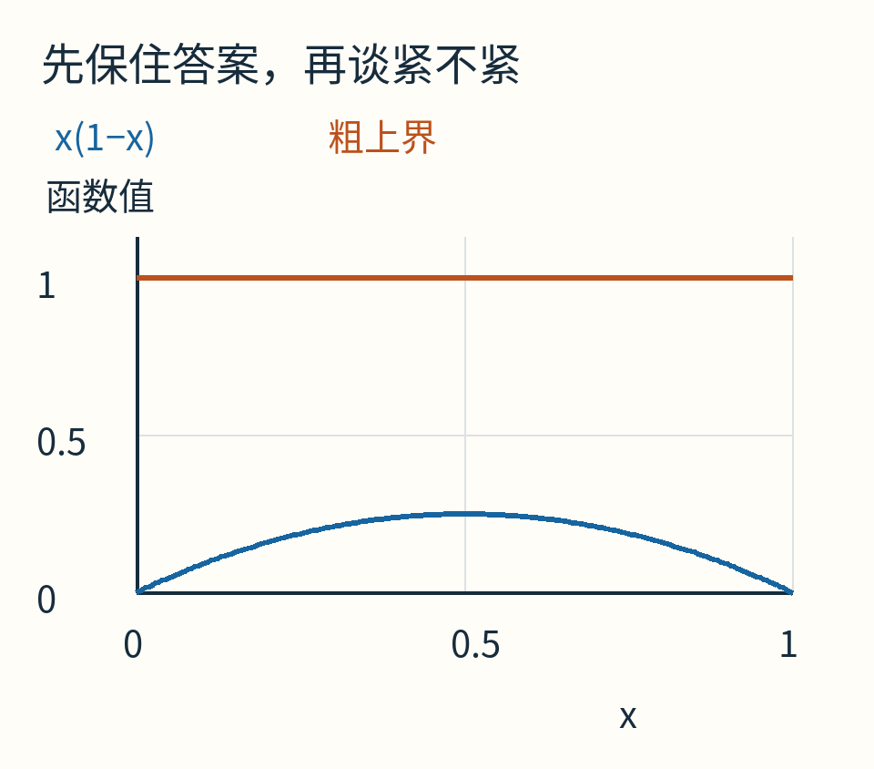

蓝色曲线最高只有0.25；橙线给出的上界1仍然合法，却宽了很多。它把“x大时1−x必然小”的关系忘掉了。

你可能想到：那就永远先配方。对这个例子很好，但大型表达式未必能轻松找出最聪明的形式。还有一种更朴素、容易自动化的办法：把输入分小。

## 把一段切成两段，为什么有帮助？

先把[0,1]分成[0,1/2]和[1/2,1]。

第一段中，x≤1/2，而1−x在[1/2,1]，乘积包围[0,1/2]。第二段对称，也是[0,1/2]。把两段结果合在一起，得到[0,1/2]，比[0,1]紧了。

再均分成四段。中间两段之一是 `[1/4,1/2]`，对应 `1−x∈[1/2,3/4]`，乘积包围 `[1/8,3/8]`。检查其他三段后，整体上界变成3/8。

八段时是5/16，十六段时是9/32，也就是0.28125。仍没等于1/4，但正逐渐靠近。

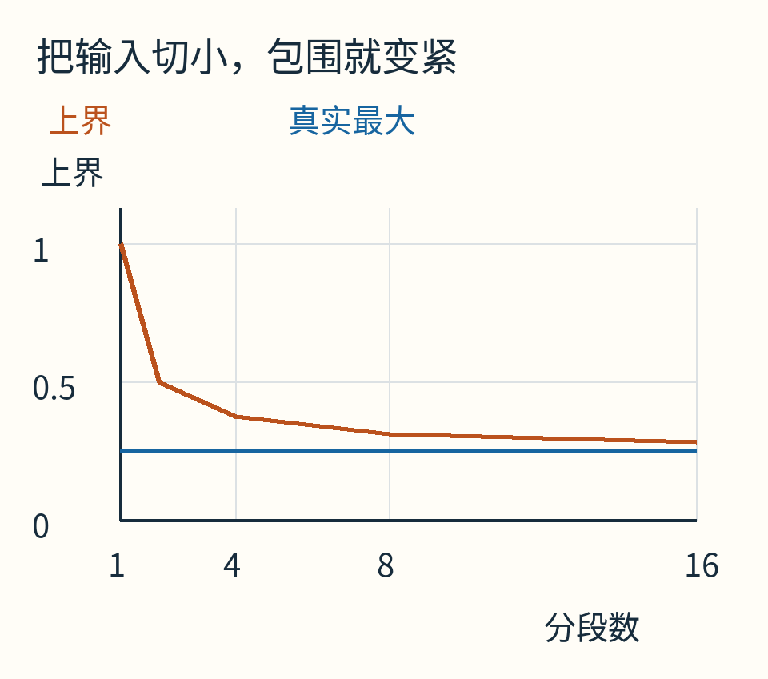

这里的数来自精确分数运算。蓝线是独立配方得到的真实最大值，橙线是每段先做区间运算、再取所有上界的最大值。

为什么变紧？每一小段里，“同一处x能变化多大”的空间更小了，丢掉相关性造成的浪费也跟着缩小。

代价同样清楚：段数增加，需要计算更多次。在多变量问题里，若每个方向都分十段，两个变量就是一百块，六个变量就到一百万块。保证并不免费，盲目均分也不总划算。

## 除法里的零，不能当成普通端点

若分母区间不含0，可以先取倒数，再做乘法。例如 `[2,4]` 的倒数是 `[1/4,1/2]`，于是 `[1,2]/[2,4]=[1/4,1]`。

但分母为[−1,1]时呢？0使表达式根本无定义；即便排除0，1/x仍能在两侧变得任意大或任意小。结果还分成两支，并不是中间连续的一小段。

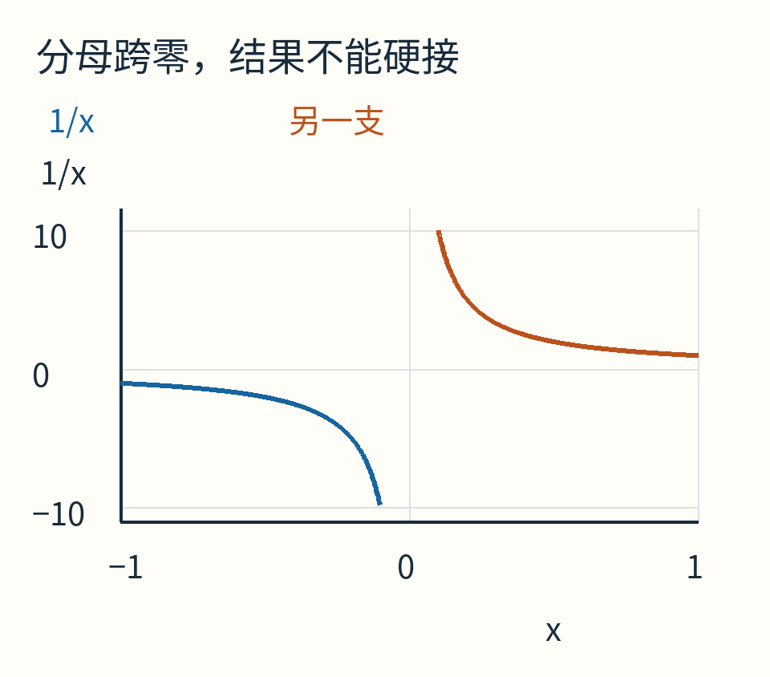

绘图只显示到约±10，曲线不会在那里终止；靠近0时幅度继续增大。图没有跨过0连线。

不同区间体系可以采用不同处理：拒绝该运算、返回带例外说明的无穷范围，或使用能表示两个分离区间的扩展结果。无论哪一种，都不能悄悄把零删去，然后返回一个貌似普通的有限范围。

随文小程序选择最简单而明确的一种：分母区间含0就抛出异常。它是教学接口，不声称实现完整的区间标准。

## 端点算错一丁点，保证就可能破了

到目前为止，我们用了整数和精确分数。如果改用电脑的有限小数，端点本身会舍入。

假设只保留到小数点后两位，想包住精确的1/3。把它四舍五入到0.33，再写 `[0.33,0.33]`，就漏掉了真实值，因为1/3大于0.33。

正确的做法是把下界向下取到0.33，把上界向上取到0.34，得到 `[0.33,0.34]`。这叫**向外舍入**。

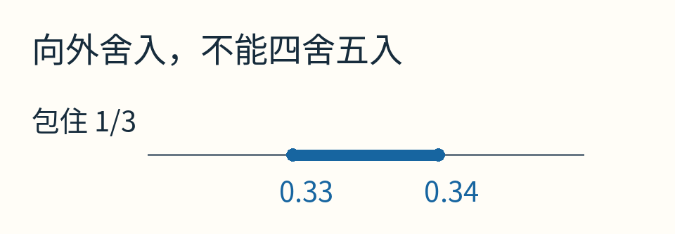

图只表达百分位端点的概念。它不是说二进制浮点数能精确储存十进制0.33与0.34。

真实浮点实现必须让每个基础运算及所用数学函数都维持包含性。编译器优化、硬件舍入方式、函数库的误差范围，都可能影响承诺。不能在普通float结果两边随手加一个固定小数，就宣称完成了可靠区间计算。

本文使用Python的Fraction表示有理端点，基本加减乘除由整数分子分母精确完成，回避这些浮点端点细节；绘图时才把结果转成浮点坐标。它不覆盖π、sin、exp等超越函数的可靠区间实现。

## 范围怎样帮助找根？

要找x²=2的正解，可以从[1,2]开始。x²−2在左端为−1、右端为2，且在这段连续、严格递增，所以里面有且仅有一个根。

测中点1.5，函数值0.25为正，根就在[1,1.5]。再测1.25，函数值−0.4375，改保留[1.25,1.5]。继续下去，范围越来越窄，却始终保住根。

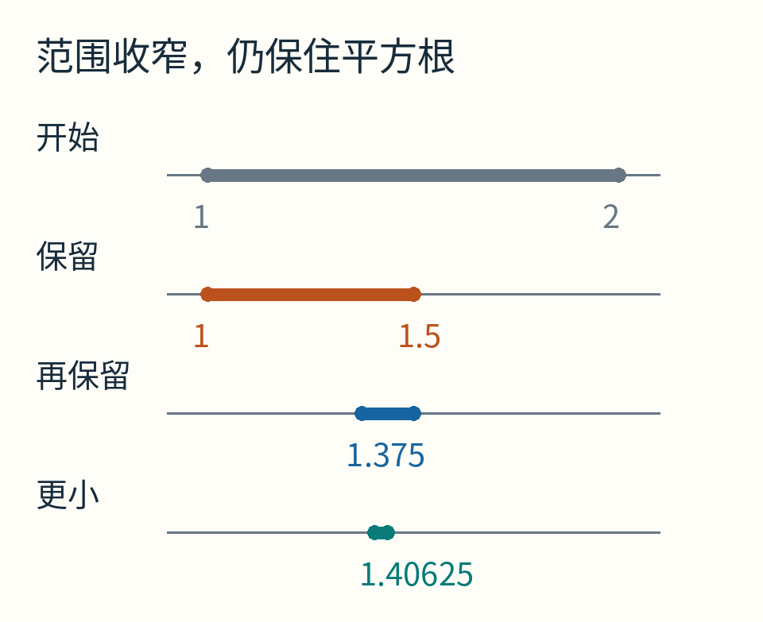

图仅挑出若干阶段展示，不假称每行恰好相隔一次二分。完整端点依次可包含[1,2]、[1,1.5]、[1.375,1.5]、[1.40625,1.4375]。

若只想问某个小区间里有没有可能藏根，也可以直接算函数区间：如果0不在输出范围里，这一段肯定没有根。但如果0在里面，只能说“还不能排除”。区间过宽可能把0包进来，实际函数却从未到0。

因此，排除证据往往比存在证据更容易得到。证明存在通常还要结合连续性、端点符号或其他条件。

## 比较也需要允许“暂时不知道”

A=[1,3]，B=[2,4]。你问A是否小于B，该答什么？

若意思是“A的每个可能值都小于B的每个可能值”，答案不成立，因为A可以取3、B可以取2。若意思是“有没有一对取值使A<B”，又当然有，例如1<4。

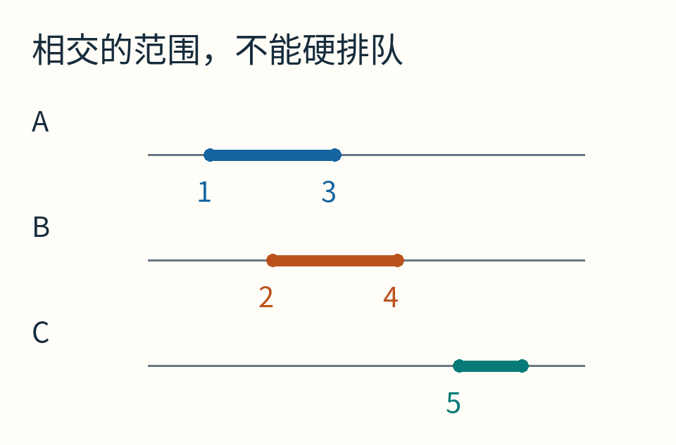

B=[2,4]与C=[5,6]则不同：B的最大值4仍小于C的最小值5，所以所有允许取值都满足B<C。

区间程序必须说清比较的语义。把“不确定”一律当成false，有时符合某个接口，有时会悄悄让分支漏掉可能发生的情况。

[随文程序](examples/lab.py)实际运行了6300项有理数网格包含性断言，并保留分段抛物线的输出；这些有限检查帮助发现实现错误，普遍规则的理由仍是正文中的端点推导。[运行范围](examples/README.md)明确列出不支持的运算。

区间算术并没有把“不知道”变成一个漂亮的准数。它做了一件更朴素的事：把不知道的范围一起带着走。范围有时太宽，计算有时必须拒绝，但只要承诺守得住，程序就不会用一串精确的小数，掩盖输入原本没有提供的确定性。

原创正文与图解采用CC BY 4.0；AI辅助了研究组织及代码制作。[来源与素材说明](sources.md)。
