# 先讲清楚，再拼成程序：Knuth 的文学化编程为什么需要两种顺序

假设你要给朋友解释一段程序：输入 `[3, -2, 5, 0]`，只把正数加起来，答案是8。

最自然的讲法，可能先说“负数和零跳过”，再展示那个关键循环，最后补上函数名、初始值和调用。但解释器读取Python文件时有另一套要求：运行到函数调用之前，必须已经执行过对应的函数定义；循环中的累积变量，也得先得到初值。

文章里最值得先讲的东西，不一定是程序里最先出现的东西。为了服从机器的顺序，我们常常让读者先穿过一堆铺垫，才能遇见真正想解释的部分。

Knuth提出的文学化编程，认真对待了这个矛盾：把程序写成一份给人理解的作品，再用工具从同一份源中取出可执行的代码。“文学化”在这里不要求辞藻华丽，而是让解释顺序、命名和论证成为组织程序的一部分。

## 一份源，两个出口


Donald Knuth，Alex Handy 摄，2011年1月11日，计算机历史博物馆“Revolution”展览开幕活动。[文件来源](https://commons.wikimedia.org/wiki/File:Donald_Ervin_Knuth.jpg)，[CC BY-SA 2.0](https://creativecommons.org/licenses/by-sa/2.0/)，本篇未修改。这不是早期WEB开发现场。

Knuth在1984年的论文《Literate Programming》中介绍这一方向。他后来在个人网站说明，最初的WEB在编写TeX时形成；Silvio Levy于1987年把它适配到C，产生CWEB。CWEB的两条工具路径很直观：CTANGLE从源生成C程序，CWEAVE从源生成供TeX排版的文档。它们共享输入，却服务于不同读者。[1984年出版记录](https://academic.oup.com/comjnl/article/27/2/97/343244)、[作者的CWEB说明](https://cs.stanford.edu/~knuth/cweb.html)

我们不复刻WEB或CWEB的语法，也不讨论TeX怎样给段落断行。下面写一个更小的教学格式，用Python实现“展开代码”和“保留讲解”两个动作。它能帮助我们真正走一次流程，不代表历史工具只有这些功能。

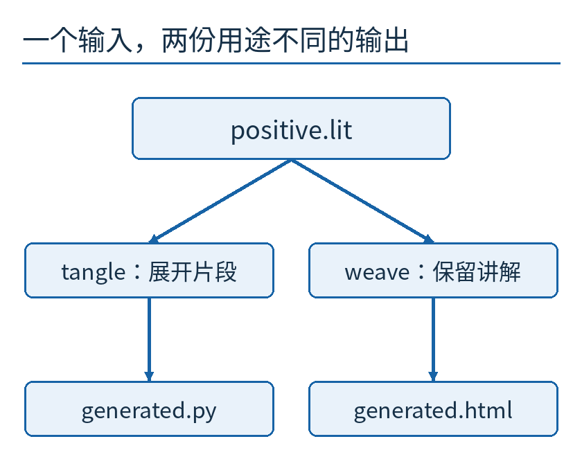

上方是唯一需要编辑的源 `positive.lit`。左边tangle把命名片段展开成Python文件；右边weave按文章中的顺序保留讲解和片段，生成HTML。箭头表示本例生成过程，不是CWEB的真实文件扩展名。

## 先把问题讲透，别急着发明格式

我们的输入是一串整数。规则很小：从头到尾看每个数，大于0就累加，否则略过。

累积值从0开始。看到3，变成3；看到−2，仍是3；看到5，变成8；看到0，仍是8。输入全部看完，返回累积值。

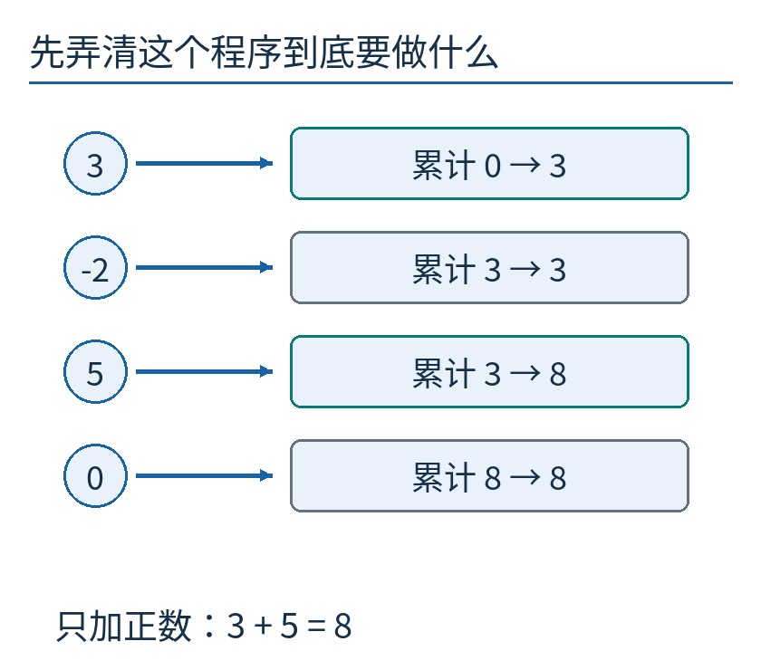

每行左边是当前输入，右边是处理前后累积值。青框表示确实做了累加；灰框表示跳过。这个轨迹来自本文程序实际计算的数据，不是历史工具运行的记录。

可以用一句话检查循环有没有偏离目标：**处理完前面一段输入后，total等于这段输入里所有正数的和。** 没处理任何数时，和是0；遇到正数就加上它，遇到其他数就保持；处理完全部输入，自然得到目标结果。这句话说明了初值、判断和累加为何要这样搭配。

如果先把所有负数删掉再求和，也能实现同样功能，但那是另一种组织方法。本文只沿这一条简单循环走到底，免得读者同时追两套算法。

## 在文章中，先给片段起一个能解释意图的名字

普通代码文件通常把函数从头到尾连续写完。我们的源文件允许先说“这里需要一段函数定义”，稍后才把那段定义展开。

教学语法约定如下：`<<名字>>=`开始定义一个片段，单独一行的`@`结束它；代码里单独一行的`<<名字>>`表示引用。双尖括号只是本文格式的记号，不是Python运算符。

最上层片段可以写成：

```text
<<主程序>>=
<<函数定义>>
values = [3, -2, 5, 0]
print(sum_positive(values))
@
```

读这段时，不必立刻知道函数每一行的细节。它先告诉我们最终程序的骨架：有一个求和函数，提供四个输入，再打印结果。

随后，文章可以直接解释最关键的“扫描”片段：

```text
<<扫描>>=
for value in values:
    if value > 0:
        total += value
@
```

`for`表示逐个取输入；`if`让后面的累加只在当前数为正时发生；`+=`表示把右边的数加到原来的total上。每往右缩进一层，就表示属于外层语句控制的内部步骤。

这时total在哪里初始化，函数从哪里接收values，还没在文章中展开。但引用结构允许我们先把最值得理解的条件讲清楚，再补上下文。

## 文章顺序与代码顺序，要由结构连接起来

在本例的源文件里，四个片段按这样的阅读顺序出现：主程序、扫描、函数定义、初值。

函数定义片段是：

```text
<<函数定义>>=
def sum_positive(values):
    <<初值>>
    <<扫描>>
    return total
@
```

初值片段只有一行`total = 0`。它被引用在扫描前面，即使它的说明写在文章最后，展开后的代码也会先初始化，再扫描。

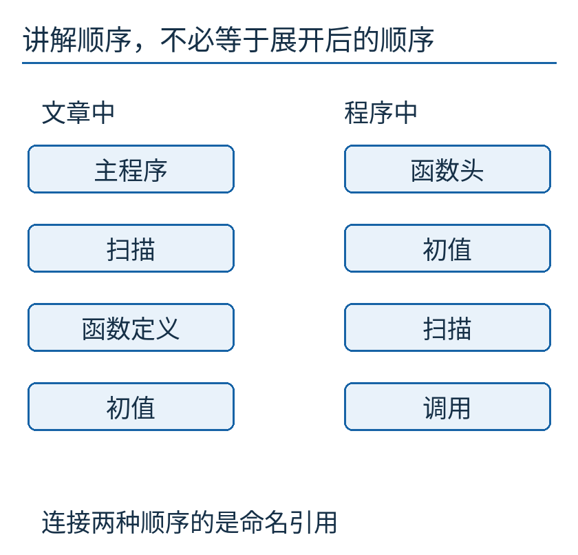

左列记录讲解次序，右列记录生成代码中的主要阶段。两列不是逐行一对一映射：例如“主程序”包含函数定义与调用的组合，“函数定义”又包含更小的片段。图要提醒我们，维持对应关系靠的是名字引用，而不是硬把两种顺序排成一致。

这不意味着越乱越好。如果读者为了找一个名字，需要反复翻过十几页，说明顺序可能仍然很糟。工具只是解除一种限制，并不会自动替作者做出好的叙述选择。

## tangle究竟怎样把名字换成代码

先只做一次最小动作。看到 `<<函数定义>>`，到名字表中找到相应片段，把片段里的几行放到引用位置。

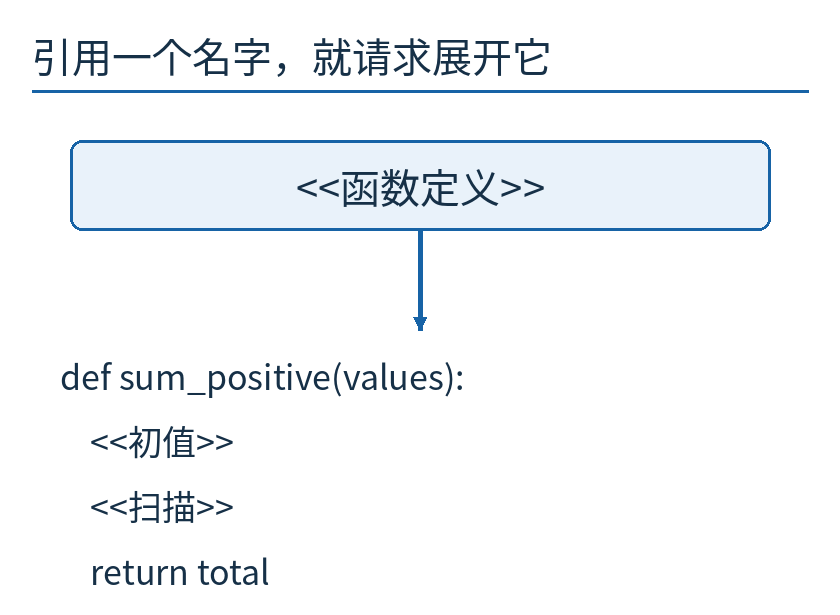

上方是使用名字的地方，下方是它指向的内容。展开以后，里面仍有 `<<初值>>` 和 `<<扫描>>`，所以工具还要继续处理这些名字。

这种“里面还有名字，就再展开一层”的过程叫递归。这里不需要神秘的数学：把展开任务交给同一个规则，直到遇到全是普通代码的片段即可。

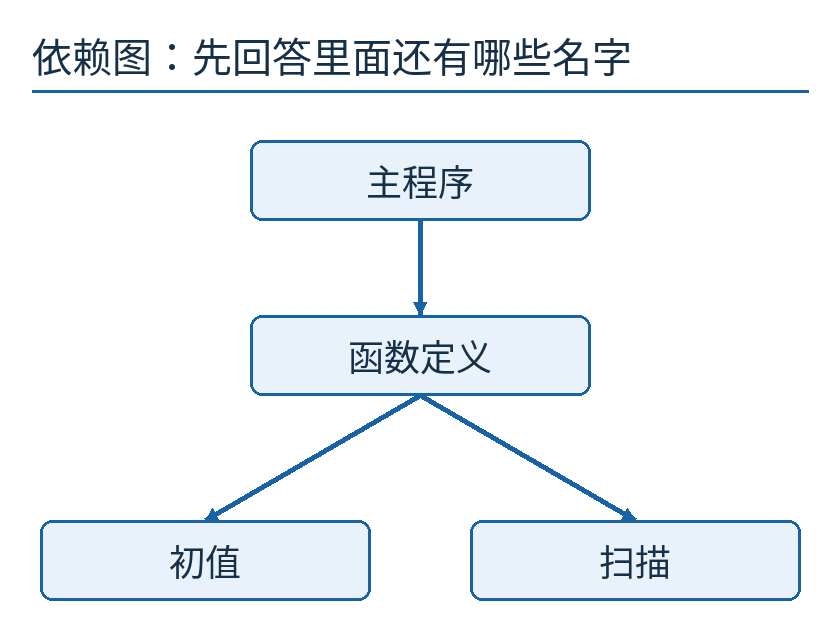

从上往下沿箭头走：主程序需要函数定义；函数定义需要初值和扫描。箭头是“依赖谁”，不是运行时间轴。初值和扫描在图中左右摆放，也不允许工具随意交换它们；实际展开顺序仍由函数定义里引用出现的先后决定。

对我们的主程序先展开一层，得到：

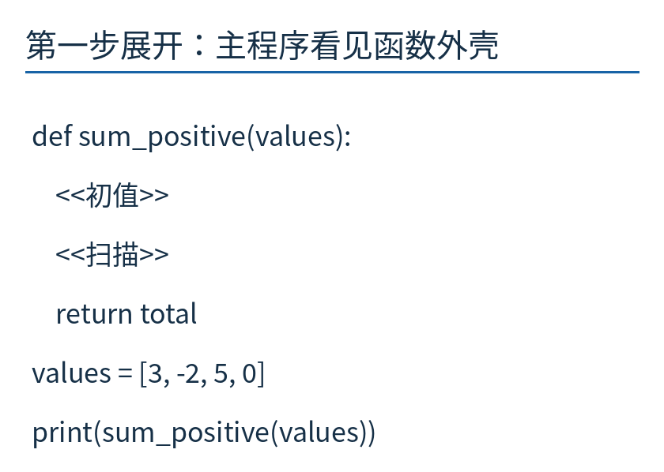

最上面已经出现Python函数头，最下面仍是输入和调用。中间保留的两个尖括号引用说明工作还没做完。这个中间文本不能直接交给Python执行。

继续展开初值和扫描，所有名字都被普通Python语句替换，最终得到完整程序。

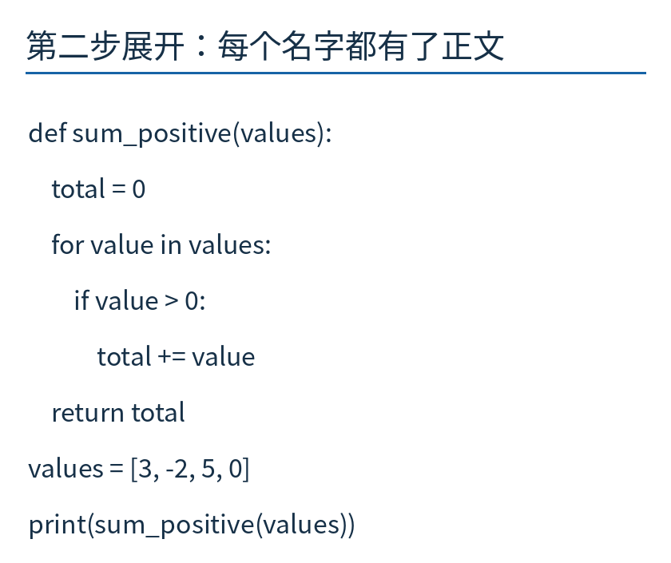

这张图逐行来自实际生成的 `generated.py`，保留缩进。请先找`total = 0`，再往下找循环和`return total`：初值在循环前，return在循环外、函数内；最后两行回到最左侧，负责给输入并调用函数。它是原代码内容的可读绘图，不是编辑器截图。

运行这个文件，标准输出确实是一行`8`。我们还检查了空输入、全负数、全正数和仅含零的输入；完整结果保存在附属数据中。这个结果来自本文自制展开器，不来自实际运行CWEB。

## 一个容易丢的细节：空格也是结构

若只是把片段原样粘贴，Python程序很可能无法正确运行。

引用`<<扫描>>`在函数内部，前面有4个空格。扫描片段的`for`行自身没有缩进，`if`行有4个空格，累加行有8个空格。展开时，外层引用带来的4个空格要加到每一行前面。

于是，最终`for`前有4个空格，`if`前有8个，`total += value`前有12个。最后的`return total`仍只有4个空格，它应在循环结束后运行，而不是每读到一个数就提前返回。

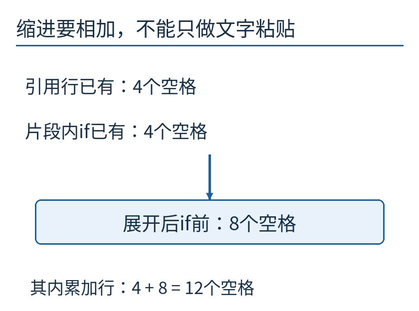

图只放大其中两行的空格数量：外层4加内部4得到8，外层4加内部8得到12。空格在这里不是装饰；它们决定语句属于哪个控制块。

本文的小展开器只支持“整行片段引用”和空格缩进，不支持在任意表达式中塞入引用，也不实现真实WEB/CWEB的宏、交叉索引、多处追加同名片段等功能。这些限制让展开规则足够小，可以直接检查。

## 缺名字和绕圈，工具应该明确报错

如果把`<<扫描>>`误拼成一个从未定义的名字，最糟的处理方式是把它当空白扔掉：生成的文件可能还能运行，却悄悄少做了工作。

本文程序遇到未定义引用，会停止并说明缺哪个片段。它还拒绝重复定义与没有结束标记的片段，避免“后面一份覆盖前面一份”的暗中变化。

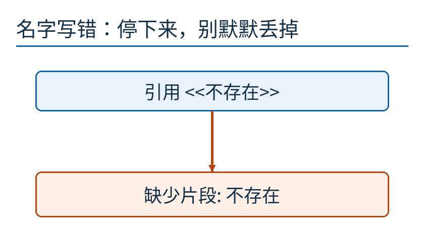

下方错误文字来自一次实际测试：引用名设为“不存在”，定义表里没有它。图不是错误弹窗截图，而是把程序返回的错误信息重新排成可读示意。

另一种错误是绕圈：主程序引用A，A又引用主程序。无论展开多少次，都会重新遇到相同任务。

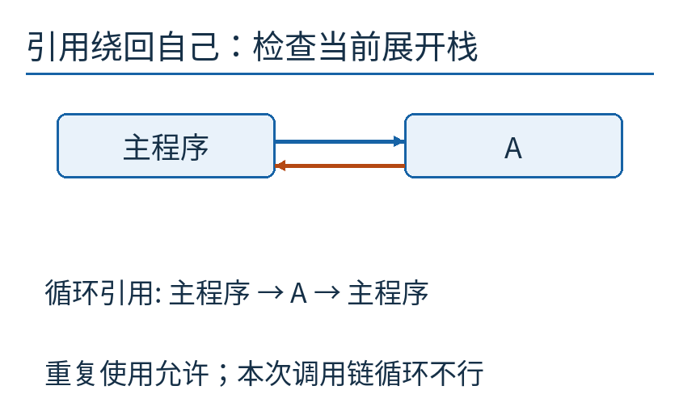

工具保存“此刻正在展开哪些名字”的栈，也就是当前这条调用链。若新名字已在这条链上，就报循环。注意，不是“某名字以前出现过就禁止”：两个互不嵌套的位置都引用同一个片段，可以是正常复用。必须区分曾用过与仍在展开中。

读者可以在附属程序里看到相应检查。它们解决的是格式结构的问题，并没有证明最终算法正确。

## weave保留的，是另一种读法

tangle沿引用关系走；本例的weave沿原文章顺序走。遇到讲解，就作为段落；遇到片段定义，就显示名字和代码块。它不会把所有引用消掉，因为读文档时，名字本身能表达意图。

因此，生成的HTML先说“只把正数加起来”，再给主程序骨架，然后解释扫描，接着补函数壳和初值。你可以直接打开[实际生成的阅读文档](examples/generated.html)，或查看它的[唯一输入文件](examples/positive.lit)。页面由本篇脚本实际生成，不是手工另写一份看起来相似的说明。

真正的CWEAVE功能远多于这个简化页面。Knuth的作者说明里，两条工具链的目标分别是C代码与TeX文档；我们用Python和HTML只是为了把同源双输出的机制缩到能看懂、能运行的程度。

## 讲解不会自动变成正确性证明

现在故意改坏一行：把 `total += value` 改成 `total = value`。前者是累加，后者只是用当前正数覆盖原值。

输入仍是 `[3, -2, 5, 0]`。看到3时total=3；看到5时total直接变成5；最后得到5，而不是8。文章若还写着“累加”，它就已经与代码不一致了。

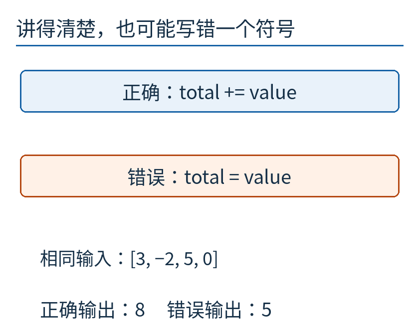

上下两段只有一个加号的差别，输出却不同。本篇程序实际执行了这个错误变体，结果是5。这个测试说明，文字写在同一个文件里，也不会自动随代码含义变化。

同源能减少“两份独立文件各改各的”这种漂移，但不能代替审查、测试和推理。文字、片段名称与程序之间的联系，仍需要作者主动维护。

反过来，测试通过也不等于说明写得好。五个输入可能全对，读者却仍不知道为何从0开始、为何return不能缩进到循环里。两种检查各自补上另一种看不到的部分。

## 编辑哪一份，决定下次生成会发生什么

如果发现累加写错，应修改 `positive.lit` 中的扫描片段，再重新生成程序与文档。如果只改 `generated.py`，下次tangle会按旧源把修补覆盖掉；只改HTML，文档也会在下次weave时恢复旧内容。

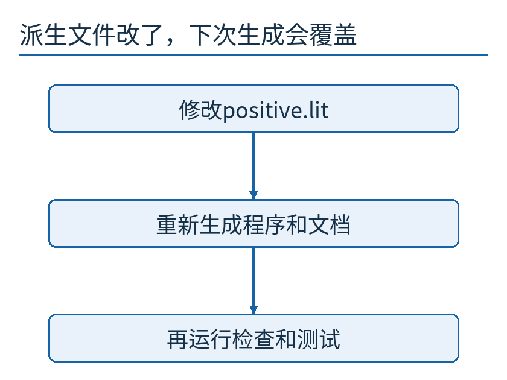

从源修改到重新生成，再到运行检查。图里的“权威源”并非某种神圣文件格式，只是项目明确选择哪一份是编辑入口、哪几份是可重建产物。

在本文目录下，可以运行：

```bash
python examples/measure.py
python examples/generated.py
```

第一条会从源重新生成两份文件，并执行五组结果检查、缺失引用与循环引用检查，以及那个故意改坏的变体；第二条运行生成的正常程序，打印8。没有安装CWEB，也没有网络请求。

这种写法什么时候值得考虑？当读者需要沿一条论证理解算法、数据结构或细节取舍，而自然解释次序与代码次序差得较远时，命名片段提供了一种有用的组织方式。若项目主要困难是大量自动生成接口、频繁合并或外部工具只能识别普通源文件，增加一层格式也可能带来额外维护负担。本文没有做团队效率实验，不能用一个小例子替所有项目决定风格。

文学化编程留下的一个耐用问题是：如果这段程序首先要交给一个愿意思考的人阅读，我会从哪里开始讲，给各部分起什么名字，又怎样保证讲过的内容最终确实拼成那个运行中的程序？工具让两种顺序共存，清晰的关系仍要由写作者建立。

---

原创正文、图、教学格式及代码采用[CC BY 4.0](https://creativecommons.org/licenses/by/4.0/)。照片保持单独许可；来源与复现范围见[sources.md](sources.md)。
