# 把镜子吊起来，为什么反而更稳？LIGO 悬挂系统里的频率选择

把一面精密镜子拧紧在结实桌子上，似乎很合理。但如果桌子下面的地面正在震动，拧得越牢，镜子就越忠实地跟着地面走。对于要比较极细微光程变化的 LIGO 引力波探测器，这份忠实恰恰是麻烦。

它的办法之一看起来有点反常：把镜子悬挂起来，而且上面还挂着别的质量块。这样的装置可以晃，为什么反而有助于测量？答案藏在“多快的晃动”里。同一套悬挂，对缓慢变化、接近自身节拍的变化和很快的变化，会做出截然不同的反应。

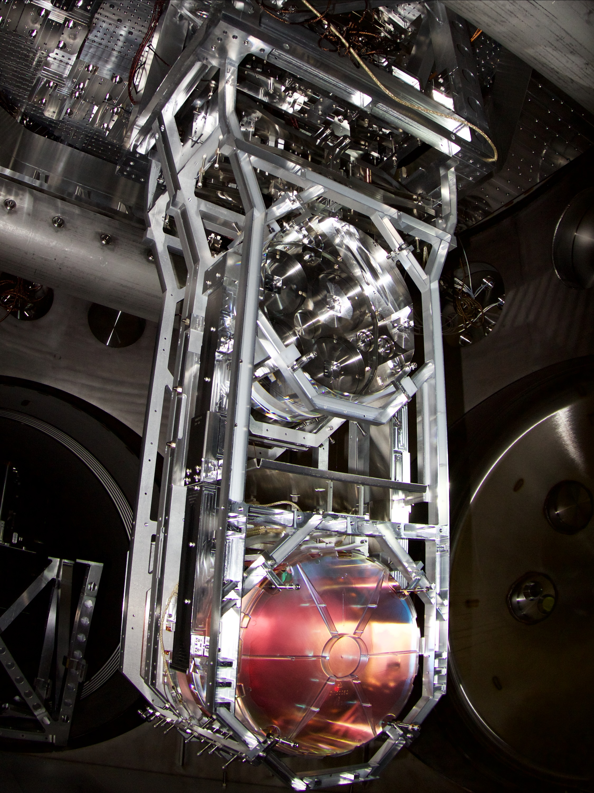

图 1：Courtesy Caltech/MIT/LIGO Laboratory。沿照片从上往下看，结构中有多个悬挂层级，底端是光学元件。它并非把镜子简单吊在实验室天花板上：悬挂还安装在经过隔振的支撑系统中。

本文只追一条主线：地面怎样把位移传给镜子，悬挂怎样减小其中某些频率的传递。我们不需要先学完引力波，也不把教学弹簧的数字当成 LIGO 的实测性能。

## 先确定：我们想让谁不动

把桌面的位置记作 y，镜子的位置记作 x，两者都相对于同一个惯性参考方向测量，向右为正。如果地面往右移动 1 毫米，镜子也往右移动 1 毫米，桌面与镜子的相对位置虽然没变，镜子本身却没有隔绝这次运动。

隔振关心的是输入位移 y 到输出位移 x 的传递，不只是“挂绳有没有拉长”。把输入和输出弄错，甚至会得出相反的判断。

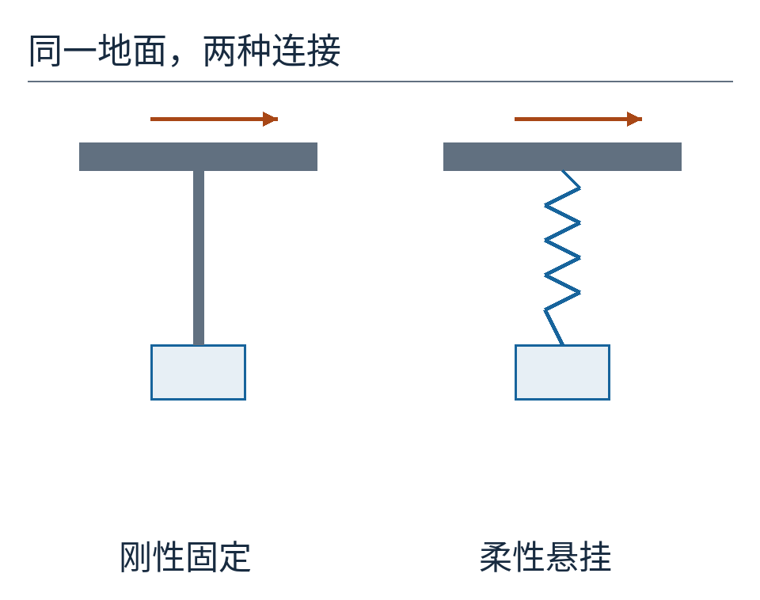

图 2：左侧刚性连接把支撑的运动直接带给镜子；右侧允许镜子和支撑发生相对运动。图只表达连接关系，不表示右侧在所有频率都更好。

小角度摆的重力回复作用，可以近似成水平方向的弹簧：镜子偏离平衡位置越远，拉回它的力越大。为了先算清机制，我们将它替换成一维质量块与弹簧，另加一个阻尼器。阻尼器根据两端相对速度提供反作用，用来描述运动能量的耗散。

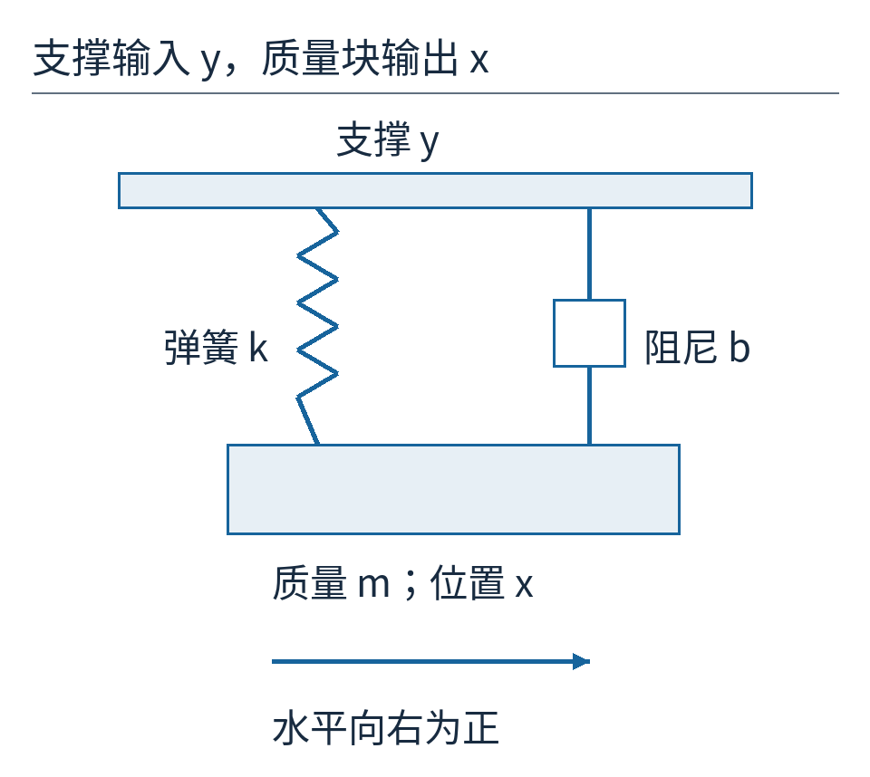

图 3：y 是支撑的位置，x 是质量块的位置。弹簧和阻尼器都连接这两个物体，弹簧变形量取 x−y。上下排版只为了展示连接；本文求的是向右为正的水平位移。这是教学模型，不是实际四级悬挂的施工图。

## 让支撑缓缓移动，镜子会跟上

弹簧力取决于两端位置差。若支撑慢慢往右挪，镜子开始落后，弹簧就产生向右的力，逐渐把镜子拉过去。变化足够慢时，镜子有时间跟上，最终 x 大致等于 y。

这说明柔性悬挂不能隔绝任意缓慢的位移。你把支点长时间移到新位置，悬挂物不会永远留在旧坐标。下图的横轴是时间，两条曲线只是稳态周期运动；为了看清差别，模型采用的是持续正弦输入，不是突然搬动支点。

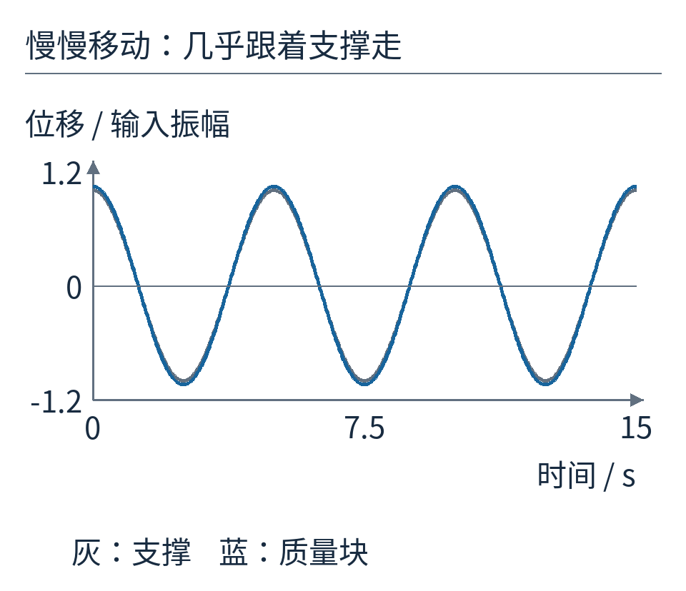

图 4：灰线是支撑，蓝线是质量块。在本文的 0.2 Hz 输入例子中，蓝线振幅约为灰线的 1.042 倍，差别很小，谈不上有效隔振。1 Hz 表示每秒往返一周。

那么快一点呢？质量块有惯性，改变它的速度需要力。若支撑在很短的时间里左右反复，弹簧力也频繁换向，质量块来不及跟着走很远。支撑的大部分位移成为弹簧两端的相对运动，而不是镜子的绝对位移。

## 先用一组数字，找到危险的中间地带

设质量 m 为 1 kg，弹簧刚度 k 为 `(2π)² N/m`，约 39.48 N/m。刚度的意思是：每拉长 1 米，弹簧回复力增加这么多牛顿。这里位移应很小，才适合线性模型；用“每米”只是表达系数，不意味着真的把它拉长一米。

如果支撑固定，轻轻拉开质量块再放手，它有自己的自然振动频率：`f₀ = √(k/m)/(2π)`。将我们选的 k、m 代入，恰好得到 1 Hz。读者可以先把这个关系理解为两个方向：弹簧越硬，拉回越快；质量越大，同样的力越难改变运动，往返越慢。

再取阻尼比 ζ 为 0.1。它是衡量阻尼强弱的无量纲量，与具体阻尼系数 b 的关系为 `b = 2ζ√(km)`，此例约 1.257 N·s/m。现在每个参数都确定了。

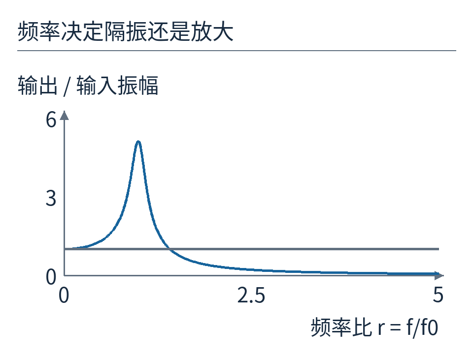

图 5：横轴是输入频率除以自然频率，记作 r；纵轴是镜子振幅除以支撑振幅。水平灰线 1 表示完全跟随。曲线在 r 接近 1 时高于 1，说明“吊起来”还可能把运动放大。

这就是共振区。支撑的推动与系统容易响应的节奏接近，前一轮还没有消退，下一轮又继续输入能量。阻尼会限制放大程度，却不会让柔性连接自动变成万能稳定器。

在恰好 1 Hz 时，本模型的振幅比约为 5.099。如果支撑的周期位移振幅是 1 微米，质量块的稳态振幅就约为 5.099 微米。它不是每一瞬间都位移同号、大小相乘：输出还有相位差。这里比较的是完整周期中的振幅。

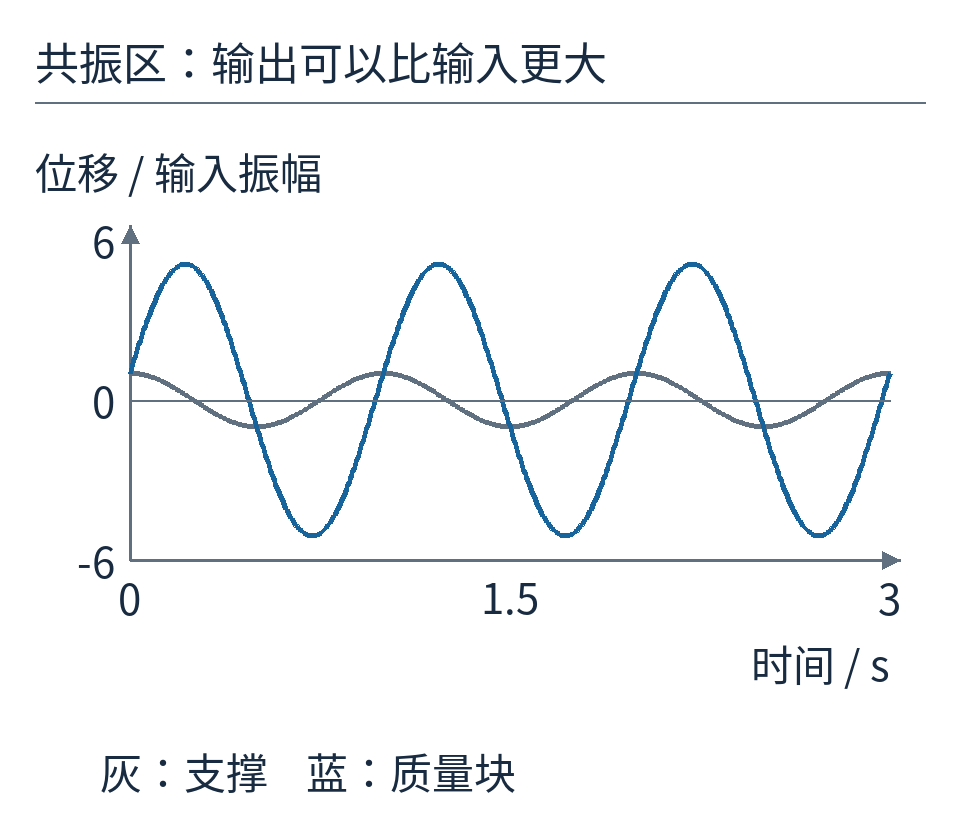

图 6：灰色支撑只在 ±1 之间变化，蓝色质量块却超过 ±5。纵轴以支撑振幅为单位，图示不是地震记录。

## 那条频率曲线从哪里来

不必背公式，先按牛顿第二定律写出力的账本。质量块受弹簧力 `−k(x−y)`，还受阻尼力 `−b(x'−y')`。撇号表示对时间的变化率：x' 是速度，x'' 是加速度。因此：

`m x'' = −k(x−y) − b(x'−y')`。

把含 x 的项放左边，支撑的输入放右边：

`m x'' + b x' + kx = b y' + ky`。

这一步很要紧。阻尼器连在支撑上，支撑的速度也会通过它施力，所以右边有 b y'。若把这一项漏掉，就变成另一种阻尼连接模型了。

周期运动可以拆成同频率的正弦和余弦。把 `x = A cos(ωt)+B sin(ωt)` 代入，其中 ω 是每秒转过的相位角、等于 2πf，再分别收集正弦项和余弦项，解两个关于 A、B 的一次方程，就能求出输出振幅 `√(A²+B²)`。这一运算在附带代码中采用等价的复数写法；不懂复数也不影响读下来的结果。

最终的振幅比为：

`T = √[(1+(2ζr)²) / ((1−r²)²+(2ζr)²)]`。

T 没有单位，因为分子和分母比较的是同种位移。r 是输入频率 f 除以自然频率 f₀。拿 r=5、ζ=0.1 实际算一次：`2ζr=1`，分子是 2；分母是 `(1−25)²+1=577`；开方得到 `√(2/577)≈0.0589`。

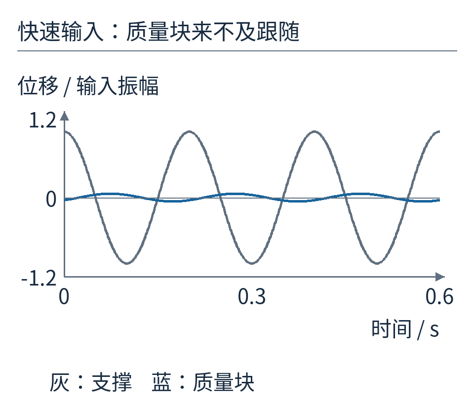

图 7：仍让支撑振幅为 1。输入升到 5 Hz 后，镜子振幅约为 0.0589；同一纵轴下蓝线已很小。这个频率在模型共振区上方，悬挂开始发挥隔振作用。

如果支撑振幅是 1 微米，这时镜子约为 0.0589 微米，也就是 58.9 纳米。它仍在动，只是动得小了。隔振从来不是“绝对静止”的证明。

## 阻尼不是越大越好

很多人第一次见到共振峰，会想把阻尼增加到足够大。确实，阻尼能压低共振峰。但对这里连接支撑和质量块的黏性阻尼器来说，它同时也是一条把快速支撑运动传给质量块的路径。

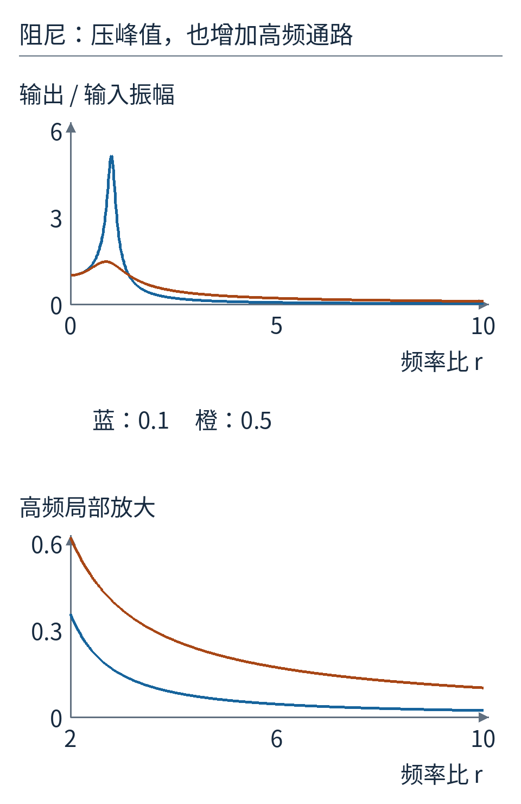

图 8：蓝线 ζ=0.1，橙线 ζ=0.5。较强阻尼压低共振峰，却在高于共振的部分频段带来更大的传递。实际系统可以用更复杂的频率选择控制，图中只比较同一种简单阻尼连接。

无阻尼弹簧在很高频率下的理想振幅比约按 `1/r²` 减小；有上述黏性阻尼时，足够高频处的阻尼通路改变了下降规律。不能一边假定强阻尼，一边不加说明地使用无阻尼高频近似。

这也帮助理解 LIGO 为什么把悬挂材料、低损耗连接和主动控制分开设计。被动结构负责物理隔离，控制系统处理位置与低频运动等问题。要避免把控制器自身的测量噪声和驱动力噪声一路注入最敏感的镜子。

## 多挂几层，究竟增加了什么

单层摆在某些频率已经有帮助。多层悬挂，让地面到最终镜子之间再经过几次“惯性与回复力”的转换。上面的质量块是下面一级的支点，下面的质量块又通过连接反作用于上面。因此，真实多级系统是互相耦合的，不能把同一条单层曲线简单乘四次，就宣称得到了 LIGO 四级悬挂的性能。

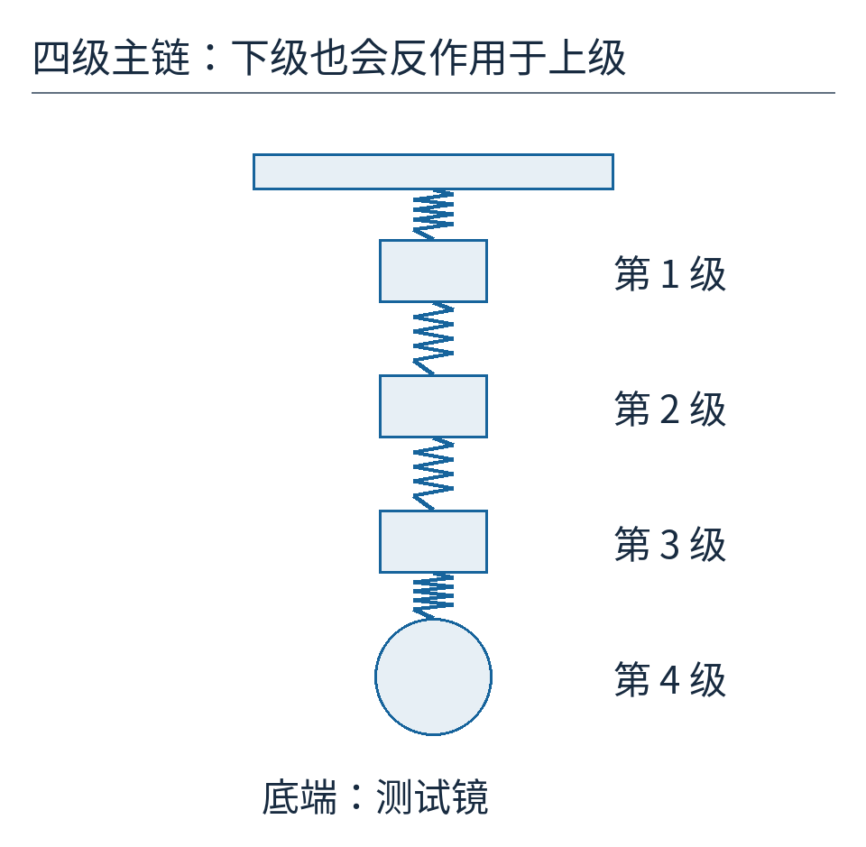

图 9：示意图只画主悬挂链，底端圆形代表测试镜。各级之间会互相施力；真实装置还有反作用链、竖直隔振与控制执行器，照片比简图丰富得多。

为看见“耦合”意味着什么，我们另算一个两级模型：两个质量都是 1 kg，两根弹簧刚度都取前面的 k，两个相对速度阻尼器也都用前面的 b。上块 x₁ 同时受上、下两处连接的力，下块 x₂ 只受它与上块之间连接的力。支撑依旧是 y。

对上块，力的账本是 `m x₁'' = k(y−x₁)+b(y'−x₁') + k(x₂−x₁)+b(x₂'−x₁')`。对下块则是 `m x₂'' = k(x₁−x₂)+b(x₁'−x₂')`。把同频率运动代入这两个方程，联立求解，才是本文两级曲线的来源。

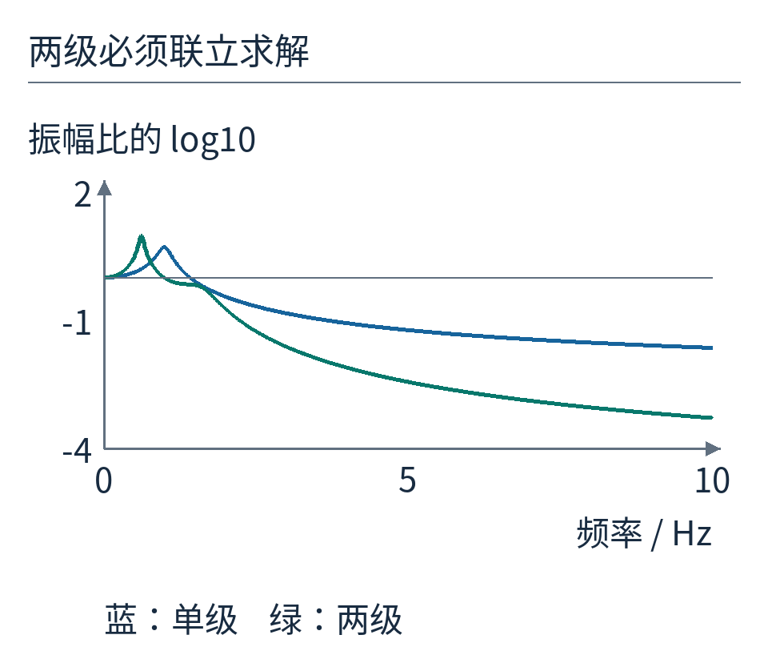

图 10：蓝线是单级输出，绿色是两级模型的最下块输出。纵轴采用以 10 为底的对数：0 表示振幅比 1，−2 表示 0.01，−4 表示 0.0001。多级模型出现不同的共振结构，高频段则能提供更强的隔离。所有点来自联立方程，没有拿单级结果硬凑。

因此，增加层数既增加隔离潜力，也增加需要管理的运动模式。每一层不是把震动固定“吃掉一半”；它的作用取决于频率、质量、连接刚度、耗散和控制。

## 回到照片：隔离地面，并不等于隔离所有噪声

LIGO 合作组的 [Advanced LIGO 技术论文第 4.4、4.5 节](https://arxiv.org/pdf/1411.4547)介绍了测试镜的四级摆悬挂、相邻反作用链，以及与之衔接的主动和被动隔振系统。实际装置还必须同时照顾多个运动方向，不能由本文的一维曲线代替。底端使用低损耗的熔融石英悬挂组件，也是为了降低悬挂自身的热噪声。

热噪声提醒我们：问题不全来自地面。材料内部的热运动、光的统计涨落、控制读数误差，甚至环境质量移动造成的引力变化，都不能简单靠再吊一层解决。机械隔离主要处理通过支撑传来的机械运动，有明确的入口和频带。

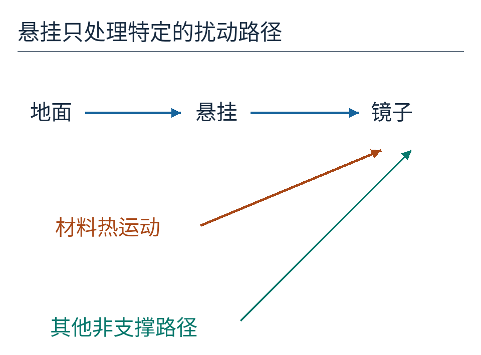

图 11：蓝色路径经过支撑和悬挂；橙色路径代表悬挂自身产生的扰动；绿色表示不经过支撑的其他影响。位置只表达路径，不表示实际大小排序。

现在再看那句“镜子挂起来更稳”，可以补全成一个有用的工程判断：当想测量的频段高于合适的悬挂共振区，而且共振、热噪声和控制噪声都得到处理时，柔性悬挂能减少地面运动传到镜子的幅度。在很慢的运动和某些共振附近，它并不天然占优。

结实不是唯一的稳定方式。允许系统在不重要的地方相对运动，有时才能让最重要的物体少动一点。

模型输入、频率响应和时间序列见 [results.json](examples/results.json)，执行 `python examples/build_figures.py` 可重算。逐图来源、许可与模型范围见 [sources.md](sources.md)。原创正文采用 [CC BY 4.0](https://creativecommons.org/licenses/by/4.0/)。
