# 不把每一步都算出来，怎样知道系统最终会稳住？

把一辆小车接在弹簧上，向右拉开一点，再松手。它往左跑，穿过原来的位置，又往右回来。只看“离原点还有多远”，你会发现这个数一会儿变大，一会儿变小。它明明正在慢慢停下，距离却并不每时每刻缩短。

假如这是一段控制程序，你会怎样证明它可靠？运行十秒，看着没出事，再运行一百秒？换一百个起点都试试？这些检查有用，但“我试过的几条轨迹都很好”与“这一整片起点都不会跑远”，之间还有一道缝。

有一种办法不急着算出小车每一秒的位置，而是先找一笔账：**这笔账能说明系统偏离目标有多严重，而且系统自己运动时，账上的数不会增加。**

它叫 Lyapunov 方法，也常译作李雅普诺夫方法。名字并不是必须背下来的部分；值得学会的是：怎么挑这笔账，怎么检查它，以及它究竟承诺了什么。

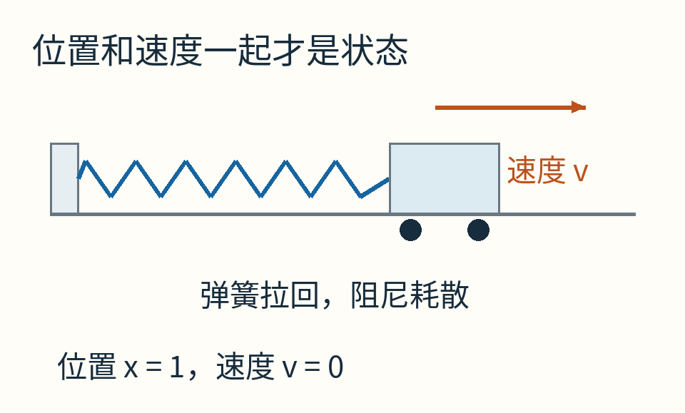

橙色箭头规定速度的正方向向右，并非说车在松手瞬间已经向右运动。初始位置为1，初始速度为0。图中的弹簧和小车是模型示意，不是真实装置照片。

## 先别把“稳”说成一件事

小球在一只理想光滑的碗里来回滚，它可能永远不停止，但只要开始时没偏得很远，后来也不会偏得很远。人们会说这个平衡位置是**稳定的**。

若碗里有阻力，小球还会慢慢回到碗底、速度慢慢趋于零。这比稳定更强，叫**渐近稳定**。“渐近”允许越来越接近，并不要求在某个有限时刻突然精确归零。

还有一种更具体的保证：偏差缩小得至少像某条指数曲线那么快。那是指数稳定。它给了收敛速度的尺度。

我们先把前两件事分开。否则很容易从一句“能量不会增加”，跳到一句并没有证明的“所以最后一定停在这里”。

## 把小车写成两个数

用 x 表示离弹簧自然位置的偏移，向右为正；用 v 表示速度，同样向右为正。车的位置相同，速度不同，下一刻的行为就不同。因此本例的状态是一对数 `(x,v)`。

为避免单位掩盖主线，先按选定的长度、时间和质量尺度归一化，使用下面这个无量纲教学模型：

`x 的变化率 = v`

`v 的变化率 = −x−v`

“变化率”就是这一刻每单位时间正在改变多少。第一条说位置怎样随速度变化；第二条里，−x是把车拉向原点的弹簧作用，−v是与速度方向相反的阻尼作用。

有时会简写成 `x'=v，v'=−x−v`。撇号表示对时间的变化率，不是新的一辆车。

从 `(1,0)` 松手，速度变化率是−1，所以车开始向左加速。等它到原点时，弹簧那一项暂时为0，但它通常还带着向左的速度，因而会越过去。**到达目标位置，与在目标位置停住，是两回事。**

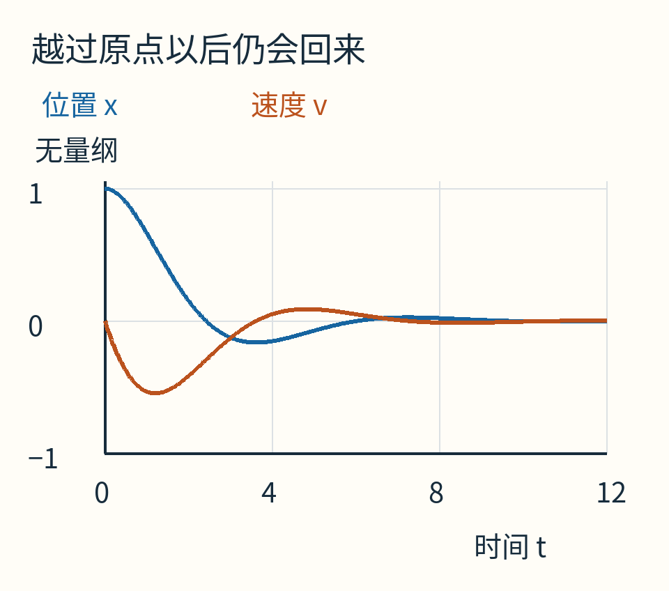

蓝线是位置x，橙线是速度v；横轴是无量纲时间。两条线都渐渐贴近0，但蓝线会先穿过0再回来。本图由模型的解析表达式计算，不是数值积分器的近似轨迹。

## 两种“偏离”可以互相兑换

车离原点很远却暂时不动，弹簧储存的能量多；车经过原点时，弹簧能量少，但车可能跑得很快，动能多。只盯一个数字，会把这种交换误认为系统忽好忽坏。

对我们的归一化模型，可以把两项相加：

`E(x,v) = (x²+v²)/2`。

x²/2对应弹簧势能，v²/2对应动能。它不是随意把“米的平方”与“米每秒的平方”相加：物理形式原本是 `kx²/2 + mv²/2`，k为弹簧刚度、m为质量；这里已经选定尺度，使两个系数成为1。换回真实单位时，需要把它们放回去。

例如，状态 `(1,0)` 的E为1/2；状态 `(0,1)` 也是1/2。两者位置与速度不同，但总账相同。`(0,0)` 的账才是0，而任何别的状态都有正数账单。

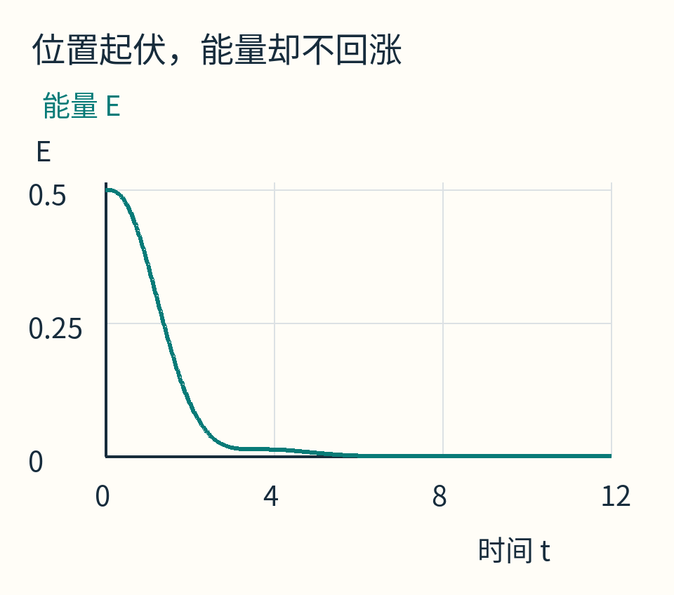

同一条运动轨迹里，能量从0.5下降。位置是否正在向外走，不能单独决定总能量是否上升。

接下来才是关键：怎么知道E确实不会增加，而不是图画得像在下降？

## 在公式里看见一笔抵消

先学一条很短的计算规则。若一个数x正在变化，x²/2的变化率是 `x×x'`。可以从很小的增量理解：

`[(x+Δx)²−x²]/2 = xΔx+(Δx)²/2`。

除以很小的时间Δt，再让时间段缩小，后面那个二阶小量不再贡献瞬时变化率，就得到x×x'。v²/2也一样。

所以E的变化率是：

`E' = x×x' + v×v'`。

把刚才的运动规则代进去，不换模型：

`E' = xv + v(−x−v) = xv−xv−v² = −v²`。

弹簧的两笔账一正一负，恰好抵消：弹簧把能量交给运动，或运动把能量还给弹簧，都只是内部转账。最后留下的−v²来自阻尼，永远不会是正数。

拿一个具体状态试试：x=1/2、v=−1/4。位置那项变化率 `xv=−1/8`，动能那项 `v(−x−v)=1/16`。势能在下降，动能却在上升；两者合计−1/16，仍与−v²相同。

现在，这条结论已经不依赖某一条轨迹画得是否顺滑。只要运动确实服从给定规则，在任意状态代入，都是同一个−v²。

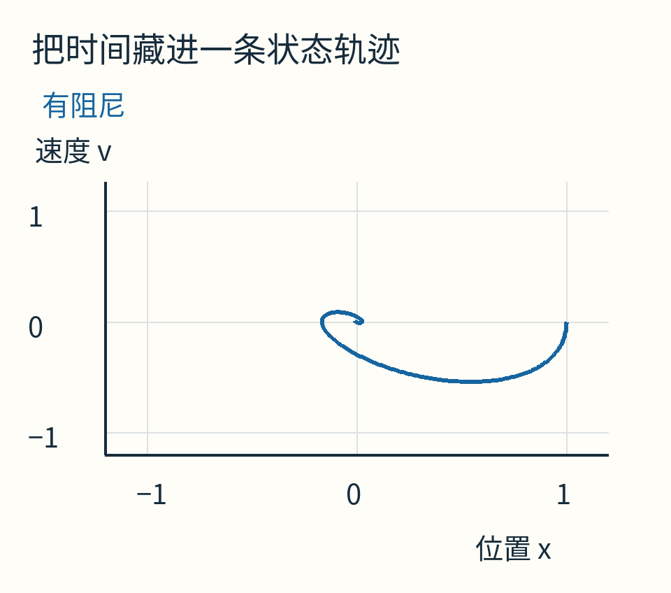

横轴读位置，纵轴读速度；一个点就是一个瞬间的完整状态。轨迹从右侧 `(1,0)` 出发，先进入负速度区域，再逐渐靠近原点。两轴在版面上的像素尺度不同，不用画面上的几何夹角判断物理方向。

## 不增加，为什么还不足以保证回来？

把阻尼删掉，模型变成 `x'=v，v'=−x`。沿用完全相同的能量账：

`E' = xv + v(−x) = 0`。

它确实不会增加，却也不会减少。由 `(1,0)` 出发，状态一直满足 `x²+v²=1`，在位置与速度之间反复兑换能量，不会趋于原点。

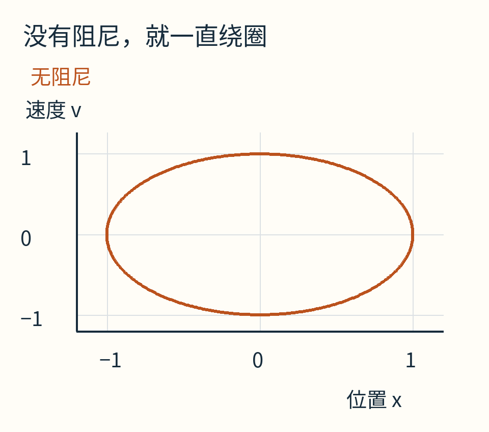

橙色闭合曲线来自 `x=cos t，v=−sin t`。数学坐标中它是圆；图的横纵显示比例不同，所以屏幕上看起来较扁。

于是第一条教训出现了：**“E不增”可以帮助证明不会跑远，但单靠这句话不能证明最终回到原点。**

有阻尼模型里，也存在E'=0的瞬间：只要v=0就行。例如车被拉到最右端刚松手时，速度为0，能量此刻的变化率也为0。难道它不能收敛？当然不能这样判。

要多问一步：系统能不能永远待在“E'=0”的那些状态里？本例中，那些状态构成v=0的一整条线。但若x≠0，第二条规则立即给出v'=−x≠0，车会离开这条线。能够一直留在其中的，只有 `(0,0)`。

对这套光滑模型，能量又把状态限制在有界的闭圆盘内，因而可以应用 LaSalle 不变性原理，得到所有轨迹趋于原点。其关键条件是“有界的不变区域”与“零变化集合中唯一能持续停留的运动”；不能删掉它们，只留下“偶尔下降就行”。这也是[MIT作者讲义](https://underactuated.mit.edu/lyapunov.html)特别区分非增与严格下降的地方。

## 这笔账不一定是真能量

Lyapunov函数通常写成V。它可以像能量，也可以纯粹是为证明设计的数学量。重要的是它和目标之间的关系，而不是单位一定叫焦耳。

围绕原点，通常要求V连续可微，原点V=0，其他足够近的状态V>0。后一条叫**正定**。沿系统运动，再检查V的变化率。

为什么不能随便挑一个“会变小”的数？假设用V=x，系统一直向左跑到负无穷，V也一直变小。账越来越小，车却越来越远；这份账根本没把“更接近目标”表达出来。

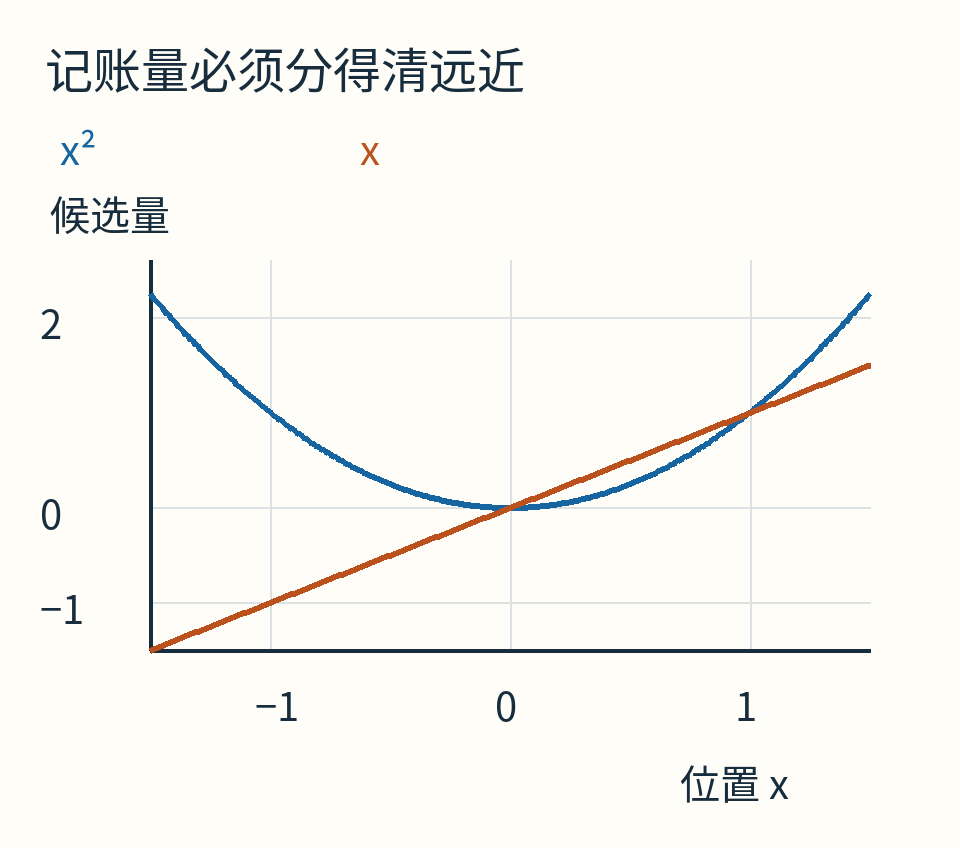

蓝色x²把原点两侧的偏离都算为正；橙色x在左侧越来越负，不能据此判断接近原点。

对我们的E，若开始时 `x²+v²≤r²`，能量不增就意味着以后仍有 `x²+v²≤r²`。状态被圈在半径r的圆盘内。你希望以后始终待在很小的范围，就把起点选在相应的更小能量区域里。

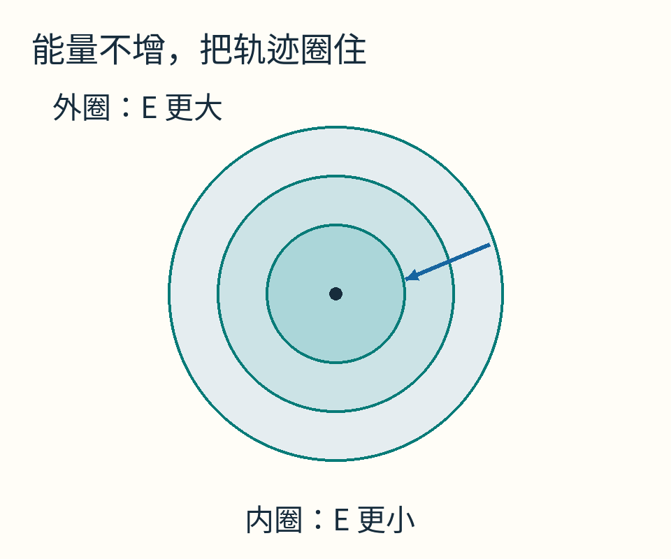

每个圆盘代表“不超过某个能量上限”的状态集合。箭头只是说明往更低能量区域的方向，不是额外计算的一条运动轨迹。

这就是稳定性定义里“起点足够近，后来就一直够近”的几何内容。证明并不要求距离严格单调；它允许状态在这个小围栏里绕一绕。

## 局部证书不能拿去包办全局

现在换成另一套明确不同的一维模型：

`x'=−x+x³`。

仍试 `V=x²/2`。变化率为 `V'=x(−x+x³)=−x²+x⁴=x²(x²−1)`。

当0<|x|<1时，x²−1为负，V严格下降；当|x|>1时，它反而为正。原点附近确实会回来，但范围外可能越走越远。

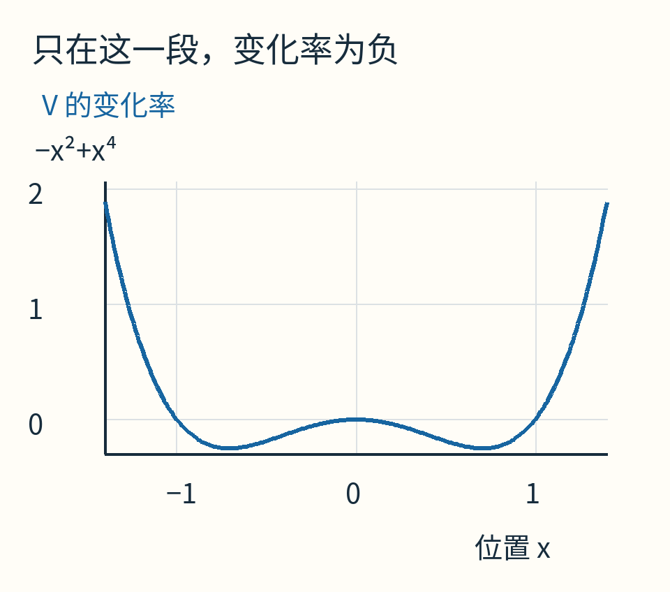

看蓝线与横轴的位置：−1和1之间低于0，两侧高于0。原点、−1、1处都等于0，含义却不相同。

更直观地，取x=1/2，变化率−1/2+1/8=−3/8，向左靠近0；取x=3/2，变化率−3/2+27/8=15/8，反而向右离开。−1与1本身也是平衡点。

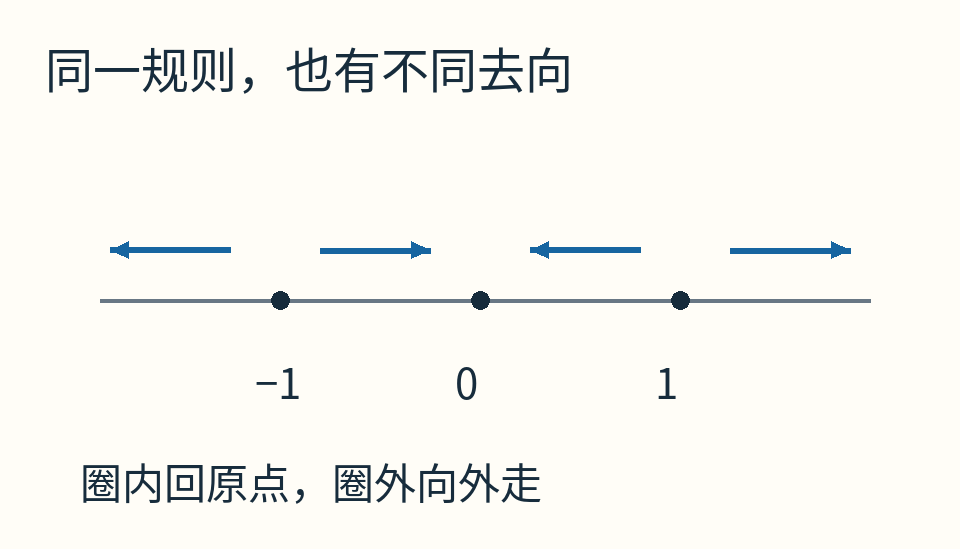

箭头由−x+x³的符号决定。这里的吸引域是开区间(−1,1)；不把边界平衡点也算作“最终回到0”。

要证明全局结论，必须让条件覆盖全状态空间，并保证V不会在状态跑向无穷时反而保持一个有限小值。常见的充分条件是V随着状态离原点越来越远而趋于无穷，称为径向无界。它帮助排除“账看着正常，人已跑得没影”的漏洞。

## 数学稳定，为什么程序图还能越画越大？

回到最初的有阻尼弹簧模型。有人写前向Euler更新：

`x新 = x+h v`

`v新 = v+h(−x−v)`。

这里h是一步的时间长度，两行右侧都用旧状态。这个程序近似连续运动，却已经构成另一套离散系统。

在起点 `(1,0)`，一步后是 `(1,−h)`，能量变成 `(1+h²)/2`，比原来的1/2还大。连续模型此刻并不增加能量，离散程序却在第一步造出一点额外能量。

这是否说明任意正步长都会发散？也不是。第一步上涨与长期发散不是同一句话。对这个二元线性模型，Euler更新矩阵的两个复特征值，模长平方都是 `1−h+h²`。因此0<h<1时长期衰减；h=1处不衰减；h>1时会发散。这里给出的是离散矩阵的结果，不需要读者先懂复数才能理解“离散程序还要单独检查”。

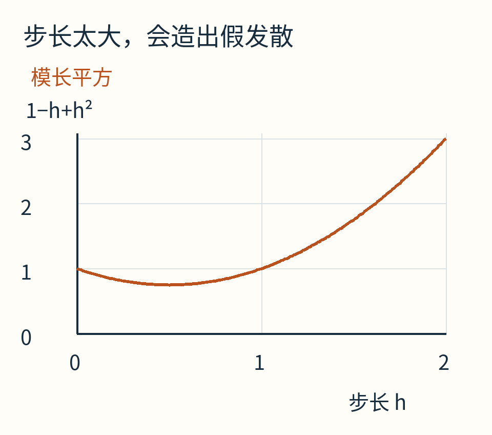

蓝本连续系统没有改变，但时间步长能把程序换成长期发散的动态。图中低于1才对应这个模型的渐近衰减条件。

若只盯程序输出，你可能错怪理论；若只盯理论，你可能漏掉实现。比较时要说清自己证明的是连续方程、离散规则，还是某个带舍入误差的实际程序。

## 会回来，也不表示来得一样快

再比较两个一维例子，初值都为1：`x'=−x` 与 `x'=−x³`。它们都能用V=x²/2分析。

第一种解是 `x=e^(−t)`；第二种是 `x=1/√(1+2t)`。后者也趋于0，但慢得多。特别是靠近0时，x³比x小很多，回拉作用变得弱。

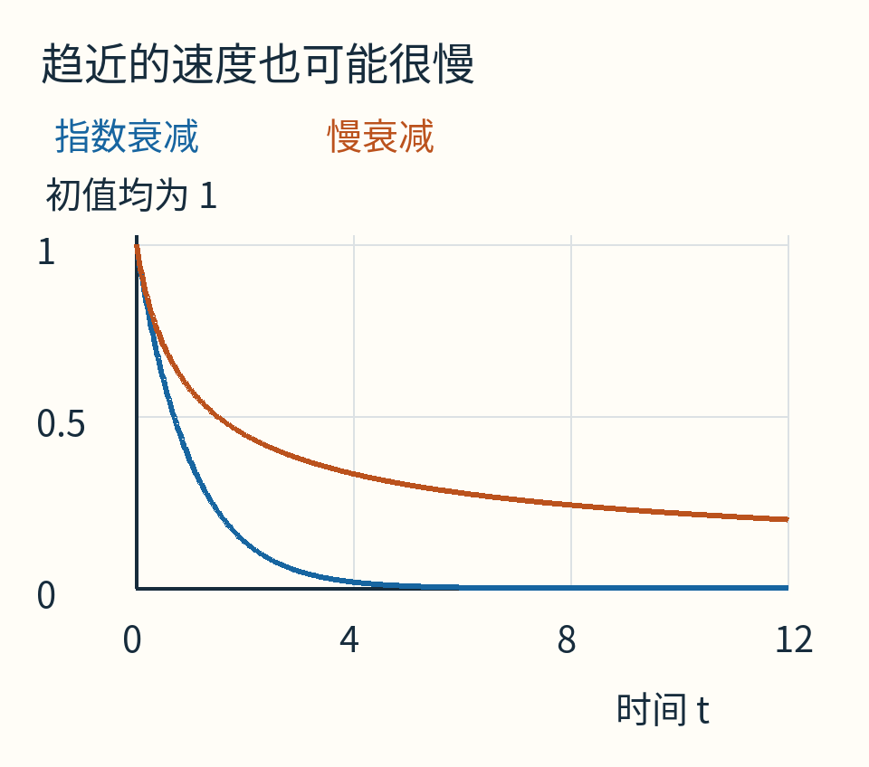

在这里“稳定”“最后趋近”“趋近多快”分别需要不同强度的证据。不要看到一条下降曲线，就顺手许诺固定的收敛时间。

## 现在你可以自己检验一张证书

对最初模型，把阻尼系数改成c：`x'=v，v'=−x−cv`。沿同一笔账计算，得到 `E'=−cv²`。

c>0时耗散；c=0时守恒；c<0时这项会注入能量。你不必先写一千条轨迹，就已经抓住参数改变的方向性后果。当然，最后的稳定性结论仍须按前面的条件完整检查。

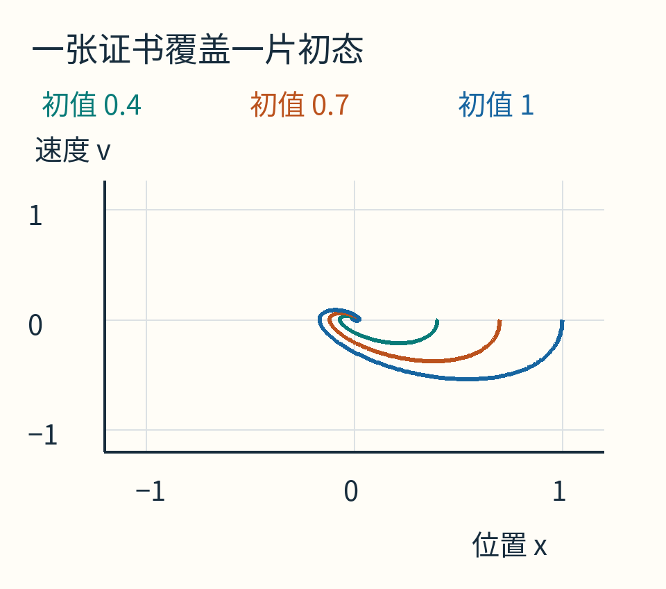

图里只画了三个起点，证明却来自对任意x、v成立的恒等式。两者各做一件事：图帮助看见，恒等式负责覆盖。

[随文程序](examples/lab.py)保存解析轨迹与绘图数据，能量图直接读取同一份[data.json](examples/data.json)。运行方式见[附件说明](examples/README.md)。有限采样检查只用于发现代码错误，没有代替上述证明。

下次看到“这个控制器看起来很稳”，可以继续问得具体一点：目标状态是哪一个？有没有一笔正定的账？账在哪个范围内不增加？零变化处能停留什么运动？实现的时间步长有没有把原来的问题改掉？

这些问题，比一张漂亮的收敛图多走了一步。

原创正文与原创模型图采用CC BY 4.0。本文使用AI辅助组织说明、编写计算与绘图代码；[来源及图像身份说明](sources.md)。
