# 只记一个名字，怎样找出过半的那一个？

九张纸条依次送来，每张只写一个字母：

`A B A C A A B A A`

问题很具体：有没有一个字母，占了全部纸条的一半以上？如果有，是谁？

纸条只有九张，数数就知道 A 有六张。可如果数据是一条很长的记录流，名字又很多，为每个名字建一格计数就可能占不少空间。能不能只保留一个名字和一个整数，先找到那个值得核实的对象？

Boyer–Moore 多数投票算法确实能这样做。不过它的承诺带着一个很重要的条件：**如果严格多数存在，最后的候选一定是它。**若没有严格多数，候选可能是一个毫不起眼的少数派。

这篇文章就从一个可以用纸牌完成的动作讲起：两张名字不同的纸条，可以一起拿走。

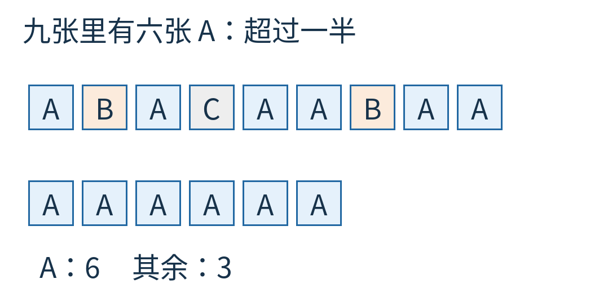

图1｜蓝色是 A，橙色是 B，灰色是 C。这里讨论“超过总数的一半”：九张中至少五张，不是只比任何单个对手多，也不是恰好一半。

## 为什么要把“过半”说得这么认真

假如 A 有四票，B 有三票，C 有两票，A 比每一位对手都多，却只有 4/9，并没有过半。

“出现次数最多的元素”常叫众数；本文要找的是严格多数元素。严格多数如果存在，只能有一个，因为两个人各占一半以上，加起来就超过全部了。

这种区别决定算法为什么可行。它会把不同名字成对抵消，而“比所有其他名字加起来还多”能经受这种抵消；“只是第一名”则未必。

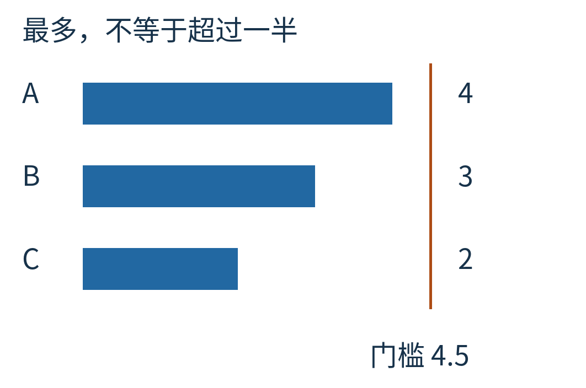

图2｜三根柱子使用同一票数尺度。A=4、B=3、C=2 时 A 是最多的，却未越过 4.5 票这条严格过半门槛。门槛不要求真实存在半张票，它只是数学比较线。

因此，这个算法不是通用的选举规则，更不是判断某个观点是否正确的方法。它解决的是一个定义明确的序列计数问题。

## 拿走一对不同的，真正的多数不会消失

先把 A 看作那个已知存在的严格多数。设它有 a 张纸条，其他所有名字合起来有 b 张，条件就是 a>b。

拿走两个不同名字，有两种情况。

第一种，拿走一张 A 和一张别的。剩下 a−1 张 A、b−1 张其他。两边同时减一，原来的优势 a−b 没变，所以 A 仍比其他总和多。

第二种，拿走的是两个都不叫 A 的名字，比如 B 和 C。A 的数量不变，其他总数少了二，A 的优势还增大了。

不可能拿走两张 A，因为规定名字必须不同。

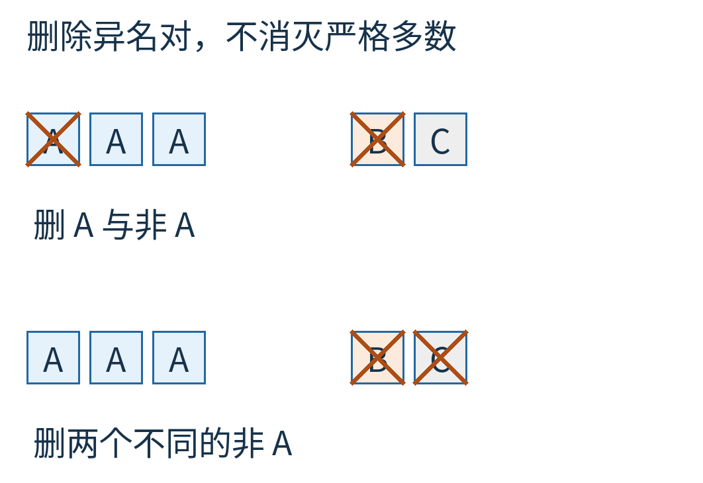

图3｜上半是删一张 A 和一张非 A，下半是删两张不同的非 A。蓝色一方相对“其余全部”的优势不会降低。图中的小方块是具体算例，证明则使用正文里的 a、b。

于是得到一条可反复使用的规则：只要最初确实有严格多数，怎么成对拿走不同名字，都不能把它变成少数，更不能把它全拿光。

注意这句话没有反过来承诺：如果最后只剩某个名字，原来就一定过半。拿走了一些票以后，原来没过半的名字也可能留下。这个漏洞稍后要专门堵上。

## 不必真的存一堆纸条

现在沿着输入顺序走。桌上只保留一堆名字相同、尚未配对的纸条。

- 桌上空了：新来一张，就用它开启一堆。
- 新来的和堆里名字相同：放进去，堆高加一。
- 名字不同：拿走新来的，同时从堆里拿走一张，堆高减一。

因为桌上始终只会堆一种名字，我们不必保存每张纸条，只需记“名字是什么”和“堆里有几张”。名字叫候选 `candidate`，堆高叫计数 `count`。

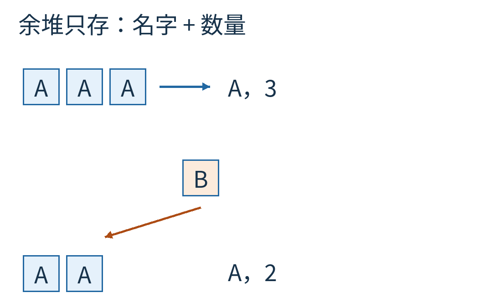

图4｜三张 A 可以表示为“候选 A，计数 3”。右侧新来 B 时，与堆中一张 A 一起消失，余堆变为两张 A。计数表示未配对数量，不是已经见过多少张 A。

最后一句值得慢一点读。计数加加减减，已经主动忘记了被抵消的票；它不再是普通频率表。

## 把九步走完，不跳过归零

仍用开头的输入，不换例子：

`A B A C A A B A A`

开始 `count=0`，候选还没有意义。

第 1 张 A 到来，桌上为空，记候选 A，计数 1。

第 2 张 B 到来，与 A 不同，一起抵消，计数回到 0。纸上也许还残留着 `candidate=A` 这个旧变量值，但它已经不代表一堆实际余牌。下一张可以重新指定名字。

第 3 张 A 到来，开启新堆，计数 1。

第 4 张 C 到来，与 A 抵消，计数又为 0。

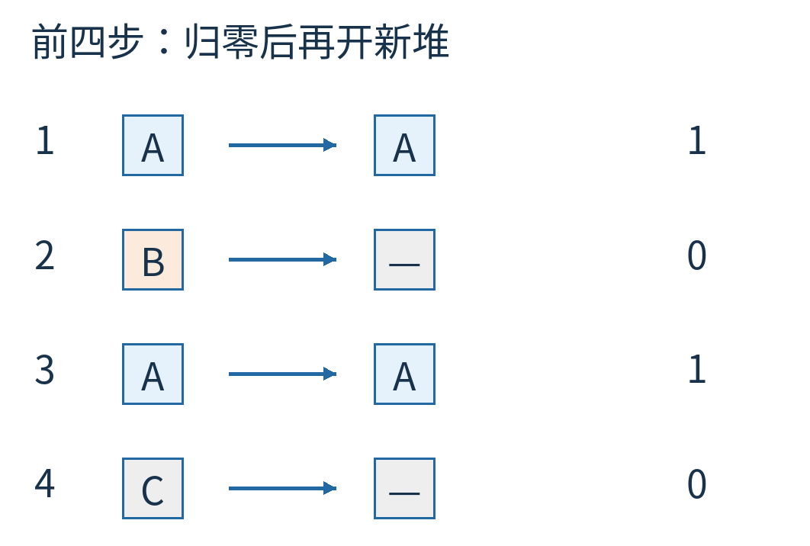

图5｜从左侧输入向右看余堆。第 2、4 步的空框表示计数为 0；图中用破折号显示“此刻没有有效候选”，避免把变量里残留的名字误当答案。

第 5、6 张都是 A，余堆依次变成 1 张、2 张 A。

第 7 张 B 到来，抵消一张 A，余堆降到 1 张。

第 8、9 张又都是 A，余堆最终升到 3 张。

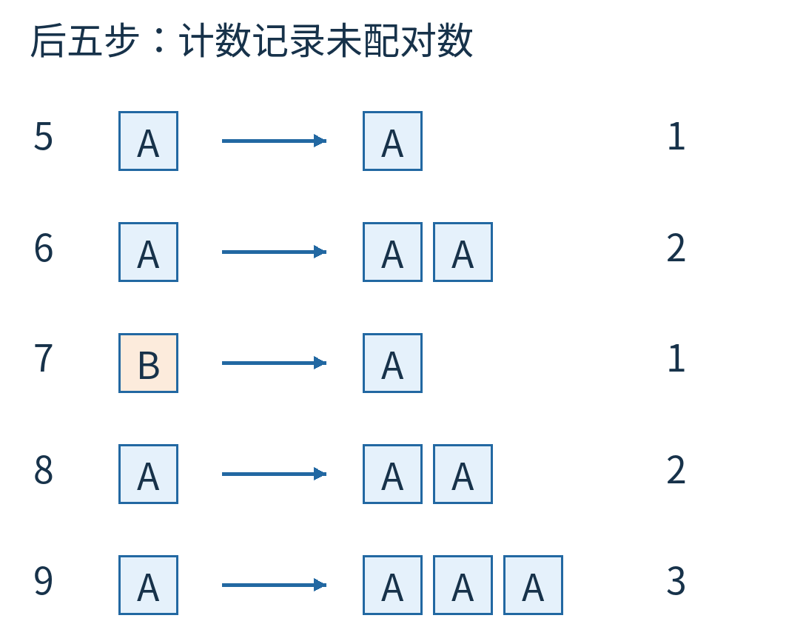

图6｜最后记录的是候选 A、计数 3。它不是在说 A 总共只出现三次；之前的三张 A 分别与 B、C、B 配走了。

我们确实只用一个名字和一个整数走完了第一遍。但是输入里有六张 A，为什么最后整数是三？因为它记的是“余堆还剩多少”，不是“候选拿了多少票”。

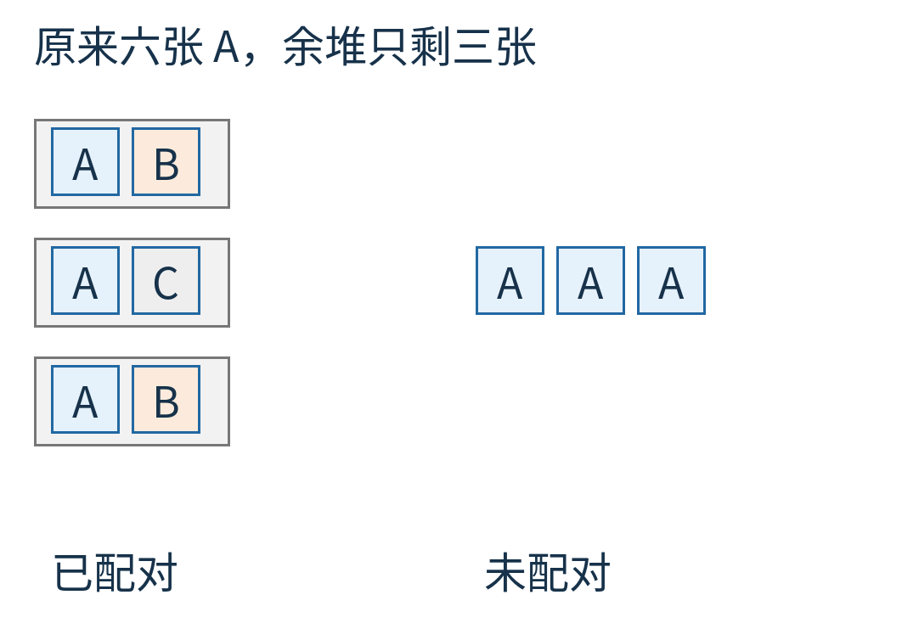

图7｜三个灰框内各含一张 A 和一张非 A，代表已经删除的异名对；右边三张 A 才是最后的余堆。计数 3 对应右边，不对应原始 A 的总数 6。

这张图也给出整个算法的不变量：处理完任意一段前缀，已读纸条总能分成若干异名对，加上一堆名字相同的余牌。每次遇到新纸条，三条更新规则都保持这件事成立。

若原输入存在严格多数，它无法被这些异名对全部消掉，最终余牌就只能是它。证明不用假定各名字均匀分布，也不用假定多数总在开头或结尾。

## 候选 C，可能只有一票

换一个专门检验边界的输入：

`A A B B C`

两张 A 先把计数推到 2，两张 B 再把它减回 0，最后一张 C 开启新堆。

结果是候选 C、计数 1。可 C 只有一票，A 和 B 都有两票；没有任何名字过半，C 甚至不是众数。

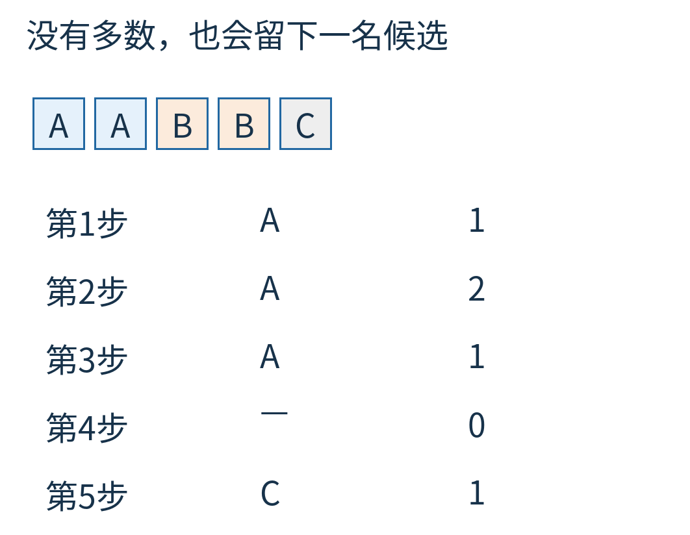

图8｜A、B 的四张票在前面互相抵消，末尾 C 单独留下。候选只拥有“如果存在严格多数，它必须是我”的资格，没有自动获得“我已经过半”的证据。

这里不是算法出了错，而是我们不能把条件句读成无条件保证。

如果题目事先保证一定存在严格多数，第一遍候选已经够了。如果没有这个保证，就必须再验证：重新扫描原输入，数候选真正出现多少次，检查是否严格大于 n/2。

对九张纸条的主例，第二遍数出 A 出现 6 次，`2×6>9`，通过。

对 `A A B B C`，第二遍数出 C 出现 1 次，`2×1>5` 不成立，结论应为“不存在严格多数”。因为第一遍已经保证，若有严格多数只能是这个候选；候选都不合格，别人也不可能合格。

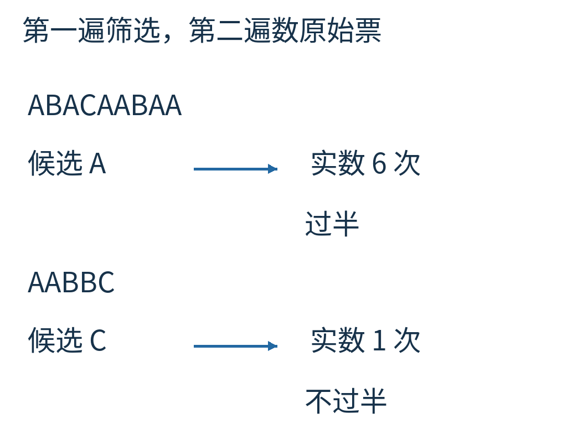

图9｜上路是主例，候选 A 经真实频数 6 验证通过；下路是反例，候选 C 经真实频数 1 验证失败。第二遍重新读取原始记录，不能拿余堆计数代替。

若数据只能经过一次，之后既不能回读也没有额外记录，那么这份简单实现只交得出“候选摘要”。它不能假装已经完成第二遍。实际系统可以保留可重放日志、重新查询原始数据，或者明确只在已有多数保证的场景使用它。

## 计数恰好归零时，已经能说些什么

输入 `A B` 最后没有余牌。两票平分，当然没有严格多数。

更一般地，最终计数为零，说明全部输入已拆成异名对。任意名字在每一对里最多占一张，因此最多占全部的一半，不可能严格过半。

所以非空输入若最后计数为零，可以直接判断没有严格多数，不必执着于变量里旧候选是什么。空输入则一开始就没有元素，也应返回“没有”。

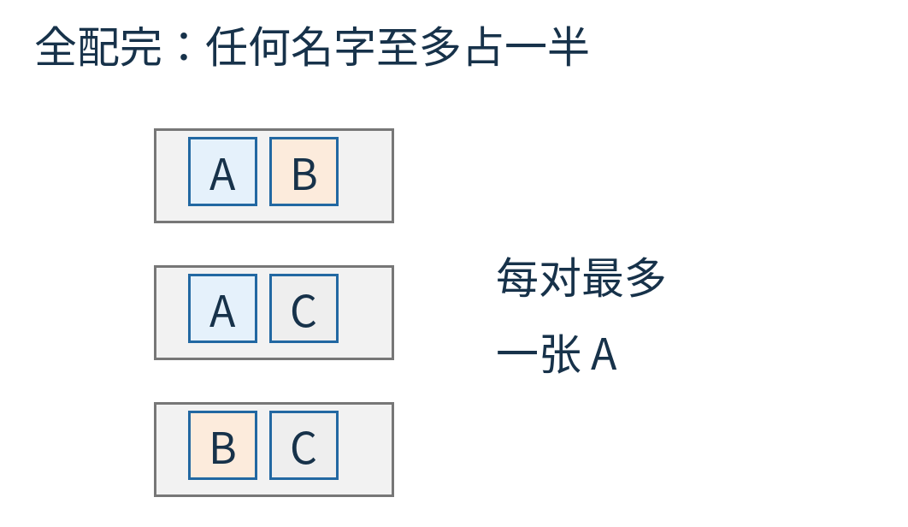

图10｜每个框内只有两种不同名字。任一名字每框最多出现一次，因而最多拿到所有格子的一半。这个论证处理的是零余量，不把恰好一半当作过半。

反过来，计数大于零只能说明还有未配对的票，不能证明原来过半。这正是上一节反例的作用。

## 不同顺序会不会改变结论

九张主例纸条不论怎样重新排列，A 仍占六张。既然严格多数存在，第一遍候选一定仍为 A；最终余堆的高度却可能变化，因为配走哪些异名对可能不同。

没有严格多数时，候选更可能随顺序变化。例如同样一份频数清单 A 两张、B 两张、C 一张，按 `A A B B C` 读完留下 C；按 `A B C A B` 读完留下 B。

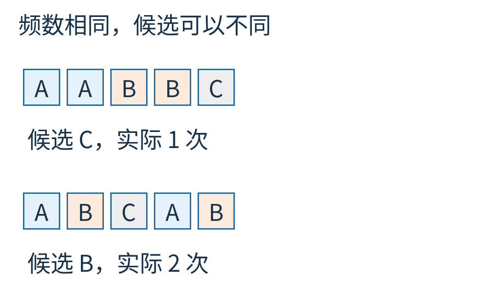

图11｜两条输入都有 A=2、B=2、C=1，真实结论都是“无严格多数”。第一遍却可给出不同候选，所以验证结果才是完整问题的答案。

这给分段处理带来一个有用的视角。每段各自删去异名对，留下一个名字及其余量；合并两个摘要时，同名就把余量相加，不同名就用较小余量与较大余量配对抵消。合并仍等于在原数据上继续删除异名对，因此**有严格多数时，候选保证仍在**。

但不要因此声称这个摘要是一个具有唯一标准形的完整统计表。无多数时，不同分组方式可能留下不同名字；即使候选一致，它的余量也不是原频数。最后仍要在原数据上验证候选。本文没有把这种摘要当成可查询任意名字频率的数据库。

## 一段能看懂每个分支的程序

下面代码里的“过半”用 `2 * actual > len(items)` 判断，避免读者把“超过”误写成“大于等于”。代码接受可重复遍历的列表；第一遍和第二遍都读取同一份输入。

```python
def majority(items):
    candidate = None
    count = 0
    for x in items:
        if count == 0:
            candidate, count = x, 1
        elif x == candidate:
            count += 1
        else:
            count -= 1

    if count == 0:
        return None
    actual = sum(x == candidate for x in items)
    return candidate if 2 * actual > len(items) else None
```

这里用 `None` 表示不存在，教学输入只含 A、B、C，所以不会与合法名字混淆。若合法数据本身可以是 `None`，接口应改为返回“是否找到”和“名字”两项，或用另外的唯一哨兵。

每个元素在第一遍做常数次比较，第二遍再做一次，所以总工作量随 n 线性增长，通常写成 O(n)。额外保存一个元素和几个整数，在能装下元素与计数的机器字模型下是 O(1) 个字。若认真按二进制位数计，一个能数到 n 的计数器仍需约 log₂n 位；“常数空间”不是说一枚永远不变大小的物理器件能数无限长的流。

附带 [verify.py](examples/verify.py) 实际穷举 `{A,B,C}` 上长度 0—9 的全部 29,524 个输入，把算法输出与完整频率表的精确结果逐项比较。它还对每个有严格多数的输入检查第一遍候选，确认没有把保证和验证混淆。

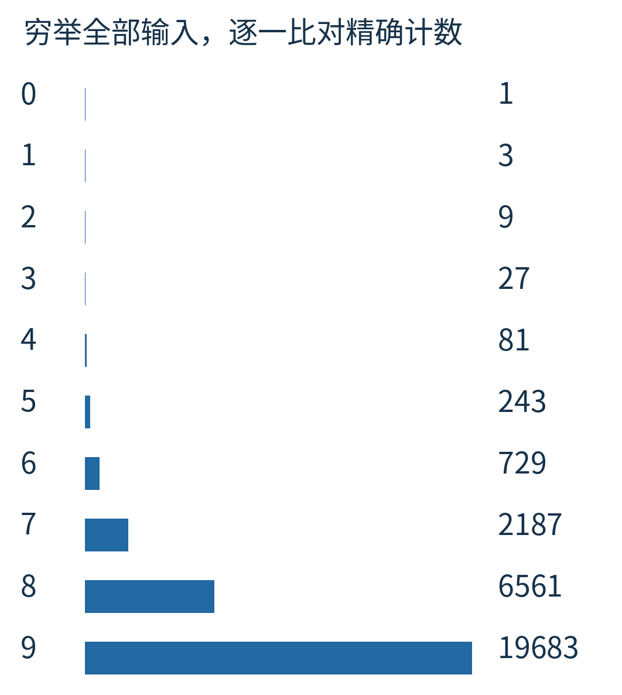

图12｜右侧为各长度完成验证的输入数，合计 29,524。这里是有限输入空间的程序检验，正确性的一般理由仍是异名配对不消灭严格多数。

J Strother Moore 在自己的[算法介绍页](https://www.cs.utexas.edu/~moore/best-ideas/mjrty/)中回忆，他与 Robert Boyer 在 1980 年提出这个算法；[技术报告](https://www.cs.utexas.edu/~boyer/ftp/ics-reports/cmp32.pdf)给出配对思路和程序。这里把 1980 年明确标为作者对提出时间的回忆，不将其写成已经核定的报告出版年。两人还提出过著名的字符串搜索算法；名字相同，并不意味着它与本文在解决同一道题。

可以留一叠纸条在桌上试一个变化：`A B C A B C A`。先只看余堆，你会得到一个候选；再数它的真实张数，你会发现“最后站着”与“原来过半”相隔的，正是那一遍不能省略的核实。

图片来源：图1—12为原创纸牌模型、状态轨迹或实际程序结果；纸牌不是历史投票照片。原创正文和图片采用 CC BY 4.0；代码与一手资料说明见 [sources.md](sources.md)。
