# 明明已经透明，蓝色为什么还会漏出来？把图片边缘的 alpha 算清楚

你给游戏做了一颗红色圆点。原图边缘干净，背景也确实透明。可把圆点放大一点，或者加一点模糊，边上却浮出一圈紫色。美术软件里看不见的颜色，怎么跑到画面上来了？

不一定是压缩把图片弄坏了。有时，问题出在一个很小的顺序上：**是先把颜色混在一起，再考虑透明度，还是先算每种颜色真正贡献多少，再混？**

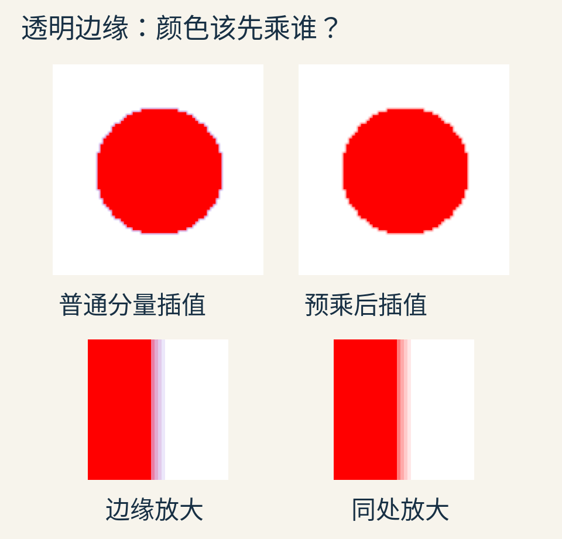

图中两颗圆点由附带程序实际计算。原始图片只有 72×72 个采样点，外部 RGB 被有意设成蓝色、alpha 设成零；两图都用双线性方式放大到 360×360，再合成到白底。下排把同一处右侧边缘放大，便于看清细线。蓝色是用于暴露问题的测试输入，不是某款游戏的截图。

这篇文章要认识的**预乘 alpha**，不是一种神奇的去边滤镜。它是一种记账方式：把“这个颜色本来是什么”和“这个颜色实际贡献多少”区分开。记对了，缩放、模糊和叠图才更容易讲同一种语言。

## 透明图片里，为什么还存着颜色？

一张普通彩色图像可以给每个采样点存三个数：红、绿、蓝，简称 RGB。这里先把每个数规范到 0 至 1：纯红是 `(1,0,0)`，纯蓝是 `(0,0,1)`，白是 `(1,1,1)`。

透明图片再添一个数 alpha，写作 α。在本文的合成模型里，α=1 表示完全遮住下面，α=0 表示不遮住，α=0.5 则让下面的一半贡献继续通过。三个颜色数加一个 alpha，就是常见的 RGBA。

因此，`(0,0,1,0)` 完全合法：它存着蓝色，但此时蓝色的贡献为零。图像文件、工具或处理步骤可能保留这些隐藏 RGB；“看起来透明”不会自动把它们清成零。

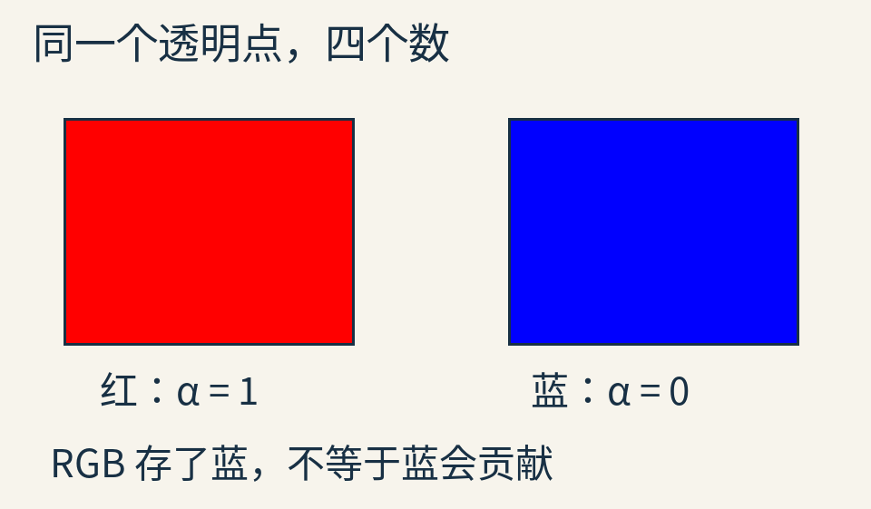

这里把隐藏的 RGB 单独展示出来，右边蓝色方块不是说最终画面应该出现蓝色。真正合成时，它的 α=0。

还有一处需要先说清：alpha 可以承载不同来源的信息。一小片不透明红纸只盖住某个采样区域的一半，可以得到平均覆盖率 0.5；一整片薄膜处处只挡住一半背景，也可能用 0.5 描述。只留下一个 alpha 后，两者原来的空间细节已经丢失。

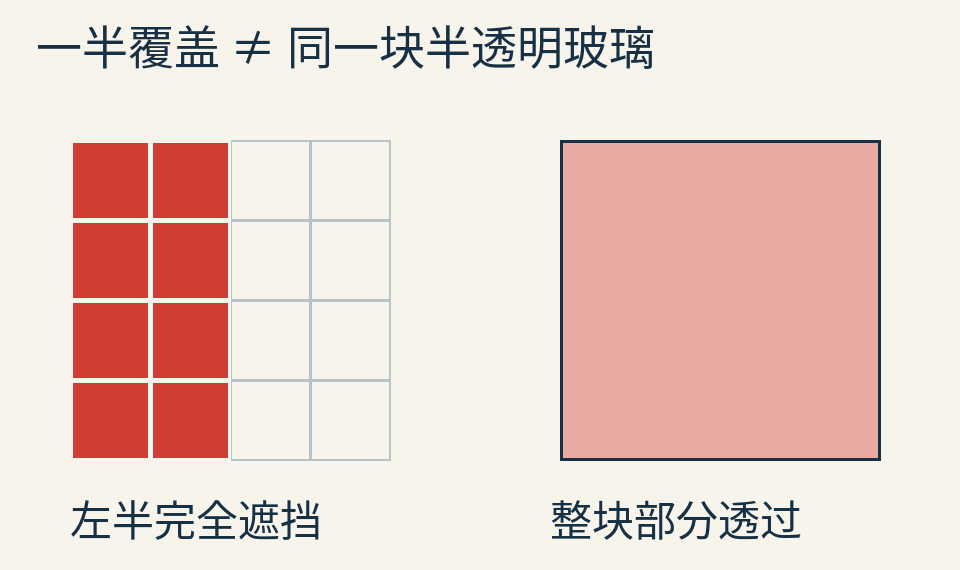

左图是覆盖的教学模型，右图是均匀部分透过的教学模型。特别是两层细小图案的覆盖位置互相相关时，只有各自一个平均 alpha，未必足以恢复精确的重叠面积。下文使用的是常见的图像合成模型，不把它当成所有微观几何或玻璃光学的完整模拟。

## 先做一次最普通的叠图

把半透明红色放在不透明蓝色上，α=0.5。

红色自己贡献一半：`(1,0,0)×0.5=(0.5,0,0)`。它还让下层的一半通过：`(0,0,1)×(1−0.5)=(0,0,0.5)`。两份贡献相加，结果是 `(0.5,0,0.5)`。

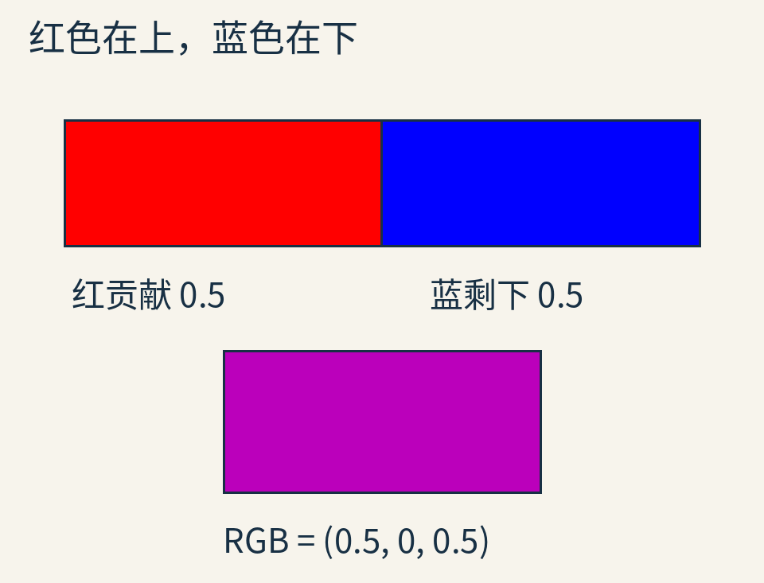

上面长条用长度表示两种贡献，不是说最终像素左半红、右半蓝。下方色块才是混合后的均匀显示结果。图中颜色先在线性光量中计算，最后转换为显示用的 sRGB。

把上层颜色叫作 `C前`，下层颜色叫作 `C后`。当下层不透明时，刚才做的事就是：

`C结果 = C前 × α前 + C后 × (1−α前)`。

每个 RGB 分量分别这样算。`1−α前` 表示上层给后面留下的份额，所以不能写成“把前后 alpha 都加进去，再除以二”。前后关系本来就不对称。

这种“前层盖在后层之上”的操作叫 **source-over**，通常简写为 over。[W3C 的合成规范](https://www.w3.org/TR/compositing-1/#simplealphacompositing)给出了颜色与 alpha 的对应规则。先把这一次代入算明白，后面的符号只是同一笔账。

## 如果下面也没有完全盖满呢？

仍然是红在蓝前，只把蓝的 alpha 也设为 0.5。

红仍贡献 0.5。蓝本来只贡献 0.5，还要经过红留下的 0.5，于是蓝只剩 `0.5×0.5=0.25`。没有被两层覆盖的份额是 `0.5×0.5=0.25`。

因此，合成结果的 alpha 是 `0.5+0.25=0.75`，而已经算入透明度的颜色贡献是 `(0.5,0,0.25)`。

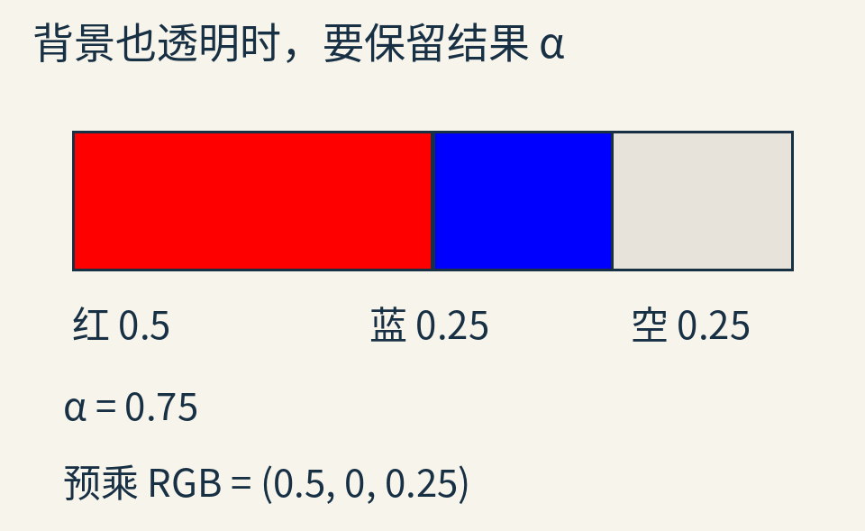

这时必须问一句：我们想存的是“颜色本身”，还是“颜色已经乘过 alpha 的贡献”？

如果存**普通颜色**，又称非预乘颜色，那么结果的 RGB 应当是：

`(0.5,0,0.25) ÷ 0.75 = (2/3,0,1/3)`，alpha 另存 0.75。

为什么要除？因为日后把它贴到另一张图上时，还会乘一次 0.75。只有先除回来，才不会把透明度重复扣掉。

另一种办法更直接：就存贡献 `(0.5,0,0.25)`，另存 alpha 0.75，并明确告诉后续步骤“RGB 已经乘过”。这就是**预乘表示**。名字中的“预”，意思是把乘 alpha 的动作提前到存储或处理之前。

我们用小写 `c` 表示贡献，大写 `C` 表示普通颜色：

`c = αC`。

于是，两层都采用预乘表示时，合成规则变成：

`c结果 = c前 + c后 × (1−α前)`；

`α结果 = α前 + α后 × (1−α前)`。

前层贡献直接拿来用，下层贡献仍要扣掉被前层挡住的部分。这两行就是整件事的核心。没有额外的“预乘颜色修正系数”。

## 那圈紫边，是在哪一步混进来的？

现在把叠图暂停，回到最小的缩放问题：原图只有两个相邻采样点。

- 左边：不透明红，普通 RGBA 为 `(1,0,0,1)`。
- 右边：透明蓝，普通 RGBA 为 `(0,0,1,0)`。

缩放时，要估计两者中间的值。最简单的线性插值，是左右各取一半。

若 RGB 与 alpha 各自直接平均，中点得到：普通颜色 `(0.5,0,0.5)`，alpha 0.5。透明蓝已经进入 RGB，组成紫色。

再把这个中点贴到白底，得到：

`(0.5,0,0.5)×0.5 + (1,1,1)×0.5 = (0.75,0.5,0.75)`。

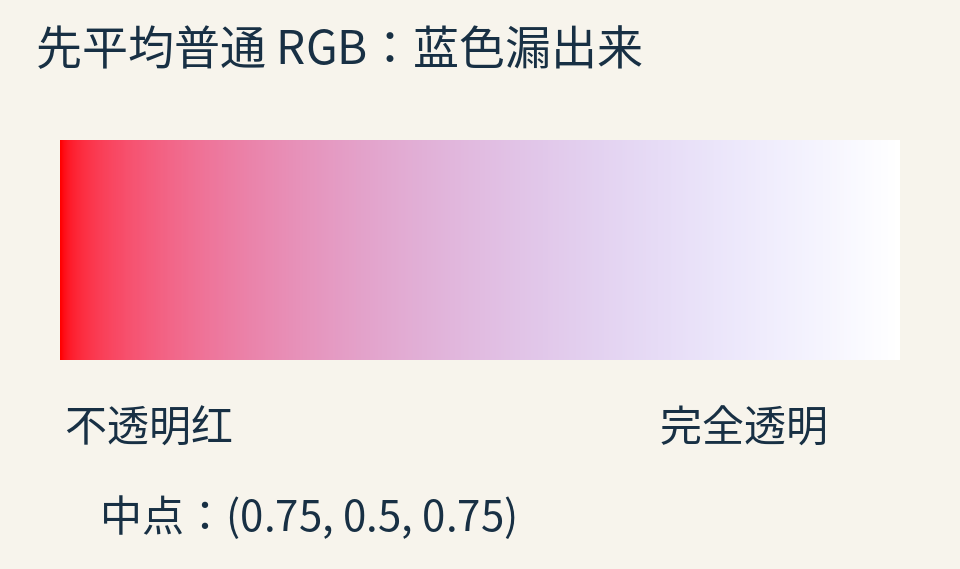

横向从左端走向右端，alpha 从 1 降到 0。图中显示的是合成到白底的真实计算结果，所以最右端应该变白；中间却带了不该来自透明区的蓝。

这不是 over 公式算错。错误发生得更早：**我们把本来没有颜色贡献的点，和有贡献的点，当成了同等有分量的颜色代表。**

## 把“贡献”先写好，答案就不同了

还是原来的两个采样点，先预乘：

- 红：`(1,0,0)×1=(1,0,0)`，alpha 1。
- 蓝：`(0,0,1)×0=(0,0,0)`，alpha 0。

现在左右平均，得到预乘颜色 `(0.5,0,0)`，alpha 0.5。

白底的预乘颜色仍是 `(1,1,1)`，因为白底不透明。使用刚才的预乘 over：

`(0.5,0,0) + (1,1,1)×0.5 = (1,0.5,0.5)`。

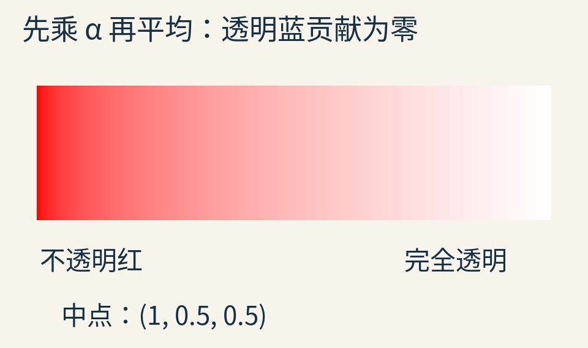

透明蓝不再影响颜色。你甚至可以把右端隐藏 RGB 改成绿色、黄色或黑色，只要 alpha 仍为零，预乘后都是零贡献。

如果必须把中点转回普通颜色，除以 alpha 即得 `(1,0,0)`，alpha 0.5。这也符合直觉：一颗正在淡出的红点，应当越来越透明，而不是在淡出过程中偷偷变紫。

这次操作也解释了一个常见误修：**先在普通 RGBA 上完成插值，再把插值结果预乘，已经晚了。** 蓝色已经进入结果，再乘一次不能把它辨认出来。要在会混合样本的步骤之前，先让输入的 RGB 表示实际贡献。

## 不只是放大：模糊也在问邻居

双线性过滤只是邻居加权的一种。模糊、旋转时重采样、生成较小分辨率图，都可能让多个采样点共同决定一个输出。

如果用相同的线性权重处理预乘 RGB 与 alpha，这些权重对两份账保持一致。颜色贡献平均多少，覆盖程度也按同一组权重平均多少。

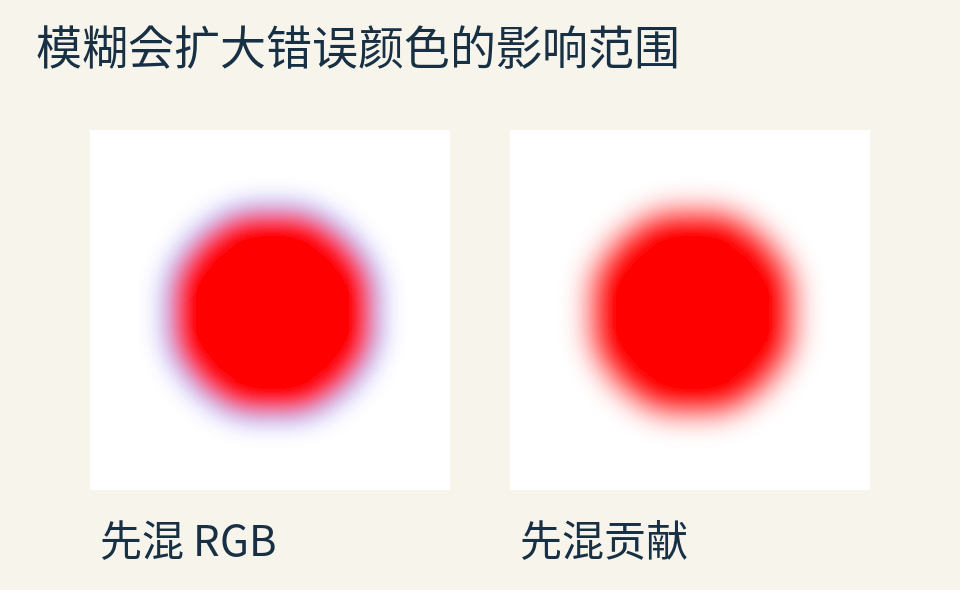

这是附带程序实际执行的高斯模糊对照，模糊半径为输出图像的 12 像素。它说明的是这份输入、这条处理路径产生的差异，不是任何软件“默认一定有紫边”的证据。

普通 RGBA 也并非不能正确过滤。你完全可以在过滤函数内部先乘 alpha，累计贡献和 alpha，最后在需要时除回来。关键不是文件名里有没有写“预乘”，而是**混合时，权重有没有尊重颜色贡献**。

同样，给透明区填上邻近实色的“扩边”在某些资源流程中很有用，却不能替代对半透明样本权重的正确处理。两个样本都半透明但透明程度不同，仍需要按贡献记账。

## 先合成哪一组，可以换；前后次序不能乱

想把红、蓝、绿三层做成一个组合。只要前后次序固定，over 具有结合性：可以先合成红和蓝，再放到绿上；也可以先合成蓝和绿，再把红放上去。

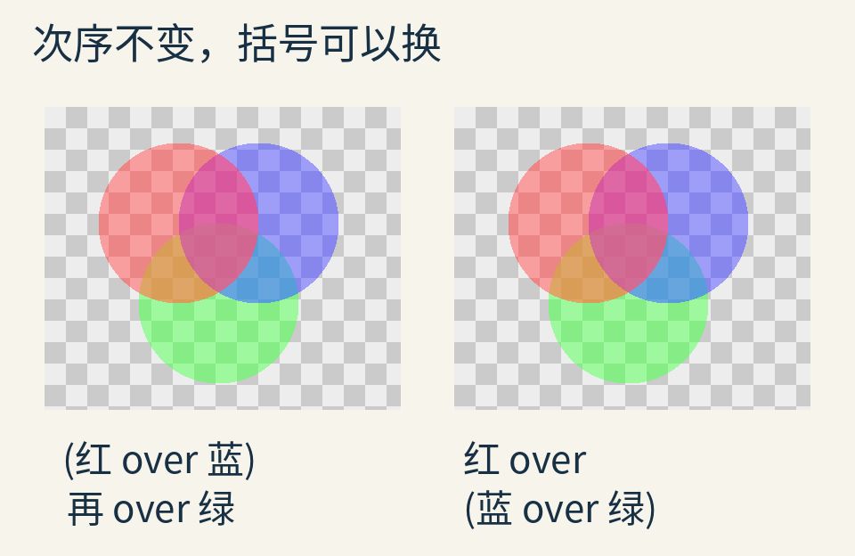

这里显示的是同一套预乘合成程序的输出。配套代码另用固定种子 24 生成了 1000 组颜色和 alpha，检查两种分组的浮点结果相符；这项有限检验支持实现检查，不代替代数证明。

证明也不神秘。把第一种分组的颜色展开：

`c红 + (1−α红)c蓝 + (1−α红)(1−α蓝)c绿`。

第二种分组展开后是同一个式子。每层都乘上前面所有层留下的份额。

可把红、蓝互换，通常就不一样了：

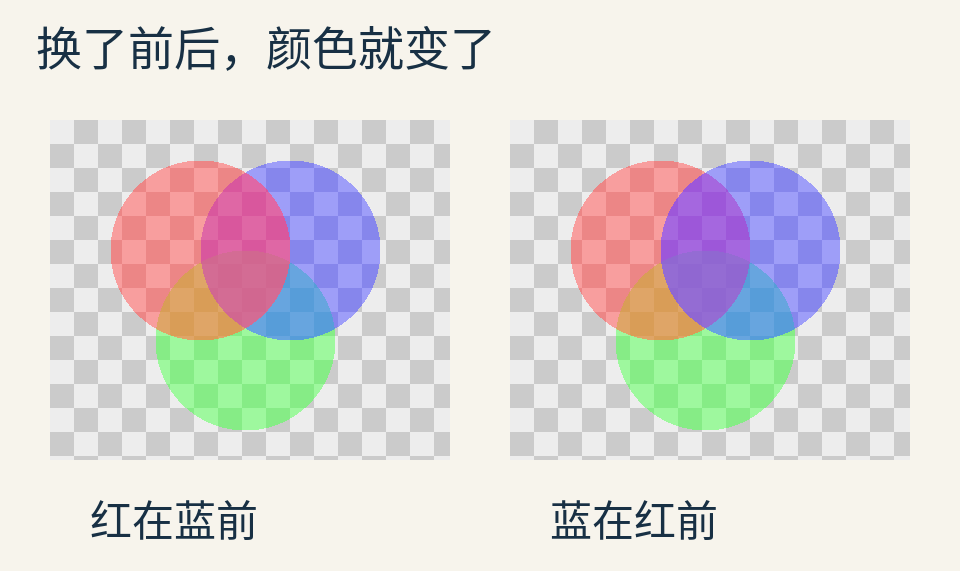

因此，“用了预乘”不等于“透明物体随便排序”。预乘解决表示与合成的一致性，不自动解决三维透明面的正确前后顺序，也不能模拟折射导致的背景位置变化。

## 还差一个条件：这些数究竟是哪种颜色数？

到现在，公式里的 RGB 都按**线性光量**解释。光量翻倍，数字也翻倍。

显示图片常用的 sRGB 编码不满足这个关系。若直接把编码值 0 与 1 平均，得到 0.5；若先平均光量，再编码到 sRGB，得到约 0.735，8 位时约为 188。两者看起来很不一样。

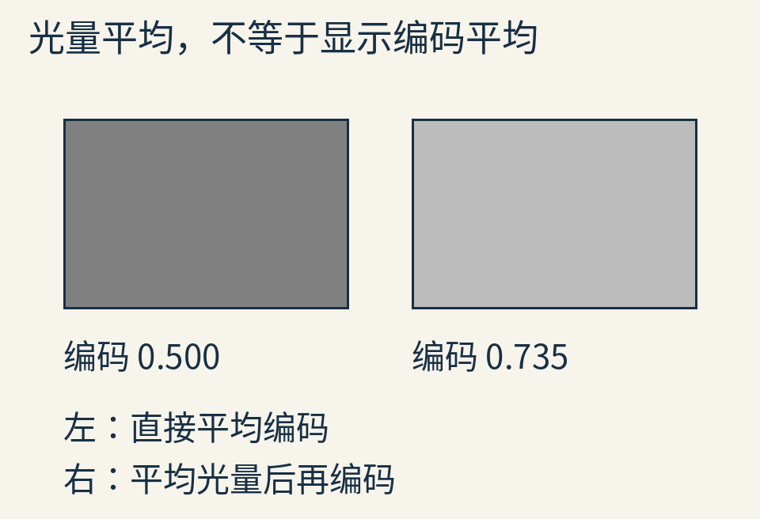

这里借黑白平均展示差别，复用的是“先问数的意义”的习惯。预乘与线性颜色空间是两件相互配合的事：不能只修了 alpha 顺序，就认为所有颜色混合都正确。

在希望物理光量合理的处理链中，一般先把颜色解码成线性值，在这里做预乘、过滤与合成，最后编码为显示值。alpha 是覆盖或不透明度数据，不应当因为旁边的 RGB 要做 sRGB 转换，也跟着套同一条颜色曲线。

具体接口可能规定不同工作空间或自动进行某些转换。不要拿本文的线性实验，断言所有网页 API 的默认行为完全相同；实际使用时须查清文件格式、纹理格式、过滤位置与混合目标。

## 预乘也会损失什么？

如果颜色用浮点数保存，预乘通常有很好的工作性质。但假如只给每个分量 8 位整数，极低 alpha 会把贡献压到很窄的范围。

例如普通红分量是 0.4，alpha 是 `1/255`。预乘后的红贡献是 `0.4/255`。若直接量化为 8 位，乘 255 得到 0.4，再取最近整数就是 0。

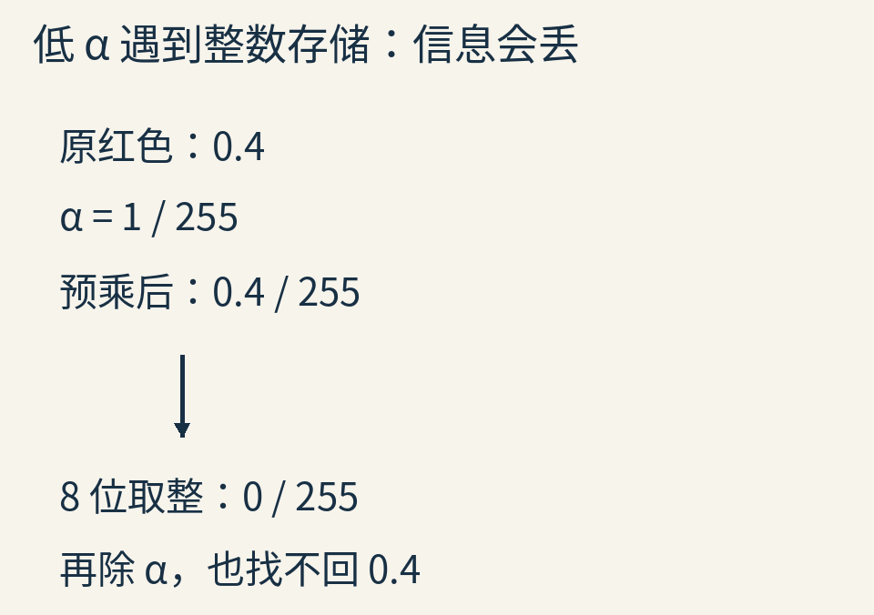

此后再除以 alpha，只能得到零，找不回原来的 0.4。这是有限精度损失，不是除法姿势不对。

alpha 恰好为零时，更不能直接做 `c/α`。普通无自发光的透明点在预乘表示中通常是零贡献；转回普通表示时，程序可以按约定写零 RGB，却不能声称恢复了原来隐藏的颜色。某些发光合成流程会使用零 alpha 但非零颜色贡献，那是额外的表示约定，不属于本文普通遮挡模型。

## 看到黑边时，先查是不是乘了两遍

另一种错误与紫边相反：输入已经预乘，可后面仍按普通颜色合成，前层又乘一次 alpha。

正确的红贡献应为 `α`，结果却变成 `α²`。在 α=0.5 处，0.5 被压成 0.25，边缘当然偏暗。

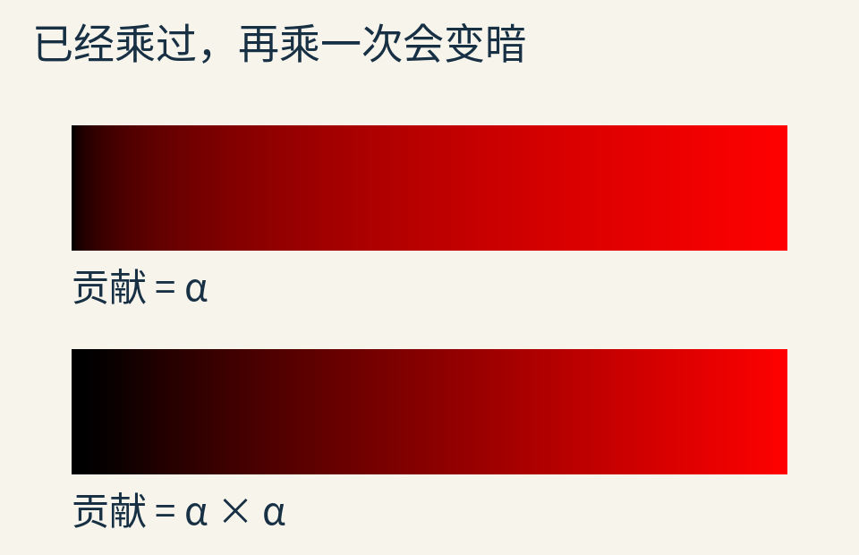

反过来，把普通 RGB 当成预乘贡献直接加进去，又可能出现过亮边缘。排查时不必先试一堆混合开关；拿一个 α=0.5 的纯红点，写出它进入每个步骤时的 RGBA，问这一处 RGB 是 1 还是 0.5，再核对后面还会不会乘。

最后，透明合成也不要和“alpha 小于某个阈值就丢弃”混在一起。后者常用于树叶孔洞等裁剪需求，是一个离散判断。

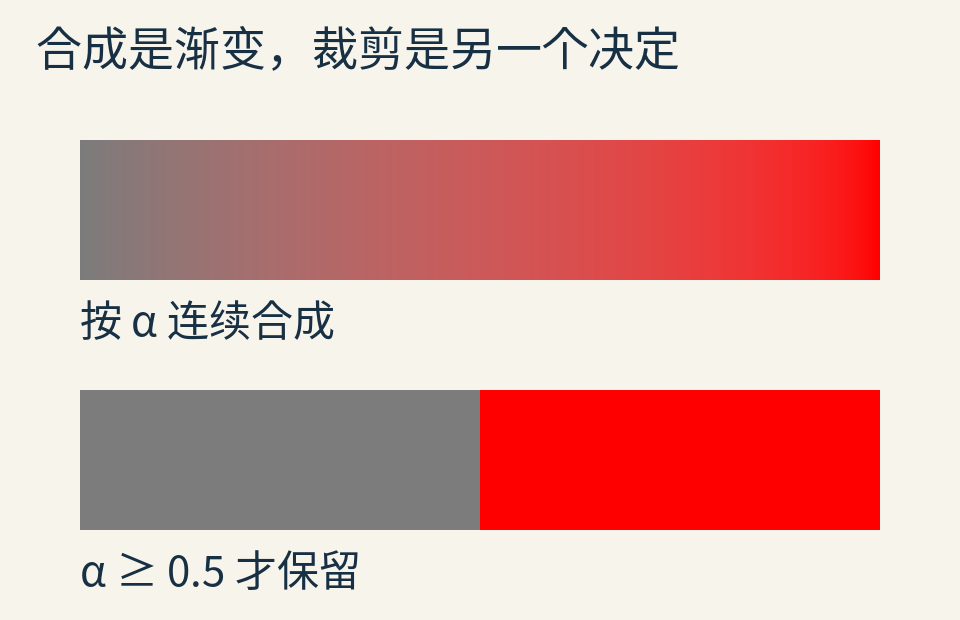

预乘不会自动替你保持裁剪后叶片的覆盖率；那涉及缩小、阈值与覆盖分布的另一套问题。

## 留给自己的最小检查图

做一张只有不透明红与透明蓝的二点图片，就足够检查这条链：输入如何表示、过滤发生在哪里、合成期待什么表示。然后把透明蓝改成透明黑，看结果是否意外变化；再加入一个半透明背景，检查输出 alpha 是否仍为 0.75。

[实验程序](examples/lab.py)会重建本文 14 幅图和[计算结果](examples/results.json)。运行环境为 Python 3.12.14、NumPy 2.3.5，绘图需要 Pillow 与 Noto Sans CJK 字体。运行 `python lab.py` 会覆盖同目录下的结果与文章配图；可先复制到自己的实验目录再改参数。

我们没有给透明区“去蓝色”，而是让一个原本就没有贡献的样本，在加权时真正保持没有贡献。那圈紫边提醒人的，也不只是图形技巧：两个都叫 RGB 的三元组，可能在记完全不同的东西。先把账目含义讲清，再让计算去混合它们。

图片均为原创教学示意或上述程序的实际输出，非历史照片、游戏截图或显卡性能测试。理论入口：[W3C 合成规范](https://www.w3.org/TR/compositing-1/#simplealphacompositing)、Alvy Ray Smith 的[1995 年技术备忘录](https://alvyray.com/Memos/CG/Microsoft/4_comp.pdf)。原创正文、原创图及数据采用 [CC BY 4.0](https://creativecommons.org/licenses/by/4.0/)，示例代码采用 [MIT](examples/LICENSE.txt)；更多来源范围见 [sources.md](sources.md)。
