# 三份读数互相打架，怎样找出最合适的一条直线？把 QR 分解拆成一次投影

一次小实验，在时刻0、1、2记录到三个读数：1、2、2。我们想用一条直线预测读数随时间怎样变化。

前两个点告诉你：每过一单位时间增加1。后两个点却告诉你：没有增加。不存在一条直线能同时穿过三点。

这不一定意味着数据毫无价值。也许存在测量噪声，也许直线只是一个近似模型。我们可以换成一个明确的问题：**在所有直线里，哪一条与这三个读数的总平方误差最小？**

QR分解是解决这类问题的一条常用路线。听起来像要先吞下一整章矩阵，我们却可以从三个数开始：把“两个有重叠作用的调节方向”，换成“两条互不干扰的方向”。

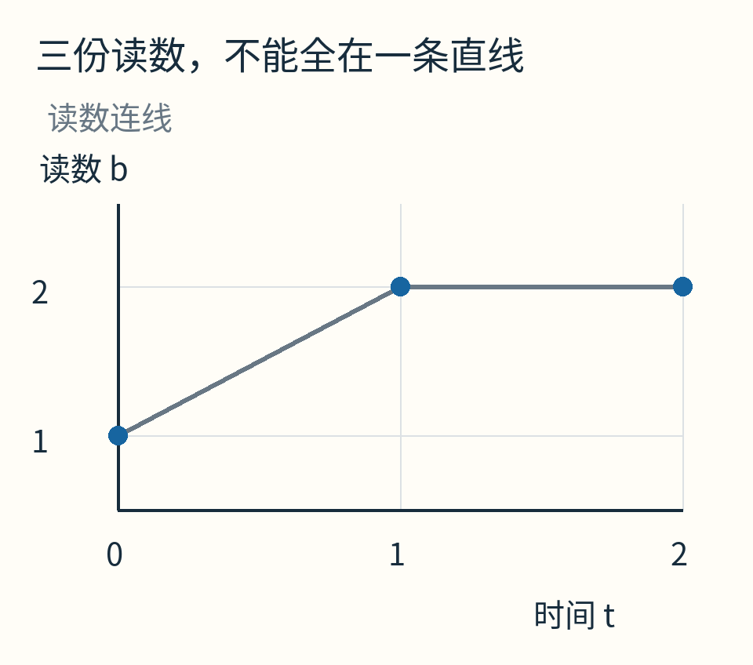

灰线只是把输入点按时间连起，帮助看出不共线；不是假定真实过程恰好折了一次弯。数据是自选教学例，没有声称做过实际测量。

## 先说清要调的两个旋钮

把直线写成 `预测值=c+mt`。c是时间为0时的预测值，m是每单位时间的增加量。

给定c、m，三次预测分别为：

`c，c+m，c+2m`。

它们与实际读数1、2、2的差，平方后相加，就是我们的分数：

`J(c,m)=(1−c)²+(2−c−m)²+(2−c−2m)²`。

这叫最小二乘问题。“二乘”指平方，不是测两次。平方让正负误差不能互相抵消，也会让大误差付出更重的代价。是否应该用这种代价，取决于任务；今天先把它作为明写的选择。

例如直线y=1+t，三次预测1、2、3，平方误差和为1。水平线y=5/3，三次预测都为5/3，平方误差和为2/3。它已经更好，但还可以继续改善。

我们不靠不停试c、m的网格来找答案。先看这两个旋钮各自改变什么。

## 一列全是1，一列记录时间

把三次预测排成竖列：

`(c，c+m，c+2m) = c(1，1，1)+m(0，1，2)`。

第一列a₁=(1,1,1)说明：c每增加1，三次预测都增加1。第二列a₂=(0,1,2)说明：m每增加1，第一次不变，第二次加1，第三次加2。

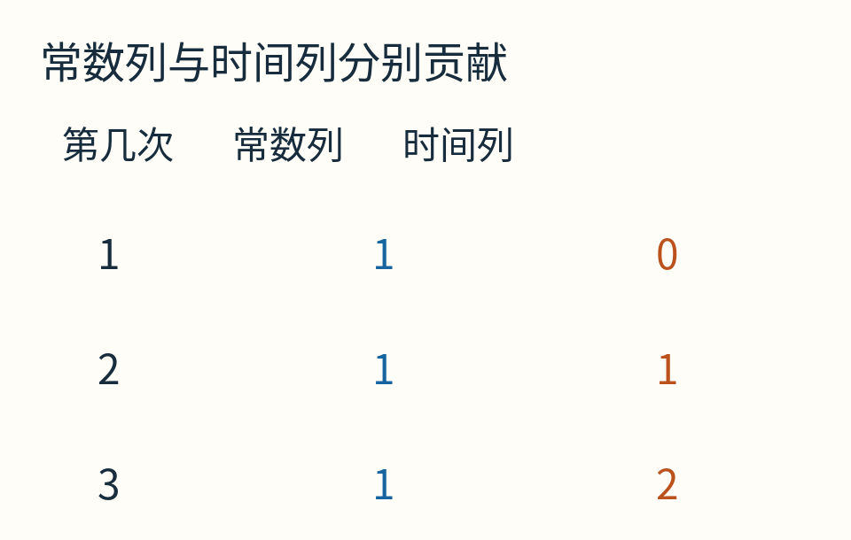

图里每行对应一次读数，不是三个物体的空间坐标。两列共同描述所有能由这条直线模型产生的三数列表。

把两列并排写成一张表，就是矩阵A：

```text
A = [1  0]
    [1  1]
    [1  2]
```

A乘以系数列(c,m)，意思就是“c倍第一列，加m倍第二列”。我们要找离b=(1,2,2)最近的这种组合；距离平方恰好等于刚才的J。

为什么两个旋钮会互相牵连？因为a₁与a₂并不垂直。把c调大时，可能抵消m造成的某些变化；把m改掉，又会影响刚才对c的判断。QR先换一套坐标，让这件事简单一点。

## 先在纸上练一次“拿掉重复方向”

暂时离开三次读数，用一个独立二维小例子练投影。已知方向是(1,1)，另有向量(0,2)。向量在这里就是一组变化量：第一分量变多少、第二分量变多少。

将(0,2)垂直投到(1,1)那条直线上，落点为(1,1)。于是它被拆成：

`(0,2)=(1,1)+(−1,1)`。

前一段沿已有方向，后一段与已有方向垂直。把前一段拿走，就得到不重复的方向。

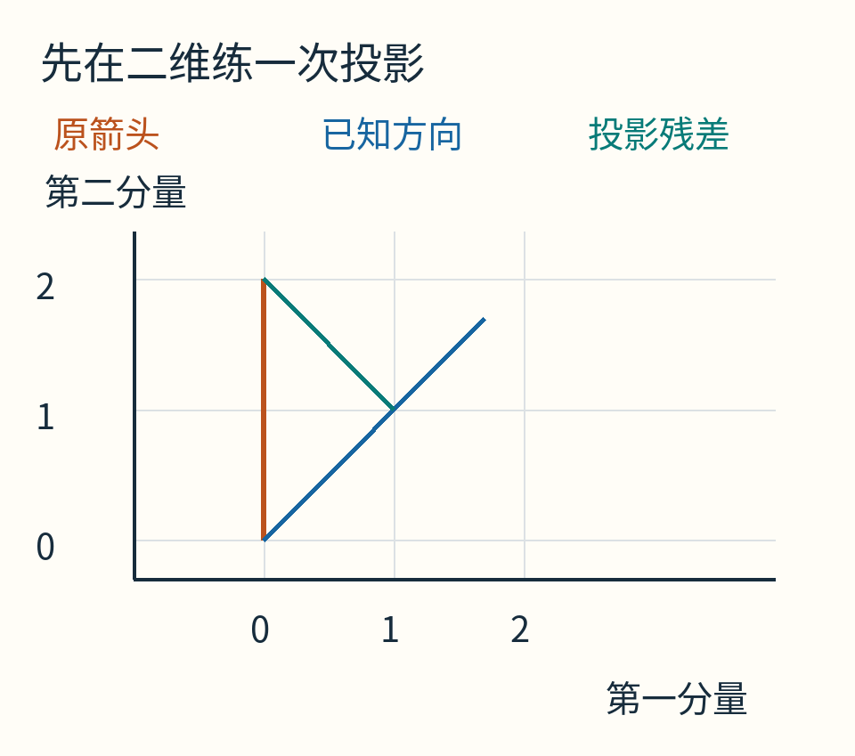

橙色是原向量，蓝色是已有方向；青色从投影点(1,1)接到原向量端点(0,2)。这里的数字仅为投影练习，不是把三次读数偷换成两次。

怎么计算“垂直”而不拿量角器？用**点积**：两组数对应相乘后相加。比如 `(1,1)·(−1,1)=−1+1=0`。在普通欧氏距离下，非零向量点积为0就互相垂直。

长度也用同一套规则：向量与自身点积，再开平方。于是(1,1)长度√2，除以√2就得到长度为1的方向q。

若q长度为1，任意向量a沿q的投影读数是q·a，投影向量则是 `(q·a)q`。之所以这样选，是为了让剩余向量垂直：

`q·[a−(q·a)q] = q·a−(q·a)(q·q)=0`，因为q·q=1。

这条等式同时给出规则和理由，不必先背一个投影公式再猜它怎么来的。

## 回到三次读数，真的做一次正交化

第一列a₁=(1,1,1)，长度√3，所以：

`q₁=(1,1,1)/√3`。

第二列a₂=(0,1,2)沿q₁的读数为：

`q₁·a₂=(0+1+2)/√3=√3`。

乘回单位方向，投影向量是 `√3q₁=(1,1,1)`。从a₂中减去它：

`u₂=(0,1,2)−(1,1,1)=(−1,0,1)`。

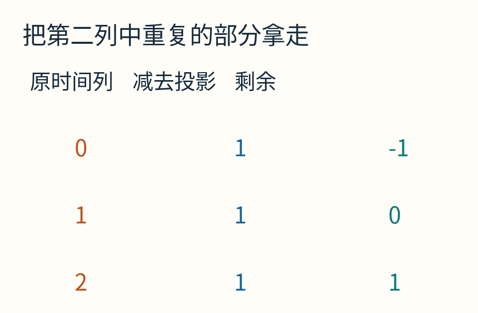

逐行读：0−1=−1，1−1=0，2−1=1。整个操作始终发生在同一份三分量数据里。

剩余向量的长度为√2，归一化得到：

`q₂=(−1,0,1)/√2`。

核对点积：q₁·q₂=(-1+0+1)/√6=0。两条新方向都长1，而且互相垂直，称为**正交归一**。

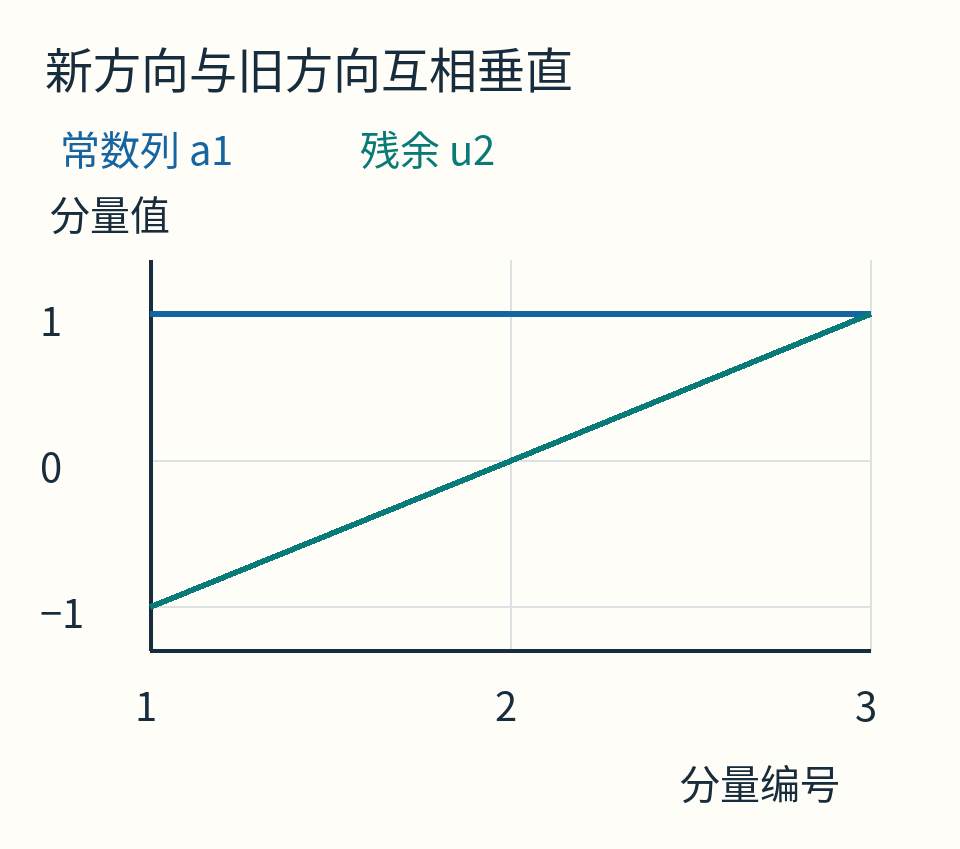

横轴是分量编号，蓝线对应原常数列a₁=(1,1,1)，青线对应残余u₂=(−1,0,1)。图中折线夹角不是三维向量夹角；垂直性由三个乘积相加为0来判断。

这个“先投影、减去、再归一化”的过程叫Gram–Schmidt正交化。我们用它把QR的结构走清楚；后面还会提醒，它并不自动等于大型数值库采用的稳定实现。

## Q 和 R 到底各自记了什么？

将q₁、q₂并排，就得到Q。它有三行、两列，负责提供新的两条正交单位方向。这是经济型或薄QR；有些教材把Q补成三行三列的完整正交矩阵，两种记法不要混在一起。

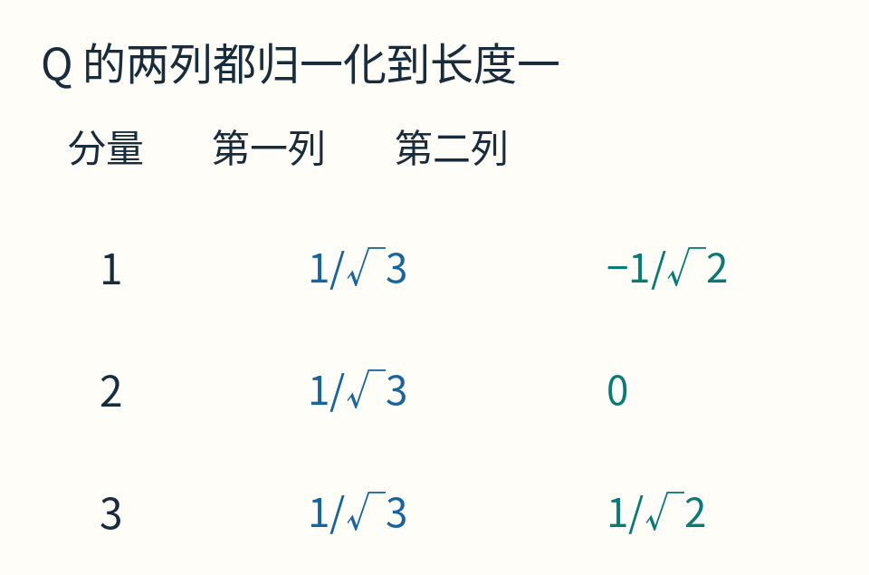

而旧方向怎样由新方向拼回去？

`a₁=√3q₁+0q₂`

`a₂=√3q₁+√2q₂`。

把这些系数排成R：

```text
R = [√3  √3]
    [ 0  √2]
```

于是 `A=QR`。Q是新的方向，R是旧方向在新坐标中的说明书。

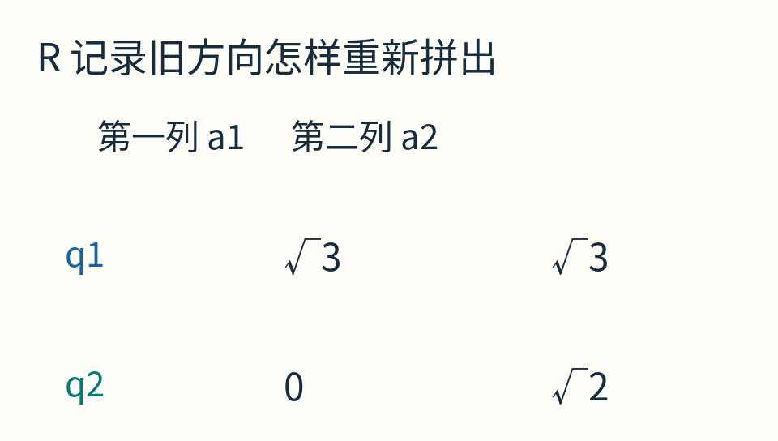

为什么左下角恰好是0？第一条方向早已由q₁完全表示，后建的q₂不必再参与。若有更多列，按同样顺序去掉前面已有的方向，会得到上三角结构：主对角线下方都是0。

这不是要求原始数据中恰好有一片零，而是我们按顺序换坐标时制造的计算便利。

## 现在把目标读数也投过去

b=(1,2,2)。在q₁上的投影读数：

`q₁·b=(1+2+2)/√3=5/√3`。

在q₂上的读数：

`q₂·b=(−1+0+2)/√2=1/√2`。

把这两项排起来就是 `Qᵀb`。上标T表示转置：把Q的列换成行，使矩阵乘法逐行完成这两次点积。

如果模型预测值要尽量接近b，它在这两条允许方向上的读数，应该与b相同。因此只需解：

`R(c,m) = (5/√3，1/√2)`。

从最下面一行开始：`√2m=1/√2`，所以m=1/2。

再回到上面：`√3c+√3m=5/√3`。除以√3，得到c+m=5/3，代m=1/2，得到c=7/6。

这种从下往上解上三角方程的方法叫**回代**。原来三条无法同时满足的读数，被分成了两条可解的系数方程，以及一部分模型根本表示不了的残余。

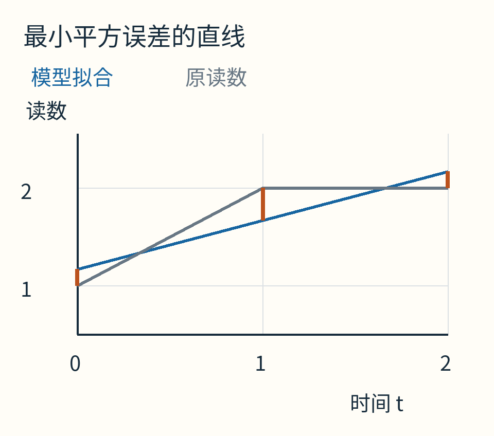

蓝线是 `y=7/6+t/2`，三次预测为7/6、5/3、13/6。橙色短线标出读数与预测的差；这是按读数方向的误差，不是点到直线的垂直几何距离。

## 为什么这就是最小，而不只是某个答案？

残差r定义为实际减预测：

`r=b−A(c,m)=(-1/6，1/3，-1/6)`。

它与常数列点积为 `−1/6+1/3−1/6=0`；与时间列点积为 `0×(−1/6)+1×(1/3)+2×(−1/6)=0`。

因此r垂直于模型能生成的所有方向组合。你把系数再改一点，预测值只能在模型方向里移动，无法顺着残差方向把它消掉。

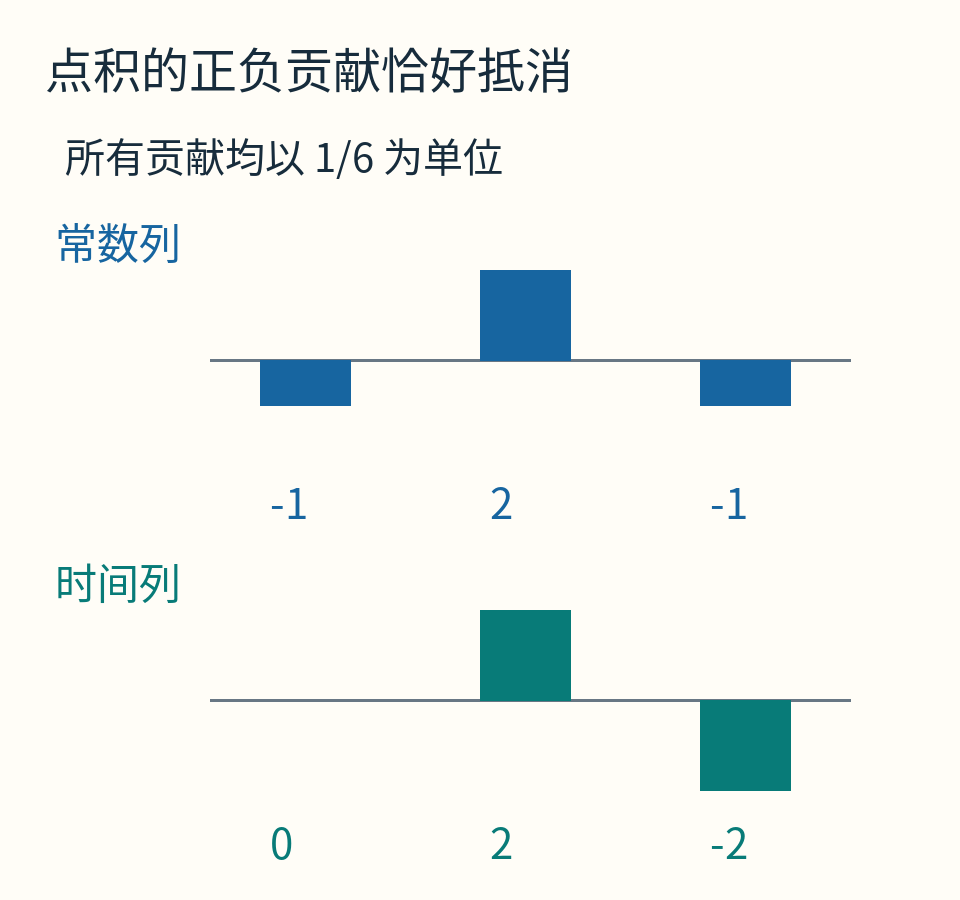

每根柱表示一个对应分量的乘积，统一以1/6为单位；向上为正，向下为负。两排贡献分别是(−1,2,−1)与(0,2,−2)，各自加起来都为0。

更精确地，设当前预测为p，另一个候选预测为p+d。d仍在模型方向内，所以r·d=0。新误差是r−d，平方长度为：

`‖r−d‖²=‖r‖²−2r·d+‖d‖²=‖r‖²+‖d‖²`。

最后一项不可能为负，故任何别的预测都不会更好。这就是三维版的勾股关系，也是最小二乘的几何理由。

本例最小平方误差和为 `1/36+1/9+1/36=1/6`，比前面试过的1和2/3都小。

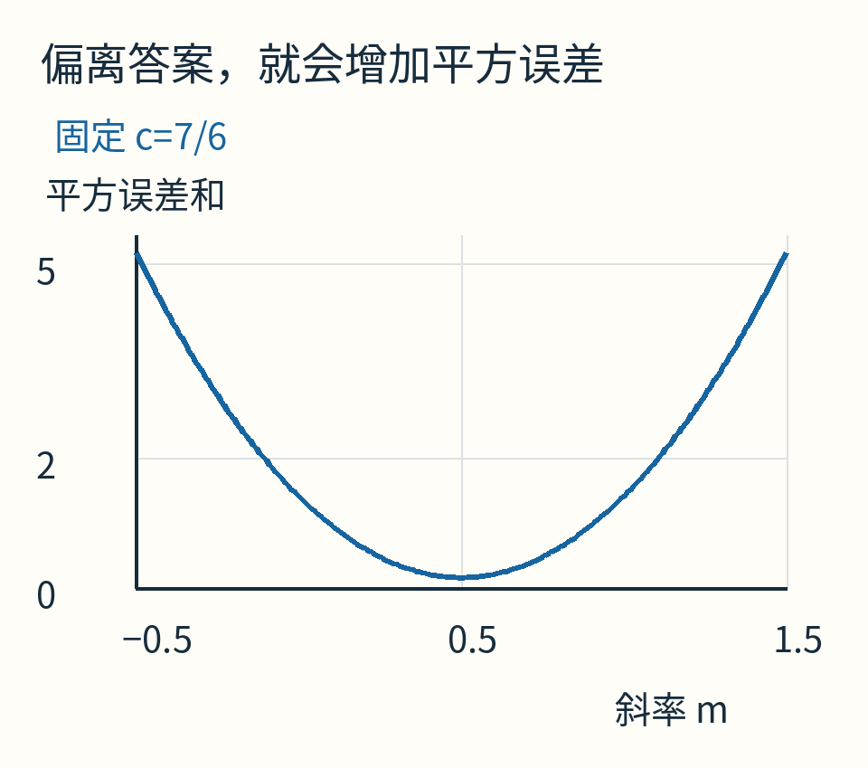

这只是目标函数的一条切片：截距固定为7/6，改变斜率。整个最优性的证明来自上面的正交分解，不只来自这条曲线看起来有个谷底。

## 正规方程也能算，为什么还需要 QR？

残差垂直于A的每一列，可以写成 `Aᵀ(b−Ax)=0`，整理为 `AᵀAx=Aᵀb`。这里x指系数列，不再是前面某个二维坐标；为免混淆，也可以始终写成(c,m)。这就是正规方程。

本例用它很容易求解，但在浮点计算里，先形成AᵀA可能放大数值困难。对满列秩A，2范数条件数满足 `κ(AᵀA)=κ(A)²`。条件数描述输入小变化可能使解变化多大；平方会让本就敏感的问题更难处理。

QR通过正交变换处理A，避免先形成这个平方条件数的矩阵。[LAPACK作者文档](https://netlib.org/lapack/lug/node40.html)将它作为满列秩线性最小二乘的基本分解路线，并使用正交反射构造。

不过QR也不是恢复丢失信息的魔法。若两列本来几乎一样，数据就很难分辨这两个旋钮各出了多少力。

## 两个旋钮几乎同效，谁都没法凭空区分

看一套独立的二维例子：a₁=(1,0)，a₂=(1,ε)，ε很小。改变第一系数和第二系数，主要都影响第一分量；第二分量只留下极小差别。

若ε=0，两个方向完全相同，模型只知道系数之和，不能唯一拆出各自值。若ε非常小，虽然数学上仍可区分，读数的细小误差却可能让系数改变很多。

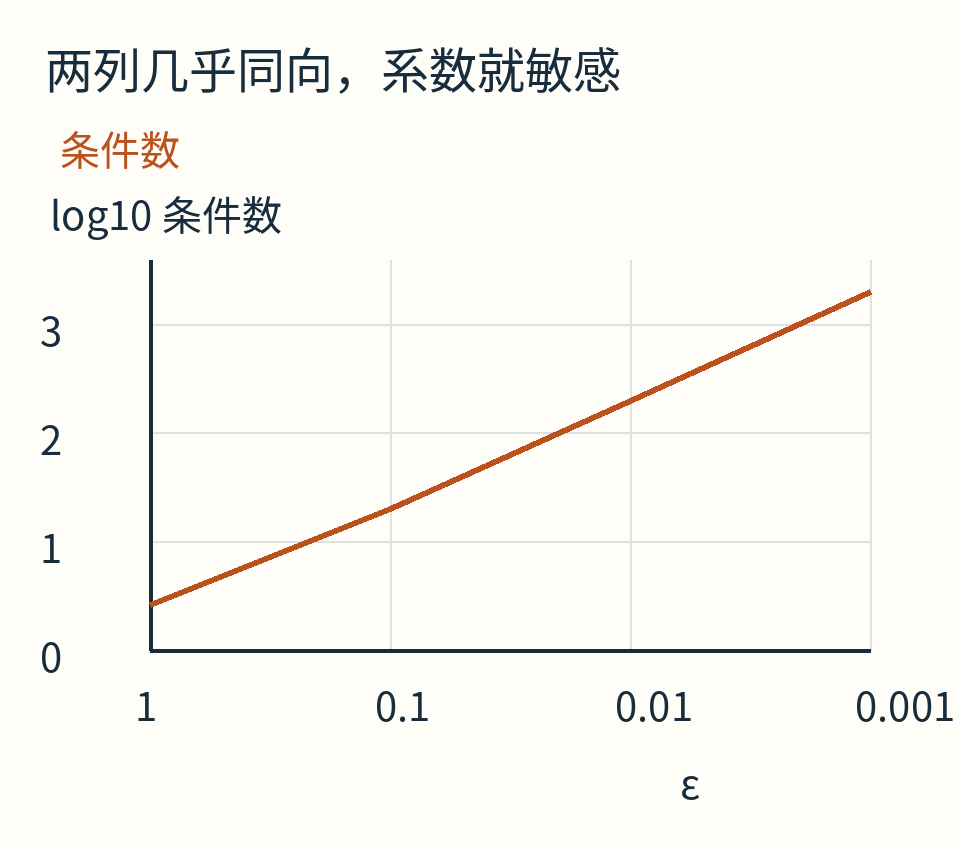

横轴按四个ε取值依次排放，并非线性ε坐标；纵轴是条件数的十进对数。数据由NumPy实际计算，不是固定系数预测精度的实验。

在Gram–Schmidt步骤里，这种情况表现为：从第二列减去投影后，剩余向量非常短。拿它归一化，会把舍入误差放大。如果剩余恰好为0，不能继续除以长度；那说明没有新的独立方向。

[带列选主元的QR文档](https://netlib.org/lapack/lug/node42.html)讨论了秩不足或秩可疑时的处理。列选主元会调整处理顺序，帮助识别数值上的独立方向；选择有效秩还需要结合尺度和阈值，不能把任意小数一概认成零。

## 实际库常用“反射”，原理仍是换成好算的坐标

还有一种把分量消成0的办法：镜面反射。举一个单独的二维例子，向量(3,4)长度为5。选择一条适当镜面，可以把它反射到(5,0)，长度保持，第二分量变为0。

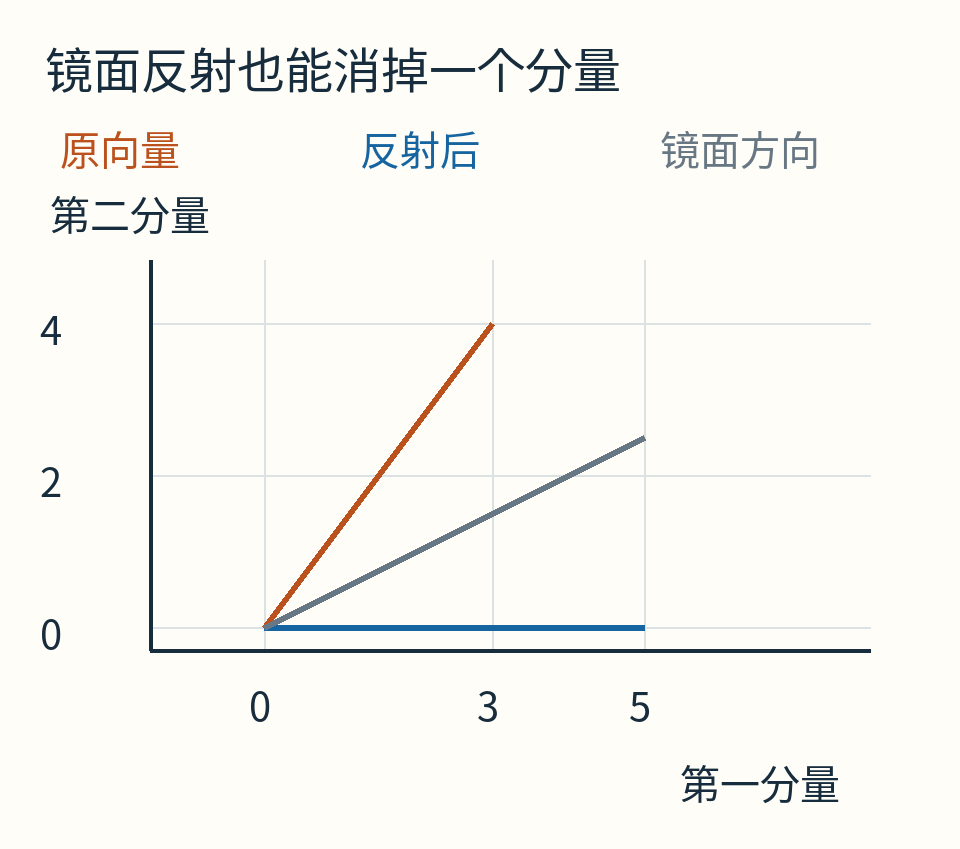

灰线是镜面方向；橙色向量(3,4)反射成蓝色(5,0)。两轴采用相同数值尺度，方向与长度关系也能直接从图上看。

对应矩阵是：

```text
H = [0.6   0.8]
    [0.8  −0.6]
```

乘(3,4)得到 `(1.8+3.2，2.4−2.4)=(5,0)`。它不改变向量长度，也保持点积。更高维中也能造类似反射，一列一列消掉对角线以下的分量，得到R，同时隐式保存Q。这称为Householder方法。

这段不是要让你立即实现一个数值库，而是避免把教学中的一次手算，误认成生产环境唯一采用的算法。Gram–Schmidt把“拿掉重复方向”讲得很直观；Householder等方法更适合许多数值实现。

## 该拿它回答什么问题？

QR适合这样一类任务：模型对未知系数是线性的，观测比系数多，方程可能不相容，想求明确的最小平方误差解。直线、给定次数多项式、某些线性组合模型，都能写成列的组合。

它不会替你决定模型是否合理，也不会自动处理异常值。若第三个读数是输入错误，QR会认真为这个错误寻找折中；若时间轴本身也有测量误差，当前只惩罚读数方向的模型可能不合适。给不同读数不同可信度，也需要相应的加权最小二乘问题。

[随文程序](examples/lab.py)实际核对QᵀQ、QR=A、最终系数、残差正交性与平方误差和；[运行说明](examples/README.md)记录NumPy版本和输入范围。

把这三个读数再看一遍：1、2、2没有被改成一份“自洽数据”。我们只是选了一种明说的误差标准，找出模型能解释的那部分，并把剩下的差异留下来。QR最有用的地方，正是让“可以由两个旋钮调整的东西”与“这两个旋钮怎么拧也消不掉的东西”，各自有了清楚的位置。

原创正文与图解采用CC BY 4.0；AI辅助了组织讲解与计算绘图代码。[来源与图片身份](sources.md)。
