# 扩散明明会抹平差别，为什么两种浓度还能长出斑纹？亲手算一步反应扩散

这张像迷宫的图，没有预先画好的路线，也没有“遇到这里就拐弯”的命令。程序只在一张方格纸上保存两种浓度，每一小步让它们和邻居交换一点，同时按局部规则反应。

起初只有中央一小块区域不同。重复计算后，斑纹向外扩展，逐渐占据画面。

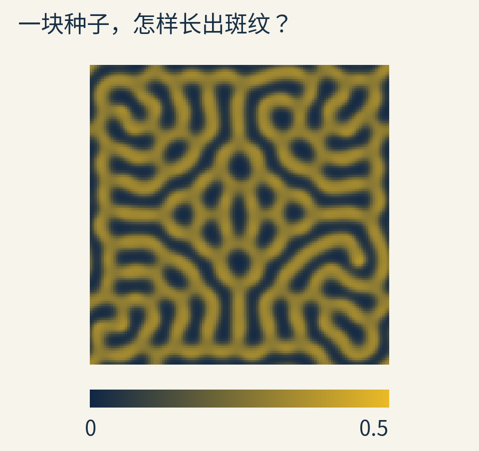

这是本文程序的数值输出，不是显微镜照片，也不是动物皮肤。深蓝到黄色表示 V 从 0 到 0.5，整篇主时间序列共用这个色标。底层计算网格为 128×128，放大时保留了网格像素，没有凭空增加细节。

这类方法叫**反应扩散**：反应改变某个地方的量，扩散让相邻地方交换量。我们要回答一个看似矛盾的问题：扩散通常把差别抹平，为什么加上局部反应后，差别反而可能持续发展成结构？

## 每格先放两个数，不急着写方程

把平面划成方格，每格保存两个非负浓度 U 与 V。它们可以理解为两种物质的量的浓淡程度；在本文中，它们是经过缩放的无量纲模型变量，没有指定某两种实际化学药品。

U 多，表示这一格还存着较多可消耗的材料；V 多，表示这一格有较多参与局部转化的成分。两者都在格子间扩散，但速度不必相同。

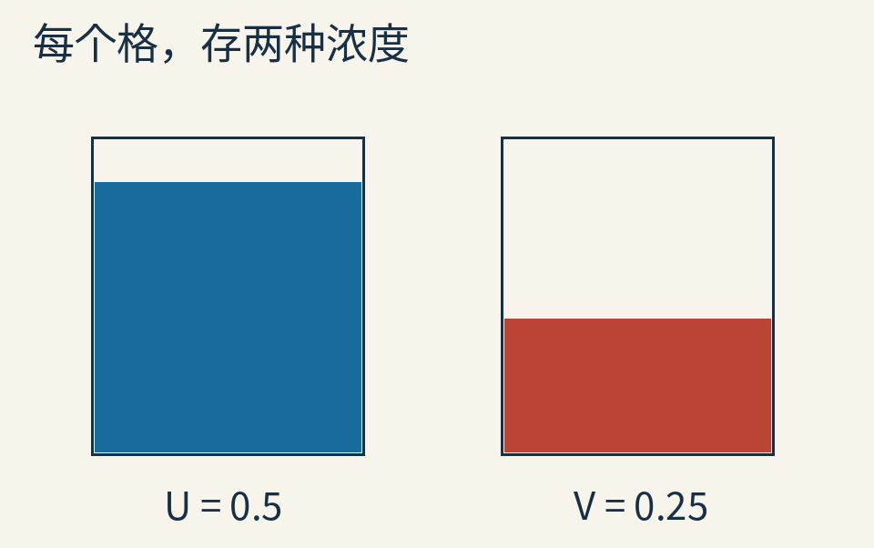

两个容器只是数值示意，不是说每格里真的分成两只杯子。本篇的工作是更新两张数字表，而不是移动一张画好的纹理。

我们采用 **Gray–Scott 模型**。John E. Pearson 的[原始研究论文](https://arxiv.org/abs/patt-sol/9304003)讨论了这种简单模型产生的多类复杂时空图案。下文用更小的自设网格与公开代码建立直觉，不把我们的运行参数、时间或图案冒充论文原实验。

## 第一笔账：V 参与了一次会增加 V 的反应

模型用下面的记法表示一个局部转化：

`U + 2V → 3V`。

左边一份 U、两份 V，右边三份 V。净变化是：U 少一份，V 多一份。V 参与了一个促进自身增加的过程，因此这里包含一种局部正反馈。

这只是模型中的反应关系，不是“随便找两种药品就能照着做”的实验配方。

反应速率采用 `U×V²`。V² 表示两个 V 因子相乘；完整物理推导还涉及模型尺度与反应动力学假设，这里把它作为明确的局部规则来计算。

仍用 U=0.5、V=0.25：

`U×V²=0.5×0.25×0.25=0.03125`。

如果这一小步的时间长度是 1，U 因此减少 0.03125，V 增加 0.03125。

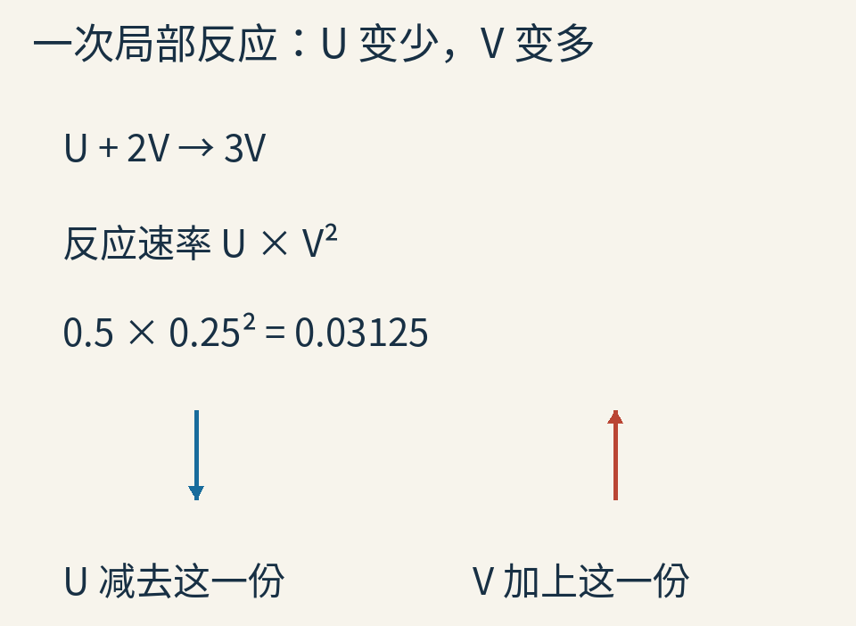

假如没有别的作用，某处 V 稍多，就可能让这项转化更快。但材料 U 会被消耗，V 也不是永远积累下去。要出现持续结构，必须把其他几笔账一起补上。

## 第二笔账：补给与移出，让系统不是一锅封死的汤

模型引入两个参数 F 和 k。

F 控制一种交换过程：把 U 朝浓度 1 的补给状态拉近，同时移出一部分现有成分。于是 U 的净补给项是 `F(1−U)`。V 没有从这个过程得到同样补给，却会按 `FV` 被移出。

V 还会以速率 k 转化成不继续参与反应的产物。合起来，V 的移出项是 `(F+k)V`。

取 F=0.04、k=0.06，仍用当前 U=0.5、V=0.25：

- U 补进 `0.04×(1−0.5)=0.02`。
- V 移出 `(0.04+0.06)×0.25=0.025`。

这说明只说“F 是喂养，k 是杀死”还不够精确。F 不只影响 U 的补入，也出现在 V 的移出项里。改 F 时，两笔账都会变。

[MIT 的 Gray–Scott 研究页面](https://groups.csail.mit.edu/mac/projects/amorphous/GrayScott/)也明确区分了补给、排出与 V 转成产物的作用。我们使用的是同步方格有限差分模型，不是该页面展示的异步不规则位置模拟器。

## 第三笔账：扩散，不是朝随便一个方向搬

设当前格 V=0.25，四个直接相邻格的 V 都是 0.2。中间比邻居浓，它应该向外失去一些 V。

在格宽为 1 的教学离散式里，把四个邻居相加，再减去自己四次：

`L(V)=V左+V右+V上+V下−4V中`。

本例就是 `0.2+0.2+0.2+0.2−4×0.25=−0.2`。

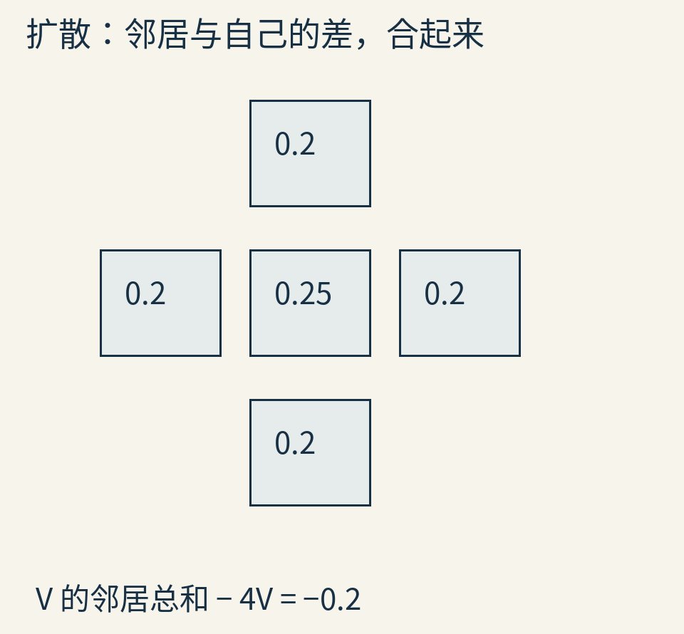

这个差分常用来近似**拉普拉斯算子**。名称可以以后再熟悉，先看它在做什么：比较一个地方与周围，周围整体更浓就增加，周围整体更淡就减少。若所有地方完全一样，结果为零。

再乘上扩散系数 Dᵥ=0.08，本小步 V 的扩散改变量是 `0.08×(−0.2)=−0.016`。

U 有自己的一份相同结构的账，系数 Dᵤ=0.16。为了让本次心算简洁，假定这一格及四邻居的 U 都是 0.5，于是 L(U)=0，本小步 U 没有净扩散改变量。

注意，这是一组专为手算选的局部数值。稍后的完整模拟在中央区域加入了微小噪声，邻居不会恰好全等于这里的数字；完整模拟仍使用完全相同的更新规则。

## 三笔账放到一起，算出下一步

本篇采用最直接的**显式欧拉更新**：先用当前状态算出变化率，乘一小段时间 Δt，再加到旧值上。

`U新 = U旧 + Δt × [DᵤL(U旧) − U旧V旧² + F(1−U旧)]`。

`V新 = V旧 + Δt × [DᵥL(V旧) + U旧V旧² − (F+k)V旧]`。

所有右边都读旧状态，下面会解释原因。现在 Δt=1，把已经算好的数填回去：

`U新=0.5 + 0 − 0.03125 + 0.02 = 0.48875`；

`V新=0.25 − 0.016 + 0.03125 − 0.025 = 0.24025`。

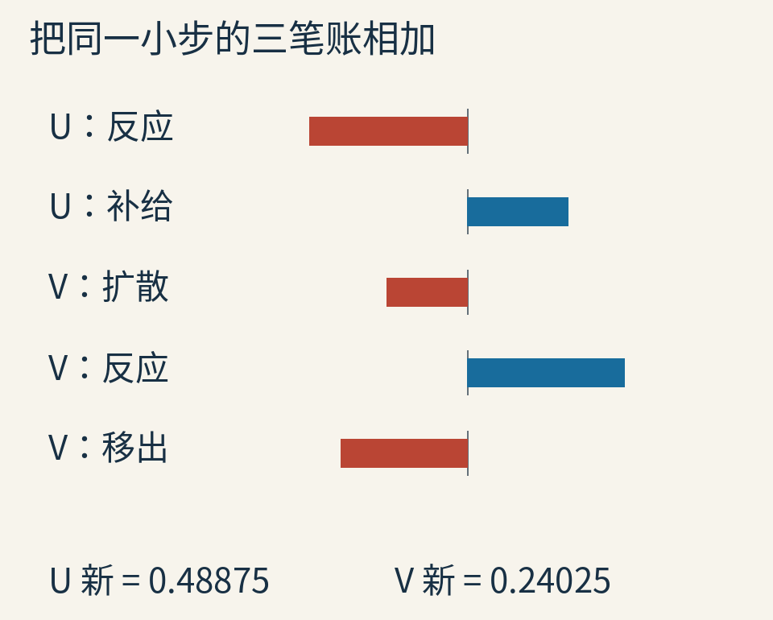

蓝条向右表示增加，红条向左表示减少，所有条使用相同的长度比例。U 的扩散项为零，未画成有长度的条。这里只展示变化量，不是浓度总量柱。

V 明明有自增反应，这一步却变少了。因为另外两项加起来更强。这提醒我们：一句“正反馈会放大差异”还不是完整解释；要看某一时刻、某一个位置，几种作用的净结果。

## 一边写新值、一边拿新值算邻居，会怎样？

假设从左到右更新一排格子。第一个已经改成新值，第二个却还用着旧值。如果第三个读取“当前数组”，它会遇到新旧混杂的数据。

这与“同一时刻的所有格一起迈一小步”不是同一个算法。

为了看清，暂时把反应与第二种浓度拿掉，只看一维周期扩散，初始四格为 `[0,1,0,0]`，扩散权重为 0.2。

同步更新得到 `[0.2,0.6,0.2,0]`。若直接在原数组上从左到右修改，本文实际执行得到 `[0.2,0.64,0.128,0.0656]`。

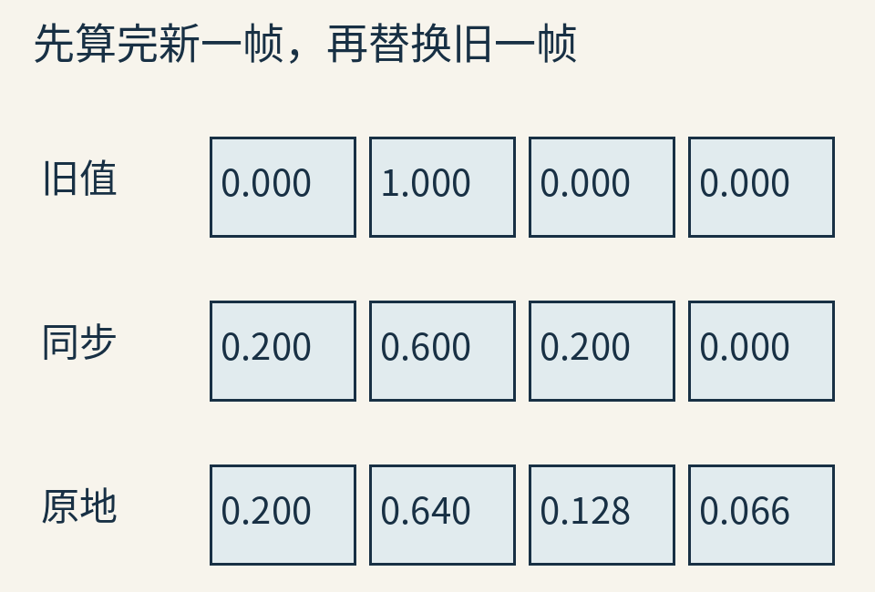

图中为显示而保留三位小数，精确运行值见结果文件。这个小例子只检查更新顺序，不是完整 Gray–Scott 图案的一帧。

因此，主程序先从旧 U、旧 V 同时计算反应项与两个差分，再生成新 U、新 V，最后一起替换。GPU 上常用两套纹理交替读写，也是为了保住相同的时间层次。异步方法当然也可以设计，但要有与之匹配的数值或守恒规则，不能把无意混读当成已经正确实现了异步模型。

## 现在放下计算器，看同一个种子慢慢发展

完整模拟使用 128×128 个格，格宽 1；Dᵤ=0.16、Dᵥ=0.08、F=0.04、k=0.06、Δt=1。这里的长度、时间和浓度都是模型单位，不是现实里的毫米、秒和摩尔浓度。

初始时，绝大多数地方 U=1、V=0。中央 20×20 区域改成 U≈0.5、V≈0.25，分别加入幅度不超过 0.02 的均匀随机扰动。随机种子固定为 24，扰动只在开始时生成，之后每一步都由确定规则更新。

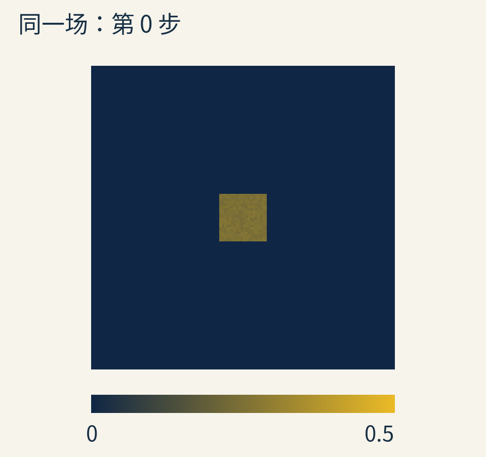

这里能看见最初的形状是方块。后来的斑纹不是每一帧重新随机画出来的；它们继承此前状态。

到第 250 步，反应和扩散已经改变了中央区域。观察外缘：它不只是把原方块均匀涂糊，还出现了浓度集中的轮廓与内部差别。

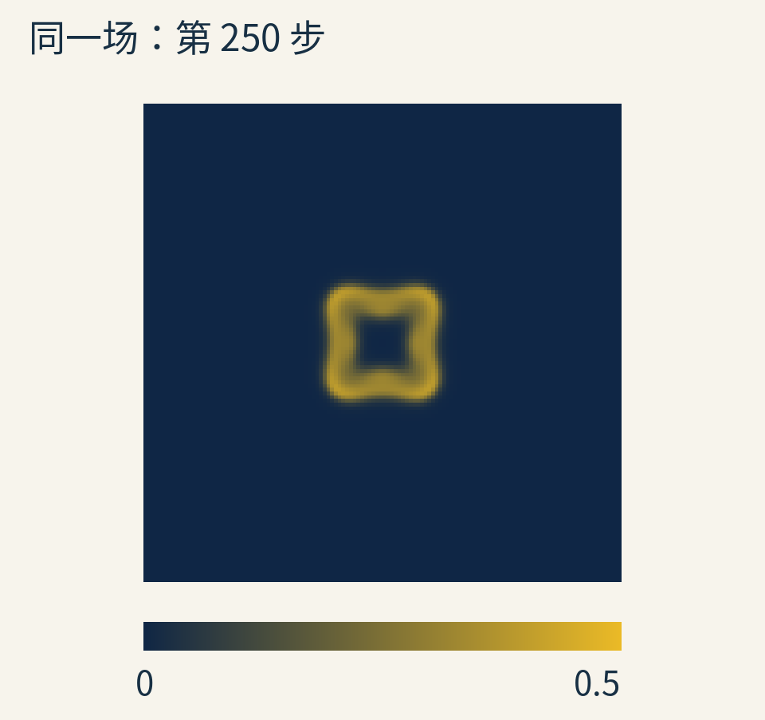

V 较多的位置会更快消耗 U；邻近 U 较多的位置又能经扩散补充。两个场改变彼此的增长条件，局部增加不再只是一次性放大一个数。

到第 1000 步，受到影响的范围更大，内部结构也继续分化。

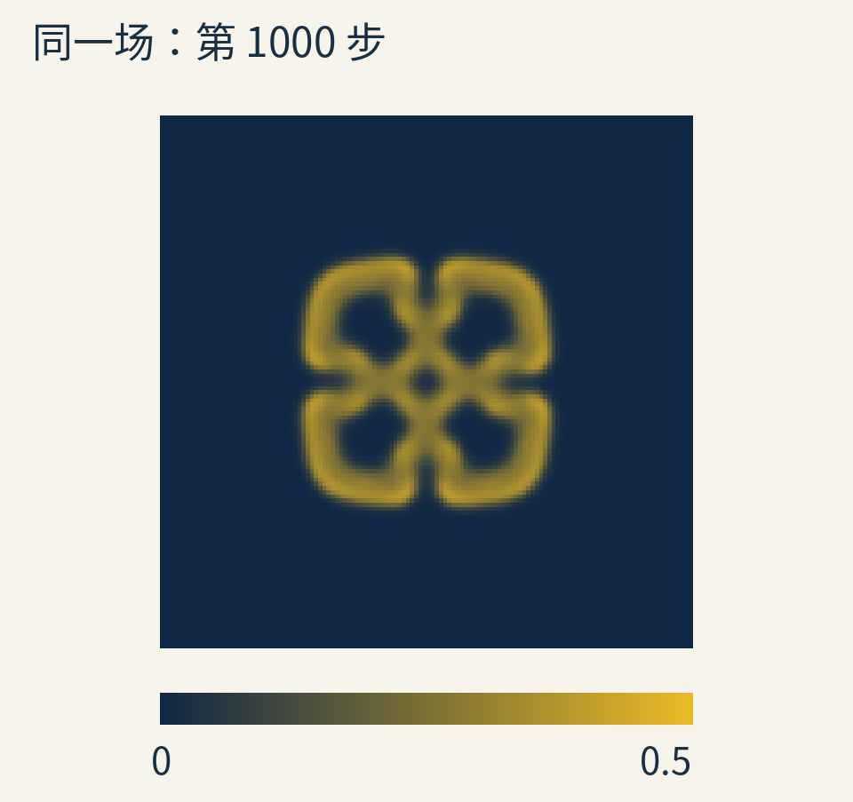

扩散在各自浓度表上仍在平滑差异。新结构来自它与非线性局部反应、持续补给和移出的共同作用，不是“扩散突然反过来自动制造尖峰”。局部增长会受 U 消耗限制，邻域交换又持续改变材料条件，哪一部分延伸、变宽、停止，取决于这一整套耦合。

第 3000 步时，结构已经占据大部分画面。再与开头第 6000 步对照，你可以看到边缘继续发展后的结果。

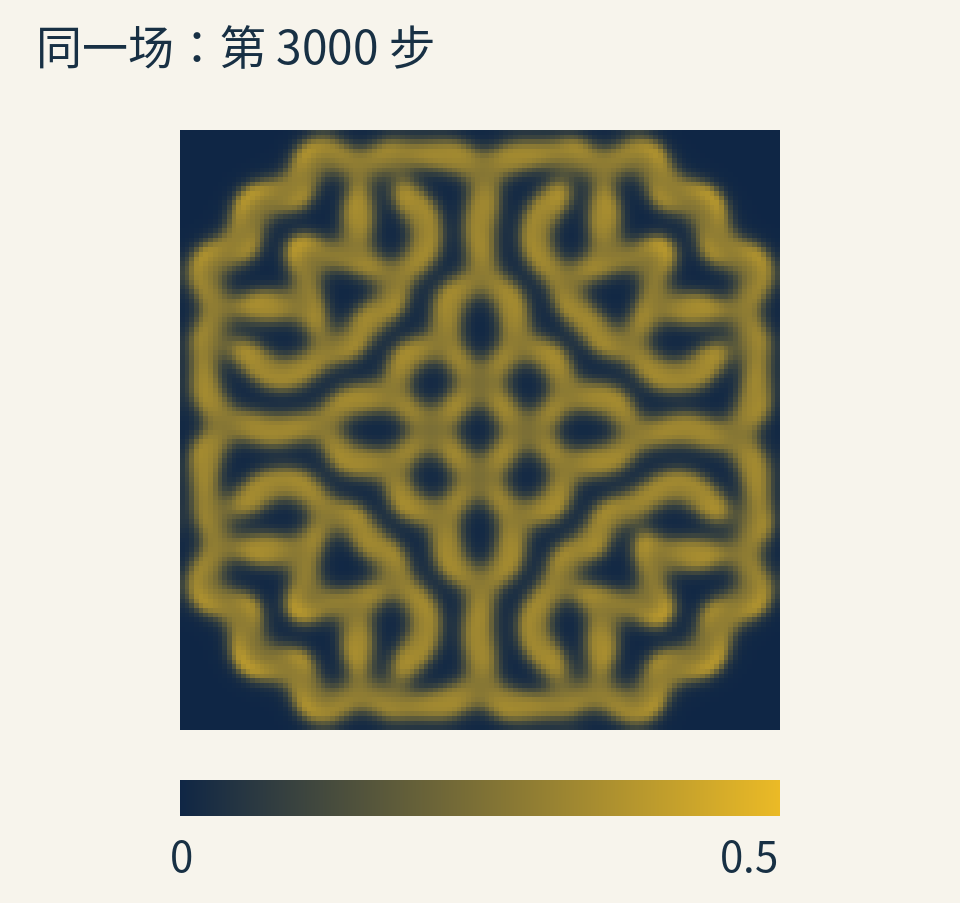

这些静态图各自保留一个阶段，理解不依赖动画。它们也不证明第 6000 步已经到达稳定终态：若要宣称稳定，需要继续运行并测量随时间的变化，而不是只选一张漂亮截图。

本次第 6000 步 V 的实际最小、最大值约为 0.00649 与 0.37537。色标上限 0.5 没有随着每帧最大值自动调整，所以颜色可以跨时间直接比较；若每张图都单独拉满对比度，很容易把“只是变淡”误读为“强度不变”。

## 同一块种子，参数为什么能改出不同的形态？

保持网格、初始数组、扩散系数、时间步与运行步数不变，只换 F 与 k，可以得到不同结构。

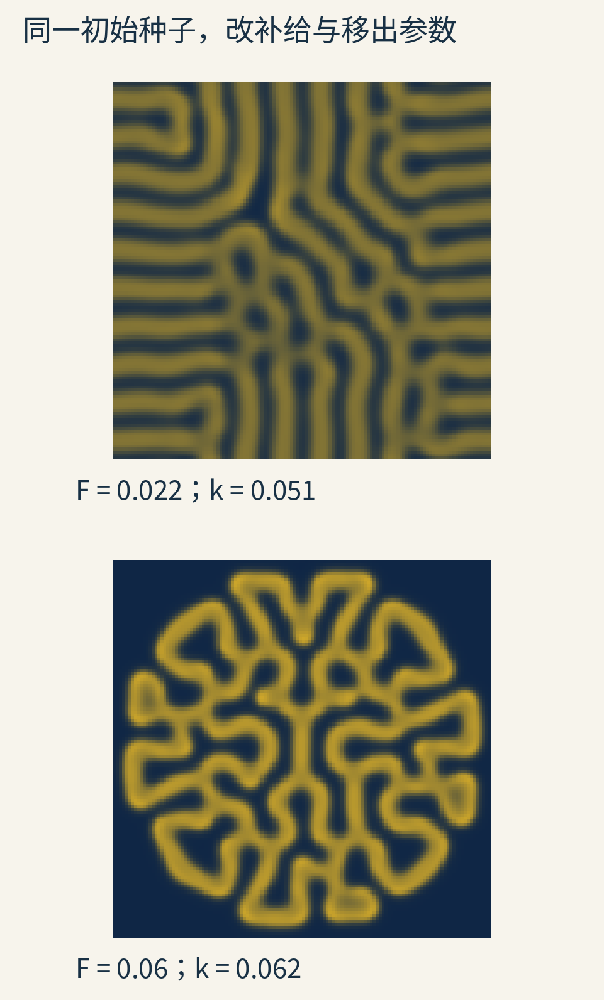

上图参数为 F=0.022、k=0.051，下图为 F=0.06、k=0.062；都沿用 V 从 0 到 0.5 的色标。这是两组有限的数值实验，不是一张完整参数相图，也不能仅凭形状就替它们归入某个严格动力学类别。

F 增大，U 在被消耗后补回的速度会变，也会更快移出 V；k 改变，V 向不参与反应的产物转化的速度变。因为这些变化会进一步改变 U、V 本身，同一个参数的作用不能永远概括成“条纹更宽”或“点更多”。

初始扰动也重要。固定参数并不意味着任意初始状态都长成相同图片。复现实验时，除了 seed，还要固定随机数生成方法、网格尺寸、扰动位置、系数、边界与更新时间；只记录一个数字种子不够。

## 走到图片边上，邻居从哪里来？

中间格子有四个邻居，最左边的格子却没有画面内的左邻居。程序必须定义边界条件。

本例使用**周期边界**：最左边与最右边相邻，最上边与最下边相邻。画面可以想成一个平铺重复的区域，跨出一边就接到另一边。

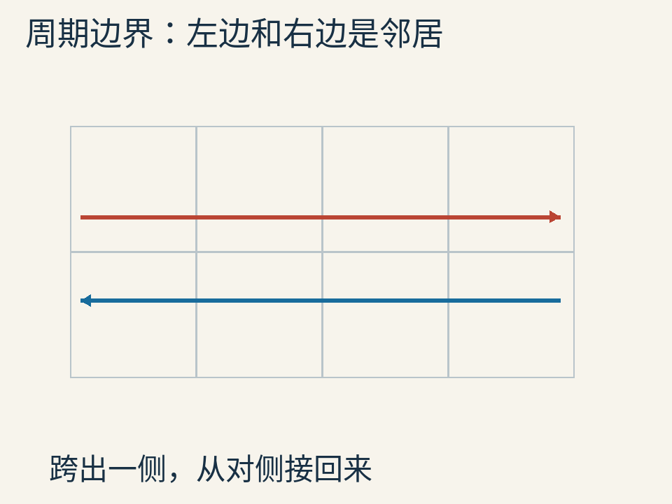

箭头是邻接关系示意，不是在浓度图中额外施加了一股向右或向左的流。这里没有像流体模拟那样的速度场。

另一种常见选择是无通量边界，让物质不穿过外墙；也可以指定固定边界浓度。它们会改变边缘附近的更新条件，进而影响长期结构。本篇主图只用周期边界；代码另外提供了一种复制边缘值的离散无通量选项，若想比较，需显式改参数后重跑。

在周期网格上，纯扩散的差分和为零：每个格向某个邻居失去的，在全图求和时会作为邻居的增加抵消。主模型的 U、V 总量却不单独守恒，因为还有反应、补给与移出。不能把“纯扩散守恒”误套到整个开放系统上。

## 步子迈大一点，为什么会算出负浓度？

把时间步从 1 改成 2，看似只是加快动画。但显式更新把旧变化率当成这一整步都成立，步子过大时，可能一次扣走比当前还多的量。

用更简单的纯扩散检查：中心浓度 1，四邻都是 0，D=0.16。Δt=1 时，中心变成 `1−4×0.16=0.36`，每个邻居得到 0.16，总和仍为 1。

Δt=2 时，中心却变成 `1−4×0.16×2=−0.28`。邻居各为 0.32，总和也仍是 1，但负浓度已经不符合我们要模拟的量。

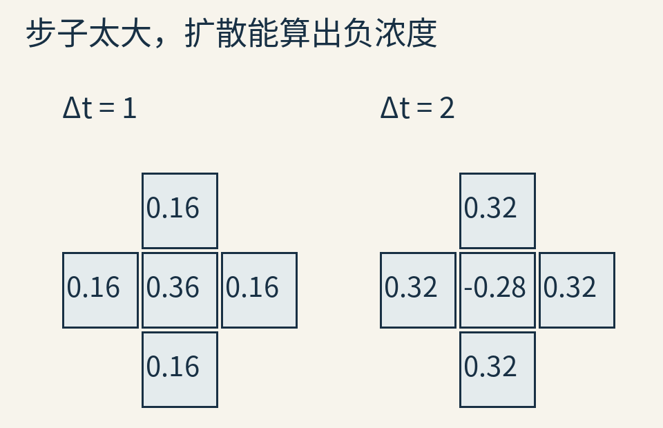

这个反例很有用：总量守恒并不等于数值解可信。给负值强行截成零，也许能让画面继续跑，却会改变方程和总量，不能把截断后的漂亮花纹当作未修改模型的结果。

对二维单位格、四邻域纯扩散的显式更新，要让各项权重非负，需要 `DΔt≤1/4`。一般格宽 h 时，条件变成 `DΔt/h²≤1/4`。这只处理扩散部分；加上非线性反应后，还要检查反应造成的步长限制与精度，不能把这一条当作完整稳定性证明。

因此，网格加密不是只把图片变高清。若是在同一实际范围内减小 h，扩散差分前的 `1/h²` 也会变，时间步往往需要重新考虑。

## 一张全空白的图，可能正好是正确答案

假设所有格子从 U=1、V=0 开始，而且完全不放种子。

此时两个场处处相等，扩散为零；U×V² 为零；U 的补给 F(1−U) 也为零；V 的移出更是零。更新后仍是 U=1、V=0。

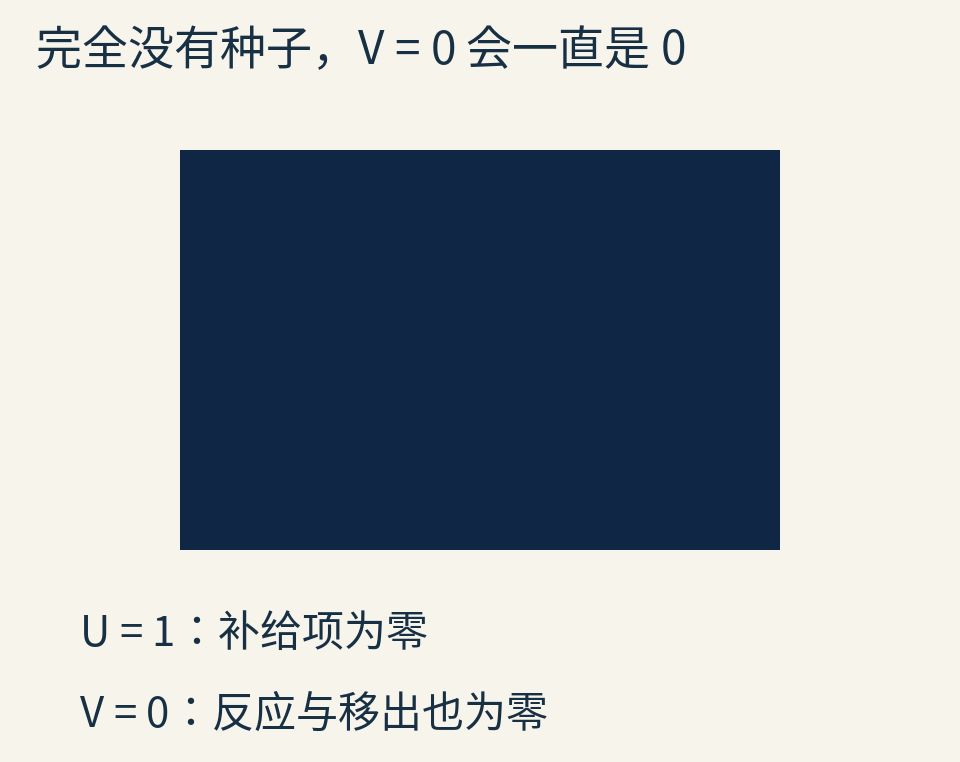

模型并没有一句“如果太无聊就凭空生成图案”。本篇代码实际检查了这一状态一步后完全不变；由相同规则重复应用，它会继续保持。

这也牵出一个容易被漂亮图片掩盖的区别：并非所有反应扩散图案都应该笼统称作经典的“Turing 不稳定性”。那种机制讨论特定均匀状态及小扰动如何因扩散而失稳，需要分析具体条件。Pearson 的论文明确指出，其所讨论扩散系数比下没有稳定的 Turing 图案，却仍出现了由有限幅度扰动触发的复杂结构。本文也使用了一块明确的非零种子，没有证明自己的主例属于经典线性失稳机制。

## 黄色多的地方，另一种浓度就一定同样少吗？

看一眼第 6000 步的 U 与 V，两幅图都用 0 到 1 的同一色标。

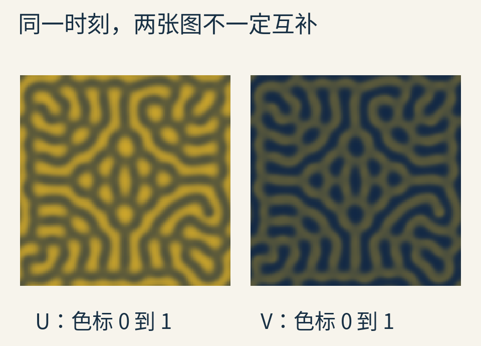

局部转化会让 U 减少、V 增加，所以它们常有明显关联。但不能据此断言 `U+V=1` 处处成立。两个扩散系数不同，系统也不断补给与移出，局部总量会变化。

前面的手算一步就是反例：新 U+新 V=`0.48875+0.24025=0.729`，并不是 1。甚至初始手算局部值相加也只有 0.75；不要把“浓度规范化”误读成“两种成分比例必须凑成百分之百”。

这些场可以用来制作纹理、驱动材质或辅助程序化图案设计。把模型结果贴到虚拟物体上，是一种创作使用；它并不证明真实动物斑纹由这组具体方程、参数和初始条件形成。形状相像提供线索，因果解释还需要额外实验与证据。

## 从一小步继续，而不是先找一张参数秘方表

[完整程序](examples/lab.py)公开了初始条件、更新方式、三组运行及数值检查；[结果文件](examples/results.json)保留时间统计、一步手算、同步与原地对照、步长反例。最终 U、V 数据也保存在 [final-fields.npz](examples/final-fields.npz)，可用 NumPy 读取。

运行环境为 Python 3.12.14、NumPy 2.3.5，制图需要 Pillow 与 Noto Sans CJK。`python lab.py` 会重跑三组各 6000 步模拟并覆盖文章图片和结果；实际耗时因机器而异，本文没有给出性能承诺。

最容易开始的改动，是把手算例的四个邻居 V 从 0.2 改成 0.3：先算扩散项怎样由负转正，再预测新 V。然后再让全图运行，保持其他条件不变，只改一个参数，看自己的预测在哪些局部还成立、在哪里被后续反馈改变。

反应扩散的有趣之处，不是十几个字符就能“解释自然界的一切”。它让我们看到一条可以追踪的路：一个格子的量怎样改变邻居，邻居又怎样改变它，局部规则在许多次来回之后，形成了没有任何单个格子事先保存的整体图案。

所有配图为原创教学示意与本篇数值模拟输出，非真实化学实验。正文、图及数据采用 [CC BY 4.0](https://creativecommons.org/licenses/by/4.0/)，代码采用 [MIT](examples/LICENSE.txt)。一手依据、图像职责与模型边界见 [sources.md](sources.md)。
