# 两路线圈怎样告诉电脑：这根轴转到了哪里？

让电机转起来，只是控制问题的一半。另一半是：它现在转到哪里了？

机械臂要停在某个姿势，天线要指向目标，转轴上都不能只有一句“电机已经通电”。电压已经施加，不代表轴真的到了想要的位置。负载、摩擦、惯性，都会让指令与实际运动产生差别。

有一种角度传感器，不靠在圆盘上印数字，也不用摄像头认刻度。它把轴的方向，变成两路线圈输出的电压。它叫**旋转变压器**，英文resolver。先别被名字吓住：变压器利用变化的磁场，让一个线圈影响另一个线圈；这里的巧思，是让这种影响的强弱随着转轴角度改变。

下面是一张真正进入过航天工程文件的接口图。

NASA，图号NASA-S-69-3788，Apollo 11任务报告Figure 16-14。左下的Resolver随交会雷达天线轴转动，向中间的转换电路送出Sine、Cosine两路信号，右侧是主制导与导航系统。图中的800 Hz是参考/信号链标注，**不是天线每秒转800圈**。这是一张历史工程图，不是雷达多普勒测速原理图。原始小字保留供查证；主线只需先认出“转轴→两路电信号→数字角度”。

我们接下来用一个简化、单圈周期的传感器模型解释这条链。它不复刻Apollo电路的全部内部实现。

## 先把角度放到一张圆上

俯视一根轴，给轴端画一条指向外侧的短线。规定向右是0度，逆时针转是角度增加。向上是90度，向左180度，向下270度，再回到右边是360度，也就是新一圈的0度。

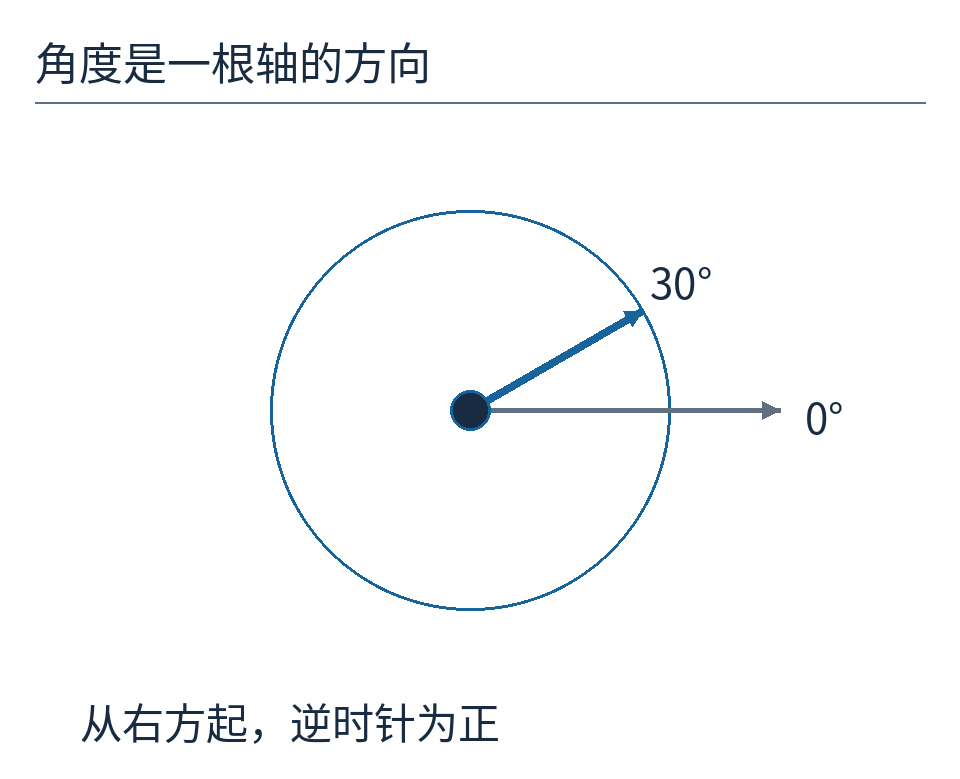

蓝箭头表示轴端标记方向，灰箭头是固定零位。真实传感器的零位由安装、接线与标定共同确定，并不是天生知道哪边是房间的右侧。

现在让蓝箭头长度为1，把箭头尖的位置拆成两部分：向右走了多少，向上走了多少。

30度时，向右约0.866，向上0.5。数学把这两个数分别叫作30度的余弦和正弦。可以先把名字放在一边，记住它们就是**同一个方向在两条垂直轴上的投影**。

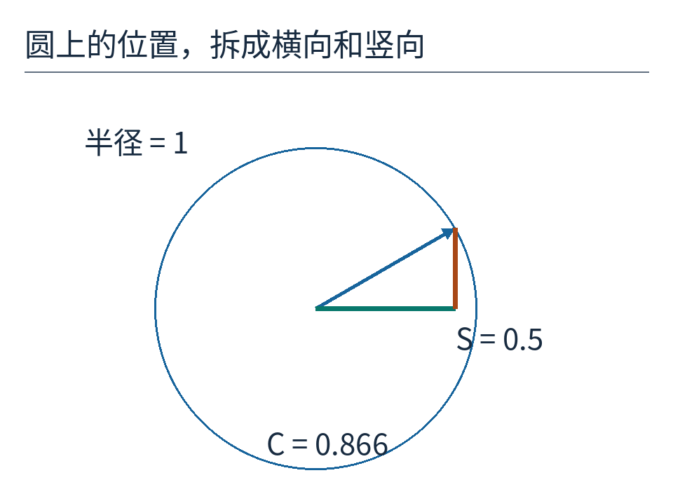

绿色横段对应C，橙色竖段对应S。C=cos θ，S=sin θ；θ表示轴角度。半径约定为1，因而C、S没有长度单位。

两路线圈要编码的，就是这两个投影。

## 为什么非要两路？一条曲线不够吗？

如果只测向上的投影，30度和150度都会得到0.5。两根箭头一根朝右上，一根朝左上，尖端却在同一条水平线上。

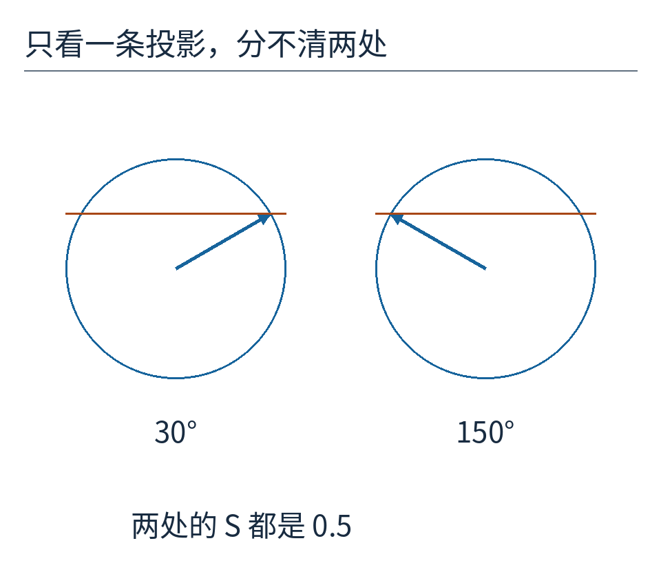

这不是精度不够。即使把0.5量到一百万位小数，两个方向仍然一样。信息从一开始就没有把它们区分开。

加上横向投影，就好办了。30度的C约为+0.866，150度则约为−0.866。S告诉我们上下，C补上左右；两者一起，才指向圆上的一个确定位置。

也可以反过来想：一只钟表只告诉你指针尖“有多高”，你猜不出它在左半边还是右半边。再告诉你“有多靠右”，位置就确定了。

## 线圈为什么能把机械方向变成投影？

给第一组线圈送入交变电压，电流不断变化，磁场也不断变化。附近线圈因磁场变化产生感应电压，这就是变压器工作的基础。

在旋转变压器中，转子与固定部分的相对方向会改变磁耦合。设计两组有效磁轴相互垂直的接收绕组，就能使两路的耦合系数分别近似随正弦、余弦变化。[ADI原厂原理说明](https://www.analog.com/en/resources/analog-dialogue/articles/precision-rtdc-measures-angular-position-and-velocity.html)同时区分了传统有绕组转子与可变磁阻结构，不能把所有resolver都想成完全相同的内部零件。

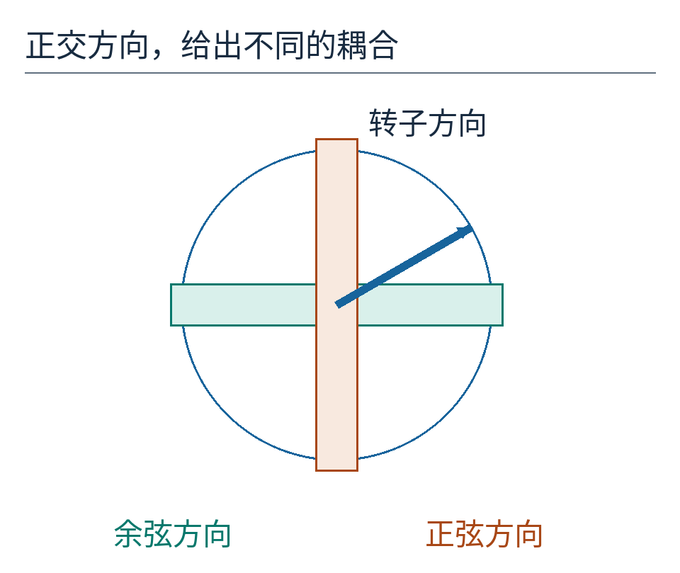

绿色与橙色带表示两组有效磁轴，蓝箭头是转子方向。为了看清正交关系，这里画的是概念几何，不是可以照着绕线的结构剖面，也不表示两块实体长条穿过转子。

真实线圈、铁芯、绕组分布和气隙共同决定输出。圆上的投影解释理想规律，却不能单凭这张圆就设计出精密传感器。

还有一件特别容易搞混的事：这两路叫“Sine”“Cosine”，**不等于轴静止时，两路载波在时间上总相差四分之一周期**。正弦、余弦首先指幅度随轴角度的关系。固定角度下，两路都跟着同一励磁节拍振荡，只是幅度和符号不同。

## 轴不动，为什么电压仍在不停变？

把励磁信号记成r(t)，其中t是时间。先把励磁峰值与共同变比归一成1。理想输出便是：

**S路电压 = sin θ × r(t)**

**C路电压 = cos θ × r(t)**

θ告诉我们轴的位置；r(t)告诉我们励磁此刻走到振荡周期的哪里。这是两个不同的变化来源。

若轴停在30度，sin θ一直是0.5，但r(t)仍在正负之间振荡。S路因此是励磁的半幅版本。

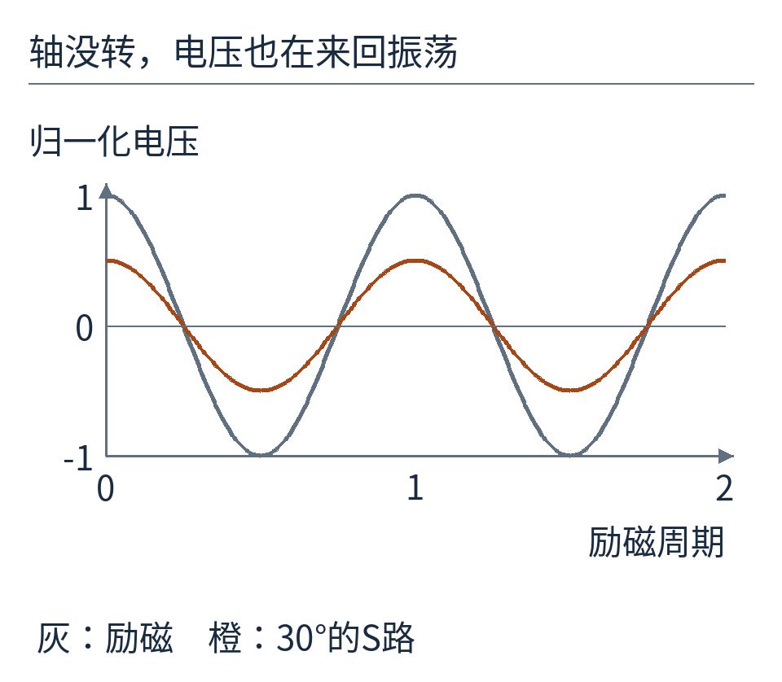

横轴按励磁周期计。灰线峰值1，橙线峰值0.5。图中轴角度从头到尾没变；不能看到橙线快速上下，就以为机械轴也在快速来回转。

这叫调幅：角度信息藏在载波的系数中。它带来一个好处——可以使用已知励磁作为参考，专门提取与它同步的响应；也带来一项义务——电脑不能拿某一时刻电压直接当角度。

例如，励磁经过0的瞬间，两路电压都接近0，但轴并没有因此失去方向。

## 用同一串参考，真的解出一次30度

把一个励磁周期等分成四份，取到的参考值是：

**1、0、−1、0。**

在30度，S路得到0.5、0、−0.5、0；C路约为0.866、0、−0.866、0。

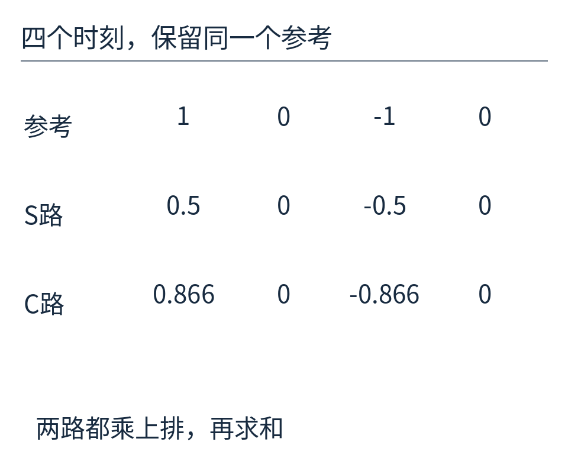

一列对应一个时刻。两路必须和同一时刻的参考比较；这里用四点只是为了手算，不是建议真实硬件只用四个低精度样点。

先解S路：对应项相乘，得到0.5、0、0.5、0，总和1。参考自己的平方是1、0、1、0，总和2。因此：

**S = 1÷2 = 0.5。**

C路同样计算：乘积总和约1.732，除以2，得到C≈0.866。

为什么要除以参考平方和？因为输出本来就是“待求系数×参考”。再乘参考并累积，得到“待求系数×参考平方和”。除掉后者，才取回系数。换一种参考幅度或取样数量，分母也会自动跟着变化。

这就是一次同步解调。真实转换器可能同步整流、滤波，也可能在跟踪环内部完成相敏比较；[TI的SBAA144应用报告](https://www.ti.com/lit/pdf/sbaa144)给出了数字解调路径，ADI的转换器资料则展示跟踪角度误差的方式。本文的四点乘法模型帮助理解信息如何取出，不意味着所有芯片都逐项执行这段伪代码。

关键条件是：两路使用与励磁相干的参考，并正确处理信号链的相位延迟。如果参考随意错开，测出的系数就会衰减，甚至符号错误。

## 为什么不能只取“振幅大小”？

让轴从30度转到210度。此时S=−0.5，C≈−0.866，两路系数都变负。

但示波器上看峰峰值，S路仍从−0.5摆到+0.5，大小没变。改变的是它与参考的关系：参考为正时，这一路为负。

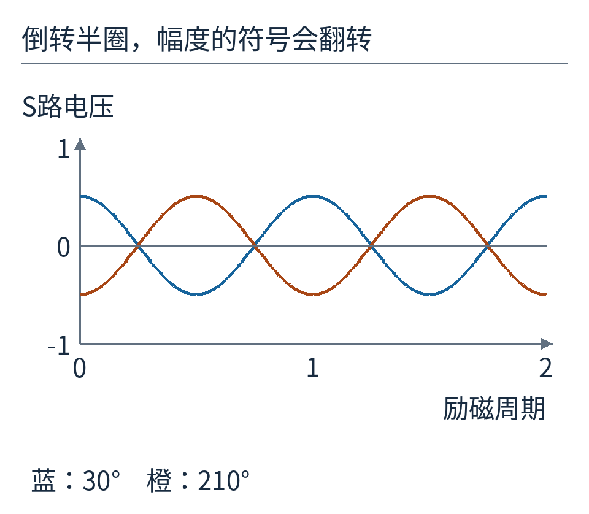

蓝线和橙线的峰峰值相等，符号却相反。同步解调保留这项“同相还是反相”的信息；简单求绝对值会把它丢掉。

如果只把两路幅度都变成非负数，四个象限可能折叠到一起。仪器读到“大小差不多”，不代表方向真的差不多。

## atan2不是多余的一个字母

得到S与C后，把点(C,S)放回圆上。最直接的任务是：找出这根从原点指向它的箭头，与右向零位之间的角度。

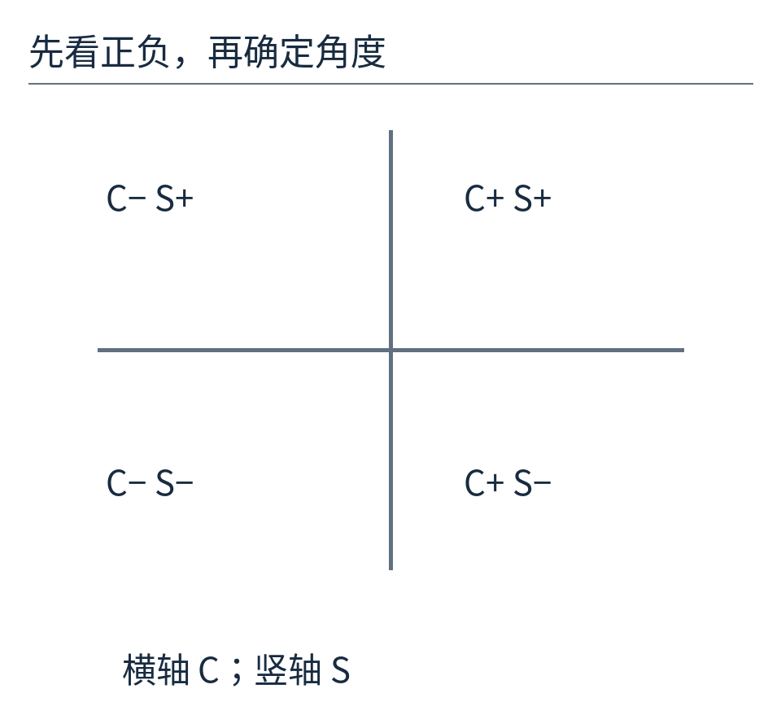

C正说明向右，C负说明向左；S正说明向上，S负说明向下。落在坐标轴上的情况，要根据非零的另一项判断。

如果只计算S/C，再求普通反正切，30度和210度会给出同样的比值：两项同时变负，商不变。于是角度相差半圈的信息又丢了。

编程时常用`atan2(S, C)`，把两项分开交给函数。它除了比例，还检查各自正负，可以返回正确象限；当C为0、S不为0时，也不需要先做一次除以0。

注意参数顺序：常见接口是`atan2(y, x)`，这里竖向S放前，横向C放后。许多函数返回弧度；转换为度，要乘180/π。我们的[实际计算结果](examples/results.json)为29.999999999999996度，这是浮点近似，表示教学输入的30度，并不是实物传感器达到如此多位精度。

若S和C都近于0，方向本身就没有可靠依据。不能因为函数能返回一个数字，就假装传感器给出了有效角度。

## 一起变大常常没事，一大一小就会偏

假设励磁整体增强，两路同时乘上1.6。圆上的点从(0.866,0.5)沿同一根射线向外移动，方向没变。

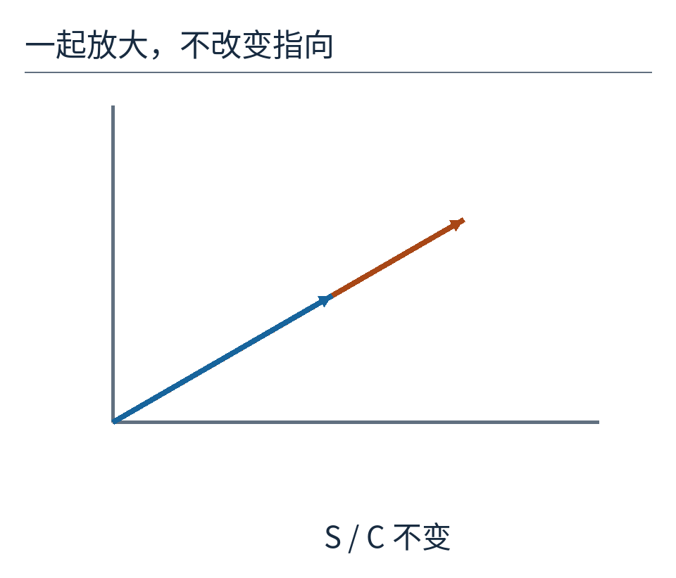

这解释了正交两路测角的一个优势：相同的幅度比例变化，可以在方向计算中抵消。但它不是“所有电压误差都自动消失”。

如果S路放大得少一些、C路保持原样，一整圈取样画出的轨迹会从圆变成椭圆。某些方向偏差小，另一些方向偏差大。

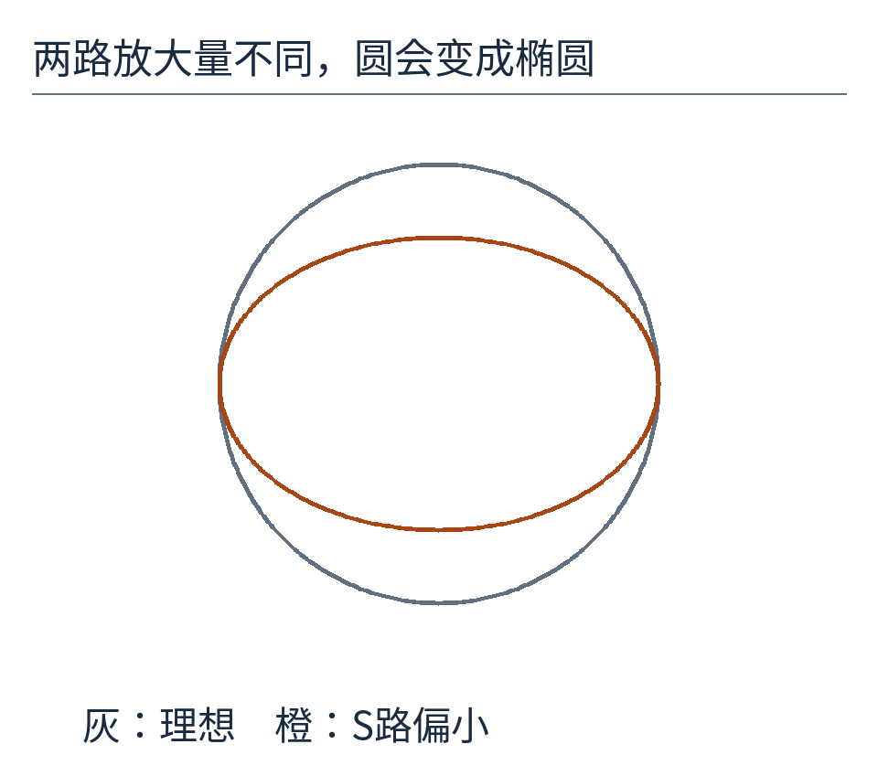

橙线把S路缩成原来的2/3，C路不变。这是特意加入的教学误差。其他误差还会表现为圆心偏移、正交轴不垂直，或随角度变化的波纹。

因此工程系统要处理通道增益、零点、相位差、噪声、安装偏心以及励磁异常。把一圈数据画成S对C的轨迹，是一个很直观的诊断入口；具体允许误差仍要看器件与应用规格。

## 知道单圈位置，不等于知道累计转了几圈

轴从355度走到5度。如果直接相减，5−355=−350度，看起来像突然倒转了很大一圈。但在连续、每次转动很小的条件下，更合理的解释是向前跨过零位10度。

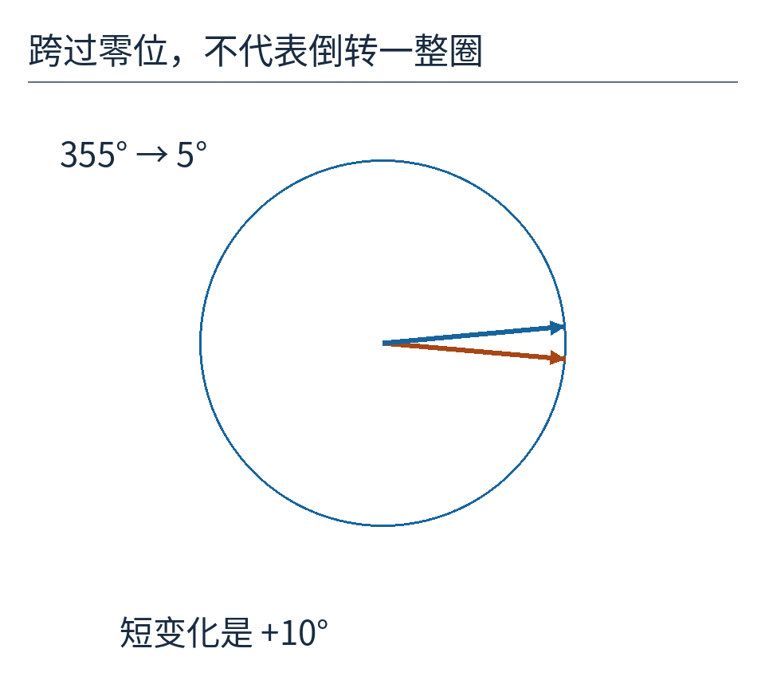

这里选择最短角差，依赖“相邻两次取样间不会转过半圈”的前提。转得太快、读得太慢，这个前提就可能失效，不能靠软件猜回来。

本文讨论的是每机械一圈对应一个电角度周期的模型。真实resolver可能有多个极对，一圈机械转动对应多个电周期；系统还可能另设粗细通道或累计计数。因此“看到一个0到360度读数”，不等于已经知道任意时刻的绝对多圈位置。

回到NASA原图，那两条标着Sine与Cosine的线，就不再像两个神秘名字了。它们一起保存方向的两个投影，励磁让这种投影变成可测的交变电压，解调取回带符号的系数，转换系统再把它们变成角度。

机械轴没有学会写数字。工程师给它安排了一套能够保留方向信息的物理关系，再让电脑沿着这套关系读回去。

原理来源：[ADI旋转变压器与转换器说明](https://www.analog.com/en/resources/analog-dialogue/articles/precision-rtdc-measures-angular-position-and-velocity.html)、[TI SBAA144，2006](https://www.ti.com/lit/pdf/sbaa144)。历史图：[Apollo 11任务报告](https://www.nasa.gov/wp-content/uploads/static/apollo50th/pdf/A11_MissionReport.pdf)，NASA-S-69-3788；[单页原件](originals/apollo-radar.pdf)。其余图片为原创教学图；[可复算程序](examples/build_figures.py)。正文CC BY 4.0，完整材料权利见[sources.md](sources.md)。
