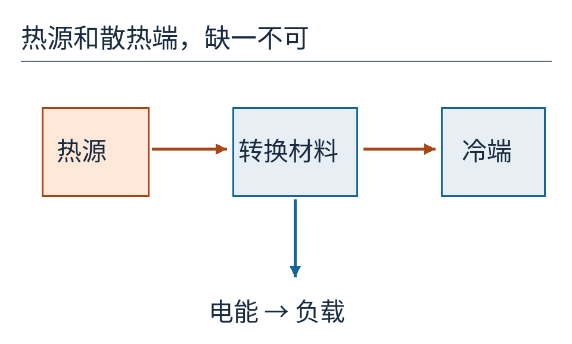
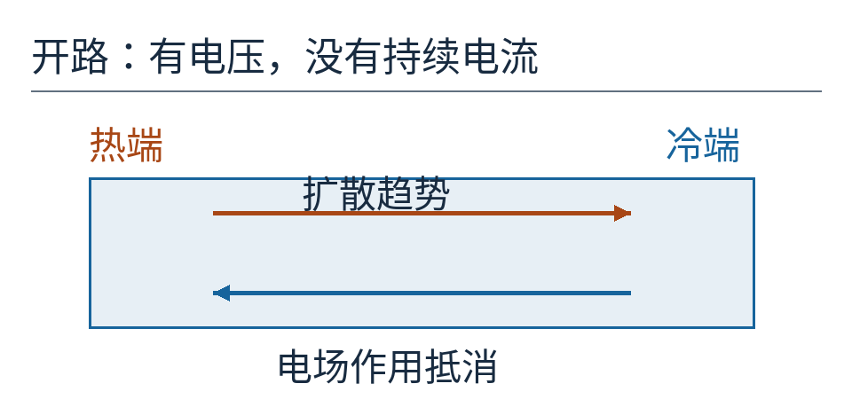
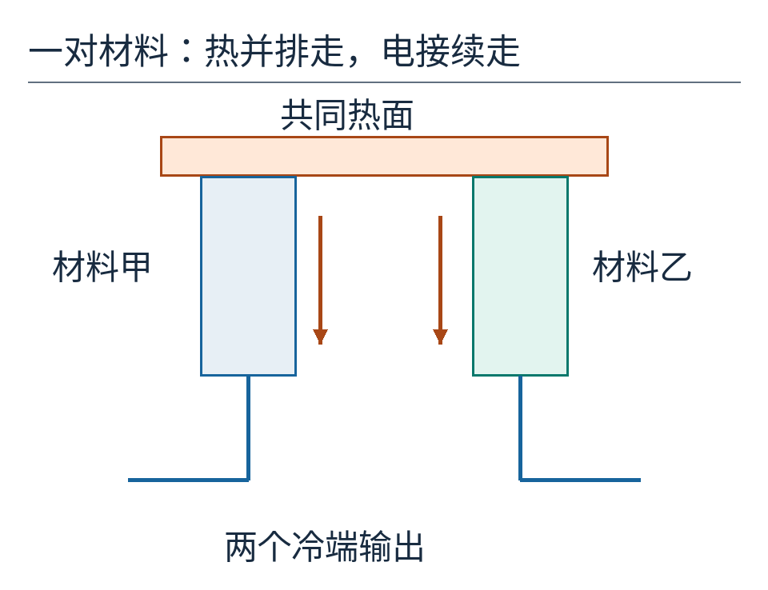
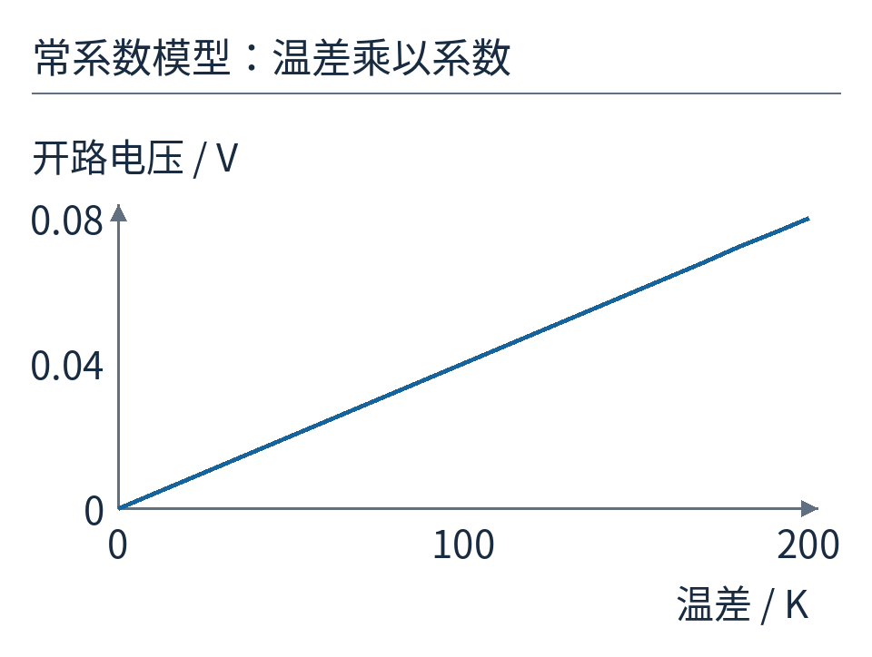
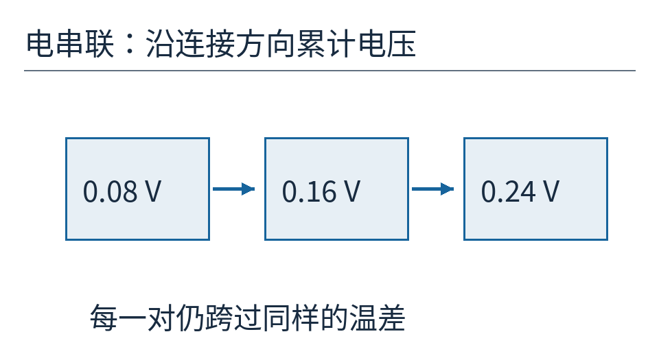
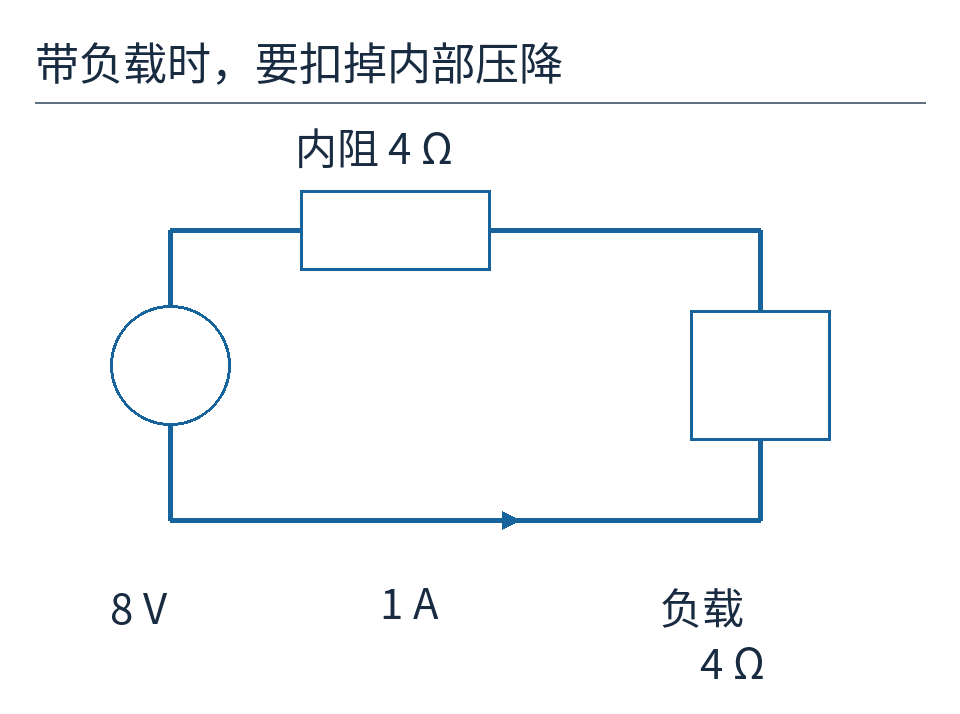
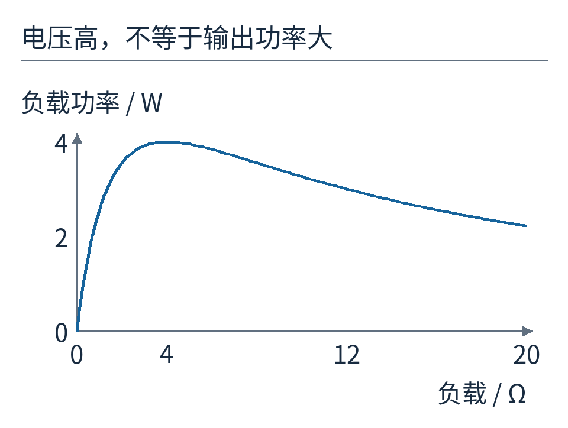
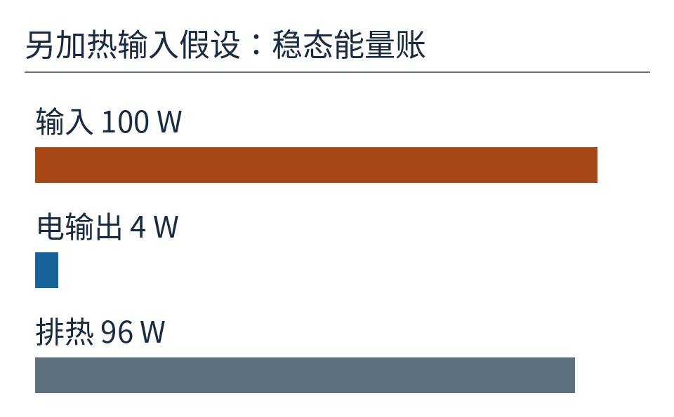
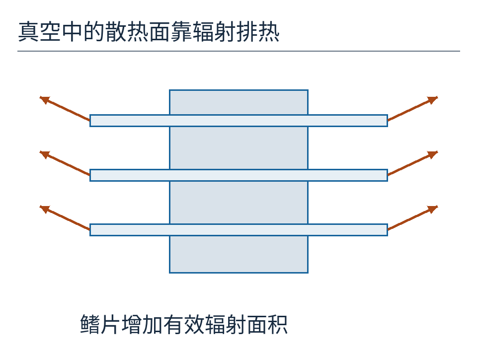
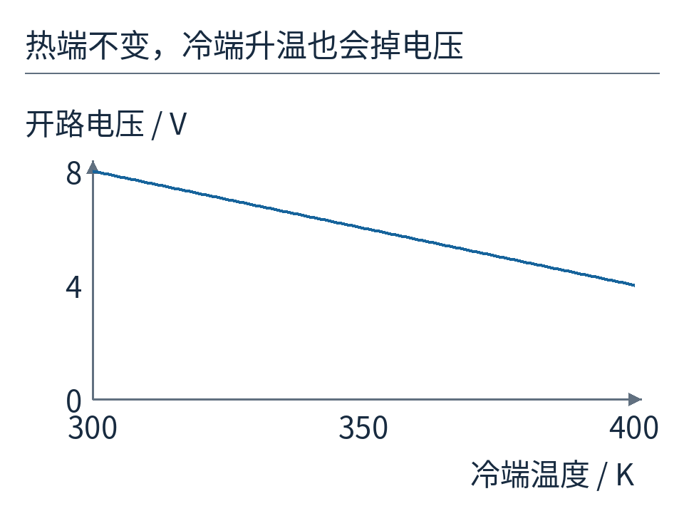

# 太空里的发电机为什么没有转轴？从一对热电材料读懂 RTG

旅行者探测器上的发电装置，外表像一组带散热片的黑色罐子。看不到风扇，也没有蒸汽管道。它的名字 RTG，展开是“放射性同位素热电发生器”：放射性衰变供热，热电材料把一小部分热流转换成电能。这几个字实际说的是两件事。热源负责让一端保持热；发电材料负责在冷热两端之间产生电压。把它们分开，才不会误以为放射性粒子直接从罐子里跑进电线。

图 1：NASA/JPL-Caltech 的旅行者 RTG 实物照片。留意外侧伸出的散热片。它们参与维持温差，绝非装饰。本文后面的数字是便于手算的教学模型，不是照片中设备的参数。

## 有热还不够，还要有另一端

先暂时拿掉“放射性”。设想一块适合发电的材料，左端接热源，右端接散热装置。热能沿材料传过去，少部分能量经电路输出。若两端最后一样热，维持发电的条件就消失了。把整个发电片放进均匀温度的烤箱，哪怕烤箱很热，也不等于得到了持续电源。

图 2：橙色箭头是热流，蓝色支路是送给负载的电能。这里的“冷端”只表示比热端凉，不意味着它必须接近冰点。

这种温差产生电压的现象叫塞贝克效应。材料内有可以运动的电荷载流子。在最简单的扩散图景里，冷热两端的载流子能量分布不同，使它们有净迁移趋势；电荷重新分布又产生电场，阻碍进一步迁移。开路时，二者达到平衡，材料两端仍能有电势差，却没有持续输出电流。

这只是解释电压形成的入口。真实材料的符号和大小还依赖载流子种类、能带与散射等性质，不能由“热端电子跑得快”一句话预测。尤其不能把每一种材料都画成电子只向同一个方向排队。

图 3：箭头代表相反的作用趋势，不是两股独立可收集的电流。开路状态下，电荷分离形成电压；负载没接上，就没有电功率送出去。

## 为什么常常要一对不同材料

拿电压表测一根导体，接表的引线也有自己的冷热分布。完整测量回路里，不能忽略另一段材料的热电响应。如果两条完全相同的材料走过相同的温度范围，它们产生的电势变化会相互抵消。

因此，我们选响应不同的两种材料，把它们的一端连接到同一热面，另外两端处于同一冷面，作为输出端。两条腿的热电响应之差成为整对材料的有效塞贝克系数。常见半导体热电元件使用 p 型和 n 型材料，使两条腿在正确的串联方向上提供可相加的电压。下图只解释连接关系，没有模拟某一款 RTG 的内部布线。

图 4：热从上往下通过两条腿；电连接从一个冷端上行、跨过热端连接片，再下行到另一个冷端。热通路并排，电通路接续，这是看懂热电模块的关键。

用一个可以口算的例子：假定这一对材料在所用温度区间内，有效系数为每开尔文 400 微伏。开尔文记作 K，温差 1 K 与温差 1 ℃ 数值相同。400 微伏就是 0.0004 伏。我们再假定热端比冷端高 200 K，那么开路电压为：

`一对的电压 = 0.0004 V/K × 200 K = 0.08 V`。

把“每单位温差的电压”乘以温差，单位 K 消去，得到伏特。写成短公式就是 `V = SΔT`，其中 S 是这一对的有效系数，ΔT 是热端温度减冷端温度。系数随温度明显变化时，不能继续用一个常数乘完整区间，需要对各小段温差的贡献累加。

图 5：横轴是冷热端温差，纵轴是一对材料的开路电压。直线来自固定系数的假设；不是测得的材料性能曲线。

一对只有 0.08 V。若把 100 对以电压相加的方向串联，每一对仍跨过相同的 200 K 温差，总开路电压就有 8 V。这里的 100 对没有让热流先冷却一次、再冷却一次地串走一百段：它们可以共同接在热面与冷面之间，电路却像许多小电池首尾相接。

图 6：只画三对展示连接原则；标出的 0.08、0.16、0.24 V 是从同一个起点沿电串联方向累计的电压。100 对的 8 V 用同一条规则得到。

## 电压表显示 8 V，接上设备却不是 8 V

发电材料和连接件都有电阻。接上负载以后，电流经过这些内部电阻也会损失一部分电压。对刚才的 100 对组件，假定总内阻为 4 Ω；再接一个 4 Ω 的纯电阻负载。Ω 是欧姆，表示对电流的阻碍程度。

从电路来看，可以把组件暂时等效为一个 8 V 理想电源，串联一个 4 Ω 内阻。总电阻是 8 Ω，所以电流是 `8 V ÷ 8 Ω = 1 A`。负载拿到的电压是 `1 A × 4 Ω = 4 V`。它得到的功率则为 `4 V × 1 A = 4 W`。

图 7：8 V 是开路电压。接通以后，4 V 落在内阻，另 4 V 落在负载。图中电源、内阻和负载构成闭合电路，蓝色箭头表示约定电流方向。

负载特别大，电流近乎为零，虽然电压接近 8 V，功率仍小。把负载短接，电流虽大，外部电压却接近零，送到理想短路上的功率也接近零。两头都不好，中间才有峰值。

对固定温差、固定系数、固定内阻的模型，负载功率是 `P = V²R / (r+R)²`。V 是开路电压，r 是内阻，R 是负载。这个式子不是额外的热学定律：先用总电阻求电流，再把 `I²R` 中的 I 替换掉，就得到它。

图 8：8 V、4 Ω 内阻保持不变，横轴改变负载电阻。负载等于 4 Ω 时达到模型最大功率 4 W。负载无限增大时曲线最终趋向零，图中只画到 20 Ω。

这条“内外电阻相等”的规则有条件。真实热源、接触热阻与散热面并不会自动把温差锁死，电流又会通过焦耳热和热电输运影响温度。若负载变化连带改变温差，必须联立热路与电路。最大输出功率也不等于最高热效率，更不等于整台航天器最合适的工作点。

## 4 W 电从多少热里来

刚才只算了电路，没有给热导率、热接触、材料输运等信息。因此我们还不知道维持 200 K 温差需要多少热。仅凭 8 V 和 4 Ω，无法宣称转换效率是多少。

为了单独练习能量账本，再补一个**新的教学假设**：这个工作点有 100 W 热功率进入转换组件，电路向外送出 4 W；稳态、无能量积存时，余下 96 W 要从冷端及其他散热路径排出。这里 4% 是这组新增假设的结果，并非前面电路自动推导出的效率，更不是旅行者设备效率。

图 9：所有条宽共用一个比例，100 W 输入拆为 4 W 电输出和 96 W 排热。窄蓝条提醒我们：稳定的少量电能，也可能需要持续处理大量热。

热端越热、冷端越冷，在其他条件相同的模型中越容易得到较大电压。不过材料有温度上限，热应力、绝缘、连接与长期退化也有限制。热效率还受热力学约束。温度要用绝对温度计算，理想热机上限为 `1−Tc/Th`；它是任何装置不能超过的上限，不是热电片保证能达到的数值。

比如热端 500 K、冷端 300 K，上限是 40%。真实热电材料还同时面临导热漏损、电阻发热和输运效率问题，不能把这个 40% 填成电源产品参数。

## 真空里没有风，散热片仍然有用

在空气中，我们习惯用风扇带走热量。深空真空没有周围空气来对流，散热表面主要通过电磁辐射把能量送出去。它不需要空气作为搬运者。太阳照射、其他结构的辐射与视野遮挡又会改变净排热，因而“外面是太空”并不能直接决定冷端温度。

图 10：橙色箭头画的是热辐射方向，不能按箭头数量理解辐射强度。增加可向外辐射的有效面积，有助于在给定排热需求下降低冷端温度；外壳并不是把热直接传给一团寒冷空气。

这也解释了一个容易忽视的故障方向：热源照旧，冷端却因为散热变差而升温，温差减少，电压仍会下降。热源温度高和输出充足不是同一句话。

图 11：继续采用 100 对、每对 400 微伏/K 的常系数模型，热端固定 500 K。冷端从 300 K 升到 400 K，温差从 200 K 减为 100 K，开路电压也由 8 V 降至 4 V。这里没有计算带负载时的热平衡。

## 为什么这种方式适合漫长而安静的航程

NASA 的说明把 RTG 中的放射性热源与热电转换明确分开：自然衰变释放热量，许多热电偶串联取电，转换过程没有转动部件。[NASA 对塞贝克效应与 RTG 的说明](https://science.nasa.gov/resource/how-does-a-radioisotope-thermoelectric-generator-rtg-work-the-seebeck-effect/)介绍了这一路径；[Ferrotec 的工程指南](https://thermal.ferrotec.com/technology/thermoelectric-reference-guide/thermalref13/)则给出了开路电压、内阻和负载的基本关系。

没有转动部件省去了某些磨损问题，却没有取消寿命问题。放射性热源的热功率随时间下降，热电材料和电接触也可能退化，冷热端状态还会变化。因此，仅知道同位素半衰期，不能直接推算每一年设备还剩多少电功率。把热源、温差、材料、电路、负载分别检查，才能找出功率变化发生在哪一段。

回头看开篇的散热片，你可以问出比“这是什么电池”更准确的问题：热从哪来？冷端怎样排热？每对材料能提供多少电压？串联以后，负载拿到多少？一个没有转轴的发电机，依然必须把这几笔账逐一算清。

计算与全部原创图可用 `python examples/build_figures.py` 重建，输入和输出见 [results.json](examples/results.json)。来源、逐图权利及代码许可见 [sources.md](sources.md)。原创正文采用 [CC BY 4.0](https://creativecommons.org/licenses/by/4.0/)。
