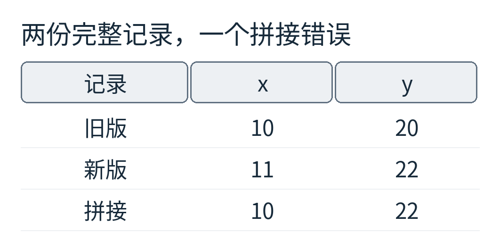
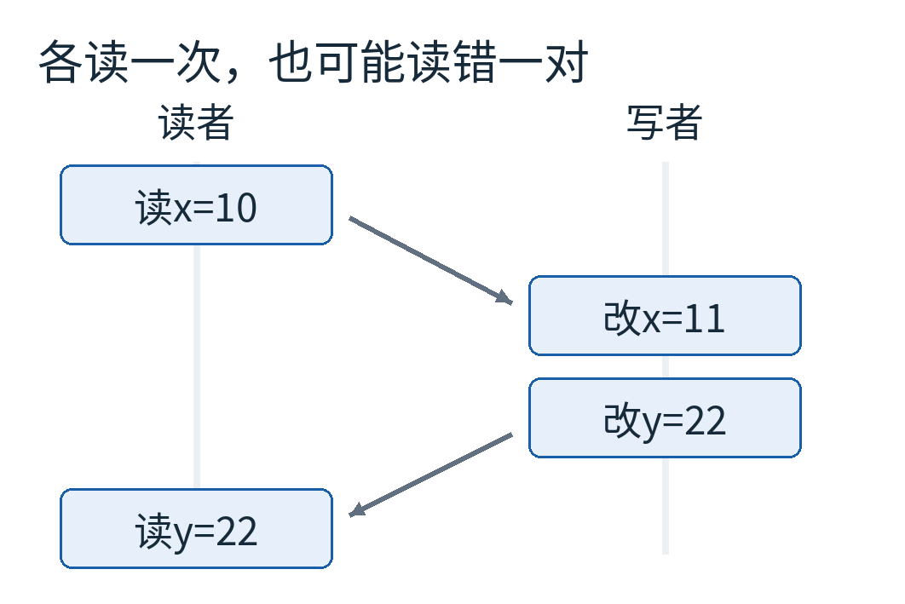
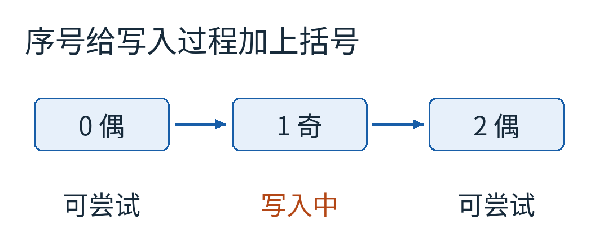
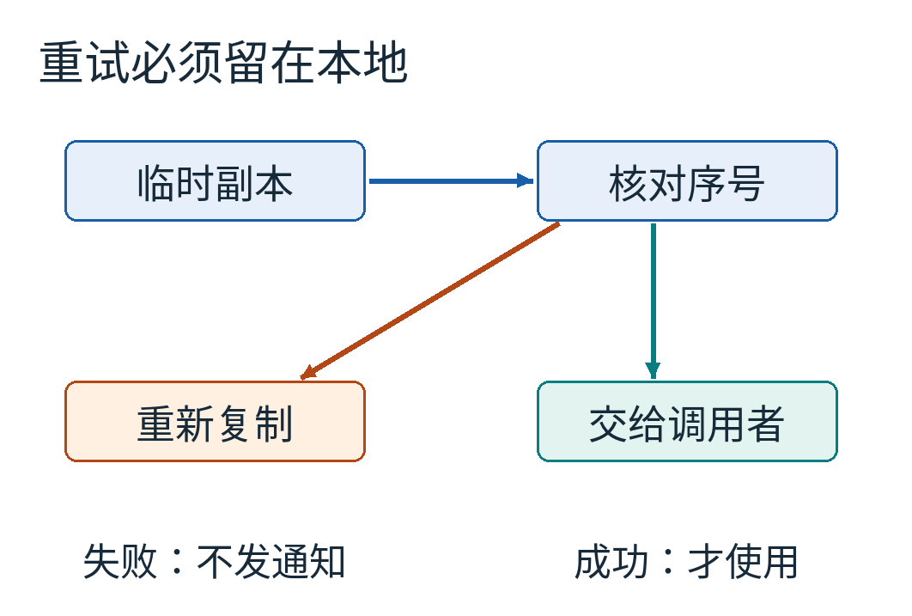
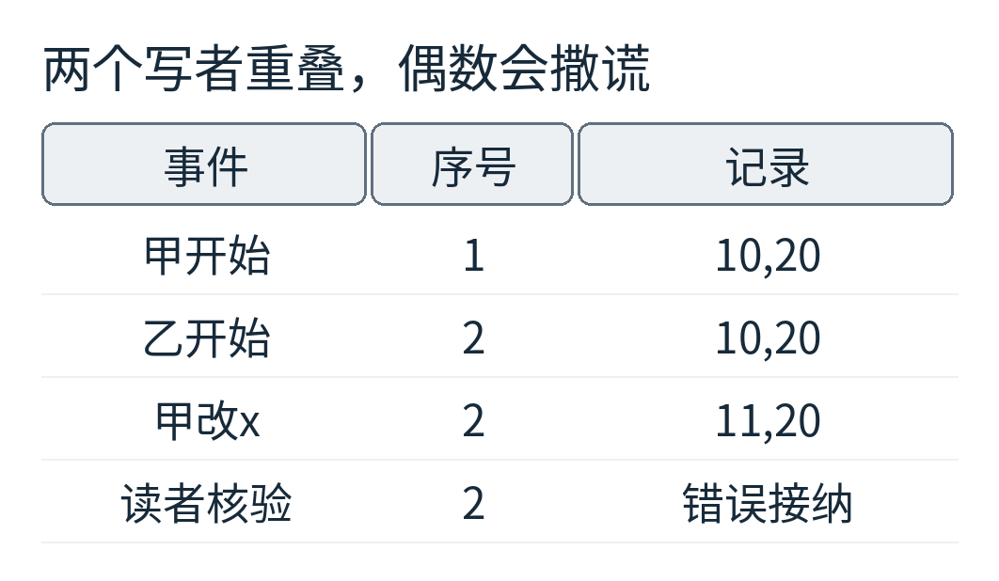
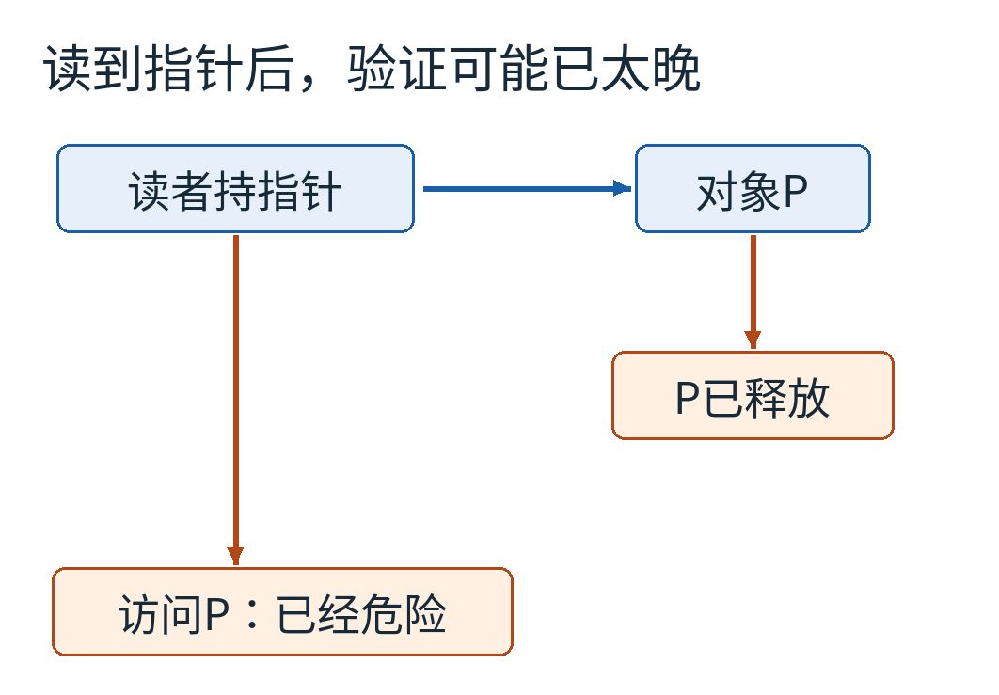
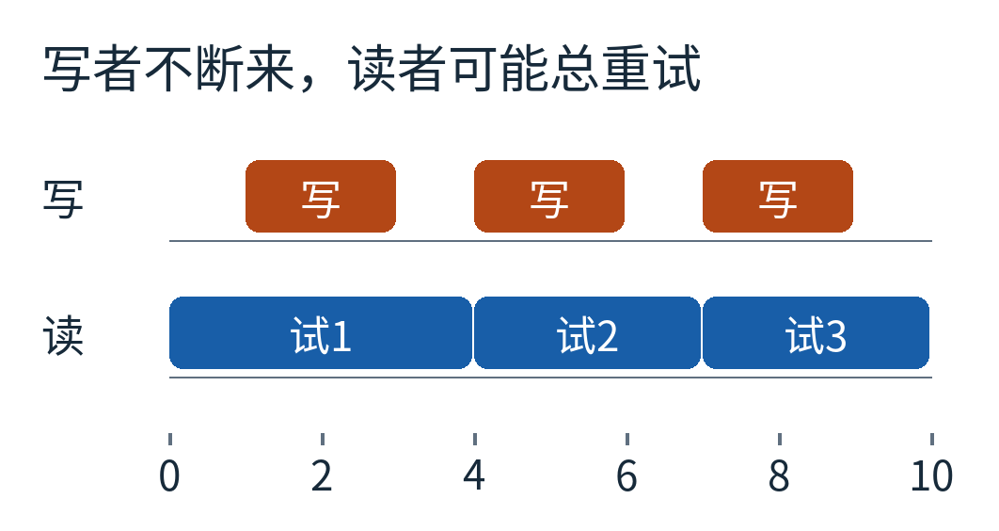

# 读到了两个正确数字，为什么拼起来却错了？序列锁怎样发现一次“读裂了”

一份坐标记录里放着两个数：x=10，y=20。另一个线程正在把它整体更新成x=11，y=22。你读x时，更新还没开始；等你读y时，更新已经结束。

于是拿到了10和22。

每次读取都没有返回乱码，却拼出了一份既不是旧版、也不是新版的记录。假如程序约定y始终等于2x，这一对数还破坏了约定。

旧版与新版都满足y=2x；第三行没有对应的完整版本。我们用这个人为设定的关系检查读数，不是在描述某台设备的真实坐标规律。

常见解决办法是让读写双方都拿锁：写者修改期间，读者先别进来。这很合理。但如果一份很小的数据每秒被读许多次、很少改变，能不能让读者先复制，结束时再判断这份副本是否可靠？

序列计数器正是这样一种机制。它让读者保留撤回这次尝试的余地：**不是保证永远碰不上写入，而是识别碰上的那次读取，然后重来。**

## 先看见错误，才能看清需要的证据

“两个数各自原子读取”也救不了这个例子。原子可以保证一次动作不可再分，却没有自动把两次动作捆成一件事。

我们把时间放慢：读者读x，得到10；写者把x改成11，再把y改成22；读者最后读y，得到22。所有动作都按各自顺序发生，仍然得到错误组合。

图向下表示先后，左右是读者与写者。两条斜箭头只是帮助对齐事件顺序，不是线程之间发送了消息。

怎样在读完后知道“中间有人写过”？再加一枚序号seq。它不是时间戳，不记录几分几秒，而是随写入向前走的计数。

写者进入修改区前把seq加一，修改完全部字段后再加一。初始seq=0，于是一次写入经历0→1→2：偶数表示没有正在进行的写入，奇数表示写入尚未结束。

这个解释有前提：写者必须被串行化，不能两个写者同时更新。读者也必须按正确内存顺序观察这些操作。先在“每个抽象动作按图示顺序生效”的模型里弄懂算法，后面再拆开这两个前提。

## 读者要做四个动作，而不是瞄一眼序号

读取规则是：先读seq，若为奇数，就等一等或重试；若为偶数，把字段复制到自己的临时变量；最后再读一次seq。只有前后相等，且开始值为偶数，才接纳这份副本。

为什么两个条件缺一不可？

只检查“相等”不行。写者正在修改时，读者可能前后都看见同一个奇数，而数据只改了一半。只检查“偶数”也不行。前面是0、后面是2，它们都是偶数，却说明中间完成过一次写入。

从左往右是前序号0、x=10、y=20、后序号0。绿色线表示两个序号相等，不表示读取瞬间把写者锁住了。

不妨自己做一次代入。读者先记住0，再读到x=10；写者完成0→1、改x、改y、1→2；读者得到y=22，最后读到2。判据是“0等于2吗”，答案不等于，因此丢掉10、22，重新复制。

表里的x和y是每个动作之后的共享状态，不是读者已经取得的全部副本。读者实际保存的x停在10，即使共享x随后变成11，也不会自动更新它的局部变量。

第二次若没有再撞上写入，读者会得到前序号2、x=11、y=22、后序号2，这次才返回11、22。

这里“丢掉副本”比“撤销操作”容易得多。临时变量不可靠，扔掉就好；如果你已经把结果写进数据库、发出邮件或更新外部设备，再发现版本不对，事情就没有那么干净了。

所以，重试区应当只做可安全重复的读取与局部计算。成功后才使用结果产生外部效果。即便副本最后有效，它在返回的一瞬间也可能已经不是最新值；序列核验承诺的是一次一致读取，不是冻结世界直到调用者用完。

## 把所有交错列出来，会发生什么？

[附带程序](examples/model.py)把一名写者和一名读者的动作当作不可分的小步，枚举所有保持各自顺序的交错。它没有启动线程，也没有模拟编译器优化或CPU缓存。

不用序号时，写者有“写x、写y”两步，读者有“读x、读y”两步。四个位置中选两个给写者，一共6种交错；其中2种得到拼接值。除了前面的10、22，还可能读到11、20。

加上序号后，写者和读者各有四步，一共70种交错。程序把开始序号为奇数的路径视为拒绝；为便于枚举，仍记录后续抽象读数，但这些读数不会交付。最终只有完全在写入前或完全在写入后的2种尝试被接纳，其余68种被拒绝。被接纳的两种分别返回10、20和11、22，没有拼接值。

**68/70不是实际系统的重试率。** 穷举没有为时间长度、调度概率或写入频率建立分布，而且两种模型的动作数不同。它回答的是有限模型中的正确性问题：所有列出的交错里，错误组合有没有漏网？

读多写少时，大量真实读取可能发生在两个写入之间；写入频繁或读段很长时，则可能反复重来。要知道某台机器实际表现如何，需要另外测量。

## 序列计数器与序列锁，差的那把锁在哪里？

Linux官方文档把裸的 `seqcount_t` 和包含写者互斥的 `seqlock_t` 区分开。前者提供计数与读侧核验机制，调用者还得保证写入串行；后者把相关写侧锁机制组合进去。[Linux序列计数器文档](https://www.kernel.org/doc/html/latest/locking/seqlock.html)

为什么不能只在两名写者各自前后加一？看一个反例：甲开始，把0变1；乙也开始，把1变2。现在两个写者都没结束，序号却已经是偶数了。甲只改了x，读者可能在seq一直为2的期间读到11、20，并错误接纳。

奇偶的意义是由规则维持的，不是一个整数天生具有的魔法。只要允许开始与结束互相套错，原来的解释就不再成立。

还要避免一种调度困境：写者把序号变成奇数后被暂停，而抢占它的读者不断等待偶数。若读者优先级更高，甚至可能让写者一直没有机会结束。Linux内核文档因此对写侧抢占与中断上下文提出具体要求；不能把内核中的使用约束删掉，再宣称它是任意用户态程序的万能技巧。

## 事后核验，救不了已经发生的非法访问

假设记录里不只是两个整数，还放着一个指向对象P的指针。读者先取得P的地址；写者随后把P移走并释放；读者继续顺着旧地址访问。

即使最后seq检查失败，读者也已经碰过失效的内存。那次危险访问不能靠一句“这一轮不算”撤销。

因此基础序列核验不负责对象存活。若对象可能被回收，需要另有安全的生命周期安排，例如在读者可能使用期间保持存储有效。具体方案有自己的约束，不能把“最终会重试”当成保护内存的理由。

同理，读段里若根据暂时不一致的长度访问数组，可能还没走到末尾检查就已越界。复制策略必须在中途也安全，不能只证明最终接受条件正确。

这与ABA问题的关注点不同。ABA会问“值又变回来了，旧计划是否仍有效”；这里先解决“多个字段是否来自一份可接纳的记录”。指针回收、版本回绕等问题会相交，但名称不同不意味着一种机制自动包含另一种机制的保证。

## 不拿读锁，不等于读者永远不会等

写者不等待普通的无锁读者结束，这让它适合某些读多写少的数据。但代价转到了读者一边：写入持续发生时，每次复制都可能被判无效。

蓝色是三次读尝试，橙色是写段。每段都发生交叠，所以读者一直无法交付结果。这说明“读者没有拿互斥锁”不能等同于“每个读者都保证有限步完成”。Linux还提供条件式读法，在持续重试时转入加锁路径；是否采用，要看具体接口和场景。

另一个不显眼的边界是计数器回绕。用两位计数器做夸张演示，序号范围只有0到3：一次完整写入从0走到2，再一次从2经过3回到0。读者若开始看到0，中间跨过两次完整写入，最后又看到0，单凭相等就发现不了变化。

生产实现一般使用远大于两位的计数器，但位数大不等于数学上永不回绕。真正的理由应是：在一次允许的读持续时间里，写入次数不足以绕一整圈，或有其他保证排除这种情况。这个小反例的价值，是提醒我们把隐含的时间界限拿到台面上。

## 不能把这几行逻辑直接翻译成普通C++变量

“先读序号、再读字段、最后读序号”看起来像几行普通代码，但现实还有编译器与处理器的内存顺序。源代码排在前面，不自动保证别的核心按同一顺序观察；普通对象上未同步的并发读写，在C++中还可能构成数据竞争并导致未定义行为。[C++工作草案的数据竞争规则](https://eel.is/c++draft/intro.races)

因此，本文没有给出看似简短、实则缺少内存模型保障的C++实现。真实实现必须使用针对目标平台和语言设计的原子访问、屏障与接口，并明确所保护数据的类型和生命周期。Linux内部已经建立的访问约定，也不能未经转换照搬为标准C++程序。

如果你正在选一种同步方式，可以先问四个问题：记录是不是足够小？写入是不是较少？中途复制是否始终安全？失败后能否没有副作用地重来？任何一项不成立，都值得考虑普通锁、不可变副本或别的设计。

序列锁有趣的地方，是把“一定别撞上”和“撞上以后能发现”分开了。它不要求读者每次都先请求写者让路，而是给读者一份可检验的证据。证据的力量来自完整规则：写者串行、序号正确包围写入、复制安全、内存顺序正确，以及不会在一次读里回绕。

把这些前提都带上，前面的10和22就不再是莫名其妙的怪数。它们只是一次被明确识别、允许丢弃的失败尝试。

图片来源：12张均为本文原创交错、状态示意与程序结果图。[来源、许可与复现说明](sources.md)
