# 几个开关接在一起，为什么能做逻辑？Shannon 把接线问题变成代数

一盏灯什么时候应该亮？

如果答案是“按下按钮就亮”，一个开关已经够用。如果答案变成“总许可已经打开，而且左侧按钮或右侧按钮至少按下一个”，该怎么接线？先画一大团导线，再凭直觉检查，会很快让人绕晕。

我们给三件事起短名字：a表示总许可，b表示左按钮，c表示右按钮。目标是：a必须满足，b、c中至少满足一个，灯才亮。看起来是日常语言，实际上已经藏着一份可以计算、核对和化简的设计说明。

本文只讨论理想开关的稳定状态：闭合就导通，断开就不导通。电源正常、灯完好、导线正确连接，才可以用“网络导通”代表“灯亮”。我们先不计算电阻、电流大小，也不把机械动作假定为真实世界里的瞬间完成。

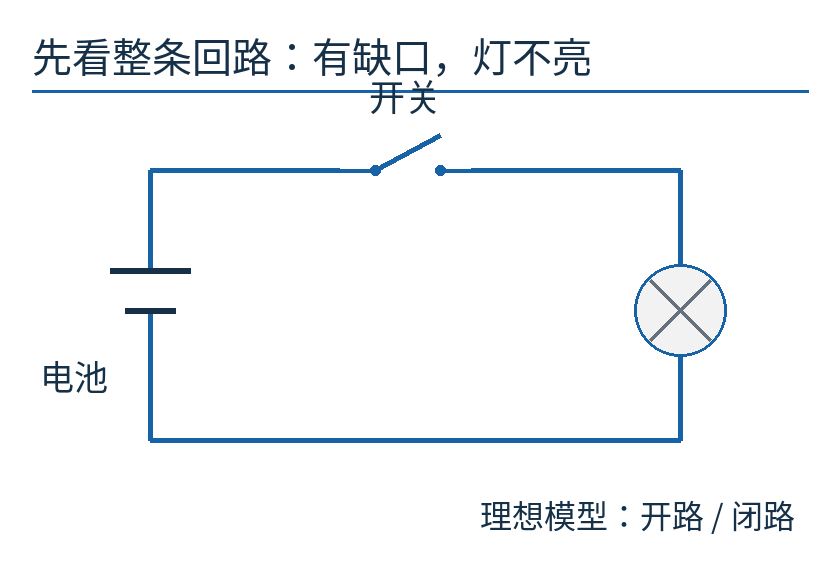

沿蓝线绕一圈：电池、开关和灯必须形成闭合回路。图中开关有一个缺口，所以灯不亮。后面把电源与灯省略，只画夹在两个端点之间的开关网络；那不是说电路不需要电源。

## Shannon 看见的是接线背后的规则

Claude Shannon，Konrad Jacobs 摄，©MFO，[CC BY-SA 2.0 DE](https://creativecommons.org/licenses/by-sa/2.0/de/)。使用[Commons已存许可版本](https://commons.wikimedia.org/wiki/File:ClaudeShannon_MFO3807.jpg)，保留既有黑白调整与水印移除，本篇未再修改。这是人物肖像，不是1938年论文写作现场。

1938年的《继电器与开关电路的符号分析》开头谈的是真实工程：电话自动交换、工业电动机控制，以及各种需要按条件动作的电路。Shannon把网络写成方程，借用布尔逻辑研究等价变换，再由方程画回接线。论文说明它源于MIT的硕士论文；本文所读的是1938年发表的文章版本，不把提交论文、会议报告和刊物发表混成同一时刻。[原论文公开扫描](https://paradise.caltech.edu/ist4/lectures/shannon38.pdf)

这条主线与后来信息论中的熵不同。这里不问一条消息包含多少信息，而问：哪些开关闭合时，两个端点之间存在通路？更进一步，能否少用一些触点，仍保留同样的通断条件？

布尔逻辑并非Shannon发明。他的工作把已有逻辑与一类电气网络的分析、合成联系起来。我们用自己的小电路走一次这座桥，不需要先学完整的符号逻辑史。

## 先拆开一个容易混淆的词：继电器

手按开关是靠手推动触点。普通电磁继电器则用线圈的电磁作用带动机械部件，让一组触点接通或分开。它可以把“某条控制回路是否通电”转换成“另一条回路里的开关怎样动作”。

真实产品的外壳、线圈和触点，可以参看[欧姆龙继电器产品页](https://www.ia.omron.com/products/category/relays/)与[官方结构介绍](https://www.ia.omron.com/support/guide/36/introduction.html)。下图是本文自绘的机制示意，不是某个型号的剖面图；未复制官方产品照片。

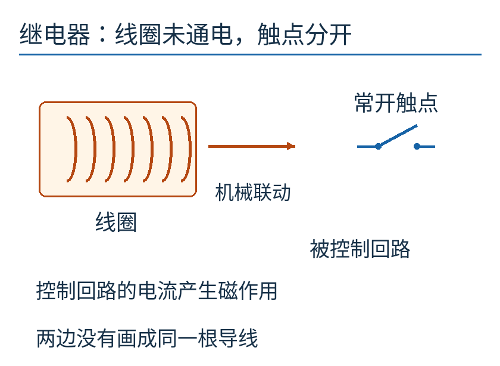

橙色一侧表示控制用的线圈，右侧表示被它控制的触点。中间箭头表示机械作用关系，不是把两条回路直接接通的导线。线圈未激励时，这组“常开”触点是分开的。

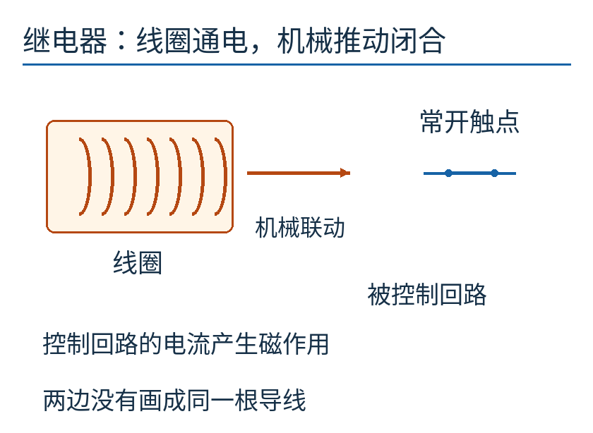

给线圈施加合适的驱动后，机械动作使触点闭合。这里画的是普通非保持型电磁继电器的工作关系，不涵盖保持继电器、固态继电器等所有类型；电气参数、驱动方式仍要看具体器件说明。

同一个继电器可以带多组触点。因此，在不同位置看见两个都标a的触点，并不一定是两个独立输入：它们可以被同一个控制量a带动。这件小事稍后会决定我们到底省掉了什么。

## 一条路上有两个开关：为什么是“且”

从现在起采用一个固定约定：**1表示闭合、导通或条件满足，0表示断开、不导通或条件不满足。** 字母a、b、c都只能取0或1。

把a、b串联，也就是一前一后排在同一条路上。想从左端走到右端，两个位置都不能有缺口。

a=0、b=0，当然不通；a=0、b=1，仍被a挡住；a=1、b=0，又被b挡住；只有a=1、b=1，整条路才通。

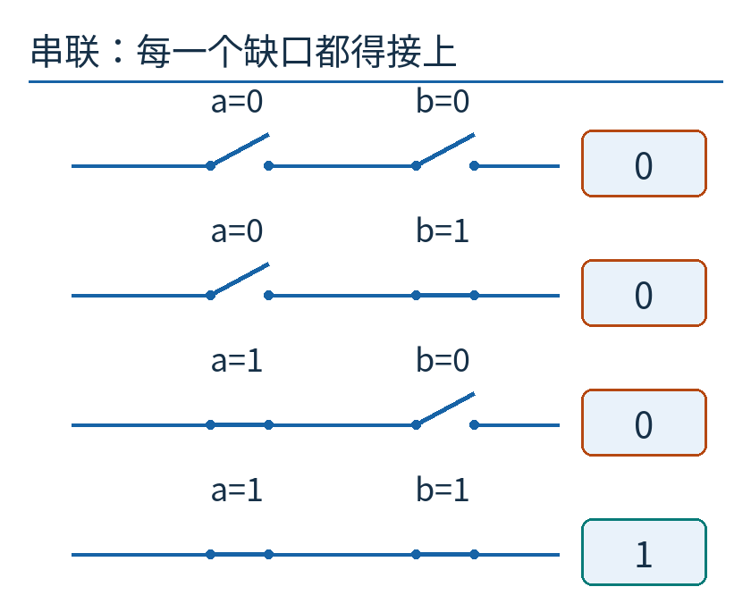

逐行沿线走一次，右边方框记录整条路是否导通。它不是电压值，1也不表示一伏。四行给出了所有可能输入，不只是挑选出来的几个例子。

我们把这种规则叫“与”，日常语言就是“且”，记为 `a ∧ b`。符号∧只是在缩短一句话：a为1并且b为1，结果才为1。

如果习惯乘法，也会发现0×0、0×1、1×0、1×1的结果刚好相同。于是可以把与写成乘积ab。但暂时保留∧，能避免误把所有逻辑运算都当成普通算术。

## 两条路任选一条：为什么是“或”

现在把两个开关放在两条支路上，两条支路的左右两端分别汇合。上路断开，未必走不通，因为下路可能完整。

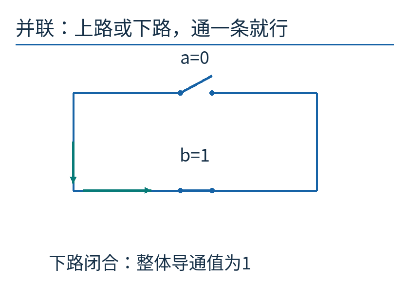

这里a=0、b=1。上路的缺口没有被修好，但沿绿色指示方向走下路，仍能从左端到右端。绿色只强调一条可走路径，不表示额外导线。

只要a、b至少一个为1，网络就导通。这叫“或”，写成 `a ∨ b`。两者都为1时，结果仍是1，不会变成2。因此，有些资料把或写成“+”，也必须记住那不是普通加法。

把这两种连接翻译回来：串联要求全部条件满足，并联允许至少一条支路满足。这两个规则都来自同一个具体动作——沿导线检查有没有完整路径。

## 同一道许可，为什么画了两次

回到开头的灯：总许可a打开，并且左按钮b或右按钮c至少打开一个。

一种直接方案是画两条支路。上路把a与b串联，下路把a与c串联，再把两路并联。写成式子就是：

`F = (a ∧ b) ∨ (a ∧ c)`

F是整个网络是否导通。图中两个a代表两个物理触点，受同一输入控制；不是把同一个触点神奇地摆在两个位置。

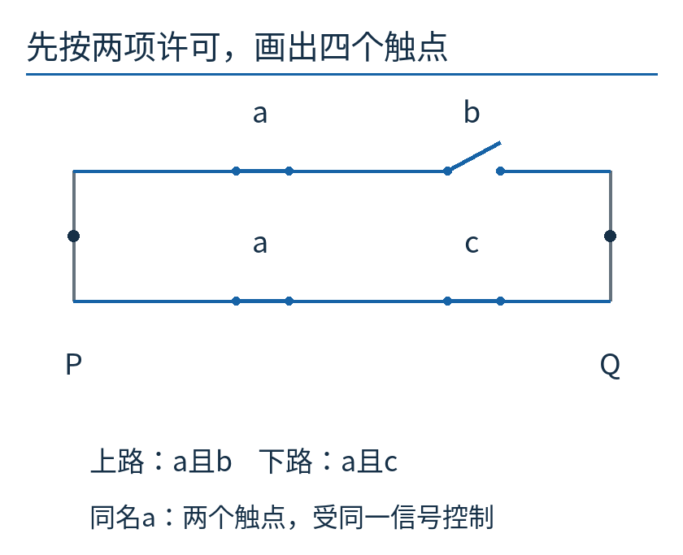

P、Q是整个开关网络的两个外部端点。图示状态是a=1、b=0、c=1：上路被b挡住，下路通过a和c，因此P、Q导通。开关标签写在各自触点上方；P、Q下方的字母只是端点名字。

现在问一句很朴素的话：既然不管走上路还是下路，都得先满足a，能否把a放到分岔之前，让它只出现一次？

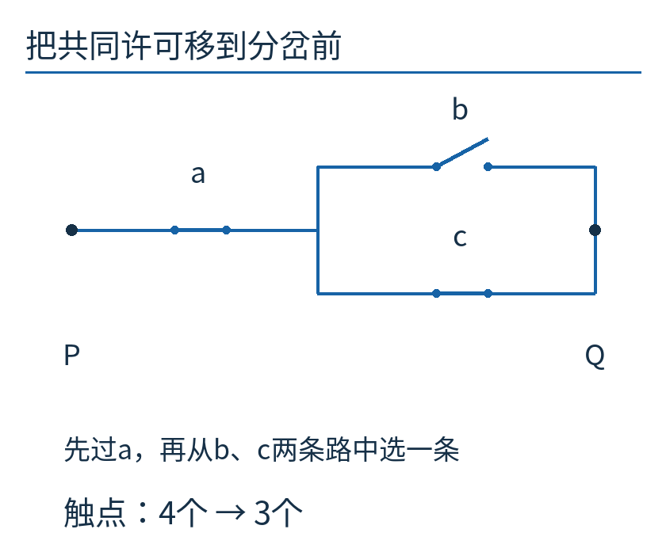

沿左端出发，必须先经过a；到达分岔后，可以走b，也可以走c。三个触点实现的条件是：

`G = a ∧ (b ∨ c)`

这就是分配律在电路里的样子：`(a ∧ b) ∨ (a ∧ c) = a ∧ (b ∨ c)`。它不是把字母凭空挪了位置，而是把两条路线共有的要求抽了出来。

## 别只看一个亮灯状态：把八种情况全部过一遍

a、b、c各有两种取值，一共2×2×2=8种组合。检查等价的意思是：**对每一种相同的输入，两个网络都给出相同结果。** 只举“都亮”的例子，证明不了“都该灭时也灭”。

先手算a=1、b=0、c=1这一行。旧网络上路是1∧0=0，下路是1∧1=1，两路相或得到1。新网络先算括号0∨1=1，再算1∧1=1。两者一样。

再看a=0、b=1、c=1。旧网络的两条支路都被a切断，新网络在分岔前就被a切断，两者都为0。按钮再积极，总许可没开也没用。

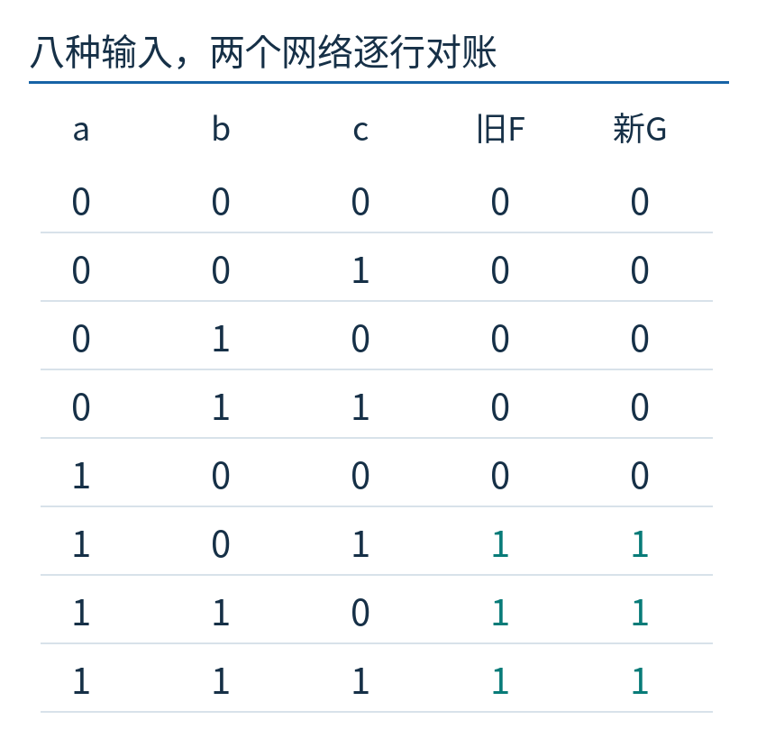

前三列是输入，旧F、新G两列是输出；青色1表示导通。表由附属程序枚举所有八种输入得到。逐行相等才是这次化简的依据，图中的行顺序从000到111。

也可以不用列八行，分两大类讲完：a=0时，两边必为0；a=1时，两边都只剩b∨c。两个可能的a已经覆盖，论证就完整了。

这次省的是一个触点：旧式子里a出现两次，新式子只出现一次。它不自动意味着少一个继电器，因为旧电路两个a触点可能本来就属于同一只多触点继电器；也不能直接推出整机成本下降25%、响应速度提高25%。接线、额定值和实际器件封装都还没算。

## 一个反例就能戳破“差不多”

有人若把串联a∧b换成并联a∨b，觉得“反正都是两个开关”，只要试a=1、b=0就知道错在哪里：前者断开，后者导通。

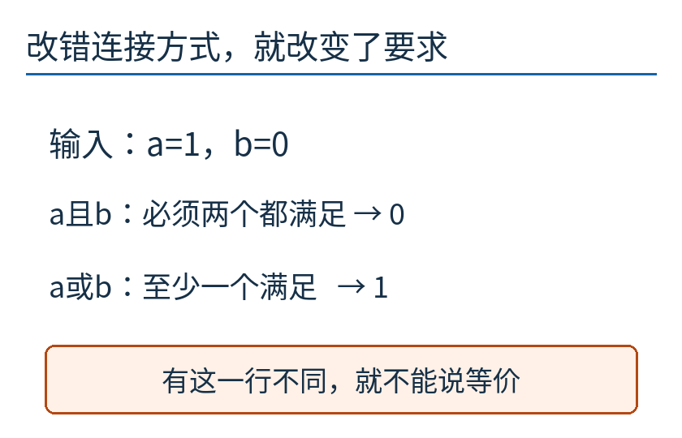

等价要求所有输入一致；不等价只需要找出一个输入不同。这种不对称很有用：检查复杂接线时，不必先把全部情况算完，找到一行反例就应停止接受那个变换。

还有些化简看起来古怪，却确实成立。例如 `a ∨ (a ∧ b) = a`。a=0时，右边支路也因a断开；a=1时，单独的a那条支路已经导通，另一支路不再影响“通或不通”。这叫吸收律。它保证的是我们选择的逻辑功能，而不是每一根导线里的电流分布都一样。

## “非”不需要一根会倒流的导线

若某条件a满足时应断开，不满足时反而应接通，需要的是相反状态，记成 `¬a`，读作“非a”。0的非是1，1的非是0。

普通继电器除了常开触点，也可以有常闭触点。常闭的“常”，指线圈未激励时的正常位置，不是保证它永远闭合。当控制状态从未激励变成激励，常开触点闭合，常闭触点打开；我们先比较动作完成后的稳定状态。

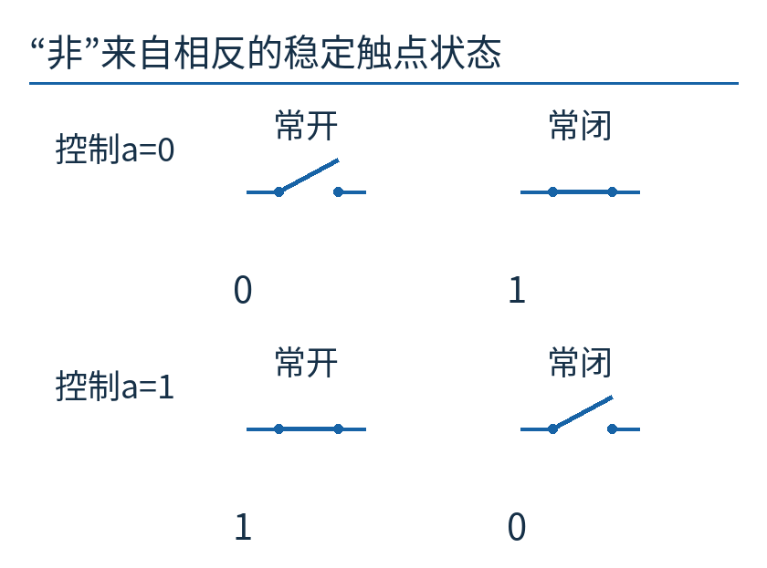

上下两行分别是控制a=0和a=1。每行左边常开触点给a，右边常闭触点给¬a；图没有承诺两组触点在切换过程中恰好同一瞬间动作。

现在可以设计稍难一点的要求：“a、b恰好一个满足时亮，两个都满足反而不亮。”这不是普通或，而是异或。

把“恰好一个”拆成两种互斥情况：a满足且b不满足，或者a不满足且b满足。于是得到：

`(a ∧ ¬b) ∨ (¬a ∧ b)`

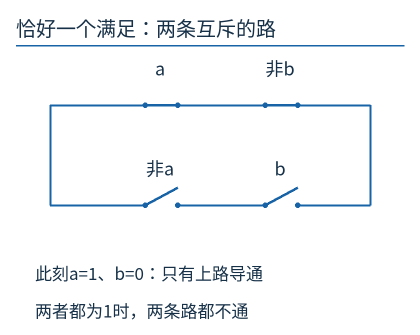

上路用a的常开触点和b的常闭触点，下路反过来。此刻a=1、b=0，上路完整、下路断开；若a=b=1，上路被¬b切断，下路被¬a切断，因此不通。我们刚完成了从语言到条件，再从条件到接线的一次小型合成。

## 打开1938年原文时，要先换一副符号眼镜

如果读者现在打开Shannon原文，可能会惊讶：他把0写成闭路、1写成开路，还把串联写成加号。是不是我们讲反了？

两套约定关注的是相反的问题。本文用1回答“通不通”；原文定义的hindrance关注阻断，用1回答“断没断”。在阻断量约定下，串联任一段断开，整体就断开，正好对应逻辑或；并联需要所有支路都断开，整体才断开，对应逻辑与。

物理连接没有改变，改变的是给状态起什么名字。读历史文献，不能只看符号外形就套用今天习惯。本文的电路都是独立教学设计，公式采用前面明确的导通约定，不声称复刻原论文的编号或记号。

## 纸上永远为1，真实触点却可能短暂都断开

稳态逻辑里，`a ∨ ¬a = 1`，因为a不是0就是1，总有一个条件成立。但把一组常开触点与常闭触点并联，不能仅凭这条式子承诺换向期间绝不会断开。

考虑一个纯教学时序：控制命令在时刻2变化，旧的常闭路在3断开，新的常开路在5才闭合。从3到5，两条路都断了。这个间隙不是布尔等式算错，而是“两个触点始终精确互补”的建模前提在过渡阶段没有成立。

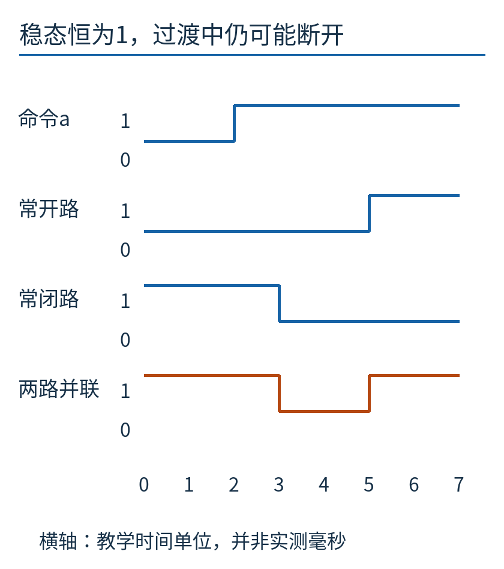

横轴是任意教学时间单位，纵向每行的0、1表示断开、闭合；最下面的橙线是两条路的并联结果。它在3到5之间落到0。此图由明确设定的时刻生成，不是示波器实测，不代表任何型号的毫秒参数，也不把所有继电器都画成相同的切换方式。

真实装置还可能涉及触点弹跳、线圈驱动、负载、电弧和器件寿命。静态逻辑给出了设计条件中的一层，时间和电气行为需要另外建模与验证。Shannon原论文后面也讨论时间相关网络，本文没有用这一篇入门文章替代那些内容。

## 现在可以自己检查一段接线了

面对一个小网络，先确定0、1的含义，再从两端沿路线观察：串联写“且”，并联写“或”，相反的稳定触点状态写“非”。写出式子以后，每一次化简都要保留同一组输入的通断结果。

不妨试试 `a ∧ (a ∨ b)`。a=0时，入口断开；a=1时，并联部分至少有a这条通路，因此整个式子等于a。你可以画出原接线，列四行状态，再把它化成一个a触点。比背下“吸收律”这个名称更有用的是，亲自说明那条多余支路为何没有改变结果。

本文的[计算程序](examples/measure.py)枚举八种主例输入、四种双输入逻辑，并生成明确标成教学假设的时间序列；[结果数据](examples/results.json)供图直接读取。运行它检验的是这些理想模型，不是获得了接实际电路的设计认证。

Shannon这篇工作的吸引力，正在于开关从此不只是图上的一条斜线。它可以进入一个有规则、可反驳、能来回翻译的系统：接线提出问题，代数帮助推理，接线再把答案做成能工作的结构。

---

原创正文、原创图及附属代码采用[CC BY 4.0](https://creativecommons.org/licenses/by/4.0/)。肖像保持单独许可，完整出处与使用范围见[sources.md](sources.md)。
