# 只量三次流量，为什么中间那次要算四份？从面积走进辛普森公式

水管往桶里注水，流量正在变化。你想知道两秒钟一共进了多少水，传感器却只给出三次读数：开始时1升每秒，一秒时2升每秒，两秒时5升每秒。

把三个数平均，再乘2秒，得到16/3升，约5.333升。这个办法看起来很公平：三次读数一视同仁。

但如果这段时间的流量恰好遵循 `f(t)=1+t²`，真正的水量是14/3升，约4.667升。三次等权平均多算了。

另一条略显奇怪的规则却正好算对：

`总水量 = (2秒)/6 × [1+4×2+5]升/秒 = 14/3升`。

为什么中间那次有四票，两端只有一票？它是在偏袒中间，还是替一条弯曲的线认真算了面积？

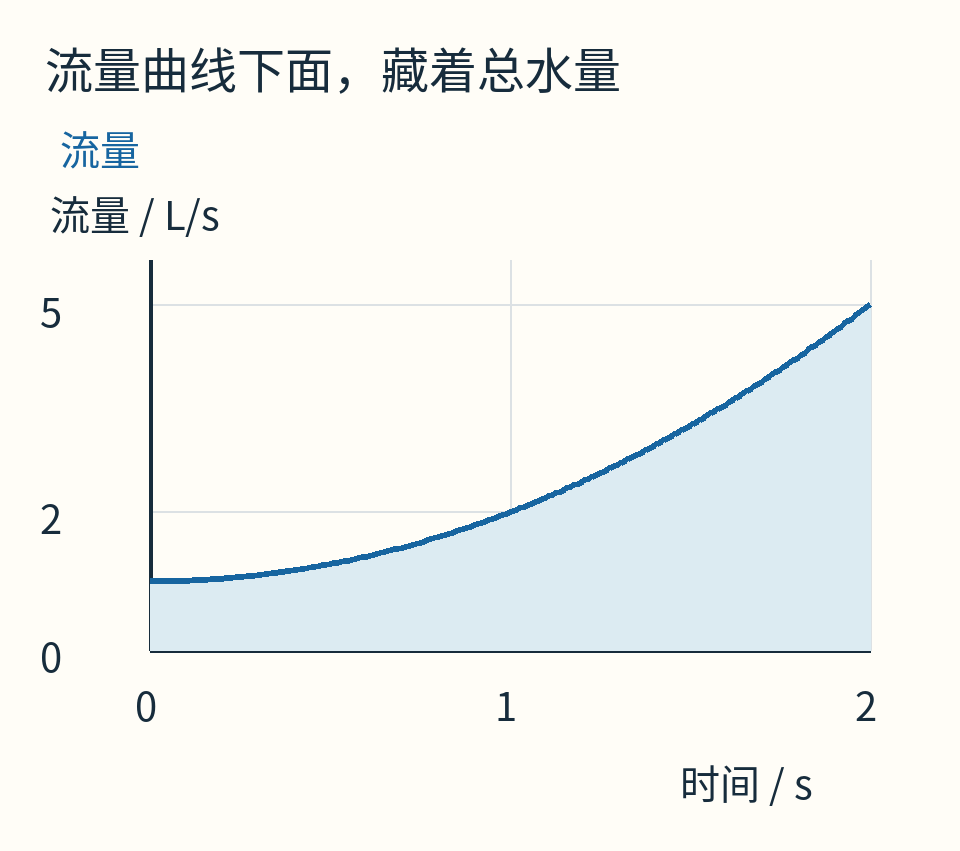

图中流量是自选的数学模型，不是真实水管测量；蓝色区域的面积才是两秒内的总水量。

## 总量怎样变成一块面积

若流量一直是3升每秒，持续2秒，水量当然是6升。图上是一块宽2、高3的长方形。

流量变化时，把时间切成许多小段，每段暂时当作流量不变，就会得到一排窄长方形。每个长方形的面积是“这小段的流量×持续时间”，把面积相加，就近似得到总水量。

时间段越细，在流量足够平滑的前提下，近似越接近真实累计量。这个极限就是积分。符号 `∫₀²f(t)dt` 只是把“从0秒到2秒累计f所代表的流量”缩短写下来。

这里的面积带单位：横轴秒，纵轴升每秒，相乘得到升。它不是一块真的铺在地上的平面面积。

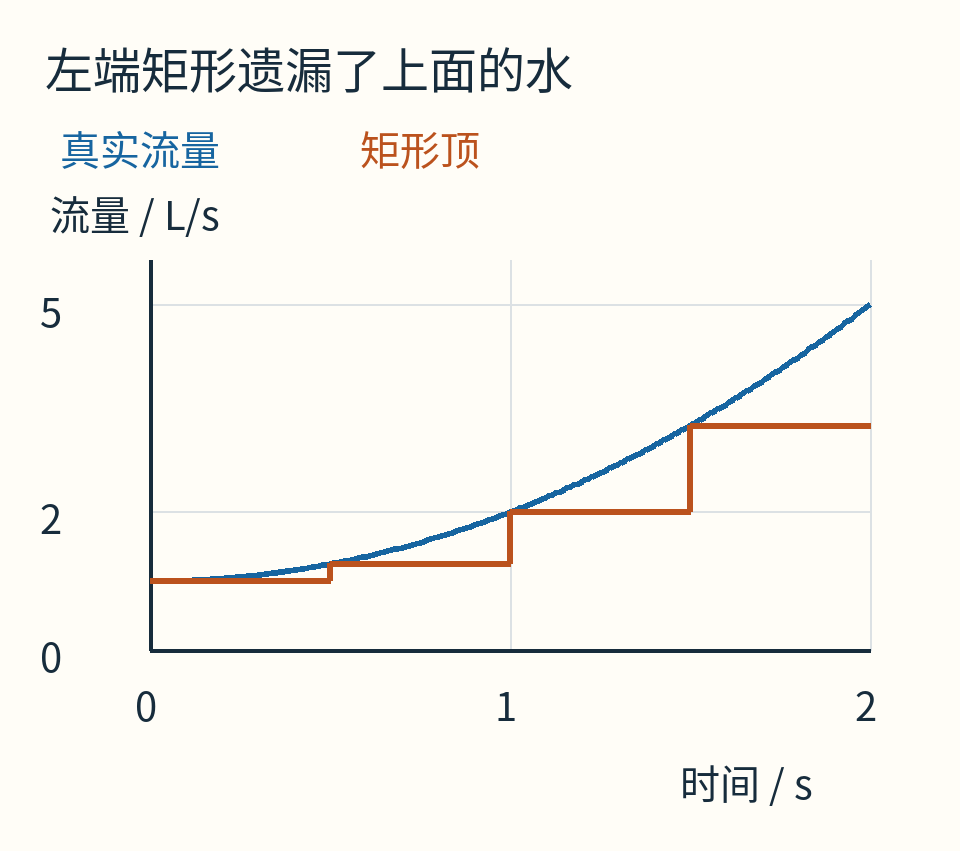

橙色台阶按每段左端流量取高。由于本例流量越来越大，矩形顶始终低于蓝线，于是低估。换成下降曲线，偏差方向也会改变。

矩形方法并没有错，它只是把一段曲线当成了常数。我们能不能用稍微聪明一点的形状？

## 两个端点给我们一条直线

只看开始和结束读数，可以用直线连接。线下的面积是梯形面积：

`(左高+右高)×宽/2`。

本例是 `(1+5)×2/2=6` 升。比刚才等权平均还大。

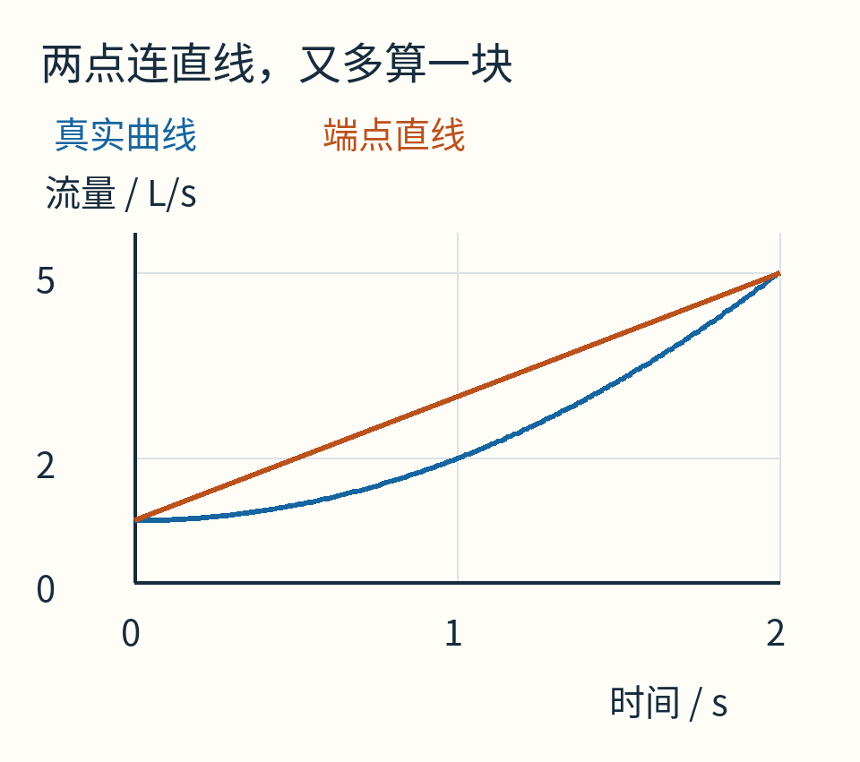

原因就在图里：真实曲线向上弯，端点直线在中间悬得太高。端点再准确，也不会自动告诉我们中间弯了多少。

如果多问一次中间，读到2，而端点连线在中间预测3，我们就知道直线漏掉了弯曲。三个不同位置上的点，可以确定一条至多二次的多项式曲线，即形如 `A+Bt+Ct²` 的抛物线；若C恰好为0，它退化为直线。

辛普森公式做的就是：**先让一条二次曲线穿过三个等距读数，再精确算那条曲线下面的面积。**真实函数如果并非二次，得到的才是近似。

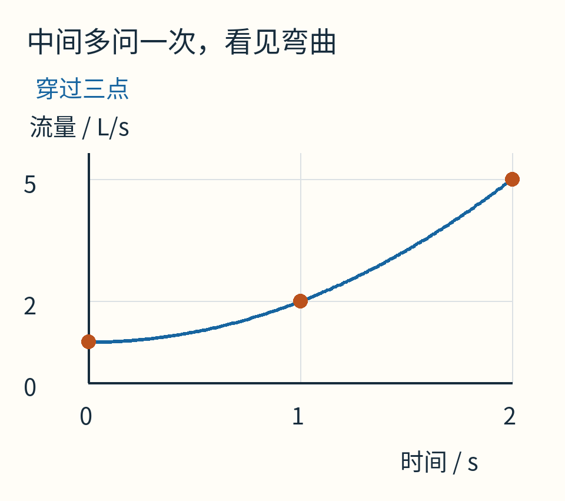

本例的真实流量本来就是1+t²，因此插值曲线与真实曲线重合。图中三个橙点是采样，不是三次独立实验。

## 不解三个系数，也能把权重找出来

先把时间坐标平移、缩放，使三个点落在−1、0、1。我们暂用z表示这个新坐标；它不是原来以秒为单位的时间。原区间若是[a,b]，中点为m=(a+b)/2，半宽为h=(b−a)/2，那么原坐标是 `t=m+hz`。

在这个对称区间里，设面积估计是：

`αf(−1)+βf(0)+αf(1)`。

两端取相同权重，因为左右翻转不应该改变总面积。只要它对常数、一次、二次三种基本形状都算准，就会对它们的任意相加组合算准。

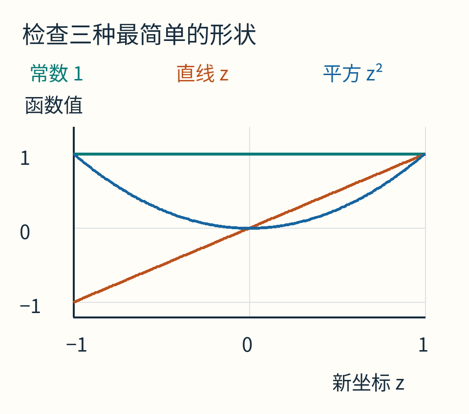

先看常数函数f(z)=1。真实面积为2，所以 `2α+β=2`。

再看直线f(z)=z。左半负面积与右半正面积抵消，总计0；加权结果−α+α也自动等于0。

最后看平方f(z)=z²。两端读数都是1，中间为0，估计变成2α。真实面积是2/3，因此 `2α=2/3`，得到α=1/3，再由第一式得到β=4/3。

于是权重是 `1/3，4/3，1/3`。把共同的1/3拿出来，就是熟悉的 `1:4:1`。

如果你还没学过积分，2/3从哪里来？可以用长方形极限核对：把[0,1]等分成n段，取右端高度，面积和是 `(1²+2²+…+n²)/n³`。利用平方和公式 `n(n+1)(2n+1)/6`，让n越来越大，得到1/3；左右两半相同，合计2/3。这里没有用辛普森公式证明它自己。

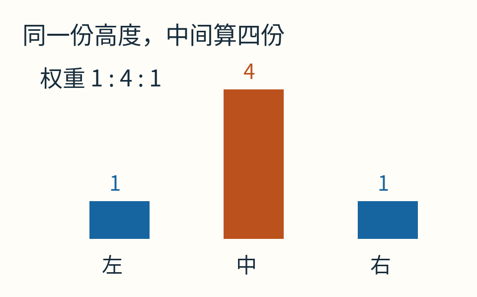

柱子的高度按1、4、1真实比例绘制。中间四份的来历，是让二次弯曲与常数面积同时正确，不是凭经验多相信一次中间读数。

回到宽度b−a的原区间，还要乘坐标伸缩因子h。于是：

`S = h/3 × [f(a)+4f(m)+f(b)]`

也就是 `(b−a)/6 × [f(a)+4f((a+b)/2)+f(b)]`。

对开头0、1、2秒的流量，h=1秒，三个读数1、2、5，代入就得到14/3升。

## 为什么三个点居然还能算准三次曲线？

我们只要求它照顾到二次，却额外得到一个小惊喜：对三次多项式也精确。

在对称坐标里，剩下只需检查z³。它左半为负、右半为正，两半有符号面积相消；采样加权结果 `(−1+4×0+1)/3` 也为0。

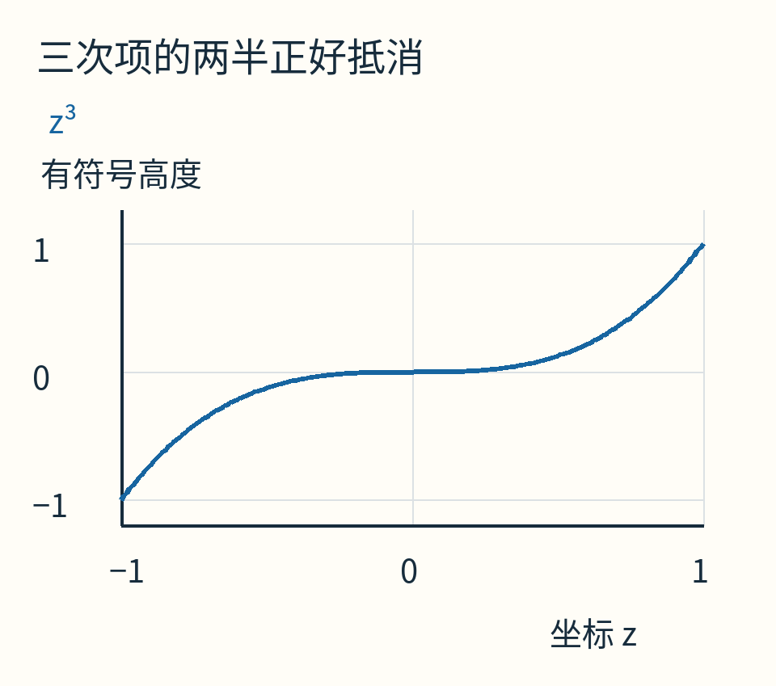

所以常数、z、z²、z³都算准。任意三次多项式都能写成这四项的倍数相加，故也算准。平移坐标后，一个三次多项式仍是三次多项式，结论不局限于原点对称的题目。

注意，是**有符号面积**抵消。若任务是求曲线与横轴之间的几何总面积，要先处理正负区间，不能把负值自动改成正值后还套同一个函数。

三个点没有神奇地知道任意曲线。四次项马上会让误差显形。

## 换成x⁴，误差就露出来了

现在明确换模型：求0到2之间x⁴的积分。这已经不是开头的流量函数，只是便于精确核对的数学试题。

三个采样值是0、1、16，辛普森结果为 `(0+4×1+16)/3=20/3`，约6.666667。真实积分是 `2⁵/5=32/5=6.4`，多算了4/15。

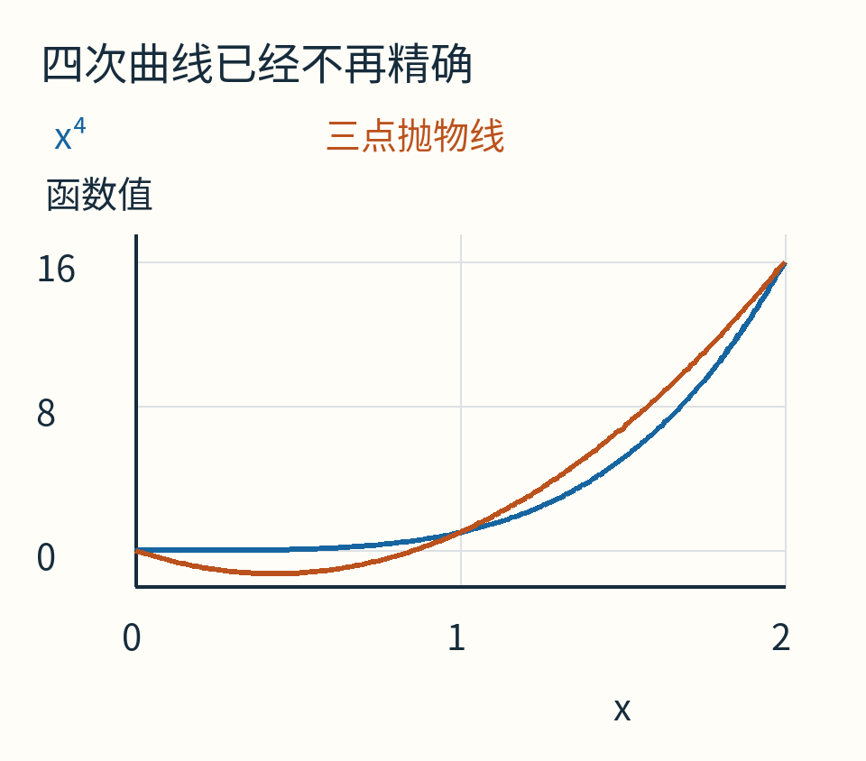

橙色二次插值是7x²−6x。它甚至会在部分区间落到0以下，而真实x⁴始终非负。插值曲线是一种计算工具，不保证保留真实函数的所有形状性质。

想改善，可以分段：在[0,1]和[1,2]各用一次辛普森，需要0、0.5、1、1.5、2五个点。公共点1参与两段端点，自然会被计算两次。

若把[a,b]分成偶数n个等长小段，步距h=(b−a)/n，复合公式的权重成为：

`1，4，2，4，2，…，4，1`，共同乘h/3。

这里的n是**小段数**，不是点数；点数是n+1。偶数要求来自每个辛普森面板占两小段。把三个点叫“三段”，很容易在程序里错一格。

对于x⁴例子，n=4时结果是77/12，约6.416667，误差1/60，恰好是n=2误差的1/16。n=8与16继续按相同比例下降。

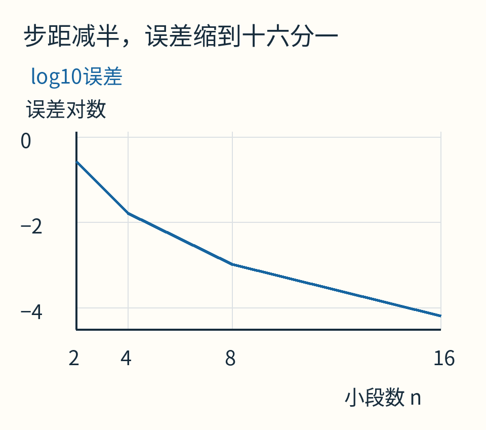

纵轴是以10为底的误差对数；−2表示误差0.01，不是负误差。真实误差由已知精确积分相减得到，没有用“两个近似很接近”代替真误差。

对足够光滑、四阶导数有界的函数，复合辛普森误差的一个标准界是：

`|误差| ≤ (b−a) h⁴ M /180`，其中M是整段上四阶导数绝对值的上界。

[NIST DLMF的辛普森条目](https://dlmf.nist.gov/3.5#ii)给出了相应公式与光滑性条件。四阶导数可理解为衡量函数在更高阶上偏离三次多项式的变化；没有学过它，也应记住保证依赖的是整段函数的性质，不只是眼前几个读数。

## 两次计算一模一样，为什么仍可能错得很大？

实际问题通常不知道精确积分。常见做法是算一次粗结果S，再把区间一分为二，得到细结果S₂。若误差已经进入h⁴规律，细化后的误差约为原来的1/16；于是 `|S₂−S|/15` 能当作细结果误差的估计。

这里有个“若”。两次结果接近，不自动等于两次都接近真值。

看函数 `g(x)=sin²(2πx)`，区间仍为[0,2]。粗辛普森用0、1、2，全部读到0；二分后的五个点0、0.5、1、1.5、2，也全部读到0。两次结果都近乎0，看起来一致得惊人。

可是中间有四个正的波峰，真实积分是1。用恒等式 `sin²θ=(1−cos2θ)/2` 就能核对：在整数个周期上，余弦正负抵消，只剩区间长度乘1/2。

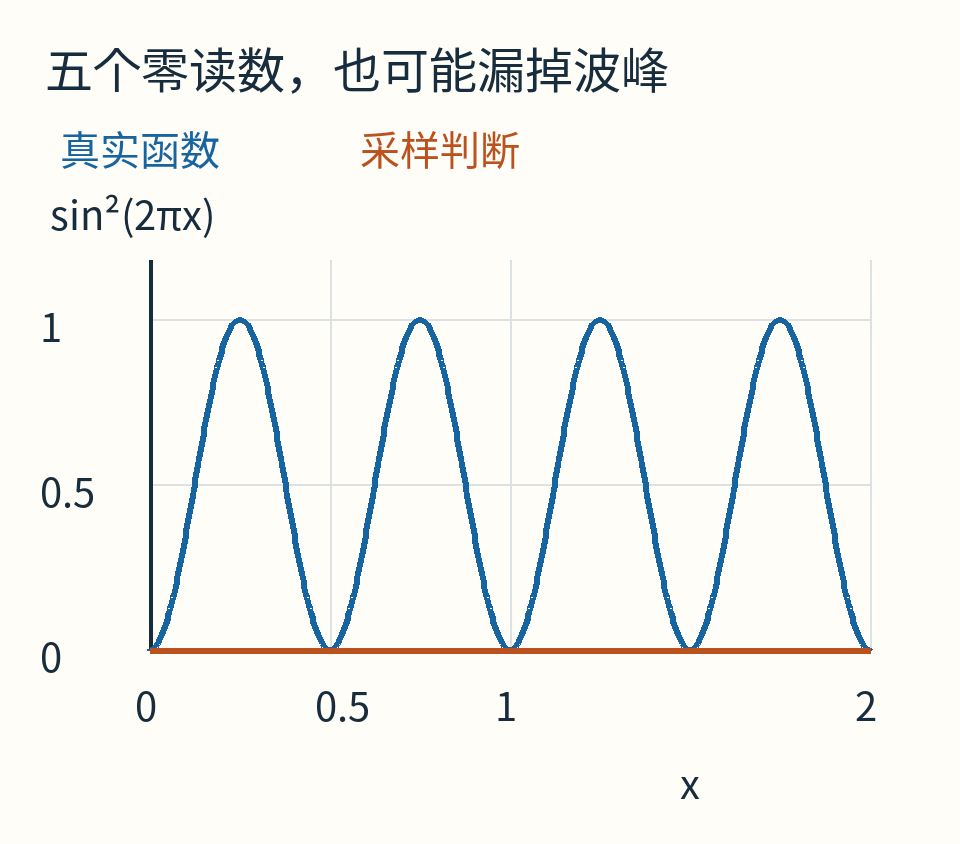

橙线是两套采样可能给出的零判断；蓝线是实际函数。浮点计算中采样值可能为极小的非零数，这不影响反例：它们仍然误导性地接近0。

这不是说自适应积分没有用，而是说：**没有对函数变化作任何限制，有限次采样无法排除采样点之间藏着一个尖峰或振荡。**你总能造出一条在那些点都一样、在别处却不同的曲线。

可靠性来自采样策略、误差分析、问题先验及异常处理共同配合，不来自一个漂亮的“前后差小于阈值”。

## 传感器时间不等距，也别照搬1:4:1

假设三个读数发生在0、0.5、2秒。中间读数已经不是时间中点，标准辛普森权重就不适用。

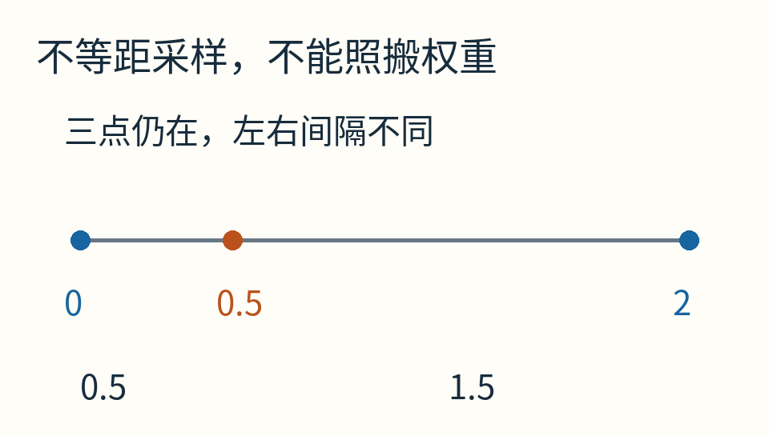

仍用f(t)=1+t²，读数是1、1.25、5。若错误地套 `(2/6)×[1+4×1.25+5]`，只得到11/3升，漏掉1升。

三个不等距点依然能确定二次插值，但积分权重必须按实际采样位置重新推导。有时数据只能测一次，后面不能任意补问，问题就更接近“对离散数据选择合适的积分模型”，而不是随叫随到的函数积分。

还有噪声：若每个流量读数都可能误差±ε，标准单面板辛普森权重全为正且总和为b−a，因此仅由这项读数误差引起的水量误差，最坏不超过 `(b−a)ε`。减小时间步距能减少某些离散误差，却不会自动消除传感器误差或模型错误。

## 什么时候值得再多问几次？

对一条大部分平缓、少数地方急剧变化的曲线，全段均匀加密可能浪费。自适应方法会比较局部粗细结果，把额外采样放在变化更难描述的区域，并设置最小步长、最大深度或调用次数上限。

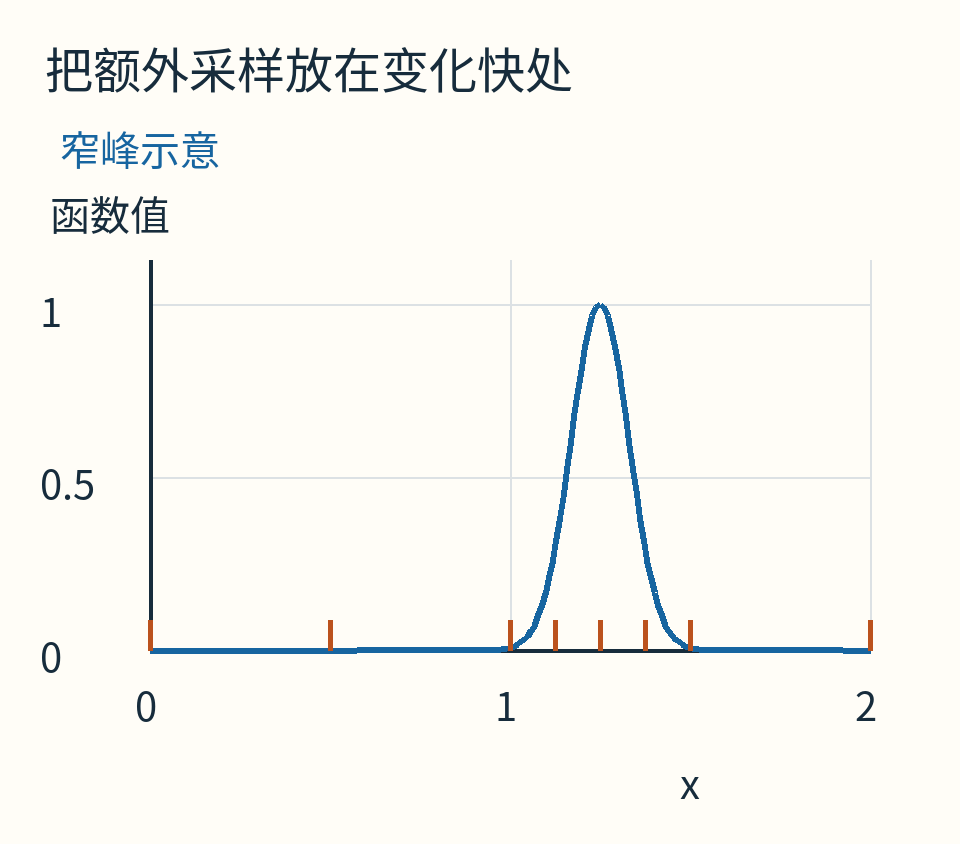

橙色短线示意采样位置。此图说明设计思路，没有声称随文已实现能保证抓住任意窄峰的自动积分器。

达到次数上限时，应返回“未满足目标精度”等状态，而不是把最后一个数改名为成功。遇到不连续、无穷尖点、强烈振荡，还可能需要换方法或先把区间拆在已知特殊位置上。

[随文程序](examples/lab.py)提供固定偶数分段的辛普森实现，用Fraction精确核对0到3次多项式和x⁴误差比例，并生成全部图。[运行说明](examples/README.md)明确区分精确有理数计算与仅供显示的浮点曲线。

三次读数中间算四份，并不是一种神秘经验。它是一份小而具体的合同：在三个等距点之间，用二次曲线理解变化，并精确积分这个替身。知道合同写了什么，才知道什么时候可以相信它，什么时候该再多看一眼曲线中间。

原创正文与图解采用CC BY 4.0。AI辅助了资料整理、解释组织和计算图代码；[来源与素材说明](sources.md)。
