# 有序链表加几层捷径，怎样少走路又容易插入？

一份按分数排好的名单，分数依次是：

`4 → 9 → 15 → 21 → 28 → 34 → 42`

假如它放在数组里，程序可以直接去中间的位置，比较一次，再决定向左还是向右找。可假如它是链表，每个节点只知道“下一个节点在哪里”，知道中间有个 21 并不能让你瞬间飞过去。你得顺着地址一个个走。

链表很方便地腾出了插入位置，却把长距离查找变慢了。

有没有办法给它添几条捷径，同时不把“插一个节点”变成“重排整张地图”？跳表，skip list，就是这样一个结构。它保留底层的完整有序链表，再让一部分节点出现在更高层。查找时先走高处的长跳，快到目标附近再下楼。

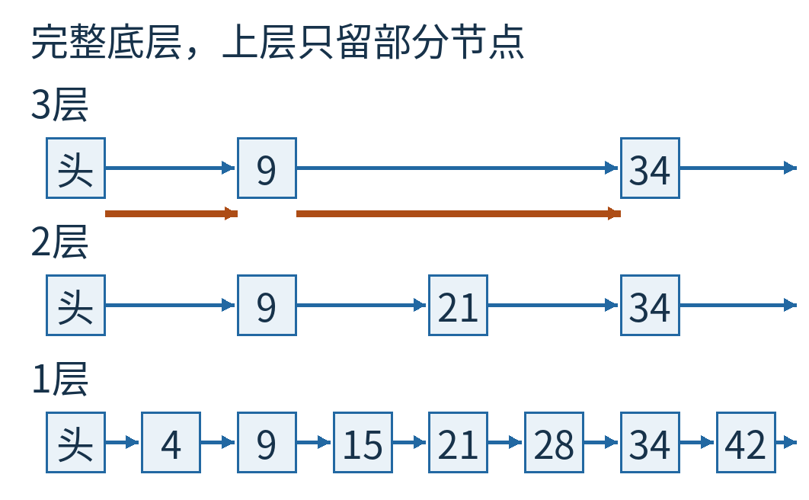

图1｜下方每个键都在，蓝箭头依次访问；上方只有部分节点，橙箭头能跳过中间节点。横向距离只是排版，不代表内存里节点的物理距离。

“给谁搭高楼”很关键。若强求每隔一个、每隔两个节点就严格设一站，插入新节点会打乱名次，可能牵动很多旧节点。跳表选择了一种更轻巧的办法：每个新节点独立抽一个高度，以后不为保持整齐而集体搬楼。

## 节点里的“下一站”，可以有好几份

先不用随机数，直接看一张固定的教学跳表。

七个节点的高度分别是：4 高 1 层，9 高 3 层，15 高 1 层，21 高 2 层，28 高 1 层，34 高 3 层，42 高 1 层。层号从 1 开始，底层叫第 1 层。

高度为 3 的节点，不是复制了三份数据。它仍然是同一个键，只是保存了三条“下一站”地址：一条连向底层下一站，一条连向第 2 层下一站，一条连向第 3 层下一站。

每层的规则一样：从左向右，键越来越大。第 1 层包含全部节点；第 2 层只包含高度至少为 2 的节点；第 3 层只包含高度至少为 3 的节点。

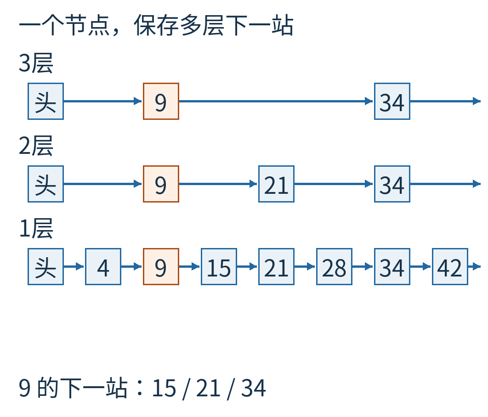

图2｜竖直对齐的格子属于同一个节点，各格代表该层的前向指针。左边“头”是入口哨兵，不是名单里的一个分数；末尾空箭头表示这一层已经没有下一站。

例如节点 9 的三个下一站是：第 1 层指向 15，第 2 层指向 21，第 3 层指向 34。上层跳过 15，并不意味着删了 15；要找 15，下来到第 1 层就能见到。

## 找 28：先问下一跳会不会跨过头

从头节点的最高层开始。当前第 3 层下一站是 9，小于目标 28，所以可以向右走到 9。

下一站是 34。34 已经不小于 28，继续跳就可能跨过目标，于是停在 9，下降一层。我们使用统一规则：**只有下一站严格小于目标，才向右走。**相等也先不跳，最后统一检查底层的下一站。

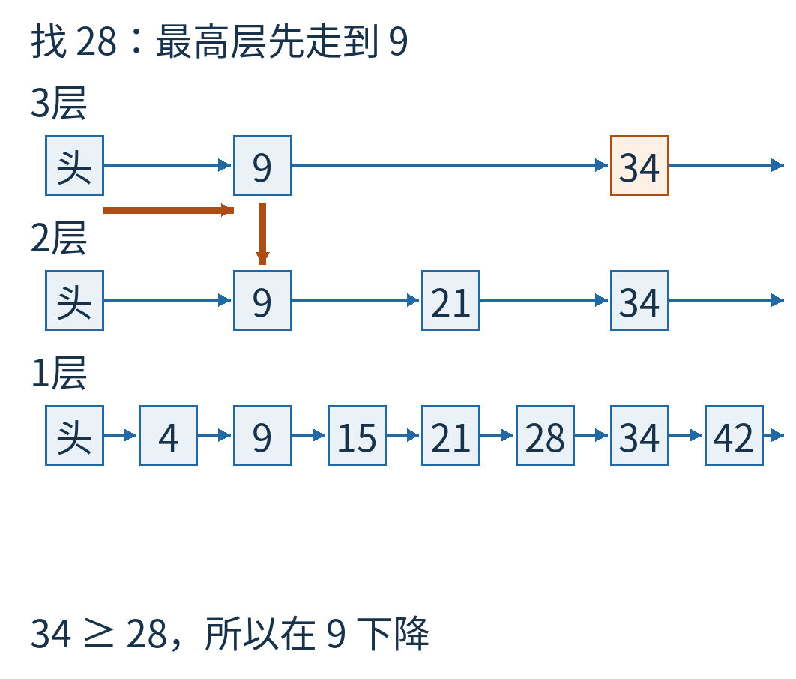

图3｜橙色路线表示实际走到 9；34 的比较结果说明不能继续向右。下降发生在同一个节点 9 上，不是回到头节点重新开始。

到了第 2 层，9 的下一站是 21，小于 28，可以走过去。21 的下一站又是 34，不能跳，便在 21 下降到第 1 层。

第 1 层，21 的下一站是 28。它与目标相等，不满足“严格小于”的前进条件，因此横向搜索结束，检查这个下一站，确认找到了。

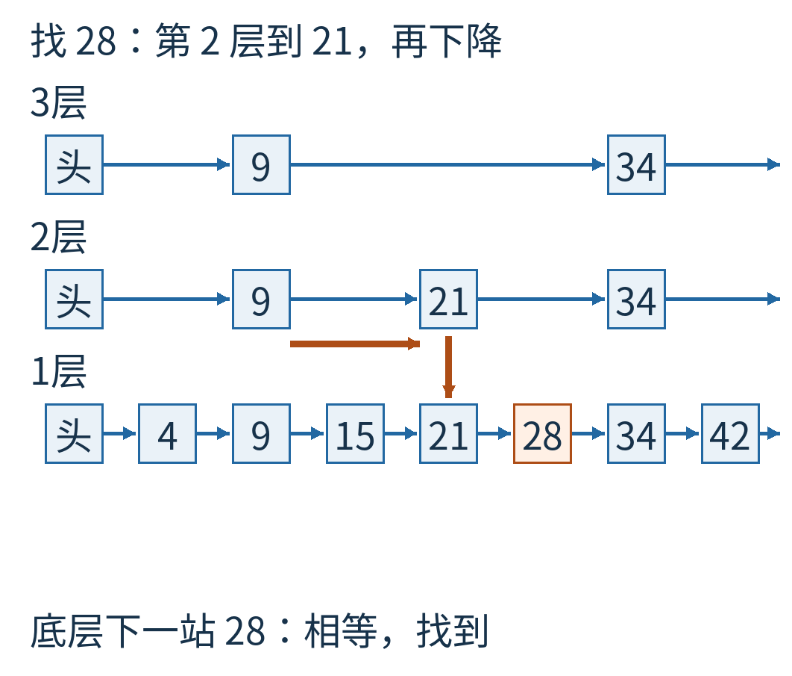

图4｜路线按第 2 层从 9 到 21，再下到第 1 层，最后检查 28。未经过 4 和 15，也没有越过目标再往回走。蓝色细箭头仍是原有链接，橙色粗线才是本次查找路线。

为什么这样走不会把答案丢掉？当下一站是 34，而目标是 28 时，答案若存在，只可能在当前节点与 34 之间。下降后，这个区间里的更矮节点重新可见；在当前层往右跨过 34，反而会把这段区间整个跳掉。

因此，算法不断维持一个简单关系：已经站住的节点仍在目标左边，真正答案尚未被越过。到底层时，所有节点都在，下一站就是第一个不小于目标的键。它若不等于目标，目标就不存在。

换成找 27，会停在底层的 21，下一站仍是 28。因为 21<27<28，中间没有其他节点，所以这次正确答案是“没有”，并不是“找不到就随便选最近的”。

## 查找顺便留下三枚书签

现在要把新分数 25 插进去，并规定这个新节点高 2 层。仍使用同一张跳表，没有重新抽旧节点的高度。

先像查找 25 那样走一遍，不过每次准备下降时，记下当前层停在哪个节点。这些位置叫前驱：它们的下一条链接将来可能需要接到新节点上。

本例得到：第 3 层前驱 9，第 2 层前驱 21，第 1 层前驱 21。

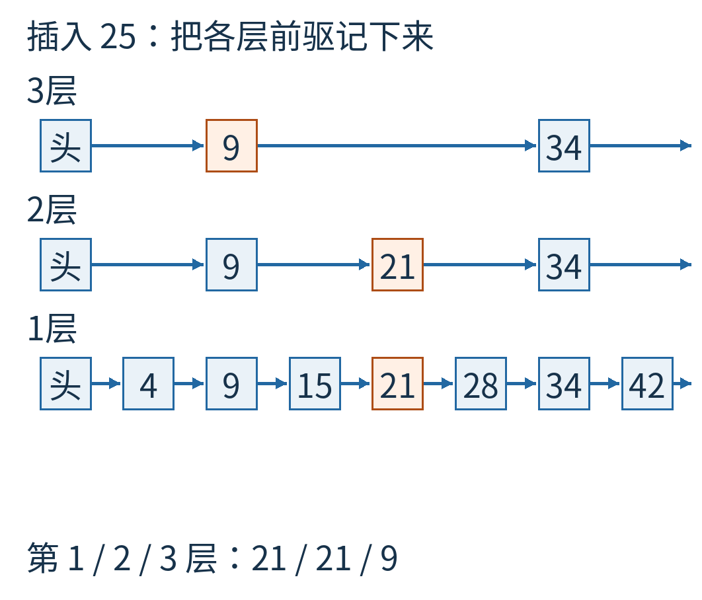

图5｜橙框标出查找 25 后各层的前驱。第 1、2 层都停在节点 21，第 3 层停在 9；这是三条不同层的链接位置，不是要建立三个不同的 21。

如果只记下底层前驱 21，插一个 1 层节点倒够用；插 2 层、3 层节点，就还缺对应的上层前驱。搜索时顺便存一份 `update` 数组，正好把这些书签留下。

## 插入时，先接住旧下一站

在第 1 层，原来是 `21 → 28`。要变成 `21 → 25 → 28`，做两个赋值：

1. 让新节点 25 的下一站指向原来 21 的下一站，也就是 28。
2. 再让 21 的下一站改为 25。

顺序很重要。如果先把 21 改成指向 25，再去读“21 原来的下一站”，得到的就已经是 25；若没有别处保存 28，容易把后半条链丢掉，或误连出一个自环。

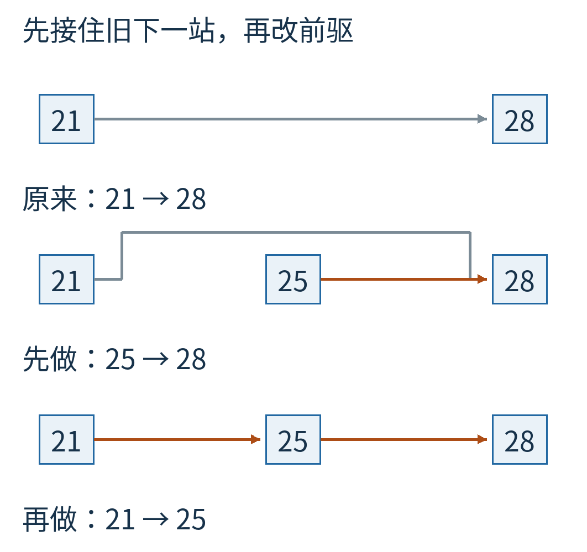

图6｜上方保留旧链接 21→28；中间先让新节点接住 28；下方再改前驱，完成 21→25→28。橙箭头是本步新改的链接，灰箭头是在下一步才被替换的旧链接。

第 2 层也是同样的动作，只是旧下一站变成了 34：`21 → 34` 变成 `21 → 25 → 34`。

第 3 层不用改，因为 25 只有 2 层。于是整个插入只在新节点覆盖到的层上拼接，不要求旧节点补高、降层或重新编号。

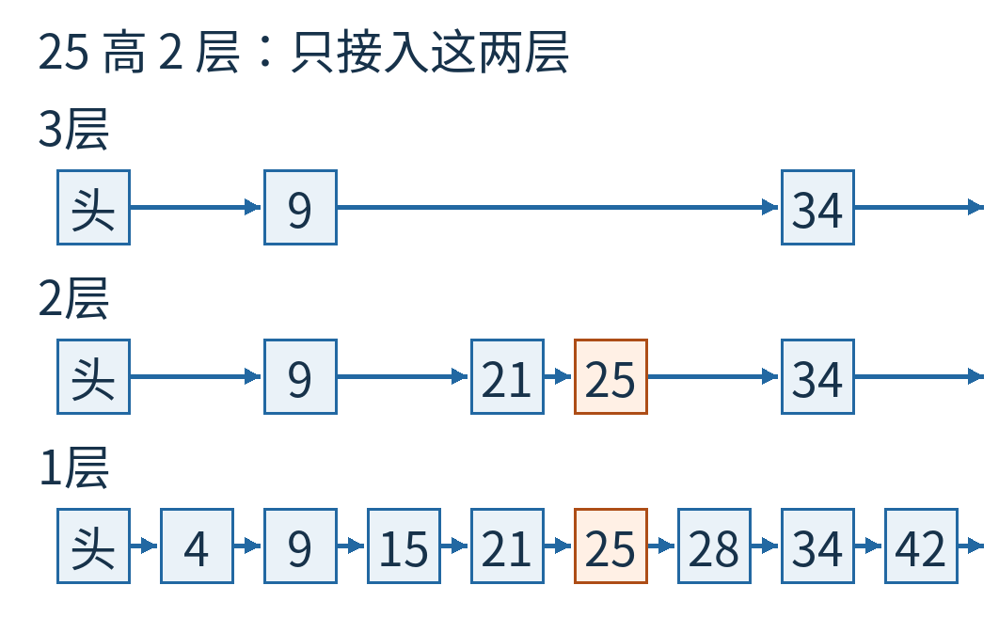

图7｜25 在第 1、2 层出现，第 3 层的 9→34 保持原样。原有所有键的大小次序不变。

若抽到的新高度超过现有最高层，就让新增层的前驱使用头节点，并提高整张表当前的层数。真实实现还会设一个最大层数，避免无界分配；本文教学代码的上限为 16。这个上限是实现参数，不是跳表只能有 16 层的数学定律。

键已经存在怎么办？可以更新它关联的值，而不是再塞一个同键节点。本文只演示无重复键的集合，重复插入返回“不新增”。多重集合需要另订规则，不能悄悄让“严格小于”和“唯一节点”两个假设失效。

## 删除同样是绕过去

在已经插入 25 的表上，再删除 21。

搜索 21，找到它各层的前驱。第 1 层前驱为 15，第 2 层前驱为 9；21 没有第 3 层。分别把前驱直接接到 21 在对应层的下一站：第 1 层接到 25，第 2 层也接到 25。

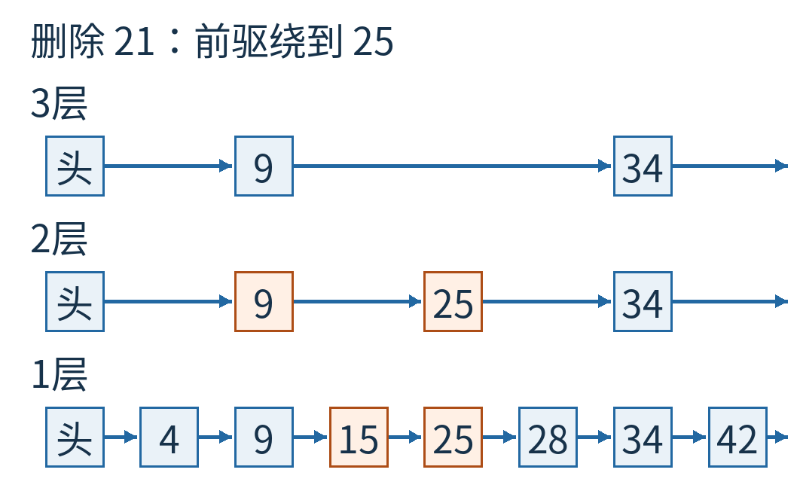

图8｜原来穿过 21 的两条路径现在都绕到 25。注意第 1 层前驱是 15，第 2 层前驱是 9；删除不等于把两个不同的前驱混成同一处。

如果删除让最顶层只剩头节点与空指针，就把整张表的当前最高层降下来。这个维护只检查已经变空的高层，不是重新计算所有节点的理想高度。

到这里，搜索、插入、删除都已经可以手算。接下来才轮到概率：为什么随机出来的高楼，通常能让路线短一些？

## 每次正面，才多搭一层

最简单的高度规则是：新节点先拥有第 1 层，然后反复抛一枚公平硬币；每次正面加一层，遇到反面就停。

第一次就是反面，高度为 1。正、反，高度为 2。正、正、反，高度为 3。各节点独立做这件事，不根据键值大小决定高度。

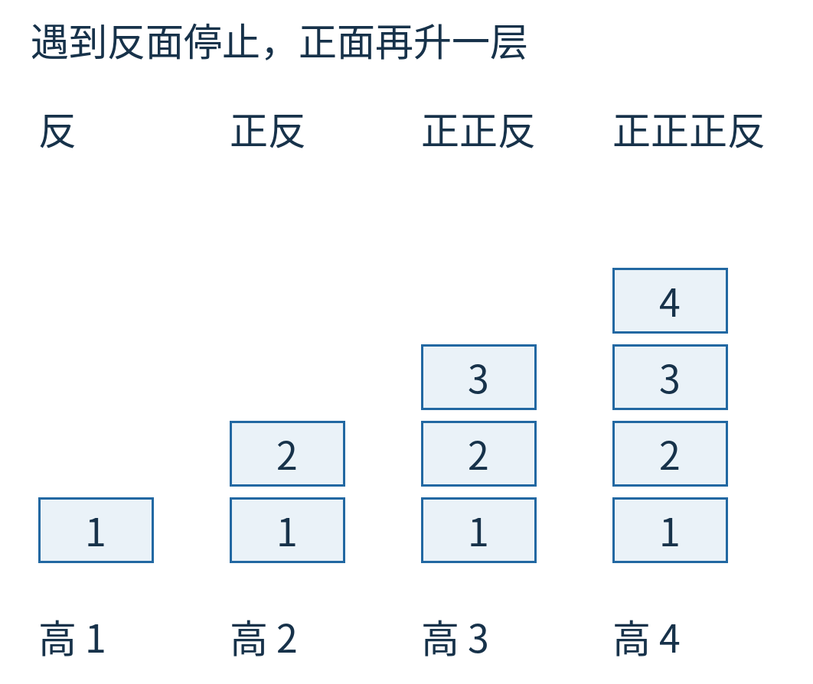

图9｜每个例子都从第 1 层开始。“正”只负责额外升一层，“反”使本次抽高度结束；这些是不同节点可能经历的结果，不是一枚硬币同时走四条路线。

因此，一个节点达到第 2 层的概率是 1/2，达到第 3 层是 1/4，达到第 4 层是 1/8。这里说的是“至少达到这一层”，不是“恰好这么高”。恰好高 3 层还要接一个反面，概率为 1/8。

若有 128 个节点，第 1 层固定有 128 个，第 2 层平均约 64 个，第 3 层平均约 32 个，一直到第 8 层平均约 1 个。“平均”说的是反复重新抽高度后的期望，不是每张实际表都整整齐齐地一半、一半再一半。

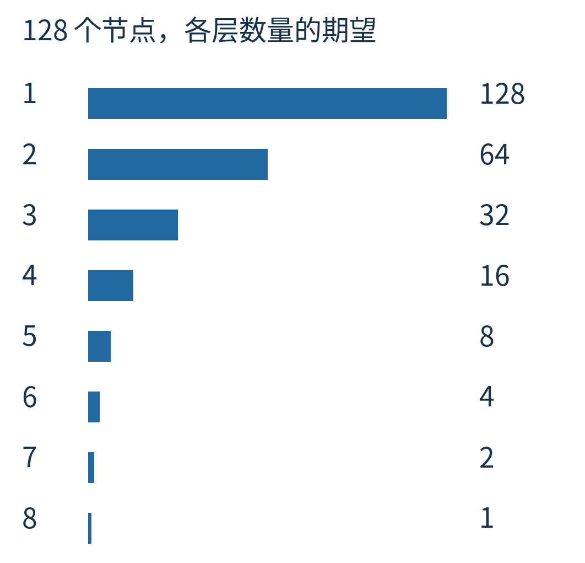

图10｜横向柱长共用一个节点数尺度，表示 128 个节点、升层概率 1/2 时的期望数量。不是一次随机实验恰好得到的塔高分布。

## 为什么路线大致随层数增长

先看需要多少层。128 连续除以 2 七次变为 1，所以七八层就已经足够把“128 个节点”稀疏到“约一个节点”的数量级。一般地，n 个节点每层大约减半，层数就与 log₂n 同一个数量级。

再看一层需要横走多少步。直觉上，上层的两站之间平均只有少量下层节点，因为每个下层节点都有一半机会继续升上来。如果总是某处特别稠密，会不会把直觉骗了？严格分析常把搜索路径倒过来看：从目标附近向左回走，寻找一个能向上连接的节点。每遇到一个节点，它独立升层的机会是 1/2；在这个模型下，等到一次成功平均需要常数次尝试。

这解释了为什么“每层少量横步 × 对数级层数”会带来期望 O(log n) 的查找工作量。本文给的是分析直觉，不把它冒充覆盖所有有限上限、查询相关性和对抗条件的完整概率证明；Pugh 原论文给出了正式分析。

最坏情况仍然存在：所有节点恰好都只有 1 层，就退回普通链表。公平独立抛币下，n 个节点全高 1 的概率是 `(1/2)^n`。虽然这种极端情形随 n 增大很快变少，却不是零。

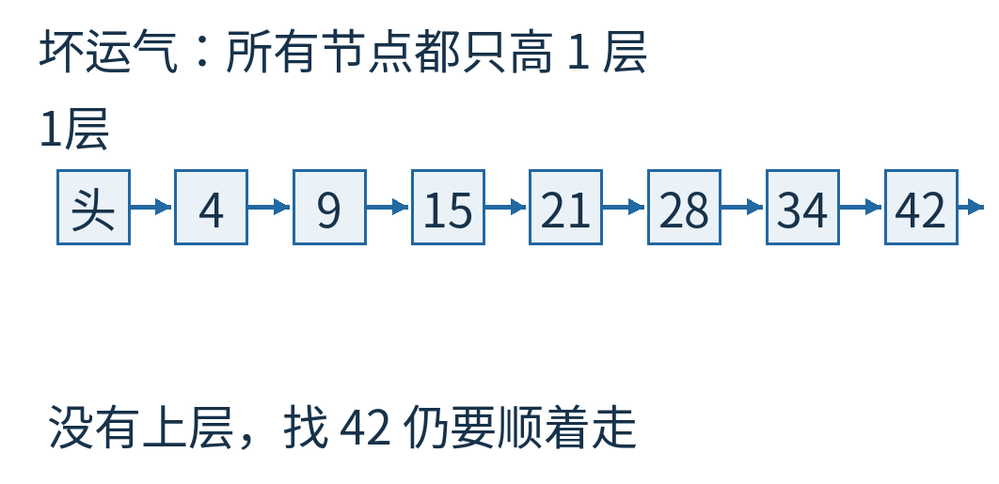

图11｜所有节点都在底层，没有可用捷径，寻找末尾 42 仍要沿链走过去。随机化改善的是在模型假设下的表现，不提供每一次操作都短的硬保证。

随机高度还应与键独立。如果攻击者能控制高度，或实现错误地让某类键总抽到短塔，不能直接套用独立随机模型的性能结论。这里也没有把简单顺序版代码说成并发安全版；多个线程同时改指针还要解决额外的同步与回收问题。

## 捷径要占多少地址

一个节点必有第 1 层指针，以 1/2 概率多有第 2 层，以 1/4 概率多有第 3 层……因此，不设上限时，平均指针数为：

`1 + 1/2 + 1/4 + 1/8 + … = 2`。

这并不是“每个节点恰好占两个指针”，而是很多次随机结构的平均。头节点、键、值、对象头、内存对齐和分配器开销都没有包含在这笔指针账里。

把每次继续升层的概率改成 p，平均指针数就是 `1+p+p²+…=1/(1−p)`。p=1/4 时约为 4/3，比 p=1/2 的 2 少。代价是每层更稀疏，搜索横向跨度的分布也会变，不能只看空间数字就宣称“1/4 全面更好”。

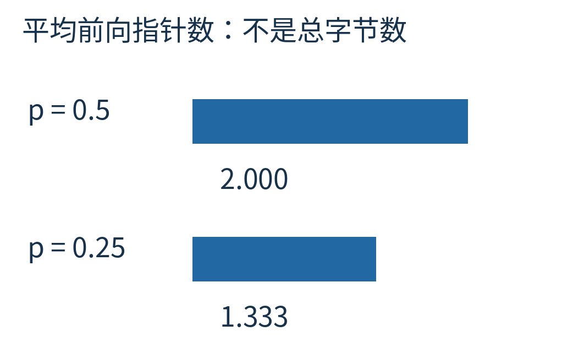

图12｜只比较无上限理想模型里的平均前向指针数，同一尺度显示 2 与 4/3。真实内存占用与实际速度还取决于实现，不能从柱长直接读成百分之多少性能提升。

## 让一份实现真的走几千次

随附 [verify.py](examples/verify.py) 是独立编写的顺序教学模型。它按固定种子 20261024 生成 5,000 次插入、删除操作；每次核对底层与 Python 集合一致，并确认每层恰好链接所有“高度足够”的节点，键严格递增。每次还检查两个查找结果。

另外做一个纯操作计数实验：n 分别为 64、256、1,024、4,096，键按从小到大插入，高度用独立伪随机抽取，升层概率 1/2，上限 16。每个规模建 16 张表，每张查询 256 个已存在的键，共 4,096 次查询。

我们统计“读取并检查某层下一站”的次数，包括导致下降的失败检查，再加最终底层相等检查一次。没有测毫秒，也没有把 Python 对象开销混成算法常数。

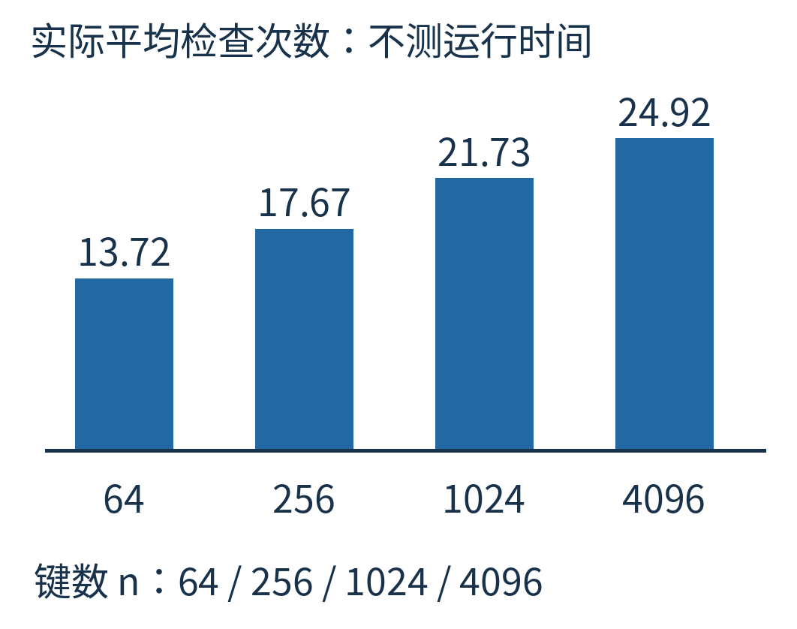

图13｜在上述固定实验里，平均检查次数约为 13.72、17.67、21.73、24.92。横轴是四种数据规模，纵向柱高共用检查次数尺度。表和查询的具体种子构造写在代码中。

数据量从 64 增至 4,096，增加了 64 倍，而这里的平均检查次数没有增加 64 倍。这个结果与“多几层、每层少走几步”的直觉相符；它不能证明任何生产跳表一定比某棵树更快，也不是所有随机种子都会得到同样的最大值。

William Pugh 在 1990 年的[原始论文](https://15721.courses.cs.cmu.edu/spring2018/papers/08-oltpindexes1/pugh-skiplists-cacm1990.pdf)中，把跳表作为平衡树的一种概率性替代。它有趣的地方不是用随机数猜答案：查找的答案仍然由有序链接精确决定。随机数只参与安排道路，让维护道路这件事不必依赖一套处处严格整齐的布局。

若要自己试着改这张图，插入一个高 3 层的 30。先找每层前驱，再接住各层旧下一站，最后改前驱指针。能把这六次赋值放对地方，就比只记住一句“跳表是 O(log n)”更接近真正理解它。

图片来源：图1—13为原创数据结构示意、概率模型图或随附程序计算结果。结构的空间排布不代表真实内存地址。原创正文与图片采用 CC BY 4.0，代码及来源范围见 [sources.md](sources.md)。
