# 声呐怎样“朝一个方向听”：把四条录音错开，再对齐

船底的一长排声学传感器，可以在没有机械转头的情况下，分别听向不同方向。计算机并没有把声音真的弯过来。它做了一件朴素的事：同一个波到达不同传感器的时间略有先后，先把这些记录重新对齐，再相加。

这一过程叫波束形成。本文只讲接收端最基本的“延时求和”，不要求先懂傅里叶变换。我们从四个传感器和 25 微秒开始，看方向信息怎样藏在一排几乎相同的波形里。

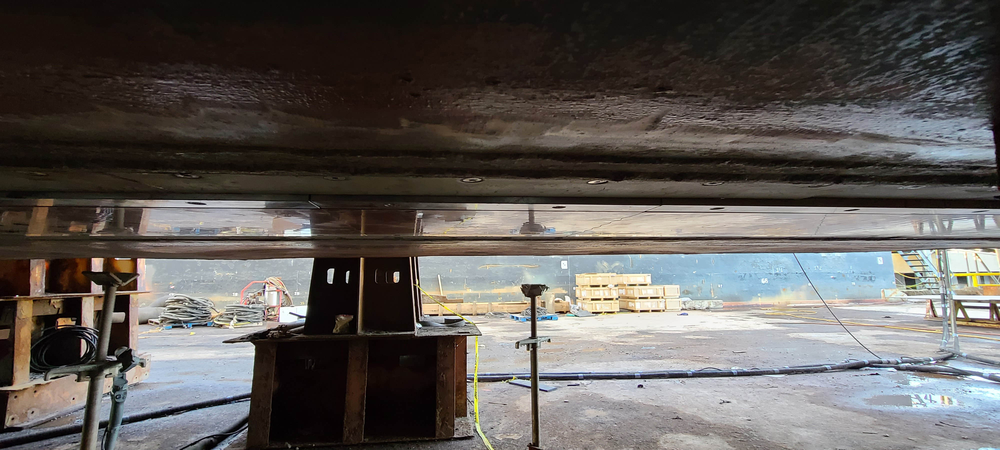

图 1：Okeanos Explorer 船底安装的换能器阵列。照片由 Charlie Wilkins、David Blessing、Michael Peperato 提供，来源 NOAA Ocean Exploration。实物是一套工程系统；下面四通道、10 kHz 的数字是独立教学模型，不是照片中 EM304 设备的内部参数。

## 单个传感器听得见，却不一定知道方向

水听器把水中的声压变化变成电信号。一次回声里，它能记录随时间变化的波形。但仅凭一个小型、近似全向的接收元件收到同样的波形，往往无法区分声音来自左边还是右边。

把第二个传感器放到旁边，事情不同了。若声波从正前方到来，可能同时到达两者；若斜着来，先碰到靠近声源的那一个，再碰到远一点的那一个。两条记录的相对时间差，成为方向线索。

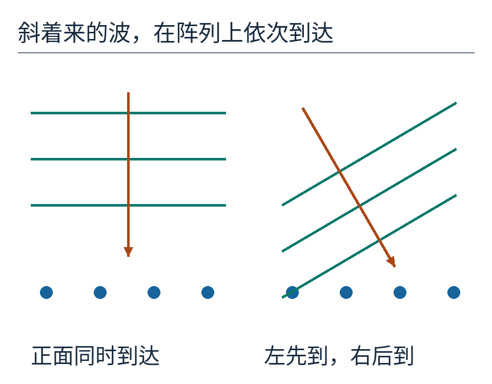

图 2：圆点是传感器，平行短线是同一相位的波面。左侧波面与阵列平行，四点同时收到；右侧波面倾斜，到达时间从左向右递增。箭头表示声波传播方向，不表示船航行方向。

先把问题限制在一个二维截面。四个传感器从左到右排成直线，相邻间距 d=0.075 米，也就是 7.5 厘米。声源在阵列上方偏左，足够远，使到达阵列的一小片波面可近似为平面。将从正上方朝声源方向量出的偏角记作 θ，向左偏为正。

这个角度定义值得停一下：θ=0° 是正面，θ=30° 是上方偏左，不是沿阵列方向量 30°。换了起算方向，公式里的正弦和余弦也会跟着换。

## 7.5 厘米为什么只多走了 3.75 厘米

相邻传感器相距 d，但声音并不沿着阵列逐个传话。来自同一个远处声源的波，沿斜向传播。需要比较的是两传感器间隔在传播方向上的投影。

当 θ=30°，这段投影长 `d sinθ`。因为 sin30°=1/2，投影恰好是 `0.075×0.5=0.0375 米`。这才是相邻两点为接到同一片波面所多走的声程。

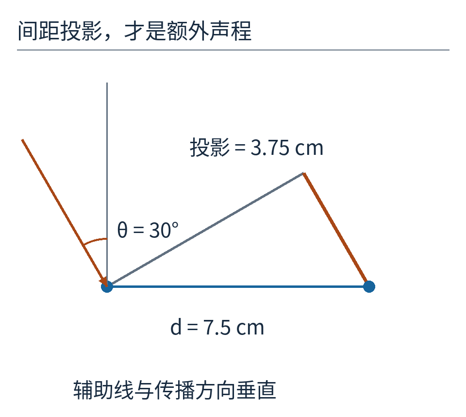

图 3：底边 d 是传感器间距；橙色投影长 d sinθ。用垂直于波传播方向的辅助线构成直角三角形，才能看出路程差为什么小于间距。示意标明 θ 从正面方向量起。

假定水中声速 c=1500 米/秒，那么路程除以速度得到到达时差：

`Δt = d sinθ / c = 0.0375 / 1500 秒 = 0.000025 秒 = 25 微秒`。

一微秒是百万分之一秒。这里算的是同一来波在相邻接收点之间的**单程差**。它和主动声呐用发射到回波的总时间计算距离时出现的“除以 2”不是一回事。几何对象不同，不要把两个公式的系数混用。

## 把四条时间线写出来

把最左传感器 A 接到某个波峰的时刻记为 0。相邻差 25 微秒，所以 B 在 25 微秒接到，C 在 50 微秒接到，D 在 75 微秒接到。这些数字都相对于 A，不是声波从声源出发的绝对旅行时间。

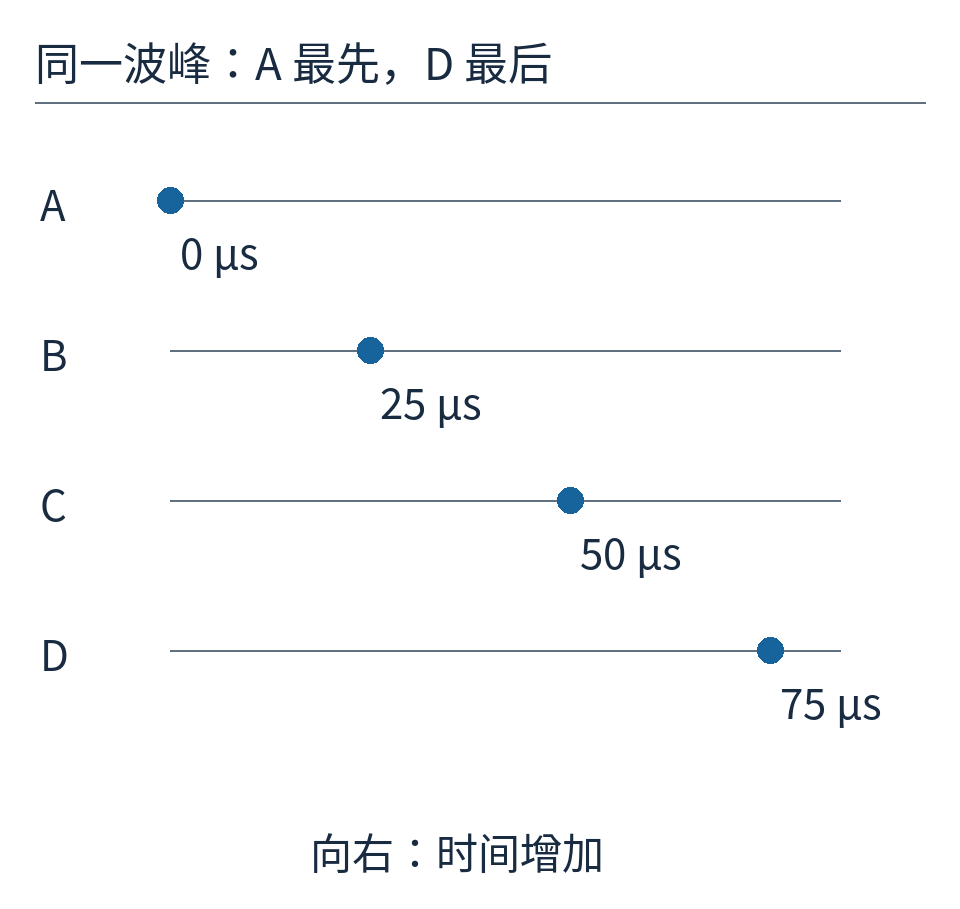

图 4：每行跟踪的是同一个特征波峰，不能把四个圆点理解为四个不同声源。横轴以微秒为单位，越往右越晚。

现在已经知道这个方向所对应的时间差。想让四份记录对齐，可以以最晚的 D 为基准：让 A 的记录再等待 75 微秒，B 等待 50，C 等待 25，D 不再等待。最终这一个波峰都在处理输出时间的 75 微秒位置出现。

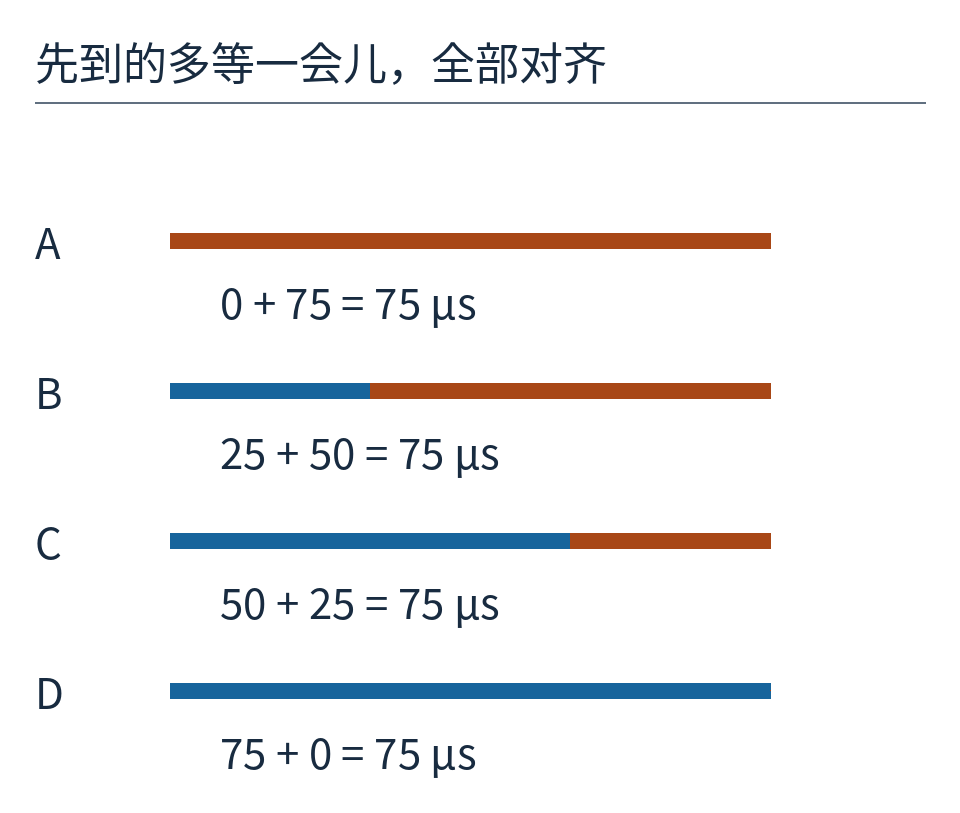

图 5：蓝段表示原始到达时间，橙段表示追加的等待。每一行总长都为 75 微秒。先到的等得久，晚到的等得少；不是把已经晚到的再往后推更多。

这样做不需要预测未来，因为只是把早到记录暂存。所有通道再共同增加一段延时，也不改变它们的相对对齐关系，只会让最终结果整体晚一点。

## 为什么要对齐后再加

我们选一个频率为 10 kHz 的单频来波，即每秒一万周。它的一周用时 100 微秒，所以相邻通道的 25 微秒时差恰好是四分之一周。若不补偿就直接相加，四个相位分别相差 0、四分之一、半周和四分之三周，正负会彼此抵消。

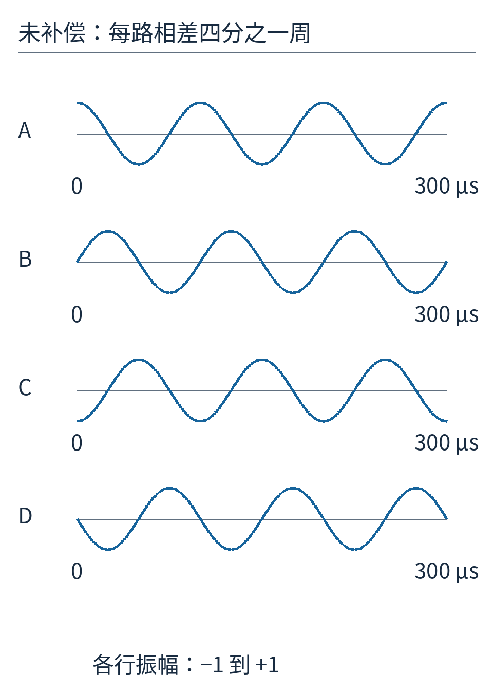

图 6：四条波形分行显示，每行的零点高度不同，便于看清相位；它们使用相同时间轴与振幅尺度。竖向排版只为阅读，不表示传感器实际上下排列。

举一个瞬间：A 的读数为 1 时，B、C、D 分别为 0、−1、0，直接相加是 0。再过四分之一周，读数轮换为 0、1、0、−1，和仍是 0。问题不是水里没有这段声音，而是相加方式恰好把想听的声音抵消了。

加上前面安排的延时，四条波对齐。某个波峰时刻，每路都是 1，总和为 4。为了不把“增加传感器数量”与“改变方向选择”混在一起，后面的方向曲线将总和除以传感器数，画归一化振幅；完全对齐的峰值就是 1。

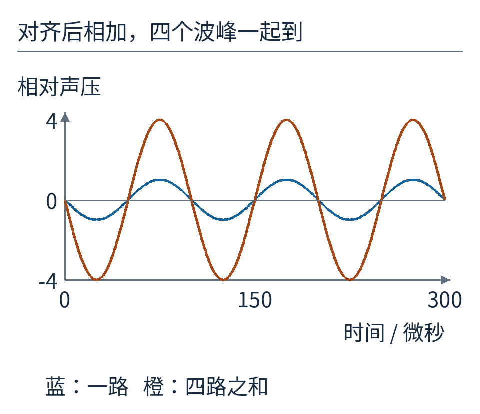

图 7：蓝线是对齐后的单通道，橙线是四路求和。橙线振幅为 4，频率没有变，也不是声音被复制出四个不同频率。

## 如果不知道声源方向，延时该怎么选

计算机不必事先猜中。它可以先假设一个方向，用这个方向算一组延时，处理同一批通道记录，再看合成输出有多强；接着换另一个假设方向。真实来波与假设方向吻合时，通道最容易对齐，输出通常在附近形成峰。

这里的“扫描”首先是计算上的扫描，不要求把船底阵列机械旋转。保存好原始多通道数据，就能针对多个方向形成多路输出。

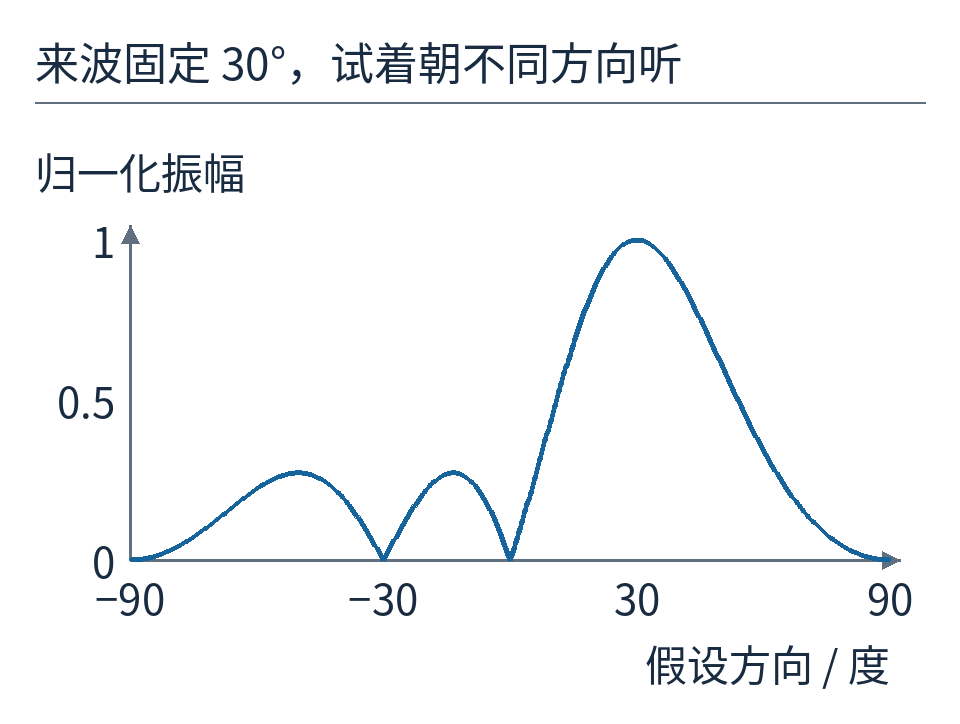

图 8：来波固定在 +30°，横轴改变接收处理所假设的方向。四元阵列的峰不是无限细的一根针。峰顶两侧仍有响应，说明相近方向未必能被轻易分开。

曲线怎么算？对每个假设方向 θs，先算相邻通道应补偿的时差；与真实 θ=30° 的时差相减，得到残余时差。残余时差乘频率，再乘 360°，就是相邻通道仍剩下多少相位差。四根相位箭头按这个差角排列后相加，再除以 4，就是图中的数值。实际代码用正弦和余弦分别累加水平、竖直分量，最后用勾股定理求长度。

例如假设方向为 0°，补偿时差为零，残余仍是 25 微秒；它正好造成前面那组四分之一周相位差，输出为零。假设方向为 30°，残余时差为零，四根箭头同向，归一化输出为 1。这两个点把曲线与我们已经算过的例子接上了。

## 再加四个传感器，峰就窄了吗

保持 7.5 厘米间距，向两边延长阵列，由四个元件增加到八个，阵列跨越的距离更大。稍微猜错一个方向，误差会沿更长的阵列积累成更明显的相位错位，所以主峰通常变窄。

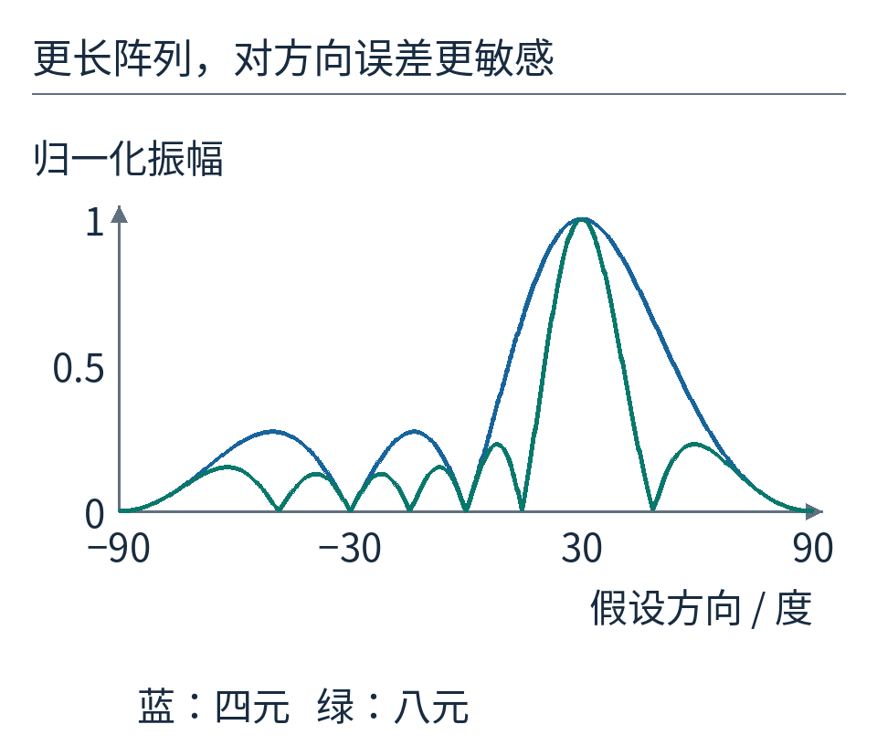

图 9：蓝线四元，绿色八元；都各自除以元件数，使完全对齐时为 1。因此这里比较的是方向选择形状，不是宣称八元阵列的绝对声功率与四元相同。

但图里还有较小的峰，叫旁瓣。强声音从旁瓣方向进入，也可能污染目标方向的输出。给不同通道不同权重，可以压低某些旁瓣，代价往往是主峰变宽、增益改变。本文先用全部权重相等的情况，把最基本的延时过程保持可见。

更窄也不代表无限分辨率。声速误差、通道相位误差、船体振动、噪声和多个反射点都会影响结果。对一条线阵来说，还存在三维方向歧义：许多空间方向可能具有相同的沿阵列投影，仅凭一条线不能把完整空间方向都确定下来。

## 间距太大，会出现“另一个同样响的方向”

10 kHz、1500 米/秒对应波长 `λ=c/f=0.15 米`。此前间距是半个波长。现在只改变一个条件：把间距加倍为 0.15 米，即一个波长。

对 +30° 的来波，相邻时差变成 50 微秒。如果试图按 −30° 接收，所假设的相邻时差是 −50 微秒。二者相差 100 微秒，恰好是这个单频的一整周。相位绕了一圈又回到原位，四路仍可能同相相加。于是一个明明来自 +30° 的单频波，在 −30° 的扫描结果中也会出现同样高的峰。

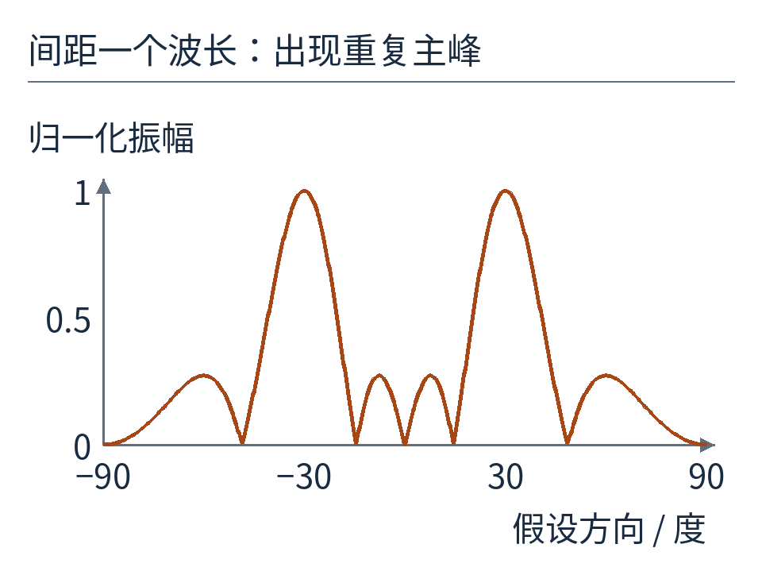

图 10：间距变为一个波长后，±30° 都出现归一化振幅 1 的峰。这个重复主峰叫栅瓣，比普通旁瓣更严重。图只讨论理想点元件、单频与同一二维半空间。

为了让均匀线阵在宽角度扫描中避免这样的空间采样歧义，常采用不大于最短工作波长一半的间距；精确边界与扫描范围有关，半波长在两个极端端射方向之间也有边界情形。不能把“半波长”理解成无视频率、视场与单元指向性的万能尺寸。

## 真延时为什么比固定挪相位更通用

25 微秒对 10 kHz 是四分之一周，对 20 kHz 却是半周。如果处理器只对每路施加按 10 kHz 设计的固定相位修正，那么同一个宽带脉冲中其他频率就未必对齐。真正的时间平移会对每个频率施加与其频率成比例的相位变化，才能一起搬动整段波形。

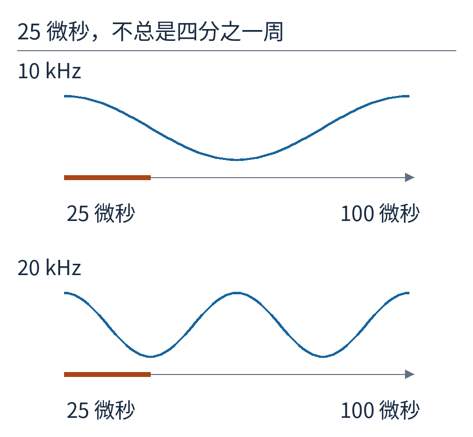

图 11：两行都标出 25 微秒，但上行 10 kHz 周期为 100 微秒，下行 20 kHz 周期为 50 微秒。需要保持的是同一个到达时间，不是所有频率都使用同一个相位角。

真实设备如何实现延时，还涉及采样率、插值和滤波：25 微秒不一定正好是整数个采样间隔，简单取整会留下误差。MIT 的[声学海洋学讲义](https://ocw.mit.edu/courses/2-682-acoustical-oceanography-spring-2012/520494b38732649598f85bf5bc722d9e_MIT2_682S12_lec11.pdf)区分了平面波、近场聚焦与栅瓣；Kongsberg 的 [EM712 技术说明](https://www.kongsberg.com/contentassets/2c197a1f0a33461b9642276e31b67fb7/datasheet_em_712.pdf)明确提到用时间延迟波束形成支持宽频带。这个实例与开篇 EM304 照片是不同型号，不能混用参数。

## 延时表不是海底地图的全部

本例假定平面波、声速恒定、传感器位置准确。目标靠近阵列时，波面弯曲不能忽略，需要按每个元件到目标的实际距离计算延时。海水声速又随环境改变，传播路线可能弯曲；船自身也在俯仰、横摇和航行。它们都要求额外测量与修正。

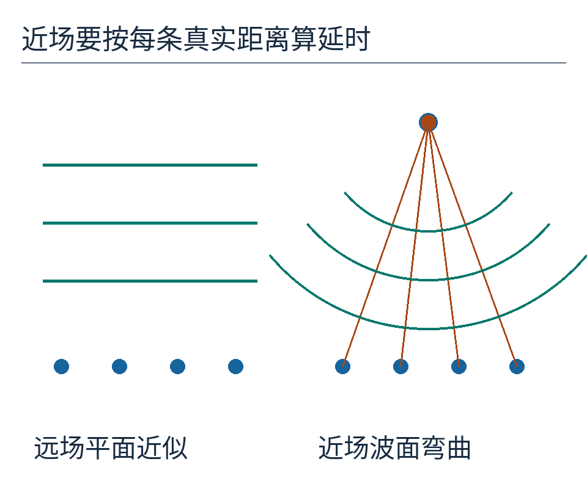

图 12：左边波面在短阵列范围内近似平直；右边近场波面弯曲，相邻到达差不再相同。图不按海域实际距离绘制，目的只是显示等差延时何时失效。

多波束测深最终还要把回波时间、方向、船的位置和姿态放在一起，才能得到空间点。本文解决的是其中“朝哪里听”的一环。[NOAA 的多波束声呐介绍](https://oceanexplorer.noaa.gov/technology/sonar-multibeam/)说明了它怎样与测深、后向散射测量结合。

四条记录原本看起来只有极小的时间差。保留这点差异，我们能推测来向；按某个方向把差异补回去，我们又能选择性地听。波束并非一定是肉眼可见的一束东西，它也可以是计算规则对空间方向形成的偏爱。

模型计算与完整曲线见 [results.json](examples/results.json)，执行 `python examples/build_figures.py` 可复算。逐图来源和代码许可见 [sources.md](sources.md)。原创正文采用 [CC BY 4.0](https://creativecommons.org/licenses/by/4.0/)。
