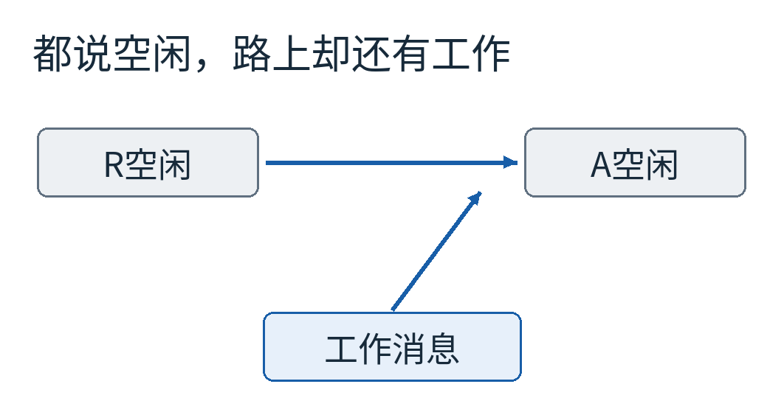
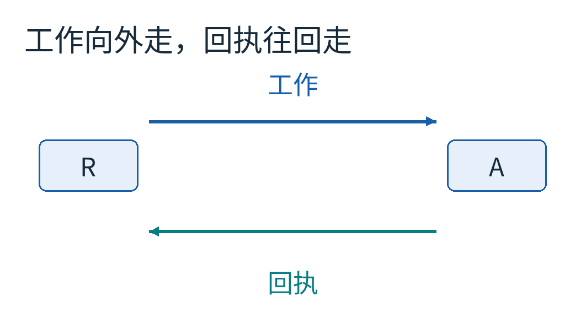
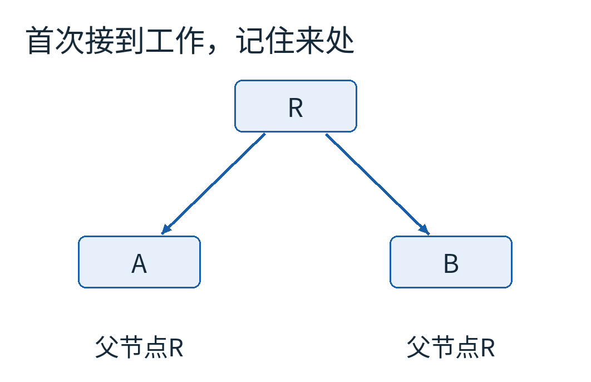
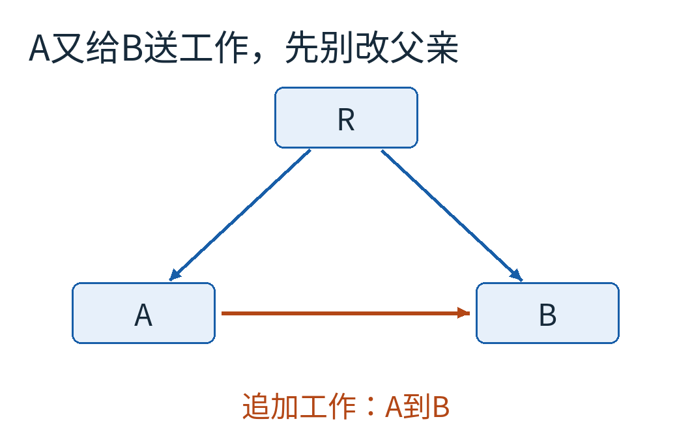
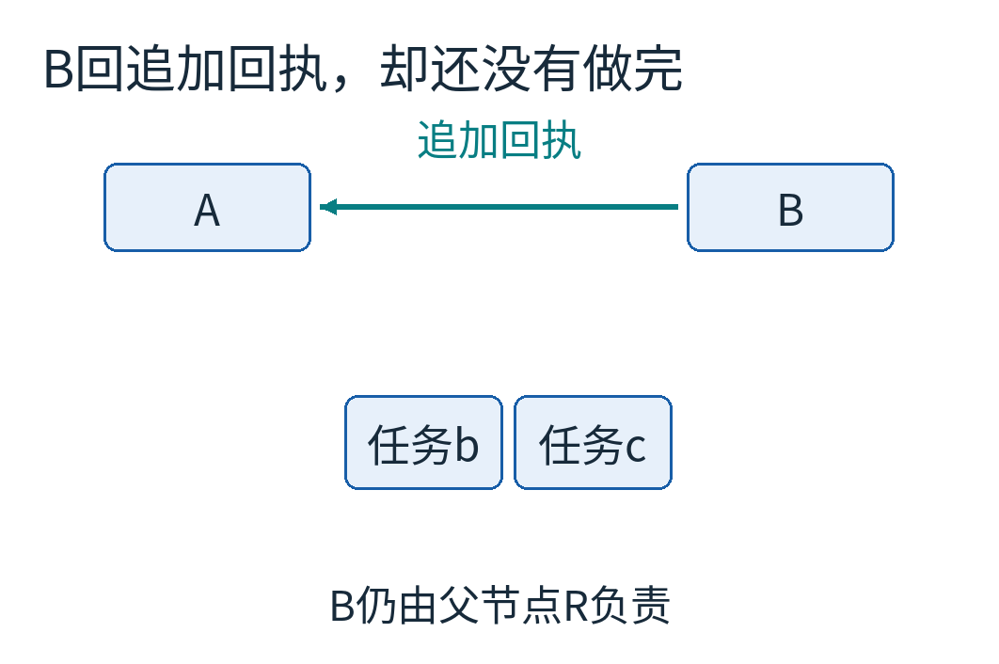
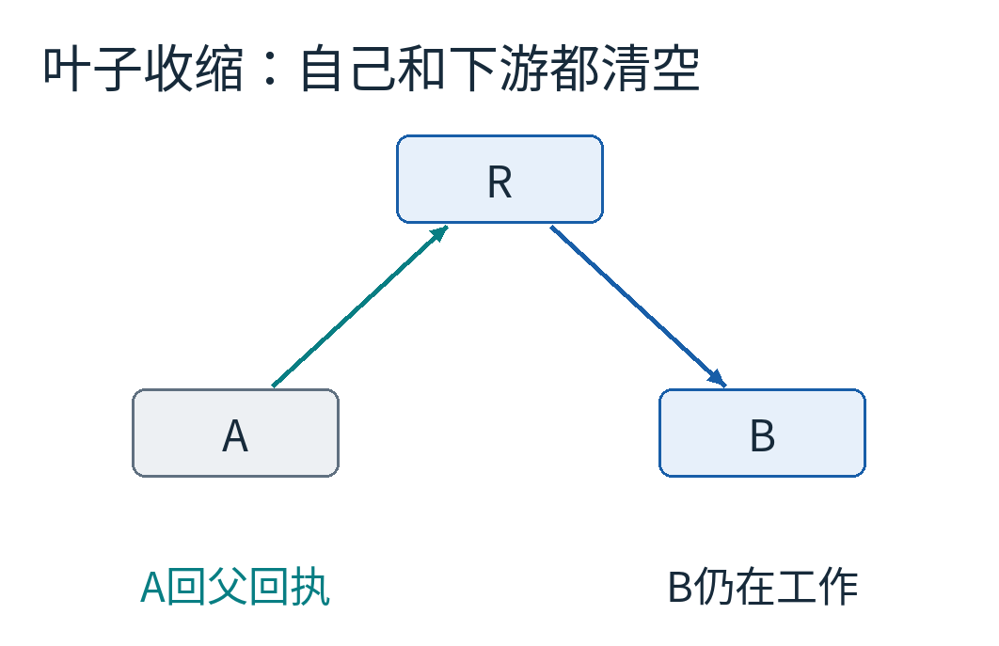
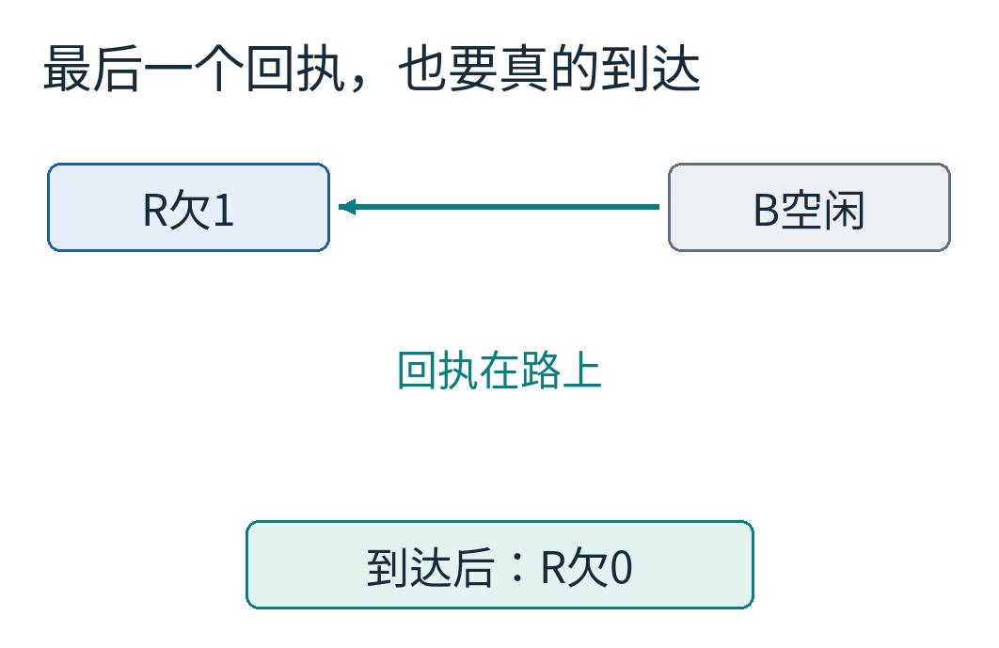
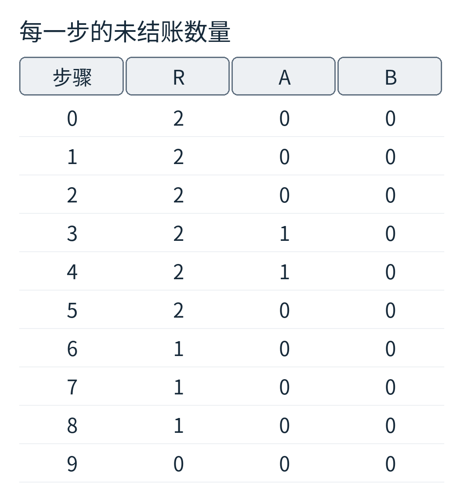
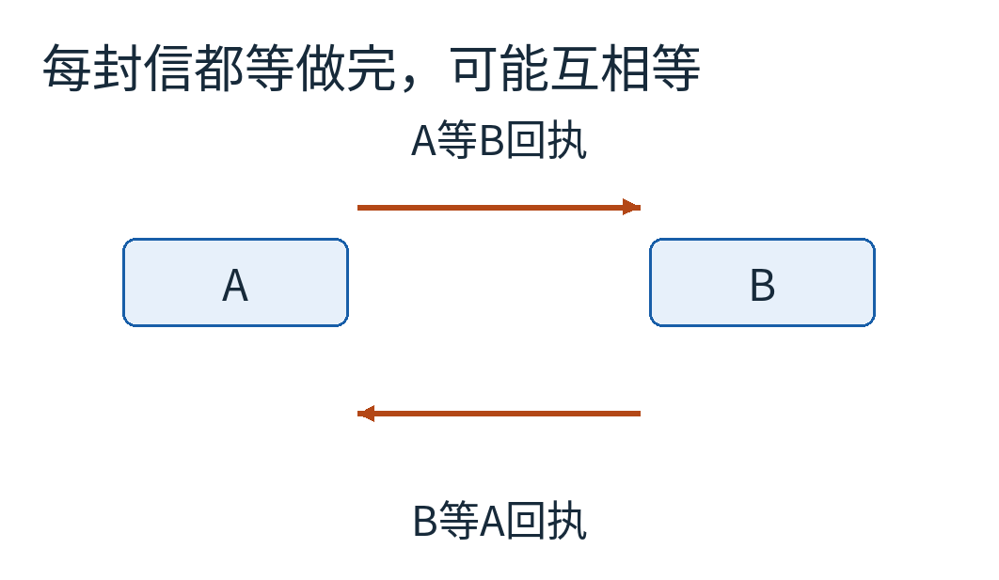

# 每台机器都说“我闲着”，为什么任务还没结束？给分布式计算收最后一张回执

三台机器合做一轮搜索。R把一个分支发给A，又把另一个分支发给B，然后把自己手里的工作做完。A、B暂时也都没活干，因为消息还在路上。

这时候询问“你忙吗”，三台机器都可能回答不忙。但只要那封工作消息抵达，计算就会重新开始。

灰框表示本地没有待处理任务，蓝色消息仍能唤醒接收者。网络里正在走的东西，也属于这一轮计算尚未结束的原因。

我们真正想判断的是：**所有节点都不再工作，而且不存在将来还能让它们继续工作的在途消息。** 若只统计机器手里的任务，这第二半会悄悄漏掉。

Dijkstra与Scholten研究过这类从一个入口向外扩散的计算如何检测终止。本文从一个可手算的“工作与回执”模型出发，理解他们的重要思想：让计算扩散出去时留下责任，让责任沿一棵树收回来。这里使用父指针教学变体，不把它冒称为原文cornet数据结构的逐行实现。[原文EWD684](https://www.cs.utexas.edu/~EWD/transcriptions/EWD06xx/EWD684.html)

## 先关上外部入口，才有“这一轮结束”

如果外界随时还能注入新任务，刚刚安静下来的系统下一秒当然又会忙。那并不表示终止检测错误，而是“这轮包括哪些工作”没有定义清楚。

本文约定：只有R在开头启动这一轮，随后不再有外部新任务；节点处理已有任务时可以派生新任务。工作消息不丢、不重复，最终都会送达，回执也一样；节点不会崩溃，本地处理最终会完成。允许消息延迟不同、跨路线乱序，不依赖共同时钟。

这些前提不是为了把困难藏起来，而是明确我们正在解决哪个困难：在可靠但异步的通信里，怎样不把“暂时空闲”误判为“真正结束”。节点失联、消息重试和进程重启，是另外需要设计的层次。

再给每个节点两个概念：本地队列空，叫“本地空闲”；已经接入本轮责任关系，叫“参与中”。参与中的节点也可以空闲，因为它还在等自己派出的工作交账。不要把“参与中”理解成CPU一定在执行指令。

## 每发一封工作信，就记下一笔账

我们用两种消息。蓝色工作消息携带需要处理的业务；青色回执只告诉发送者，可以解除对应的一笔责任。回执不会产生新业务任务。

发送工作时，发送者立即把“未收到回执的工作数”加一。不能等对方收到后才记，否则工作在路上的那段时间就没人负责。只有对应回执真正到达，才减一。

若用q表示某节点的未结账数，那么 `q = 已发送工作数 - 已收到对应回执数`。这里数的是消息，不是线程数、剩余秒数或计算进度百分比。

比如R向A发一次：发送前q=0，发出后q=1；A收到后，R的q仍是1；A以后发回执，若回执还在路上，R也仍是1。只有R收到，才回到0。

这笔账同时盖住了工作传输、后续处理和回执返回的空档。延迟很大，会让R晚一点知道结束，却不应让它提前报喜。

如果每个节点等自己空闲、所有外发账归零，再给所有上游回执，看起来似乎就够了。但一般业务图可能有环：A给B派活，B又给A派活，双方都等对方先回，可能永远收不了尾。我们需要一种有方向的责任组织方式。

## 第一次被叫醒时，记住是谁叫的

除R外，一个尚未参与本轮的节点，第一次收到工作消息时，记下发送者作为自己的父节点，并保留这封消息的回执。它随后可以处理任务、继续派生工作，但先不把这份首次责任还回去。

R给A、B各发一封。两者都还未参与，所以A的父节点是R，B的父节点也是R。R有两笔未结账。

这是一棵临时的参与树，描述“谁在替谁兜住尚未结束的工作”。它不是网络布线图，也不要求业务消息只沿这棵树走。网络可以有很多边，责任树只给每个非根参与者保留一个父亲。

节点什么时候能退出？需要同时满足两项：本地没有任务；自己发出去的所有工作都已收到回执。此时才把保留的首次回执还给父节点，并清掉父关系。

清掉父关系与父节点收到回执不是同一时刻。中间回执仍在路上，父节点那边尚未减账，所以不会出现无人负责的空窗。

## 再来一封工作信，不一定要再挂一条父边

现在A处理自己的任务时，又派生一项给B。此时B已经挂在R下面，仍然参与中。

B收到追加消息，**立即回这一封追加消息的回执，但保留原来的父节点R**，并把新增业务加入本地待办。这里“立即”表示接收处理时安排回执，不表示网络零延迟。

橙色边是A送给B的追加工作。它可以横穿参与树，但不会把B的父亲改成A，也不会让B同时欠两个首次父责任。

为什么工作没做完就能回执？因为回执的含义不是“这封消息的所有计算已经完成”，而是“发送者可以解除这条追加边上的账”。B的未完成工作已经由它通向R的首次父边承担。

如果把回执误读成每项任务的完成通知，这一步看起来就像作弊。其实我们在维护的是覆盖关系：每项还没结束的工作，总要沿着某条责任链被根看住；不要求所有曾经传递它的人都一直等着。

A把追加消息发出时，自己的未结账从0变1。B收到并发回追加回执，A尚未收到时仍为1。回执到A，A的未结账变0；若A本地也空了，它就能把保留的首次回执还给R。

R收到A回执后，从欠2变欠1。它依然不能宣布结束，因为B的那份首次责任还没有还回来。

树像从叶子向里收缩。一次业务扩散建立新的责任，局部完成后再逐层收回。原网络里复杂的交叉边，不会强迫我们在每一条边上都建立永久等待关系。

## 最后一份工作做完，还差最后一程

B先处理最初那项，再处理A追加的那项。两项都完成，B本地队列为空；它没有再派出工作，所以未结账也是0。于是B把首次回执发给R，清掉父关系。

这一刻，业务计算已经结束，但R还不知道。R仍有一笔账，直到最后的回执抵达才降为0。

根R本地空闲，自己的未结账也为0，此时才可以宣布这一轮结束。结束判断不要求某台机器直接窥视所有网络缓冲区；路上的东西已经由发送时建立、收到回执才解除的账间接覆盖。

我们把刚才的轨迹编号0到9。第0步是R已经发送两封、自己空闲；第1、2步分别是A、B收到；第3步A做完并派生追加工作；第4步B收到追加；第5步追加回执到A；第6步A的父回执到R；第7、8步B完成两项；第9步最后回执到R。

表中的A在第3、4步为1；第5步归零。R一直保留对B的1，直到第9步。B的未结账始终为0，因为本例B没有再向外派工作；这并不意味着B从头到尾都没活干。

这一点很值得停下来核对：**本地待办多少，与向别人派出而尚未收账多少，是两个不同的量。**

## 为什么责任链不会绕成一圈？

父关系只在“未参与者第一次接收工作”时建立。发出这份工作的节点已经参与本轮，接收者此前还没有父边，因此是在现有树上添一个新节点，而不是把两个已有节点互相接成环。

已经参与的节点再次收到工作，走的是追加消息规则：回这封回执，不改首次父边。这样，业务可以从A到B，再从B回到A，责任树仍不必跟着绕圈。

反过来，如果每条收到的消息都建立“必须等这项的所有后代彻底做完才回”的责任，A和B可能各保留一项对方的等待，哪怕本地业务已经清空也互不释放。

这个图不是正确协议的一种执行，而是删掉“只保留首次父责任”后可能引入的循环等待。反例能让我们看清，树不是为了画得好看，而是为了让责任最终有机会收拢。

原文EWD684用cornet及计数不变量给出更一般、细致的表述，并证明安全性和最终通知性。本文父指针模型保留“首次责任最后归还、追加消息由已有参与关系覆盖”的教学主线，不声称两份代码字段逐项一致。

## 为什么根归零可以相信？

可以反向追问：假设仍然存在一件未完成业务，它躲在哪里？

若工作消息还在路上，发送者已经为它记账，回执不可能先把账消掉，因为接收处理尚未发生。若工作已经落到某节点本地，那个非根节点必须参与中：要么刚通过首次消息加入，要么此前已在树上。它不能在本地尚有任务时归还首次责任。

若某节点自己空了，但它的后代还有活，它发出的账也没有全部归零，因此不能退出。把这条关系沿父方向追上去，总会走到R，而不会在环里绕丢。

因此，R没有本地任务、没有未结账时，就没有这条链可以继续兜住未完成的工作。在协议规则与通信前提下，这排除了“根宣布结束，但业务还在继续”。这是安全性的直觉。

“本地队列为零”只说明这里暂时没活；“本地未结账为零”只说明这里的外发账已还；根的两者为零，需要配合整套责任不变量，才表示本轮结束。不要把最后一行脱离前文，当成任何分布式队列的通用判断式。

另一个方向叫最终通知性：业务确实停止后，通知会不会永远卡住？在有限工作、消息最终送达、本地事件最终被处理的前提下，树的叶子会有机会归还责任，父节点随后也能退出，一层层收回到根。公平处理与可靠传输正是在这里发挥作用。

## 让机器把这三个任务的所有可能顺序都走一遍

[完整模型](examples/model.py)不建立网络连接，只在内存里保存三个节点、在途消息和本地队列。R初始派给A、B；A完成自己的任务时追加一项给B；B处理任务但不再派生。业务任务总共3项。

每一步，程序可以选择交付任意一封在途消息，也可以让任意有待办的节点执行一项任务。不同节点与不同路线的消息可以换顺序；各节点本地按队列次序处理。模型还考虑了追加工作先到B、R原本给B的工作后到的情况，此时B会先认A为父节点，规则仍需成立。

程序把等价的在途消息排列归为同一状态，穷举得到37个不同可达状态，其中1个去重后的终止状态。最多同时有3笔未结账，没有出现根错误宣布结束。

每个状态都检查：全系统未结账之和等于已发送工作数减已收到回执数；非根有本地任务或外发账时必须有父关系；父指针无环；一旦根宣布结束，本地任务、未结账和在途消息必须全空，且三项业务确实都已完成。

这些断言能发现本模型中的实现错误，但37个状态不是对无限规模系统的一般证明。它没有覆盖任意派生程序、重启、计数溢出或真实网络重复。一般性的理由来自协议不变量与相应证明，有限模型用来把这些理由变得可以逐步核对。

## 如果一台机器死了，沉默不再是回执

假设B崩溃，最后回执永远不来。R的账会一直留着。这种行为很保守：它没有错误地把“没消息”说成“做完了”，但也无法正常收尾。

要支持崩溃容错，需要额外决定任务重试、去重、轮次身份、状态持久化与失败判定。简单设置超时后把账减掉，会重新打开最初那个漏洞：慢消息仍可能在路上，而你已经宣布结束。

同样，若允许外部随时把新任务塞给任意节点，必须先定义接纳边界或新的轮次，不能继续使用“只有R开头注入”的前提。若回执重复投递，也不能重复减账；本文用唯一消息编号维护集合，但仍假设传输不重复，没把重试协议一起藏进来。

与分布式快照相比，这里没有保存某个一致切面上的所有业务状态；它专门跟踪本轮工作责任。与节点探活相比，它不判断谁失联，而是在无故障前提下确认谁已经没有需要兜住的工作。

如果只记住一个观察方法，可以试着在每次派发任务时问：从这封信离开我的手，到我可以放心忘掉它，中间究竟由谁负责？把这条责任一路画清楚，系统的最后一声“完成”才不只是几台空闲机器碰巧同时保持了安静。

图片来源：12张均为本文原创消息、责任树和有限状态模型结果图。[来源、许可与复现说明](sources.md)
