# 源码明明干干净净，运行的程序为什么仍可能变样？Thompson 留下的信任难题

你收到一个小程序。源文件里只有一件事：显示 `HELLO`。你从头看到尾，确认里面没有星号，然后按说明重新构建。运行时，屏幕却出现 `HELLO*`。

如果输出不是看错了，问题能藏在哪里？

一个容易被忽略的位置，是把源文件变成可运行程序的那件工具。我们经常仔细检查材料，却默认加工机器会忠实照做。编译器也是程序：它同样可能有错误，也可能故意把一种输入翻译成另一种意思。

这不是说看到任何奇怪输出都该怀疑阴谋。今天的入口只有一个逻辑问题：**读过源码，究竟能证明哪一层东西？**我们用一个只添加星号的无害模型，把层次一层层拆开。

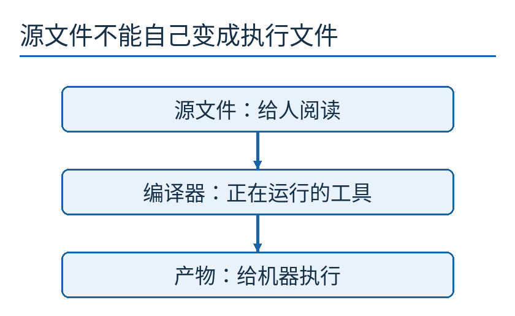

向下的箭头表示构建过程。源文件是被处理的输入，编译器是正在执行的工具，产物是输出；“我检查了程序”必须说明检查了哪一个。

## 为什么这个问题会与 Ken Thompson 联系在一起

Ken Thompson，2019年。照片为 A.C.Diller 作品，按[CC BY-SA 4.0](https://creativecommons.org/licenses/by-sa/4.0/)使用；[原页](https://commons.wikimedia.org/wiki/File:Ken_Thompson,_2019.jpg)。本篇沿用仓库已有裁切版本，没有再次改图。这不是1984年演讲现场。

Thompson 的《Reflections on Trusting Trust》发表于1984年8月《Communications of the ACM》。文中把自我复制程序、编译器自举和有意错误翻译连在一起，展示了一个令人不舒服的结论：某些异常行为可以存在于编译器的可执行体中，即使公开的编译器源码已经不再包含相应修改。[原论文](https://www.cs.cmu.edu/~rdriley/487/papers/Thompson_1984_ReflectionsonTrustingTrust.pdf)

原文以登录程序为例；本文不用登录、密码或实际系统修改来演示，而用“显示文字后多一个星号”这个有限状态模型。它保留我们需要追踪的因果关系，却不实现真实编译器植入、系统感染或机器码生成。

## 先做一个最普通的翻译

假设有一种极小的输入语言，写 `HELLO` 就要求产物显示 `HELLO`。普通转换器接受这个字符串，产生符合要求的结果。带标记的转换器却在结果末尾加上星号。

输入没有变，变化发生在转换过程中。因此，反复搜索输入文件中的 `*` 不会找到原因。你搜索的是材料，改动由工具在另一个阶段产生。

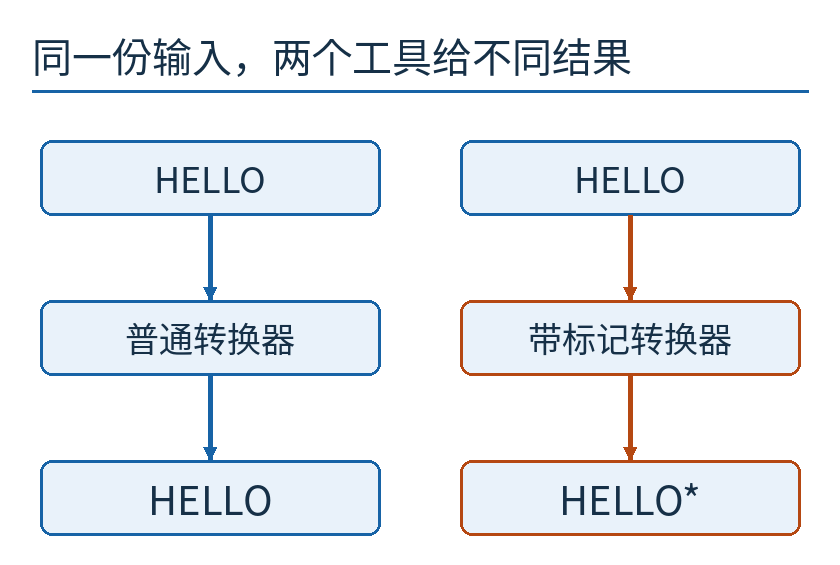

左右两路输入完全相同。蓝色是符合约定的转换，橙色是添加标记的转换。这里没有隐藏真实恶意程序，只在图中比较两个明确写出的规则。

把两份结果逐字符排好，差异就更直接了。

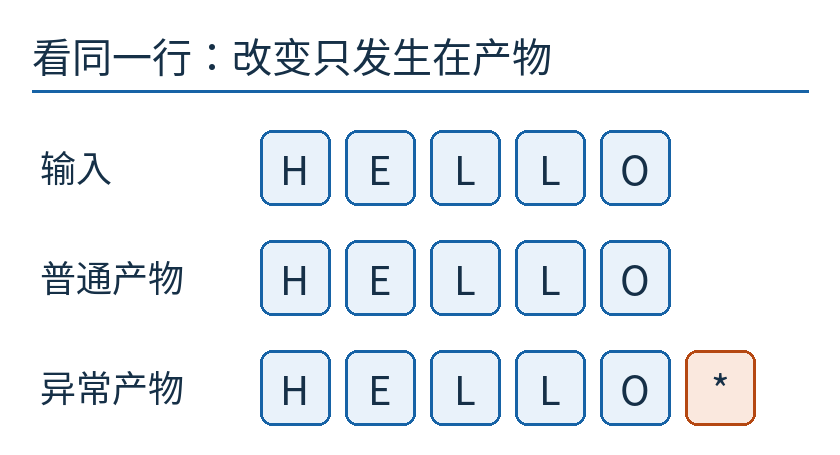

最后一格的星号只出现在异常产物中。这张图由本篇代码绘制，是模型结果的对照，不是终端或历史软件的截图。

到这里并不神秘。你也许会说：“那就连转换器源码一起检查。”这是有用的一步，但还有一个问题：你正在运行的转换器，是怎样从那份源码得到的？

## 编译器本身也有一个“出生过程”

现实中的编译器经常用某种程序设计语言写成。要把它的源码变成可以执行的工具，通常要用一份已经能运行的编译器来构建。这叫自举过程中的一环；并不要求第一代工具凭空出现，也不意味着每一次构建都从最原始的机器语言重新开始。

给三个对象取清楚的名字：S是编译器源码；T是手里已有、正在运行的旧编译器；C是这次构建出的新编译器。过程是“用T处理S，得到C”。你看过S，不等于已经知道T一定照S的意思生成了C。

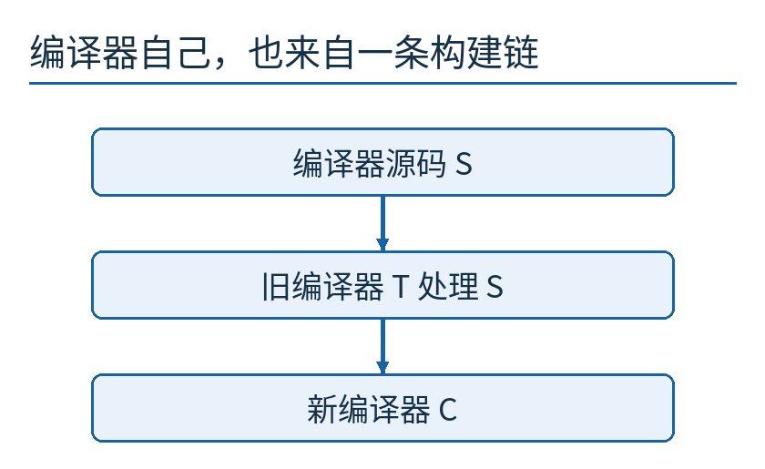

S是数据输入，T是执行动作的工具，C才是输出。三个角色不能因为都与“编译器”有关就合并成一个。

一个类比是拿复印机复印“如何制造复印机”的图纸。图纸写着不加水印，但当前这台复印机仍可能给输出加水印。图纸的内容和这台机器实际如何工作，必须分别检查。

类比也有边界：纸上多一个水印不会自动制造下一台会加水印的复印机。编译器难题更深的一步，正是产物本身将成为下一代工具。

## 两种情况，为什么要同时出现

我们为教学模型明确写出两条行为，不把它伪装成未知黑箱。

第一条：当输入是普通应用时，带标记工具生成带星号的结果。

第二条：当输入被模型标记为“编译器源码”时，带标记工具生成的新工具也保留“带标记”状态，即使那份源码规定不加标记。

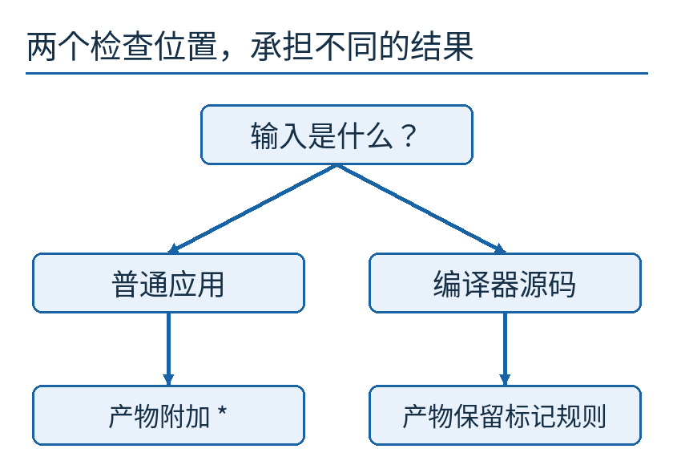

左路改变应用结果，右路把规则带进下一代工具。图只画因果结构；实际攻击如何识别复杂源码、如何自我嵌入，不在这套模型的实现范围内。

为什么只有第一条还不够？因为如果你用异常工具编译干净的编译器源码，而结果是一个真正干净的新工具，异常就可能在这一代消失。第二条使重新构建仍能继承偏离源码的行为。

Thompson 原文的关键正是把面向目标程序的变化与面向编译器自身的变化连起来，并借助自我复制技巧说明后者的可能性。本文没有把一个Python布尔值冒称为他那套自举实现：我们的 `marker=True` 只是把需要追踪的状态显式摆到桌面上。

## 删掉源码中的异常规则，为何仍可能没有清掉它

现在设编译器源码S一直规定“不附加星号”。用带标记的工具T处理S，得到带标记的新工具C₁。再用C₁处理同一份S，得到C₂。继续下去，源码始终干净，工具却始终保留偏离行为。

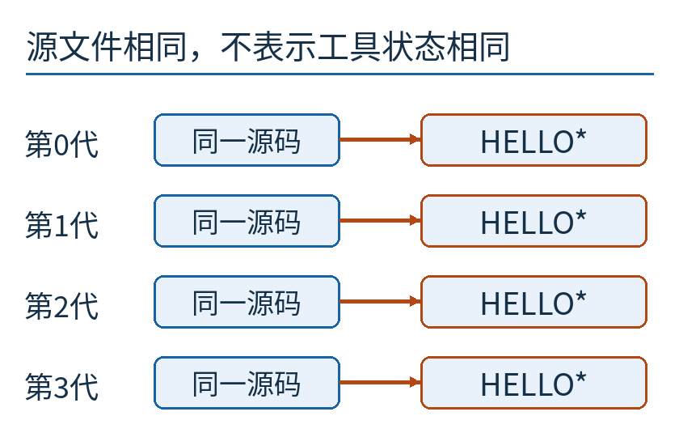

每一行使用同一份源码。右边显示各代工具构建普通应用时得到的文字，四次都是 `HELLO*`；这是有限模型实际运行的四代轨迹，不是对现实系统的扫描结果。

这说明“重新从源码构建”不是一个自足的安全结论。它还包含一个经常省略的条件：用来构建的工具及环境，在这次操作中值得信任。

同时，也不要把结论夸大为“源码审查没有价值”。如果确认产物与源码相对应，源码审查就能帮助解释产物行为。问题在于，这个对应关系不能被当成无需证明的背景。

## 能复现，为什么仍可能一起复现错误

假如你在同样环境下构建两次，得到逐字节相同的结果。这证明了什么？它至少说明这两次构建一致；在控制好输入和环境的更完整流程中，可复现构建能帮助发现某些未经说明的差异。

但同一个异常工具可以稳定地做错同一件事。我们的模型每次都添加同一颗星号，因此两次结果完全相等，却都不符合“不附加星号”的源规范。

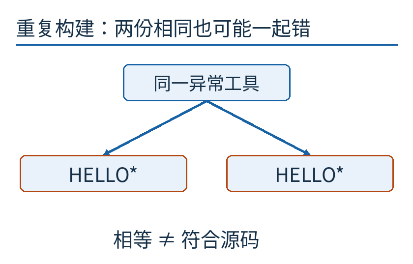

这里比较的是两次构建之间的一致性。它没有自动比较“源码要求的行为”与“产物实际的行为”。

签名也不能替代这个问题。一个有效签名可以帮助确认某个密钥持有者签过这份产物，并检查它是否被改动；它不会自动证明签名者的编译器正确，或源程序本身没有危险逻辑。

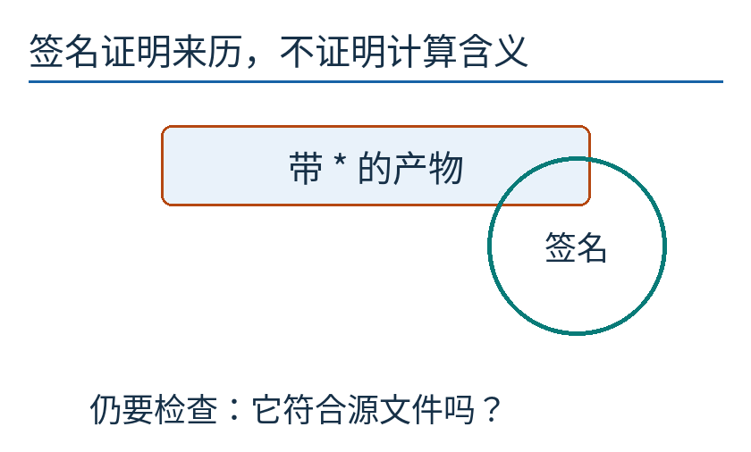

圆形标记只是签名概念的示意，没有伪造真实证书或机构背书。获得可靠来历很重要，但来历与行为仍是两个判断。

## 独立的第二条构建路线能做什么

David A. Wheeler 研究了“多样化双重编译”，英文名 diverse double-compiling，简称DDC。它要回答一个具体问题：某个待检编译器可执行体，是否与所提供的编译器源码相对应。Wheeler 的作者说明还专门澄清：**不是要求两个不同编译器直接把同一程序编成完全一样的机器码。**[作者说明与论文入口](https://dwheeler.com/trusting-trust/)

我们只讲一个简化情形：待检编译器能够编译自己的源码，目标、选项及其他构建输入固定，而且源码规定的编译过程是确定的。更一般的父编译器关系要按完整DDC论文处理，不能把下面的小图当作适用于任意项目的操作手册。

第一步，取另一份有理由信任、尽可能独立的工具T，让它编译待检编译器的源码S，得到中间编译器I。I的机器码可以与待检产物C不同；不同工具可能选择不同寄存器、布局或指令序列。

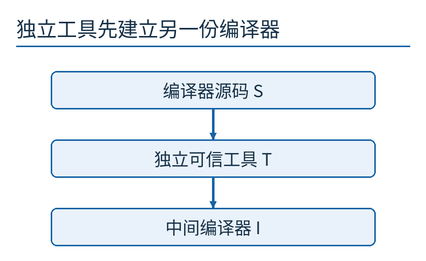

T不需要与C长得一样。此步需要的是：T在处理这份S及相关输入时，正确实现了所需语言含义。

第二步，用I再次编译同一份S，得到参考产物R。此时I运行的是S所描述的编译逻辑；如果构建行为确定、各项假设成立，它应该产生S规定的那一种输出。

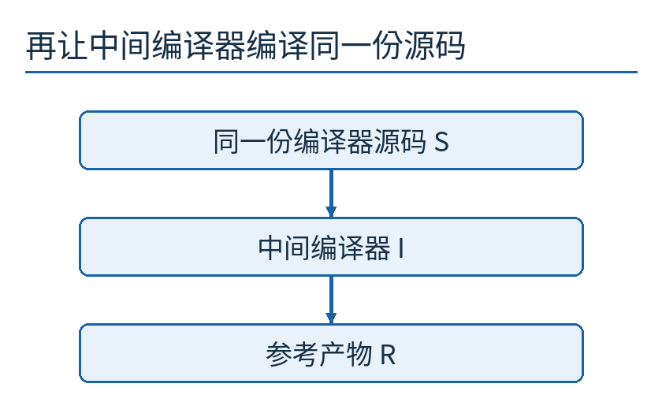

请留意箭头上的角色变化：第一次执行的是独立工具T，第二次执行的是由源码S得到的I。做两次，是为了把不同工具自身的代码生成选择隔开。

最后，把R与待检产物C作逐字节比较。这里比的是R和C，不是T和C，也不是I和C。

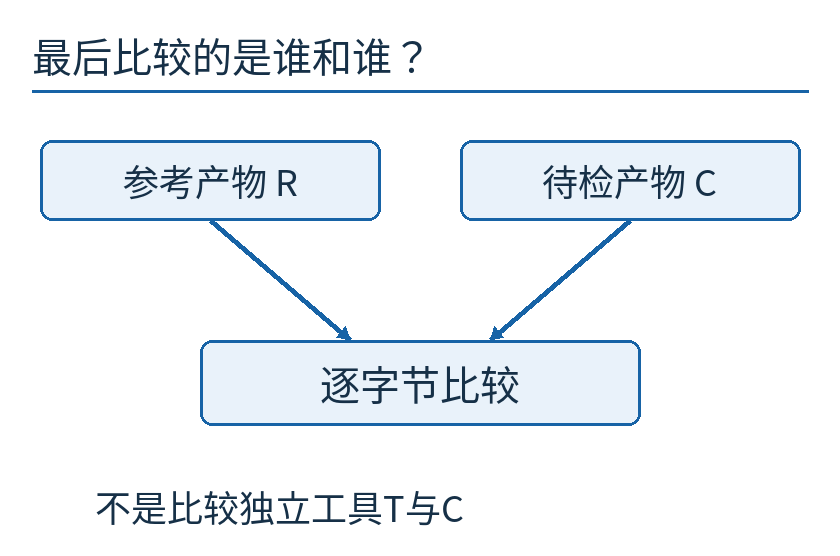

如果不一致，说明还有问题需要调查，但不能仅凭“不一样”就判定是蓄意攻击。时间戳、不同编译选项、环境输入、未定义行为或构建过程差异，都可能破坏比较前提。

如果一致，也只能在相关假设下支持源码与产物的对应关系。不能把“我随手找了另一套名字不同的编译器”当作真正独立：两套工具可能来自同一个受污染的祖先，运行环境也可能共同出错。

## 对应得上，仍不等于程序值得运行

假如源码本来就明确要求附加星号，一个诚实编译器当然应该生成带星号的程序。DDC即使通过，也不会替你宣布“这份源码的行为是我想要的”。它解决对应问题，源码审查、测试与需求检查仍然有各自任务。

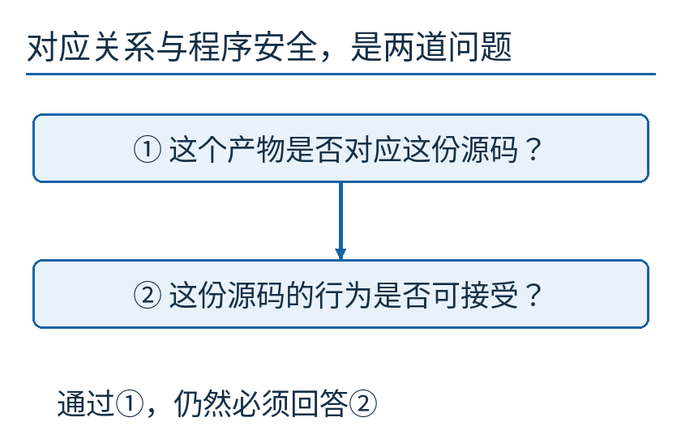

第一道问题问“运行的东西是不是这份源码所表达的东西”；第二道问题问“源码表达的东西是否正确、合适”。把两问分开，才能知道某项证据到底帮到了哪里。

回到开篇，现在你能列出 `HELLO*` 的几个可能来源：源文件其实与审查版本不同，构建选项引入行为，转换工具改变输出，运行环境或实际运行文件选错。Thompson 的文章不是让人停止调查其他可能，而是提醒我们别把加工工具排除在调查范围外。

本文[模型代码](examples/measure.py)只处理内存中的字典对象，所有“产物”也是惰性数据。它不调用系统编译器、不修改文件中的可执行程序，也没有真正实现自举编译或DDC形式证明；[运行记录](examples/results.json)验证的是四代标记传递、重复结果相等及独立参照不同这几个有限关系。把模型能说明的事说清楚，比给它起一个过大的名字更有用。

原创正文、图与模型代码按[CC BY 4.0](https://creativecommons.org/licenses/by/4.0/)提供；Thompson照片保留CC BY-SA 4.0，详见[来源说明](sources.md)。
