# 十八块镜子怎样变成一面镜子：韦布望远镜为什么还要“调相”

你把两面小镜子朝同一处照，让两个光斑重合，似乎就完成了拼接。可是对一台要分辨遥远天体细节的望远镜来说，光到达同一个位置，还不够。来自不同镜片的光，连波动的节拍也要对齐。

韦布空间望远镜的主镜由十八块六边形镜片组成。这种分段结构让大镜面能够折叠运输，展开以后却带来一个细致的问题：怎样让十八块镜子像同一面连续大镜子那样工作？不是把边缘拼得看不见缝，而是让它们给同一束入射光带来的波前误差足够小。

图 1：韦布地面测试照片，NASA/Chris Gunn，CC BY 2.0。金色镜面与展开的遮阳结构同处真实工程现场；照片说明设备身份，并不能直接显示纳米尺度的镜片高度误差。

本文将十八块暂时减为两块，用一组可以手算的光波说明：光斑重叠、光程相同和图像清晰，是怎样连接起来的。

## 每块都照见同一颗星，为什么会有十八个像

远处一颗恒星送来的光，在望远镜尺度上可以近似成一组平行到来的波面。单独一块镜片就能收集其中一部分光，并把它送进后续光学系统。如果镜片的方向有偏差，最后的星像位置也会偏。

于是展开初期的十八块镜片，会把同一颗星成像到探测器上的不同位置。这里的十八个亮点不代表发现了十八颗恒星，而可能是同一颗星的十八份副本。NASA 的镜面调整说明首先就要识别这些副本分别属于哪一块镜片，再逐步调整。[NASA 的 Webb Mirror Alignment Animations](https://svs.gsfc.nasa.gov/20358/)给出了识别、单片调整、叠像与调相之间的区别。

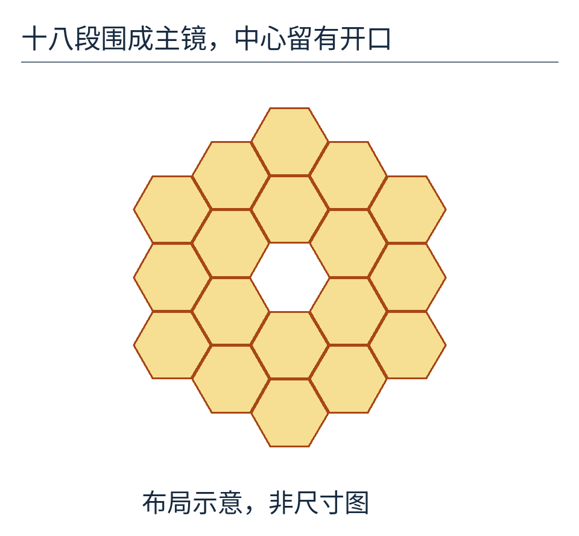

图 2：十八个六边形分布在中央开口周围；只表示分段布局，不是制造尺寸图。颜色相同强调它们共同组成一面主镜，不代表十八台独立望远镜永远各自工作。

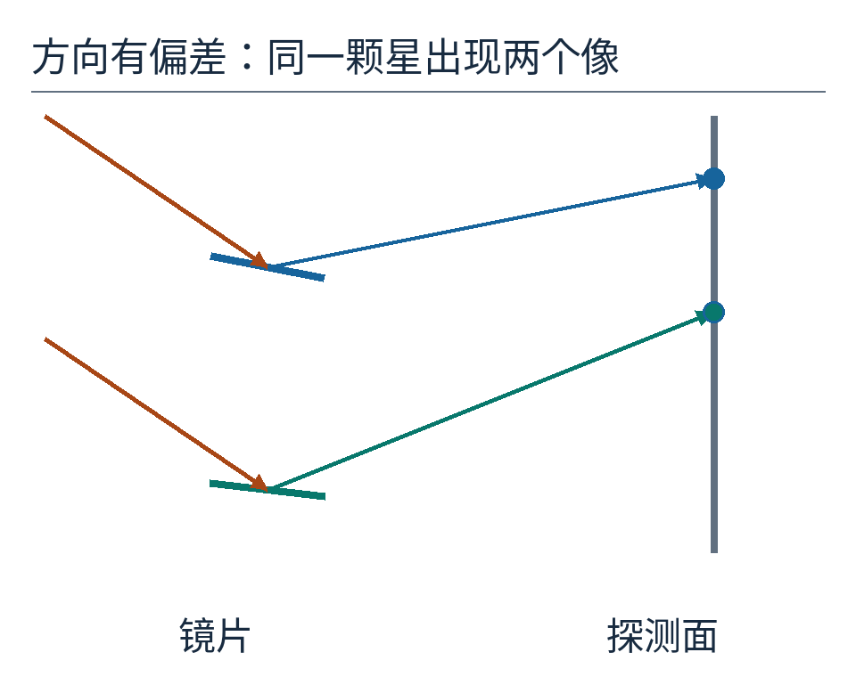

图 3：左侧两块镜片的方向稍有不同，右侧探测面上出现两个像点。折线只画教学光路，真实韦布还要经过次镜等光学元件，不是镜片直接照射一个平板。

要把这些像叠起来，可以逐片调整指向，让它们落到共同位置。我们现在假定这一步已经完成。此时若只把光看成沿直线行进的细箭头，会以为任务结束；把光看成波动，新的问题才出现。

## 同一处的两束光，也可能彼此抵消

想象同一个位置有两份相同频率的电场振动。第一份现在向上偏，第二份也向上偏，相加就变大；第一份向上、第二份向下，二者可能抵消。这个相加发生在电场上，而探测器记录的光强与合成电场幅度的平方有关。

把一份电场的振幅设为 1。这里的 1 是归一化单位，不是 1 伏。两份完全同相，合成振幅是 2，光强就是 4 个单位；两份相差半个周期，合成振幅是 0，该位置的光强就是 0。

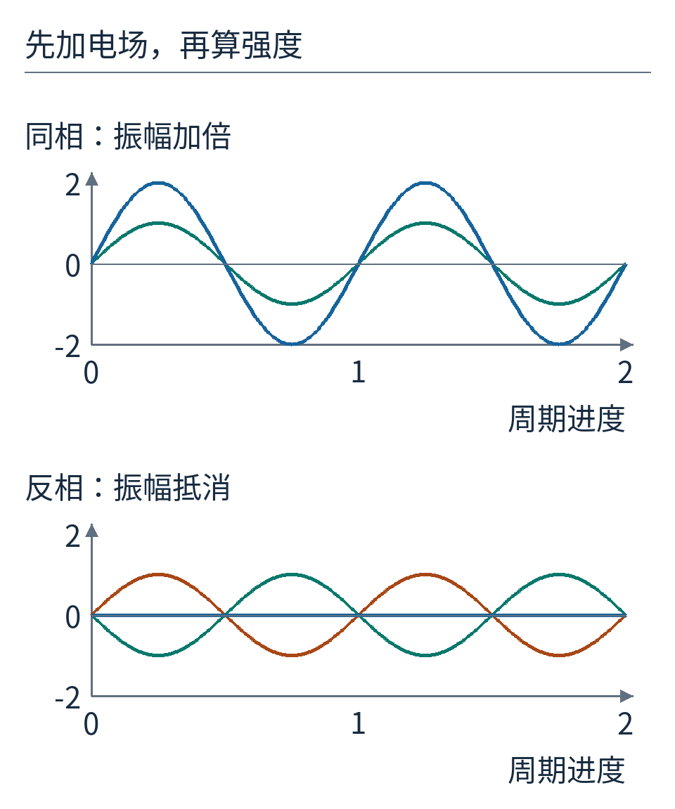

图 4：上半图两条波同相，合成后的蓝线振幅加倍；下半图一上一下，合成蓝线落在零线上。横轴是一段光波周期的进度，不是望远镜相机能逐帧看到的电场摆动。

这里要防止一个误会：相消没有让光的总能量消失。在完整空间光场中，某些方向变暗的同时，另一些方向会变亮。望远镜希望把同一个点光源的能量集中在正确的成像位置，而不是让它散到不需要的条纹和旁瓣里。

## “晚到半拍”究竟差了多长的路

一个完整波动周期对应空间上的一个波长，记作 λ。如果两束光的光程差为 λ，它们相差整整一周，再次同相；相差 λ/2，就错开半周。这里光程可以先理解成在真空中走过的路程；穿过介质时还必须把折射率算进去。

为方便计算，本文选 λ=2 微米，即 0.002 毫米。半个波长是 1 微米。这不是说韦布只在这一个波长工作，而是先选一种颜色把问题讲清。

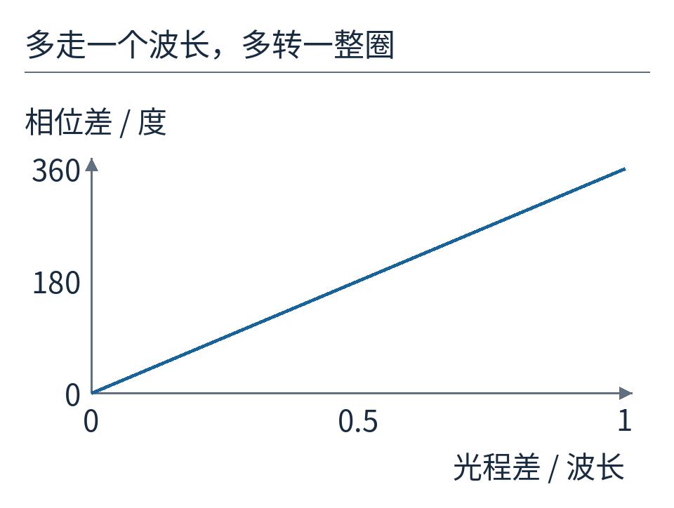

图 5：横轴是光程差除以波长，纵轴是相位差。走完一个波长，就多转一整圈，也就是 360°。图上 0.5 个波长对应 180°。

用公式写：`相位差 φ = 2π × 光程差 / λ`。π 是半圈对应的弧度数，2π 表示整圈。你也可以直接用“360° 乘以波长的份数”，含义完全相同。

现在把一块反射镜沿光线方向往后平移 δ。在近似垂直入射、原路反射的简化几何里，光去镜面时多走 δ，反射回来又多走 δ，总共多走 2δ。因此镜片本身后退 0.5 微米，就会产生 1 微米光程差，对 2 微米的光恰好是半拍。

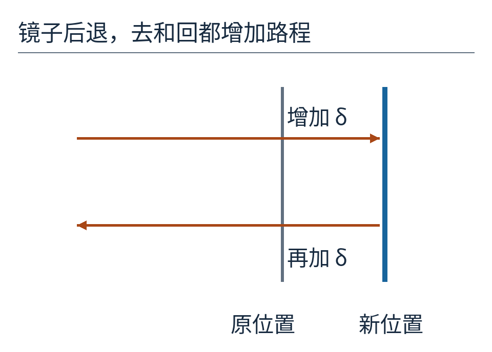

图 6：灰线是原镜面位置，蓝线是后退后的镜面。橙色箭头分别表示入射与反射路径；灰、蓝镜面之间的那一段，在两条路径上各增加 δ。示意把两条路径错开以便看清；正常入射的真实光路可以重合。

把这个动作叫作镜片的活塞位移，英文 piston：像活塞一样整体前后挪，方向没变。倾斜主要使星像位置改变；活塞位移可以在星像仍然叠着时改变相位。二者是不同的误差，不能只凭“光点已经重合”确认都消除了。

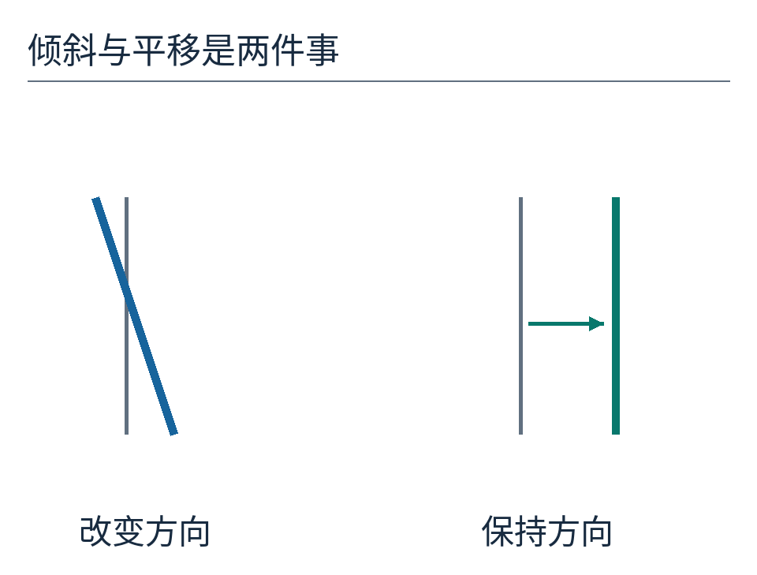

图 7：左边改变镜片方向，右边保持方向只平移。图中的变化刻意放大；实际调节量不能用图上毫米估计。

## 把中间的四分之一拍也算出来

同相得到 4，反相得到 0，那相差四分之一拍呢？可以用两根长度为 1 的小箭头表示两份同频率电场的相位。箭头彼此夹角为 φ，相加后那根箭头的长度，就是合成波的振幅。

在 φ=90° 时，两根箭头互相垂直。根据勾股定理，合成长度为 √2；再平方，光强就是 2。不是 1+1 随时都等于 2，而是这个特定相位刚好得到 2。

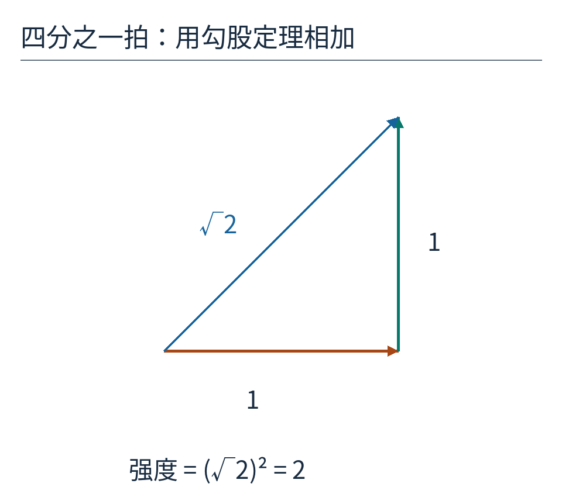

图 8：横向箭头与竖向箭头都长 1，对角合成箭头长 √2。这张相位箭头图不是光在空间里真的拐成直角，而是一种记录同频率波相位与振幅的数学工具。

更一般地，第二根箭头的水平分量为 cosφ，竖直分量为 sinφ。相加后，横向是 `1+cosφ`，竖向是 `sinφ`。长度平方为 `(1+cosφ)²+sin²φ`；利用 `cos²φ+sin²φ=1`，得到：

`I = 2+2cosφ`。

I 是此处的归一化强度，两束单独照到这里时各为 1。这个结果假定两束同频率、能相干叠加、偏振可相加且幅度相等。若两束没有稳定的相位关系，探测器长时间平均后就不会保留这样的固定明暗变化。

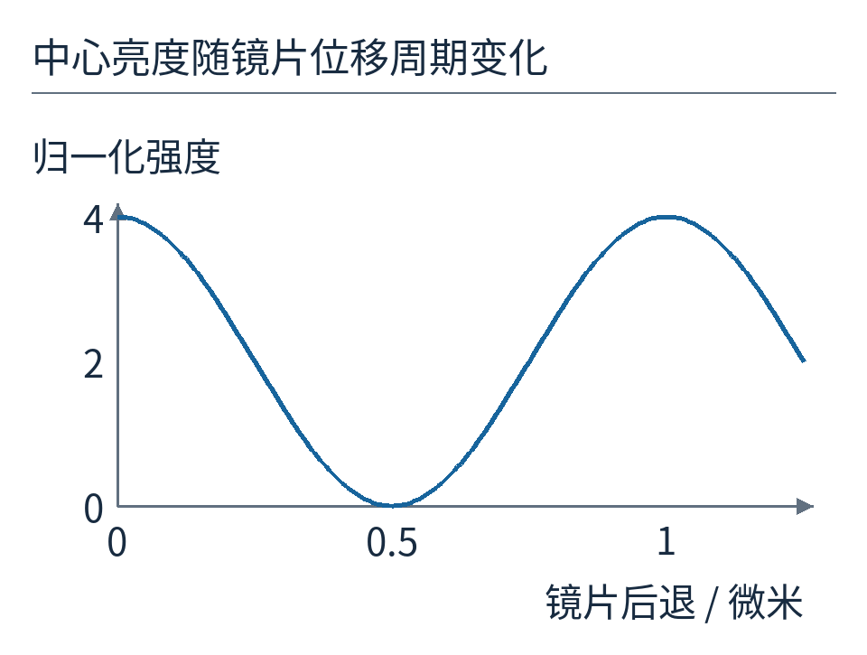

图 9：采用 λ=2 微米和光程差 2δ 的模型，横轴是镜片后退量。δ=0 时强度 4；0.25 微米时为 2；0.5 微米时为 0；1 微米时又回到 4。相同亮度可能对应多个位置，这是调相不能只盯一个数字的原因。

## 中心变暗后，光去了哪里

我们再做一个明确简化的模型：一条直线上有两段等宽的入光孔径，中间留缝。每一段代表一块镜片在一维方向上的投影。计算远场不同方向的电场，再把幅度平方，就能画出点光源的亮度分布。

同相时，两段孔径在正中方向相长；其中一段错开半拍后，正中相消，较多能量转移到两边。图中的横轴 u 定义为“单段孔径宽度乘观察方向的正弦，再除以波长”，没有单位。它帮助比较形状，不是韦布图像的角秒刻度。

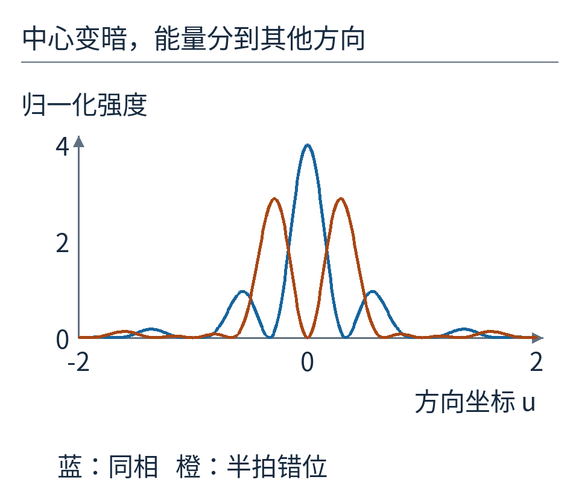

图 10：蓝线同相，橙线半拍错位；两条曲线共用同一强度尺度，没有分别拉高各自峰值。这里只模拟两段一维孔径，不能把它当作韦布十八块六边形镜面的真实点扩散函数。

这个计算说明，调相不只是让一颗星看起来更亮。它在修复整个成像系统怎样分配点光源能量。一个理想的点也不会在有限口径望远镜里变成无尺寸的数学点；衍射仍然存在。调相的目标是尽量接近这副真实孔径允许的成像效果，而不是消灭衍射。

## 只看一张清晰度照片，可能认错了台阶

回到图 9，δ=0 与 δ=1 微米都让 2 微米光在中心同相。只用这一个波长的这个读数，无法分辨镜片是完全对齐，还是多走了整整一周。

换成 λ=2.5 微米，δ=1 微米造成的光程差仍为 2 微米，却只相当于 0.8 周；它不再是整周。同一处位置在不同波长下的响应，能帮助辨别那些在单一颜色下混在一起的可能性。这是解释光谱信息为什么有用的入门例子，不是韦布粗调相算法的逐行复刻。

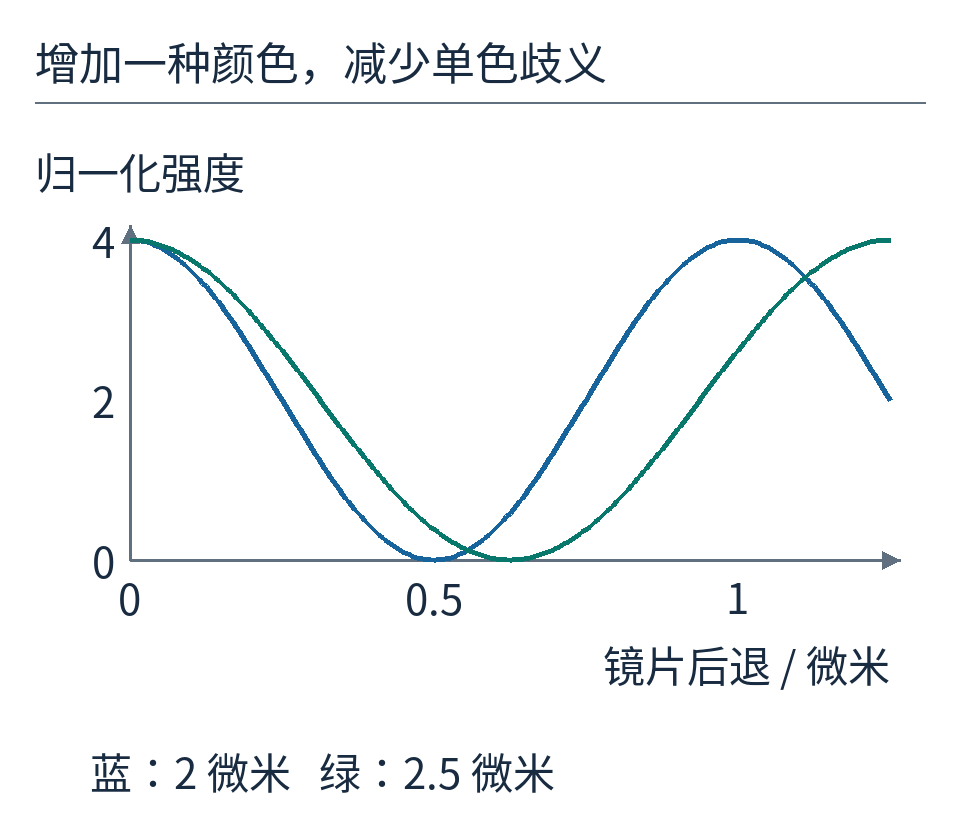

图 11：蓝线为 2 微米，绿色为 2.5 微米。δ=0 时两线都在峰值；δ=1 微米时只有蓝线回到峰值。两色共同约束比单色多，但有限测量范围和噪声仍需处理，不能说两色保证识别任意位移。

NASA 的实际方案在粗调相阶段利用分散条纹测量成对镜片的活塞差；精调相阶段则使用引入已知离焦量的图像，推断和修正剩余波前误差。离焦不是把“坏照片”当最终结果，而是故意改变已知条件，让原本隐藏的相位误差在强度图样中留下更可辨认的痕迹。

可以类比成检查一个不透明盒子：只从正面看一眼，几种内部状态可能长得一样；在已知方向上改变条件，再看它如何变化，候选就减少了。实际相位恢复要由光学模型预测不同误差会产生什么图像，再与多幅观测比较，不能凭肉眼把光斑画圆就完成。

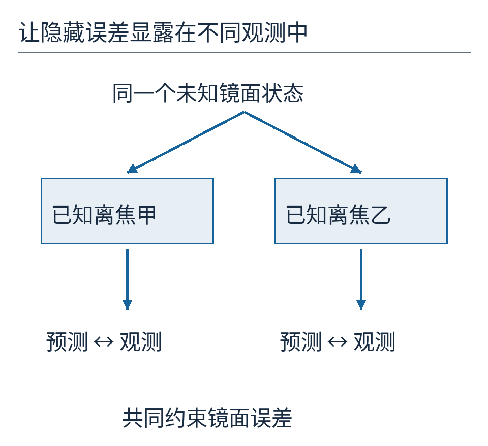

图 12：示意的是测量逻辑，没有生成冒充 NIRCam 的软件画面。未知镜面误差进入同一个光学模型，已知的不同离焦条件产生多组预测，与对应观测共同比较。

## 一块镜子调好了，不代表整台望远镜调好了

在一个视场点成像良好，还要检查其他视场位置和不同仪器的成像。镜片会受到温度与结构状态的影响，也需要后续监测与维护。NASA 的[主镜介绍](https://science.nasa.gov/mission/webb/webbs-mirrors/)说明了分段镜片、驱动机构及镜面调整的工程背景；调相只是大型光学系统对准工作中的重要一环。

现在可以把“十八块变一块”说得更具体：先认清每块产生的像，修正单块误差，让像落到共同位置；再比较波前，调整镜片之间的光程，使同一颗星的光在应该集中之处协同叠加；最后检查整个系统的适用视场。这些动作既有关联，也不能彼此替代。

拼镜子的难点并不全在缝隙。对光而言，半个波长的错位已经足够把最想保留的亮处变暗。看起来已经对准的十八个像，仍然值得再问一句：它们到达时，是不是同一拍？

示例输入和曲线数值见 [results.json](examples/results.json)，执行 `python examples/build_figures.py` 重算。照片和原创图的逐图权利见 [sources.md](sources.md)。原创正文采用 [CC BY 4.0](https://creativecommons.org/licenses/by/4.0/)。
