# 一条加法指令，谁来按顺序拨动开关？Wilkes 与微程序控制

写下 `3+5`，我们会说答案是8。可是在一台计算机里，“加起来”不是一个会自己发生的动作。

3可能已经在处理器的小存储格里，5却还在内存中。机器需要先指出5在哪里，再把它取过来，让加法器看到两个输入，最后把8存回去。不能还没把5取到就开始相加，也不能同时让两个输出端抢着往同一根线上送数。

谁负责安排这几步？一种办法，是为每种指令设计对应的逻辑电路，让状态和输入一起决定控制信号。另一种办法，则把许多控制步骤排成一张可按地址读取的表：读一行，发出这一行规定的信号，再决定读哪一行。这就是微程序控制的核心想法。

这里的“微”指的是它靠近硬件控制的层次，不是说程序文件一定很小，更不是“给微型计算机写程序”。我们从一条只有三步的教学加法开始，看看这个想法究竟省下了什么，又没有省下什么。

## 从真实机器旁边的问题出发

Maurice Wilkes 与 EDSAC 延迟线管组。照片帮助我们看见早期计算机的实物尺度；这些管子属于存储装置，不是本文要讲的微程序控制表，照片也不是 EDSAC 2 微程序单元的特写。Copyright Department of Computer Science and Technology, University of Cambridge. Reproduced by permission. [原档案](https://www.cl.cam.ac.uk/relics/archive_photos.html)，[CC BY 2.0 UK](https://creativecommons.org/licenses/by/2.0/uk/)，未修改。

Wilkes 的剑桥个人档案把微程序提议放在1951年前后。1953年，他与 John B. Stringer 的论文进一步讨论电子计算机的控制电路设计。论文开头提出了一个很实际的观察：逻辑结构简单、规则的部分比较容易维护，而控制部分往往最复杂。这里追求的不只是“算得更快”，也包括让设计者能理解、检查和维护机器。[Wilkes个人简介](https://www.cl.cam.ac.uk/archive/mvw1/short-biography.html)、[1953年论文摘要及出版记录](https://www.cambridge.org/core/journals/mathematical-proceedings-of-the-cambridge-philosophical-society/article/microprogramming-and-the-design-of-the-control-circuits-in-an-electronic-digital-computer/4F7EDCBEB735637790E7170503908323)

要看控制硬件本身，可打开剑桥档案的[EDSAC II控制矩阵机架原始照片](https://www.cl.cam.ac.uk/relics/jpegs/edsac99.26.jpg)；它与上面的延迟线照片是不同对象。本文没有归档该照片，后续结构图负责解释控制表的工作关系。

下面的图和小机器是为本文独立设计的现代教学模型，不照搬历史电路，也不声称三步、寄存器名字或微地址就是 EDSAC 的原样。把层次分清，反而更容易看懂那个历史想法。

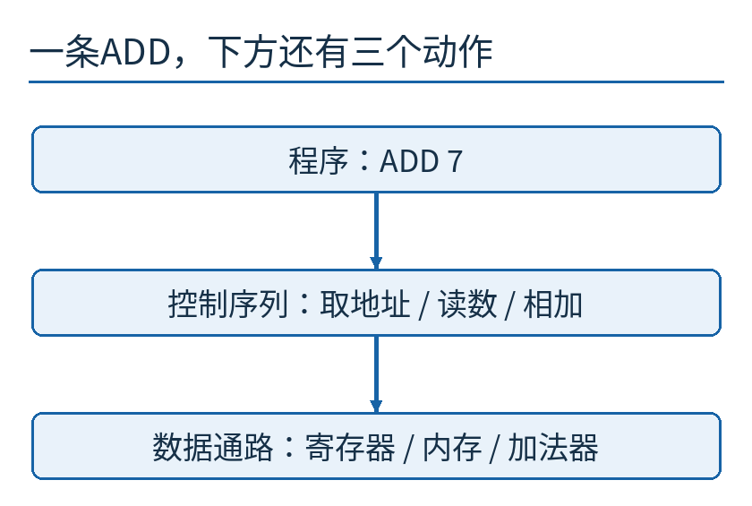

从上往下读：程序说“做什么”，控制序列安排“这一拍启用什么”，底层通路负责真的搬动和运算。箭头表示控制层次，不表示一根实际导线。

## 先认识四个存数的位置

我们规定一条机器指令 `ADD 7`：把内存地址7里的数，加到累加器A中。累加器只是一个保存当前运算结果的小存储位置；“7”是地址，不是要加上的数字。

这台教学机有四个重要位置。A最初装3；内存的7号位置装5；MAR暂存要访问的内存地址；MDR暂存从内存读回的数。后两个英文缩写分别对应 memory address register 和 memory data register。寄存器可以先理解为处理器里能快速保存少量信息的格子。

MAR与MDR不能混为一谈：一个回答“哪一格”，另一个回答“那一格里是什么”。如果把7直接拿去加，得到10，机器就认真执行了错误的含义。

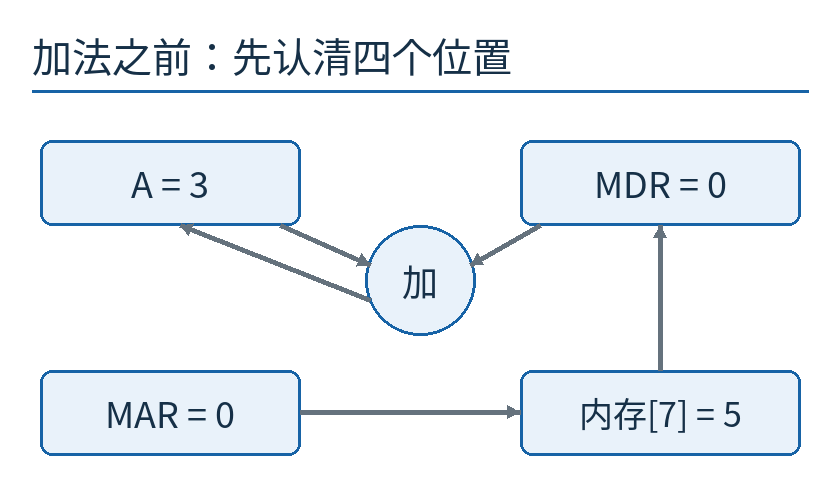

左上是A，右上是MDR，中间圆圈是加法器；下方是地址寄存器和内存。灰箭头表示允许的信息传送方向，不表示所有通路此刻都在传数据。

我们的模型还作一项简化：一次读内存可以在一个微步里完成。真实内存可能有等待状态、握手或多个周期；把这些暂时省掉，只为看清控制顺序，不能用本例的三步推算真实机器速度。

## 第一步：先把地址放好

微地址10处的控制行规定：把当前指令中的地址7送入MAR，随后转到微地址11。

一步执行后，MAR从0变成7；A仍然是3，MDR仍然是0。我们还没有做加法，也没有把内存里的5取出来。

“把地址放好”和“读出这个地址里的数”为什么分成两步？因为内存必须先知道该选谁，随后才能提供相应内容。某些硬件能把部分动作合并，但在这台教学机中，先后约定很明确。一步步列出状态，是防止自己悄悄跨越这个条件。

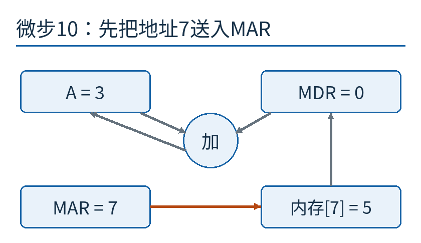

图中MAR已变成7。橙色标出本阶段正在建立的地址选择关系；其余寄存器保持原值。

## 第二步：把那一格的内容带回来

微地址11处的控制行让内存按MAR寻址，并将读出的数放入MDR。MAR是7，所以MDR得到 `内存[7]=5`。下一微地址是12。

此时A仍然是3，MDR是5。加法器终于有了需要的两个数，但我们仍然没有许可它把结果写回A。能在电路上形成某个数，与允许这个数改变机器状态，是两件事。

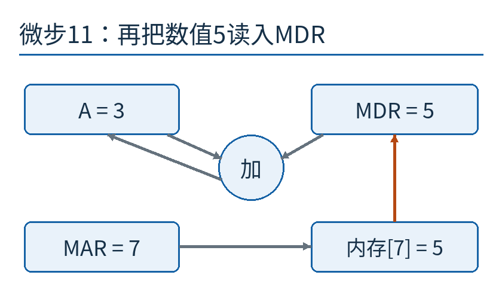

橙色箭头从内存指向MDR。地址7留在MAR中，读出的5进入另一处寄存器；图里的7和5有不同角色。

## 第三步：相加，并在正确时刻保存

微地址12启用加法器的结果写入A。它读取本步开始时的A=3、MDR=5，计算8，再让A接收8。MDR和内存都不需要改变。

然后控制转到微地址0。本文把0约定为“结束当前指令，返回取下一条指令的入口”，程序不继续模拟取指动作。这个0不是关机，也不是内存地址0，更不是所有计算机统一保留的特殊地址。

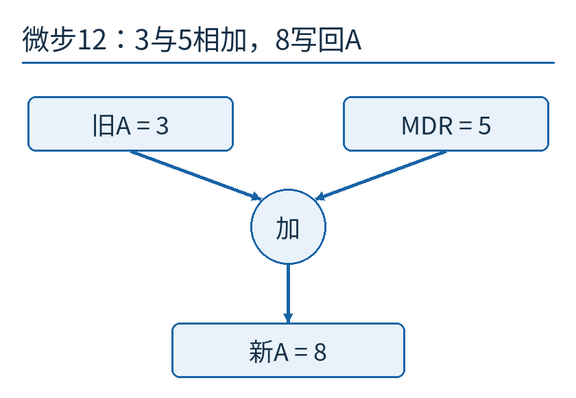

A变为8，表示第三步的写回已经完成。蓝线只标本阶段参与运算和写回的通路；它没有表示另一套并行加法。

至此，外部程序只写了一条 `ADD 7`，内部却按顺序经历三次状态变化。微程序不是把加法器取消了，而是安排加法器何时工作、结果何时被接住。

## 把三步写成可以读取的控制字

现在把“启用地址传送”“读内存”“执行加法并写回”各分配一个控制位。位是0或1，这里暂定1表示启用、0表示不启用。

微地址10那行是 `1 0 0`：只做地址传送。微地址11是 `0 1 0`：只读内存。微地址12是 `0 0 1`：只做加法写回。每一行还附带下一微地址。

这串位叫作控制字。读它的目的不是把它当一个普通整数参与加法，而是让各位接到对应的控制入口。相同的0和1，放在不同约定下可以是数据、地址或命令；含义来自机器设计。

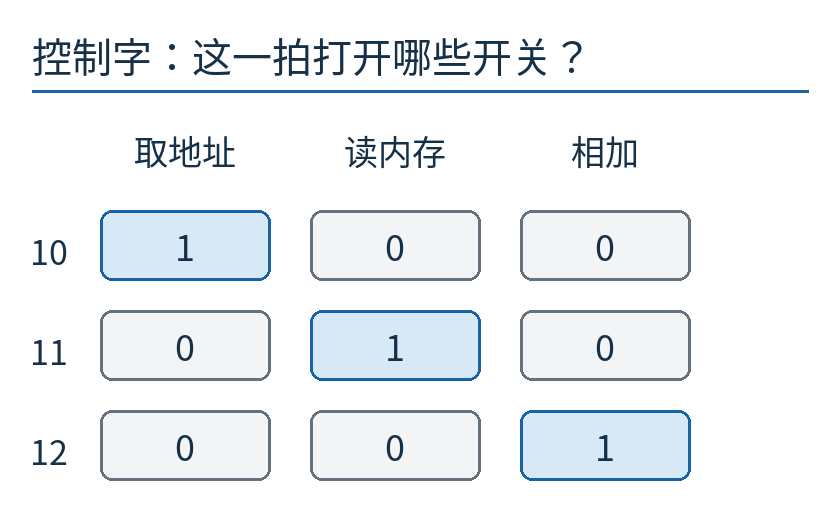

纵向是微地址10、11、12，横向是三种控制功能。蓝格表示1、灰格表示0。读一整行，得到该微步允许发生的动作组合。

如果这些行放在一种可以寻址读取的存储装置里，控制器就不必为每一步另造完全不同的逻辑路径。它可以重复“取控制字、发信号、选下一址”的共同结构。规则性来自重复使用这个结构，复杂的指令过程则体现在表的内容中。

这并不表示控制器内部没有逻辑。选地址、译码、产生时序和处理条件，都还需要电路。微程序是重新组织控制逻辑的一种办法，不是让控制逻辑凭空消失。

## 小机器也需要知道下一步去哪

如果控制表只会顺着10、11、12读下去，它只能执行直线流程。乘法里的重复步骤、条件跳转、不同指令入口，都需要更灵活的下一址选择。

我们的三行明确写着10→11、11→12、12→0。专门记住当前微地址的位置，可以叫微程序计数器。它与程序计数器不是同一个东西：程序计数器指向应用程序的下一条机器指令；微程序计数器指向实现当前指令所需的下一段控制。

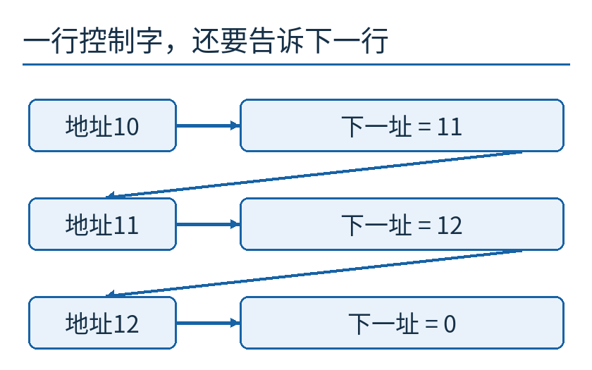

左边是当前微地址，右边是本行提供的下一址。斜箭头表示下一次选择的控制行，行在图上的摆放不等于芯片里存储单元的物理位置。

再加一个小分支：若A为0，进入微地址20；否则回到0。判断结果可以用一个零标志Z表示，Z=1代表A为0，Z=0代表A非零。

先确定Z的含义，再代入：A=0时选20；我们刚刚的A=8则选0。不要因为“零标志”里有个零，就误以为Z=0表示结果为零。名字指向被检测的条件，位值表示这个条件是否成立。

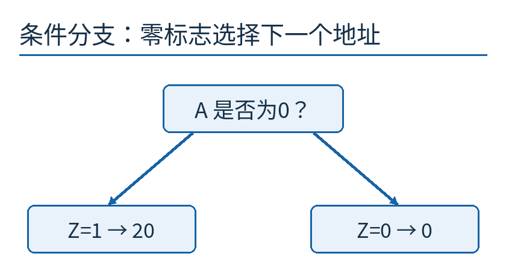

这是独立的条件分支示例，不是说前面的ADD在得到8后又执行了一次额外加法。分支选择取决于机器当前状态。

## 控制字不是想写什么就写什么

看到一行有许多独立位，很容易产生一种错觉：把需要的位都置1，就能让机器同时做更多事。

但一根共享总线如果同一时刻只能由一个来源驱动，便不能让A输出3、B输出5同时连上去。它不会自动把两者相加得到8；总线不是加法器。实际电路可能出现冲突或不可靠状态，具体后果依硬件而定。

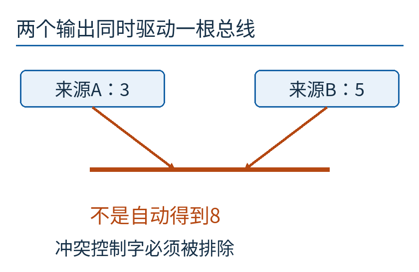

两条橙色箭头汇入共享总线，表示不允许的同时驱动。叉路相接不等于数学加法；真正的加法应经过前面那个加法器。

因此，设计者还要给控制字施加合法组合约束。例如在同一组选通源中只能选一个；必须先建立有效地址才能读内存；某些状态只允许在时钟边沿更新。控制字错误是设计错误，存进表里不会使它变得正确。

反过来，互不冲突、满足时序的动作可以同拍进行。本文把三个动作分开，是教学通路的选择，不是“所有微指令只能做一个动作”的定义。

## 一排独立开关，还是一个编码选择

如果三种动作在某个字段中保证互斥，可以用两位编码：00不做事、01取地址、10相加、11读内存。这样字段比三个独立控制位更短，但需要一个译码器把编码翻译成具体控制信号。

这个小例子只比较三种互斥动作，不能代表完整CPU控制字的所有安排。更宽、比较直接的控制字常被称为水平微指令；更多使用编码字段的安排偏向垂直微指令。这两个词描述一条设计取舍轴，并不是两类毫无中间地带的机器。

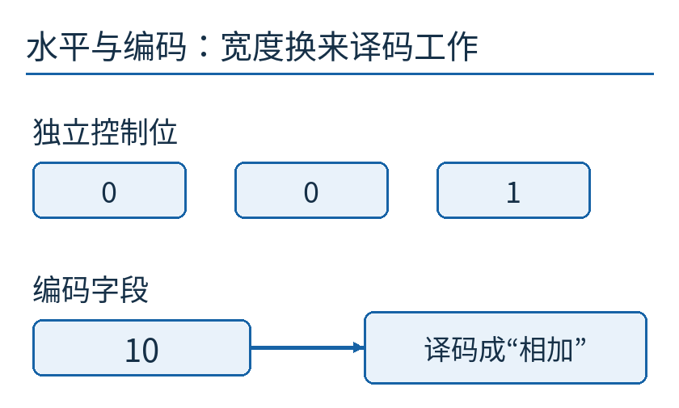

上方用第三位为1表示相加；下方用编码10经译码器选择相加。两种位串按不同约定解释，不能逐位直接比较。

短一些可能节省控制存储，译码却可能增加延迟；直接一些可能更利于并行控制，但控制字更宽、合法组合更复杂。设计者需要看真实通路、时序、存储技术与维护需求，不能只数“位越少越好”。

## 两种“程序”，为何不互相抢位置

应用程序的 `ADD 7` 可以放在主存地址100。处理器取到它后，识别ADD这个操作码，进入对应的控制序列，例如微地址10。完成三微步以后，再返回应用程序的取指流程。

主存地址100、操作数地址7、微地址10，三个编号都能写成整数，却属于不同的用途。把它们画在不同列里，是帮助读者认清层次，并非要求真实机器一定有三块外观分开的芯片。

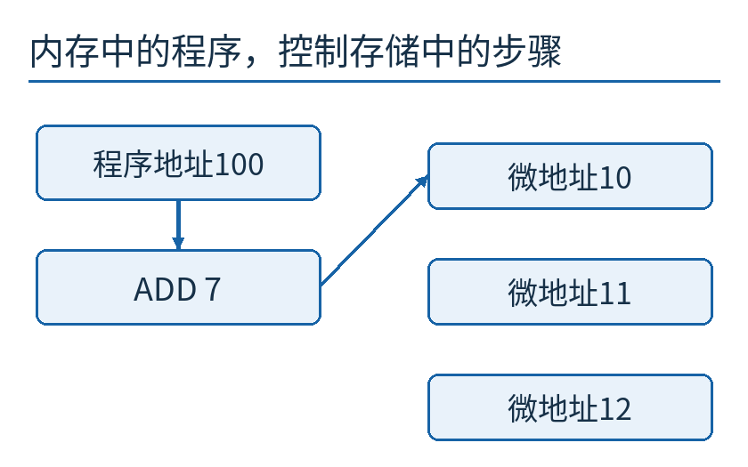

左列说明应用程序从哪取指令，右列说明控制器从哪取步骤。中间箭头代表根据操作码选择微程序入口，不是把ADD的文字直接当作导线信号。

微程序存储也不一定随时可写。某些设计用只读形式，某些设计支持装入或修补；是否能更新、由谁更新、能改哪些行为，都是具体机器的问题。不能从“它像一张程序表”跳到“普通软件随时能给所有CPU添指令”。

## 为什么这不是软件的无限魔法

假如通路上有加法器，没有除法器，修改控制表不能让一个任意除法在一拍里完成。可以尝试用已有加减、比较、移位等硬件组织多步算法，但前提是这些操作和必要状态确实存在，并且要付出更多步骤。

同样，存储带宽、寄存器宽度、连线和时序都是实物限制。控制表负责安排已有能力，不能把一条窄线变宽，也不能让尚未到达的内存数据提前出现。

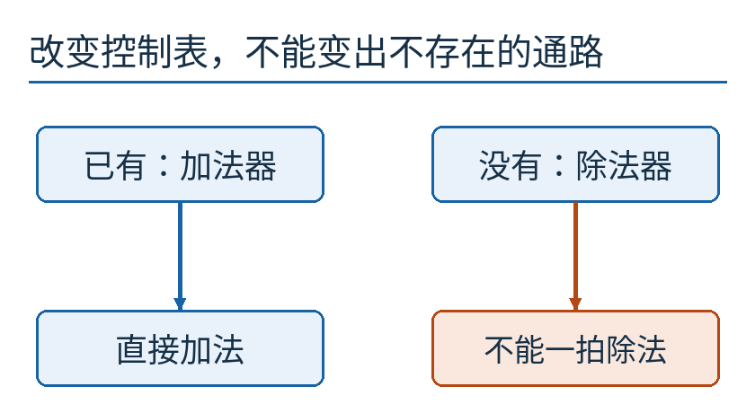

“已有加法器”支持直接相加；“没有除法器”不排除多步实现除法，却排除了凭改表就获得一拍任意除法的想象。

你现在可以自己试一个变化：仍执行 `ADD 7`，但A最初是9、内存7号格装4。三行控制表需要改吗？不需要。第一步仍把地址7放入MAR，第二步读回4，第三步得到13。微程序规定的是操作关系，操作数则由当前机器状态提供。

再试一个真正需要改控制的变化：要求“把A与内存7号内容交换”。只靠前面三个控制动作够不够？不够。你至少需要保留旧A，并有把数写回内存的通路和控制。把目标说得像一句话很容易，逐步检查每个值什么时候在哪里，才知道机器到底能不能做。

[配套模型](examples/measure.py)记录了3→8的三步状态，另检查0到15范围内256组加法。它只验证本文简化的算术和控制顺序，不模拟历史电子管、存储等待、有限字长溢出或实际电路可靠性。[数值记录](examples/results.json)与[来源和图像许可](sources.md)可一并查看。
