# 一颗CPU忙到最后，其他CPU在等什么？任务窃取怎样把活重新分开

给两位同事各发两项工作，看上去很公平。第一位领到的两项，各要四小时；第二位领到的两项，各要一小时。两小时以后，一半人手已经闲下来，另一半还要忙六小时。

计算机也会遇见这种局面。图片处理、搜索、编译和游戏中的一些后台计算，可以拆成许多任务；但“任务数量相同”不保证“计算时间相同”。更麻烦的是，任务还可能在运行途中生出新的任务。你在开始前，甚至不知道工作清单会长成什么样。

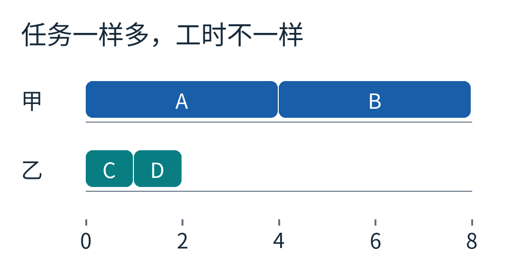

蓝色是甲的两项长任务，青色是乙的两项短任务，横轴用同一种教学时间单位。每个色块的长度就是耗时；这里没有测量真实CPU。

一种很实用的办法是：**平时各做各的；谁先做完，谁去别人那里领一项尚未开始的工作。** 这叫任务窃取，work stealing。“窃取”是调度术语，任务本来就属于同一轮合法计算，并不涉及偷走别人的文件或权限。

它最值得琢磨的地方，不是“闲人应该帮忙”这句常识，而是三个细节：从哪里拿？为什么从那一端拿？它能够保证什么，又保证不了什么？

## 先有依赖，再谈分工

用一轮小计算把事情说清。我们设八个任务，字母只是稳定编号：

- S花1单位时间，把问题分成L和R。
- L花1单位时间，产生A、B，两项各花4。
- R花1单位时间，产生C、D，两项各花1。
- 四项叶子任务全部完成以后，J花1单位时间合并结果。

这里的“产生”指把新任务放入待办队列。产生任务和执行任务是两回事。A没有开始，不代表它还不存在。

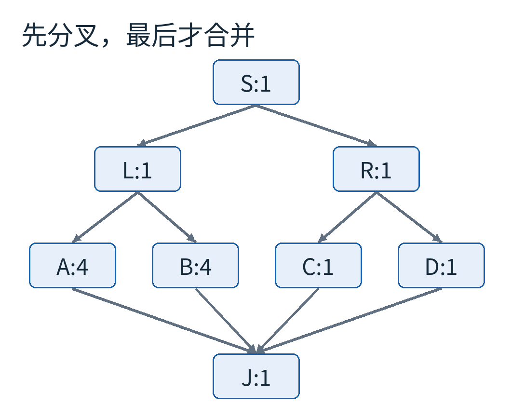

每个框内“字母:数字”表示任务和耗时；箭头指向必须后做的任务。J必须等A、B、C、D全部完成。图上的位置不是内存地址，也不是CPU位置。

假如A正在读取一份只有L才能算出的输入，调度器不能为了让CPU忙起来，就让A先于L执行。任务窃取只改变**已经可以执行的工作归谁做**，不取消依赖，也不决定某项计算是否应该命中缓存。

这也是它与增量构建的一个区别：增量构建先问“这项工作还需要重做吗”；本文把八项都视为必须执行，再问“这些工作如何分到两名工作者手里”。

## 每个人身边，放一条两头都能拿的队列

普通排队常常一头进、一头出。这里需要一种两端都能操作的容器，叫双端队列，简称deque。你不必记住读音，先记住它有两个入口。

我们约定：主人把新发现的任务放在“较新端”，自己也从这一端拿；来帮忙的工作者从另一端拿较早放进去的任务。

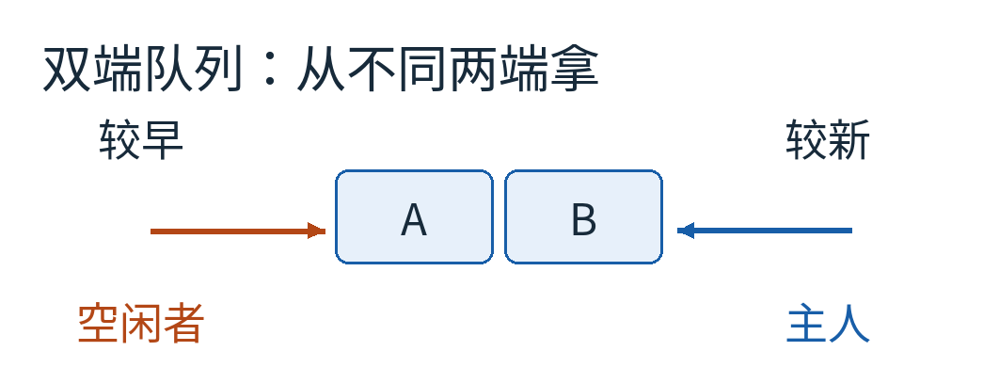

图中A先入队，B后入队。蓝色主人从右边拿B，橙色窃取者从左边拿A。左右是本文画图约定；不同论文可能把两端称作top、bottom，名字不能脱离各自定义照搬。

这样安排不是为了装得复杂。主人接着做刚刚产生的分支，通常更接近深度优先执行：沿眼前这条路走下去，临时数据可能还在缓存里，调用关系也比较集中。留给帮手的较早任务，在递归拆分的程序里常常代表一个更靠近上层、可继续展开的分支。

“常常”很重要。队列没有水晶球。较早任务不必然更大，也不必然更赚钱；这个策略利用的是一类程序常见的结构，不是对任意任务长度的预言。

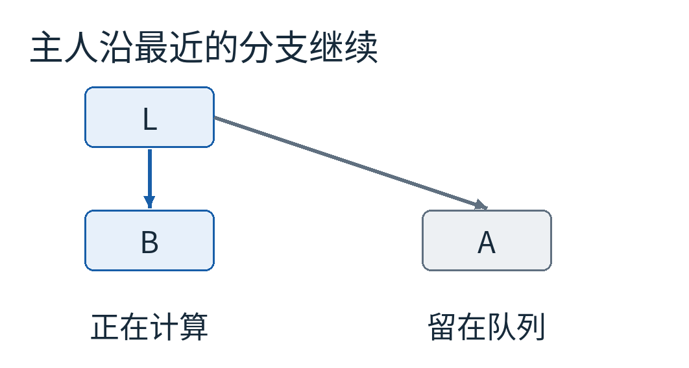

L产生A和B以后，甲先执行B，A留在队列。只有A可以被别人领取；B正在甲那里计算，不能简单从它的双端队列中“搬走”。

真实系统也可能采用其他策略，例如把新生成的子任务交出去，或把原来计算的后续部分留给窃取者。本文采用的是容易看清的任务队列教学模型，不把所有运行时的实现都画成同一张图。

## 把一次窃取放慢到四个时刻

两种调度都从同样的起点开始：甲在0到1运行S。S结束后，甲领L，乙领R；1到2，两项分叉同时进行。

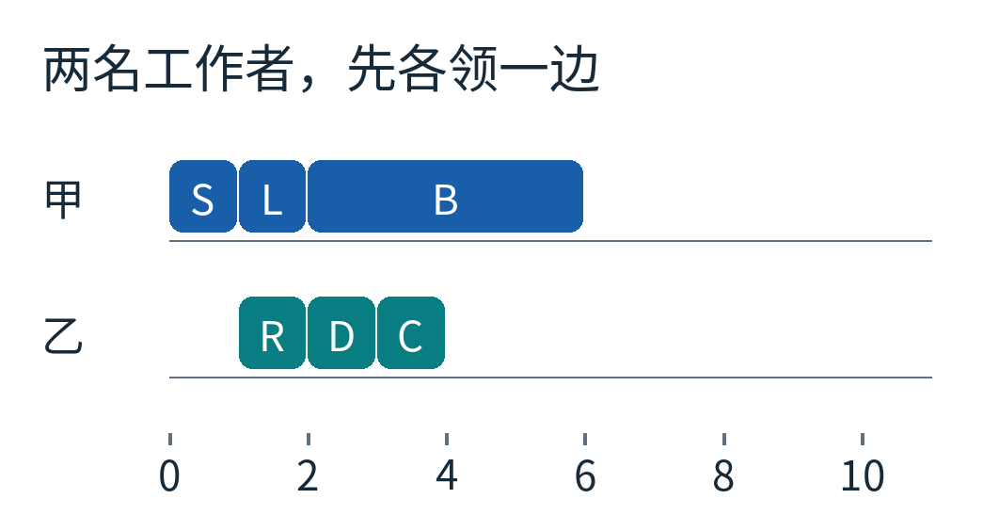

横轴是模拟时间，行表示工作者。S、L、R都长1单位；图中随后开始的B较长。任务图中的“并行可能性”，在这里变成了具体的开始与结束时间。

时刻2，甲把A、B放好，先做较新的B；乙把C、D放好，先做较新的D。时刻3，乙做完D，接着做C。时刻4，乙的本地队列空了，而甲的B才进行到一半。

如果坚持初始分工，甲要先做完B，再从6做到10完成A；J等到10才能开始，11结束。乙从4开始一直等。

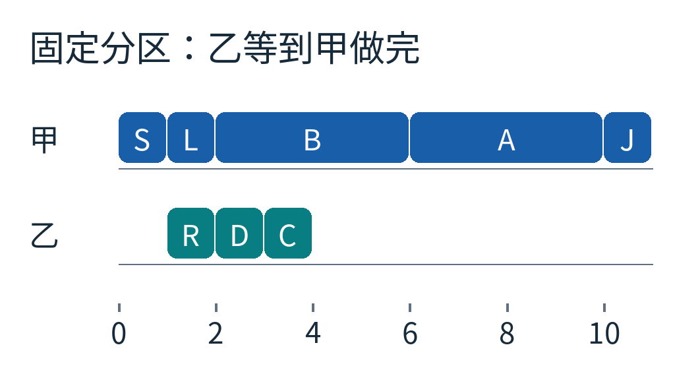

留白表示没有运行这八项模型任务，不代表真实机器在省电或执行了什么后台工作。末尾的J也算工作，不能比较时偷偷删掉。

现在允许窃取。时刻4，乙看到甲队列里的A，把它领取出来，从4做到8。甲仍把B做到6，然后等待。到8，四项叶子任务都齐了，甲运行J，9结束。

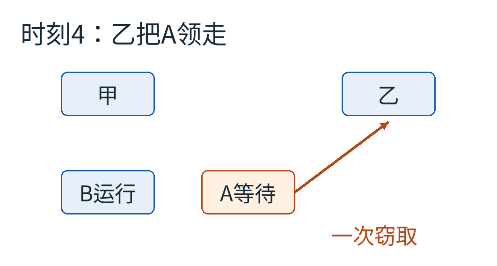

甲没有暂停B，也没有把B已经算过的那一半打包给乙。橙色箭头只移动待办的A。这是解释任务窃取时最容易混淆的一处。

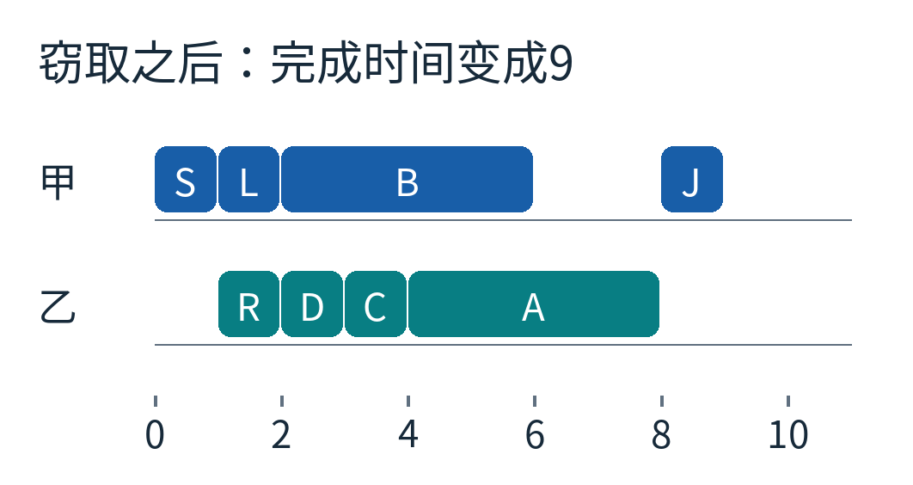

这张图与上一张保持相同横轴。你能直接看到，结束时间从11移到9；也能看到甲在6到8仍然空闲。任务已经太粗，调度器不能凭空把正在运行的A再拆成两份。

这个例子只发生一次窃取，而且我们故意把寻找受害者、同步和移动任务的耗时设为零。它证明的是“重新分工可以缩短长尾”，不是“任何程序都会快11/9倍”。

## 为什么多买CPU，也不可能无限快？

把八项耗时全部加起来：

`1 + 1 + 1 + 4 + 4 + 1 + 1 + 1 = 14`。

这叫总工作量，记作W。若只有一名工作者，忽略额外开销，必须完成14单位工作；有两名工作者，每单位时间最多消化2单位工作，所以总时间不可能短于14/2，也就是7。

另一个限制来自依赖。沿着S→L→A→J，耗时是1+1+4+1=7。即使买来一百颗CPU，这条链也不能同时执行。最长的这种依赖链叫跨度，记作S；这里S也是7。字母S同时是前面根任务的编号，后面说“跨度”时我们直接写中文，避免混淆。

两种下界必须同时满足。P名同速工作者的理想完成时间T至少为 `max(W/P, 跨度)`。这只是不能低于的门槛，不是保证能达到的成绩。

为何模型跑到9，而下界是7？从时间线就能找到答案：开始时只有根任务；之后任务释放也要等待分叉；长任务一旦开始就不能拆分。下界没有替我们安排一份无空隙的日程。

Blumofe与Leiserson研究了结构受约束的并行计算，以及随机选择其他工作者的窃取调度。在他们的模型和前提下，期望运行时间有 `W/P + O(跨度)` 这样的上界。这里的O表示与跨度成比例的量级，隐藏常数；“期望”是对随机选择而言，不是每次运行都恰好如此。任意阻塞I/O、锁依赖、硬件异构、超大数据迁移，都不能不加说明地塞进这个结论。[原论文](https://perso.ens-lyon.fr/loris.marchal/docs-data-aware/papers/scheduling-multithreaded-comp-WS.pdf)

我们的八任务程序没有模拟论文的全部计算模型，也没有实施随机选人；它只让两名工作者演示一次可以手算的迁移。

## 队列里只剩一个任务时，简单图画不够用了

假设A是甲队列里最后一个任务。甲伸手拿它，乙也同时来拿。如果两边都先看到“有A”，随后各自把A运行一遍，结果就错了。

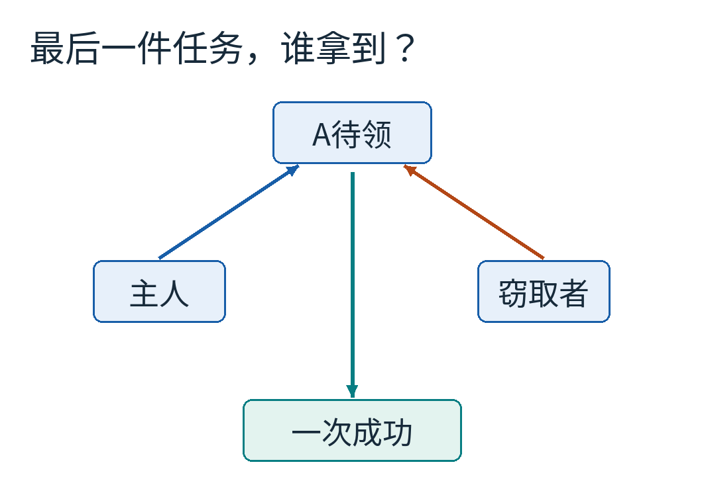

这里必须有一种不可分割的争领规则，让至多一方成功。实际并发双端队列会使用合适的原子操作与内存顺序，处理最后一项竞争、队列扩容、空队列和多个窃取者。它不是把Python列表的两端换个函数名就完成了。

本文代码刻意用单线程顺序模拟：先处理甲，再处理乙。这样便于复核调度，也意味着它**没有证明真实并发容器正确**。如果你需要实现生产调度器，应使用运行时已经提供并经过验证的容器或调度接口，而不是把这份模型加上两个线程。

主人“本地操作较便宜”也不等于“本地永远完全无需同步”。具体实现、编译器和处理器内存模型决定了哪些操作可省，哪些屏障不能省。

## 为什么不把每一次加法都变成任务？

任务越小，似乎越容易填满时间线。但是包装、入队、领取、检查完成条件都要付钱。

设每项有效计算花g单位，管理它额外花1单位。有效计算所占比例就是 `g/(g+1)`：g=1时只有一半时间算正事；g=4时是80%；g=16时约94%。

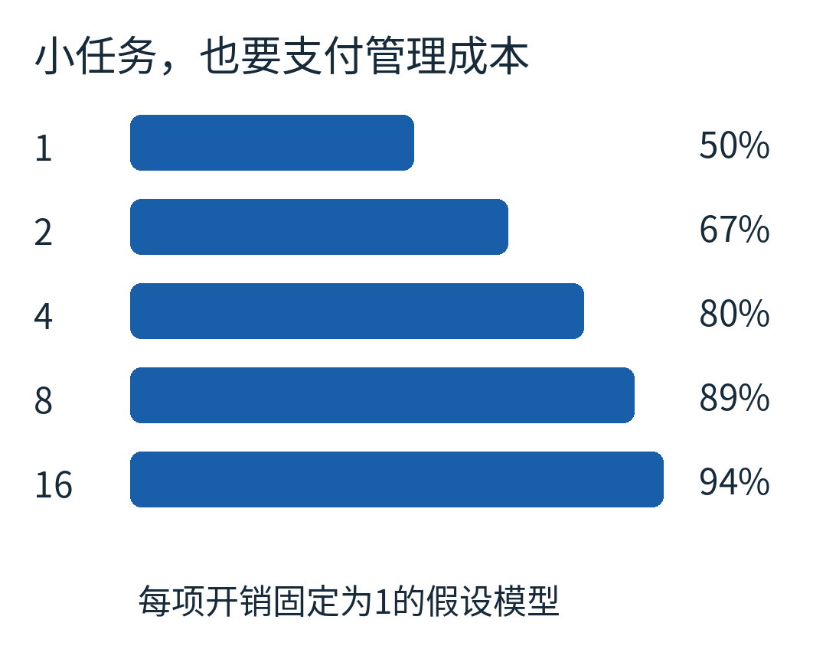

蓝条都按0到100%的共同尺度画，左边是g，右边是有效比例。这里“开销恒为1”是为了隔离变量的假设，不是任何语言或CPU的测量结果。

反过来，任务过大，又会回到刚才6到8的留白：空闲者找不到尚未开始的小块可领。合适粒度在两种浪费之间折中，常见做法是递归拆到某个规模后改为串行计算。阈值需要结合真实工作量、数据局部性和硬件测量；算法分析提供方向，不能替代测量。

还有一笔账藏在数据移动里。乙领走A之后，A需要的数据若恰好都在甲的缓存附近，帮助可能伴随额外访存。多插槽机器上的内存距离更不均匀。让所有核心“看上去都很忙”，不是唯一目标。

## 自己改一次模型，看清策略与结果的区别

[完整调度代码](examples/model.py)只用Python标准库，任务耗时固定，没有随机种子，因为没有随机数。运行后写出[计算结果](examples/results.json)，制图代码再读取这些数据。

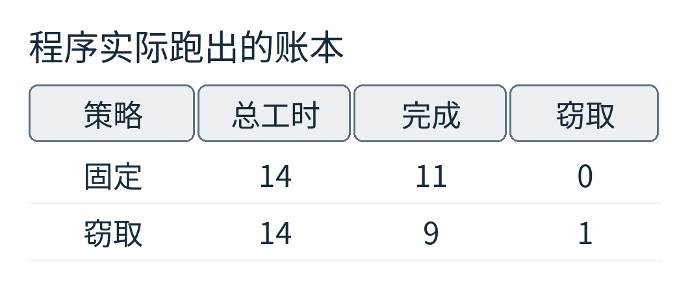

两种策略总工作都为14；固定分区在11结束，允许一次窃取在9结束。它不是删掉了两单位工作，而是让原来串行堆在一边的工作与另一边重叠。

可以做两个很有区分力的改动。第一，把A、B、C、D都改成1，原来的不平衡大幅减小，窃取还能帮多少？第二，把A改成20，其他不变，观察乙领到A后，甲能否再帮它。别先问“算法名称是什么”，先画出哪个时刻有哪些任务已经就绪。

如果你看见一台多核电脑只有一两个核心忙到最后，至少有三种不同原因值得检查：依赖链太长、任务粒度太粗、可执行任务分配不均。任务窃取主要处理第三种，也会受前两种约束。

它没有让一个人同时做两件事。它做的是更朴素、也更精巧的事：把请求帮忙的成本放到已经空闲的那一边，同时让忙着的人尽可能沿着自己的计算继续走。

图片来源：全部为本文原创调度示意及程序结果图。机制背景可继续阅读[OpenCilk的工作与跨度说明](https://www.opencilk.org/doc/tutorials/opencilk-concepts/)。[来源、许可与复现说明](sources.md)
