# 一段文字要找一千个关键词，为什么可以只向前读一遍？Aho–Corasick 多模式匹配

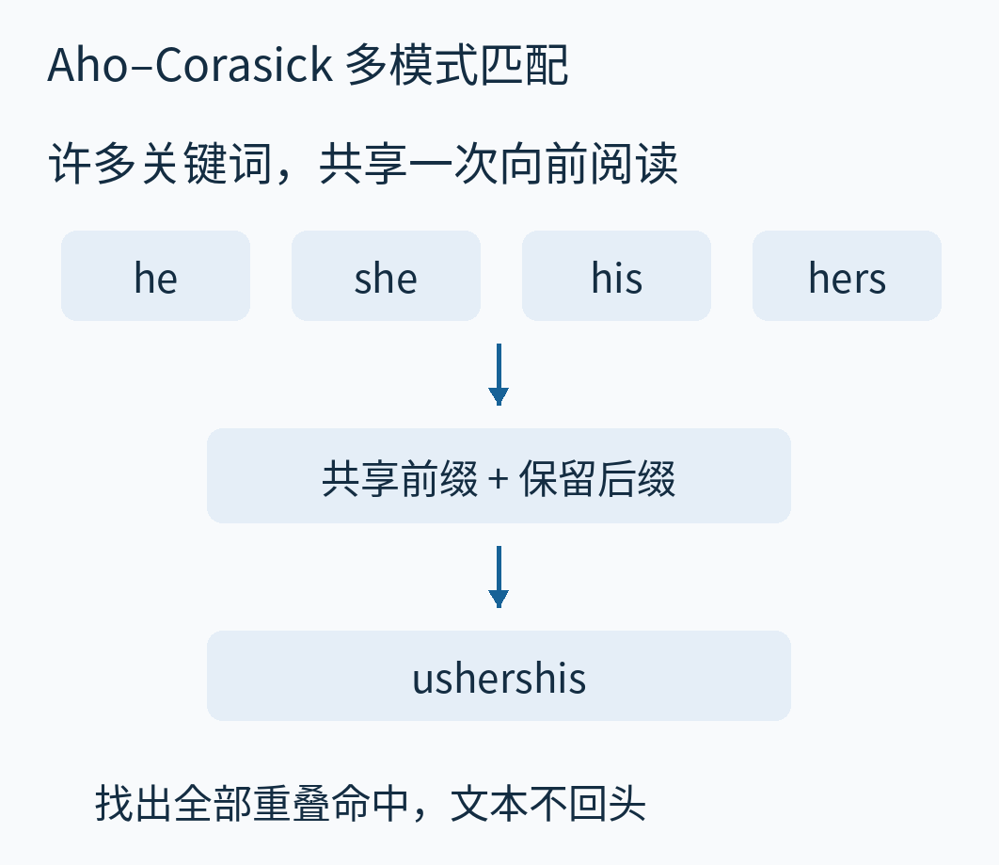

假设你在做一份文献目录：每段摘要里，只要出现词表中的任意术语，就记录它的位置。只有一个词时，可以拿这个词逐处比对；词表涨到一千个后，如果每个词都重新扫一遍摘要，重复读取同一段文本就成了显眼的工作。

这里的“模式”先只指**要精确寻找的一串字符**，不是带通配符的表达式。Aho–Corasick（简称 AC）把固定词表预先整理成一台“读入一个字符，就更新一次记忆”的机器。文本从左向右前进，机器留下仍有用的匹配线索，也能在同一位置报告多个词。

算法名字来自 Alfred V. Aho 和 Margaret J. Corasick。1975 年论文的题目就把应用指向文献检索；本文借用这个任务说明用途，不复述未经核验的历史成本或人物轶事。[论文书目与摘要](https://dl.acm.org/doi/10.1145/360825.360855)

## 先约定究竟要找到什么

我们用一个足够短、可以逐字画出来的词表：`he`、`she`、`his`、`hers`。待查文本是 `ushershis`。这些字符只是教学输入，不要求它是一句英语；匹配也不检查词边界。

位置从 0 开始。记号 `[2,4)` 表示包含位置 2，不包含位置 4，因而恰好取出两个字符。目标不是“找到一个就停”，而是报告**全部出现位置，包括彼此重叠的结果**。

例如 `she` 的末尾就含有 `he`。若只报告较长的那个，做高亮界面也许够用，却已经改变了任务。先把这个输出约定说清，才能判断算法有没有漏报。

## 第一层共享：把相同开头只存一次

把每个词从左到右写成一条路。`he` 和 `hers` 都先走 `h`、再走 `e`，这两段不用修两次；`his` 也能共用第一段 `h`。这种从空起点分叉、把共同前缀合在一起的结构叫**字典树**，英文是 trie。

先实际插入一次：每来一个字符，就检查当前节点有没有这条出边；有则沿旧边走，没有才建新节点。插入 `his` 时，根已经有 `h`，所以复用它；`h` 还没有 `i`，才新建 `hi` 和后面的 `his`。最后在 `his` 登记完整词。下图依次展开四次插入，绿色节点已经存在，蓝色节点本次新建；没画出的旧分支仍然保留。

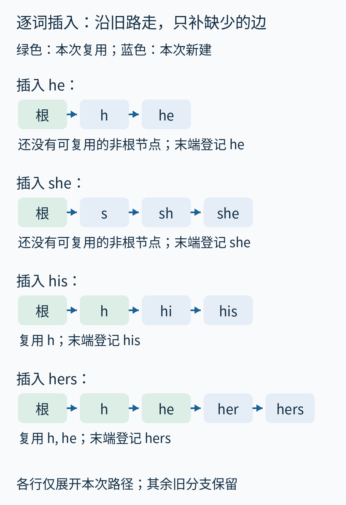

插入 `hers` 时，旧节点 `he` 的完整词标记也保留；在它后面添 `r`、`s`，不意味着把 `he` 改成了一个未完成的词。把这些路径合在一起，就得到下面的完整树。

图中从左向右走，每条边只读一个字符。为减少边标签拥挤，圆框直接写“从根到这里已经读过的全部字符”；因此 `h` 到 `he` 的边读的是新添的 `e`。深色框表示在这里恰好拼出词表中的完整词。`he` 已经是完整词，但还可以继续走向 `hers`。

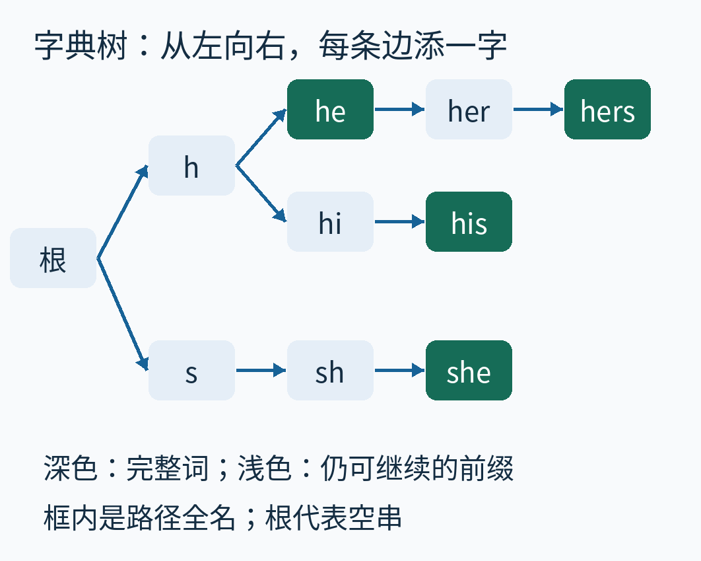

根表示空串。停在 `sh`，不是说前面整段文本只有 `sh`，而是说：**目前已读文本的末尾，保留了一个有希望继续长成关键词的 `sh`**。

注意这是一种压缩记忆。我们不需要同时记住整段 `ush`，因为词表没有哪个词以 `u` 开头；但不能把末尾 `sh` 忘掉，下一个字符若是 `e`，`she` 就出现了。

## 走不下去时，不能一律回到根

读到 `ushe` 后，机器停在 `she`。下一个字符是 `r`，可 `she` 节点没有 `r` 出边。现在有两个容易犯的错。

第一个错是回到根，再处理 `r`。这样丢掉了刚读过的末尾 `he`，也就找不到随后形成的 `hers`。第二个错是把文本指针退回去重新读 `he`。这能补救，却放弃了共享扫描的好处。

正确做法是保留已经确认的后缀。`she` 去掉最前面的 `s` 后剩下 `he`；`he` 恰好又是字典树中的一条路。因此不用重新读字符，直接把记忆改成 `he`。现在它有 `r` 出边，便进入 `her`。

这样的备用去处叫**失败指针**。对一个非根节点，它指向“当前路径串的最长真后缀，而且这个后缀也是某个关键词的前缀”。“真”只表示不能把整个原串本身选回来，否则失败时会原地绕圈。

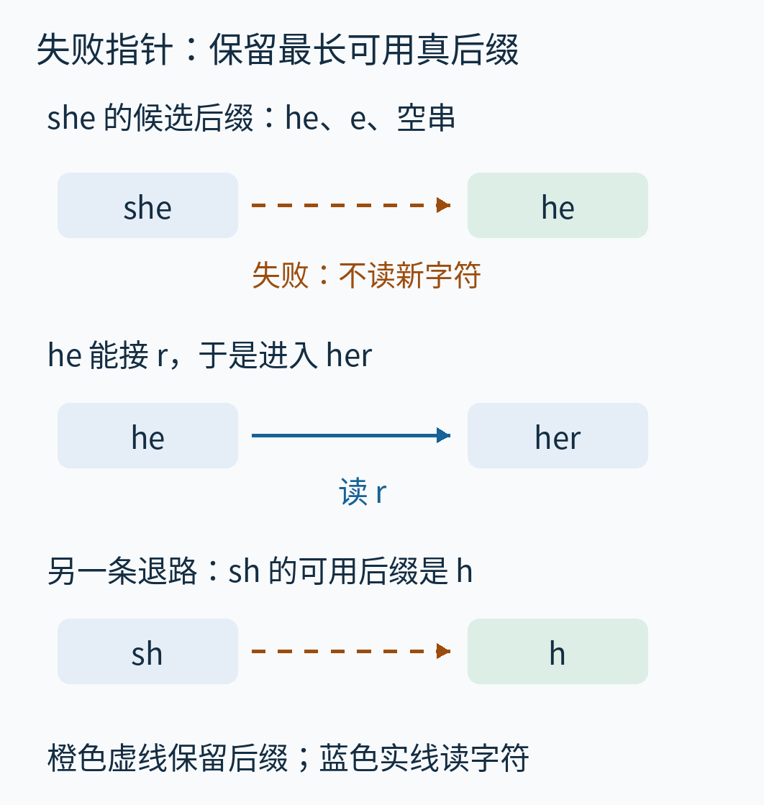

图的上半部先只看 `she`：候选真后缀按长度依次是 `he`、`e`、空串。`he` 在字典树里，选它就够了。下半部给出 `sh`：`h` 在树里，所以失败后可保留它。所有非根失败跳转都会变短；如果连空串也没有对应字符出边，就留在根，消耗这个无用字符。

为什么先试最长的就不会漏掉更短的？因为更短且有用的后缀，也必然是这个最长后缀的后缀。沿它的失败指针继续走，就能依次找到。如果 `he` 也接不上 `r`，机器仍会继续退；本例恰好第一跳就接上了。

于是每次读字符只需要遵守一条规则：有对应出边就前进；没有就沿失败指针缩短记忆，直到能前进或退到根。这些退路移动的是**机器状态**，不是文本中的阅读位置。

## 把九个字符真正走一遍

下面是随文程序的实际执行轨迹，不是性能计时。左列是文本位置与字符，中列是消费该字符后的状态，右列列出新完成的词。橙色行是发生失败跳转的地方。

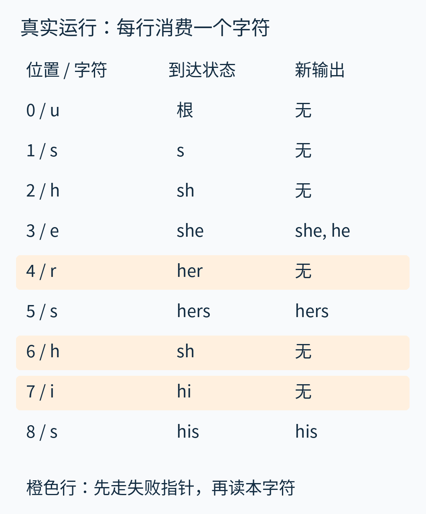

前四步可以用眼睛核对：`u` 没路可走，仍在根；`s` 进入 `s`；`h` 进入 `sh`；`e` 进入 `she`。下一步读 `r`，刚才演示的 `she → he → her` 就发生了。再读 `s` 到 `hers`。

还有两次跳转很值得亲手做。位置 6 来了 `h`，`hers` 接不上；它的最长可用真后缀是 `s`，于是先退到 `s`，再沿 `h` 走到 `sh`。位置 7 来了 `i`，`sh` 没有 `i` 出边，但退到 `h` 就可以走到 `hi`。最后的 `s` 完成 `his`。

把三次失败行单独展开，看橙色虚线和蓝色实线之间的区别：虚线只换状态，手中字符和输入位置不变；走实线才消费一次字符。

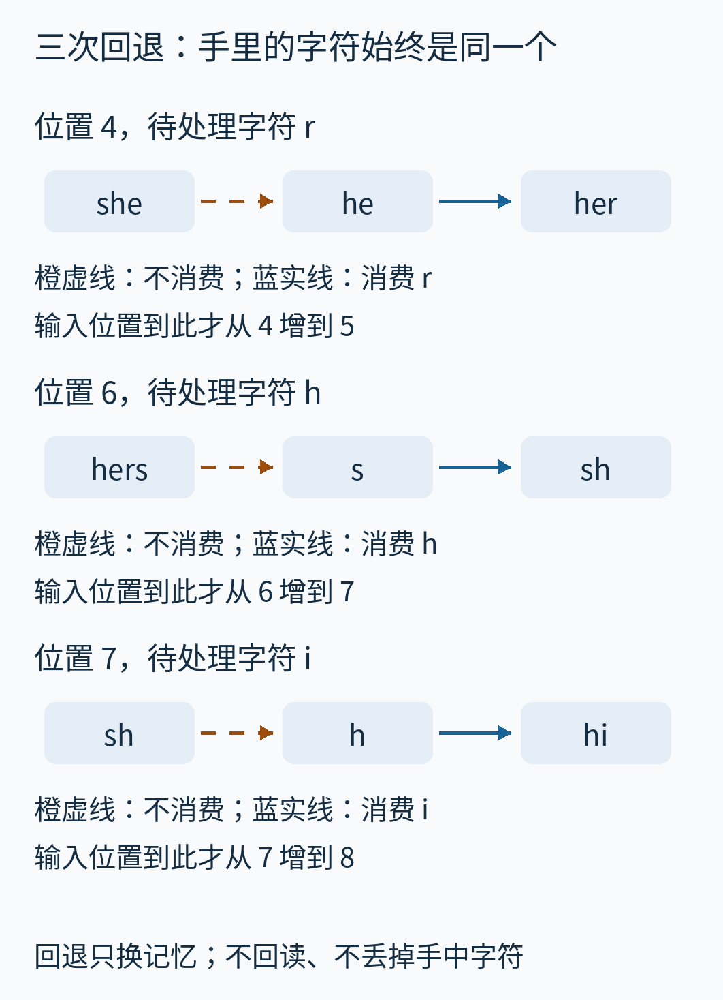

这说明失败指针不只在某一个特殊例子里补洞。它把“刚才匹配失败，但末尾还能留下什么”提前整理好了，每次都按同一个规则处理。

## 到了 she，为什么还要报告 he？

节点 `she` 上直接登记的词是 `she`，但当前文本末尾也一定是 `he`。因此一个状态的输出不仅包括它自己的完整词，还包括失败链上那些恰好为完整词的节点。

这和“为了找下一条路而失败”是两件事：**即使刚才顺利读到了 `she`，现在也要检查后缀输出。** 漏掉这一点的程序，常常能找到长词，却漏掉藏在长词末尾的短词。

图里上排字符格的边界就是位置。四条彩带都采用同一横向尺度，表示程序报告的区间；`she` 与 `he` 在同一条右边界结束，`hers` 又和它们重叠。

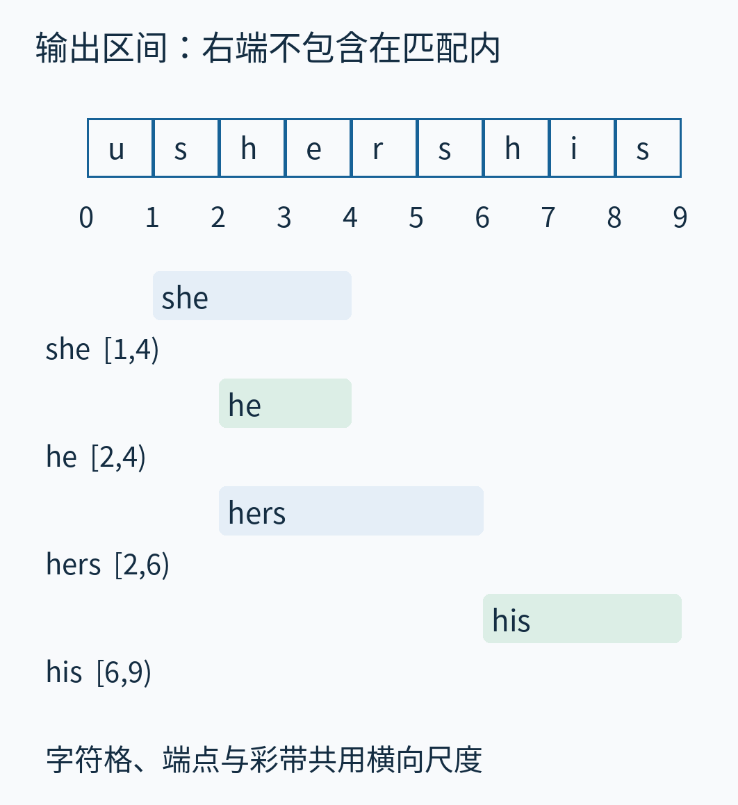

具体计算一次：读完位置 3 后，不包含在结果内的结束位置是 `3+1=4`。`she` 长 3，开始位置为 `4−3=1`，得到 `[1,4)`；`he` 长 2，得到 `[2,4)`。读完位置 5 后，`hers` 长 4，开始位置为 `6−4=2`，得到 `[2,6)`。最后得到 `his` 的 `[6,9)`。

程序没必要把失败链上的所有输出复制进每个节点。可以另存一条**输出链接**，直接指向失败链上最近的完整词节点。输出时先检查自己，再沿输出链接访问；每走到一个这样的节点，至少报告一个结果，避免在不含完整词的节点间空走。本例从 `she` 的输出链接到 `he`，然后结束。

下面分开画两种动作。上半部回顾下一字符 `r` 引起的失败转移；下半部才是刚读完 `e` 时的输出枚举。**输出游标**是临时查找结果的位置，和记住已读后缀的主状态不是同一个变量。绿色箭头只移动这个游标；报告完 `he` 后，主状态仍为 `she`，下个 `r` 仍从 `she` 开始处理。

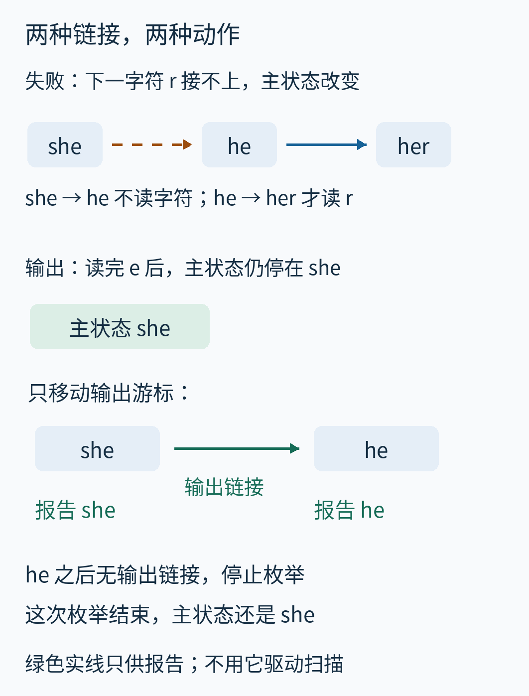

## 这些失败指针是怎样造出来的？

先完成整棵字典树，再按“浅的先处理，深的后处理”的顺序计算。这个顺序叫广度优先，可以用一个先进入先取出的队列完成。根的直接孩子失败时只能到根；之后的节点就能借用已经算出的浅层退路。

初始化时，把 `h`、`s` 的失败目标设为根，并把它们按此顺序放进队列。每次取出最左节点，把它的孩子按出边的插入顺序放到最右边，同时为孩子计算失败边。下图上半部是本程序的实际出队层序；下半部列出前几次取出并加入孩子后的队列。比如处理完 `s` 时，`sh → h` 已经得到，后面处理 `sh` 时就可以使用。

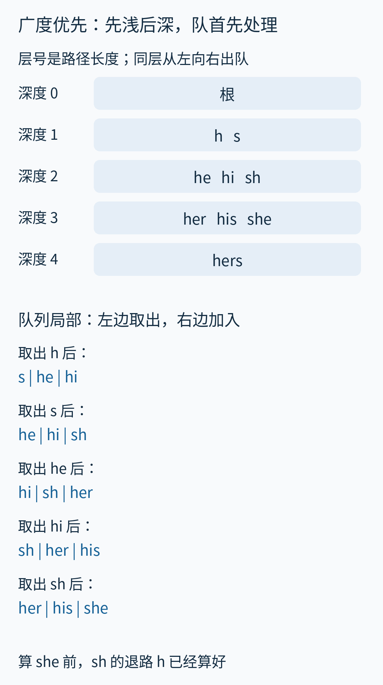

设已经知道节点 `v` 的失败指针，现在要为它读入字符 `c` 后的孩子 `u` 找退路。先从 `v` 的失败节点出发，尝试读同一个 `c`；没有路就继续失败，直到找到路或到根。这条最终到达的路，就是 `u` 的失败节点。

用仍然熟悉的 `she` 做一次：父节点是 `sh`，边字符是 `e`。`sh` 的失败节点是 `h`，而 `h` 读 `e` 能到 `he`，所以 `she` 的失败指针指向 `he`。这里不能从 `sh` 本身开始试，否则会重新得到 `she` 自己。

按图先看左侧已知的橙色失败边，再看下方从 `h` 读 `e` 的蓝色树边，最后把右侧失败边记下来。这是在构建机器时查询树中的出边，还没有消费待查文本。

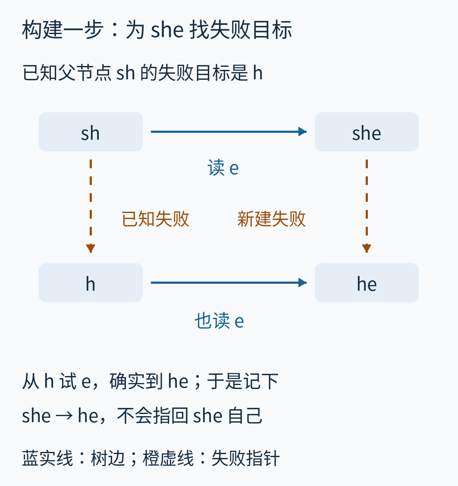

顺手可以核验全表。根的失败指针约定指回根；其他节点如下，节点名仍表示整条路径串：

| 节点 | 失败目标 | 原因 |
|---|---|---|
| `h`、`s` | 根 | 没有非空真后缀 |
| `he`、`hi`、`her` | 根 | 末尾的 `e`、`i`、`r` 等不是树中的前缀 |
| `sh` | `h` | 最长可用后缀为 `h` |
| `she` | `he` | 最长可用后缀为 `he` |
| `his`、`hers` | `s` | 更长真后缀不存在于树中，`s` 存在 |

这个构建过程也解释了“固定词表”的重要性。添加一个新词可能使原来不存在的前缀出现，旧节点的最佳失败目标就可能变了。教学实现选择重建机器，不把新增一条树枝误认为已经更新全部关联。

## “只向前读一遍”不等于每个字符只做一次工作

先作一个明确的输入变化：词表不变，把原文本末尾追加 `x`，得到 `ushershisx`。读完原来九个字符仍停在 `his`；现在 `x` 让状态先退到 `s`，再退到根。根也没有 `x` 出边，这时才消费它并留在根。这两次失败都没有重复消费 `x`。

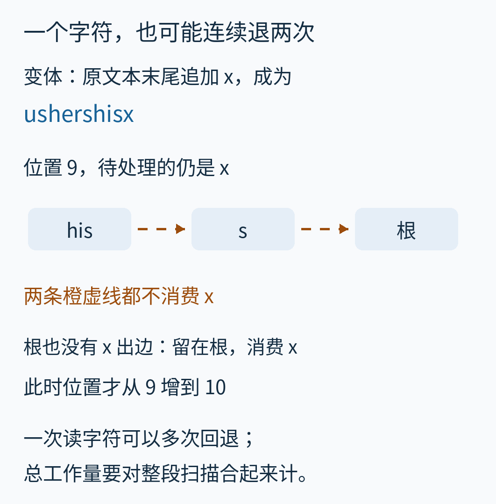

一条很深的路径接不上时，一个字符可能触发多次失败跳转。为什么整个扫描仍然可控？给当前状态记一个深度：它的路径串长度。沿树边消费一个字符，深度至多增加 1；沿失败指针走一次，深度至少减少 1。深度从 0 开始且不能为负，所以在长度为 `n` 的文本上，总下降次数不会超过总上升次数，而总上升次数最多为 `n`。

回到原来的九字符输入 `ushershis`，把每次消费与每次失败都记在同一张图上。横向是动作顺序，不是等间隔时间；纵向是状态深度，蓝线消费字符，橙色虚线只回退。注意 `hers → s` 一次失败就下降三层。

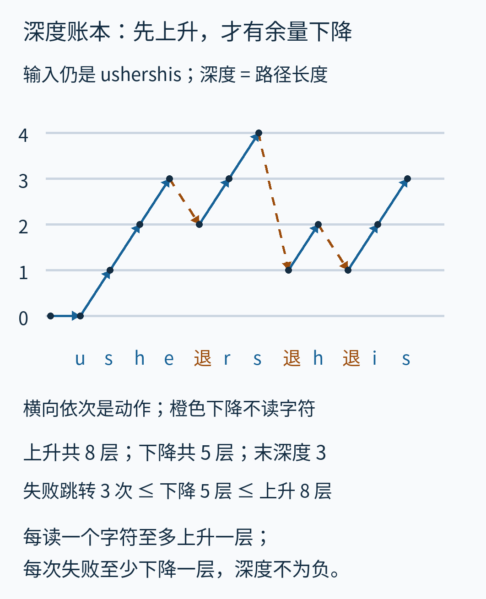

这段运行上升 8 层、下降 5 层，最终深度为 3；失败只有 3 次。它是上述计数关系的可核例子，通用理由仍是每次失败至少下降一层，以及深度不能为负。

因此，假设查一条出边花常数时间，读入和失败跳转合计是 O(n)。再加上实际报告的 `z` 个命中，扫描成本是 **O(n+z)**。这句话描述建好机器后的扫描，不把建词表的时间藏起来。

输出量不能忽略。换一个专门构造的词表 `a`、`aa`、`aaa`，文本换成 `aaaa`，共有 `4+3+2=9` 个命中。词表若包含更多不同长度的 `a` 串，输出会继续增多。算法可以省重复比较，却不能免费写出所有答案。

图里的字符格和每条区间带共用横向尺度。每一行都是实际程序报告的一项：即使许多带覆盖相同字符，也不能合并成一个结果。

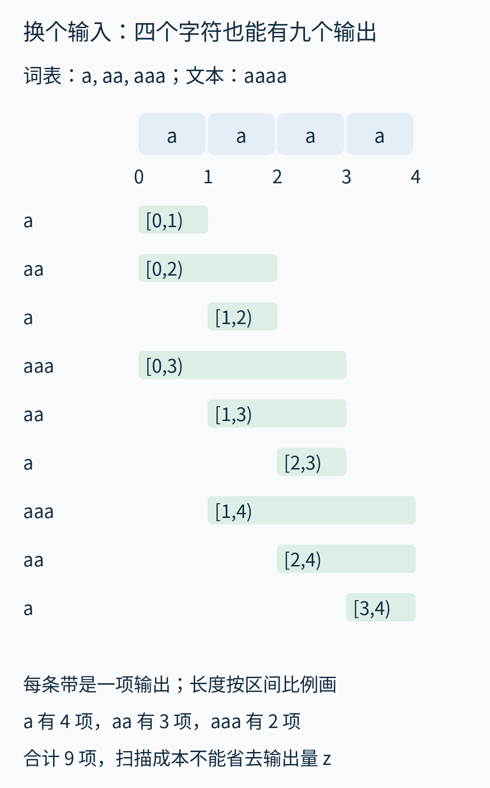

随文实现用字典保存已有出边、用失败指针现场回退，便于看清原理。Python 字典查找在通常哈希假设下按均摊常数计；它不是对任意实现的无条件保证。构建阶段的这份简明代码也可能反复沿失败链走，若节点数为 `S`、最长词长为 `L`，可以给出 O(SL+M) 的保守时间上界，`M` 是所有输入模式的总长度；不要把扫描的 O(n+z) 直接套在这个构建循环上。

另一种实现会为每个状态和字母表字符预先填好完整转移表，用内存换扫描时更直接的跳转。若字母表大小为 `σ`，这张表占 O(Sσ) 空间；按广度优先从更浅状态继承已算好的转移，可在 O(M+Sσ) 时间内构建。处理小字母表与处理非常大的字符集合，选择就可能不同。

随文代码还保存每个节点的整条路径串，只为了生成可读图表。这些标签总长最坏可达 O(SL)，不是紧凑匹配器必需的内存。去掉教学标签、让输出按产生顺序交给调用者，稀疏结构本身只需存节点、边、失败/输出链接和模式信息；本演示为方便核对，额外收集了轨迹和全部结果。

## 文本分成两包到来，边界会不会漏词？

文件或网络数据常常分块读入。如果把 `ushershis` 切成 `ush` 和 `ershis`，第一块结束时尚未发现任何词，但状态已经是 `sh`。只要把这个状态交给第二块，第一个 `e` 就能完成 `she` 与 `he`。

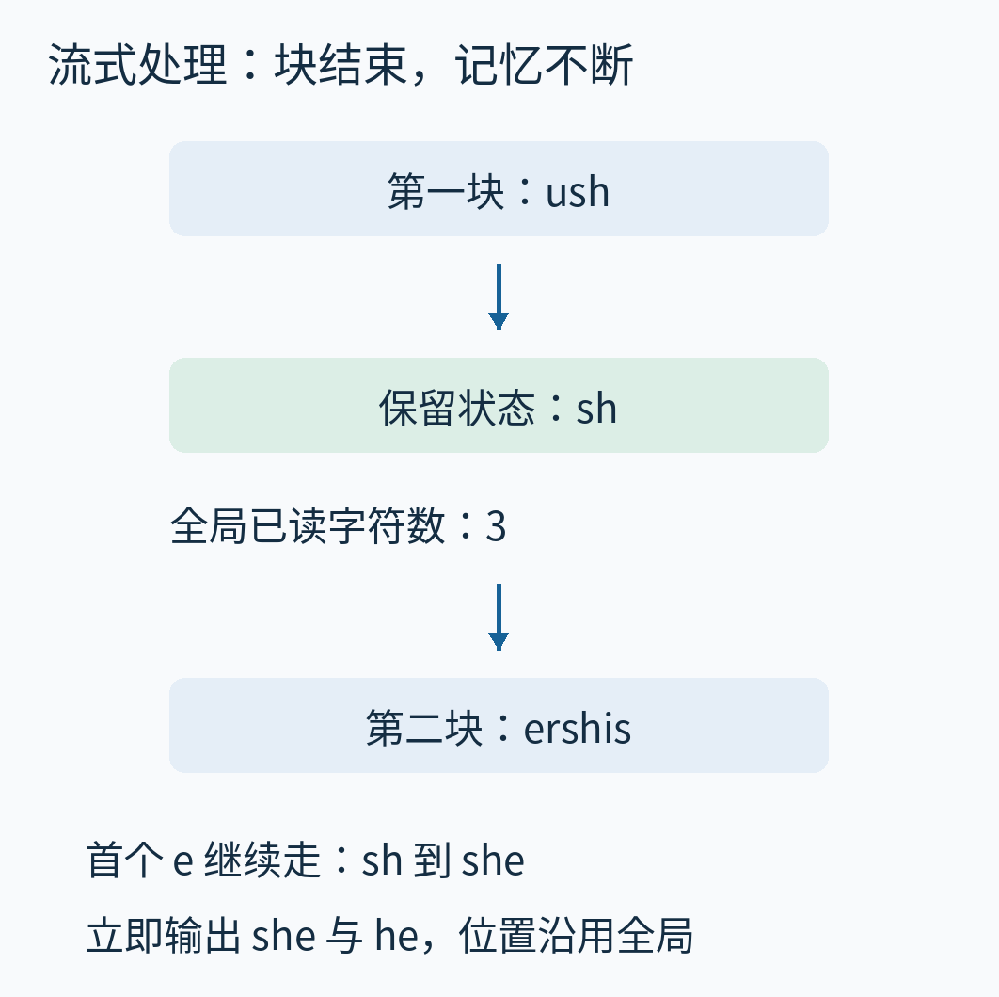

图中蓝色块表示两次输入，中间绿色框是需要保留的状态。保留全局已读字符数也很必要，否则返回的位置会在第二块重新从 0 算。若每一块都重新建一台从根开始的匹配器，跨块的 `she` 就会漏掉。

这里只讨论字符流。若实际输入是 UTF-8 字节，而实现按 Unicode 字符工作，还需要增量解码器保存跨块的半个编码。字符、字节和屏幕上一个可见符号不是同一单位；大小写折叠和 Unicode 规范化若改变长度，还要保存结果到原文位置的映射。

## 亲自运行并检查一个变化

[完整教学代码](examples/ac.py)只使用 Python 标准库，拒绝空模式，允许重复模式按重复条目输出；比较单位是 Python 字符串迭代得到的 Unicode 码点。下面演示分两次送入同一台机器：

```python
from ac import Matcher

m = Matcher(["he", "she", "his", "hers"])
print(m.feed("ush")[0])       # []
print(m.feed("ershis")[0])
# [['she', 1, 4], ['he', 2, 4], ['hers', 2, 6], ['his', 6, 9]]
```

在 `examples` 目录运行 `python ac.py`，会重建[核算数据](examples/results.json)：程序把全部四个结果与逐个起点、逐个词检查的朴素基准比较，验证这段文本全部 10 种双块切法；另对六个短模式构成的 63 个非空词表、长度 0 到 6 的全部二进制文本，共做 8001 组比较。还单独检查了重复词、空词表、中文码点和空模式拒绝。这些是有限输入范围的正确性复核，不是对所有输入的穷尽证明，也不是速度测试。

下面是本篇**本地教学 web 界面**的一次真实浏览器截图，界面源代码见 [demo_web.py](examples/demo_web.py)。实际点击按钮后，后端重新调用 `Matcher` 分两块输入，并执行朴素基准、全部双块切法和 8001 组比较，再将结果送回页面。它不是终端、生产检索软件或发布平台截图，也不是把 JSON 重画成界面。

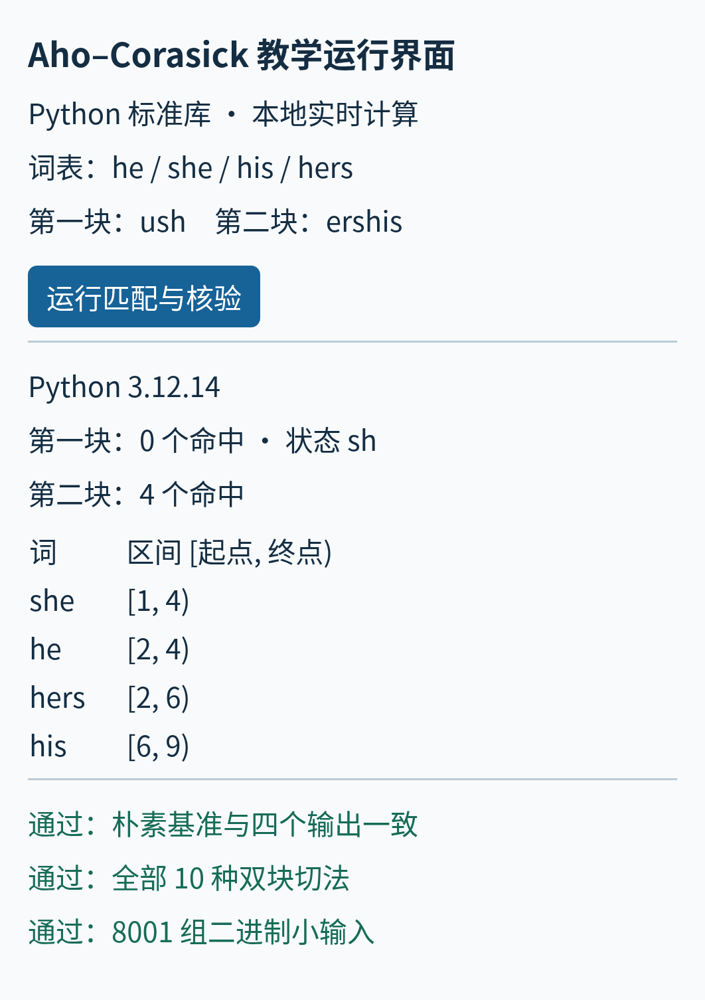

复现界面：在 `examples` 目录运行 `python demo_web.py`，浏览器打开 `http://127.0.0.1:8765`，点击“运行匹配与核验”。服务只绑定本机地址；页面不会随静态文章自动运行。截图脚本 [capture_demo.py](examples/capture_demo.py) 使用 Playwright 与 Chromium；[执行摘要](examples/demo-capture.json)记录实际 Python 与浏览器版本。新增过程图的数据可用 `python visual_model.py` 重新计算。

可以自己改成只送入 `shis`。纸上先推一次：读到 `sh` 后遇到 `i`，退到 `h`，再进入 `hi`，最后完成 `his`。如果得到的区间不是 `[1,4)`，先检查失败跳转有没有错误地消耗 `i`，再检查结束位置是否采用同一套半开区间约定。

## 用它之前，先问自己的任务是否相同

AC 适合“词表能够复用，要在许多文本中找大量固定字面串”的工作，例如术语标注或日志中的固定签名检索。它本身不会理解语义，也不会自动处理拼写错误；把关键词命中当成内容判断，还需要额外规则和误报评估。

“全部重叠命中”“互不重叠”“最左优先”“同一起点最长优先”也是不同的产品需求。实现方 `aho-corasick` 的文档专门区分这些语义，并提供不同接口；不能见到库名相同，就假设普通迭代器会返回本文的全部四个结果。[实现方文档，1.1.5](https://docs.rs/aho-corasick/1.1.5/aho_corasick/)

只有少量短词、只查一次时，建机器可能不划算；规则频繁变动时，更新代价也可能占主导。实际速度还受缓存、转移表布局和专门的向量指令优化影响，不能仅凭渐近记号宣布 AC 永远最快。

如果想对照实现方自己的结构图，可以看[原图对照附页](source-figures.md)：其中收录 `aho-corasick` 1.1.5 设计文档的两幅 ASCII 图及中文说明。那里明确换成 `abcd`、`cef` 词表，保留原状态编号与 MIT 署名许可；它们是现代实现文档材料，不是 1975 年原论文图片。

再回到位置 4 的那个 `r`：机器没有倒回文本，也没有丢掉 `he`。理解了“把读过的末尾压缩成一个状态，再沿可用后缀继续”，就理解了这套算法为什么能让许多关键词共享一次向前阅读。

---

正文、原创教学图与原创界面截图采用 CC BY 4.0；示例代码和生成数据采用 CC0 1.0。附页所用第三方 ASCII 图及其重排渲染单独遵循 MIT，不包含在上述原创图授权中。事实来源、材料范围与 AI 辅助说明见[来源与许可](sources.md)。
