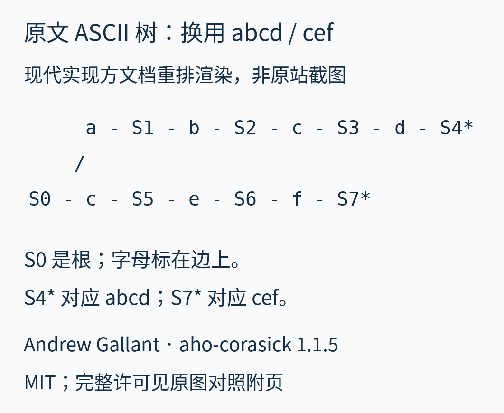
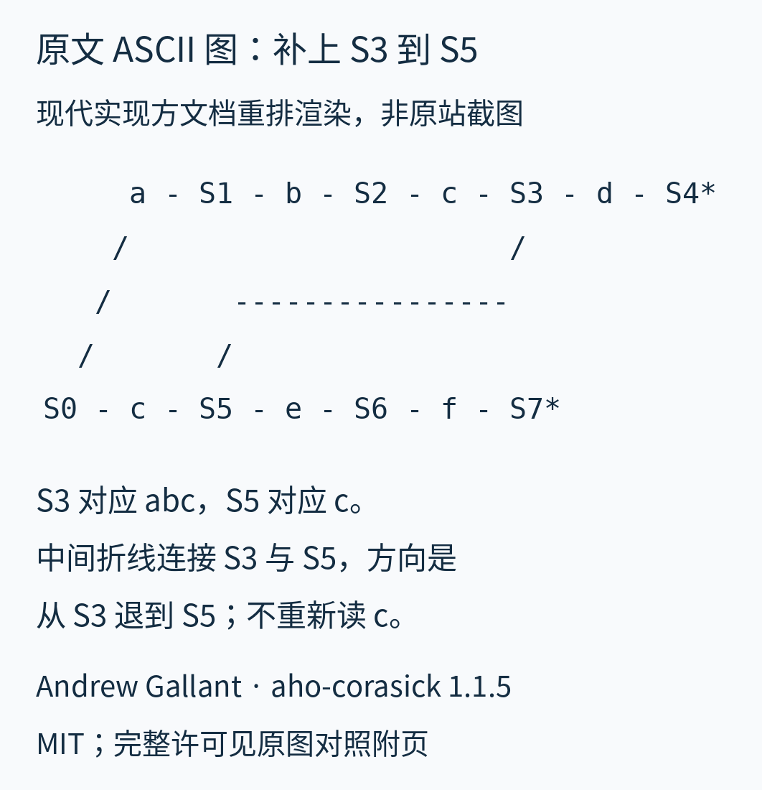

# 实现方原图对照：换成 abcd 与 cef

这是正文的补充对照，不另起一篇教程。这里把词表**明确换成 `abcd`、`cef`**，以便保留现代 Rust 实现方文档的原图与编号；不是把原文的 S 编号冒充正文 `he/she/his/hers` 的节点编号，也不是 1975 年论文史料。

来源是 Andrew Gallant 的 [`aho-corasick` 1.1.5 `DESIGN.md`，Basics](https://github.com/BurntSushi/aho-corasick/blob/1.1.5/DESIGN.md)。下列 ASCII 文字根据可访问的 GitHub 页面代码块逐行转录；图片是本篇按等宽字体重排渲染，并加中文说明，**不是原站截图或下载的原图文件**。保留字符、连接布局与 `*` 标记；原始文件下载未成功，故不声称核对过仓库原文件字节。版本锚点为发布标签 `1.1.5`，未解析提交 SHA。两图原内容为 Copyright (c) 2015 Andrew Gallant，采用 MIT，完整通知附后。

## 先看没有失败边的树

从 `S0` 开始，沿上路依次读 `a b c d`，到 `S4*`；沿下路读 `c e f`，到 `S7*`。这里字母写在边上，`S` 后的数只是状态编号，不是深度。星号表示完整模式结束。



可复制文字：[树图转录](originals/design-trie.txt)。

```text
     a - S1 - b - S2 - c - S3 - d - S4*
    /
S0 - c - S5 - e - S6 - f - S7*
```

## 再看保留 c 的失败连接

输入若是 `abcef`，读完 `abc` 到 `S3`，接下来是 `e` 而不是预期的 `d`。已经读过的末尾 `c` 仍然是另一个词的开头，所以沿中间折线从 `S3` 退到 `S5`，继续读手里的 `e`，随后 `f` 完成 `cef`。折线是原文 ASCII 的连接，原图没有箭头；方向按文档解释为 `S3 → S5`。其他失败目标都是 `S0`，原图省略了它们。



可复制文字：[失败连接图转录](originals/design-failure.txt)。

```text
     a - S1 - b - S2 - c - S3 - d - S4*
    /                      /
   /       ----------------
  /       /
S0 - c - S5 - e - S6 - f - S7*
```

这与正文的 `she → he` 用的是同一个后缀保留规则，但两套词表、路径和编号不同。正文以自己的例子逐步教学，这里保留原文材料供对照。渲染代码见 [render_source_figures.py](examples/render_source_figures.py)。

## 原材料许可

仓库的 [COPYING](https://github.com/BurntSushi/aho-corasick/blob/1.1.5/COPYING) 允许选择 MIT；[LICENSE-MIT](https://github.com/BurntSushi/aho-corasick/blob/1.1.5/LICENSE-MIT) 明确包含随附文档。这里只对仓库自有 ASCII 内容采用该许可，不外推到 GitHub 外壳、商标、外链或论文图片。两幅 ASCII 转录及渲染保留 MIT，不纳入本文原创图的 CC BY 4.0。中文说明为本篇原创。

[随附完整许可文本](originals/LICENSE-MIT.txt)：

```text
The MIT License (MIT)

Copyright (c) 2015 Andrew Gallant

Permission is hereby granted, free of charge, to any person obtaining a copy
of this software and associated documentation files (the "Software"), to deal
in the Software without restriction, including without limitation the rights
to use, copy, modify, merge, publish, distribute, sublicense, and/or sell
copies of the Software, and to permit persons to whom the Software is
furnished to do so, subject to the following conditions:

The above copyright notice and this permission notice shall be included in
all copies or substantial portions of the Software.

THE SOFTWARE IS PROVIDED "AS IS", WITHOUT WARRANTY OF ANY KIND, EXPRESS OR
IMPLIED, INCLUDING BUT NOT LIMITED TO THE WARRANTIES OF MERCHANTABILITY,
FITNESS FOR A PARTICULAR PURPOSE AND NONINFRINGEMENT. IN NO EVENT SHALL THE
AUTHORS OR COPYRIGHT HOLDERS BE LIABLE FOR ANY CLAIM, DAMAGES OR OTHER
LIABILITY, WHETHER IN AN ACTION OF CONTRACT, TORT OR OTHERWISE, ARISING FROM,
OUT OF OR IN CONNECTION WITH THE SOFTWARE OR THE USE OR OTHER DEALINGS IN
THE SOFTWARE.
```

返回[正文](read.md)；完整来源范围见[来源与许可](sources.md)。
