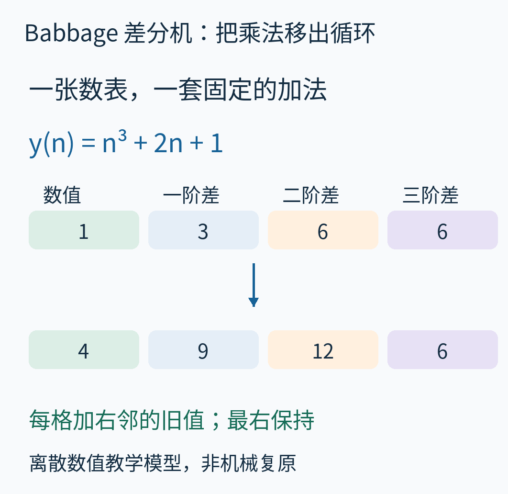
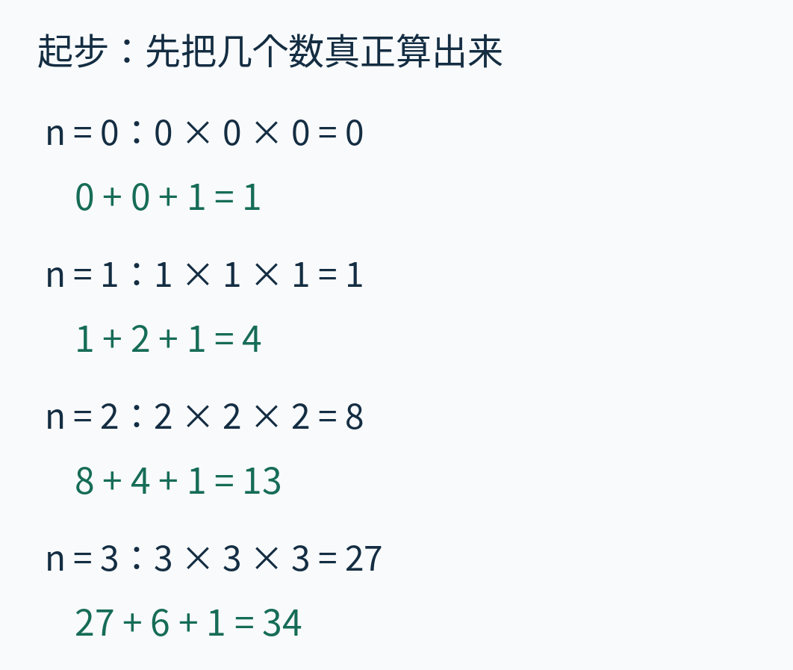
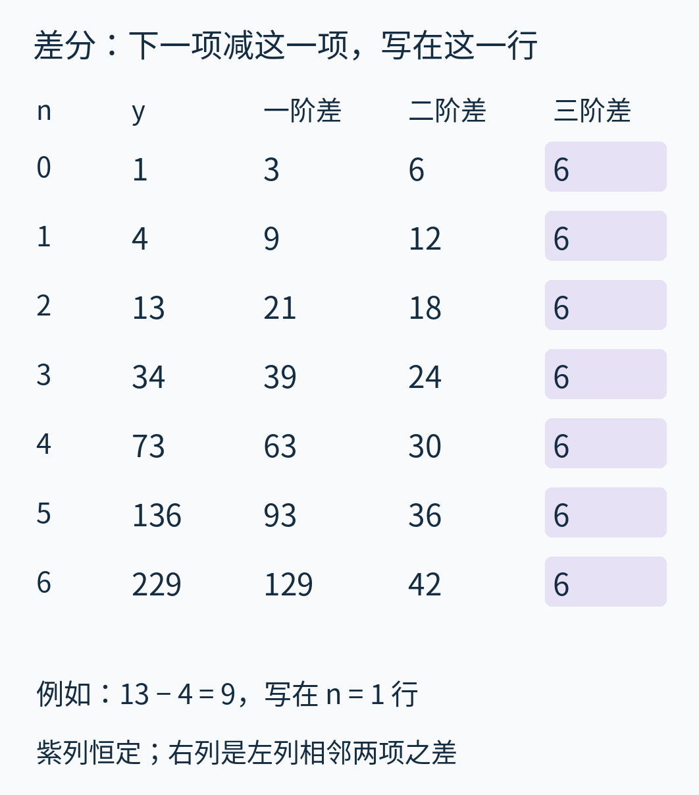
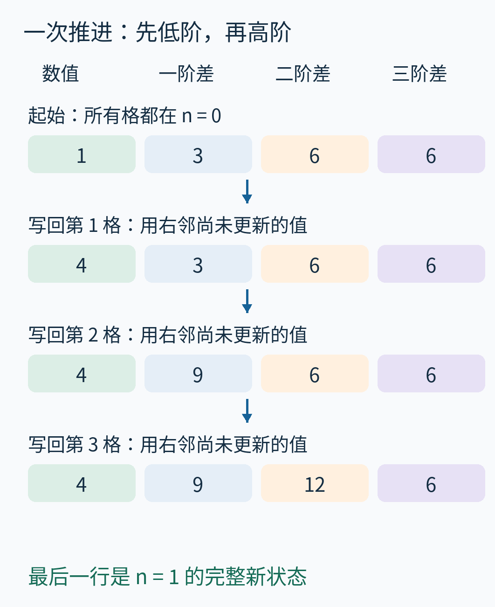
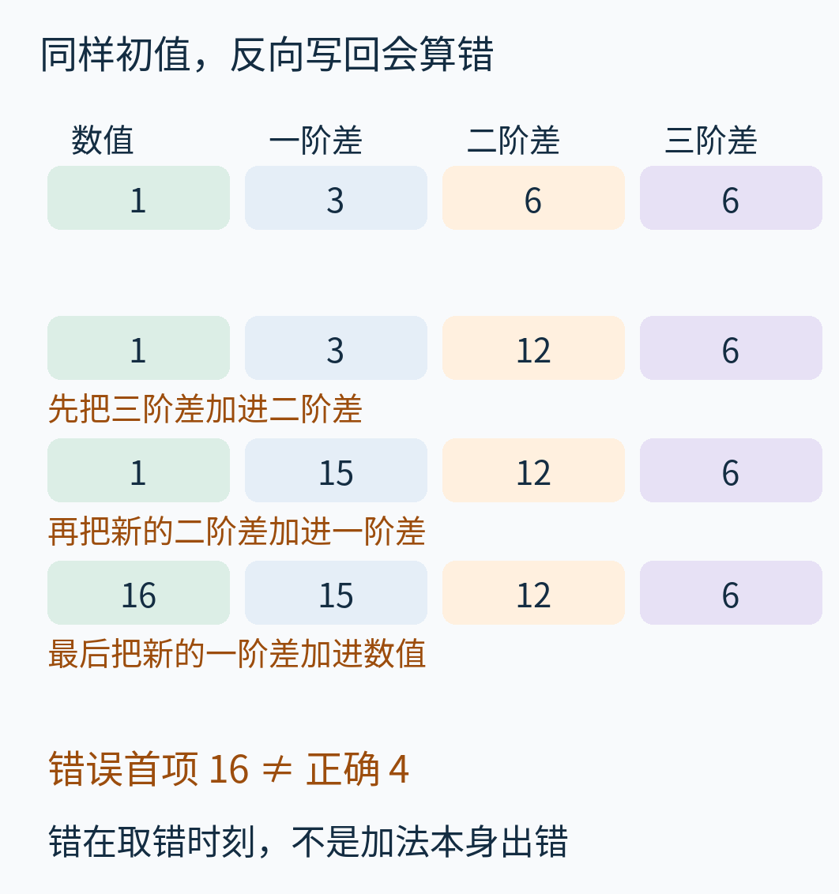
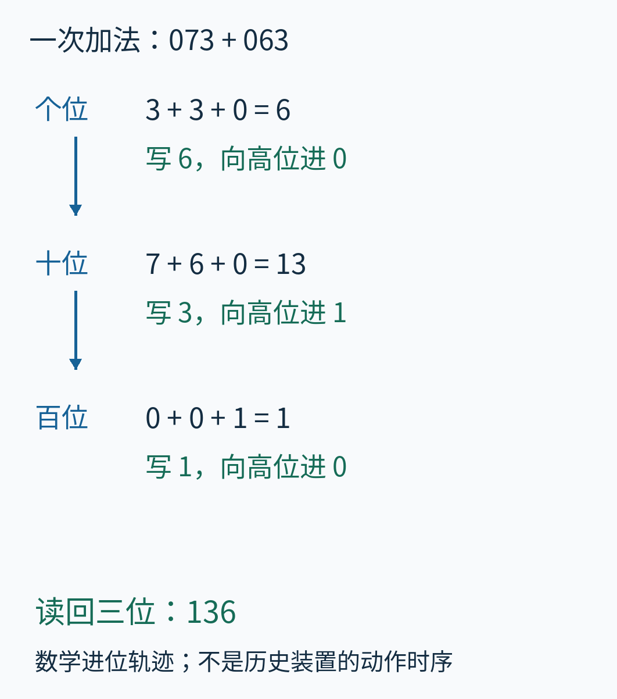
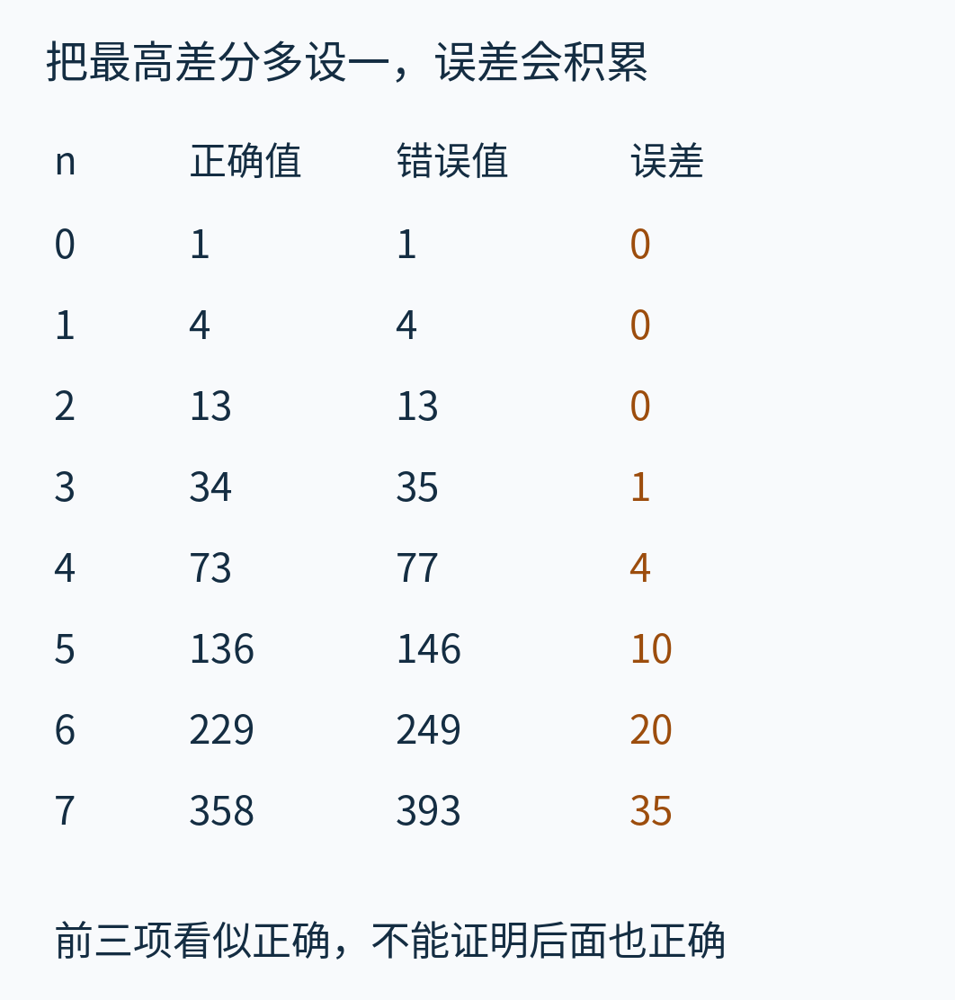
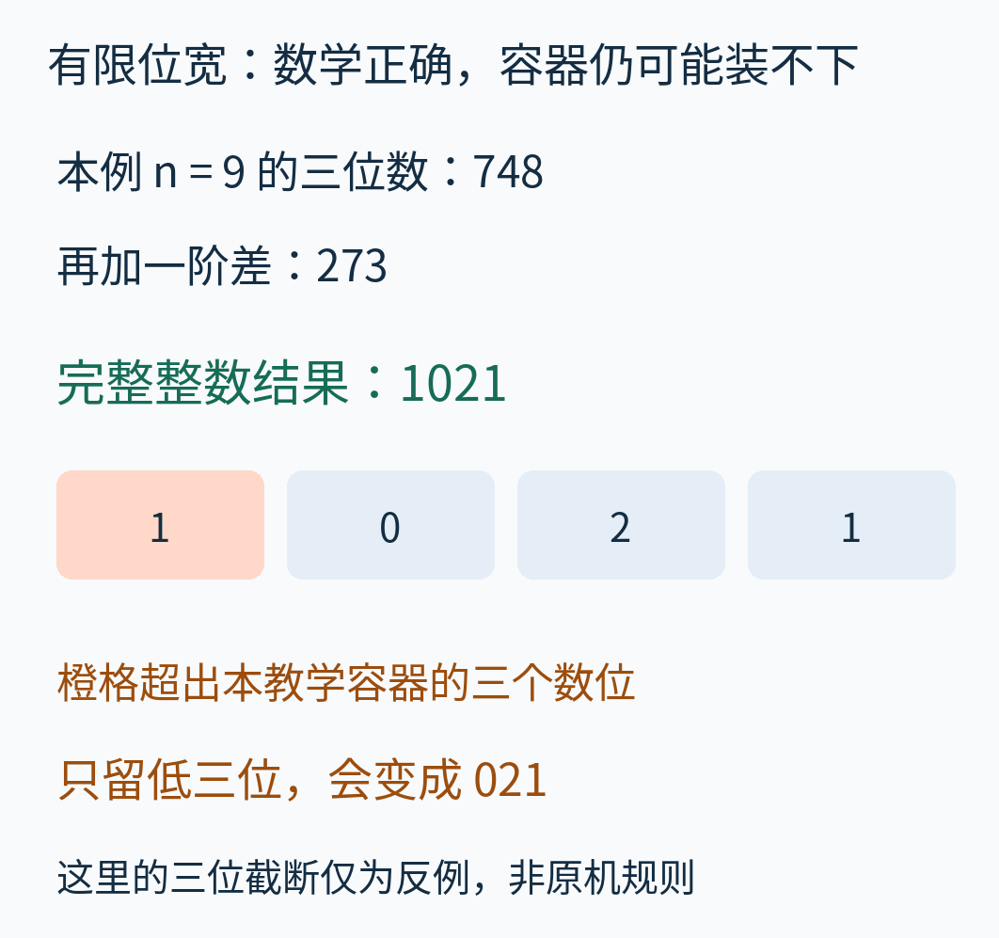
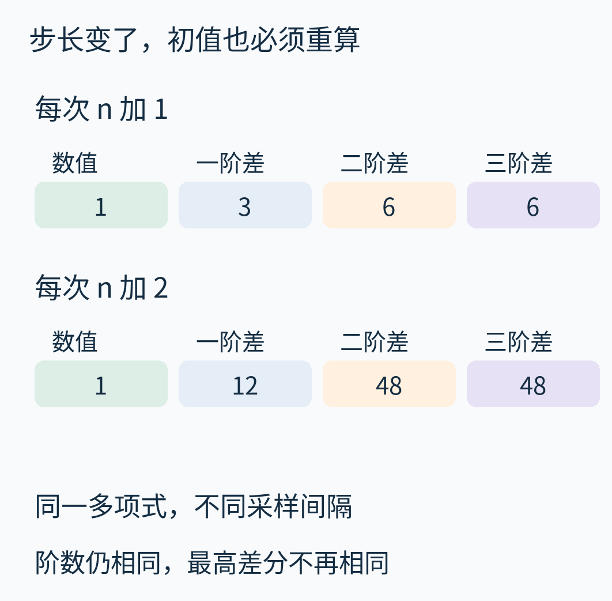
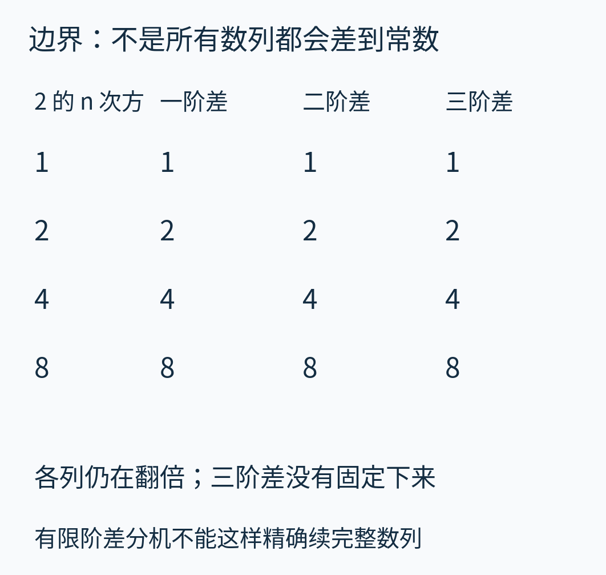

# 【待补真实素材稿】不再一行行乘：Babbage 差分机怎样只用加法造出数表？

> **状态：待补真实素材稿（2026-10-26）。** 本文先公开现有完整文字、计算和配图供阅读；整体仍为 HOLD，尚未达到正式成稿的真实素材完整性要求，不计入本批已正式审读通过的 27 篇。
>
> **待补内容：** 尚缺可辨认的真实差分机整体、数位或机构局部及相关历史输出素材。现有图是数学与机械数位的教学表示，不是实机照片、原机构图纸或历史制表实物。
>
> 具体来源、未核范围与许可限制见[来源说明](sources.md)。补齐素材并复审后，再更新成稿状态。

要把一个公式算上几百次，最直接的办法是把输入逐个代进去。算完一个，再算下一个；遇到平方就把两个相同的数相乘，遇到立方就把三个相同的数相乘。可如果机器很擅长加法，而乘除法要付出更复杂的机械代价，是否能换一种工作安排？

查尔斯·巴贝奇（Charles Babbage）的差分机，就是为连续生成数表设计的机械计算装置。它的关键不在于“齿轮也会乘法”，而在于：**先把公式变成几个初始数，再用固定的加法规则把整张表接下去。**



图里的四个格子是本文的数学教学模型，不是巴贝奇机械图纸的复刻。先认住最左边：它存放当前要写进数表的结果。右边的三个格子，会逐层告诉它下一步应该增加多少。下面会亲手算出这些数。

真实设备与模型的区别也必须先说清。伦敦科学博物馆保存的十九世纪一号差分机完成部分，与后来依据二号差分机设计制造的现代机器，是不同实物。本文尝试取得的四件开放许可摄影作品原文件均受访问限制，未取得原像素，因而这里没有伪造实拍或以示意图代替照片。可从[科学博物馆的实物介绍](https://www.sciencemuseum.org.uk/objects-and-stories/charles-babbages-difference-engines-and-science-museum)查看设备原站展示；本文现有图负责说明可复算的数值机制，实物照片仍待补齐。

## 从一张很小的数表开始

过去，航海、测量和工程中的计算常借助印好的数学表。一个结果从计算者的纸面到读者手中，还要经过誊写、排字和印刷；这些环节都可能引入错误。科学博物馆对差分机的介绍，把自动计算与自动输出放在同一条生产链上。这也是它与一台只回答单次加减题目的计算器不同的地方。[来源：Science Museum](https://www.sciencemuseum.org.uk/objects-and-stories/charles-babbages-difference-engines-and-science-museum)

我们不从复杂航海表入手，而做一张更小的教学表：

```text
y(n) = n³ + 2n + 1
n = 0, 1, 2, 3, ...
```

n 是这一行的输入，y(n) 是这一行要记录的结果。n³ 表示 n × n × n；2n 表示 2 × n。这里没有长度、时间等物理单位，输入每次增加 1。

先老老实实代入。n = 0 时得到 1；n = 1 时得到 1 + 2 + 1 = 4；n = 2 时得到 8 + 4 + 1 = 13；n = 3 时得到 27 + 6 + 1 = 34。



图中每组上行展开立方，下行把立方、线性项和常数相加。先算这四项不是耍赖：差分法确实需要准备初值。它要节省的是此后很长一段连续制表中的重复乘算，不是承诺连准备工作也凭空消失。

现在把前四个结果写成一列：1，4，13，34。它们每次增加的量是多少？

- 从 1 到 4，增加 3。
- 从 4 到 13，增加 9。
- 从 13 到 34，增加 21。

这些“下一项减这一项”的结果，叫作一阶差分。变化量还不固定，不能直接给机器一个永远不变的加数。于是对变化量再做一次同样的事：9 − 3 = 6，21 − 9 = 12。这叫二阶差分。再做一次：12 − 6 = 6，得到三阶差分。

你可能已经看到诱惑：如果三阶差分以后一直是 6，那么从最右边开始，整个数表似乎就能接着长出来。但只算出一个 6，尚不能证明它永远不变。我们稍后会从公式解释这一点。

## 差分不仅有数值，还有位置

先把写表规则固定，否则正确的数也会被用错。

记号 Δ 读作“差分”。本文采用**向前差分**：

```text
Δy(n) = y(n+1) − y(n)
```

右边取的是从 n 行走到 n+1 行的增加量，结果写在 **n 行**。例如 13 − 4 = 9，是从 n = 1 走向 n = 2 的增加量，所以 Δy(1) = 9。它不写在 n = 2 行。

二阶差分同样定义为下一行的一阶差分减本行的一阶差分。以 n = 0 为例：Δ²y(0) = 9 − 3 = 6。三阶也照办。上标 2、3 表示重复做差分的次数，不是把差分值平方或立方。



按行看，图中每行都是同一位置 n 的状态。按列看，右列来自左列相邻两行的相减。紫色的三阶差分列始终是 6。图中超过前四项的数已经由附带程序直接代入核算，先展示它们是为了核对规律，而不是用观察代替证明。

从第一行取出四个数：

```text
y = 1
一阶差 a = 3
二阶差 b = 6
三阶差 c = 6
```

这四个量不是多项式的系数。原公式的系数是立方项前的 1、线性项前的 2 和常数 1；这里的 1、3、6、6，是公式在起点附近形成的差分状态。换公式、换起点或换采样间隔时，都应重新求它们。

## 为什么三阶差分会停在常数上？

把“下一项减这一项”真的用到同一个公式上：

```text
y(n+1) − y(n)
= (n+1)³ + 2(n+1) + 1
  − (n³ + 2n + 1)
= 3n² + 3n + 3
```

这里关键的消去是：展开 (n+1)³ 得到 n³ + 3n² + 3n + 1；减去原来的 n³ 后，最高的三次项没有了。线性部分又贡献 2，常数项互相抵消，留下 3n² + 3n + 3。代 n = 0 得 3，代 n = 1 得 9，正好回到刚才手算的一阶差分。

继续对这个二次式做“下一项减这一项”，得到 6n + 6；再差一次，得到 6。再差一次则为 0。于是前面的规律不只是碰巧出现：对这个多项式，不管 n 取哪个整数，三阶差分都等于 6。

这背后有一条一般规律：**在固定的非零步长下，对一个 d 次多项式做一次差分，次数会降低一次；做 d 次后得到常数。** 理由与刚才相同：最高次项在相减时抵消，剩下低一次的项。对于常数，下一项减这一项就是零。

注意，这里谈的是间隔固定的离散相减。我们没有把步长缩到无限小，也没有做微积分中的求导。差分虽然也能把多项式次数降低，但它计算的是两个确切采样点之间的变化。

## 从差分表反过来：每步只做三次加法

定义式可以换个读法。既然一阶差分是“下一项减当前项”，那么下一项就是“当前项加一阶差分”。同理：

```text
新 y = 旧 y + 旧 a
新 a = 旧 a + 旧 b
新 b = 旧 b + 旧 c
新 c = 旧 c
```

每条规则都取旧状态。现在把 1、3、6、6 代进去：新 y = 1 + 3 = 4；新 a = 3 + 6 = 9；新 b = 6 + 6 = 12；c 保持 6。于是下一行是 4、9、12、6。



这张图分成四个时刻。第一行是完整旧状态，最后一行是完整新状态；中间两行是操作过程中的混合状态，不能当作某个 n 的完整差分表行。每一步只更新一个格子，右邻尚未改变，因而读到的正是需要的旧值。

再走一次：4 + 9 = 13，9 + 12 = 21，12 + 6 = 18。新的状态是 13、21、18、6。第三次得到 34、39、24、6；第四次得到 73、63、30、6。

现在我们已经从最初的四个数，走到了原公式在 n = 4 时的结果 73，循环里没有乘法。以后每次仍只需三次整数加法。对一般 d 次多项式，这个数学实现保存 d+1 个状态数，每产生一个新值做 d 次加法；这不是机械运行时间的估计，也没有计入初值准备和输出工作。

这段 Python 直接实现同一规则：

```python
def advance(state):
    for j in range(len(state)-1):
        state[j] += state[j+1]
    return state
```

state 按数值、一阶差、二阶差、三阶差排列。循环从左向右：先更新低阶量，再更新高阶量。最右的常数格不更新。Python 的整数可以按需增加位数；这里使用它来核数学关系，并不模拟历史机器的容量和耗时。

## 为什么换个更新顺序就错了？

也许你听过另一种差分口诀：“先加最高阶，再一层层往回加。”它并不一定错，但必须先问：那些差分写在哪一行？

本文四格采用同一个 n 的向前差分。若不改变这些初值，却从右向左就地写回，会发生什么？

先把 b 改成 6 + 6 = 12；接着 a 使用新的 b，变成 3 + 12 = 15；最后 y 使用新的 a，得到 1 + 15 = 16。它根本不是下一行应该出现的 4。



错误不在于进位或加法，而在于“下一步的变化量”提前混进了这一步。若有一份独立旧状态副本，则可以按任意次序计算各个新值；若像这里这样直接覆盖原格子，就必须保护尚未读取的旧值。

Computer History Museum 的[差分法介绍](https://www.computerhistory.org/babbage/howitworks/)采用另一种摆表与续表说明，从末端已有差分向后延长，先得到新的差分再加回数值。它的教学例子和差分位置与本文不同。两种写法可以表达同一数学关系，但不能拿一种表的初始化值，配另一种表的就地更新口诀。**先明确差分的位置，再决定更新顺序。**

同样，本文的 Python 语句顺序不是二号差分机的凸轮、数位轮和传动机构的实际时序。代数上能等价，不代表机械过程逐句照做。

## 从四个数到一列列数位轮

四格状态把每个整数当作一个整体；机械装置需要进一步把整数拆成十进制数位。

在差分机中，数字由机械轮的位置表示，一个数的各个数位各有自己的轮。这里的“数字式”指可识别的离散数位状态，不意味着电子器件，也不意味着二进制。CHM 的装置说明明确区分了十进制表示和这种离散状态。[来源：The Engines](https://www.computerhistory.org/babbage/engines/)

用已经走到的 n = 4 状态作例子：73、63、30、6。为便于画出来，我们给每个数暂时分配三位，写成 073、063、030、006。


看每一竖列：上面是百位，中间是十位，下面是个位。最左列的 0、7、3 合起来才是 73。颜色区分数值与不同阶的差分，不代表金属材料或真实装置零件。图中四列的位置、三位容量都是教学选择，没有声称是巴贝奇机器的比例、朝向或真实列数。

这一步解释了为什么“只用加法”仍然需要复杂机构：机器不仅要保存数，还要在列之间传递数值，并在一个数的相邻数位之间正确处理进位。机械设计必须解决那些我们写一个加号时省略的动作。

## 73 + 63：一个加号内部发生什么？

下一项的数值是 73 + 63 = 136。同一个例子已经出现进位，不必另换一道与主线无关的算术题。

从个位开始，3 + 3 = 6，写 6，不进位。十位是 7 + 6 = 13，十位只保留 3，将其中十个十位单位合成一个百位单位。百位是 0 + 0 + 1 = 1。读回结果就是 136。



图中的第三个加数是来自低一位的进位；“向高位进”指把多出的十进制单位交给更高一位。向下的箭头表示先个位、再十位、最后百位的计算先后，不是进位的空间移动，更不是真实齿轮的转向。

这张图只证明了本次数位运算所需的输入、输出和进位关系，没有展示或测量历史机器的棘爪、传动齿或进位装置运动。实际机械设计如何把这些关系落实为可靠动作，需要专门的机械图纸和机构研究，不能从四个数学格子臆造出来。

二号差分机设计所处理的数长可达 31 位，并支持最高七次多项式制表（对应七阶差分）。这里的 31 位是数的十进制位数，不应随意改写成“任何结果都有小数点后 31 位精度”。输入缩放、初值和函数近似都需要另行处理。[来源：The Engines](https://www.computerhistory.org/babbage/engines/)

## 算对还不够：初值和容量也有边界

差分法没有让错误消失。它把工作转成了一个可重复执行的递推，而递推会忠实传播你给它的初值。

如果把初始三阶差分从 6 错设成 7，其余三个数保持 1、3、6，前几个结果会怎样？



前三项 1、4、13 仍然正确，到 n = 3 才开始多 1；随后误差变成 4、10、20、35。原因可以从更新顺序看出来：最高格的错误先传到二阶，再传到一阶，最后才进入结果格。因此“开头几行没错”并不能证明整张表可靠。这个例子的误差是 n(n−1)(n−2)/6，附带程序也逐项核对了这一关系；它说的是特定初值误差的精确传播，不是设备误差的实测统计。

容量则是另一回事。继续使用正确状态走到 n = 9，y = 748，一阶差分是 273。相加得到 1021，已经超过三位。



图中橙格表示数学结果比教学容器多出的一位。如果自作主张只保留低三位，读到的就会是 021。递推关系本身依然正确，错在容器容不下完整整数。真实装置怎样检测或处理越界，不能由这个三位截断反例推定；本文的程序也没有冒充历史溢出机制。

换步长同样不能偷懒。若输入不再是 0、1、2、3，而改成 0、2、4、6，函数仍是原来的 n³ + 2n + 1，但前几个值变成 1、13、73、229。新的初始差分状态是 1、12、48、48。



两种状态保存的仍是同一个公式，只是相邻行之间的距离不同。三次多项式的三阶差分在步长 h 下与 h³ 成正比，所以这里从 6 变成 48。图中每组四格从左到右仍然是数值、一阶差、二阶差、三阶差；不能沿用旧的 1、3、6、6，却期望机器自己知道要跳过一个输入。

最后，多项式这个条件不能删掉。另取数列 2ⁿ，它的值是 1、2、4、8……；相邻相减仍是 1、2、4、8……。继续差分也不会得到恒定的一列。



这并不表示差分机器与更复杂的函数毫无关系：可以在有限区间用多项式近似其他函数，再生成近似值。但那会多出一个新问题——近似误差是否满足用途。本文没有构造航海表、对数表或三角表的误差保证，也没有把有限阶递推说成对任意函数都精确。

## 把数学方法放回历史中的机器

到这里，我们已经知道差分机要保存什么、怎样得到下一行、为什么高阶差分恒定，以及错误会从哪里进入。再回看机器的历史，几个日期就不容易混在一起了。

| 对象或事件 | 本文采用的准确含义 |
|---|---|
| 1832 年的一号差分机完成部分 | 巴贝奇时代的实物，是整体计划中的部分装置，不是完整二号差分机 |
| 1847—1849 年 | 二号差分机的设计时期，不是建成年代 |
| 1991 年 | 科学博物馆完成现代建造项目的计算部分 |
| 2002 年 | 加上打印机构后完成该现代装置 |
| 2008 年 5 月 10 日 | CHM 新闻稿宣布第二台现代二号差分机展览开幕并安排现场演示 |

前三类年代与现代建造阶段见[科学博物馆说明](https://www.sciencemuseum.org.uk/objects-and-stories/charles-babbages-difference-engines-and-science-museum)；2008 年开幕及演示安排来自[CHM 当年的新闻稿](https://computerhistory.org/press-releases/babbage-engine-exhibit/)。这里转述的是机构记录和当时的活动公告，不是作者亲临现场或测量机器。

巴贝奇还有另一项更广泛的设计——分析机（Analytical Engine），设想通过穿孔卡控制运算，并区分存储与运算部分。它与本文反复做固定差分递推的机器不是同一个设计。讨论分析机的程序控制，不应直接拿来说明差分机怎样换公式；我们这里改变的是初始数值状态。[来源：The Engines](https://www.computerhistory.org/babbage/engines/)

差分机的输出机构同样有明确目的：自动把结果送往纸面或制版过程，减少人工转录环节。于是我们开头那张小表真正对应了一条工作链：准备正确初值，反复执行固定关系，把结果可靠地交给读者。只解释“齿轮会算数”，就会漏掉为什么要持续制表，以及为什么计算和输出需要一起考虑。

你现在可以不运行任何程序，接着本文的 n = 5 状态继续算。此时四个数是 136、93、36、6；下一行应当是什么？按低阶到高阶更新，你会得到 229、129、42、6。最后再用 6³ + 2×6 + 1 核对最左格，得到同一个 229。

附带的[计算程序与复现说明](examples/README.md)把这一过程、错序反例、进位、溢出和步长变化都实际跑了一遍。真正值得带走的不是一串初值，而是准备与重复之间的分工：先理解公式在等间隔采样下的差分结构，之后才能让简单、固定、可检查的动作接管长长的数表。

本文由 AI 辅助研究、推导、编写代码和绘图；来源范围、素材取得限制与许可见 [sources.md](sources.md)。
