# Buddy 分配器：空闲内存明明挨着，为什么还不能合并？

一个程序要保存 13 字节数据。你手里有一段连续的 64 字节空间，决定把其中一部分交给它，并记住剩下哪些地方还能用。随后又来了 9 字节和 17 字节的请求。过一会儿，有的请求结束，把空间归还了。

这个任务不是“找到一个数字地址”就结束了。管理者还必须保证不同请求不重叠、释放的块能重新使用，而且不必每次都从头扫描每个字节。

**Buddy 分配器把可分配块限定为一组二次幂大小；需要小块时对半分，释放时只与同一次分裂产生的另一半合。** Buddy 就是“伙伴”：不是离得最近的空闲块，而是同一个父块的两个孩子。

这条限制让找伙伴变得非常简单，也留下一个值得认真看的代价：两个同样大的空闲块，即便地址连续，也可能无法合并。

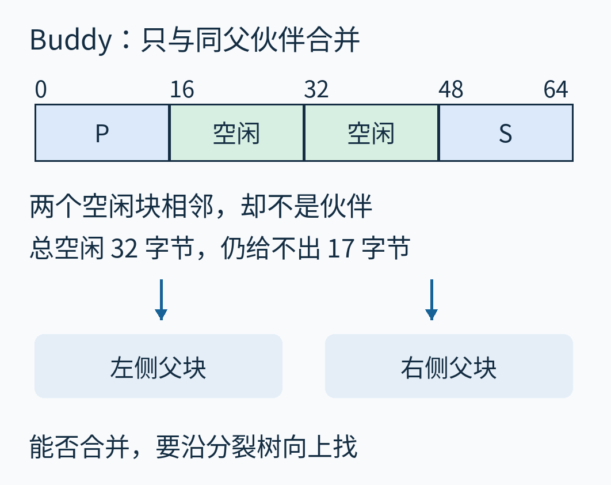

这幅封面先给出一个稍后会完整算出的反例。绿色是空闲，蓝色是仍被请求占用的块；横轴从左往右是相对起点的字节偏移。中间虽然有连续空位，但它跨过了两个父块的边界。

本文从一段小内存把分裂、分配、释放、合并走完，再解释真实操作系统多了什么约束。所有彩色状态图和数字来自随文运行的[独立教学程序](examples/buddy.py)。它管理的是模拟地址和记录，不会接管 Python 或操作系统的实际内存分配。

## 1. 先约定：order 不是字节数

把交给同一个分配器管理的连续区域叫作 **arena**。本例规定：

- arena 总大小为 64 字节，基址为 `0x1008`。`0x` 表示后面的地址用十六进制写。
- 最小分配单位为 8 字节。
- 每增加一级，块大小翻倍。这个级别叫 **order**，从 0 开始。

| order | 包含几个最小单位 | 块大小 |
|---|---:|---:|
| 0 | 1 | 8 字节 |
| 1 | 2 | 16 字节 |
| 2 | 4 | 32 字节 |
| 3 | 8 | 64 字节 |

因此，本例的 order 1 不是“1 字节”，也不是“2 字节”，而是两个 8 字节单位。一般写成：

```text
块大小 = 最小单位 × 2^order
```

这里 `^` 在数学式中表示幂；稍后 Python 代码里的 `^` 则是异或，二者不要混用。Python 计算二次幂可以写 `2 ** order`，本程序用 `unit << order` 表示把单位乘以这个幂。

申请 13 字节时，8 字节不够，16 字节够了，所以取 order 1。申请 17 字节时，16 不够，必须上到 order 2 的 32 字节。

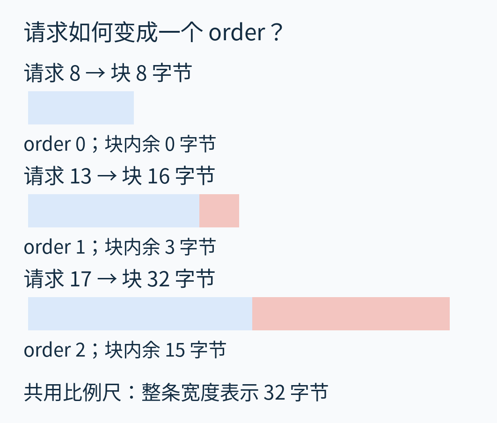

图中蓝色是实际请求的容量，粉色是已经保留在块中、但本次请求用不到的容量。三个横条共用同一比例，最长的整条是 32 字节。

向上取整可以分两步做，避免浮点对数在整数边界附近带来的问题：

```python
units = (request + unit - 1) // unit
order = (units - 1).bit_length()
```

先求至少需要几个最小单位，再求能装下这些单位的最小二次幂。13 字节需要 `(13+8−1)//8=2` 个单位；`2−1=1` 的二进制只有一位，因此 order 为 1。17 字节需要 3 个单位；`3−1=2` 的二进制是 `10`，有两位，所以 order 为 2。

本程序只接受正整数请求；零、负数、布尔值和小数都会明确拒绝。超过整个 arena 的请求返回失败。怎样处理这些输入是接口约定，不能把某个教学约定说成所有分配器的统一标准。

## 2. 13 字节怎样从 64 字节里分出来？

为了让算式容易跟踪，先暂时不写绝对地址，使用 **offset（偏移）**：它表示某地址距离 arena 基址多少字节。

例如偏移 16 对应地址 `0x1008+16=0x1018`。区间 `[0,16)` 包含偏移 0 到 15，不包含右端的 16，长度恰好是 16。这种左闭右开写法方便表示相邻块：前一块的右端就是后一块的左端。

初始时只有 `[0,64)` 这一块。A 请求 13 字节，目标是 16 字节。分配器先看 order 1 的空闲表：没有。再看 order 2：也没有。order 3 有整块，于是把它取出来：

1. 把 `[0,64)` 分成 `[0,32)` 和 `[32,64)`，两个孩子都是 order 2。暂时拿着左块，右块进入 order 2 空闲表。
2. 左块还是太大，再分成 `[0,16)` 和 `[16,32)`。右块进入 order 1 空闲表。
3. 左块大小正好是 16 字节，把它交给 A，停止分裂。

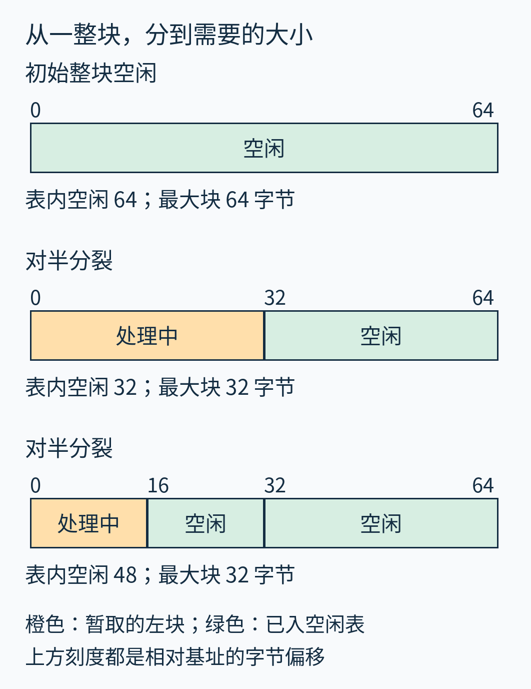

橙色表示当前正在处理的块，它暂时不在空闲表里；绿色才是已经登记为可用的块。图中“表内空闲”和“最大块”只统计绿色、已进入空闲表的块；橙色块暂取或待合并，还未计入。这是一次操作内部的过程快照，不表示释放过程中物理容量消失，也不是说外部调用者能同时拿走橙色部分。

为什么不直接切出 13 字节，再留下 51 字节？那样当然能设计另一种分配器，但块大小和边界就不再遵守 Buddy 的二分结构，后面那个简单的找伙伴公式也不能原样使用。

A 拿走以后，空闲表不是“48 个空闲字节的列表”，而是两个块起点的记录：

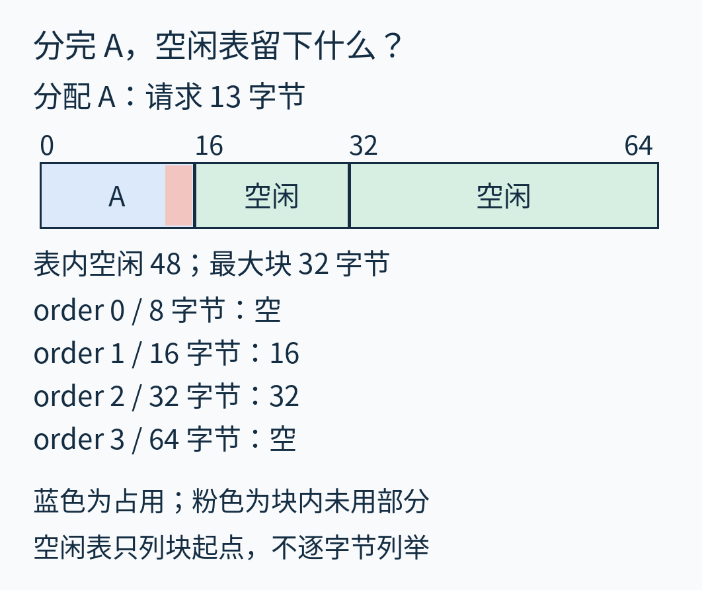

order 1 中的 `16` 表示“从偏移 16 开始，有一个 16 字节空闲块”；order 2 中的 `32` 表示“从偏移 32 开始，有一个 32 字节空闲块”。**表的层级提供大小，表里的值提供起点。** 大小和起点缺一不可。

接着 B 申请 9 字节。它也需要 order 1，直接取走 `[16,32)`，不用再分裂。C 申请 17 字节，需要 order 2，直接取走 `[32,64)`。

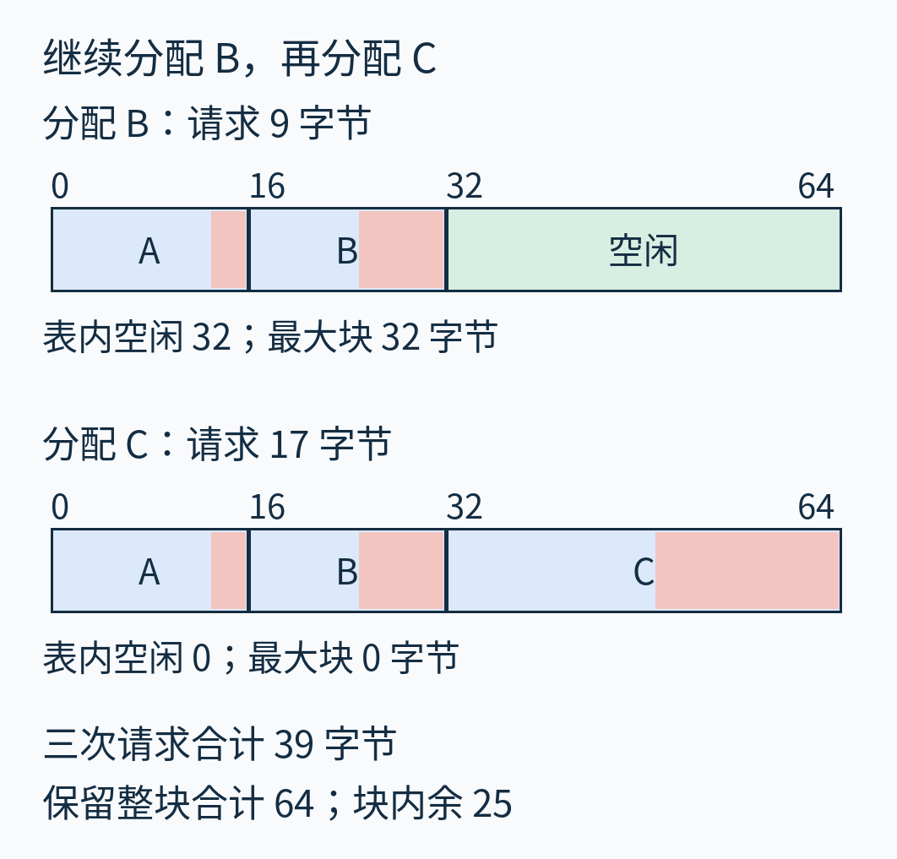

三次请求实际需要 `13+9+17=39` 字节，但分配器已经保留 `16+16+32=64` 字节。多出的 25 字节被封在已分配的块内，分别是 A 的 3、B 的 7、C 的 15 字节。这叫 **内部碎片**：空余发生在已经交出的块里面，分配器不能再把它独立借给另一请求。

对不小于最小单位的请求 r，向上取到的块大小 s 满足 `r≤s<2r`，因此块内余量小于 r，也小于块大小的一半。但请求小于最小单位时，这个界不成立：申请 1 字节仍会保留 8 字节，余下 7 字节。选择最小单位本身也是取舍。

## 3. 为什么一次 XOR 就能找到伙伴？

现在看 `[16,32)`：它的起点偏移是 16，大小也是 16。它与 `[0,16)` 来自同一个 `[0,32)` 父块，所以它的伙伴起点是 0。

换成二进制，16 是 `010000`。16 字节块的合法起点都是 16 的倍数，低四位必须为 0。其父块大小是 32；两个孩子只在“16 这一位”不同：左孩子这一位为 0，右孩子为 1。其他位相同。

**异或 XOR 的逐位规则是：相同得 0，不同得 1。** 与 `010000` 异或，恰好翻转这一位，其他位保持不动。因此：

```text
伙伴偏移 = 当前偏移 XOR 块大小
```

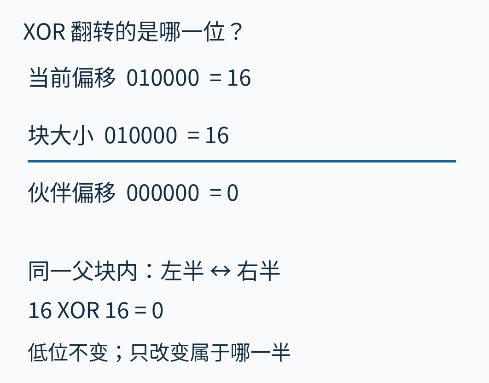

从另一边算也一样：`0 XOR 16=16`。到下一层，块大小变成 32，要翻转的也变成“32 这一位”：`0 XOR 32=32`，`32 XOR 32=0`。

这个公式成立的前提不是“数字恰好相邻”，而是我们一直维持同一套二分网格：大小为 s 的块从 s 的整数倍偏移开始，两个伙伴共享大小为 2s 的父块。合并后的父块起点就是两个孩子起点中较小的那个。

### 基址不为零时，别直接对地址 XOR

本例使用非零基址，是为了把一个常见错误放到眼前。正确做法是先回到 arena 的坐标系：

```python
offset = address - base
buddy_offset = offset ^ size
buddy_address = base + buddy_offset
```

仍用基址 `0x1008`，现在考察最小的 8 字节块，取偏移 8，即地址 `0x1010`。它的同父伙伴应该是偏移 0，即 `0x1008`。

正确计算：`8 XOR 8=0`，再加回基址，得到 `0x1008`。如果错把绝对地址直接异或：`0x1010 XOR 8=0x1018`，得到的却是偏移 16——落到了另一个父块。

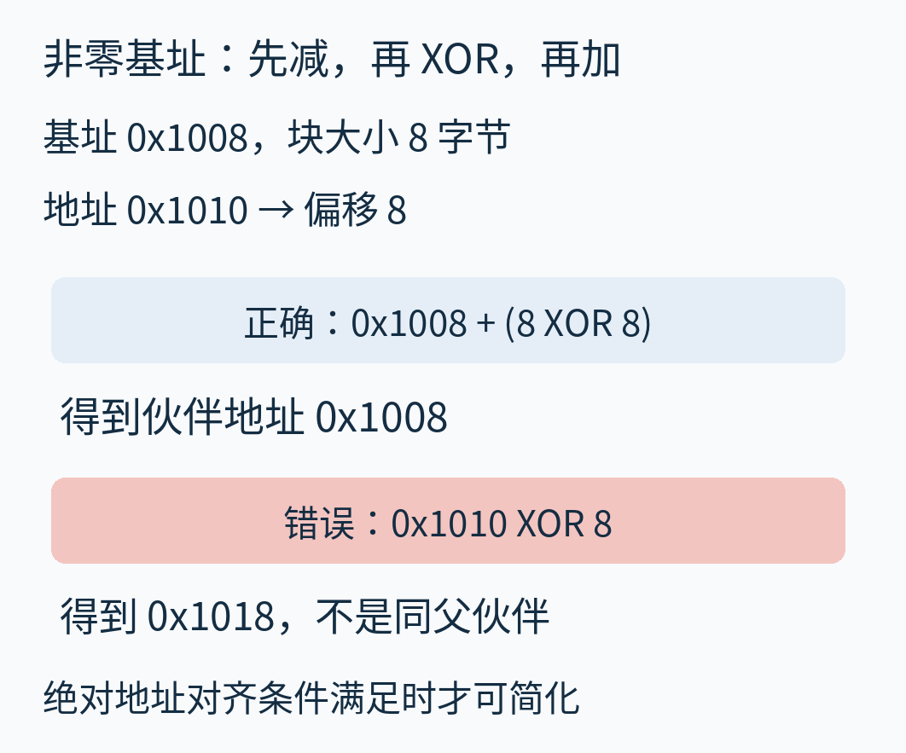

不是说基址一旦非零，直接 XOR 每一次都会错。本例在 16 字节层级就可能碰巧得到正确答案。真正的条件是二分边界是否与采用的地址编号系统对齐；例如基址按整个 arena 大小对齐，是直接用绝对地址公式的一种充分条件。

本模型只保证相对于 arena 的对齐，且基址至少按 8 字节对齐。它不承诺所有返回地址满足更大的绝对对齐要求，不能直接冒充通用 `malloc` 接口。

## 4. 找到伙伴，不等于可以合并

让 A 先结束。`[0,16)` 的伙伴候选是 `[16,32)`，但 B 仍在使用它。此时只能把 A 的块放回 order 1 空闲表。

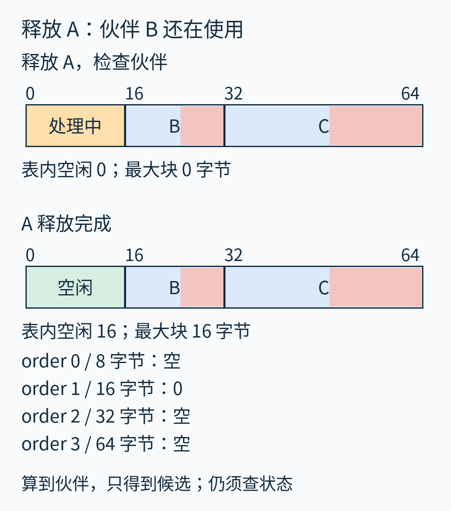

这里必须分清两件事：XOR 只回答“伙伴应当从哪里开始”；状态表才回答“那里现在是不是一个同阶、完整、可用的空闲块”。不能检查几段字节看起来没用，就把它们当成一个可合并的块。

在本程序中，空闲表按 order 分开存放。因此检查 `buddy_offset in free[order]` 同时要求：候选起点确实登记为空闲，而且登记在相同大小的层级。整个 Buddy 对象只管理自己的 arena，边界也受对象和最大 order 限制。

再让 B 结束。现在步骤不同了：

1. B 的起点为 16，大小为 16，伙伴起点算得 `16 XOR 16=0`。
2. 在 order 1 空闲表找到起点 0，也就是 A 释放的那一块。
3. 从这个表删除伙伴记录，把两块合为 `[0,32)`，order 从 1 升为 2。
4. 用新大小重新找伙伴：`0 XOR 32=32`。那里是 C，仍被占用，合并停止。
5. 只把最终的 `[0,32)` 放入 order 2 空闲表。

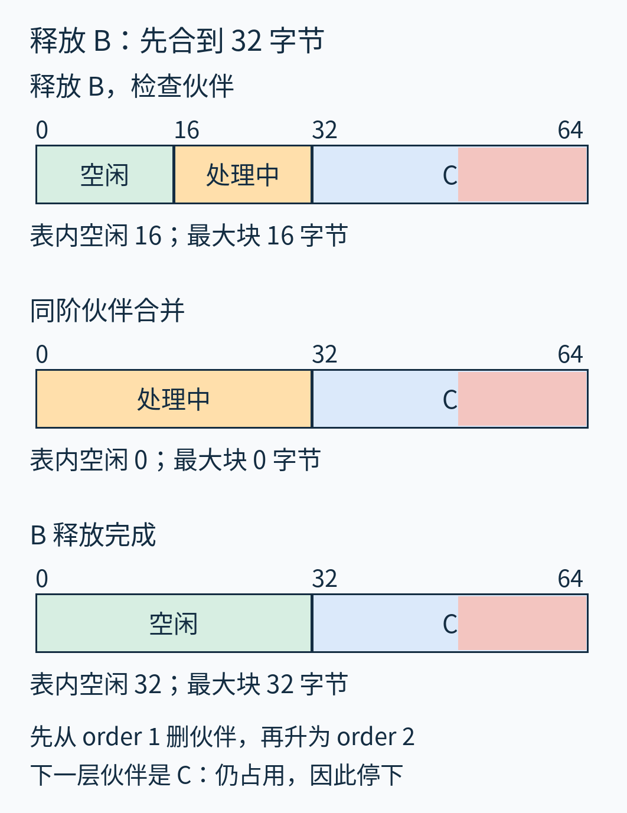

注意第三步一定要删除旧伙伴。否则表里同时声称“这里有一块 16 字节可用”和“这里有一块 32 字节可用”，同一段地址会被重复分配。一次合并也不意味着可以直接跳到根：每上升一级，块大小、候选伙伴和检查条件都要更新。

最后让 C 结束。它是 `[32,64)`，order 2。候选伙伴偏移为 `32 XOR 32=0`，恰好找到刚刚合出来的 `[0,32)`。删掉这个伙伴，合成 `[0,64)`，达到 arena 的最高 order 3，就不再向外寻找。

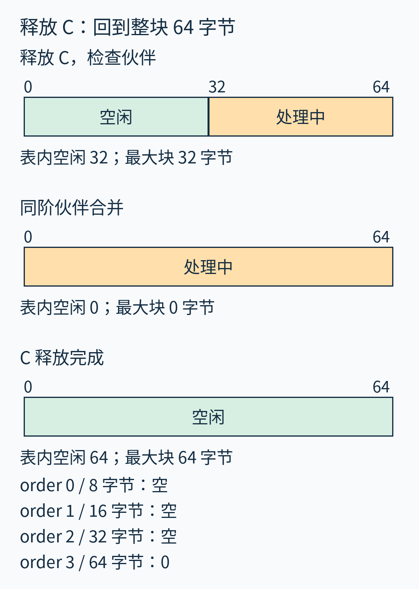

此时空闲表中只有 order 3 的起点 0。其他层都为空。我们恢复的不仅是“空闲总数为 64”，还有“一块可以直接满足大请求的 64 字节块”。

这也可以从树上看。每个节点是一段区间，向下是分裂，向上是合并：

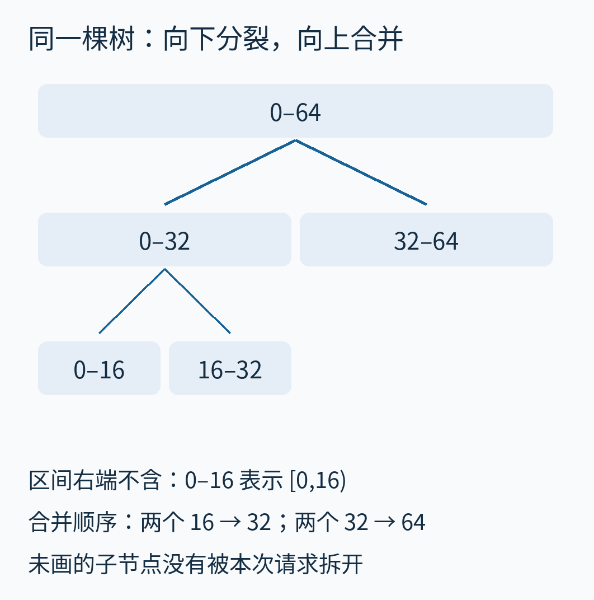

图中 `0–16` 是区间 `[0,16)` 的简写。右边的 32 字节块没有在这次运行中继续分裂，因此不画出它并未使用的后代。合并必须沿这棵树往上走，不允许临时横跨两个不同父节点创造一个新父块。

## 5. 总空闲 32 字节，为何 17 字节仍申请失败？

现在重新初始化同样的 64 字节 arena。为了看清边界，连续申请四个 16 字节块，按本次运行顺序命名 P、Q、R、S：

```text
P: [0,16)    Q: [16,32)
R: [32,48)   S: [48,64)
```

释放 Q，再释放 R。Q 的伙伴是 P，P 没释放；R 的伙伴是 S，S 也没释放。因此只能保留两个 order 1 空闲块，起点分别为 16 和 32。

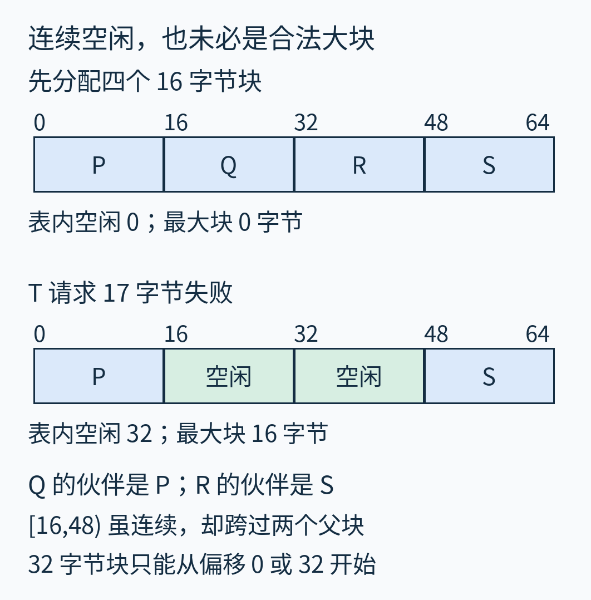

这次空闲总量是 32 字节，而且 `[16,48)` 真的连续。为什么新的 17 字节请求还是失败？

17 需要取整到 32 字节，即 order 2。本 arena 里合法的 order 2 块只有 `[0,32)` 和 `[32,64)`；它们都被活跃请求占着一部分。`[16,48)` 的起点 16 没有按 32 对齐，跨过了二分网格的父块边界，不是一个合法的 Buddy 块。

分配器检查 order 2 和 order 3 空闲表，都为空。它不会为了满足这次请求临时更改块的家族关系。

这体现了 **外部碎片**：可用空间落在已分配块以外，但布局与块边界限制使它不能满足某个请求。这里甚至不必有占用字节夹在两段空位中间；Buddy 所要求的大小和对齐网格，本身也会限制大块的形成。

因此看分配能力至少要区分三项：空闲总字节数、最大可用块大小、请求需要的块大小。本状态分别是 32、16、32；只看第一项就会误判。

如果 P 和 S 随后也结束，分配器能沿两个父块逐级合并，再处理同样的请求：

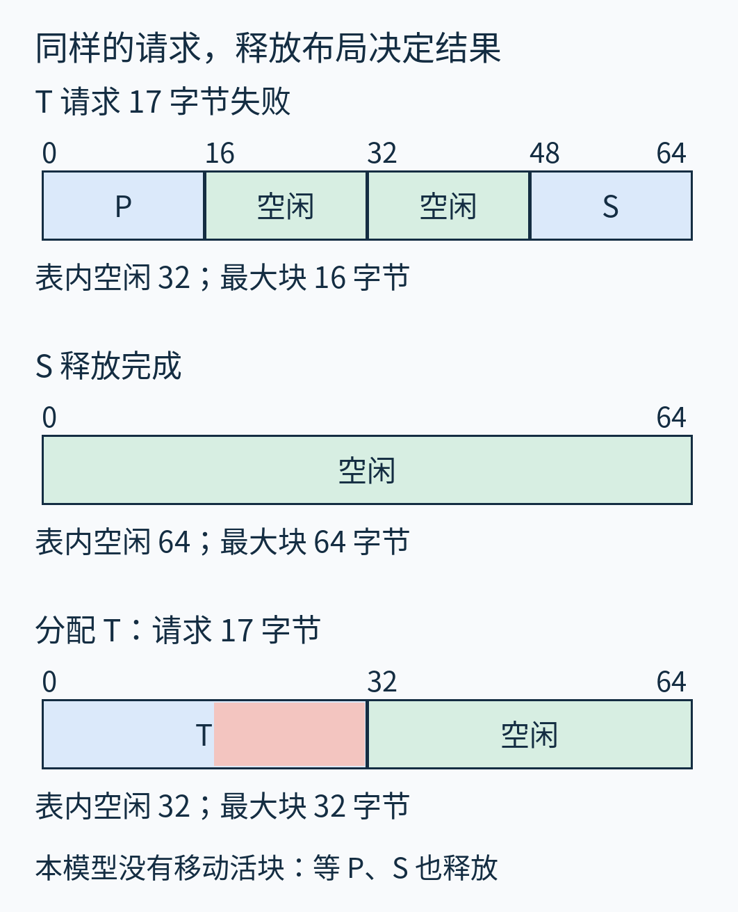

这个恢复过程没有偷偷搬动活跃数据，只是等待其他请求归还空间。把尚在使用的对象搬走、更新它们的引用属于额外机制；不能把这种能力算进本篇基本 Buddy 模型。

## 6. 边界之外，不能继续“找另一半”

再换一个实验：有两个分别管理的 32 字节 arena，地址恰好相邻，分别是 `[0x2000,0x2020)` 和 `[0x2020,0x2040)`。它们各自全空闲。

请求 48 字节需要一个 64 字节块。两个 arena 的空闲量加起来虽是 64 字节，但任一分配器都不能交出另一个分配器拥有的地址。

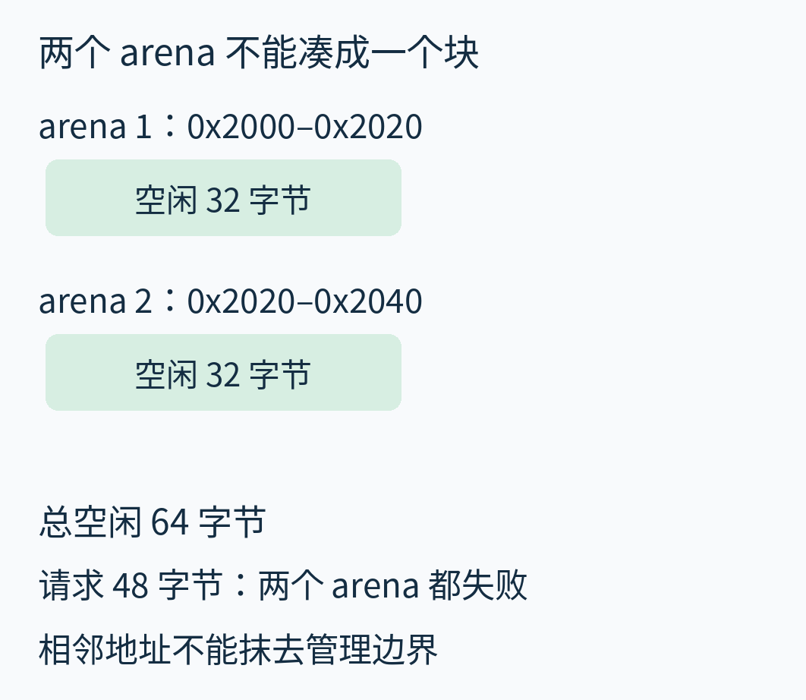

能否把它们从一开始就设计成同一片 64 字节 arena，是更上层的组织选择。**已经作为两个独立管理域运行，不能仅凭地址相邻就跨界合并。** 同样，一片地址空间也可能包含不可用洞或不同用途区域，不能用 XOR 结果替代有效性检查。

## 7. 数据到底记在哪里？代码到底做了什么？

前面的图只画了被管理的地址范围，却没有画“谁占着哪一块”的账本。本例把账本放在 Python 对象里：

- `used` 记录名称对应的起点、order 和请求量，释放时从这里恢复原块大小。
- `free[order]` 记录这一层的空闲起点。它用字典充当可删除的有序集合。
- `events` 保存过程快照，供图和网页回放。

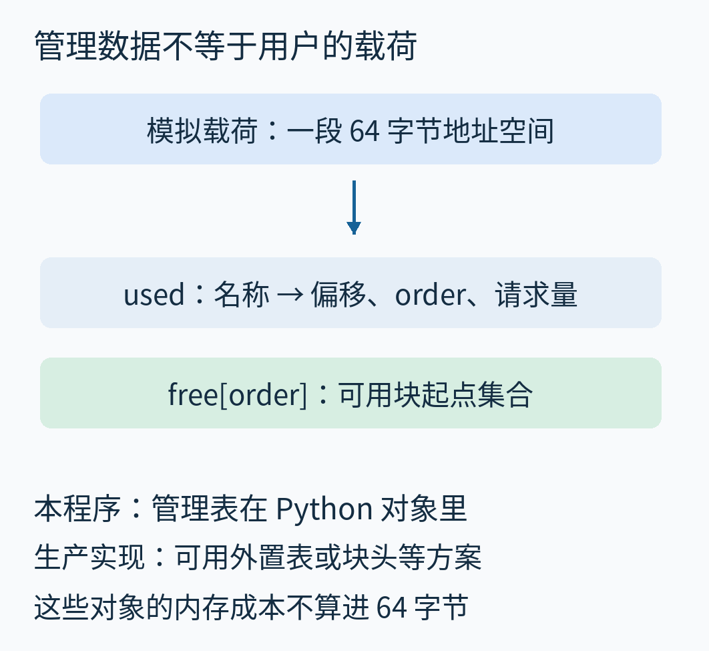

因此，这里的“64 字节”只是模拟的可分配容量，不包含字典、整数、字符串和快照的 Python 对象成本。程序也没有把用户数据真的写进那 64 个字节。生产分配器可以选择独立位图、树、页描述符或块内管理头等布局；放在用户块内的管理头会占空间，也要参与容量和对齐设计。

本接口通过名称释放，未知名称或重复释放会报错。若换成真实指针接口，还得规定如何辨认分配起点、找回大小、拒绝越界或内部指针，并保护元数据。不能把这一行 XOR 当成完整的内存安全方案。

本模型的释放核心相当于下面这段；进入前，`offset` 和 `order` 已从合法的分配记录取出：

```python
while order < top:
    size = unit << order
    other = offset ^ size
    if other not in free[order]:
        break
    del free[order][other]
    offset = min(offset, other)
    order += 1
free[order][offset] = None
```

这是新编写的教学算法，不是 Linux 源码摘录。完整程序额外做输入验证、状态快照和不变量检查；真实并发分配器还必须让“检查—删除—合并—入表”受到适当同步保护，否则两个线程可能同时认领同一个空闲块。本程序只演示串行操作。

### 怎样谈复杂度，才没有把画图成本藏起来？

设最小单位为 u，总容量为 N，层数上限 K 为 `log₂(N/u)`。一次向上找可用阶、向下分裂或向上合并，最多经过 K 级。

如果每级能常数时间取一个块，并能常数时间查询、删除给定伙伴，那么抽象分配/释放路径是 O(K)。本例字典的查询、插入、删除与 `popitem()` 使用通常的平均或摊还复杂度假设；并不提供对恶意哈希情形的最坏常数保证。`popitem()` 取最后插入的块，**不承诺总是取地址最小的空闲块**，只是本次小例恰好产生了图中的顺序。

如果改成普通列表，查找某个伙伴可能要线性扫描，这就不能继续不加条件地说每层 O(1)。如果为了“总挑最小地址”调用 `min()` 扫描所有空闲块，也要计入扫描成本。

更重要的是，随文这个**完整教学实现**为了让每个过程可见，每次记录都会遍历并排序全部当前块，复制空闲表，还在操作结束检查所有空闲起点。设一次快照包含 B 个块，排序成本可达 O(B log B)，一次操作又可能产生 O(K) 个快照；完整运行成本因此不等于抽象路径的 O(K)。保留 S 个快照所用空间还随快照内容累计增长。这里没有宣称实际 Python 程序具有生产分配器的时间或空间常数。

## 8. Linux 用的是同一个想法，但不是这份小程序

Linux 官方 6.12 物理内存文档把内存组织为 node 和 zone；这些区域受体系结构和用途等约束。本篇只用这个事实说明为什么不能随便跨管理边界，并不把 64 字节教学 arena 当作某台机器的物理内存图。[官方文档](https://docs.kernel.org/6.12/mm/physical_memory.html)

对照 Linux **v6.12** 的实际文件，可以辨认出熟悉的骨架：`__rmqueue_smallest()` 从目标 order 往上找，`expand()` 把大块往下分；`__free_one_page()` 在条件允许时逐阶合并。空闲块的 order 和状态由页的管理信息记录，空闲表还区分迁移类型。[v6.12 page_alloc.c](https://github.com/torvalds/linux/blob/v6.12/mm/page_alloc.c)

但有一个坐标差异尤其重要：Linux 的 `__find_buddy_pfn()` 使用全局页框号 PFN 与 `1 << order` 异或，不是先减去某个 zone 的起点。本篇的相对基址公式适用于这里自定义的 arena 划分，不能照搬成“Linux 对每个 zone 都减基址”。`page_is_buddy()` 再检查同阶和同 zone 等条件；调试 guard page 还有特殊处理。[v6.12 internal.h](https://github.com/torvalds/linux/blob/v6.12/mm/internal.h)

这些源码同时包含本模型没有实现的锁、每 CPU 页面缓存、迁移类型限制和调试路径。操作系统分配的一次实际延迟，不能从我们的循环次数直接推出来。本篇也没有运行内核分配实验，没有把下方网页截图称为 Linux 内存截图。

## 9. 把同一套状态真正跑出来

[实验目录](examples/README.md)给出了可复现命令。运行 `buddy.py` 会重建全部事件和统计，`build_figures.py` 用这些数据画出本文示意图；`viewer.html` 则把同一份数据放进可逐步查看的页面。

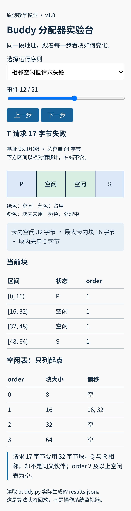

这是真实执行的原创网页截图：手机视口宽 354 CSS 像素，以 3 倍像素密度输出。它停在“相邻空闲但请求失败”序列的事件 12。块表同时给出区间、状态和 order，能核对颜色条是否真的对应空闲表；没有使用操作系统监视数据。

除了文中的两组确定性序列，程序还用独立种子 19019 运行 2,000 次操作，以逐字节占用数组作为另一种表示来交叉检查：分配成功时不重叠，释放时只归还原来占用的字节，分配失败时也确实不存在按目标大小对齐的全空闲窗口。此次得到 867 次成功分配、269 次失败申请；其余操作是释放。最后释放所有活块，检查是否恢复整块。

这是一组有限测试，不是形式化证明，也不是性能基准。它的用处是把示意图所依赖的关键关系实际算一遍，尤其是“请求失败”不能只由我们自己写的一句说明来充当证据。

读完后可以先不运行程序，换一个顺序手算：A、B、C 都分配完成后，先释放 C，再释放 A，最后释放 B。C 先成为 order 2 空闲块；A 暂时只能停在 order 1；最后 B 释放，先与 A 合成 32，再与 C 合成 64。一次释放可能连续合并多层，但每一层都必须重新找到那个唯一的同父伙伴。

理解 Buddy 的关键就在这里：**“有多少空闲”是容量问题，“能否合成这一块”是结构问题。** 分裂时建立的边界，决定了释放时能沿哪条路回去。

---

本文为全新独立教学稿。正文与原创图片采用 CC BY 4.0，教学代码与生成数据的许可、来源核读范围以及逐项视觉库存见 [sources.md](sources.md) 和 [source-visual-inventory.md](source-visual-inventory.md)。
