# 有人对两边说不同的话，大家还能一致吗？拜占庭口信算法逐轮算给你看

三台控制计算机同时等一台调度机的命令：继续运行，还是进入保护状态？如果调度机停机，大家也许都能看见它不再响应。更棘手的是，它还在发消息，却告诉一台“继续”，告诉另一台“停止”。每条消息都完整送到了，系统却被分成了两种现实。

这类故障称为**拜占庭故障**：出错节点可以任意偏离协议，包括撒谎、沉默、对不同接收者说不同的话。它不必真的有恶意；程序错误或硬件故障也可能表现出这样的行为。为了覆盖最坏情况，我们按有人蓄意捣乱来设计。

本文研究一个明确的小任务：**一位指挥官向其他节点发布一个值，忠诚的接收者怎样得到一致且符合要求的结果？** “忠诚”只表示严格执行算法。我们暂时用“进攻／退却”两个值，简称“进／退”，它们是便于手算的符号，不是战争史叙述。

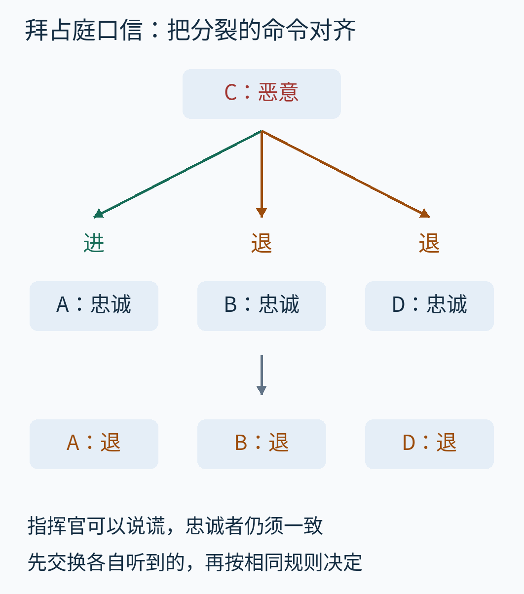

封面先给出目标：上方是分裂的直收消息，下方是算法算出的统一结果。统一不等于发现谁在说谎，也不等于找回坏指挥官所谓的“真实意图”。下面从每一条消息走到这个结果。

## 一、先说清楚，究竟保证什么

Lamport、Shostak、Pease 在1982年的《The Byzantine Generals Problem》中，把单次发布任务写成两条要求。本文沿用它们，并分别称为一致性与有效性：[原论文，第2—3节](https://lamport.azurewebsites.net/pubs/byz.pdf)。

- **一致性 IC1：**所有忠诚副官输出相同的值，即使指挥官是坏的。
- **有效性 IC2：**如果指挥官忠诚，所有忠诚副官必须输出它发出的值。

只满足第一条很容易：不管收到什么，一律退却。但当忠诚指挥官发“进”时，这会违背第二条。只满足第二条也不够：直接照抄指挥官的消息，在指挥官向两边说不同话时就会分裂。

这两条要求约束的是**忠诚副官**。算法不能控制坏节点最后打印什么，也没有承诺查明坏节点身份。若指挥官坏了，只要忠诚副官结果相同，结果是进或退都可能合格。

原论文称接下来这种办法为 **OM(m)**，OM 是 Oral Messages，即“口信”。m是事先准备容忍的坏节点数上限，包含指挥官；不是已经查明的坏人数。n是总节点数，也包含指挥官。本文在完全互联的固定成员集合里讨论它，充分条件是 **n > 3m**。容忍一人坏，最小的非平凡配置是四人；容忍两人坏，则是七人。

“口信”不是匿名通信，更不是没有任何网络假设。

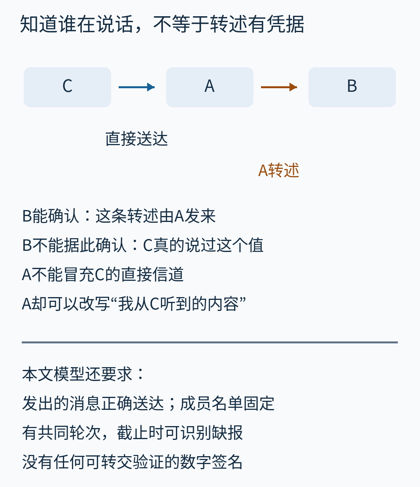

看图中的C→A→B：B能确定眼前这条消息由A发送，A不能占用C的直接信道冒充C。可是A说“C刚才告诉我进”，B没有C的数字签名可以拿来核对。**知道谁在转述，与知道转述的原话是真的，是两件事。**

本文的同步模型还假定：发出的消息正确送达；直接发送者可识别；接收者可以在约定截止点判断缺报。节点按共同轮次行动，处理和传递有已知上界。坏节点可以不发，但不能让忠诚节点发出的消息在可靠信道中无故丢失。这些是本文明确采用的通信与时间前提。原文局部文字可核对可靠传送、直接来源识别及缺报假设的开头，但完整同步时间界讨论不在本次已核读范围内。现实系统必须另行建立这些前提，不能把“设了超时”当作已经建立了同步保证。

## 二、坏指挥官的第一轮：每人都只看见一小块

四个节点叫C、A、B、D。C是指挥官，另外三位是副官。设n=4、m=1，并让C成为唯一坏节点。它分别发：

- 给A：进。
- 给B：退。
- 给D：退。

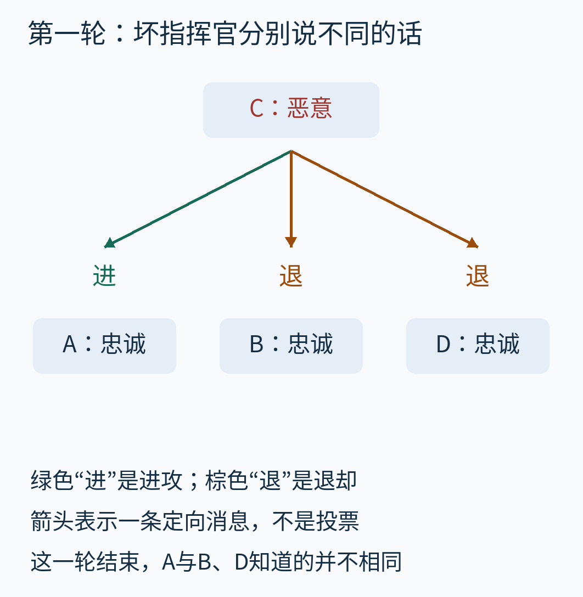

绿色表示“进”，棕色表示“退”；箭头是定向发送。此时A照自己的消息行动就会进，B和D却会退。不能以“每个人都收到消息”作为结束条件。

我们增加一个具体动作：**每位副官把自己第一轮收到的值，告诉另外两位副官。** 不是再向C询问一次，因为C仍可以继续分别说谎；而是让接收者交换各自的经历。

## 三、第二轮不是再投一次票，而是把别人的一格补齐

由于唯一坏节点已经是C，A、B、D全部忠诚。A向B、D说“我听到进”；B向A、D说“我听到退”；D向A、B说“我听到退”。

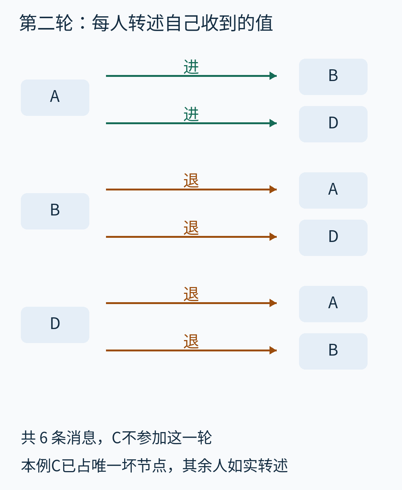

从上往下读，每一组对应一个发送者。C不参与这一轮；每位副官发给另外两位，总共六条消息。图中没有把双向发送省略为一条无方向连线。

现在给每位接收者一张三格表，**列顺序固定为[A，B，D]**。一列的含义是“这一位副官报告自己从C收到的值”，不是“我对这一位副官的信任评分”。

先亲手替A填写：

1. A列属于自己，填第一轮C直接发来的“进”。A不必给自己发一条消息。
2. B列填第二轮B转述的“退”。
3. D列填第二轮D转述的“退”。

于是A得到[进，退，退]。替B填写时，A列来自A的转述，B列来自自己直收，D列来自D的转述，仍然是[进，退，退]。D也相同。

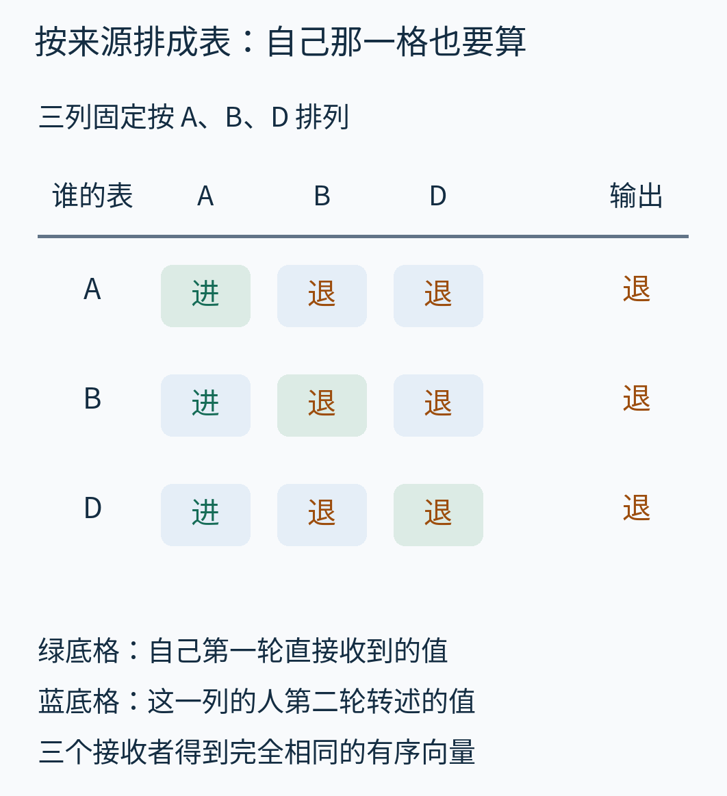

绿底格总在“自己的那一列”，其余格来自转述。**不能丢掉自己的直收项，只对别人转述的两条消息取多数。** 那样A看见退、退，B却看见进、退，已不是同一个算法。

然后，每人对整行使用同一个确定规则：某个值严格超过一半，就选它；没有严格多数，选事先固定的默认值“退”。三项里两项为退，所以三人都输出退。


圆点数由实际执行向量计数得到。这里输出退，不是因为退比进更“正确”，而是三人现在拥有相同的输入向量，并使用相同规则。此时C是坏的，有效性不要求保留它的某条命令；一致性要求三位忠诚副官别分裂。

如果把C的发送改为进、进、退，第二轮结束三张表都会变成[进，进，退]，结果就都为进。算法没有偷偷把“永远退却”当成一致性。

## 四、换一种坏法：指挥官没错，转述的人错了

仍是四人、至多一个坏节点，这次让C忠诚，向A、B、D全部发进。把D改成坏节点：它向A谎称自己听到退，却向B说自己听到进。A、B仍如实转述进。

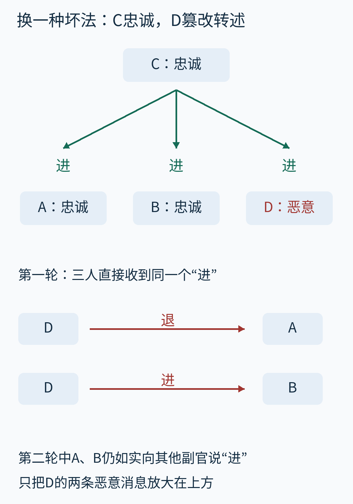

上半部分是第一轮，下面只放大D在第二轮的两条恶意消息。D可以这样做，因为转述没有附带C的不可伪造签名。

再次按[A，B，D]填写：A得到[进，进，退]，B得到[进，进，进]。


与上一节不同，**忠诚接收者的整张表不必相同**。A和B的D列可以不同；但A、B两列都是可靠的进，已经占了三项中的严格多数。所以两位忠诚者仍输出C的进，满足有效性，也因此一致。

这正是四人方案的两种情况：C坏，剩余副官都好，大家能对齐整行；C好，副官里至多一人坏，好副官形成足够多的正确列。不能把两种情况都解释成“大家最后肯定看到同一张表”。

## 五、沉默也必须变成明确的一格

坏节点还可以不发送。让第一例中的C不给D发消息，A仍收到进，B仍收到退。

D不能无休止等下去，也不能刚开始等就自行认定缺报。同步模型规定这一轮何时结束；到截止点仍没有合格消息，D把自己的直收项记为默认值退，下一轮如实转述这个补出的值。这样三张表仍是[进，退，退]。

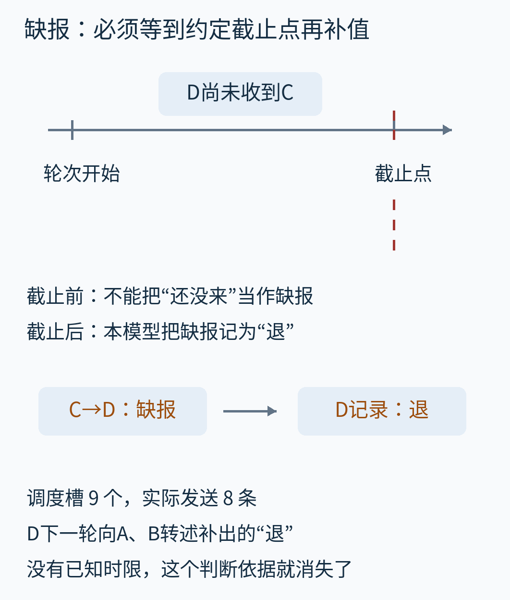

时间线只表达先后和截止约定，没有测量毫秒延迟。这个运行有九个预期消息槽，但C→D这一槽没有发送，因此实际发送八条。程序把“预期要收到的槽”与“真的发出消息的次数”分开记，防止把缺报悄悄当成收到一条退却消息。

本文的命令域只有进、退；不合法内容与缺报都在接收端归一为退。平票也统一选退。默认值本身并不神奇，关键是各方事先使用同一确定规则。若甲平票选进、乙平票选退，即使输入表完全一样，结果仍会分裂。

在没有时限保证的网络上，迟到与不发送无法靠这一张时间线区分。本文算法的保证不能原封不动搬过去。

## 六、从两轮到递归：每个人轮流当一次“小指挥官”

如果允许两个坏节点，刚才的第二轮就不够了：原指挥官坏，某个副官也可能坏；即使交换经历，坏副官仍能向不同人发不同转述。

解决办法是把“让副官向大家报告自己的经历”，也当作一个较小的指挥官发布任务。这就是递归：对同一种问题重复使用同一套办法，但每次规模和剩余深度都变小。

先定义尽头 **OM(0)**：本次指挥官直接向本组其余成员发值；接收者使用直收值，缺报用退。没有后续转述。OM(0)没有容忍任意坏指挥官的承诺；它只是递归明确的停止规则。

**OM(m)，m大于0**的操作是：

1. 本次指挥官向本组其他成员直接发值，每人记录自己的直收值。
2. 移除本次指挥官。每位副官j分别担任一个子问题的指挥官，用OM(m−1)向其余副官发布“我刚才收到的值”。
3. 接收者i为每个来源j填一格。j就是i时，用自己的直收值；j不是i时，用j主持的子问题最终输出。对整行取严格多数，否则退。

注意第三步使用的是**子问题算出的值**，不是随便拿一条最底层消息当作顶层投票。

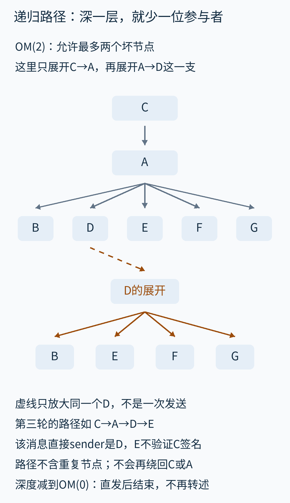

图中只展开部分树：顶层是C；下一层选择A；A的子问题还包括B、D、E、F、G，再选其中的D展开。路径C→A→D→E表示第三轮中D直接向E转述，消息属于“C之后A这一支”的子问题。

图中虚线只把同一个D移到下方展开，不代表额外发送或重复经过D。不同路径必须分开存。例如C→A→D→E与C→B→D→E的直接发送者都是D，但属于不同的来源链，不能覆盖到同一格。路径编号是组织子问题的标签，不是数字签名链。恶意D仍可以改写自己发出的值。

每往下一层，都把本层指挥官从参与集合中去掉，因此路径里不会再次出现同一节点。已经走过C、A的分支不会再走回C或A。这既符合子问题定义，也让深度耗尽时真正停止；不是让消息在网络里无限“听说你听说”。

## 七、七个人实际走一次：先修好一列，再合整行

现在设n=7、m=2，节点为C、A、B、D、E、F、G。C与B恶意，其余忠诚。下面是一组固定、可复现的教学故障策略：

C第一轮给A、B、E发进，给D、F、G发退。此后凡B发送，接收者在上述节点列表中的索引为奇数就发进，为偶数就发退；索引从0开始，因此B给A、D、F发进，给E、G发退。它可以不管之前收到什么。没有随机性，也不代表“最聪明的攻击”。

先看顶层A列怎样建立。A从C收到进，然后在排除C的六人组里执行OM(1)。A忠诚，所以它给B、D、E、F、G都发进；接下来这五位互相转述。B向部分人撒谎，其余四位如实转述。

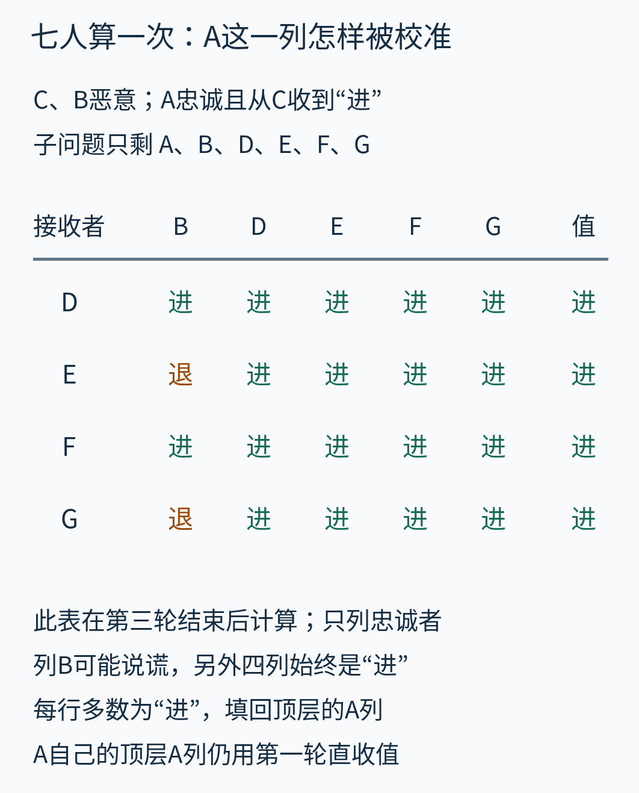

这里展示忠诚接收者D、E、F、G的五格表，列顺序是[B，D，E，F，G]。例如E的B列是退，其余四列全是进，所以子问题给E输出进。D的五项全是进，也输出进。这个输出随后填入E、D等人的**顶层A列**。A自己的顶层A列直接使用C第一轮给它的进。

再看顶层B列。移除C后，B成为六人子问题里的唯一坏指挥官。B分别向A、D、E、F、G发送进、进、退、进、退；这五人全部忠诚，所以最后互相补齐同一张表。

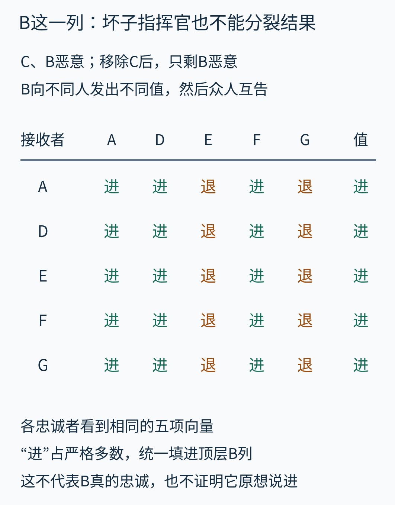

这次三项进、两项退，因此大家给顶层B列填写进。请不要把这句话读成“大家相信了B”：算法只是让B这一列在忠诚接收者之间有了共同解释，无法证明B诚实。

同样完成另外各列后，五位忠诚副官的顶层表如下。

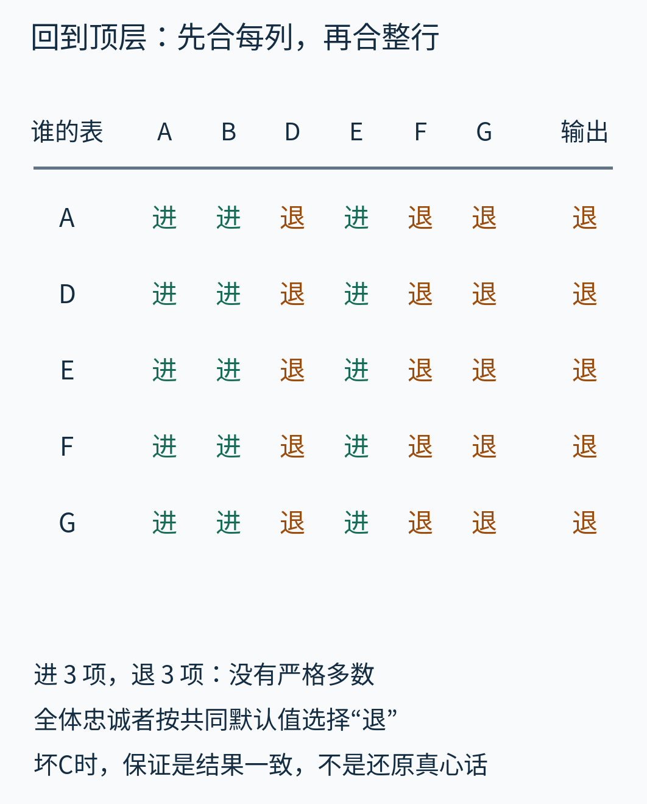

列固定为[A，B，D，E，F，G]，每行都是[进，进，退，进，退，退]。进退各三项，没有严格多数，所有忠诚副官按默认规则输出退。

这组例子还解释了为什么不能只凭“副官有六位，肯定能多数表决”来省掉默认规则：偶数长度的向量确实会平票。归约分两层完成，先对每个子问题的表取多数，再对顶层整行取多数；把所有叶子揉成一大堆投票，会改变每个来源的权重，已经不是OM算法。

## 八、一般情况为什么成立，人数又花在哪里

前面的四人和七人运行是例子，不是对任意m的证明。一般论证也必须分清指挥官是否忠诚。


**指挥官坏时，坏节点预算已经用掉一个。** 剩下n−1人里最多还有m−1个坏节点。n>3m保证这些子问题人数足够，所以可以归纳使用OM(m−1)的一致性与有效性：忠诚来源j使其他忠诚者得到它实际持有的值；坏来源j也不能让其余忠诚者对这一列分裂。每一列都对齐，整张表就对齐，确定规则给出相同结果。

**指挥官好时，不能直接说“剩余坏节点也少一个”。** 去掉的是好人，坏节点仍可能有m个，而子程序深度却只有m−1。这是一个容易跳过的证明关节。

本次核读的原文有效性引理片段给出了所需条件；以下用独立推导把理由展开：如果实际坏节点至多k个，只要n>2k+m，OM(m)就能保留忠诚指挥官的值。直观地逐层看，忠诚副官j主持子问题时，组规模变成n−1、深度变成m−1，仍满足同一种不等式。归纳保证每个忠诚来源列给出原命令；而这些忠诚列严格多于坏列，最终多数仍是原命令。底层m=0时，忠诚指挥官直接发送即可保留值。取k=m，就得到本文n>3m下的有效性。相关引理见原论文第3节；本次核到的是引理与部分证明文字，不把后续一般定理的完整证明列为已核原文。

这个证明结构说明：门槛不是简单的“最后一票要过半”。人数还要支持向下递归后，忠诚来源的信息能正确传回来。

## 九、轮数有限，消息树却很快变大

OM(m)最多展开m+1轮发送。OM(1)有直发与一次转述；OM(2)有直发、转述、转述的转述。各条同深度分支可以并行，所以递归分支数不等于通信轮数。

先按**单个指挥官、完全展开、不打包合并、每个路径到一个接收者占一个消息槽**来数。第一轮n−1槽；第二轮每位副官向其余n−2位发，所以有(n−1)(n−2)槽；第三轮再乘n−3。总数是这些逐轮乘积之和：

```text
第r轮：
(n−1)(n−2)…(n−r)

r从1到m+1，总数逐轮相加。
```

七人OM(2)是6 + 30 + 120 = 156槽。十人OM(3)则是9 + 72 + 504 + 3024 = 3609槽。这些也由附带程序实际生成路径后计数，与乘积公式交叉核对。


图中m=0采用两人的无故障基例。各条共用同一比例，最小值因此很短；左侧数字给精确计数。固定m时，总消息槽数是O(n^(m+1))。当容错深度也随人数增长时，不能把这个说成固定次数的多项式。

这不是网络带宽或执行耗时测量。真实字节还包含路径、值和协议开销；缺报减少实际发送数，却不减少协议必须处理的预期槽。若要让每位节点都发布自己的输入，还得另行安排多个指挥官实例，本文数字只算一个实例。附带教学代码保存完整追踪和中间表，便于检查，不能拿它的内存占用当作优化实现下界。

## 十、为什么三个人不能容忍一个坏人

把人数减到C、A、B，难题不是我们还没想出聪明的“平票规则”，而是每位忠诚者掌握的信息本身不足。看三个世界。

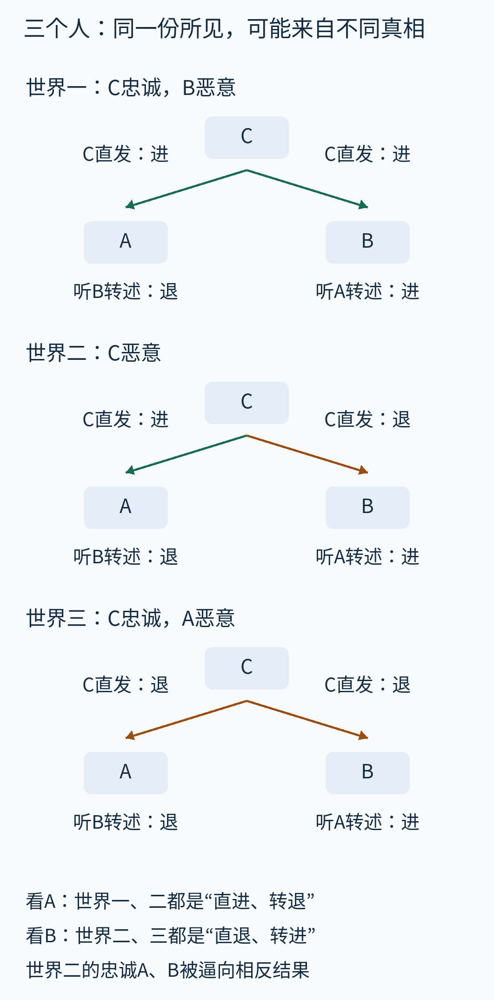

图从上往下列出三个世界；每个副官下面写“直接从C收到什么”和“另一位副官说他收到什么”。A听到的转述来自B，B听到的转述来自A；它们各自都看不到C给另一位的直接消息。

在第一个世界，C忠诚，发进；B坏，向A谎称自己收到退。A看到“直进、转退”。有效性要求A最终必须进。

在第二个世界，C坏，给A进、给B退，而A、B都忠诚。他们互相转述后，A仍看到“直进、转退”。从A的局部观察，这与第一个世界无法区分。若坏节点持续配合模拟相应消息，增加询问也不能凭空制造可验证的证据。

对B对称地考虑第三个世界：C忠诚，发退；A坏，却向B声称自己收到进。B看到“直退、转进”。有效性要求它退。而第二个世界里的B恰好也看到同样的信息。

于是第二个世界中，A被第一个世界的有效性要求逼着进，B被第三个世界逼着退；两人明明都忠诚，却违反一致性。**一个节点无法根据完全相同的局部经历，在不同世界中保证作出两个不同决定。**

图只展示最初两轮的观察骨架，不把两条转述的枚举冒充任意协议的严格不可能性证明。把“始终模拟另一世界”写成完整执行的不可区分性论证，才是一般证明要处理的部分；原论文第2节明确提醒这种直觉论证需要形式证明支撑。

更一般的n≤3m门槛可通过分组归约理解：假设有一个能处理这类规模的方案，把节点分成三个非空组，每组至多m个，让三位模拟者各扮演一组。一位恶意模拟者至多造成m个恶意节点；若原方案总能满足要求，就能推出刚刚不可能的三人方案。这里讨论的是至少三个节点的非平凡广播问题；只有两个节点时，指挥官坏便只剩一个忠诚副官，“忠诚副官互相一致”没有两个对象可比较，不能不加说明地套用这个下界。

顺带实际运行本文OM(1)的三人版本：C忠诚发进，B恶意向A报退，A的表为[进，退]，默认输出退，直接违反有效性。把默认值改成进只会换一种输入失败，不能消除上面的信息矛盾。

## 十一、实际程序算出了什么，没有验证什么

随文提供[可运行的仿真与说明](examples/README.md)。程序把每个消息记为“来源路径、直接发送者、接收者、轮次、原始内容、归一值”，再按子问题返回值构建有序向量。实现先递归展开子问题树，再把事件按轮次排序供阅读；这个排序不是操作系统实测的事件时间线。它模拟同步轮次，不启动分布式节点，不发真实网络请求。


这是本篇自制只读报告在默认Chromium中的真实截图，不是原论文软件界面。显示值来自Python执行的results.json；浏览器负责展示，没有凭空重画一份成功输出。

四人OM(1)检验逐一覆盖单个坏节点所有有效发送槽的进、退、缺报组合，共83组：含两种全员忠诚输入、坏C的27种发送组合，以及三种坏副官位置分别在两种忠诚C输入下的9种转述组合。坏C的“原命令”不约束结果，所以不为它重复枚举一个无意义的初值。

七人OM(2)另做100组测试，每组使用独立整数种子20261025至20261124，随机选两个坏节点和每个坏发送槽的三值行为；种子、坏节点、输入和保证检查结果随JSON保存。这是有限策略测试，不覆盖所有自适应攻击，也不代替归纳证明。四人与七人适用范围内全部通过；前述三人越界例被明确记录为有效性失败，而不是被筛掉不展示。

读者可以先不运行程序，自己改第一例：把C给B的退改成进，填写三张表；再把好C例中D给两人的转述互换，检查A和B为什么仍会进。运行代码时，改变的是节点、深度与故障策略，不能只改图上的结果文字。

## 十二、学到这个算法之后，哪些判断更可靠

它首先教会我们问：一致的是谁的什么值？指挥官诚实时要保留原值；指挥官不诚实时要阻止忠诚者分裂。两个目标不同，证明也不同。

它还给出了一个具体构造：把各自的直收经历按来源排成有序向量；通过递归，让需要对齐的来源列获得共同解释；用同一个多数与默认规则归约。表的来源和路径，比一句“少数服从多数”更关键。

但它不是现成的现代生产共识方案。成员认证如何建立、轮次与超时怎样保证、重启后保存什么、连续请求怎样排成日志、怎样换成员、怎样降低通信量，都没有由本文仿真解决。相邻的[Raft文章](../2026-10-10-raft-shared-log/read.md)讨论复制日志，但它假设节点不会任意撒谎，两者不能只比较副本数就互换。

数字签名也会改变问题：若转述能附上不可伪造、可验证的原始签名，坏副官就失去了一部分撒谎能力。本文没有实现原论文另述的签名消息算法SM(m)，所以n>3m不是所有共识模型的通用人数口令。

最后，共识输出不是客观真理。好指挥官自己获得错误传感器读数时，忠诚副官可能非常一致地保留这个错误输入。口信算法解决的是在明确通信和故障假设下的信息一致性；判断输入是否符合现实，仍是另一个任务。

---

本文为全新原创教学解释。参考：Lamport、Shostak、Pease，《The Byzantine Generals Problem》，ACM TOPLAS 4(3)，1982，382—401；[作者官网书目与回忆](https://lamport.azurewebsites.net/pubs/pubs.html#byz)。正文与原创图片为CC BY 4.0，代码及自产数据为CC0；访问范围、逐图职责与AI辅助说明见[sources.md](sources.md)。
