# Catmull–Rom 插值：给出必经点，怎样自动连成平滑曲线？

在动画编辑器里安排镜头路线，你可能先点出几个位置：这里靠近门口，那里绕到展品侧面，最后退到走廊。把这些位置直接用直线连接，镜头会在连接处突然改变方向；如果改用一条随意的平滑曲线，它又可能绕开你指定的位置。

Catmull–Rom 插值解决的是这个具体问题：**给定一串必须经过的点，用邻近点自动决定经过它们时的方向，再把相邻位置连成曲线。**“插值”指曲线经过输入点；“样条”指长曲线由若干短段拼成。本文讨论常用的分段三次 Catmull–Rom 曲线，不是名字相近的 Catmull–Clark 曲面细分。

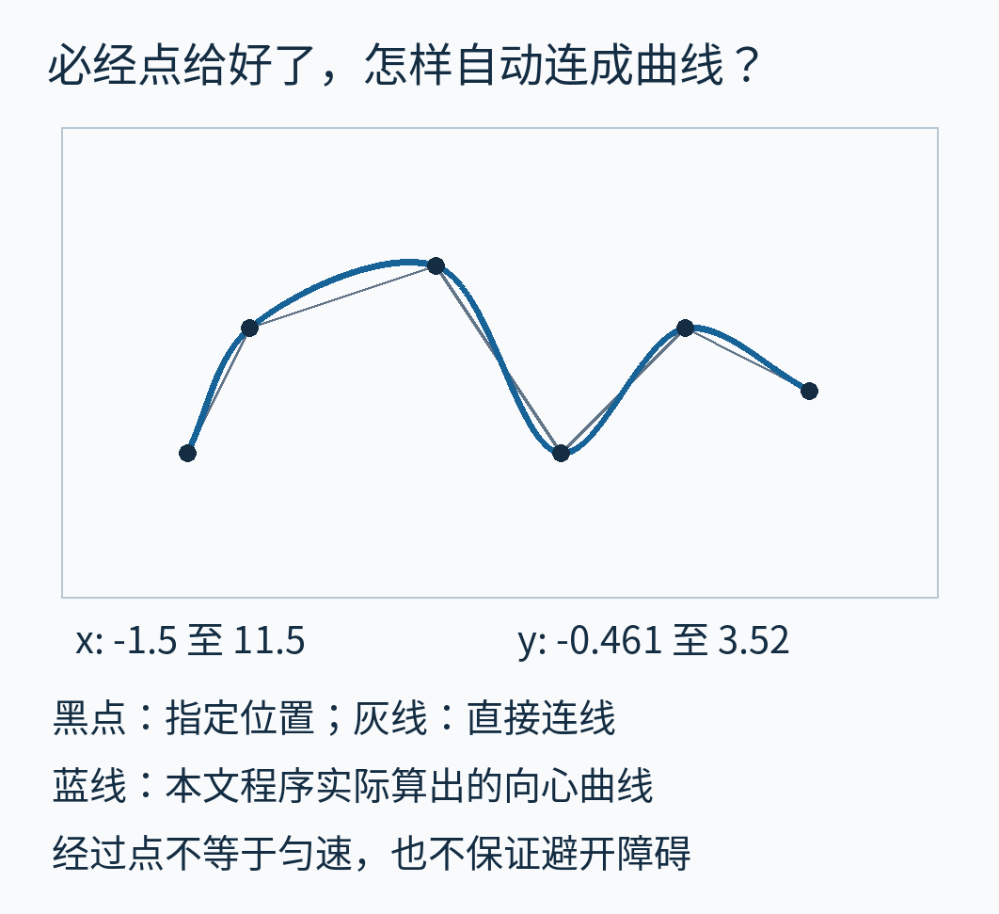

图里的路线是本文 Python 程序的实际计算结果，坐标单位任意，不是某款引擎或真实镜头的测量。我们会先用四个点手算曲线上的一个位置，再解释为什么改变“点与点之间分配多少参数”会改变曲线，最后分别检查回环、越界和速度。

## 四个点，先只负责中间一段

把平面位置写成 `(x, y)`。取四个点：

| 点 | 坐标 | 在当前一段中的作用 |
|---|---|---|
| P0 | (0, 0) | 起点前的邻居 |
| P1 | (1, 2) | 当前段起点 |
| P2 | (4, 3) | 当前段终点 |
| P3 | (6, 0) | 终点后的邻居 |

先只画 **P1 到 P2**。P0 和 P3 参与计算方向，但这一个短段不负责走到它们。下一段再把四点窗口向后移动一个位置。

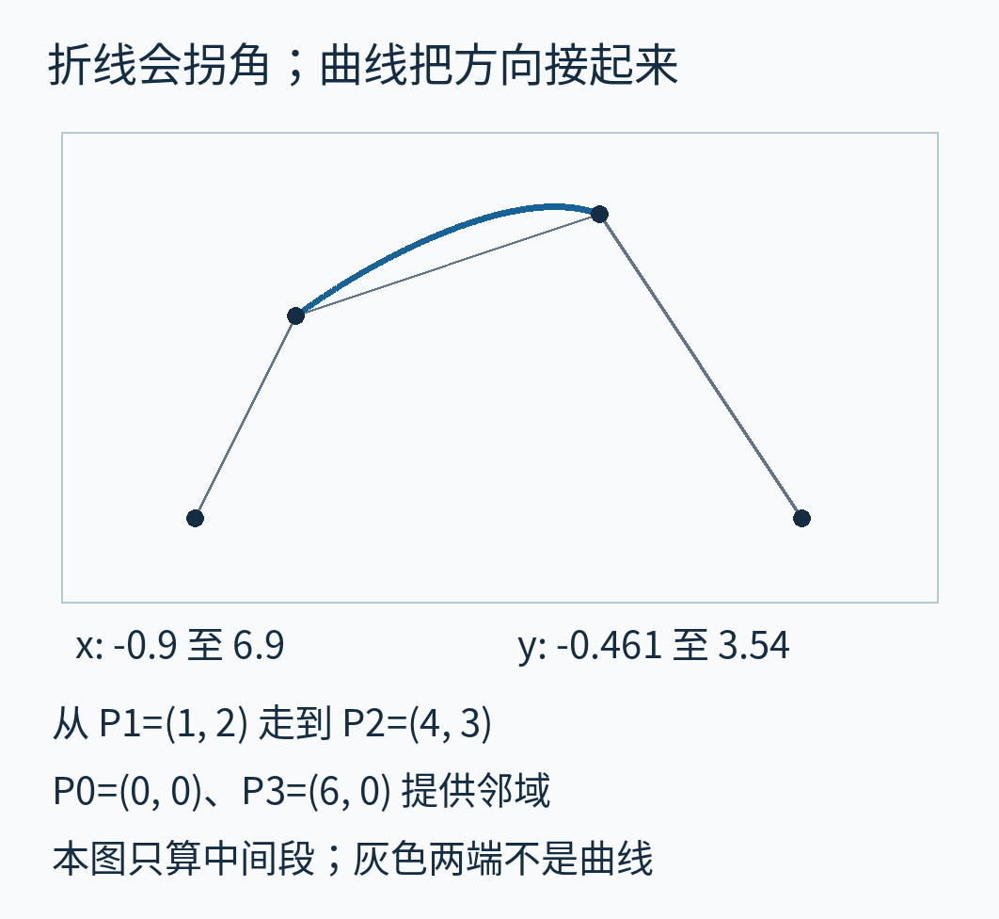

我们给当前段一个进度数 `u`：从 0 走到 1。曲线位置记作 `C(u)`，于是必须满足 `C(0)=P1`、`C(1)=P2`。注意，u 是计算曲线用的参数，尚未规定一秒钟走多少 u。

直线插值也能满足这两个条件：`(1−u)P1 + uP2`。问题是它走到 P2 时的方向只看 P1→P2，下一条直线却看 P2→P3；两条边方向不同，就会出现折角。要自动把方向接起来，应该让两段在 P2 处参考同一份邻域信息。

## 用邻居估计“经过这里时朝哪走”

暂时假定每对相邻点之间都分配一单位参数，这叫**均匀参数化**。从 P0 到 P1 的位置差是 `(1,2)`，从 P1 到 P2 的位置差是 `(3,1)`。在 P1 处，把前后两步的变化率取平均：

```text
m1 = ((P1−P0) + (P2−P1))/2
   = (P2−P0)/2
   = (2, 1.5)

m2 = (P3−P1)/2
   = (2.5, −1)
```

`m1`、`m2` 是端点处对 u 的导数：u 增加一个很小的量，位置大约改变“导数乘这个小量”。它们同时给出瞬时方向和变化快慢。比如从 P1 出发，u 增加 0.001，位置一阶近似增加 `(0.002,0.0015)`；不能把这个近似当整段直线一直走下去。

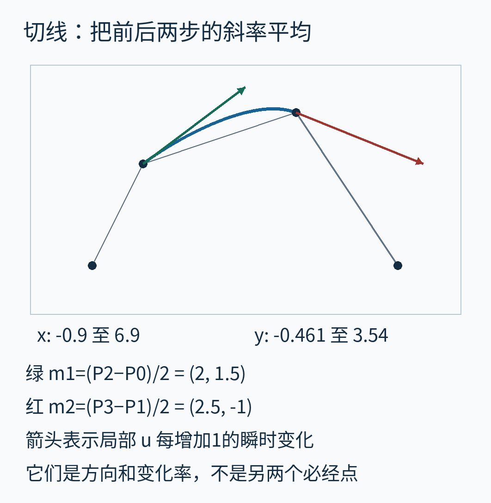

这个平均规则是一种局部、对称的选择：既看刚从哪来，也看接下来往哪去。它不是“所有平滑曲线唯一必须遵守的物理规律”。Catmull–Rom 的便利在于替用户自动选好这两根切线；若需要精确操纵切线，直接使用带把手的曲线表示可能更方便。

## 四个条件怎样变成曲线？

现在有两个位置条件和两个导数条件：

```text
C(0)=P1    C(1)=P2
C′(0)=m1   C′(1)=m2
```

先看 x 这个坐标。给它一个三次式 `x(u)=a u³+b u²+c u+d`，正好有四个待定系数。把 u=0 代入位置和导数，得到 `d=P1x`、`c=m1x`。再把 u=1 代入，得到两个剩余方程，解出 a、b。y 坐标重复同样的操作。把两个坐标合写为向量，就是：

```text
C(u)=a u³+b u²+c u+d

a=2P1−2P2+m1+m2
b=−3P1+3P2−2m1−m2
c=m1
d=P1
```

这种“给两端位置与两端导数来构造三次曲线”的方法叫三次 Hermite 插值。Catmull–Rom 在这里做的事情，是从邻点替 Hermite 插值选出导数。

也可以把同一个三次式按 P1、m1、P2、m2 的贡献重新收集：

```text
h00 = 2u³−3u²+1
h10 = u³−2u²+u
h01 = −2u³+3u²
h11 = u³−u²

C(u) = h00 P1 + h10 m1
     + h01 P2 + h11 m2
```

这些 h 叫基函数，意思是四种基本贡献随 u 怎样变化。例如 h00 在起点为 1、终点为 0，且两端导数都为 0，因而只负责放入起点位置，不擅自改变端点切线。h10 的两端值都为 0，起点导数为 1、终点导数为 0，专门负责起点切线。其余两个扮演终点的对应角色。

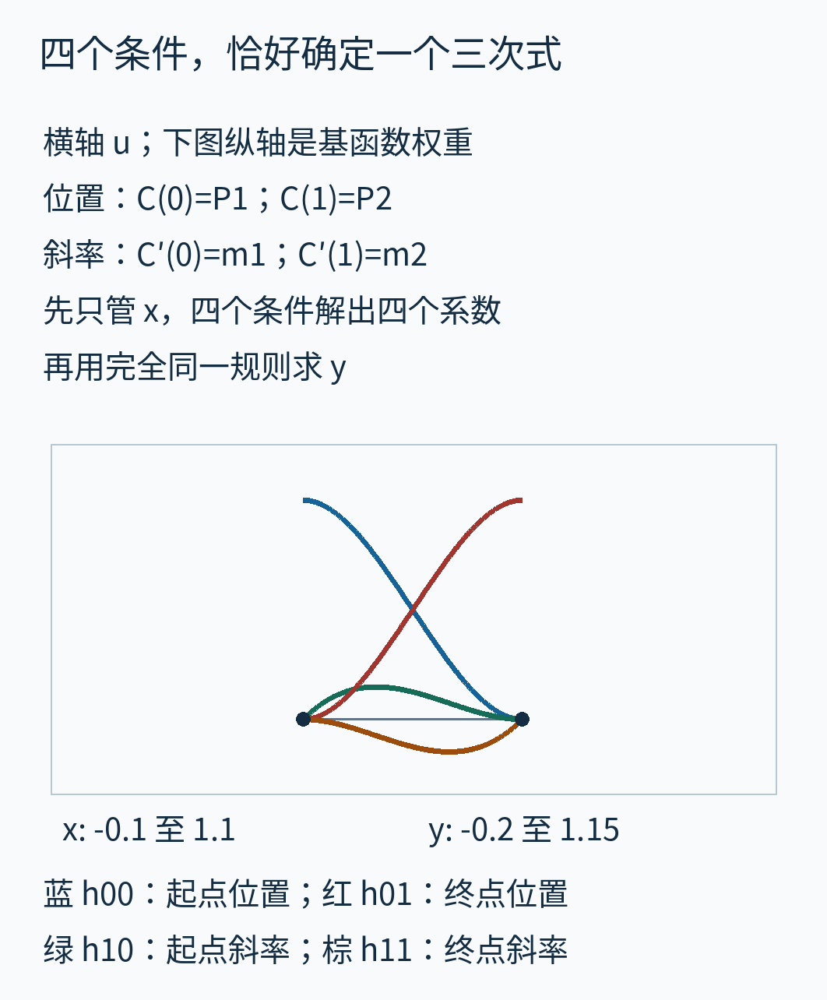

先别记矩阵，算一次就能看见这些权重的作用。取 u=0.5，四个权重依次为 `0.5、0.125、0.5、−0.125`。把前面求出的点和导数代入：

```text
0.5 P1    = (0.5, 1)
0.125 m1  = (0.25, 0.1875)
0.5 P2    = (2, 1.5)
−0.125 m2 = (−0.3125, 0.125)

C(0.5) = (2.4375, 2.8125)
```

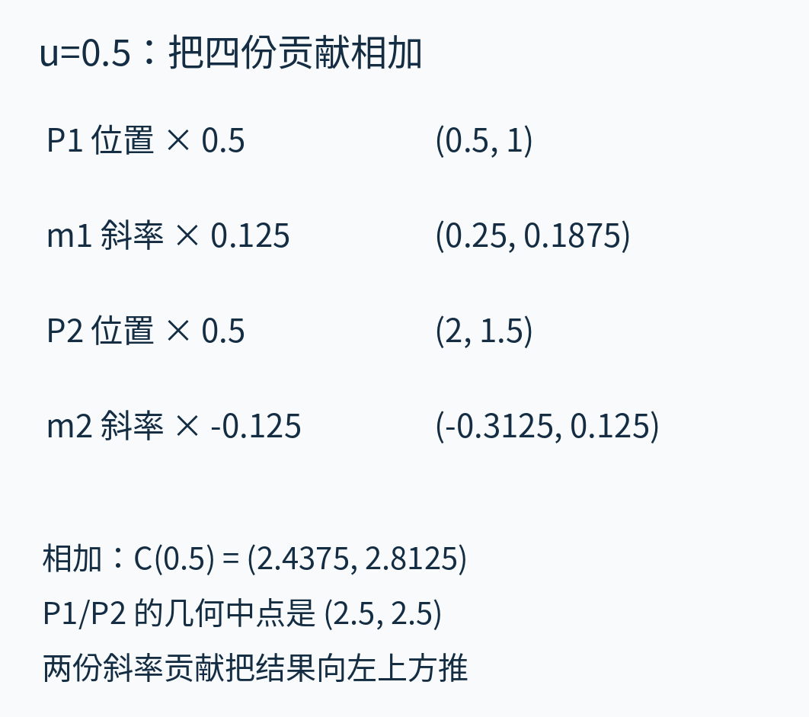

P1 与 P2 的几何中点是 `(2.5,2.5)`。曲线在“参数走到一半”时到达的位置却更靠左上方：切线贡献使它先继续上行，之后才向下转。由此也能看出，u=0.5 不承诺走了半程路。

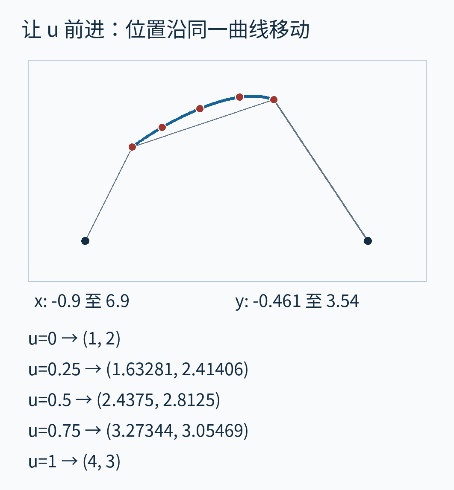

## 为什么拼接后方向接得上？

画 P1→P2 时，终点切线是 `(P3−P1)/2`。画下一段 P2→P3 时，四点窗口移成 P1、P2、P3、P4，其起点切线还是 `(P3−P1)/2`。两段到达同一个位置，使用同一根导数，所以位置和一阶导数连续，通常记为 **C1 连续**。

“一阶”说的是位置的变化率；“二阶”说的是这个变化率如何变化。三次 Catmull–Rom 一般没有保证二阶导数连续，因此不能由“看起来没有折角”推出车辆加速度、曲率或镜头运动的所有体验都连续。

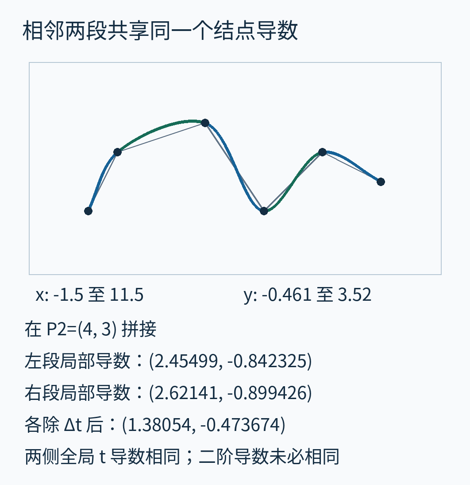

上图提前展示了稍后会算的非均匀情形：两段各自的 u 都从 0 到 1，但它们在整条曲线的参数轴上占的长度不同。比较连续性时，必须先统一参数尺度；不能只看两根局部导数箭头长度不同就宣布接缝不连续。

这种四点窗口还带来局部性。一个内部控制点最多参与附近四个短段；移动它，不需要重新解整条曲线的方程组。下面把第三个输入点的 y 增加 1.5，其余输入保持不变，最右段的采样输出逐点不变。

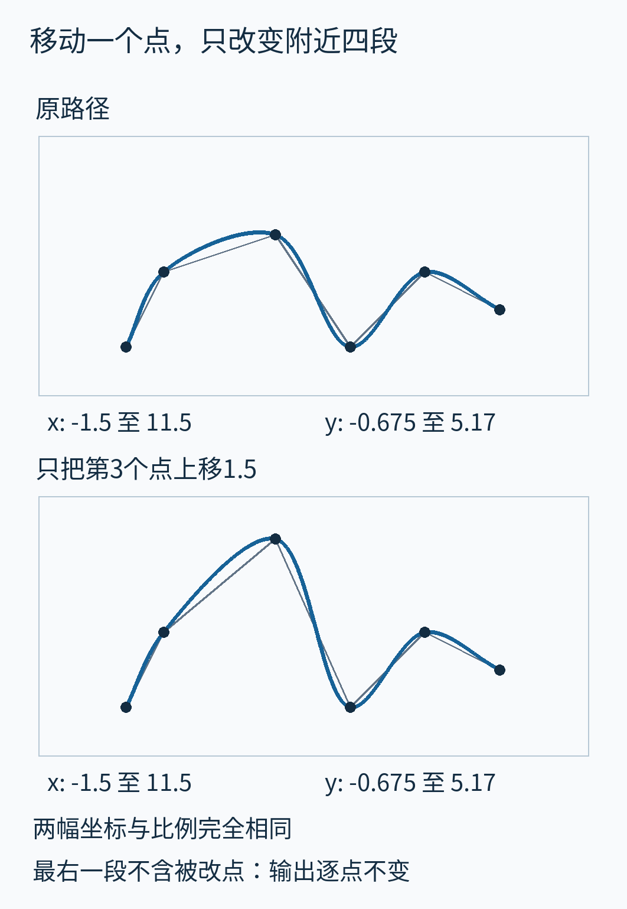

如果输入点本身很嘈杂，“准确经过每一点”未必是优点。测量轨迹可能需要先去噪，或者改用允许偏离输入点的拟合方法。

## 点挤得很近，还应该给它同样多参数吗？

前面默认点与点之间参数间隔都是 1。但空间中的点并不等距。若两点相隔很近，而它们外面的邻居很远，均匀差分仍可能给短段一根很长的切线，曲线就容易冲过头。

给整串点安排递增的数 `t0、t1、t2……`，这些数叫**结点**。一种常用的参数族按相邻距离安排结点间隔：

```text
t0 = 0
Δti = |Pi+1−Pi|^α
ti+1 = ti + Δti
```

竖线表示欧氏距离，也就是两点间直线长度。三种常用选择是：

| α | 名称 | 参数间隔怎样分配 |
|---|---|---|
| 0 | 均匀 uniform | 每段间隔 1，代码直接设 1 |
| 0.5 | 向心 centripetal | 距离的平方根 |
| 1 | 弦长 chordal | 距离本身 |

“弦”在这里就是连接两点的线段。向心是这一参数化的惯用名称，不表示程序模拟了一股向心力。三种规则是在定义计算坐标，不自动把 t 变成真实秒数；坐标单位改变，非均匀 t 的数值单位也会随之改变。

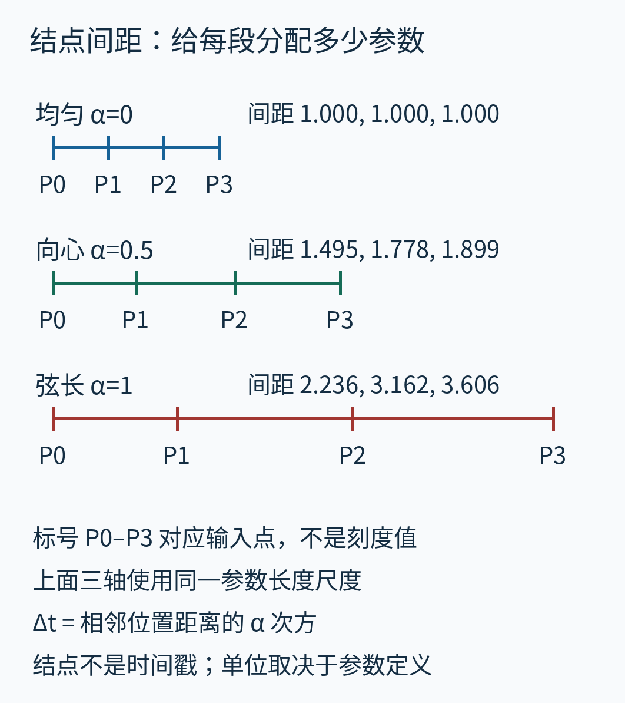

主例三段距离是 `√5、√10、√13`。均匀间隔为 `(1,1,1)`；向心间隔约为 `(1.495349,1.778279,1.898829)`；弦长间隔约为 `(2.236068,3.162278,3.605551)`。如果相邻边本来就全等长，这些规则只是把整条参数轴统一缩放，不会改曲线的几何形状。

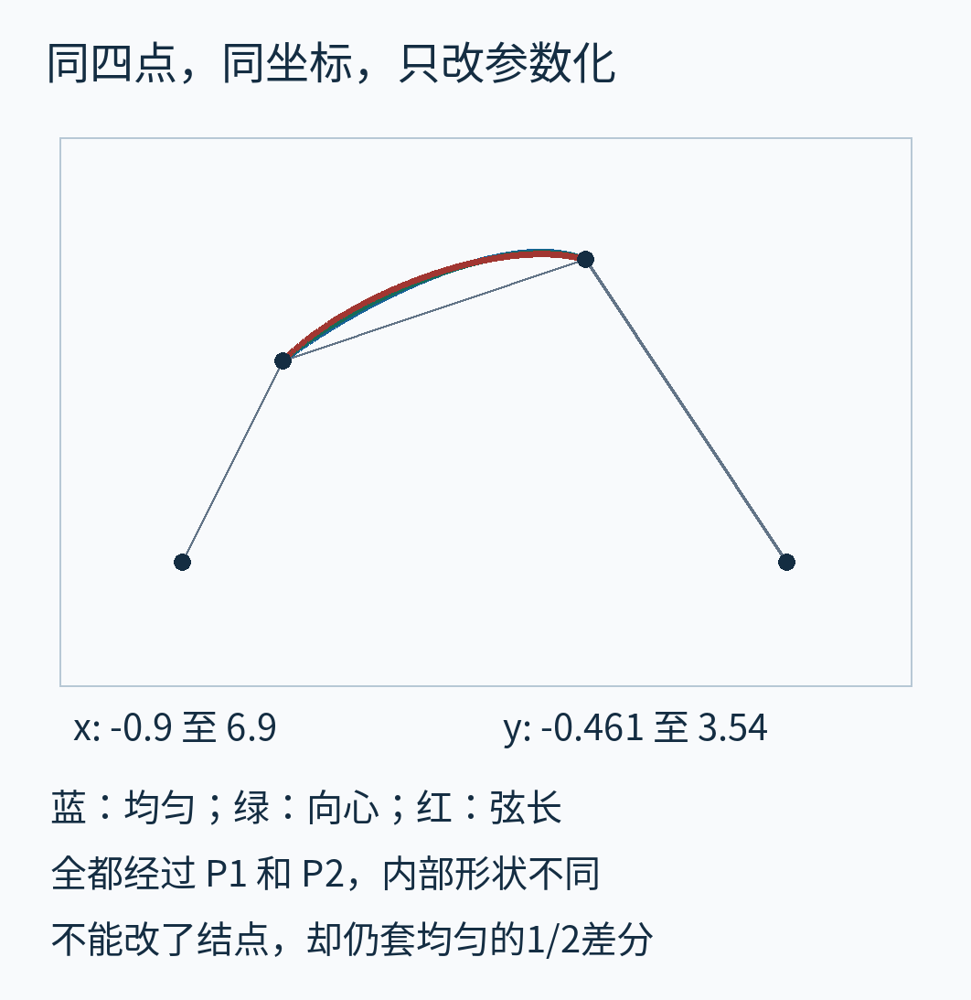

形状会改变，关键不只是“采样点分布不同”，而是结点改变之后，**端点导数也必须重算**。不能把非均匀结点塞给程序，却仍使用均匀情况下的 `(P2−P0)/2`。

## 非均匀导数：先统一“每单位参数”的意思

记 P0→P1、P1→P2、P2→P3 的参数间隔为 a、b、c。每条边的平均变化率分别是：

```text
v0 = (P1−P0)/a
v1 = (P2−P1)/b
v2 = (P3−P2)/c
```

在 P1 处不能再对 v0、v1 简单各取一半，因为它们来自不同长度的参数区间。三次 Catmull–Rom 所用的非均匀导数是：

```text
D1 = (b v0 + a v1)/(a+b)
D2 = (c v1 + b v2)/(b+c)
```

可以从一个小推导理解这个权重：把 P1 放到参数 0，前点在 −a、后点在 b，试着用一条二次式 `Q(s)=A s²+D1 s+P1` 穿过这三个点。前段斜率满足 `v0=D1−aA`，后段满足 `v1=D1+bA`。前式乘 b、后式乘 a，相加时 A 被消掉，留下 `(a+b)D1=bv0+av1`。我们只用这个二次邻域来选导数，最终连接 P1、P2 的仍是上面的三次式。

D1、D2 是**对全局 t 的导数**。而 Hermite 基函数用的是本段从 0 到 1 的 u。两者关系是：

```text
t = t1 + b u
m1 = b D1
m2 = b D2
```

这一步不能省：u 走满 1，t 实际走了 b。主例改成向心参数后，D1 约为 `(1.133878,0.983408)`，乘本段间隔 `b≈1.778279`，得到局部导数约 `(2.016353,1.748773)`；它不再是均匀例的 `(2,1.5)`。

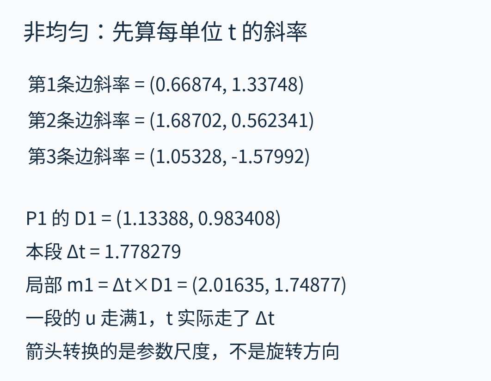

拼接时，左段的局部终点导数除以左段参数间隔，右段的局部起点导数除以右段参数间隔，才是可以直接比较的两份全局导数。本文整条示例路径在所有接缝处执行了这项核验。

## 另一条计算路线：只反复做直线插值

如果想交叉核验实现，可以使用 Barry–Goldman 递归形式。它不用先写出三次系数，而是逐层组合四个点。2009 年一手论文的图 3 给出了这套结构；这里使用自己的坐标重新计算，不转载论文图。其基本操作是：给定 A 位于参数 ta、B 位于 tb，在目标 t 求

```text
L(A,B) = ((tb−t)A + (t−ta)B)
         / (tb−ta)
```

第一层分别从 P0P1、P1P2、P2P3 得到 A0、A1、A2，使用各自的结点区间。第二层用区间 `[t0,t2]` 组合 A0、A1 得到 B0，用 `[t1,t3]` 组合 A1、A2 得到 B1。第三层在 `[t1,t2]` 上组合 B0、B1，得到 C。

沿均匀主例走一遍：结点为 0、1、2、3；u=0.5 对应 t=1.5。第一层是 `(1.5,3)`、`(2.5,2.5)`、`(3,4.5)`；第二层是 `(2.25,2.625)`、`(2.625,3)`；最后仍是 `(2.4375,2.8125)`。

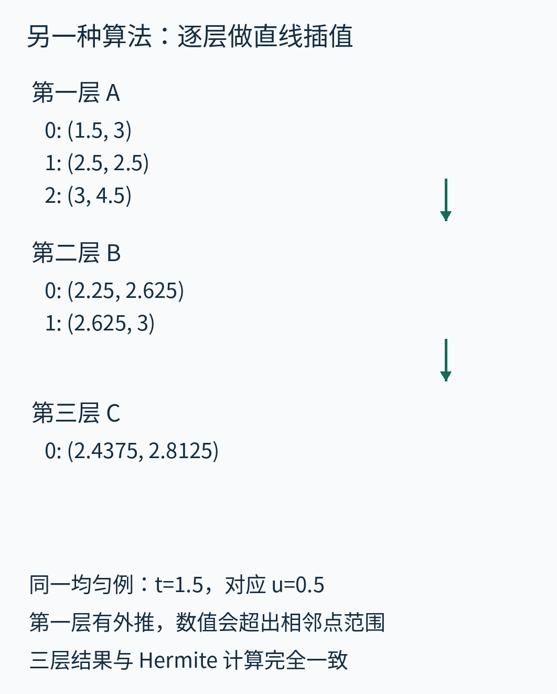

这里有一个容易被“插值”二字掩盖的细节：t=1.5 已经超过第一条边的区间 `[0,1]`，却还没进入最后一条边的区间 `[2,3]`。因此 A0 越过 P1，A2 在 P2 的反方向延长线上。第一层包含**外推**，权重可以小于 0 或大于 1，不是每一步都把点限制在一条线段内部。

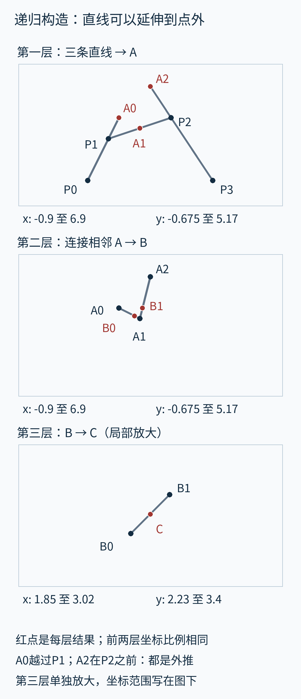

这套递归和上面的非均匀 Hermite 导数描述同一条曲线。附带程序分别实现了两条求值路线，在 180 组分段、900 个求值位置上交叉比较，最大位置差约为 `2.25×10⁻¹⁵`。这是有限样本的实现核验，不是用测试替代数学证明。

## 与贝塞尔把手怎样接上？

如果已有贝塞尔曲线工具，可以把这一段转换过去。三次贝塞尔端点导数分别为 `3(B1−B0)`、`3(B3−B2)`，因此把 Catmull–Rom 的局部导数除以 3，就得到两根把手：

```text
B0 = P1
B1 = P1 + m1/3
B2 = P2 − m2/3
B3 = P2
```

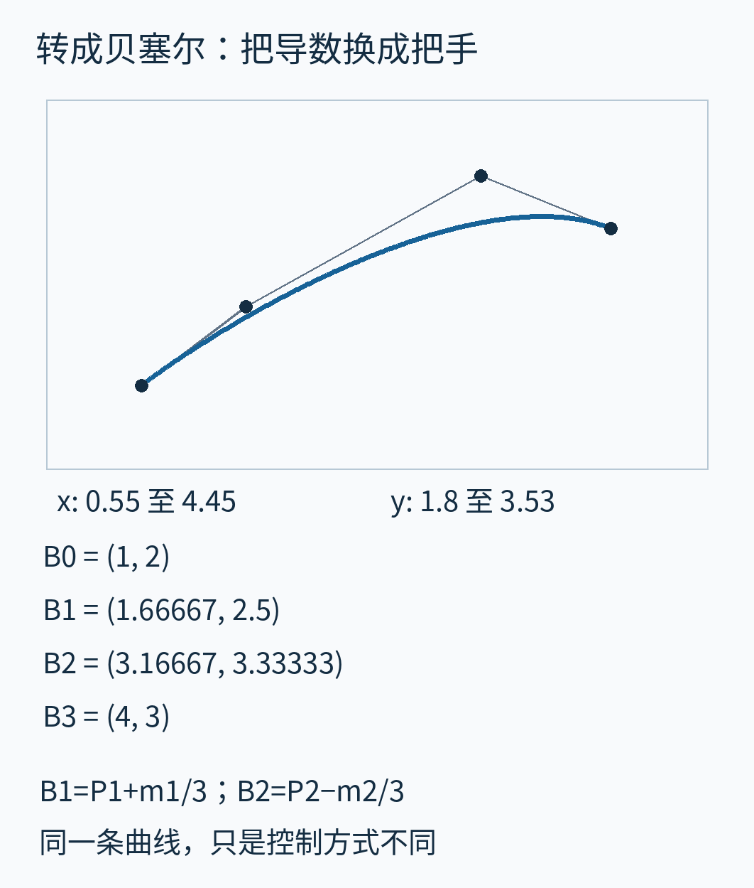

主例的两个内部把手是 `(1.666667,2.5)`、`(3.166667,3.333333)`。几何曲线没有变，变的是表示方法。与[从线性插值理解贝塞尔](../2026-10-09-bezier-from-lerp/read.md)相比，此处用户输入的是必经点，程序再替用户算出把手。非均匀情况下仍要使用已乘本段间隔的 m1、m2，不能直接把全局 D1、D2 除以 3。

## “向心更稳”究竟保证了什么？

先看一个真正有交点的反例。换用四个点 `P0=(−7,−8)`、`P1=(2,3)`、`P2=(3,4)`、`P3=(−1,10)`。以下三条曲线使用完全相同的输入、坐标范围和横纵比例。

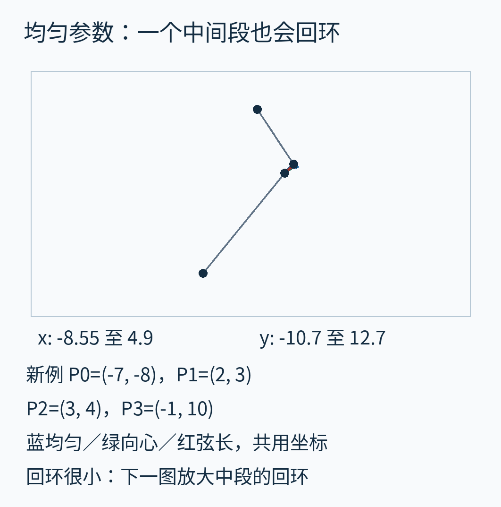

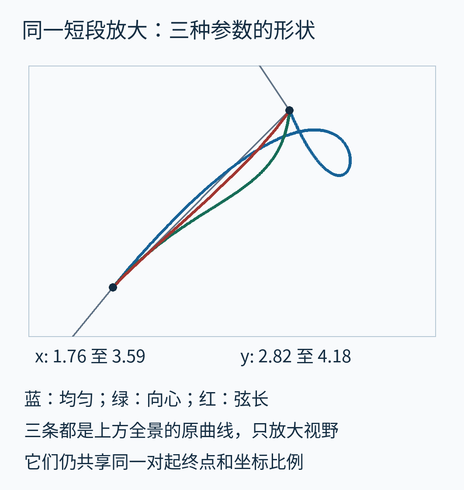

均匀曲线在 `u≈0.305038` 和 `u≈0.961629` 两次到达 `(3.056,3.88)`。这不是粗折线“看着像碰上”：程序把三次多项式的两个不同参数相等作为方程求解，再将两参数代回原式，位置差小于 `10⁻¹⁴`。

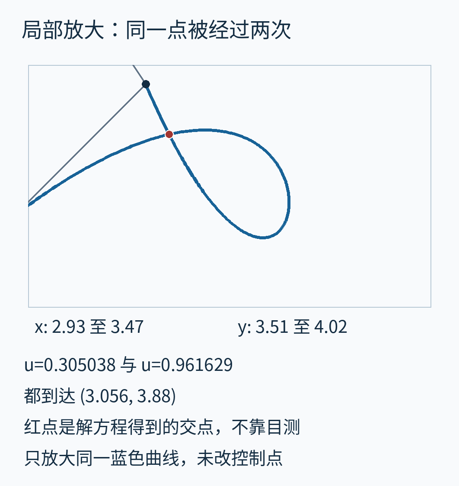

Yuksel、Schaefer、Keyser 证明：在上述按距离幂分配结点、α 在 0 到 1 的三次 Catmull–Rom 参数族中，向心参数化具有**不产生单段内部尖点或自交**的保证。这个范围限定很关键：它不是任意次数样条的保证，也不是所有路径都安全的保证；相邻重复点导致的零间隔必须先处理。[一手论文与作者说明](https://www.cemyuksel.com/research/catmullrom_param/)

下面把常被混淆的三件事分开。

**不产生段内回环，不等于坐标不会越界。** 换用 `(0,0)、(1,1)、(2,1)、(3,0)`，四点 y 都在 0 到 1 之间，向心曲线中段却在 u=0.5 达到 `y≈1.096028`。对高度、透明度、音量等有硬范围的值，这一点尤其重要。

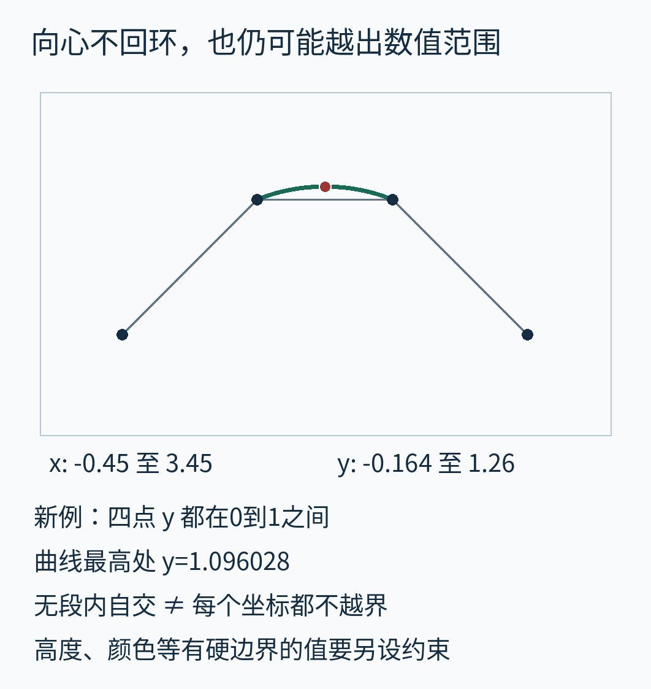

**每段内部不自交，不等于不同段不会互相穿过。** 下图新路径依次经过 `(-3,-2)、(-2,-1)、(2,1)、(-2,1)、(2,-1)、(3,-2)`，全用向心参数，第二段与第四段仍在约 `(0,−0.037579)` 相交。程序以两个不同段的参数求解这个交点；“它们各自没有小回环”并不会阻止整条路线交叉。

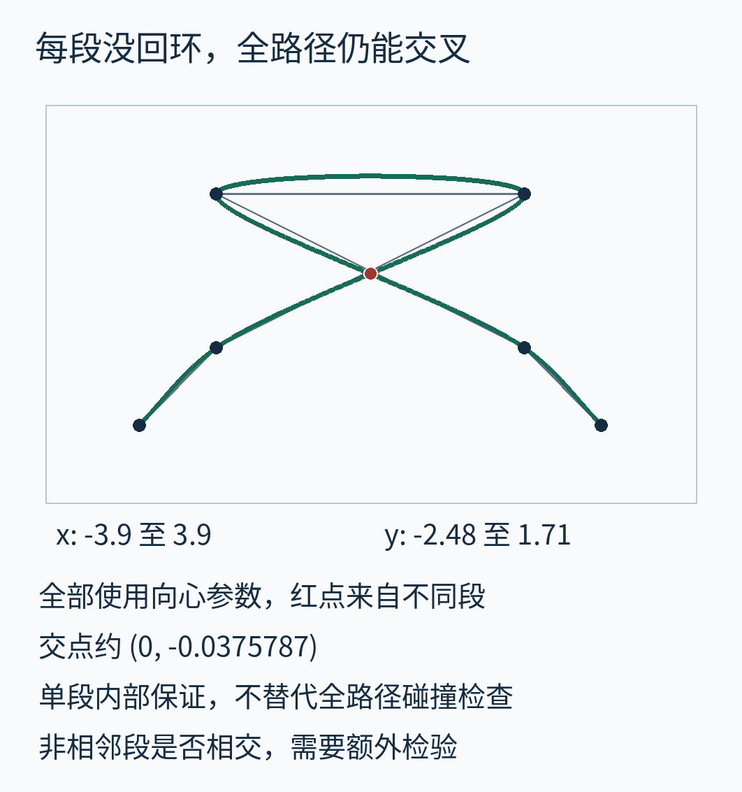

**段内部没有尖点，也不排除端点零导数。** 例如相邻三个点 `(0,0)→(1,0)→(0,0)`，每一对邻点都不重合，但走向完全反转，向心规则在中间点算出零导数。若拿它控制运动，就有瞬时速度为零的退化情况。

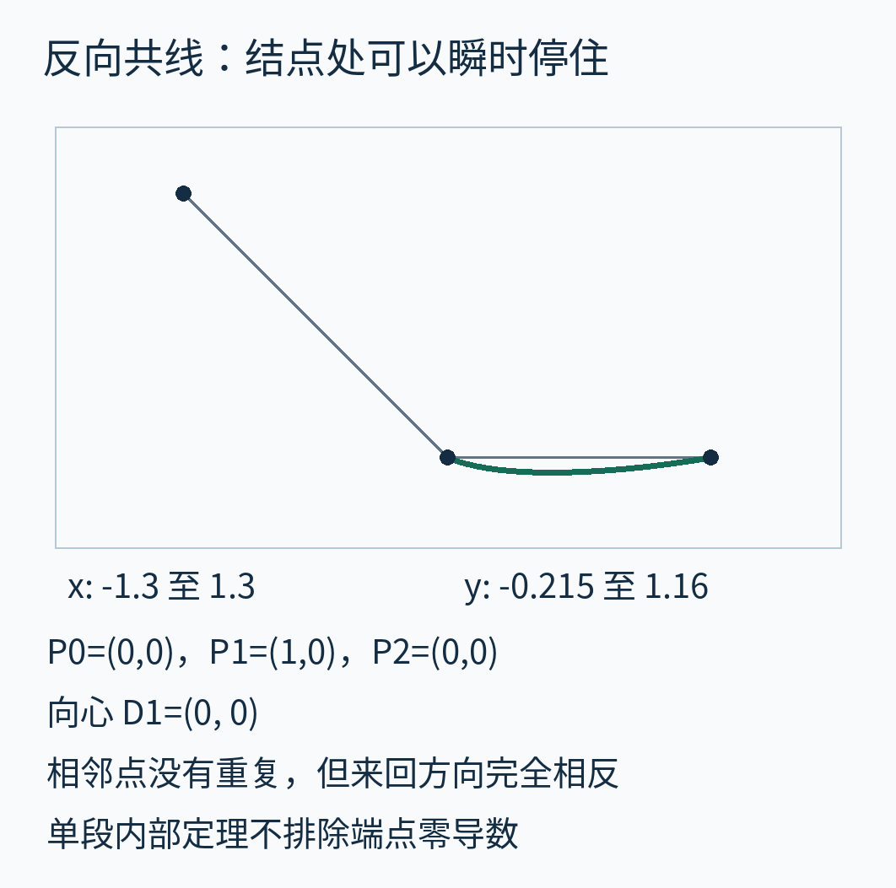

原论文还讨论了距离界、相邻段角度以及不同段的界盒条件。这里没有实现那套完整的全局无交约束，也不把“向心”当碰撞检测的替代品。若路线用于运动规划，仍要另外检查物体尺寸、障碍物和运动限制。

## 两端缺点、点重复时，规则要说清楚

内部段有前后邻居，开放曲线的首尾却各少一个。一个简洁的边界政策是**线性外推虚拟点**：

```text
虚拟前点 = 2×首点 − 次点
虚拟后点 = 2×末点 − 前一点
```

虚拟点参与算切线，但不添加到必须走过的位置序列。本文整条曲线示例使用这个政策；首点 `(0,0)`、次点 `(1,2)` 之前就补出 `(-1,-2)`。

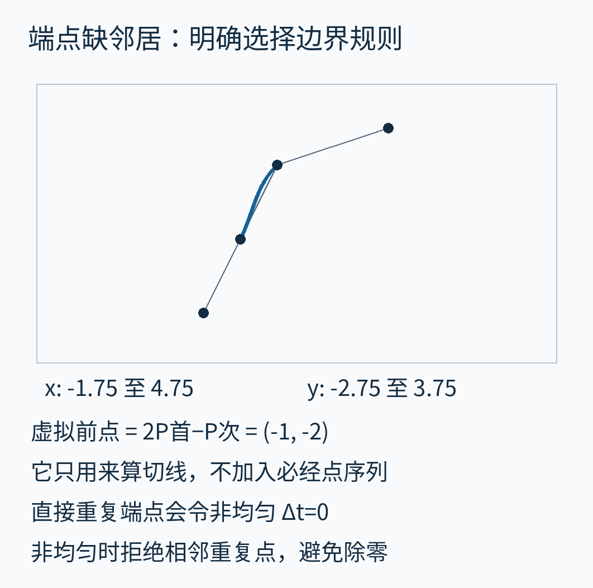

这不是唯一的端点规则。也可以由用户指定端点方向，或为闭合曲线使用环绕邻居，但必须与应用需求一致。一个常见陷阱是直接重复首尾点：在均匀参数下不会让结点间隔变成 0；在本文的非均匀规则下，相邻距离为 0，就会出现除零。

附带实现对非均匀的相邻重复点明确抛出异常。它没有偷偷插入某个固定小数来掩盖问题。工程应用若选择合并重复点，需要承认这改变了输入序列；若重复点表示“在这里停两秒”，应把停留作为独立的时间安排，不靠零长度几何段碰运气。近重复点还涉及浮点精度和坐标尺度，本文没有提供通用的生产级容差政策。

## 曲线平滑了，镜头为什么还会忽快忽慢？

如果每帧固定增加 0.1 的 u，得到的相邻位置不一定等距。主例中十个步长的直线距离从约 0.2740 到 0.3651；同样的帧间隔里，物体走出的距离不同，速度自然变化。

一种常用做法是先建立近似弧长表：沿曲线密集采样，累加相邻采样点距离，得到“参数 u 对应累计走过多远”的表。想走到某个累计路程，就反过来查对应的 u，再用原曲线公式求位置。

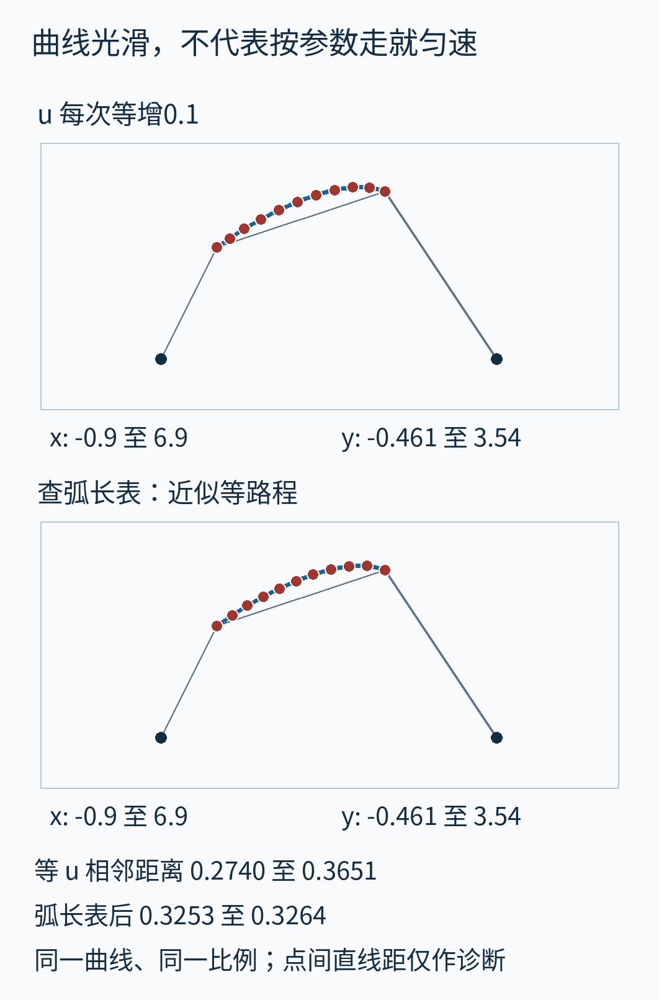

本文用 4001 个采样点构成折线近似，再反查十个等路程间隔。得到的相邻**直线弦长**约为 0.3253 到 0.3264，比直接等增 u 接近，但不会严格相等：等曲线弧长不等于等两点间直线距离，弧长表本身也有离散误差。

这一步改变的是“沿曲线怎样走”，不改变几何曲线本身。即便速度大小安排得更均匀，曲率变化仍会影响加速度；若用于机械臂、车辆或舒适镜头运动，还需要针对实际约束设计时间规律。对于原本带真实时间戳的数据，应尊重时间轴，不能随意把秒和位置、角度混进同一个欧氏距离，再声称保留了原始时序。

## 运行这份模型，再改一个输入

[示例代码与运行说明](examples/README.md)提供三种参数化、Hermite 求值、独立递归求值、贝塞尔转换、边界处理及上述反例。下面是本文教学查看器的真实浏览器截图：滑块改变 u，下拉框改变参数化，后端重新计算位置；它不是任何商业软件的界面。

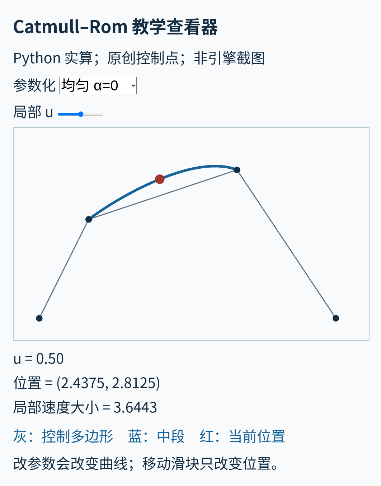

可以先把 P3 从 `(6,0)` 改成 `(6,3)`：在均匀规则下，m1 不变，而 m2 从 `(2.5,−1)` 变成 `(2.5,0.5)`。不用猜整条曲线，你已经能预测它到达 P2 时不再向下。随后运行程序，看中段的形状和 u=0.5 的位置怎样变化。

附带测试核验了端点插值、递归与 Hermite 求值一致、贝塞尔表示一致、导数有限差分、全局参数下拼接导数、重复点异常以及三个不同的边界反例。测试使用公开固定输入和种子；图中曲线、点、导数与读数来自同一份计算结果。它们说明这份教学实现做了什么，不代表任何引擎、硬件或所有可能输入的性能保证。

当你下一次用几个点安排路线时，可以分开作三个决定：哪些位置必须经过，怎样选择结点与边界导数，以及按什么时间规律沿曲线移动。Catmull–Rom 自动解决了其中很有用的一部分，而这些边界决定它能否满足你的具体任务。

---

正文与原创图采用 CC BY 4.0；示例代码及自产数值数据采用 CC0。一手文献、素材范围、逐图职责、访问限制与 AI 辅助说明见 [sources.md](sources.md)。
